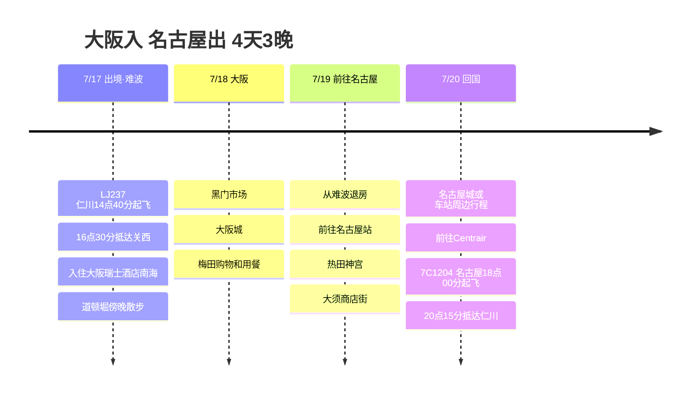

# 大阪入 名古屋出 4天3晚旅行计划

7月中旬，从大阪入境、从名古屋出境的4天3晚行程。前2晚住在大阪瑞士酒店南海，轻松使用难波一带，最后一天转移到名古屋，缩短回国的动线。

## 旅行概览

- 时间：2026年7月17日 ~ 20日
- 航班：LJ237 仁川 → 关西，7C1204 名古屋 → 仁川
- 住宿：大阪瑞士酒店南海2晚，名古屋站附近1晚候选
- 路线：关西机场 → 难波/大阪 → 名古屋 → 中部国际机场

## 行程概要

| 日期 | 地区 | 主要行程 |
|------|------|----------|
| 7/17 | 仁川、关西、大阪 | 乘LJ237出境，抵达KIX，前往难波，入住瑞士酒店，在道顿堀吃晚餐 |
| 7/18 | 大阪 | 黑门市场、大阪城、梅田购物和晚餐 |
| 7/19 | 大阪、名古屋 | 从难波退房，前往名古屋，热田神宫，大须商店街 |
| 7/20 | 名古屋、仁川 | 名古屋城或车站周边行程，前往Centrair，乘7C1204回国 |

## 行程时间线

## 7/17 - 抵达大阪，适应难波

LJ237是下午起飞，所以第一天不勉强，就当作进入大阪的一天。抵达关西机场后，乘南海电铁直达难波，入住大阪瑞士酒店南海。

酒店与难波站直接相连，第一天晚上只在道顿堀和心斋桥周边走走就足够了。即使很晚抵达也能减少移动，这是这家酒店最大的优点。

## 7/18 - 大阪市区一日

第二天不把大阪安排得太分散，以市区为中心。早上从黑门市场开始，中午前往大阪城游览代表性路线。

下午转到梅田，把商场、咖啡馆和晚餐安排在一起。回难波酒店很方便，行李和购物的负担也小。

## 7/19 - 前往名古屋

第三天是从大阪前往名古屋的日子。乘新干线很快，想省钱的话近铁特急系列也是候选。最后一晚住在名古屋站附近，第二天去机场会很方便。

抵达名古屋后，轻松地把热田神宫和大须商店街安排在一起游览。晚餐很适合吃鳗鱼饭（日式鳗鱼三吃）或味噌猪排等名古屋特色美食。

## 7/20 - 从名古屋回国

最后一天上午安排名古屋城或车站周边购物，下午前往中部国际机场Centrair。7C1204是傍晚起飞，所以最后一天也不用太赶。
