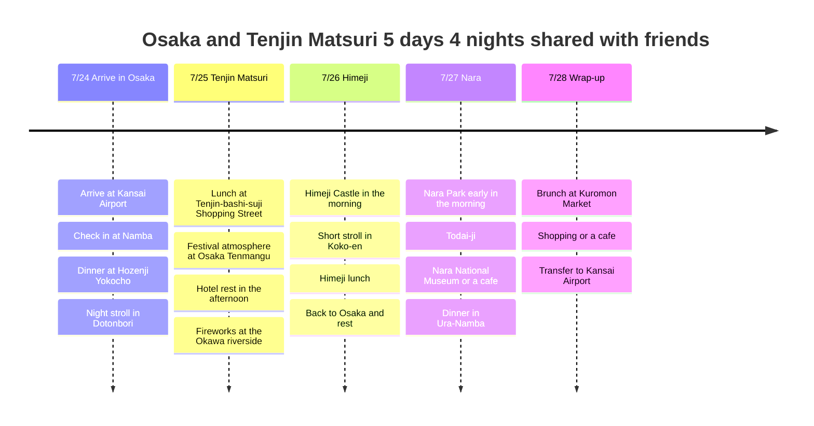

# Osaka and Tenjin Matsuri: A 5-Day, 4-Night Itinerary to Share with Friends

An itinerary to share with friends that brings festival and fireworks excitement to Osaka in July, skips the theme parks and eases the burden of the heat. The key points are the Tenjin Matsuri fireworks on 7/25, Himeji Castle on 7/26 and Nara Deer Park on 7/27.

## Trip Overview

- Dates: July 24 to 28, 2026
- Nature: A hidden itinerary shared with friends
- Lodging base: Namba or Umeda as candidates
- Highlights: Tenjin Matsuri fireworks, Himeji Castle, Nara Deer Park, Osaka food
- Heat strategy: Outdoors in the morning and at night; afternoons in cafes, shopping streets and hotel rests
- Flights: Not confirmed; only airport transfer reference points are shown

## Itinerary Summary

| Date | Area | Main Plans |
|------|------|----------|
| 7/24 | Kansai, Namba | Arrive at KIX, check in at Namba, dinner at Hozenji Yokocho and Dotonbori |
| 7/25 | Osaka Tenmangu, Okawa | Lunch at Tenjin-bashi-suji, afternoon rest, Tenjin Matsuri fireworks and riverside festival |
| 7/26 | Himeji | Himeji Castle in the morning, a short Koko-en visit, Himeji food, then back to Osaka |
| 7/27 | Nara, Osaka | Nara Park and Todai-ji early in the morning, museum or cafe in the afternoon, dinner in Ura-Namba |
| 7/28 | Namba, Kansai | Brunch at Kuromon Market, shopping or a cafe, transfer to KIX |

## Itinerary Timeline

## 7/24 - Arrive in Namba and start with food

On the first day, do not overextend, given the travel fatigue. After getting from Kansai Airport to your lodging in Namba or Umeda, start lightly at Hozenji Yokocho or Ura-Namba for dinner.

Treat Dotonbori as just a first-night look at the atmosphere. July nights can be humid too, so rather than a plan with a lot of walking, it is better to see the Glico sign and the riverside briefly after dinner and head back to your lodging.

## 7/25 - Tenjin Matsuri and fireworks

The highlight of this itinerary. Tenjin Matsuri, held on July 24 and 25, is Osaka's signature summer festival, so the plan centers on the fireworks on the evening of the 25th and the Okawa riverside atmosphere.

During the day, use covered routes like Tenjin-bashi-suji Shopping Street and just take in the atmosphere at Osaka Tenmangu briefly. Be sure to retreat to a hotel or cafe to rest at midday, and head to the Okawa riverside in the evening.

The fireworks are beautiful but crowded. Recheck the exact viewing spots and traffic restrictions once the official 2026 announcements come out, and it is best to share it with friends as "a plan to go early, or, if it is too crowded, just take in the atmosphere from a distance and leave."

## 7/26 - Himeji Castle in the morning only

Osaka Castle is nice too, but for something different, Himeji Castle is a much stronger card. However, in July the inside of Himeji Castle has no air conditioning, elevators or escalators and has many stairs, so aim to enter at 9 AM.

After Himeji Castle, if you have the energy, take a short look at Koko-en, and plan lunch around local food like anago meshi or Himeji oden. Rather than holding out until late afternoon, it is better to return to Osaka and rest, which keeps the Nara plans on track for the next day.

## 7/27 - Nara Deer Park early in the morning

If you like the deer park, be sure to include Nara. But since you dislike heat, it is best to leave Osaka early, see Nara Park and Todai-ji in the morning, and move indoors or to a cafe after noon.

The deer are cute, but they are wild animals, so lingering with food or teasing them can cause stress and accidents. It is easier to give deer senbei briefly and take photos in the shade at a distance.

In the afternoon, escape the heat at the Nara National Museum or a shopping-street cafe, then return to Osaka in the evening and have your last-night dinner in Ura-Namba.

## 7/28 - Brunch and flying home

On the last day, depending on your flight time, only fit in brunch at Kuromon Market or some shopping in Namba. In July, moving around for long with luggage quickly gets tiring, so first work out luggage storage after checkout and the airport transfer time.

If your flight home is early, boldly skip Kuromon Market and go straight to the airport. If it departs late, it is better to pick one cafe and wrap up at a relaxed pace.

## Reference Links

- [Tenjin Matsuri](https://en.wikipedia.org/wiki/Tenjin_Matsuri)
- [Himeji Castle Official Website](https://www.himejicastle.jp/en/)
- [Nara Park - Nara Travelers Guide](https://visitnara.jp/destinations/area/nara-park/)
- [Dotonbori - OSAKA INFO](https://osaka-info.jp/en/spot/dotonbori/)
