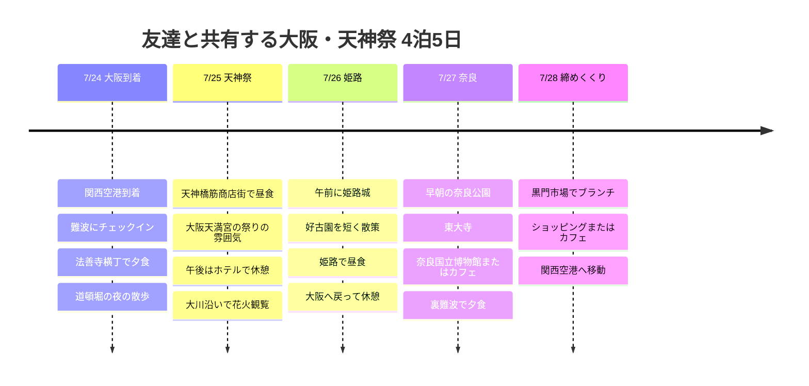

# 友達と共有する大阪・天神祭 4泊5日の旅程

7月の大阪で、祭りと花火ならではの楽しさを取り入れつつ、遊園地は外して暑さの負担を減らした友達共有用の旅程です。ポイントは、7/25の天神祭の花火、7/26の姫路城、7/27の奈良の鹿公園です。

## 旅行概要

- 期間: 2026年7月24日 〜 28日
- 性格: 友達共有用の非公開旅程
- 宿のベース: 難波または梅田が候補
- ポイント: 天神祭の花火、姫路城、奈良の鹿公園、大阪グルメ
- 暑さ対策: 屋外は午前と夜、午後はカフェ・商店街・ホテルで休憩
- 航空便: 未確定、空港への移動の基準点のみ表示

## 旅程の概要

| 日付 | エリア | 主なスケジュール |
|------|------|----------|
| 7/24 | 関西、難波 | KIX到着、難波にチェックイン、法善寺横丁と道頓堀で夕食 |
| 7/25 | 大阪天満宮、大川 | 天神橋筋で昼食、午後は休憩、天神祭の花火と川沿いの祭り |
| 7/26 | 姫路 | 午前に姫路城、好古園は短く、姫路グルメのあと大阪へ戻る |
| 7/27 | 奈良、大阪 | 早朝に奈良公園と東大寺、午後は博物館またはカフェ、裏難波で夕食 |
| 7/28 | 難波、関西 | 黒門市場でブランチ、ショッピングまたはカフェ、KIXへ移動 |

## 旅程タイムライン

## 7/24 - 難波に入り、グルメでスタート

初日は移動の疲れを考えて、予定を広げすぎません。関西空港から難波や梅田の宿に入ったあと、夕食は法善寺横丁や裏難波で軽く始めます。

道頓堀は、初日の夜の雰囲気を確認する程度にとどめます。7月は夜も蒸し暑いので、長く歩く計画よりも、食事のあとにグリコサインと川沿いを短く見て宿に戻るのがおすすめです。

## 7/25 - 天神祭と花火

この旅程のハイライト。天神祭は7月24日と25日に開かれる大阪を代表する夏祭りなので、25日夜の花火と大川沿いの雰囲気を中心に据えます。

昼は天神橋筋商店街のように屋根のある動線を使い、大阪天満宮は短く雰囲気だけ見ます。日中は必ずホテルかカフェに避難して休み、夕方に大川沿いへ移動します。

花火はきれいですが人がとても多いです。正確な観覧ポイントと交通規制は、2026年の公式案内が出たら改めて確認し、友達には「早めに行く、混みすぎていたら遠くから雰囲気だけ見て引き上げるプラン」として共有するのがよいでしょう。

## 7/26 - 姫路城は朝だけ

大阪城もいいですが、ひと味違う旅にするなら姫路城のほうがずっと強力な一手です。ただし7月の姫路城は、城内に冷房もエレベーターもエスカレーターもなく階段も多いので、午前9時の入場を目標にします。

姫路城のあと、体力に余裕があれば好古園を短く見て、昼食は穴子めしや姫路おでんなどのご当地グルメにします。午後遅くまで粘らず、大阪に戻って休んだほうが、翌日の奈良の予定が生きてきます。

## 7/27 - 奈良の鹿公園は早朝

鹿公園が好きなら、奈良はぜひ入れましょう。ただし暑さが苦手という条件があるので、大阪を早く出発して午前に奈良公園と東大寺を見て、正午以降は屋内かカフェに避難する流れがおすすめです。

鹿はかわいいですが野生動物なので、えさを持って長く引きつけたりからかったりすると、ストレスや事故につながる恐れがあります。鹿せんべいは短く与え、写真は日陰で距離をとって撮るのが楽です。

午後は奈良国立博物館や商店街のカフェで暑さを避けたあと、夕方は大阪に戻り、裏難波で最後の夜の食事をとります。

## 7/28 - ブランチと帰国

最終日は飛行機の時間に合わせて、黒門市場のブランチか難波でのショッピング程度にとどめます。7月は荷物を持って長く動くと急に疲れるので、チェックアウト後の荷物預けと空港への移動時間を先に計算します。

帰国便が早い時間なら、黒門市場は思い切って外して、そのまま空港へ向かいます。出発が遅ければ、カフェを1軒決めておいて、ゆったり締めくくるのがよいでしょう。

## 参考リンク

- [天神祭](https://en.wikipedia.org/wiki/Tenjin_Matsuri)
- [姫路城公式ホームページ](https://www.himejicastle.jp/en/)
- [奈良公園 - Nara Travelers Guide](https://visitnara.jp/destinations/area/nara-park/)
- [道頓堀 - OSAKA INFO](https://osaka-info.jp/en/spot/dotonbori/)
