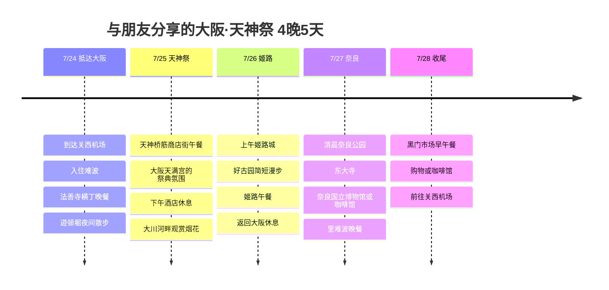

# 与朋友分享的大阪·天神祭 4晚5天行程

在7月的大阪加入祭典和烟花的独特体验，同时去掉游乐园、减轻暑热负担的朋友分享行程。重点是7/25天神祭烟花、7/26姬路城、7/27奈良鹿公园。

## 旅行概览

- 时间: 2026年7月24日 ～ 28日
- 性质: 朋友分享用的隐藏行程
- 住宿据点: 候选为难波或梅田
- 重点: 天神祭烟花、姬路城、奈良鹿公园、大阪美食
- 防暑策略: 户外安排在上午和夜晚，下午在咖啡馆、商店街或酒店休息
- 航班: 未确定，仅标出前往机场的基准点

## 行程概要

| 日期 | 地区 | 主要行程 |
|------|------|----------|
| 7/24 | 关西、难波 | 到达KIX，入住难波，在法善寺横丁和道顿堀吃晚饭 |
| 7/25 | 大阪天满宫、大川 | 天神桥筋吃午饭，下午休息，天神祭烟花和河畔祭典 |
| 7/26 | 姬路 | 上午姬路城，好古园简单逛逛，品尝姬路美食后返回大阪 |
| 7/27 | 奈良、大阪 | 清晨奈良公园和东大寺，下午博物馆或咖啡馆，晚上在里难波用餐 |
| 7/28 | 难波、关西 | 黑门市场早午餐，购物或咖啡馆，前往KIX |

## 行程时间线

## 7/24 - 抵达难波，以美食开场

第一天考虑到旅途疲劳，不安排太满。从关西机场到难波或梅田的住处后，晚餐在法善寺横丁或里难波一带轻松开始。

道顿堀只在第一天晚上感受一下氛围。7月的夜晚也可能很闷热，与其安排长时间步行，不如饭后简单看看格力高广告牌和河畔，然后回住处。

## 7/25 - 天神祭与烟花

这次行程的最大亮点。天神祭于7月24日和25日举行，是大阪具有代表性的夏季祭典，所以以25日晚上的烟花和大川河畔的氛围为中心。

白天走商店街这类有顶棚的路线，大阪天满宫只短暂感受一下气氛。正午一定要躲进酒店或咖啡馆休息，傍晚再前往大川河畔。

烟花很美，但人也很多。具体的观赏地点和交通管制，等2026年官方公告发布后再确认，建议对朋友这样分享这个方案：“早点去，如果太拥挤就在远处感受一下气氛然后撤”。

## 7/26 - 姬路城只在早上去

大阪城也不错，但想玩点不一样的，姬路城是更有分量的一张牌。不过7月的姬路城内部没有空调、电梯和扶梯，楼梯也多，所以目标是上午9点入场。

游览姬路城之后，如果体力还行，就简单逛逛好古园，午饭吃星鳗饭或姬路关东煮这样的当地美食。不要硬撑到下午很晚，回大阪休息，才能让第二天的奈良行程更精彩。

## 7/27 - 奈良鹿公园要趁清晨

如果喜欢鹿公园，奈良一定要安排。不过有怕热这个条件，所以从大阪早点出发，上午逛奈良公园和东大寺，中午以后躲到室内或咖啡馆比较好。

鹿虽然可爱，但毕竟是野生动物，拿着食物长时间逗弄或戏弄它们，可能造成压力和意外。鹿仙贝要短时间喂完，拍照时在阴凉处并保持距离会更轻松。

下午在奈良国立博物馆或商店街的咖啡馆避暑，傍晚回到大阪，在里难波享用最后一晚的晚餐。

## 7/28 - 早午餐与回国

最后一天根据航班时间，只安排黑门市场的早午餐或难波购物。7月带着行李长时间活动会迅速疲惫，所以要先计算好退房后寄存行李和前往机场的时间。

如果回国航班很早，就果断去掉黑门市场，直接前往机场。如果起飞较晚，先选好一家咖啡馆，悠闲地收尾比较好。

## 参考链接

- [天神祭](https://en.wikipedia.org/wiki/Tenjin_Matsuri)
- [姬路城官方网站](https://www.himejicastle.jp/en/)
- [奈良公园 - Nara Travelers Guide](https://visitnara.jp/destinations/area/nara-park/)
- [道顿堀 - OSAKA INFO](https://osaka-info.jp/en/spot/dotonbori/)
