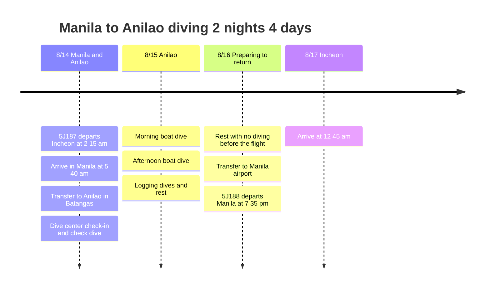

# Manila to Anilao Diving Trip Plan, 2 Nights 4 Days

Fly 5J187 into Manila in the early hours of August 14, then make a short diving trip based at an Anilao dive center in Batangas. The return is tentatively set on 5J188, leaving Manila on the night of August 16 and arriving at Incheon in the early hours of August 17.

## Trip Overview

- Period: August 14 to 17, 2026
- Flights: 5J187 Incheon → Manila, 5J188 Manila → Incheon
- Base: Anilao Dive Center
- Highlights: Manila airport pickup, transfer to Anilao, check dive, boat dives, rest before the flight

## Itinerary Summary

| Date | Area | Main plans |
|------|------|----------|
| 8/14 | Incheon, Manila, Anilao | Early-morning departure on 5J187, arrive in Manila, transfer to Batangas, check in at the dive center, check dive |
| 8/15 | Anilao | Morning and afternoon boat dives, logging dives, relaxing by the coast |
| 8/16 | Anilao, Manila | Rest with no diving before the flight, transfer to Manila, wait at the airport, depart on 5J188 |
| 8/17 | Incheon | Arrive at Incheon at 00:45 |

## Itinerary Timeline

## 8/14 - Arriving in Manila and Heading to Anilao

5J187 departs in the early hours, so it is fairly tiring. After arriving in Manila early in the morning, the easiest flow is to take an airport pickup to Anilao on the Mabini side of Batangas.

On the arrival day, rather than forcing in many dives, plan only check-in, gear setup, and a check dive. The transfer is long, so how well you manage your condition on the first day determines how satisfying the next day's diving will be.

## 8/15 - Anilao Boat Dives

The second day is the main diving day. Plan around morning and afternoon boat dives, and use the surface intervals for meals and logging dives. Anilao is strong in macro life and coral sites, so bring a camera or a light to record what you see.

## 8/16 - Rest Before the Flight and Return to Manila

5J188 departs at 19:35, so on the last day the plan skips diving to keep a safe interval before flying. Spend the morning packing and resting, then move to Manila and pass the time near the airport.

The return flight leaves at night and arrives at Incheon in the early hours of the next day, so it is natural to treat August 17 as the actual end date of the trip.
