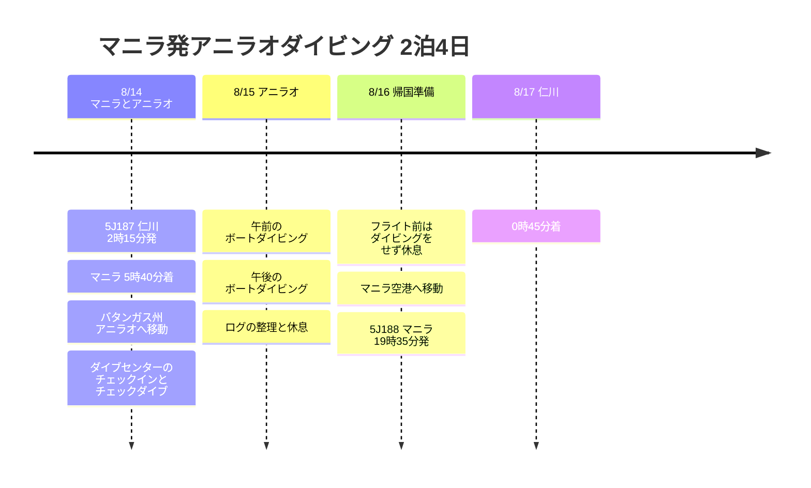

# マニラ発アニラオダイビング 2泊4日旅行プラン

8月14日早朝、5J187でマニラに入り、バタンガス州アニラオのダイブセンターを拠点に短く楽しむダイビング日程です。帰国は5J188で、8月16日の夜にマニラを出発し、8月17日の未明に仁川へ到着する想定で仮置きしました。

## 旅行の概要

- 期間: 2026年8月14日 ~ 17日
- 航空: 5J187 仁川 → マニラ、5J188 マニラ → 仁川
- 拠点: アニラオ・ダイブセンター
- ポイント: マニラ空港でのピックアップ、アニラオへの移動、チェックダイブ、ボートダイビング、フライト前の休息

## 旅程の概要

| 日付 | 地域 | 主な予定 |
|------|------|----------|
| 8/14 | 仁川、マニラ、アニラオ | 5J187で早朝出国、マニラ到着、バタンガスへ移動、ダイブセンターにチェックイン、チェックダイブ |
| 8/15 | アニラオ | 午前・午後のボートダイビング、ログの整理、海岸でひと休み |
| 8/16 | アニラオ、マニラ | フライト前はダイビングをせず休息、マニラへ移動、空港で待機、5J188で出国 |
| 8/17 | 仁川 | 0時45分に仁川到着 |

## 旅程タイムライン

## 8/14 - マニラ到着後、アニラオへ移動

5J187は早朝発なので、体力の消耗が大きめです。マニラに朝早く到着した後、空港ピックアップでバタンガス州マビニ側のアニラオまで移動する流れが最も楽です。

到着日は無理にたくさん潜るのではなく、チェックイン、器材のセッティング、チェックダイブ程度にとどめます。移動時間が長いため、初日のコンディション管理が翌日のダイビングの満足度を左右します。

## 8/15 - アニラオでボートダイビング

2日目がメインのダイビング日です。午前と午後のボートダイビングを中心に組み、水面休息の時間には食事とログの整理を入れます。アニラオはマクロ生物とサンゴのポイントが充実しているエリアなので、カメラやライトを持っていくと記録に残しやすいです。

## 8/16 - フライト前の休息とマニラへの帰還

5J188は19時35分発のため、最終日はフライト前の安全間隔を考慮してダイビングを入れない方針にします。午前は荷造りと休息にあて、その後マニラへ移動して空港の近くで時間を調整します。

復路は夜に出発して翌日の未明に仁川へ到着する構成なので、実際の旅行終了日は8月17日と考えるのが自然です。
