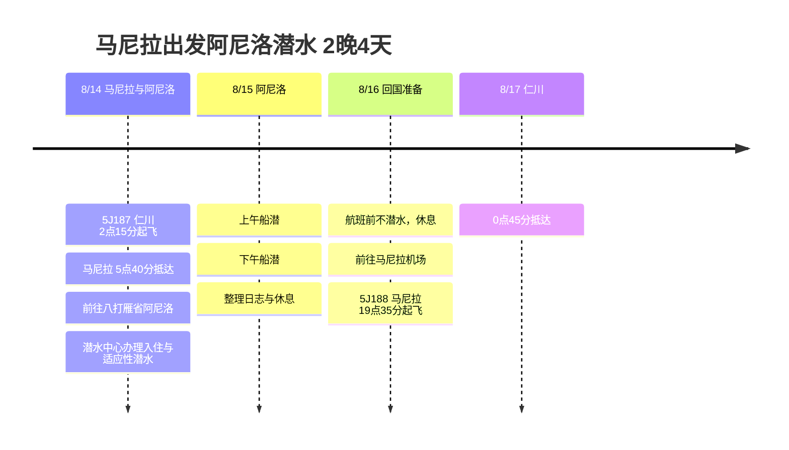

# 马尼拉出发阿尼洛潜水 2晚4天旅行计划

8月14日凌晨乘坐5J187抵达马尼拉，以八打雁省阿尼洛的潜水中心为基地，进行短途潜水行程。回程暂定乘坐5J188，8月16日夜间从马尼拉出发，8月17日凌晨抵达仁川。

## 旅行概览

- 时间：2026年8月14日 ~ 17日
- 航班：5J187 仁川 → 马尼拉，5J188 马尼拉 → 仁川
- 基地：阿尼洛潜水中心
- 重点：马尼拉机场接机、前往阿尼洛、适应性潜水、船潜、航班前休息

## 行程概要

| 日期 | 地区 | 主要行程 |
|------|------|----------|
| 8/14 | 仁川、马尼拉、阿尼洛 | 乘5J187凌晨出境，抵达马尼拉，前往八打雁，潜水中心办理入住，适应性潜水 |
| 8/15 | 阿尼洛 | 上午、下午各一次船潜，整理潜水日志，海边休息 |
| 8/16 | 阿尼洛、马尼拉 | 航班前不潜水，休息，前往马尼拉，在机场等候，乘5J188出境 |
| 8/17 | 仁川 | 0点45分抵达仁川 |

## 行程时间线

## 8/14 - 抵达马尼拉后前往阿尼洛

5J187是凌晨起飞，体力消耗比较大。清晨抵达马尼拉后，乘机场接机车前往八打雁省马比尼一带的阿尼洛，是最轻松的方式。

抵达当天不要勉强安排太多潜水，办理入住、整理装备、做一次适应性潜水就够了。由于车程较长，第一天的状态管理会决定第二天潜水的满意度。

## 8/15 - 阿尼洛船潜

第二天是主要的潜水日。以上午和下午的船潜为中心，水面休息时间安排用餐和整理潜水日志。阿尼洛是微距生物和珊瑚潜点都很出色的地区，带上相机或潜水灯会更方便记录。

## 8/16 - 航班前休息与返回马尼拉

5J188是19点35分起飞，考虑到航班前的安全间隔，最后一天不安排潜水。上午整理行李和休息，之后前往马尼拉，在机场附近调整时间。

返程是夜间出发、次日凌晨抵达仁川，所以实际的旅行结束日自然是8月17日。

