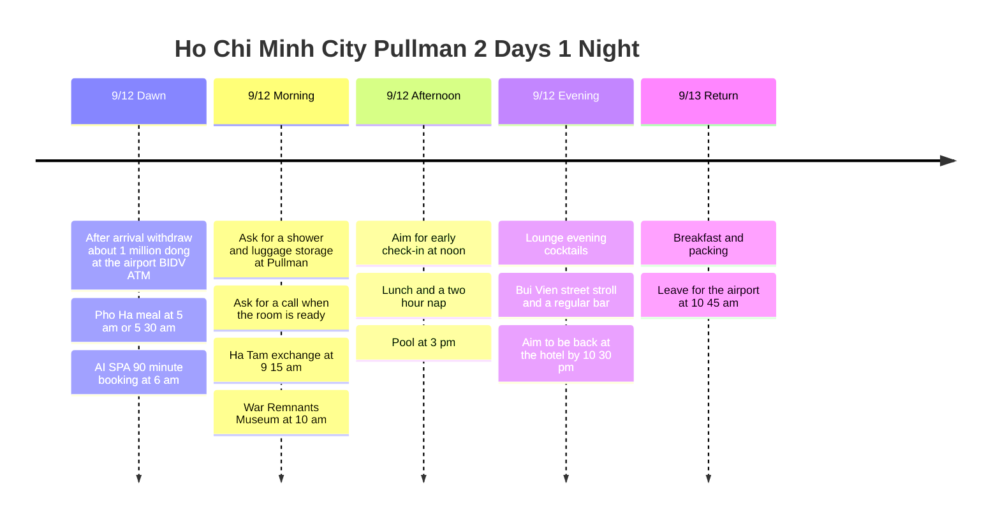

**Airport BIDV ATM for about 1 million dong → dawn meal at Pho Ha → 6 am AI SPA → shower and luggage storage at Pullman → Ha Tam exchange → War Remnants Museum → 12:00 check-in target → nap → pool → lounge happy hour** is the flow. This time, to make full use of Pullman, the post office, Nha Hang Ngon and the café apartment are removed from the default route. At night, the plan leaves time to soak up the street atmosphere at nearby Bui Vien and talk with other travelers at a regular bar.

**The confirmed booking is AI SPA on 9/12, 06:00, 90-minute course.** For Pho Ha, the hope is to eat at 05:00 or 05:30, and as an ALL Platinum member the plan is to **ask Pullman for an early check-in around 12:00 and a call when the room is ready**. Whether a shower before check-in is possible and whether a room is available at 12:00 are marked as targets until the hotel confirms.

All times are local. For flights, the public timetable was used: **9G401 Incheon 00:10 → Ho Chi Minh City 03:35 / 9G400 Ho Chi Minh City 15:25 → Incheon 22:40**. The actual booked flights and times need to be cross-checked, and with a 00:10 departure you go to Incheon Airport on **the night of Friday 9/11**. [Route timetable](https://www.aeroroutes.com/eng/260707-9gaug26kr).

## Itinerary Summary

| Date | Key route | Times to keep first |
|---|---|---|
| Fri 9/11 | Prepare to depart from Incheon Airport | For the 00:10 flight, aim to reach the airport at 21:10 |
| Sat 9/12 dawn | Immigration at the airport, about 1 million dong from the BIDV ATM → Pho Ha → AI SPA | Leave the restaurant at 05:40, **06:00-07:30 massage booking** |
| Sat 9/12 morning | Store luggage at Pullman → Ha Tam exchange → War Remnants Museum → hotel | 09:15 exchange, 10:00-11:30 museum, 12:00 check-in target |
| Sat 9/12 afternoon and evening | Lunch and nap → pool → lounge → Bui Vien and bar | Nap 13:00-15:00, pool 15:00-16:15, lounge in the 6 pm hour, Bui Vien in the 8 pm hour |
| Sun 9/13 | Optional morning swim → breakfast → checkout → airport | Checkout done by 10:30, car leaves at 10:45 |

## Itinerary Timeline

## Sat 9/12 · Dawn Meal and a 6 am Massage

| Local time | Plan | Travel and booking basis |
|---|---|---|
| 03:35-04:20 | Arrival, immigration, baggage | Based on the looked-up flight; processing time may vary |
| 04:20-04:30 target | **Withdraw about 1,000,000 VND at the airport BIDV ATM and call a car** | 5-10 minutes after immigration. UnionPay at BIDV first, compare fees for Mastercard. If late, shorten Pho Ha |
| 04:30-05:15 | Airport → Pho Ha | Allow 45 minutes for the car ride. A 05:00 meal is possible if you leave the airport earlier |
| During 05:00-05:40 | **Dawn meal at Pho Ha** | Start according to arrival time. If you arrive at 05:30, only a quick no-wait meal or takeout |
| 05:40-05:55 | Pho Ha → AI SPA | Allow 15 minutes for calling a car and the ride; do not switch to walking |
| 05:55-06:00 | Confirm the booking and get ready | Contact the booking channel if running late |
| **06:00-07:30** | **AI SPA 90-minute massage** | Time confirmed by the traveler's booking |
| 07:30-07:45 | Wrap up and gather belongings | Adjust to the actual course start time |
| 07:45-08:15 | AI SPA → Pullman | Allow 30 minutes by car |
| 08:15-09:00 | Ask for a shower, luggage storage and a check of member benefits | Ask for a call when the room is ready and say you would like to move in at 12:00 if possible |

[Pho Ha map](https://maps.app.goo.gl/nkqyTSqZkxR9cmZd6) · [AI SPA map](https://maps.app.goo.gl/T8tWoQu1C3Xrp5A1A) · [Pho Ha → AI SPA by car](https://www.google.com/maps/dir/?api=1&origin=10.7719657,106.7052281&destination=10.779081,106.705037&travelmode=driving) · [AI SPA → Pullman](https://www.google.com/maps/dir/?api=1&origin=10.779081,106.705037&destination=Pullman+Saigon+Centre&travelmode=driving).

Pho Ha is the **PHỞ HÀ, 19 Hải Triều** branch. The branch confirmed from the official introduction was linked to the traveler's map. [Pho Ha store introduction](https://phoha.com.vn/tin-tuc/pho-ha-tren-pho-an-dem-hai-trieu-co-gi-dac-biet-niu-chan-thuc-khach.html). AI SPA is at **8A/7D2 Thái Văn Lung**, and its official site states **open 24 hours**. Because it is down an alley, check the map pin together with the booking instructions. [AI SPA official information](https://www.aispa1.com/eng).

**The 6 am booking takes priority.** A 05:30 meal is hard to treat as a leisurely meal. If orders back up or you cannot leave at 05:40, switch to takeout or eating after the massage. If you cannot leave the airport by 04:45 because immigration is delayed, it is better to skip the restaurant and go straight to the spa. Arriving by 06:00 may also vary with actual road conditions, so contact the spa directly if delayed.

The hotel visit is placed after the massage to cut down on dawn round trips to the hotel. Because this order has the **condition of taking the suitcase to the restaurant and spa**, check with the spa's booking channel whether there is room to leave it. If the spa cannot store it, leave it at the hotel first, and in that case move the Pho Ha meal to after the massage to keep the booking time.

## Sat 9/12 · Nap, Pool and Lounge After the Museum

| Local time | Plan | Margin to keep |
|---|---|---|
| 09:00-09:15 | Pullman → Ha Tam exchange shop | By car, with luggage stored at the hotel |
| 09:15-09:30 | **Aim to exchange USD 100 at Ha Tam Jewelry** | Check that it is open and handling exchange that day, and the actual amount received |
| 09:30-10:00 | Ha Tam → War Remnants Museum | Includes the car and preparing for entry |
| 10:00-11:30 | **Visit the War Remnants Museum** | 90 minutes. If the exchange finishes quickly, extend the visit |
| 11:30-12:00 | Back to the hotel and check on room readiness | If a call has come, connect to retrieving luggage and check-in |
| 12:00-12:30 | **Early check-in target and unpacking** | If the room is ready. If delayed, use the alternative timetable below |
| 12:30-13:00 | Light lunch at the hotel or right nearby | Do not go back and forth to the sightseeing area again for lunch |
| 13:00-15:00 | **Room nap and rest** | Secure 2 hours of sleep after the dawn arrival |
| 15:00-16:15 | **6th-floor pool** | 75 minutes in total for swimming and poolside rest |
| 16:15-16:45 | Shower and change in the room | Do not rush out or to the lounge right after swimming |
| 16:45-17:30 | Rest in the room and check the lounge hours for the day | Match the start time the hotel gave |
| 18:00-19:30 target | **30th-floor Executive Lounge evening cocktails** | Confirm the exact hours for the day at check-in. If it starts at 17:30, move it to 17:30-19:00 |
| 19:30-20:00 | Tidy the room and a light dinner if needed | If you use the lounge until 20:00, leave 30 minutes later |
| 20:00-20:30 | Pullman → Bui Vien on foot and a street stroll | Allow 10-15 minutes from the hotel to the street, take in the main street atmosphere and the touts |
| 20:30-22:00 | **One regular bar such as Rooster Beers** | Pick a seat where you can talk with travelers; prioritize time at one place over moving around |
| 22:00-22:30 | Walk back to Pullman | If you stay longer, apply the extension plan below and skip the next morning's swim |

The War Remnants Museum is at **28 Võ Văn Tần**, open daily **07:30-17:30**, last entry **17:00**. The post office behind the museum is not added; return to the hotel and respond to the 12:00 call that the room is ready. [Official museum information](https://baotangchungtichchientranh.vn/en/visit), [Last entry notice](https://ticket.baotangchungtichchientranh.vn/terms-and-conditions.html).

### Airport ATM · BIDV and Choosing by Card

After immigration and baggage claim, **if you use UnionPay, prefer the BIDV ATM in the international arrivals area**. For Mastercard, decide using the fee comparison table below. BIDV's official ATM list has an installation record for 'Ga đến quốc tế - Sân bay Tân Sơn Nhất' (Tan Son Nhat international arrivals). However, since it is an older list, check the exact machine location and whether it is working now through the arrivals area signage. We did not include a plan to travel to another terminal to look for one. [BIDV official ATM list](https://bidv.com.vn/wps/wcm/connect/d5e0fc34-1e5c-4390-b02e-321329c595b6/Danh%2Bsach%2BATM%2BBIDV%2Bchap%2Bnhan%2Bthe%2Bquoc%2Bte.pdf?MOD=AJPERES).

The withdrawal target is **1,000,000 VND**, taking **5-10 minutes**. Check the withdrawal fee shown on the machine and your card that day, and if it is hard to use, switch to another ATM in the same arrivals area or a currency exchange counter. If delayed, push the Pho Ha meal back to keep the 6 am massage booking.

### Mastercard and UnionPay ATM Comparison · Checked 2026-09-07

This is **based on cards issued outside Vietnam, such as in Korea**. For UnionPay, **BIDV comes first**, and for Mastercard, **VPBank is the first candidate to compare**, but do not assume that such a machine is at the airport. This airport withdrawal is about 1 million dong, and do not go through another terminal or a downtown bank looking for a free ATM.

| Card brand | Bank | Local ATM fee findings | Choice for this trip |
|---|---|---|---|
| **UnionPay** | **BIDV** | **BIDV's own withdrawal fee is waived**, per the official table applied from 2026-01-06 | Use first at the airport. Check card issuer costs separately |
| **Mastercard** | **BIDV** | **4.5-5%, minimum 90,000 VND**, VAT and card issuer costs extra | Even for a 1 million dong withdrawal, the minimum of 90,000 dong plus VAT applies, so decide after checking the cost |
| **Mastercard** | **VPBank** | There are travel reviews and comparison sources for free withdrawals, but a blanket waiver for the latest foreign-issued cards could not be confirmed from an official table | Compare first if a machine is nearby. Check the actual fee on the final screen |
| Mastercard / UnionPay | **MSB** | A travel guide corrects it to paid since 2024-07-24. Exact current fees by foreign-issued card and brand are unconfirmed | **Excluded as the first choice for free withdrawal**, choose only if the on-screen fee is favorable |
| Mastercard / UnionPay | **TPBank** | There is a notice of fees, so the old free list is hard to apply as is. Latest official tables by brand are unconfirmed | Do not assume it is free; compare the on-screen fee |

**BIDV official basis:** Page 19 of the fee table for cards issued by other banks distinguishes foreign-issued Mastercard from UnionPay/DFS. Because the minimum fee is 90,000 VND, **the minimum amount takes precedence** over 1,000,000 VND × 4.5-5% = 45,000-50,000 VND. The latest table was applied instead of the minimum of 60,000 VND in 2025 material. [BIDV official 2026 fee table, page 19](https://bidv.com.vn/wps/wcm/connect/c4a4a907-713b-43fd-90ea-96b6a3ccc676/Bieu%2Bphi%2Bup%2Bweb%2B30.01.26.pdf?CVID=pMesill&MOD=AJPERES&amp%3Battachment=true&id=1763006437516).

**Level of confirmation for VPBank, MSB and TPBank:** For VPBank, a reference on free Mastercard withdrawals was used to pick it as a candidate, and it is not presented as an official policy guaranteeing free withdrawals. For MSB and TPBank, travel guide corrections about fees were referred to. Those corrections alone do not settle the current rates for every card. [VPBank comparison source](https://travel-atm-cost.jso.app/en/countries/vietnam/atms/vpbank/), [Travel guide with the MSB and TPBank fee correction](https://www.youtube.com/watch?v=mjRtjWSJOuc). **Do not interpret the "free ATM" benefit of cards issued by MSB itself as also applying to a Korean-issued Mastercard.** [MSB's own card product information](https://www.msb.com.vn/khach-hang-ca-nhan/the/msb-mastercard-platinum-fcb/).

Local ATM operating fees and the Korean card company's overseas withdrawal and brand fees are separate. For example, the Travelog guide also states that it does not cover local ATM operator fees. **Check your card's product name, brand, balance currency and fee-waiver limit** in the card app, and do not calculate that the total fee is zero just from the bank logo. [Hana Card overseas withdrawal guide](https://m.hanacard.co.kr/mobile_web/landing/travlog/a29/check.jsp).

At the airport, decide in this order: **if you have UnionPay, BIDV → if you have only Mastercard, compare the actual fees of ATMs in the same arrivals area → accept the fee and withdraw 1 million dong or exchange the cash you need**. Do not extend the search for a bank beyond 5-10 minutes, and keep the 6 am massage booking. The withdrawal amount and the fees in the table are not yet included in the expense totals; only actually incurred costs will be recorded later.

[The Naver reference post provided by the traveler](https://m.blog.naver.com/travelwoody/223614224109) could not be opened, so its tables and amounts are not cited as confirmed. The comparison above is based on separately confirmed bank materials and travel materials marked separately.

### Ha Tam Exchange · Preparing USD 100 in Cash

**Ha Tam Jewelry, 2 Nguyễn An Ninh** is next to Ben Thanh Market and is a stop before heading from Pullman to the museum. The **plan is to change USD 100 into VND at 09:15-09:30**, and it is not a record of a completed exchange. Public information says it is open daily **08:00-19:00**, but there is also conflicting information about its operating status, so when leaving luggage at the hotel in the morning, first check whether exchange is possible that day. [Address and hours information](https://antoursvietnam.com/best-places-for-money-exchange-in-ho-chi-minh-city/), [Source mentioning closure, current status unconfirmed](https://en.thevietmedia.net/hatam-jewelry-fx-rules-2026/).

Prepare one 100-dollar bill, but compare by **the final VND received including the cost of buying dollars with won**. Do not assume a 100-dollar bill is always better; first check the applied rate, fees and total to be received at the counter. Because the actual rate is not yet known, the expected VND amount is not fixed. Exchange is a currency swap, so **do not add USD 100 to the travel expense total**; record actual spending such as meals and massage afterward.

**After immigration, withdraw about 1,000,000 VND (1 million dong) at the airport ATM** and prepare it as cash for dawn Pho Ha, the massage and transport. The ATM use is placed after immigration and baggage claim with a 5-10 minute target. The massage price has not yet been provided, so it is not assumed that 1 million dong covers everything, and if it falls short, check whether the spa accepts cards. Also register the card you will use for Grab before departure. The withdrawal and the morning Ha Tam exchange amount are cash preparation records and are not double-counted in travel expenses. If an actual withdrawal fee is incurred, only the confirmed amount is recorded separately. If delayed by ATM queues or errors, push Pho Ha to after the massage and prioritize the 6 am booking. If Ha Tam is closed or does not handle exchange, ask the hotel for an open, official exchange counter nearby, and **if it is not done by 09:30, head to the museum**. Do not go looking for other exchange shops one after another and push back the 12:00 move-in and nap.

### Pool Hours

The hotel's official pool hours are **6th floor, 06:00-22:00**. The default is 15:00-16:15 on Saturday, and if you want more, extend to 16:30 and then shower. On Sunday morning, you can optionally use it once more from 06:45 to 07:30. The pool and Pool Bar have different hours, and drinks and meals are extra. [Hotel pool official information](https://www.pullman-saigon-centre.com/spa-fitness/).

### Pullman Happy Hour · Executive Lounge Basis

The place to use with the Platinum benefit is the **evening cocktails at the 30th-floor Executive Lounge**. The hotel's official page lists the lounge's overall hours of **06:00-22:30** and evening cocktails, but does not state the current exact cocktail start and end times. [Official lounge information](https://www.pullman-saigon-centre.com/restaurants-and-bars/executive-lounge/).

A past visit record gives **18:00-20:00**, so this time the goal is **to use it from 18:00 to 19:30**, keeping 17:30-20:00 free at the hotel. This is not treated as the latest confirmed opening time, and **the lounge's notice on the day takes precedence**. [Visit record of 6-8 pm evening cocktails](https://r923e.blog109.fc2.com/blog-entry-2872.html).

The **14:30-17:30 afternoon tea** on the official lounge page is **a separate product with a listed price**, so it is not assumed to be free for members. If the lounge food is not enough, have a light dinner during the walk or order separately at the hotel.

## Sat 9/12 Night · Bui Vien Stroll and a Traveler Bar

**Pullman → Bui Vien main street → Rooster Beers at 40 Bùi Viện → Pullman** are linked on foot. The Bui Vien and Pham Ngu Lao area is where foreign backpackers gather, so it was chosen as a candidate for starting a conversation about travel in English. The wish to meet Western travelers is reflected, but the nationality or proportion of a particular bar's customers that day cannot be confirmed. [Ho Chi Minh City tourism's introduction of Bui Vien](https://visithcmc.net/en/news/khu-pho-tay-bui-vien-sai-gon-song-dong-voi-pho-khong-ngu).

| Purpose | Place and how to choose | Allocation |
|---|---|---|
| Soak up the busy street and the touting atmosphere | Walk the Bui Vien main street once and look at menus of shops you like | 20-30 minutes |
| Make friends at a regular bar | Treat **Rooster Beers / Tiệm Bia Gà, 40 Bùi Viện** as the first candidate, and check for a volume where you can talk and a bar seat | 60-90 minutes |
| Finish with a quiet night view | Swap in **The View Rooftop, 195 Bùi Viện** | 45-60 minutes, no need to visit both |

Rooster's address was confirmed from the brewery's official taproom list. Before entering, see whether there are solo guests or small groups of travelers, and if it is too loud or has no seats, move to a regular pub nearby. **Choose based on whether there is a seat that is actually good for talking, rather than a guarantee that "customers of a certain nationality gather".** [Rooster official taproom](https://roosterbeverages.com/vi/tiem-bia-ga/), [Map](https://www.google.com/maps/search/?api=1&query=Rooster+Beers+40+Bui+Vien).

The View is a rooftop above the Duc Vuong Hotel, with official hours of **07:00-02:00**. It is an alternative for when you want a quiet atmosphere and a night view, and for the purpose of naturally mixing with unfamiliar travelers, choose after looking at the seating that day. [The View official information](https://ducvuonghotel.com/en/restaurant-2/).

Chatting lightly with the touting staff and looking at menus is included in the street stroll. When entering, first check only **menu prices, minimum order and extra charges**, and order drinks yourself. To start a conversation, "Hey, are you travelling here too?" or "Mind if I join you for a drink?" is enough. Continue when the other person wants to talk, and if you get along, talk about the next destination or good restaurants.

**The default is back by 22:30, and if it is fun you can extend to 23:30.** On an extended day, skip the 06:45 swim on Sunday and start with 08:00 breakfast. If tired, only stroll Bui Vien for 20-30 minutes and have one drink, then return around 21:30. Nguyen Hue is excluded from tonight's route to cut car round trips and movement between bars.

## Platinum, Luggage Storage and the Room-Ready Call

At the hotel in the 8 am hour, convey in one go: **Platinum member check → luggage storage → request to use a shower space before check-in → wish to move in at 12:00 → request a call when the room is ready**. Leave a number you can be reached on or a messenger channel that actually connects with the hotel. If a shower is not immediately available, do not delay the museum trip for long and wash after moving into the room.

Sentence to use on site:

> I'm an ALL Platinum member and I have a reservation for tonight. Could you store my luggage and let me know if I can use the shower facilities before my room is ready? If possible, I'd like to check in around noon. Please message or call me as soon as the room is ready. Could you also confirm today's Executive Lounge evening cocktail hours and my breakfast benefits?

ALL's official benefits list Platinum lounge access and breakfast in the Asia-Pacific region. **Early check-in is a benefit subject to room availability**, so 12:00 is not a guaranteed reservation. For this itinerary, the 12:00 the traveler expected is the default target, and the shower location, application of benefits and breakfast location are to be confirmed with the hotel. [ALL official member benefits](https://all.accor.com/loyalty-program/cards-status-benefits-details/index.en.shtml).

### If the Room Is Ready Late

| Actual move-in | Nap and pool adjustment | Standard to keep |
|---|---|---|
| Around 12:00 | Nap 13:00-15:00 → swim 15:00-16:15 | Default timetable |
| Around 13:00 | Lunch first → nap 13:30-15:30 → swim 15:30-16:30 | Get ready at the hotel by 17:30 after showering |
| Around 14:00 | After lunch, nap 14:15-16:15 → short swim 16:15-17:00 | Shower 17:00-17:30, lounge time takes priority |
| After 14:00 or very short on sleep | Prioritize the nap, move swimming to Sunday 06:45 | Do not force cuts to sleep, the lounge or the departure time on the return day |

If the room-ready call comes during the museum visit, there is no need to go back right away. Finish the visit and leave around 11:30, but if the hotel has set conditions for receiving the room, follow its instructions. The post office and Nha Hang Ngon are chosen only when move-in is late and you have enough energy, **in place of the lunch route after the museum**, and do not add sightseeing that delays the nap as well.

## Sun 9/13 · Optional Morning Swim and Platinum Breakfast

| Local time | Plan | Deadline basis |
|---|---|---|
| 06:45-07:30 | Optional: pool | Only if you could not swim on Saturday or want more |
| 07:30-08:00 | Shower and tidy in the room | If you returned late at night, skip swimming and sleep until the 08:00 breakfast |
| 08:00-09:00 | **Platinum breakfast** | Apply the lounge or restaurant the hotel indicated and the scope of benefits |
| 09:00-10:00 | Rest in the room and pack | No additional outings or massage |
| 10:00-10:30 | Checkout and settling the bill | Even if a late checkout benefit is possible, leave to match the flight time |
| 10:30-10:45 | Call a car and board | Check the international terminal on the booking confirmation |
| 10:45-12:15 | Hotel → airport | Allow 90 minutes for car waiting and traffic |
| 12:15-15:25 | Check-in, departure formalities, lunch and boarding | About 3 hours of margin based on the looked-up departure time |
| 15:25-22:40 | Ho Chi Minh City → Incheon | Local times at each airport, the actual ticket takes priority |

If you could not go to the museum on Saturday, you can swap **in place of Sunday's swim and relaxed breakfast: leave the hotel at 07:00 → museum 07:30-09:00 → back at the hotel at 09:30**. In that case, eat a light breakfast beforehand and keep the 10:30 checkout and 10:45 airport departure. Do not fit swimming, breakfast and the museum all into Sunday morning.

## Adjustable Time Ranges

| Segment | Adjustable range | If late or tired |
|---|---|---|
| Airport BIDV ATM | Target 5-10 minutes after immigration | Withdraw about 1 million dong. If delayed, skip the Pho Ha stop first |
| Dawn Pho Ha | 10-30 minutes, **leave the restaurant at 05:40** | If there is a queue, takeout or eat after the massage. The 6 am booking takes priority |
| AI SPA | **06:00 start, 90-minute booking fixed** | If the earlier schedule runs late, contact the booking channel |
| Hotel shower and luggage storage | 20-45 minutes | Cut the shower wait first and only ask for the room-ready call |
| Ha Tam exchange | 10-15 minutes | Target leaving at 09:30. If closed or a long wait, switch to the hotel's suggested alternative |
| War Remnants Museum | 90 minutes by default, up to 120 minutes if the exchange finishes early | Keep the 10:00-11:30 visit. If worn out, move to an early Sunday visit |
| Room nap | 2-3 hours | If you want 3 hours of sleep, cut swimming to 45-60 minutes or move it to Sunday |
| Saturday pool | 45-90 minutes | Match the actual move-in and nap end time. Leave room to end swimming by 17:00 and shower |
| Lounge | 60-120 minutes within the actual hours | The notice of the day takes priority. If you use it until 20:00, leave for Bui Vien 30 minutes later |
| Bui Vien and bar | Street 20-30 minutes + bar 45-90 minutes | Early return at 21:30 to extension until 23:30. If you return late, skip the Sunday morning swim |

Because this is a day that starts moving at dawn, **cut in this order: adding the post office or café → a second swim → a second bar visit.** If you secure one basic swim, the nap and the lounge, plenty of time remains for using the hotel.

If the return flight differs from the lookup, subtract **3 hours of airport check-in margin + 90 minutes of travel from the city** and recalculate the hotel departure target. The airline's recommended arrival time and actual traffic conditions take priority.

## Booking and Cost Notes

| Item | Confirmed details and amount |
|---|---|
| Sun PhuQuoc Airways outbound | KRW 185,600 |
| Pullman 9/12-13, 1 night | KRW 168,327 · ALL Platinum |
| AI SPA | **9/12 06:00, 90-minute booking complete**, amount not provided |
| Pho Ha | Meal planned on 9/12 at 5 am or 5:30 am |
| Airport BIDV ATM withdrawal | **About 1,000,000 VND planned**, withdrawal excluded from expense totals |
| Ha Tam exchange | **USD 100 → VND planned**, exchanged amount excluded from expense totals |
| Recorded subtotal in KRW | **KRW 353,927** |

Massage, meals, the return airfare, local transport and museum admission are not included in the total. Early check-in and a shower before check-in are things to ask the hotel for, and no message has been sent to the hotel and no additional payment has been made. Only the actual flights and baggage, spa luggage storage, the room-ready contact channel and the lounge cocktail hours of the day need to be cross-checked before departure. Itinerary last updated 2026-09-07.
