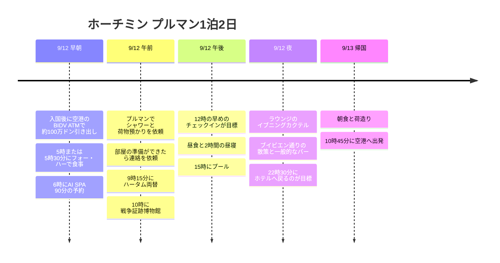

**空港のBIDV ATMで約100万ドン引き出し → フォー・ハーで早朝の食事 → 6時のAI SPA → プルマンでシャワーと荷物預かり → ハータム両替 → 戦争証跡博物館 → 12時のチェックインを目標 → 昼寝 → プール → ラウンジのハッピーアワー**という流れで動きます。今回はプルマンを十分に楽しめるよう、郵便局・ニャーハンゴン・カフェアパートメントは基本ルートから外し、夜は近くのブイビエン通りで通りの雰囲気を眺め、一般的なバーで旅行者と話す時間を残しました。

**確定している予約は9/12のAI SPA 06:00・90分コース**です。フォー・ハーは05:00または05:30の食事を希望し、プルマンはALLプラチナ会員として**12時ごろの早めのチェックインと客室準備の連絡を依頼する予定**です。チェックイン前のシャワーが使えるかどうかと12時の客室提供は、ホテルの確認が取れるまで目標として表記します。

時刻はすべて現地時間です。フライトの配置は公開時刻表の**9G401 仁川 00:10 → ホーチミン 03:35 / 9G400 ホーチミン 15:25 → 仁川 22:40**を使いました。実際の予約便・時刻は照合が必要で、00:10発なら仁川空港には**9/11(金)の夜**に向かいます。[路線時刻表](https://www.aeroroutes.com/eng/260707-9gaug26kr)。

## 旅程の概要

| 日付 | 主な動線 | 優先して守る時間 |
|---|---|---|
| 9/11 金 | 仁川空港で出国準備 | 00:10発なら21:10に空港到着が目標 |
| 9/12 土 早朝 | 空港入国・BIDV ATMで約100万ドン引き出し → フォー・ハー → AI SPA | 05:40に店を出発、**06:00〜07:30はマッサージの予約** |
| 9/12 土 午前 | プルマンで荷物預かり → ハータム両替 → 戦争証跡博物館 → ホテル | 09:15両替、10:00〜11:30博物館、12時チェックインが目標 |
| 9/12 土 午後・夜 | 昼食・昼寝 → プール → ラウンジ → ブイビエン・バー | 13〜15時昼寝、15〜16:15プール、18時台ラウンジ、20時台ブイビエン |
| 9/13 日 | 任意の朝のプール → 朝食 → チェックアウト → 空港 | 10:30チェックアウト完了・10:45に車で出発 |

## 旅程タイムライン

## 9/12 (土) · 早朝の食事と6時のマッサージ

| 現地時間 | やること | 移動・予約の基準 |
|---|---|---|
| 03:35〜04:20 | 到着・入国・手荷物 | 照会したフライト基準、処理時間は変動する可能性あり |
| 04:20〜04:30 目標 | **空港のBIDV ATMで約1,000,000 VND引き出し・配車手配** | 入国後5〜10分。ユニオンペイはBIDV優先、マスターカードは手数料を比較。遅れたらフォー・ハーは縮小 |
| 04:30〜05:15 | 空港 → フォー・ハー | 車での移動に45分。5時の食事は空港をもっと早く出られた場合に可能 |
| 05:00〜05:40のうち | **フォー・ハーで早朝の食事** | 到着時刻に合わせて開始。05:30到着なら待ち時間のない速い食事・持ち帰りのみ |
| 05:40〜05:55 | フォー・ハー → AI SPA | 配車と移動に15分、徒歩移動には変えない |
| 05:55〜06:00 | 予約確認・準備 | 遅れそうなら予約チャネルで連絡 |
| **06:00〜07:30** | **AI SPA 90分マッサージ** | ユーザーが予約確定した時間 |
| 07:30〜07:45 | 仕上げ・持ち物の整理 | 実際のコース開始時刻に応じて調整 |
| 07:45〜08:15 | AI SPA → プルマン | 車で30分 |
| 08:15〜09:00 | シャワー・荷物預かり・会員特典の確認を依頼 | 客室の準備ができたら連絡を依頼、可能なら12時の入室希望を伝える |

[フォー・ハーの地図](https://maps.app.goo.gl/nkqyTSqZkxR9cmZd6) · [AI SPAの地図](https://maps.app.goo.gl/T8tWoQu1C3Xrp5A1A) · [フォー・ハー → AI SPA 車ルート](https://www.google.com/maps/dir/?api=1&origin=10.7719657,106.7052281&destination=10.779081,106.705037&travelmode=driving) · [AI SPA → プルマン](https://www.google.com/maps/dir/?api=1&origin=10.779081,106.705037&destination=Pullman+Saigon+Centre&travelmode=driving)。

フォー・ハーは**PHỞ HÀ、19 Hải Triều**支店です。公式紹介で確認した支店とユーザーの地図を結びつけました。[フォー・ハー店舗紹介](https://phoha.com.vn/tin-tuc/pho-ha-tren-pho-an-dem-hai-trieu-co-gi-dac-biet-niu-chan-thuc-khach.html)。AI SPAは**8A/7D2 Thái Văn Lung**にあり、公式サイトでは**24時間営業**と案内されています。路地の奥にあるので、地図のピンと予約案内をあわせて確認します。[AI SPA公式案内](https://www.aispa1.com/eng)。

**6時の予約を最優先します。**05:30の食事はゆとりのある一食とは言えません。注文が混んだり05:40に出発できなかったりしたら、持ち帰りまたはマッサージのあとの食事に切り替えます。入国が遅れて04:45までに空港を出発できない場合は、店に寄らず直接スパへ向かうほうがよいでしょう。実際の道路状況によって6時の到着も変わりうるので、遅れたらスパに直接連絡します。

ホテルへの訪問はマッサージのあとにして、早朝のホテルとの往復を減らしました。この順番には**レストランとスパにスーツケースを持っていく**という条件があるため、スパの予約チャネルで荷物を置く場所を確認します。スパでの預かりが難しければ先にホテルに預ける必要があり、その場合はフォー・ハーの食事をマッサージのあとに移して予約時間を守ります。

## 9/12 (土) · 博物館のあとの昼寝・プール・ラウンジ

| 現地時間 | やること | 確保しておく余裕 |
|---|---|---|
| 09:00〜09:15 | プルマン → ハータム両替所 | 車で移動、荷物はホテルに預ける |
| 09:15〜09:30 | **Ha Tam JewelryでUSD 100を両替する目標** | 当日の営業・取り扱いの有無と実際の受取額を確認 |
| 09:30〜10:00 | ハータム → 戦争証跡博物館 | 車と入場の準備を含む |
| 10:00〜11:30 | **戦争証跡博物館の見学** | 90分。両替が早く終われば見学時間を延ばす |
| 11:30〜12:00 | ホテルへ戻る・客室準備の確認 | 連絡があれば荷物の受け取り・チェックインにつなげる |
| 12:00〜12:30 | **早めのチェックインが目標・荷解き** | 客室の準備ができている場合。準備が遅れたら下の代替時間表を適用 |
| 12:30〜13:00 | ホテルまたはすぐ近くで軽い昼食 | 昼食のために観光エリアまで往復しない |
| 13:00〜15:00 | **客室で昼寝・休憩** | 早朝到着後の睡眠2時間を確保 |
| 15:00〜16:15 | **6階のプール** | 水泳とプールサイドでの休憩で合計75分 |
| 16:15〜16:45 | 客室でシャワー・着替え | プールのあとすぐに外出やラウンジへ急がない |
| 16:45〜17:30 | 客室で休憩・ラウンジの当日の時間を確認 | ホテルが案内した開始時間に合わせる |
| 18:00〜19:30 目標 | **30階Executive Loungeのイブニングカクテル** | 正確な当日の提供時間はチェックイン時に確認。17:30開始なら17:30〜19:00に前倒し |
| 19:30〜20:00 | 客室で整理・必要なら軽い夕食 | ラウンジを20時まで使うなら外出を30分遅らせる |
| 20:00〜20:30 | プルマン → ブイビエン 徒歩・通りの散策 | ホテルから通りまで10〜15分の余裕、メインストリートの雰囲気と客引きを見物 |
| 20:30〜22:00 | **Rooster Beersなど一般的なバー1軒** | 旅行者と話せる席を選ぶ、移動よりも1軒でじっくり過ごす時間を確保 |
| 22:00〜22:30 | 徒歩でプルマンに戻る | もっと遅くまでいるなら下の延長案を適用、翌朝のプールは省略 |

戦争証跡博物館は**28 Võ Văn Tần**にあり、毎日**07:30〜17:30**、入場締切は**17:00**です。博物館のあとの郵便局は組み込まず、ホテルに戻って12時の客室準備の連絡に対応します。[博物館公式案内](https://baotangchungtichchientranh.vn/en/visit)、[入場締切の案内](https://ticket.baotangchungtichchientranh.vn/terms-and-conditions.html)。

### 空港ATM · BIDVとカード別の選択

入国・手荷物受け取りのあと、**ユニオンペイを使うなら国際線到着エリアのBIDV ATMを優先**します。マスターカードは下の手数料比較表を見て決めます。BIDV公式のATM一覧に「Ga đến quốc tế - Sân bay Tân Sơn Nhất」(タンソンニャット空港 国際線到着)の設置記録があります。ただし過去の一覧なので、現在の正確な機器の位置と稼働状況は到着エリアの案内で確認します。別のターミナルまで移動して探す予定は入れていません。[BIDV公式ATM一覧](https://bidv.com.vn/wps/wcm/connect/d5e0fc34-1e5c-4390-b02e-321329c595b6/Danh%2Bsach%2BATM%2BBIDV%2Bchap%2Bnhan%2Bthe%2Bquoc%2Bte.pdf?MOD=AJPERES)。

引き出しの目標は**1,000,000 VND**、所要時間は**5〜10分**です。当日の機器とカードに表示される引き出し手数料を確認し、利用が難しければ同じ到着エリアの別のATMまたは両替窓口に切り替えます。遅れたらフォー・ハーの食事を後ろにずらして6時のマッサージ予約に合わせます。

### マスターカード・ユニオンペイのATM比較 · 2026-09-07確認

**韓国などベトナム国外で発行されたカードが基準**です。ユニオンペイは**BIDV優先**、マスターカードは**VPBankを先に比較する候補**としますが、空港に該当の機器があるとは想定しません。今回の空港での引き出しは約100万ドンで、無料ATMを探すために別のターミナルや市内の銀行へ寄ることはしません。

| カードブランド | 銀行 | 現地ATM手数料の確認内容 | 今回の旅行での選択 |
|---|---|---|---|
| **UnionPay ユニオンペイ** | **BIDV** | **BIDVが課す引き出し手数料は免除**、公式2026-01-06適用表 | 空港で優先利用。カード発行会社の費用は別途確認 |
| **Mastercard マスターカード** | **BIDV** | **4.5〜5%、最低90,000 VND**、VATとカード発行会社の費用は別 | 100万ドンの引き出しでも最低9万ドン+VATがかかるため、費用を確認してから選択 |
| **Mastercard マスターカード** | **VPBank** | 無料引き出しの旅行レビューや比較資料はあるが、最新の海外発行カード向け公式表で一律免除とは確認できず | 近くに機器があれば先に比較。最終画面の実際の手数料を確認 |
| Mastercard / UnionPay | **MSB** | 旅行案内に2024-07-24の有料化訂正あり。現在の海外発行カード・ブランド別の正確な料金は未確認 | **無料引き出しの第一候補から除外**、機器画面の料金が有利なときのみ選択 |
| Mastercard / UnionPay | **TPBank** | 有料化の案内があり、過去の無料リストをそのまま適用しにくい。ブランド別の最新公式表は未確認 | 無料と想定せず、画面の料金を比較 |

**BIDV公式の根拠:**他行発行カードの手数料表19ページは、海外発行のMastercardとUnionPay/DFSを区別しています。最低手数料が90,000 VNDなので、1,000,000 VND × 4.5〜5% = 45,000〜50,000 VNDよりも**最低金額が優先**されます。2025年の資料の最低60,000 VNDではなく、最新の表を適用しました。[BIDV公式2026手数料表 — 19ページ](https://bidv.com.vn/wps/wcm/connect/c4a4a907-713b-43fd-90ea-96b6a3ccc676/Bieu%2Bphi%2Bup%2Bweb%2B30.01.26.pdf?CVID=pMesill&MOD=AJPERES&amp%3Battachment=true&id=1763006437516)。

**VPBank・MSB・TPBankの確認レベル:**VPBankはマスターカードの無料引き出しの参考資料を候補選定に使いましたが、無料を保証する公式ポリシーとしては表示していません。MSBとTPBankは旅行案内の有料化訂正を参考にしました。その訂正だけですべてのカードの現在の料率を確定するわけではありません。[VPBank比較資料](https://travel-atm-cost.jso.app/en/countries/vietnam/atms/vpbank/)、[MSB・TPBankの有料化訂正がある旅行案内](https://www.youtube.com/watch?v=mjRtjWSJOuc)。**MSBが発行したカードの「ATM無料」という商品特典を、韓国発行のマスターカードにも適用されるものとは解釈しません。**[MSB自社カード商品案内](https://www.msb.com.vn/khach-hang-ca-nhan/the/msb-mastercard-platinum-fcb/)。

現地ATMの運営手数料と、韓国のカード会社の海外引き出し・ブランド手数料は別物です。たとえばトラベルログの案内も、現地ATM運営会社の手数料は対象外と明記しています。**手持ちのカードの商品名・ブランド・残高の通貨・免除の上限**をカードアプリで照合し、銀行のロゴだけを見て総手数料が0ウォンだと計算しないでください。[ハナカード海外引き出し案内](https://m.hanacard.co.kr/mobile_web/landing/travlog/a29/check.jsp)。

空港では、**ユニオンペイがあればBIDV → マスターカードだけなら同じ到着エリアのATMで実際の料金を比較 → 手数料を受け入れて100万ドンを引き出す、または必要な現金を両替**という順序で判断します。5〜10分以上は銀行探しを延ばさず、6時のマッサージ予約を維持します。引き出し額・表の手数料はまだ支出の合計に入れておらず、実際に発生した費用だけをあとで記録します。

[ユーザーが提供したNAVERの参考記事](https://m.blog.naver.com/travelwoody/223614224109)は原文の閲覧がブロックされていたため、その記事の表や金額を確認したものとしては引用していません。上の比較は、別途確認した銀行の資料と、区別して表示した旅行資料に基づいています。

### ハータム両替 · 100ドルの現金準備

**Ha Tam Jewelry、2 Nguyễn An Ninh**はベンタイン市場の隣にあり、プルマンから博物館へ向かう前に立ち寄ります。**09:15〜09:30にUSD 100をVNDに両替する計画**であり、両替完了の記録ではありません。公開されている案内では毎日**8〜19時**となっていますが、営業状況について相反する情報もあるため、午前中にホテルで荷物を預けるときに、まず当日の両替が可能かどうかを確認します。[住所・営業時間の案内](https://antoursvietnam.com/best-places-for-money-exchange-in-ho-chi-minh-city/)、[閉店に言及した資料 — 現在の状態は未確定](https://en.thevietmedia.net/hatam-jewelry-fx-rules-2026/)。

100ドル札を1枚用意しますが、**ウォン→ドルの購入費用まで含めた最終的な受取VND**で比較します。100ドル札がいつも有利だと決めつけず、窓口で適用レート・手数料・受取総額を先に確認します。実際のレートはまだ分からないため、予想VND金額は固定していません。両替は通貨の交換なので、**USD 100は旅行の支出合計に加えず**、その後の食費・マッサージなど実際に使った額を記録します。

**入国後に空港ATMで約1,000,000 VND(100万ドン)を引き出し**て、早朝のフォー・ハー・マッサージ・移動に使う現金として準備します。ATMの利用は5〜10分が目標で、入国・手荷物受け取りのあとに配置しました。マッサージの料金はまだ提供されておらず、100万ドンですべて賄えるとは決めつけず、足りなければスパでカード決済ができるか確認します。Grabで使うカードも出発前に登録しておきます。引き出し額と午前のハータム両替額は現金準備の内訳であり、旅行の支出に重複して合算しません。実際の引き出し手数料が発生したら、確認できた金額だけを別途記録します。ATMの待ち時間やエラーで遅れたら、フォー・ハーをマッサージのあとに回し、6時の予約を優先します。ハータムが閉まっていたり両替を扱っていなかったりしたら、ホテルから近い営業中の正規の両替窓口を案内してもらい、**09:30までに処理できなければ博物館へ移動**します。ほかの両替所を次々と探して、12時の入室・昼寝を押し下げないようにします。

### プールの利用時間

ホテル公式のプール営業は**6階、06:00〜22:00**です。土曜の15:00〜16:15を基本とし、もっと使いたければ16:30まで延ばしてからシャワーを浴びます。日曜の朝は任意で06:45〜07:30にもう一度利用できます。プールとPool Barの営業時間は異なり、飲み物と食事は別料金です。[ホテルのプール公式案内](https://www.pullman-saigon-centre.com/spa-fitness/)。

### プルマンのハッピーアワー · Executive Lounge基準

プラチナ特典で利用したいのは**30階Executive Loungeのイブニングカクテル**です。ホテル公式ページはラウンジ全体の営業**06:00〜22:30**とイブニングカクテルの提供を案内していますが、現在の正確なカクテルの開始・終了時間は記載していません。[ラウンジ公式案内](https://www.pullman-saigon-centre.com/restaurants-and-bars/executive-lounge/)。

過去の訪問記録では**18:00〜20:00**と紹介されているため、今回は**18:00〜19:30の利用を目標**とし、17:30〜20:00はホテルの中で空けておきます。この時間を最新の確定した営業時間とは見なさず、**当日のラウンジの案内が優先**です。[18〜20時のイブニングカクテル訪問記録](https://r923e.blog109.fc2.com/blog-entry-2872.html)。

公式ラウンジページの**14:30〜17:30のアフタヌーンティーは価格が表示された別商品**なので、会員に無料で含まれるとは決めつけません。ラウンジの食事で足りなければ、散歩のついでに軽く夕食をとるか、ホテルで別途注文します。

## 9/12 (土)の夜 · ブイビエン散策と旅行者バー

**プルマン → ブイビエンのメインストリート → 40 Bùi ViệnのRooster Beers → プルマン**と、歩いてつなぎます。ブイビエン・ファングーラオ一帯は海外のバックパッカーが集まるエリアなので、英語で旅の話を始めてみる候補として選びました。西洋人の旅行者に会いたいという好みを反映しましたが、特定のバーの当日の客の国籍や割合は確認できません。[ホーチミン市観光局のブイビエン紹介](https://visithcmc.net/en/news/khu-pho-tay-bui-vien-sai-gon-song-dong-voi-pho-khong-ngu)。

| 目的 | 場所・選び方 | 配分 |
|---|---|---|
| 繁華街・客引きの雰囲気を見物 | ブイビエンのメインストリートを一度歩いて、気に入った店のメニューを見る | 20〜30分 |
| 一般的なバーで友達づくり | **Rooster Beers / Tiệm Bia Gà、40 Bùi Viện**を第一候補とし、会話できる音量とバーカウンターの席を確認 | 60〜90分 |
| 静かな夜景で締めくくる | **The View Rooftop、195 Bùi Viện**に変更 | 45〜60分、2軒とも必ず訪れる必要はない |

Roosterの住所は、醸造所公式のタップルーム一覧で確認しました。店に入る前に、一人客や少人数の旅行者がいるかを見て、うるさすぎたり席がなかったりしたら近くの一般的なパブに移ります。**「特定の国籍の客が集まる場所」という保証よりも、実際に話しやすい席があるかどうかを基準に選びます。**[Rooster公式タップルーム](https://roosterbeverages.com/vi/tiem-bia-ga/)、[地図](https://www.google.com/maps/search/?api=1&query=Rooster+Beers+40+Bui+Vien)。

The Viewはドゥックヴオン・ホテルの上のルーフトップで、公式案内は**07:00〜02:00**です。静かな雰囲気と夜景がほしいときの代案で、知らない旅行者と自然に交わす目的なら、当日の席の配置を見て選びます。[The View公式案内](https://ducvuonghotel.com/en/restaurant-2/)。

客引きのスタッフと軽く話してメニューを見るのは、通りの散策に含めます。入店するときは**メニューの価格・最低注文・追加料金**だけ先に確認し、お酒は自分で注文します。会話を始めるには「Hey, are you travelling here too?」または「Mind if I join you for a drink?」くらいで十分です。相手が会話を望むときに続け、気が合えば次の旅行先やおいしいお店の話をします。

**基本は22:30帰着、楽しければ23:30まで延長可能**としました。延長した日は日曜06:45のプールを抜いて、8時の朝食から始めます。疲れていたら、ブイビエンを20〜30分見て一杯だけ飲み、21:30ごろに戻ります。ヌオンフエは今夜の動線から外して、車の往復とバー間の移動を減らしました。

## プラチナ・荷物預かり・客室準備の連絡

8時台にホテルで、**プラチナ会員の確認 → 荷物預かり → チェックイン前のシャワースペースの利用を依頼 → 12時の入室希望 → 客室の準備ができたら連絡を依頼**を一度に伝えます。連絡を受けられる番号、またはホテルと実際につながるメッセンジャーのチャネルを残します。シャワーがすぐに使えなければ、博物館への移動を長く遅らせず、入室してから浴びます。

現地で使う文面:

> I'm an ALL Platinum member and I have a reservation for tonight. Could you store my luggage and let me know if I can use the shower facilities before my room is ready? If possible, I'd like to check in around noon. Please message or call me as soon as the room is ready. Could you also confirm today's Executive Lounge evening cocktail hours and my breakfast benefits?

ALL公式の特典では、プラチナ会員のラウンジ利用とアジア太平洋地域の朝食が案内されています。**早めのチェックインは客室の状況次第の特典**なので、12時が保証された予約ではありません。今回の旅程はユーザーが想定した12時を基本の目標としており、シャワーの場所・特典の適用・朝食の提供場所はホテルで確認します。[ALL公式会員特典](https://all.accor.com/loyalty-program/cards-status-benefits-details/index.en.shtml)。

### 部屋の準備が遅れたら

| 実際の入室 | 昼寝・プールの調整 | 守る基準 |
|---|---|---|
| 12時ごろ | 13:00〜15:00昼寝 → 15:00〜16:15プール | 基本の時間表 |
| 13時ごろ | 先に昼食 → 13:30〜15:30昼寝 → 15:30〜16:30プール | シャワーのあと17:30までホテルで準備 |
| 14時ごろ | 昼食後14:15〜16:15昼寝 → 16:15〜17:00短めのプール | 17:00〜17:30シャワー、ラウンジの時間を優先 |
| 14時以降、または睡眠不足が大きい | 昼寝を優先、プールは日曜06:45に移す | 睡眠・ラウンジ・帰国日の出発時間を無理に削らない |

客室準備の連絡が博物館の見学中に来ても、すぐに戻る必要はありません。見学を終えて11:30ごろに出発しますが、ホテルが定めた客室受け取りの条件があれば、その案内に従います。郵便局・ニャーハンゴンは、入室が遅く体力が十分なときだけ**博物館のあとの昼食動線の代わりに**選び、観光を増やして昼寝まで遅らせることはしません。

## 9/13 (日) · 任意の朝のプールとプラチナ朝食

| 現地時間 | やること | 締切の基準 |
|---|---|---|
| 06:45〜07:30 | 任意:プール | 土曜にプールを使えなかったとき、またはもっと使いたいときのみ |
| 07:30〜08:00 | 客室でシャワー・整理 | 夜遅く戻ったならプールを抜いて8時の朝食まで寝る |
| 08:00〜09:00 | **プラチナ朝食** | ホテルが案内したラウンジ・レストランと特典の範囲を適用 |
| 09:00〜10:00 | 客室で休憩・荷造り | 追加の外出・マッサージはなし |
| 10:00〜10:30 | チェックアウト・精算 | レイトチェックアウトの特典が使えても、フライト時間に合わせて出発 |
| 10:30〜10:45 | 配車・乗車 | 予約票の国際線ターミナルを確認 |
| 10:45〜12:15 | ホテル → 空港 | 車の待機・渋滞に90分 |
| 12:15〜15:25 | 搭乗手続き・出国・昼食・搭乗 | 照会した出発時刻基準で約3時間の余裕 |
| 15:25〜22:40 | ホーチミン → 仁川 | 各空港の現地時刻、実際の航空券を優先 |

土曜に博物館へ行けなかったなら、**日曜のプール・ゆっくりした朝食の代わりに、07:00ホテル出発 → 07:30〜09:00博物館 → 09:30ホテル帰着**に変更できます。その場合は軽い朝食を先に済ませ、10:30チェックアウト・10:45空港出発は維持します。プール・朝食・博物館を日曜の午前にすべて入れることはしません。

## 時間調整の範囲

| 区間 | 調整できる範囲 | 遅れたり疲れたりしたとき |
|---|---|---|
| 空港のBIDV ATM | 入国後5〜10分が目標 | 約100万ドン引き出し。遅れたらフォー・ハーに寄るのから省略 |
| 早朝のフォー・ハー | 10〜30分、**05:40に店を出発** | 待ちがあれば持ち帰り・マッサージのあとに食事。6時の予約を優先 |
| AI SPA | **06:00開始・90分予約で固定** | 前の予定で遅れたら予約チャネルに連絡 |
| ホテルのシャワー・荷物預かり | 20〜45分 | シャワーの待ちから減らし、客室準備の連絡だけ依頼 |
| ハータム両替 | 10〜15分 | 09:30出発が目標。休業・長い待ちならホテルが案内した代替に変更 |
| 戦争証跡博物館 | 90分が基本、両替が早く終われば最大120分 | 10:00〜11:30の見学を維持。疲れたら日曜の早朝見学に移す |
| 客室の昼寝 | 2〜3時間 | 3時間寝たいならプールを45〜60分に減らすか日曜に移す |
| 土曜のプール | 45〜90分 | 実際の入室・昼寝の終了時刻に合わせる。17時のプール終了・シャワーの余裕を確保 |
| ラウンジ | 実際の提供時間のうち60〜120分 | 当日の案内を優先。20時まで利用するならブイビエン出発を30分遅らせる |
| ブイビエン・バー | 通り20〜30分 + バー45〜90分 | 21:30の早めの帰着〜23:30の延長。遅く戻ったら日曜朝のプールは省略 |

早朝から動く日なので、**郵便局・カフェの追加 → 2回目のプール → バーの2軒目という順に減らします。**基本のプール1回・昼寝・ラウンジを確保すれば、宿の利用時間を十分に残せます。

帰国便が照会結果と違う場合は、**空港での手続きの余裕3時間 + 市内の移動90分**を引いて、ホテルの出発目標を計算し直します。航空会社の推奨到着時刻と実際の交通状況が優先です。

## 予約・費用メモ

| 項目 | 確認内容・金額 |
|---|---|
| サンフーコック航空 往路 | 185,600ウォン |
| プルマン 9/12〜13、1泊 | 168,327ウォン · ALLプラチナ |
| AI SPA | **9/12 06:00・90分予約済み**、金額は未提供 |
| フォー・ハー | 9/12 5時または5時30分に食事予定 |
| 空港のBIDV ATM引き出し | **約1,000,000 VND予定**、引き出し額は支出合計から除外 |
| ハータム両替 | **USD 100 → VND予定**、両替額は支出合計から除外 |
| 記録されたウォン部分の合計 | **353,927ウォン** |

マッサージ・食費・帰国の航空運賃・現地交通・博物館の入場料は合計に含めていません。早めのチェックインとチェックイン前のシャワーはホテルに依頼する事項で、ホテルへメッセージを送ったり追加決済を進めたりしたわけではありません。実際のフライト・手荷物、スパでの荷物預かり、客室準備の連絡チャネル、当日のラウンジカクテルの時間だけを、出発前に照合します。旅程更新日 2026-09-07。
