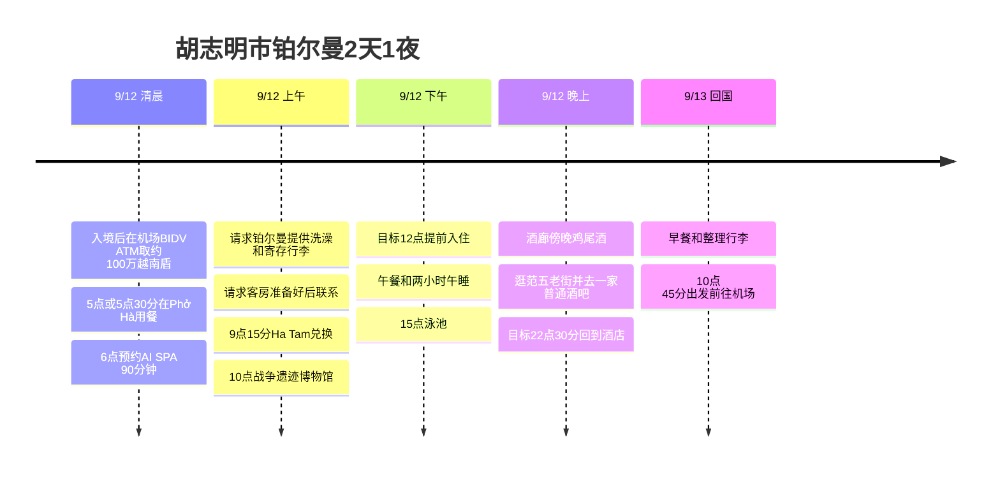

**机场BIDV ATM取约100万越南盾 → Phở Hà清晨用餐 → 6点AI SPA → 铂尔曼洗澡和寄存行李 → Ha Tam兑换 → 战争遗迹博物馆 → 目标12点入住 → 午睡 → 泳池 → 酒廊欢乐时光**,这就是行程的流向。这次为了充分享受铂尔曼,把邮局、Nhà Hàng Ngon和咖啡公寓从基本路线中去掉了,夜里则留出时间在附近的范五老街感受街头氛围,并在普通酒吧与各国旅行者聊天。

**确定的预约是9/12 AI SPA 06:00、90分钟课程。**Phở Hà希望在05:00或05:30用餐;铂尔曼方面,作为ALL白金会员,**计划请求12点左右提前入住,并请酒店在客房准备好时联系**。入住前能否洗澡、12点能否提供客房,在酒店确认之前都只标注为目标。

所有时间均为当地时间。航班安排采用公开时刻表上的**9G401 仁川 00:10 → 胡志明市 03:35 / 9G400 胡志明市 15:25 → 仁川 22:40**。实际预订的航班和时间还需核对,如果是00:10出发,则要在**9/11周五晚上**前往仁川机场。[航线时刻表](https://www.aeroroutes.com/eng/260707-9gaug26kr)。

## 行程概要

| 日期 | 核心动线 | 优先保证的时间 |
|---|---|---|
| 9/11 周五 | 在仁川机场准备出境 | 如果是00:10航班,目标21:10到达机场 |
| 9/12 周六 清晨 | 机场入境、BIDV ATM取约100万越南盾 → Phở Hà → AI SPA | 05:40离开餐厅,**06:00至07:30为按摩预约** |
| 9/12 周六 上午 | 铂尔曼寄存行李 → Ha Tam兑换 → 战争遗迹博物馆 → 酒店 | 09:15兑换,10:00至11:30博物馆,目标12点入住 |
| 9/12 周六 下午、晚上 | 午餐、午睡 → 泳池 → 酒廊 → 范五老街、酒吧 | 13至15点午睡,15至16:15泳池,18点左右酒廊,20点左右范五老街 |
| 9/13 周日 | 可选的早晨游泳 → 早餐 → 退房 → 机场 | 10:30办完退房,10:45乘车出发 |

## 行程时间线

## 9/12 (周六) · 清晨用餐与6点按摩

| 当地时间 | 要做的事 | 交通、预约基准 |
|---|---|---|
| 03:35至04:20 | 抵达、入境、领取行李 | 以查询到的航班为准,办理时间可能变动 |
| 04:20至04:30 目标 | **机场BIDV ATM取约1,000,000 VND、叫车** | 入境后5至10分钟。银联优先BIDV,万事达卡比较手续费。如果晚了就缩减Phở Hà |
| 04:30至05:15 | 机场 → Phở Hà | 乘车预留45分钟。5点用餐只有在更早离开机场时才可能 |
| 05:00至05:40之间 | **Phở Hà清晨用餐** | 根据到达时间开始。如果05:30到达,只做无需排队的快速用餐或打包 |
| 05:40至05:55 | Phở Hà → AI SPA | 叫车和移动预留15分钟,不要改成步行 |
| 05:55至06:00 | 确认预约、准备 | 如果会迟到,通过预约渠道联系 |
| **06:00至07:30** | **AI SPA 90分钟按摩** | 用户已确认预约的时间 |
| 07:30至07:45 | 收尾、整理随身物品 | 根据实际课程开始时间调整 |
| 07:45至08:15 | AI SPA → 铂尔曼 | 乘车预留30分钟 |
| 08:15至09:00 | 请求洗澡、寄存行李、确认会员福利 | 请求客房准备好后联系,并转达如果可能希望12点入住 |

[Phở Hà地图](https://maps.app.goo.gl/nkqyTSqZkxR9cmZd6) · [AI SPA地图](https://maps.app.goo.gl/T8tWoQu1C3Xrp5A1A) · [Phở Hà → AI SPA 驾车路线](https://www.google.com/maps/dir/?api=1&origin=10.7719657,106.7052281&destination=10.779081,106.705037&travelmode=driving) · [AI SPA → 铂尔曼](https://www.google.com/maps/dir/?api=1&origin=10.779081,106.705037&destination=Pullman+Saigon+Centre&travelmode=driving)。

Phở Hà是**PHỞ HÀ,Hải Triều街19号**分店。把官方介绍中确认的分店与用户的地图对应了起来。[Phở Hà门店介绍](https://phoha.com.vn/tin-tuc/pho-ha-tren-pho-an-dem-hai-trieu-co-gi-dac-biet-niu-chan-thuc-khach.html)。AI SPA位于**Thái Văn Lung 8A/7D2**,官网标明**24小时营业**。由于位于小巷内,需要同时参考地图定位和预约说明。[AI SPA官方说明](https://www.aispa1.com/eng)。

**优先保证6点的预约。**05:30用餐算不上从容的一餐。如果点餐太慢或05:40无法出发,就改为打包,或在按摩之后再吃。如果入境延误,到04:45还不能从机场出发,最好跳过餐厅直接去水疗中心。受实际路况影响,6点能否到达也会变化,迟到时直接联系水疗中心。

去酒店的行程安排在按摩之后,以减少清晨往返酒店。这个顺序有**带着行李箱去餐厅和水疗中心**的前提,所以要通过水疗中心的预约渠道确认有没有放行李的地方。如果水疗中心无法寄存,就必须先寄存到酒店,这时把Phở Hà的用餐挪到按摩之后,以守住预约时间。

## 9/12 (周六) · 博物馆之后的午睡、泳池、酒廊

| 当地时间 | 要做的事 | 保留的余裕 |
|---|---|---|
| 09:00至09:15 | 铂尔曼 → Ha Tam兑换处 | 乘车前往,行李寄存在酒店 |
| 09:15至09:30 | **目标在Ha Tam Jewelry兑换100美元** | 确认当天是否营业、是否办理兑换及实际到手金额 |
| 09:30至10:00 | Ha Tam → 战争遗迹博物馆 | 包含乘车和入场准备 |
| 10:00至11:30 | **参观战争遗迹博物馆** | 90分钟。如果兑换早点结束,就延长参观时间 |
| 11:30至12:00 | 返回酒店、确认客房准备情况 | 如果已接到联系,就衔接领取行李和办理入住 |
| 12:00至12:30 | **目标提前入住、整理行李** | 客房已准备好的情况。如果延迟,适用下面的替代时间表 |
| 12:30至13:00 | 在酒店或附近简单吃午餐 | 不要为了午餐再往返游览区 |
| 13:00至15:00 | **客房午睡、休息** | 保证清晨抵达后的2小时睡眠 |
| 15:00至16:15 | **6楼泳池** | 游泳和池畔休息合计75分钟 |
| 16:15至16:45 | 客房洗澡、换衣服 | 游泳后不要急着立刻外出或去酒廊 |
| 16:45至17:30 | 客房休息、确认酒廊当天的时间 | 配合酒店告知的开始时间 |
| 18:00至19:30 目标 | **30楼Executive Lounge傍晚鸡尾酒** | 当天确切的供应时间在入住时确认。如果17:30开始,则提前到17:30至19:00 |
| 19:30至20:00 | 整理客房、必要时简单吃晚餐 | 如果酒廊用到20点,外出推迟30分钟 |
| 20:00至20:30 | 铂尔曼 → 范五老街 步行、逛街 | 酒店到街上预留10至15分钟,观赏主街氛围和拉客场面 |
| 20:30至22:00 | **Rooster Beers等普通酒吧1家** | 选择能与旅行者聊天的位置,确保在一处停留的时间,而不是来回移动 |
| 22:00至22:30 | 步行回铂尔曼 | 如果想待得更久,适用下面的延长方案,并省去第二天早晨的游泳 |

战争遗迹博物馆位于**Võ Văn Tần 28号**,每天**07:30至17:30**,**17:00**停止入场。不再接着去博物馆后面的邮局,而是回酒店,应对12点客房准备好的联系。[博物馆官方说明](https://baotangchungtichchientranh.vn/en/visit)、[停止入场说明](https://ticket.baotangchungtichchientranh.vn/terms-and-conditions.html)。

### 机场ATM · BIDV与按卡种选择

入境并领取行李后,**如果用银联卡,优先使用国际航班到达区的BIDV ATM**。万事达卡则参考下面的手续费比较表来决定。BIDV官方ATM列表里有“Ga đến quốc tế - Sân bay Tân Sơn Nhất”(新山一机场国际航班到达)的安装记录。不过这是过去的列表,所以现在确切的机器位置和是否正常运行,要以到达区的指引为准。行程中没有安排跑到其他航站楼去找。[BIDV官方ATM列表](https://bidv.com.vn/wps/wcm/connect/d5e0fc34-1e5c-4390-b02e-321329c595b6/Danh%2Bsach%2BATM%2BBIDV%2Bchap%2Bnhan%2Bthe%2Bquoc%2Bte.pdf?MOD=AJPERES)。

取款目标是**1,000,000 VND**,用时**5至10分钟**。确认当天机器和卡上显示的取款手续费,如果难以使用,就换成同一到达区的其他ATM或兑换窗口。如果延误,就把Phở Hà的用餐往后推,以配合6点的按摩预约。

### 万事达卡·银联ATM比较 · 2026-09-07确认

**以韩国等越南以外国家发行的卡为准。**银联**优先BIDV**,万事达卡把**VPBank作为先比较的候选**,但不假设机场有这种机器。这次机场取款约100万越南盾,不会为了找免费ATM而绕到其他航站楼或市区银行。

| 卡组织 | 银行 | 当地ATM手续费确认内容 | 本次旅行的选择 |
|---|---|---|---|
| **UnionPay 银联** | **BIDV** | **免收BIDV取款手续费**,官方2026-01-06起适用的费率表 | 在机场优先使用。发卡行费用另行确认 |
| **Mastercard 万事达卡** | **BIDV** | **4.5至5%,最低90,000 VND**,增值税和发卡行费用另计 | 即使取100万越南盾也要至少收9万越南盾加增值税,确认费用后再选择 |
| **Mastercard 万事达卡** | **VPBank** | 有免费取款的旅行评价和比较资料,但没能通过最新的境外发行卡官方费率表确认一律免费 | 附近有机器就先比较。以最终画面上的实际手续费为准 |
| Mastercard / UnionPay | **MSB** | 旅行指南中有2024-07-24改为收费的更正。目前境外发行卡、各卡组织的确切费用未确认 | **从免费取款的首选中排除**,仅在机器画面显示的费用有利时才选择 |
| Mastercard / UnionPay | **TPBank** | 有改为收费的说明,很难直接套用过去的免费名单。各卡组织的最新官方费率表未确认 | 不假设免费,比较画面上的费用 |

**BIDV官方依据:**他行发行卡手续费表第19页区分了境外发行的Mastercard和UnionPay/DFS。最低手续费是90,000 VND,所以相比1,000,000 VND × 4.5至5% = 45,000至50,000 VND,**以最低金额为准**。采用了最新费率表,而不是2025年资料中的最低60,000 VND。[BIDV官方2026年费率表 — 第19页](https://bidv.com.vn/wps/wcm/connect/c4a4a907-713b-43fd-90ea-96b6a3ccc676/Bieu%2Bphi%2Bup%2Bweb%2B30.01.26.pdf?CVID=pMesill&MOD=AJPERES&amp%3Battachment=true&id=1763006437516)。

**VPBank、MSB、TPBank的确认程度:**VPBank的万事达卡免费取款参考资料只用于挑选候选,没有标示为保证免费的官方政策。MSB和TPBank参考了旅行指南中改为收费的更正。仅凭这一更正并不能确定所有卡目前的费率。[VPBank比较资料](https://travel-atm-cost.jso.app/en/countries/vietnam/atms/vpbank/)、[有MSB、TPBank收费更正的旅行指南](https://www.youtube.com/watch?v=mjRtjWSJOuc)。**不把MSB自家发行卡的“ATM免费”产品福利理解为同样适用于韩国发行的万事达卡。**[MSB自家信用卡产品说明](https://www.msb.com.vn/khach-hang-ca-nhan/the/msb-mastercard-platinum-fcb/)。

当地ATM运营手续费与韩国发卡公司的境外取款、卡组织手续费是两回事。例如Travelog的说明也明确不补贴当地ATM运营商的手续费。要在银行App里核对**手中卡的产品名、卡组织、余额币种、免除额度**,不要只看银行标志就算作总手续费为0韩元。[Hana Card境外取款说明](https://m.hanacard.co.kr/mobile_web/landing/travlog/a29/check.jsp)。

在机场按照**有银联卡就用BIDV → 只有万事达卡就比较同一到达区ATM的实际费用 → 接受手续费取出100万越南盾,或兑换所需现金**的顺序判断。不要把找银行的时间拖到5至10分钟以上,保住6点的按摩预约。取款金额和表中的手续费尚未计入支出合计,之后只记录实际发生的费用。

[用户提供的Naver参考文章](https://m.blog.naver.com/travelwoody/223614224109)因原文被屏蔽无法阅读,所以没有当作已确认过该文章的表格和金额来引用。上面的比较基于另外确认的银行资料和已标明区分的旅行资料。

### Ha Tam兑换 · 准备100美元现金

**Ha Tam Jewelry,Nguyễn An Ninh 2号**在滨城市场旁边,从铂尔曼去博物馆之前顺路。**计划在09:15至09:30把100美元换成越南盾**,并不是兑换完成的记录。公开信息显示每天营业时间为**8至19点**,但对营业状态也有相互矛盾的信息,所以上午在酒店寄存行李时,先确认当天能否兑换。[地址、营业时间说明](https://antoursvietnam.com/best-places-for-money-exchange-in-ho-chi-minh-city/)、[提到停业的资料 — 现状未确定](https://en.thevietmedia.net/hatam-jewelry-fx-rules-2026/)。

准备一张100美元钞票,但要以**包含韩元→美元购买成本在内的最终到手越南盾**来比较。不断言100美元钞票总是更有利,先在窗口确认适用汇率、手续费和到手总额。由于还不知道实际汇率,没有固定预计的越南盾金额。兑换是货币交换,所以**不把100美元加到旅行支出合计中**,之后只记录餐费、按摩等实际花费。

**入境后在机场ATM取约1,000,000 VND(100万越南盾)**,作为清晨Phở Hà、按摩和交通所用的现金。ATM的使用目标是5至10分钟,安排在入境、领取行李之后。按摩的金额还没有提供,不断言100万越南盾能全部覆盖,如果不够,就确认水疗中心是否可以刷卡。用于Grab的卡也要在出发前绑定。取款金额和上午Ha Tam的兑换金额属于现金准备明细,不重复计入旅行支出。如果产生了实际取款手续费,仅另行记录确认过的金额。如果因ATM排队或故障而延误,就把Phở Hà推到按摩之后,优先保证6点的预约。如果Ha Tam没开门或不办理兑换,就请酒店推荐附近营业中的正规兑换窗口,**到09:30还没办完就去博物馆**。不要接连寻找其他兑换处,把12点入住和午睡往后推。

### 泳池使用时间

酒店官方泳池营业时间为**6楼,06:00至22:00**。以周六15:00至16:15为基本安排,如果想多游一会儿,可延长到16:30再洗澡。周日早晨可以选择在06:45至07:30再游一次。泳池和Pool Bar的营业时间不同,饮品和餐食另付费。[酒店泳池官方说明](https://www.pullman-saigon-centre.com/spa-fitness/)。

### 铂尔曼欢乐时光 · Executive Lounge基准

打算凭白金会员福利使用的是**30楼Executive Lounge的傍晚鸡尾酒**。酒店官方页面介绍了酒廊整体营业时间**06:00至22:30**和傍晚鸡尾酒的供应,但没有写明目前确切的鸡尾酒开始、结束时间。[酒廊官方说明](https://www.pullman-saigon-centre.com/restaurants-and-bars/executive-lounge/)。

过往的到访记录中介绍为**18:00至20:00**,所以这次以**18:00至19:30使用为目标**,17:30至20:00在酒店内留空。不把这个时间视为最新确定的营业时间,**以当天酒廊的说明为准**。[18至20点傍晚鸡尾酒到访记录](https://r923e.blog109.fc2.com/blog-entry-2872.html)。

官方酒廊页面上**14:30至17:30的下午茶是标价的单独产品**,因此不断言会员可免费享用。如果酒廊的餐食不够,就在散步时简单吃个晚餐,或在酒店另外点餐。

## 9/12 (周六)晚上 · 逛范五老街与旅行者酒吧

**铂尔曼 → 范五老街主街 → Bùi Viện街40号的Rooster Beers → 铂尔曼**,全程步行衔接。范五老街、Phạm Ngũ Lão一带是海外背包客聚集的区域,所以选作可以用英语开启旅行话题的候选。体现了想认识西方旅行者的喜好,但无法确认某家酒吧当天顾客的国籍或比例。[胡志明市旅游局对范五老街的介绍](https://visithcmc.net/en/news/khu-pho-tay-bui-vien-sai-gon-song-dong-voi-pho-khong-ngu)。

| 目的 | 地点、选择方法 | 分配 |
|---|---|---|
| 观赏繁华街区、拉客氛围 | 在范五老街主街走一趟,看看喜欢的店铺菜单 | 20至30分钟 |
| 在普通酒吧交朋友 | 把**Rooster Beers / Tiệm Bia Gà,Bùi Viện街40号**当作首选,确认音量适合聊天并有吧台座位 | 60至90分钟 |
| 以安静的夜景收尾 | 换成**The View Rooftop,Bùi Viện街195号** | 45至60分钟,不必两家都去 |

Rooster的地址是通过酿酒厂官方的酒吧列表确认的。进店前先看看有没有独自来的客人或小规模旅行者,如果太吵或没有座位,就换到附近的普通酒吧。**与其追求“某国籍顾客聚集的地方”这种保证,不如以是否真的有适合聊天的位置为标准来选择。**[Rooster官方酒吧](https://roosterbeverages.com/vi/tiem-bia-ga/)、[地图](https://www.google.com/maps/search/?api=1&query=Rooster+Beers+40+Bui+Vien)。

The View是德王酒店(Đức Vương)上方的露台酒吧,官方说明营业时间为**07:00至02:00**。想要安静氛围和夜景时可作为替代,若目的是自然地结识陌生旅行者,则看当天的座位布局再选择。[The View官方说明](https://ducvuonghotel.com/en/restaurant-2/)。

和拉客的员工轻松聊几句、看看菜单,也算在逛街之内。入场时只需先确认**菜单价格、最低消费、额外费用**,酒自己点。要开启对话,说“Hey, are you travelling here too?”或“Mind if I join you for a drink?”就足够了。对方愿意聊就继续,聊得来的话就聊聊下一个旅行目的地或好吃的店。

**基本为22:30回来,玩得开心可以延长到23:30。**延长的那天就省去周日06:45的游泳,从8点早餐开始。如果累了,就只逛范五老街20至30分钟、喝一杯,21:30左右回来。Nguyễn Huệ这次从夜间动线中排除了,以减少往返乘车和酒吧之间的移动。

## 白金会员·寄存行李·客房准备联系

8点左右在酒店一次性转达:**确认白金会员 → 寄存行李 → 请求入住前使用淋浴空间 → 希望12点入住 → 请求客房准备好后联系**。留下能接到联系的号码,或实际能与酒店联系上的即时通讯渠道。如果不能马上洗澡,就不要长时间推迟去博物馆,入住后再洗。

现场可以用的话:

> I'm an ALL Platinum member and I have a reservation for tonight. Could you store my luggage and let me know if I can use the shower facilities before my room is ready? If possible, I'd like to check in around noon. Please message or call me as soon as the room is ready. Could you also confirm today's Executive Lounge evening cocktail hours and my breakfast benefits?

ALL官方福利介绍了白金会员的酒廊使用权和亚太地区的早餐。**提前入住是视客房情况而定的福利**,并不是保证12点的预约。这次行程以用户预想的12点为基本目标,洗澡地点、福利适用情况、早餐供应地点要向酒店确认。[ALL官方会员福利](https://all.accor.com/loyalty-program/cards-status-benefits-details/index.en.shtml)。

### 如果客房准备得晚

| 实际入住 | 午睡、泳池调整 | 保持的基准 |
|---|---|---|
| 12点左右 | 13:00至15:00午睡 → 15:00至16:15游泳 | 基本时间表 |
| 13点左右 | 先吃午餐 → 13:30至15:30午睡 → 15:30至16:30游泳 | 洗澡后到17:30在酒店准备 |
| 14点左右 | 午餐后14:15至16:15午睡 → 16:15至17:00短时游泳 | 17:00至17:30洗澡,优先酒廊时间 |
| 14点之后,或严重睡眠不足 | 优先午睡,游泳改到周日06:45 | 不要硬缩短睡眠、酒廊、回国日的出发时间 |

如果在参观博物馆期间接到客房准备好的联系,不必马上赶回去。参观结束后11:30左右出发,但如果酒店有规定的客房领取条件,就按那个说明来。邮局、Nhà Hàng Ngon只在入住晚且体力充足时,**代替博物馆之后的午餐动线**来选择,不会为了多逛而把午睡也推迟。

## 9/13 (周日) · 可选的早晨游泳与白金会员早餐

| 当地时间 | 要做的事 | 截止基准 |
|---|---|---|
| 06:45至07:30 | 可选:泳池 | 仅限周六没游成,或想多游的时候 |
| 07:30至08:00 | 客房洗澡、整理 | 如果夜里很晚才回来,就省去游泳,睡到8点早餐前 |
| 08:00至09:00 | **白金会员早餐** | 适用酒店告知的酒廊、餐厅及福利范围 |
| 09:00至10:00 | 客房休息、整理行李 | 不再额外外出、按摩 |
| 10:00至10:30 | 退房、结账 | 即使可以享受延迟退房福利,也要配合航班时间出发 |
| 10:30至10:45 | 叫车、上车 | 确认订单上的国际航站楼 |
| 10:45至12:15 | 酒店 → 机场 | 为等车和路况预留90分钟 |
| 12:15至15:25 | 办理手续、出境、午餐、登机 | 以查询到的起飞时间为准,约有3小时余裕 |
| 15:25至22:40 | 胡志明市 → 仁川 | 各机场当地时间,以实际机票为准 |

如果周六没能去博物馆,可以**用周日07:00从酒店出发 → 07:30至09:00博物馆 → 09:30回酒店,来代替周日的游泳和悠闲早餐**。这时先简单吃点早点,保持10:30退房、10:45出发去机场。不把游泳、早餐、博物馆全部塞进周日上午。

## 时间调整范围

| 环节 | 可调整的范围 | 晚了或疲惫时 |
|---|---|---|
| 机场BIDV ATM | 入境后目标5至10分钟 | 取约100万越南盾。如果延误,先从绕去Phở Hà开始省略 |
| 清晨Phở Hà | 10至30分钟,**05:40离开餐厅** | 如果要排队,就打包或按摩之后再吃。优先6点的预约 |
| AI SPA | **06:00开始、90分钟预约固定** | 如果因前面的行程晚了,联系预约渠道 |
| 酒店洗澡、寄存行李 | 20至45分钟 | 先减少等淋浴的时间,只请求客房准备好后联系 |
| Ha Tam兑换 | 10至15分钟 | 目标09:30出发。若休息或排长队,改为酒店推荐的替代方案 |
| 战争遗迹博物馆 | 基本90分钟,兑换提早结束时最多120分钟 | 保持10:00至11:30参观。累了就挪到周日早上参观 |
| 客房午睡 | 2至3小时 | 想睡3小时就把游泳缩短到45至60分钟,或挪到周日 |
| 周六泳池 | 45至90分钟 | 配合实际入住和午睡结束的时间。保证17点结束游泳、有洗澡的余裕 |
| 酒廊 | 在实际供应时间内60至120分钟 | 以当天通知为准。如果用到20点,去范五老街的出发推迟30分钟 |
| 范五老街、酒吧 | 逛街20至30分钟 + 酒吧45至90分钟 | 21:30提早回来至23:30延长。如果很晚回来,就省去周日早晨游泳 |

因为是从清晨就开始行动的一天,所以**按“增加邮局、咖啡馆 → 第二次游泳 → 第二家酒吧”的顺序削减。**只要保证基本的1次游泳、午睡和酒廊,就能充分留出使用酒店的时间。

如果回程航班与查询结果不同,就**减去机场办手续的3小时余裕 + 市区移动90分钟**,重新计算酒店的出发目标。以航空公司建议的到达时间和实际交通状况为准。

## 预订、费用备忘

| 项目 | 确认内容、金额 |
|---|---|
| 太阳富国航空 去程 | 185,600韩元 |
| 铂尔曼 9/12至13,1晚 | 168,327韩元 · ALL白金会员 |
| AI SPA | **9/12 06:00、90分钟已预约**,金额未提供 |
| Phở Hà | 9/12 5点或5点30分预计用餐 |
| 机场BIDV ATM取款 | **预计约1,000,000 VND**,取款金额不计入支出合计 |
| Ha Tam兑换 | **预计USD 100 → VND**,兑换金额不计入支出合计 |
| 已记录的韩元部分合计 | **353,927韩元** |

按摩、餐费、回程机票、当地交通、博物馆门票未计入合计。提前入住和入住前洗澡是要向酒店请求的事项,并不是已经向酒店发送了消息或进行了额外付款。只需在出发前核对实际航班、行李、水疗中心寄存行李、客房准备好的联系渠道、当天酒廊鸡尾酒的时间。行程更新日 2026-09-07。
