**Arrive at noon on day one and fill the wait for early check-in with Din Tai Fung, Hanshin Arena shopping, Ruifeng Night Market and one-stop Darlie toothpaste grocery shopping. On day two, take the Klook tour, then SunnyHills pineapple cakes and Liuhe Night Market for dinner, followed by a Friday-night social evening (making friends) at the Brickyard international pub. On day three, tour Xiaoliuqiu by electric scooter, do Lanbaituo SUP with drone photos, free snorkeling and the 3 pm Bear Diving sea turtle tour with underwater photos, then a cocktail at DIAMOND BAR, a 4-minute walk from the hotel. On day four, a local breakfast, then SKM Park Outlets on the way to the airport.** This completes every route, shopping stop and social moment of the Kaohsiung trip as perfectly as possible.

Because day two (Klook day tour) and day three (Xiaoliuqiu snorkeling and SUP activities) are packed from morning to evening, you can do the heavy supermarket and Darlie toothpaste shopping on the first night right next to the hotel (URBAN HOTEL33) and pack it all into your suitcase, so the second half of the trip stays light and comfortable without luggage to worry about.

Times are local (1 hour behind Korea). The flights are based on the checked timetable of **7C6123 Gimpo 09:45 → Kaohsiung 12:00 / BR172 Kaohsiung 15:50 → Incheon 19:45**. If your actual booking differs, adjust the airport transfer first. [Outbound timetable](https://zbordirect.com/en/low-cost/from-korea/to-taiwan/seoul-kaohsiung), [return timetable](https://zbordirect.com/en/tools/schedule?arrival_city=SEL&departure_city=KHH).

## Itinerary Summary

### 🎯 Four Core Topics by Day (Daily Core Mission)

* 🏬 **Day 1 (9/24 Thu): Check-in and shopping tour**
  - **Theme**: Use the early check-in waiting time after the flight comfortably and conquer Kaohsiung's key shopping districts
  - **Key plans**: 06:00 walk from Dasan House to Gimpo Airport and check in for 7C6123 → 06:40 go straight to the Sky Hub Premium Lounge for breakfast and relax → 08:45 (1 hour before boarding) pick up Shinsegae Duty Free goods → 09:45 depart Gimpo, 12:00 arrive in Kaohsiung and pick up and top up the EasyCard → store luggage at the hotel and use the early check-in prime window (**[Option 1] Carrefour Aihe one-stop shopping, food court lunch and 5% instant on-site refund** or **[Option 2] lunch at the local old-timer Da Niu Beef Noodles and a Macu Tea Zhizhi Mango**) → 15:00 hotel check-in and sort luggage → Hanshin Arena (Din Tai Fung dinner and 130-year-old Chiu Chen Nan pineapple cakes) → Ruifeng Night Market Angel chicken cutlet → buy 2 bottles of whisky at the Kavalan showroom / Nanwei Liquor Shop and pack them safely in the suitcase → [Optional] a light first-night beer at H BAR, 6 minutes on foot from the hotel.
* 🏛️ **Day 2 (9/25 Fri): Korean-guided Fo Guang Shan tour and Friday-night Brickyard social night**
  - **Theme**: Explore Kaohsiung's number one landmarks and its history and culture, eat at Liuhe Night Market, and make friends at an international pub or bar on Friday night
  - **Key plans**: **[Booking confirmed] Klook full-day Korean-guide tour**: meet at Formosa Boulevard Station → Lotus Pond (Dragon and Tiger Pagodas) → Fo Guang Shan Buddha Memorial Center with the world's largest bronze seated Buddha → Pier-2 Art Center and free tasting and purchase of SunnyHills native pineapple cakes → panoramic view of the harbor from the Takao British Consulate → get off at Liuhe Night Market and have a dinner of cool papaya milk or fresh fruit juice and grilled seafood at the central open-air stalls → hidden local shaved ice shop Laoma (老媽) fresh mango snow ice → **[Friday-night highlight] [Brickyard (紅磚地窖)](https://maps.app.goo.gl/jnwZL2sB41fR88NJA), Kaohsiung's signature international pub and club**, for Taiwan beer and cocktails and pool at the billiard tables while making foreign and local friends on a social night!
* 🐢 **Day 3 (9/26 Sat): Xiaoliuqiu marine activities full course (scooter, SUP with drone photos, snorkeling) and DIAMOND BAR**
  - **Theme**: Speeding by electric scooter, SUP paddleboard drone aerial photos, swimming up close with wild sea turtles, and a stylish bar near the hotel for a social finish
  - **Key plans**: Bus 9127D and KKday Taifu round-trip express ferry (KRW 14,815) → pick up the Trip.com license-free electric scooter (KRW 13,600) → **🌟 10:00 [Trip.com booking confirmed] Lanbaituo (藍白拖) SUP paddleboard experience and drone aerial photos in emerald water (KRW 29,445)** → **11:30 free local snorkeling at Vase Rock and Beauty Cave** → local lunch on Xiaoliuqiu, shopping for 3D metallic '小琉球' engraved magnets and sea turtle keychains and dolls at Story of Sea Turtle, and grab some Mahua Juan (twisted fried dough snacks) → **🌟 15:00 [Trip.com booking confirmed] Bear Diving (熊潛水) guided tour (close-up underwater sea turtle photos) and hot shower and full change of clothes (KRW 16,000)** → 17:20 leisurely return on the Taifu ferry → Donggang Huaqiao Fish Market black tuna sushi and kaisendon feast → return to Kaohsiung on bus 9127D, then an optional relaxing massage → **21:30 [DIAMOND BAR (鑽石吧)], 4 minutes on foot from the hotel**, for custom cocktails from a friendly bartender recommended by Koreans and an emotionally rich social night!
* 🥟 **Day 4 (9/27 Sun): Eating spree and check-out**
  - **Theme**: Savoring a 70-year-old local breakfast, then perfect outlet shopping just before departure and a super-fast airport transfer
  - **Key plans**: 4 minutes by MRT from the hotel to the 70-year-old Xinglong Ju for signature juicy tangbao (soup dumplings) and soy milk → 10:30 hotel check-out → **SKM Park Outlets: large lockers for luggage, a cool indoor lunch, brand shopping, a 5% instant on-site tax refund and using up the Starbucks 1+1 coupon** → one stop (3 minutes by MRT) to the airport for relaxed EVA Air BR172 check-in, duty-free shopping, and the 15:50 flight home.

---

### 🗺️ Itinerary Timeline (Mermaid)

```mermaid
timeline
  title Kaohsiung 4 days 3 nights itinerary timeline
  9/24 Thu - check-in and shopping tour : 6 am walk to Gimpo Airport and check in
                       : 6 40 am breakfast and relaxing at Sky Hub Premium Lounge
                       : 8 45 am 1 hour before boarding Shinsegae Duty Free pickup
                       : 12 pm arrive in Kaohsiung and EasyCard
                       : Carrefour Aihe one-stop shopping with tax refund application for KRW 100,000 or more and lunch
                       : 3 pm hotel check-in and store the shopping bags
                       : Hanshin Arena Din Tai Fung and Chiu Chen Nan pineapple cakes
                       : Ruifeng Night Market Angel chicken cutlet
                       : Whisky shop and cushioned suitcase packing
                       : Optional 9 40 pm H BAR local beer 6 minutes on foot from the hotel
  9/25 Fri - tour and Friday-night Brickyard social : 8 45 am guide meeting at Formosa Boulevard Station
                       : Lotus Pond and Dragon and Tiger Pagodas
                       : Fo Guang Shan Buddha Memorial Center bronze Great Buddha
                       : Pier-2 Art Center and free SunnyHills pineapple cake tasting
                       : Takao British Consulate and Sizihwan panorama
                       : Dinner at Liuhe Night Market open-air stalls and fresh fruit juice
                       : Laoma fresh mango fruit snow ice
                       : 10 pm Friday-night Brickyard 紅磚地窖 social night to make friends
  9/26 Sat - Xiaoliuqiu three activities and DIAMOND BAR : Direct bus 9127D and Taifu ferry
                       : Trip.com electric scooter pickup
                       : 10 am Lanbaituo SUP paddleboard and drone aerial photos
                       : 11 30 am free local snorkeling at Vase Rock and Beauty Cave sea turtles
                       : Local lunch on Xiaoliuqiu and Story of Sea Turtle magnets and keychains
                       : 3 pm Bear Diving guided tour with underwater turtle photos
                       : Bear Diving hot shower and full change then a leisurely 5 20 pm ferry back
                       : Donggang fish market black tuna sushi feast and return to Kaohsiung
                       : 9 30 pm DIAMOND BAR 鑽石吧 4 minutes on foot from the hotel for a last-night cocktail
  9/27 Sun - eating spree and check-out : 70-year-old Xinglong Ju juicy tangbao and soy milk
                       : 10 30 am hotel check-out
                       : SKM Park Outlets large locker storage and indoor lunch
                       : 5 percent instant tax refund and Starbucks 1+1 coffee
                       : One subway stop 3 minutes to Kaohsiung Airport
                       : Airport 3rd floor customs kiosk to collect the Carrefour tax refund in cash
                       : EVA Air BR172 check-in and duty-free shopping
                       : 3 50 pm depart Kaohsiung and return home
```

---

| Day | Main topic | Main route | End of the day |
|---|---|---|---|
| 9/24 Thu | **Check-in and shopping tour** | 06:00 walk to Gimpo Airport → go straight to the lounge for breakfast → 08:45 (1 hour before boarding) duty-free pickup → 12:00 arrive in Kaohsiung (e-Gate 1 minute, exchange EasyCard on the airport 1st floor) → **store luggage at the hotel and, before early check-in, go to Carrefour Aihe (MRT 3 minutes plus walk/bus, shopping, food court lunch, get a tax refund application issued for KRW 100,000 or more) [or Da Niu Beef Noodles and bubble tea, 5 minutes on foot from the hotel]** → 15:00 check-in and rest → **Hanshin Arena (by MRT, Starbucks 1+1 coupon and shopping for Chiu Chen Nan pineapple cakes and nougat crackers while waiting for Din Tai Fung)** → Ruifeng Night Market (5 minutes on foot) → **whisky shops (Nanwei Liquor Shop / Kavalan showroom)** → **[Optional] H BAR (6 minutes on foot)** | 21:00 pre-pack the suitcase at the hotel or a light beer at H BAR |
| 9/25 Fri | **Korean-guided tour and Friday-night social** | **[Confirmed] Klook day tour**: meet at Formosa Boulevard Station → Lotus Pond → Fo Guang Shan Buddha Memorial Center (Starbucks at the Grand Hall) → Pier-2 (Starbucks at Eslite Bookstore and free SunnyHills tasting/shopping) → British Consulate → Love River → **get off at Liuhe Night Market for dinner and open-air socializing → 老媽冰店 (fresh mango snow ice) → 22:00 Brickyard 紅磚地窖 (Friday international pub/club to make friends)** | 00:30-01:00 return to the hotel by Uber or taxi in 5 minutes and sleep well |
| 9/26 Sat | **Xiaoliuqiu three activities and DIAMOND BAR** | **Xiaoliuqiu marine activities full course**: direct bus 9127D → Donggang Taifu ferry (KKday) → electric scooter (Trip.com) → **🌟 10:00 Lanbaituo SUP/kayak and drone aerial photos (Trip.com KRW 29,445)** → **11:30 free local snorkeling (Vase Rock and Beauty Cave)** → lunch and shopping at Story of Sea Turtle (turtle magnets, dolls and keychains) → **🌟 15:00 Bear Diving (熊潛水) guided tour (underwater sea turtle photos) and hot shower and full change of clothes** → 17:20 ferry back → Donggang fish market (black tuna and sushi) → return to Kaohsiung on 9127D → **21:30 DIAMOND BAR 鑽石吧, 4 minutes on foot from the hotel** | 23:30 cocktails at DIAMOND BAR 4 minutes on foot from the hotel, then back and sleep well |
| 9/27 Sun | **Eating spree and check-out** | 70-year-old breakfast (Xinglong Ju tangbao/soy milk, 4 minutes by MRT) → 10:30 check-out → **SKM Park Outlets lunch, Starbucks 1+1 coffee and shopping (large locker luggage storage)** → just 1 MRT stop (3 minutes) to the airport → **[before checking baggage] collect the Carrefour KRW 100,000 or more tax refund in cash at the E-Tax kiosk at customs on the airport 3rd floor** → EVA Air check-in and duty-free shopping | 13:30 arrive at the airport, get the customs refund, then BR172 home |

---

> [!TIP]
> **Complete guide to Taiwan ATM withdrawals and overseas card (Travelog, Travelwallet / TravelGo) fees**
>
> 📊 **Real Taiwan travel payment data (aggregated by Travelwallet)**:
> - **Cash withdrawals 55%** vs **card payments 45%**  
> - Apart from the big Taipei shopping malls, Taiwan is a place where **cash withdrawals still account for more than half (55%)** at local Kaohsiung old-timer shops, night market stalls and Xiaoliuqiu snorkeling showers and coin lockers. The key to the trip is to secure enough cash in advance, especially small 100 TWD notes!
>
> ---
>
> #### 1. Which brands (Master / VISA / UnionPay) each of Taiwan's 6 popular banks' ATMs support
> For overseas payment and withdrawal cards (Travelog, Travelwallet, TravelGo, Toss and so on), the ATM banks that allow free withdrawals with a 0 fee differ completely depending on the **international brand logo printed on the card**.
>
> | Bank (Korean/English/Chinese) | Supported card brands | Main locations and withdrawal tips |
> |---|:---:|---|
> | **Cathay United Bank** Cathay United Bank / 國泰世華 🌳 | <mark>**Mastercard**</mark> · <mark>**VISA**</mark> · <mark>**UnionPay**</mark> *(supports all 3 brands!)* | • **All Kaohsiung MRT stations (inside and outside the fare gates)** • **Inside the PX Mart right in front of the hotel** • Hi-Life convenience stores 👉 **A must-have base for Mastercard holders!** The only 'all-purpose ATM' that fully supports all 3 brands with a 0 fee |
> | **Bank of Taiwan** Bank of Taiwan / 臺灣銀行 | <mark>**VISA**</mark> · <mark>**UnionPay**</mark> | • **Kaohsiung Airport baggage claim (before customs)** • **Right end of the 1st-floor arrivals hall at Kaohsiung Airport** • Bank of Taiwan branches in the city |
> | **Mega Bank** Mega Bank / 兆豐銀行 | <mark>**VISA**</mark> | • **Kaohsiung Airport baggage claim (before customs)** • **Left end of the 1st-floor arrivals hall at Kaohsiung Airport** • Mega Bank branches in the city |
> | **Shin Kong Bank** Shin Kong Bank / 新光銀行 | <mark>**VISA**</mark> | • Major branches and busy areas in Kaohsiung |
> | **CTBC Bank** CTBC Bank / 中國信託 | <mark>**UnionPay**</mark> *(* beware of fees on VISA/Master withdrawals)* | • **Inside 7-ELEVEN stores across Taiwan** 👉 **UnionPay (Travelog UPI) has a 0 fee!** (VISA/Master are charged 100 NTD) |
> | **Taishin Bank** Taishin Bank / 台新銀行 | <mark>**UnionPay**</mark> *(* beware of fees on VISA/Master withdrawals)* | • **Inside FamilyMart (全家) stores across Taiwan** 👉 **UnionPay (Travelog UPI) has a 0 fee!** (VISA/Master are charged 100 NTD) |
>
> ---
>
> #### 2. A super simple strategy for finding the right ATM for your card
> - **💳 Hana Travelog (UnionPay 🔴🔵🟢)**:
>   - **Usable ATMs**: Cathay United Bank 🌳, Bank of Taiwan, **7-Eleven (CTBC)**, **FamilyMart (Taishin)**
>   - **Strategy**: Besides the airport (Bank of Taiwan), you can withdraw with a 0 fee 24 hours a day at the **7-Eleven and FamilyMart ATMs** found on every city street! Overwhelmingly the best accessibility.
> - **💳 Travelwallet (VISA 🔵)**:
>   - **Usable ATMs**: Cathay United Bank 🌳, **Bank of Taiwan**, **Mega Bank**, Shin Kong Bank
>   - **Strategy**: At the airport use **Bank of Taiwan or Mega Bank**, and in the city use the **Cathay United Bank** machines at MRT stations or the PX Mart in front of the hotel. *(* Avoid the 7-Eleven/FamilyMart machines, which charge a 100 NTD fee)*
> - **💳 Mastercard (Travelog Master / Toss / Shinhan SOL Travel 🔴🟡)**:
>   - **Usable ATMs**: Focus on **Cathay United Bank (Cathay United Bank 🌳)**!
>   - **Strategy**: To withdraw safely for free, look for Cathay United Bank at the airport MRT connecting passage (B1), **at every Kaohsiung MRT station fare gate, or inside PX Mart**.
>
> ---
>
> #### 3. Withdrawal limits by card issuer and transit card/discount tips
> 1. **Hana Travelog (Mastercard vs UnionPay)**:
>    - **Withdrawal fees and limits**: Hana Card ATM withdrawal fees are **fully waived**, and the limits are generous at about $6,000 per day / $10,000 per month.
>    - **Real-time automatic top-up**: Even if your balance is low, it is instantly topped up from your KRW account at the base exchange rate so you can withdraw or pay.
>    - **UnionPay (UPI) merchant benefits**: Promotional benefits may apply when paying at major Chinese-speaking-world franchises such as **Din Tai Fung (鼎泰豐)** (we recommend checking at the counter when paying at Din Tai Fung in Hanshin Arena on day 1!).
> 2. **Travelwallet (Visa)**:
>    - **★ Beware of the 2% own fee above $500 per month**: Travelwallet waives ATM withdrawal fees **only up to about 500 US dollars (USD) per month**, and **withdrawals above that are charged a 2% own fee** (limits of $400 per withdrawal, $1,000 per day, $2,000 per month). For large withdrawals, Travelog is recommended first.
> 3. **Boarding by tapping a contactless card directly at Kaohsiung MRT fare gates (UnionPay officially supported!)**:
>    - **A major advantage of the Kaohsiung MRT (KRTC)**: Unlike the Taipei subway, **the Kaohsiung subway officially supports direct contactless UnionPay tapping to enter and exit**!
>    - **Use your own card 100%**: You can **tap your Hana Travelog UnionPay contactless card** or a Travelwallet (Visa) physical card on the dedicated reader at the top of the fare gate **like a transit card and board right away**.
>    - **Division of roles for the physical EasyCard**: Ride the Kaohsiung subway (MRT) directly with your Travelog card, and use the physical EasyCard (87 TWD) you bought for the **Day 3 Donggang ↔ Kaohsiung 9127D direct bus (an EasyCard is required on intercity buses)** and **small payments at the PX Mart / convenience stores in front of the hotel**!
>
> ---
>
> #### 4. Three fee-free (0) ATM points at Kaohsiung Airport and the best route
> Kaohsiung International Airport (KHH) is compact so the routes are very short, and free ATMs are available throughout after immigration:
>
> | Area in the airport | Bank and location | Supported brands and practical tips |
> |---|---|---|
> | **① [Fastest] Baggage claim (Baggage Claim / before customs)** | **Bank of Taiwan and Mega Bank ATMs** • On the wall of the conveyor belt area where you collect baggage after passing e-Gate | • Bank of Taiwan (VISA, UPI) / Mega Bank (VISA) • During the 5-10 minute wait for your bags, you can withdraw cash fastest without lining up! |
> | **② [Main] 1st-floor arrivals hall (lobby right after customs)** | **Mega Bank (left end) and Bank of Taiwan (right end) counters and ATMs** • At each end of the lobby once the automatic doors open | • **Tip to avoid the queue ⚡**: The passage to the subway (MRT) is to the left, so most arrivals crowd into the **Mega Bank (VISA) on the left** and the line is long. If the left is busy, don't hesitate and go to the **Bank of Taiwan (VISA, UPI) counter/ATM on the opposite right side**! There is almost no line, so it is processed super fast. • **One-stop 3-minute flow**: customs → withdraw in 100 NTD notes at the quiet ATM → pick up the EasyCard (87 TWD) at 'United Traveler' near Exit 5 on the right → go to the MRT |
> | **③ [Alternative] B1 MRT Airport Station (R4 Kaohsiung Airport Station)** | **Cathay United Bank (Cathay United Bank / 國泰世華 🌳) ATM** • On the way down the escalator in front of Exit 6 on the 1st floor to the subway / the fare gate concourse | • **Master / Visa / UPI, all 3 brands supported 100% free** • Strongly recommended for Mastercard holders! Even if the 1st-floor lobby ATM has a long line or you forgot, you can withdraw right before boarding the subway |
>
> 💡 **Additional bases in Kaohsiung city and in front of the hotel**:
> - **All Kaohsiung MRT stations (Formosa Boulevard Station, Xinyi Guosiao Station and so on)**: **Cathay United Bank (green tree logo 🌳) ATMs** are installed inside and outside the fare gates. (all free for Master/Visa/UPI)
> - **PX Mart Xinyi Store right in front of the hotel (2 minutes on foot)**: A **Cathay United Bank ATM** is installed in the store, so you can withdraw for free anytime right next to the hotel (* Korean credit cards are not accepted for store purchases, cash/EasyCard only).
>
> ---
>
> #### 5. A complete practical ATM withdrawal manual (tip for splitting into 100 TWD notes)
> 1. **Preparation**: Before leaving, be sure to check in your card app whether **overseas ATM withdrawal is unblocked** and your **PIN (4 digits)**.
> 2. **Insert the card and enter the PIN**: Insert the card, enter your 4-digit Korean PIN and press the green button (Enter). (If a 6-digit PIN is requested, enter **4-digit PIN + 00**).
> 3. **Select the account menu**: Click the third menu, **`Savings Account`**.
> 4. **Enter the withdrawal amount**: Up to 20,000 NTD at a time (for example, enter 1,000 NTD or 3,000 NTD and click Next).
> 5. **🌟 The 100 NTD denomination split screen (most important!)**:
>    - Just before the withdrawal, a message appears: **"Would you like to receive the withdrawal amount in 100 TWD notes? (Exchange to 100 TWD notes?)"**
>    - **Always press `YES`!** (For example, withdrawing 1,000 NTD gives you ten 100 NTD notes).
>    - At night market stalls, street food, vending machines and Xiaoliuqiu snorkeling showers/coin lockers, vendors often have no change for a large 1,000 NTD note, so having 100 NTD notes is essential.
> 6. **Retrieve the card and collect the cash**: Following the on-screen instructions, **take the card out first** and then collect the cash and the receipt (optional) to finish the withdrawal!
>
> #### 6. [Emergency cash exchange tip] Don't exchange directly from KRW! Double exchange via dollars (USD) has an overwhelming advantage
> Withdrawing from a 0-fee Travelog card ATM is the most economical, but if you carry cash from Korea for emergencies, remember these exchange rate facts:
> - **Exchanging KRW cash locally is absolutely not recommended ❌**: The rate when buying with KRW at Taiwanese banks is very unfavorable (for example, exchanging 10,800 TWD costs about KRW 550,000, but exchanging 350 dollars bought in Korea beforehand (about KRW 500,000 at the time) yields a gain of about KRW 50,000).
> - **Prepare US dollar (USD) bills (double exchange recommended) 🟢**: It is much better to bring emergency money in USD 100 bills from Korea and exchange it at the airport arrivals bank counter (Bank of Taiwan/Mega Bank).
> - **What you need at the counter**: Just hand over your **passport + foreign currency bills (USD)** and the exchange is done in 1 minute.
> - **Airport bank counter hours**: Bank of Taiwan/Mega Bank daily 09:00 ~ 21:00 (with early opening of 05:30~10:30 on weekdays Mon-Fri to match flights). *(* Card ATM machines are available 24 hours a day, year-round)*
>
> #### 7. Practical payment and taxi tips in Kaohsiung
> - **Local restaurants and night markets**: 100% cash payment (some support LINE Pay).
> - **Taxis**: Even if a credit card sticker is on the outside of the car, most drivers ask for cash once you ride, saying cards don't work. If you want to pay by card, use **automatic payment in the Uber app**. (However, at outlying places like the Cijin Island pier it is hard to get an Uber, so taking a regular street taxi with cash is much faster).

---

## 9/24 Thu · [Day 1: Check-in and Shopping Tour] Noon Arrival, Carrefour and Hanshin Arena Shopping and Ruifeng Night Market

* **Eve of departure (9/23 Wed)**: To make the 09:45 morning flight (7C6123), stay **1 night (KRW 18,000) at [Dasan House](https://naver.me/xjgcCwsW)** at Songjeong Station, right in front of Gimpo Airport. Sleep well without the burden of an early first train and leave at 06:00 in the morning.
* **Departure morning (9/24 Thu)**: At **06:00, walk leisurely from Dasan House to the Gimpo Airport international terminal (about 10-15 minutes)** and arrive around 06:15. Check in at the Jeju Air counter, drop off your checked baggage and clear departure immigration, then **right after entering the duty-free zone (airside), immediately apply for 'pickup counter smart waiting (remote queue/mobile ticket)' in the Shinsegae Duty Free app**. Then head straight to the [**Sky Hub Premium Lounge**](https://www.prioritypass.com/ko-KR/lounges/south-korea/gimpo-international/gmp5-sky-hub-lounge-premium), which opens at 06:30! Relax comfortably with a hot buffet breakfast, live cooking and a massage chair zone while checking your queue number on the app, then **leave the lounge 1 hour before boarding (around 08:45) and pick up your duty-free goods at the Shinsegae Duty Free pickup counter right in front with 0 seconds of waiting**, and move to the boarding gate at 09:15.

### 💡 Making the Most of the Gap Before Early Check-in (15:00) After Noon Arrival on Day 1 (Carrefour vs Local Beef Noodles)
After arriving at Kaohsiung Airport at 12:00, passing e-Gate and picking up and topping up the EasyCard at the 1st-floor counter of International Terminal 1, it will be about 13:00 to 13:10. The regular check-in time at the hotel, URBAN HOTEL33, is **15:00**, so you have about 1 hour 30 minutes of waiting before you can get into the room.  
After leaving your suitcase free of charge at the hotel front desk at 13:35 (1 minute), you can spend the time well by choosing, according to your taste, either **[Option 1: Carrefour supermarket one-stop course (100% public transport)]** or **[Option 2: Local food and dessert walking course (0 transport cost)]**:

#### 🏆 [Option 1 (public transport recommended, supermarket one-stop conquest)] Carrefour Aihe Shopping, Lunch and Tax Refund Application (KRW 100,000 or more)
*A smart plan: conquer the supermarket before hotel check-in, put the large pile of shopping straight into the room at the 15:00 check-in, and travel with light hands throughout days 2 to 4!*
1. **13:35 After storing luggage at the hotel, travel by MRT public transport**:
   - Right in front of the hotel, **board the MRT Orange Line at O6 Xinyi Guosiao Station → get off at O4 City Council Station (formerly Kaohsiung City Council) (only 2 stops, 3 minutes, EasyCard 20 TWD)**.
   - Exit via Exit 2 and walk about 10-12 minutes along the riverside path across Zhongzheng Bridge (Love River) (or 2 stops on bus 60 from in front of City Council Station / 3 minutes by YouBike) to arrive at **[Carrefour Aihe Store (家樂福 愛河店)](https://maps.app.goo.gl/fPioKXCNr9VqWssw7)**.
2. **13:45 Carrefour food court lunch and supermarket shopping**:
   - **Food court/restaurant area lunch**: Under cool air conditioning, eat comfortably and quickly with no wait from a variety of menus such as beef noodles, Taiwanese teppanyaki, Japanese food and dim sum.
   - **Sweep the shelves**: Put souvenirs and late-night snacks all in one cart in one place: DARLIE Darlie toothpaste (bundle discount pack), Dr.Q konjac jelly, Man Han Da Can beef noodle cups, 3:15 pm milk tea bags, gummy chocolate balls, Kinmen sorghum liquor and more.
   - **🌟 [Apply for a tax refund of KRW 100,000 or more and receive the airport refund slip]**:
     - In Taiwan, purchases totaling **2,000 NTD (about KRW 85,000) or more** at the same store on the same day qualify for a 5% value-added tax refund (Tax Refund).
     - After shopping for **KRW 100,000 (about 2,400-2,500 NTD) or more** in toothpaste, instant noodles, snacks, alcohol and so on, finish paying at the register and **present your passport and receipts at the 1st-floor Service Desk to apply for the tax refund**.
     - **Keep the airport refund slip**: Either get a small refund on the spot right away, or receive the **airport customs refund slip (Refund Form)** and keep it safe with your passport. If you keep this slip, **on the last day (Day 4) you can get the tax back in cash (TWD) at the E-Tax kiosk at customs on the 3rd floor of Kaohsiung Airport and add it straight to your airport duty-free shopping (whisky, souvenirs)!**
3. **14:45 Return to the hotel by MRT and 15:00 regular check-in**: Return from City Council Station to Xinyi Guosiao Station on the MRT Orange Line (only 3 minutes) *(* only if your bags are far too heavy from bulk box purchases, you can optionally take an Uber/taxi to the front of the hotel, about 8 minutes, 110 TWD)*. After the 15:00 regular check-in, put your shopping bags in the room right away and enjoy a comfortable 40-minute rest under the air conditioning!

#### 🍜 [Option 2 (walking only, local food)] Local Lunch at Da Niu Beef Noodles, 5 Minutes on Foot from the Hotel, and Macu Tea Fruit Tea Dessert
*A 100% walking-friendly course where you enjoy a true local favorite of Kaohsiung locals and Taiwan's signature fruit tea right near the hotel, with no vehicles or transfers, while leisurely waiting for check-in!*
1. **13:35 Store luggage at the hotel**: Leave your suitcase at the hotel front desk and set out in light clothing (0 transport cost).
2. **13:45 First meal at a true local favorite**: Head to [**Da Niu Beef Noodles (大牛牛肉麵)**](https://maps.app.goo.gl/hXfR9jY8j1K6Z9pE7), an old-timer beef noodle shop beloved by Kaohsiung locals, 5 minutes on foot from the hotel! Satisfy your post-flight hunger with clean, rich red-braised/clear-stewed beef noodles, chewy beef tendon and a cool cucumber salad.
3. **14:25 Taiwan's number one fruit tea dessert**: Right after the meal, grab a **Zhizhi Mango (fresh mango smoothie + sweet-salty cheese foam)**, the summer/autumn signature, or a **50 Lan (50嵐) oolong milk tea (with bubbles added)** at nearby **Macu Tea (MACU 麻古茶坊)** and recharge your sugar in the cool.
4. **14:50 Return to the hotel and check in (15:00)**: Get your room key, wash your face and rest under the cool air conditioning. (Supermarket shopping for toothpaste, instant noodles and so on is done after the night plans at the PX Mart and POYA in front of the hotel)

| Local time | What to do | Travel and waiting arrangement |
|---|---|---|
| 06:00∼06:15 | **Leave Dasan House → walk to Gimpo Airport** | About 10-15 minutes of morning walking from the Songjeong Station lodging to the Gimpo Airport international terminal |
| 06:15∼06:40 | **7C6123 check-in, security screening and departure immigration** | Drop off Jeju Air checked baggage and pass quick departure immigration |
| 06:40∼08:45 | **Apply for [Shinsegae Duty Free remote queue] immediately upon entering the duty-free zone → go straight to the [Sky Hub Premium Lounge] for breakfast and relaxing** | After passing security and departure immigration, **issue 'pickup counter smart waiting (remote queue/mobile ticket)' in the Shinsegae Duty Free app** the moment you step into the duty-free zone (airside)! Go straight to the new premium lounge that opens at 06:30, relax comfortably with a live cooking breakfast and a massage chair rest zone while checking your real-time queue number on your smartphone |
| 08:45∼09:15 | **[1 hour before boarding] Shinsegae Duty Free pickup counter smart pickup (0 seconds of waiting)** | After leaving the lounge, pick up your pre-ordered duty-free goods immediately with no waiting at the Shinsegae Duty Free pickup counter right in front according to your remote queue number, organize them, then go to the gate (boarding at 09:15) |
| 09:15∼09:45 | **Board and take off on 7C6123 (GMP → KHH)** | Depart Gimpo Airport at 09:45 (arrive in Kaohsiung at 12:00 noon local time) |
| 12:00∼13:00 | **Arrive in Kaohsiung · e-Gate (1 minute) and customs, Travelog withdrawal and EasyCard exchange/top-up** | After online pre-declaration, register in 1 minute at the red E-GATE counter at the very back of the immigration hall and pass the gate in 10 seconds → pass the exit customs X-ray (* meat and processed food are banned) → in the 1st-floor arrivals hall, **withdraw 5,000 NTD with Travelog from the Bank of Taiwan/Mega Bank ATM (0 fee)** → exchange for the physical EasyCard (87 TWD) at the **1st-floor United Traveler counter** → **top up 400 NTD immediately** at a convenience store or MRT Airport Station (R4) (hand over a 1,000 NTD note and get the 600 NTD change in 100 NTD notes for the night market) |
| 13:00∼13:35 | **Gate 10 walkway → board MRT → go to the hotel and store the suitcase** | Walk straight 1 minute along the Gate 10 outdoor walkway → R4 Airport Station (tap Travelog contactless or EasyCard) → board toward Nangang Mountain (north) → transfer at Formosa Boulevard → O6 Xinyi Guosiao Station (3 minutes on foot). **Store your suitcase first at the hotel front desk (1 minute)** |
| 13:35∼14:50 | **[Option 1] MRT to Carrefour Aihe, shopping, lunch and instant tax refund** *(Option 2: Da Niu Beef Noodles local lunch and Macu Tea Zhizhi Mango walking course)* | • **Option 1 (public transport)**: Board the MRT Orange Line in front of the hotel (O6 Xinyi Guosiao → O4 City Council Station, 2 stops, 3 minutes, 20 TWD), then walk 10 minutes along the Love River path (or bus 60/YouBike) → **[Carrefour Aihe Store](https://maps.app.goo.gl/fPioKXCNr9VqWssw7)** food court lunch and fill the cart with must-buy supermarket items (Darlie toothpaste bundle pack, Man Han Da Can, Dr.Q jelly, milk tea) → **5% instant on-site cash refund at the 1st-floor Service Center (for 2,000 NTD or more)** → return to the hotel by MRT • **Option 2 (walking only)**: After a lunch of red-braised/clear-stewed beef noodles and beef tendon at **[Da Niu Beef Noodles Siwei main branch](https://maps.app.goo.gl/ZEsUXYtWrnvQzY1S9)**, 5 minutes on foot from the hotel, take away a **Macu Tea (MACU)** Zhizhi Mango (0 transport cost) |
| 14:50∼15:45 | **Hotel check-in (15:00), enter the room, store shopping bags, shower and rest** | Check in at URBAN HOTEL33. (If you did Option 1, the supermarket shopping bags are in the room right away!) Wash your face and recharge comfortably for 40 minutes in a cool room |
| 15:45∼16:15 | Hotel → Hanshin Arena | O6 Xinyi Guosiao → transfer at Formosa Boulevard → R14 Kaohsiung Arena Station (about 20 minutes by subway and on foot) |
| 16:15∼18:00 | **Hanshin Arena B1 shopping, Din Tai Fung dinner and Starbucks 1+1** | **1) Get a Din Tai Fung waiting number (wait about 20-30 minutes)** **2) Shopping and coffee while waiting**: Taste/buy the **Chiu Chen Nan (舊振南) premium pineapple cakes** with a tradition since 1890 and pick up **handmade nougat crackers**. At the Starbucks inside Hanshin Arena (2F or B1), pick up a cool drink with a **110 TWD 1+1 coupon** • **[Tax refund tip]**: For same-day combined purchases of **2,000 NTD or more** inside Hanshin Department Store, you can get a **5% instant on-site cash refund at the B1 or 6th-floor Service Center with your passport**! **3) Din Tai Fung meal**: xiaolongbao, short rib fried rice, spicy mixed dumplings (* check at the counter whether a 10% Din Tai Fung discount promotion applies when paying with a UnionPay card) |
| 18:00∼18:15 | Hanshin Arena → Ruifeng Night Market on foot | 5 minutes on foot through the alley behind the department store |
| 18:15∼19:30 | **Ruifeng Night Market (Angel chicken cutlet and street food)** | Kaohsiung's biggest local hotspot night market. Browse the crispy, thick **Angel chicken cutlet (天使雞排)**, sweet potato balls and street snacks |
| 19:30∼20:15 | **[Whisky liquor shop] Straight from Ruifeng → Nanwei Liquor Shop Fumin Store (8 minutes on foot)** | Head straight after the Ruifeng Night Market food crawl to the specialty liquor shop [**Nanwei Liquor Shop (南威海洋酒行)**](https://maps.app.goo.gl/4mksKCj4XeMNTj269), **8 minutes on foot (650 m to the southeast)**! Shop economically for **2 bottles of whisky (Kavalan/single malt)** to fit the Korean duty-free limit. The liquor shop is right in front of MRT R13 Aozihdi Station (5 minutes on foot), so the return route by subway makes a perfect one-way course! |
| 20:15∼20:40 | **Return to the hotel neighborhood by MRT (one-way course)** | Board at R13 Aozihdi Station, 5 minutes on foot from Nanwei Liquor Shop → transfer at Formosa Boulevard → O6 Xinyi Guosiao Station (about 20 minutes, a straight return with no backtracking) |
| 20:40∼21:10 | **Supermarkets in front of the hotel (PX Mart and POYA) or a Sushiro (壽司郎) late-night meal right next to the hotel** | • If you did Carrefour during the day: just lightly pick up cool Taiwanese fruit drinks (papaya milk/apple cider) and late-night snacks at the convenience store/supermarket in front of the hotel for a relaxed wrap-up • If you enjoyed Da Niu Beef Noodles during the day: finish the must-buy shopping at **POYA** (Darlie toothpaste bundle pack) and **PX Mart** (Man Han Da Can noodles, Dr.Q jelly, milk tea shopping, and free withdrawals with a 0 fee at the Cathay United Bank ATM inside the store. * Korean credit cards are not accepted for store payment, cash/EasyCard only), 2 minutes on foot from the hotel • **[Sushi and dessert late-night option right next to the hotel 🍣]**: **[Sushiro Kaohsiung Zhongzheng Store (壽司郎)](https://maps.app.goo.gl/SUUBUMvHE2uVTiTN8)**, right in front of the hotel (URBAN HOTEL33), 1 minute on foot! You can **queue/reserve remotely in advance with the official Taiwan Sushiro app**, so it is ideal for enjoying fresh sushi, warm green tea and sweet dessert comfortably under the air conditioning without waiting. |
| 21:10∼21:40 | Return to the hotel and **finish cushioned packing of the checked suitcase** | Wrap the **2 bottles of whisky** thickly up to the neck in clothes/towels, pack them in the center of the suitcase with the toothpaste and lock it. (Fully prepared for days 2-4) |
| 21:40∼23:00 | **[Optional: a light local first-night drink] [H BAR](https://maps.app.goo.gl/fT34LjREt6ENvvBe8), 6 minutes on foot from the hotel** | Just 6 minutes (500 m) on foot east of the hotel (URBAN HOTEL33). • **Features**: A great-value 200 NTD (about KRW 8,500) minimum per person, no smoking indoors, ideal for lightly enjoying a cool Taiwanese draft beer or highball with comfortable music to celebrate your first night in Kaohsiung! • **Walking back**: Shuffle back to your hotel room in slippers in just 6 minutes |

[Hotel → Carrefour Aihe Store (public transport/on foot)](https://www.google.com/maps/dir/?api=1&origin=URBAN+HOTEL33+Kaohsiung&destination=%E5%AE%B6%E6%A8%82%E7%A6%8F%E9%87%8F%E8%B2%A9+%E6%84%9B%E6%B2%B3%E5%BA%97&travelmode=transit) · [Hotel → Da Niu Beef Noodles](https://www.google.com/maps/dir/?api=1&origin=URBAN+HOTEL33+Kaohsiung&destination=Da+Niu+Beef+Noodles+Kaohsiung&travelmode=walking) · [Hotel → Hanshin Arena](https://www.google.com/maps/dir/?api=1&origin=URBAN+HOTEL33+Kaohsiung&destination=Din+Tai+Fung+Hanshin+Arena&travelmode=transit) · [Hanshin Arena → Ruifeng](https://www.google.com/maps/dir/?api=1&origin=Din+Tai+Fung+Hanshin+Arena&destination=Ruifeng+Night+Market&travelmode=walking) · [Ruifeng → Nanwei Liquor Shop (8 minutes on foot)](https://www.google.com/maps/dir/?api=1&origin=Ruifeng+Night+Market&destination=南威海洋酒行+富民店&travelmode=walking) · [Hotel → Sushiro Zhongzheng Store (1 minute on foot)](https://maps.app.goo.gl/SUUBUMvHE2uVTiTN8) · [Hotel → H BAR (6 minutes on foot)](https://maps.app.goo.gl/fT34LjREt6ENvvBe8) · [Hotel → DIAMOND BAR (4 minutes on foot)](https://maps.app.goo.gl/u19WYRNiKbpwhwfAA).

> [!TIP]
> **Gimpo Airport international terminal 'Sky Hub Premium' lounge and Shinsegae Duty Free smart waiting (remote queue) tips**
> - **Shinsegae Duty Free pickup counter smart waiting (remote queue / mobile ticket)**:
>   - **When to apply**: Launch the Shinsegae Duty Free mobile app **right after entering the duty-free zone (airside / inside the departure hall)** once you've finished security and departure immigration!
>   - **How to apply**: In the app, tap **'Smart Waiting (issue a mobile waiting ticket)'** under the `My Page` or `Pickup Counter Guide` menu.
>   - **Great advantage**: You don't have to stand waiting at the on-site kiosk ticket machine. You can **enjoy breakfast comfortably in a massage chair at the Sky Hub Premium Lounge while checking in real time how many people are ahead of you on your smartphone**. Leave the lounge 1 hour before boarding (around 08:45) and go to the pickup counter when your number is called to **pick up your duty-free goods immediately on a 0-second wait hi-pass**.
> - **Sky Hub Premium Lounge (Sky Hub Lounge Premium)**:
>   - **Newly opened**: The latest premium lounge, freshly opened airside at Gimpo Airport's international terminal on September 7, 2026.
>   - **Hours**: Daily 06:30 ~ 20:10 (best to visit around 08:35 for the morning breakfast period)
>   - **Admission benefit**: **100% free entry** with no extra charge using an **unlimited PP card (Priority Pass)**!
>   - **Distinguishing facilities**: Live chef cooking station, massage chair relaxation zone, business lounge seating, fresh fruit juice/specialty coffee and a premium bakery.

> [!TIP]
> **Complete guide to Kaohsiung Airport e-Gate (automated immigration) 5-minute registration and lifelong hi-pass (reflecting YouTube and the latest on-site reviews)**
> - **Eligibility**: Holders of a Korean e-passport with at least 6 months of validity remaining (age 17 or older, height 140 cm or more).
> - **Complete 3-step manual**:
>   1. **[Required before departure] Fill in the online arrival card**:
>      - Go to the [Taiwan Immigration online arrival card (Online Arrival Card)](https://niaspeedy.immigration.gov.tw/webacard/) and enter the details on mobile or PC in 3 minutes (Korean translation supported).
>      - **Key information to enter**: English full name, passport number, date of birth, nationality (Republic of Korea), outbound flight (7C6123), return flight (BR172), accommodation in Taiwan (hotel name: **URBAN HOTEL33** or **高雄商旅**), purpose of visit (Sightseeing).
>      - In the final step, enter your email address and the security code and the screen shows **"Success"** and a confirmation email (PDF file) is sent. It is linked to the system automatically and instantly so printing is unnecessary, but saving the PDF or a screenshot on your smartphone gives peace of mind just in case.
>   2. **[Right after arriving in Kaohsiung] Head straight to the 1-minute on-site registration counter (location tip!)**:
>      - After getting off the plane, follow the 'Arrival' signs and take the escalator down to the immigration hall.
>      - Even if the regular in-person foreign visitor line is long, don't stand in it. Walk straight to the **'E-GATE' Enrollment Counter, written in large red letters, at the very back (end of the corner) of the hall**.
>      - Hand your passport to the officer and follow instructions: **look straight into the camera (face photo, take off hat, glasses and mask) + scan both index fingers**.
>      - When the officer stamps (sticks) an **'E-GATE' registration confirmation stamp on the back of your passport**, registration is complete in just 1 minute!
>   3. **[Use right away on the same day] Pass the automatic gate in 10 seconds**:
>      - Right after registration, step confidently into the **E-GATE automatic gate** right next to it.
>      - As with Korean automated immigration, scan the passport photo page on the reader → enter when the first door opens → face recognition (or fingerprint scan) looking at the on-screen camera → the second door opens and **immigration is done in a super-fast 10 seconds with 0 seconds of waiting!**
> - **🌟 Major advantages and lifetime benefits of registering at Kaohsiung Airport**:
>   - **Zero queue stress**: At Taipei Taoyuan Airport crowds build up and there is a wait even at the registration counter, but **Kaohsiung Airport is compact and quiet so there is almost no registration line and you can enter super fast in 3-5 minutes**.
>   - **Valid for life until the passport expires**: Once registered, **you can keep using the automatic gates for free for entry and exit at all airports across Taiwan (Taipei Taoyuan/Songshan, Kaohsiung and so on) until your passport's expiration date** (on your next Taiwan trip or a year-end Taipei visit, you don't need to go to the on-site registration counter, just fill in the online arrival card and pass the automatic door in 10 seconds!).
>   - **Applies to departure on this trip (Day 4) too**: When returning from Kaohsiung to Korea you also don't need to stand in the departure immigration line and can pass comfortably through the e-Gate automatic door in 10 seconds.

> [!CAUTION]
> **Kaohsiung Airport customs X-ray baggage inspection and absolute ban on livestock products before departure**
> - At Kaohsiung Airport, after immigration and collecting checked baggage, **a customs X-ray inspection (food quarantine) of all baggage is also strictly carried out just before the exit gate into the airport terminal lobby**.
> - Taiwan strictly bans the import of processed meat products because of African swine fever (ASF) control.
> - Foods including sausage, jerky, ham, dumplings, beef stir-fried gochujang and **meat bits in instant noodle soup base** carry an immediate heavy fine of **200,000 NTD (about KRW 8.5 million) at first offense up to 1,000,000 NTD (about KRW 42 million)** if caught. Never put processed meat or fresh fruit in your suitcase.

> [!NOTE]
> **Kaohsiung Airport arrival golden flow: Travelog 5,000 NTD withdrawal and route to the MRT station**
> 1. **Pass the e-Gate automated immigration gate (about 1 minute)**: Register your face/fingerprints in 1 minute at the red E-GATE counter at the very back of the hall, then pass the gate right next to it in 10 seconds.
> 2. **Withdraw 5,000 NTD with a Travelog fee waiver**:
>    - **ATM location**: Use the **Bank of Taiwan (Bank of Taiwan / 臺灣銀行)** or **Mega Bank (Mega Bank / 兆豐銀行)** ATM in the 1st-floor arrivals hall lobby (if the line at Mega Bank on the left is long, the Bank of Taiwan ATM on the right is comfortable).
>    - **Fee**: **0 local fee** when using Travelog (Hana Master/UPI).
>    - **Withdrawal tips**: Select Korean or English as the screen language and enter the 4-digit PIN (add 00 at the end if needed). If a DCC exchange window appears, always choose **local currency (TWD)**. 5,000 NTD is a perfect amount for cash expenses such as night markets, local restaurants, massages and snacks over 4 days and 3 nights.
> 3. **Pick up the physical EasyCard (United Traveler counter)**:
>    - **Location**: On the 1st floor of International Terminal 1 between the Chunghwa Telecom (中華電信) counter and Entrance 5. Show the mobile voucher for the advance purchase (87 TWD) and receive the physical card.
> 4. **Top up the EasyCard with 400 NTD and get change (100 NTD notes)**:
>    - Visit a convenience store in the lobby or the **MRT Kaohsiung Airport Station (R4) information counter** in the connecting passage.
>    - Hand over a 1,000 NTD note withdrawn from the ATM and ask to **"top up 400 NTD (加值, jiāzhí)"**.
>    - **How the 400 NTD budget fits**: City MRT for 4 days and 3 nights plus the round-trip 9127D bus from Donggang on the 26th (about 240 TWD) total about 390 TWD, a golden amount that fits exactly! Use the 600 NTD (100 NTD notes) you get back as cash for Ruifeng Night Market and the Angel chicken cutlet on day one.
> 5. **Route from the airport terminal → boarding the MRT Kaohsiung International Airport Station (R4) (super simple walk)**:
>    - Exit the 1st-floor arrivals lobby toward **Gate 10**.
>    - Follow the guide line on the floor and the outdoor canopy walkway straight for 1-2 minutes on foot and you connect directly to the **MRT Kaohsiung International Airport Station (R4)** entrance and escalator.
>    - Take the escalator down to the underground platform, tap your **Travelog UnionPay contactless card** or **EasyCard** at the fare gate and board a train **toward Gangshan (岡山), the north direction**.
>    - You reach Formosa Boulevard Station (R10), Kaohsiung's central transfer station, in just 6 stops and 12 minutes!

> [!TIP]
> **Best route guide for using the Starbucks 110 TWD instant 1+1 coupon**
> The **'Starbucks 110 TWD instant-use coupon 1+1'** you obtained this time is a practical coupon that, when you show the QR code at checkout in Taiwan stores, gives a 1+1 drink benefit within a 110 TWD limit or an instant discount of the amount (if you order a drink above 110 TWD, you pay only the excess difference by cash/EasyCard/card).
> We recommend the 5 most convenient and atmospheric Starbucks spots along the route:
> 1. **9/24 (Thu) Hanshin Arena (2F / B1 store)**: Take a cool 1+1 drink to go while waiting 20-30 minutes after taking a Din Tai Fung waiting number, or before and after shopping for Chiu Chen Nan pineapple cakes! (the 2nd-floor store has a comfortable floor-to-ceiling window view)
> 2. **9/25 (Fri) Fo Guang Shan Buddha Memorial Center (Grand Hall 禮敬大廳 1st floor)**: A unique Starbucks on the 1st floor of the large hall at the temple entrance. A spot for a cool 1+1 break under the air conditioning during a hot daytime tour.
> 3. **9/25 (Fri) Pier-2 Art Center (Pier-2 Eslite Bookstore 駁二誠品 store)**: A store full of atmosphere remodeled from an old red-brick harbor warehouse. Perfect for a stroll and a coffee break after the free SunnyHills pineapple cake tasting.
> 4. **9/27 (Sun) SKM Park Outlets (1st-floor large store)**: The most relaxed place to leave your suitcase in a large coin locker after check-out, shop in the cool mall, and enjoy a leisurely 1+1 coffee and bakery.
> 5. **9/27 (Sun) Kaohsiung International Airport international 3rd-floor departure hall (airside)**: You can neatly use up your last remaining coupon near the gate after passing security and before boarding.

> [!TIP]
> **Complete roundup of the purchase route for Taiwan's 3 must-buy shopping items (Darlie toothpaste, nougat crackers, pineapple cakes)**
> 1. **Darlie toothpaste (DARLIE / 黑人牙膏)**:
>    - **Where to buy**: **Carrefour Aihe Store (家樂福 愛河店)** before check-in on the first day (best recommended for large bundle discount packs and the 5% instant refund) or **POYA (POYA Xinyi Store)** / **PX Mart (全聯福利中心)** in front of the hotel on the first night.
>    - **Recommended types**: Original Double Action (green mint flavor, number one for freshness), All-in-One Baking Soda Whitening, Charcoal Clean.
>    - **Key tip**: Toothpaste is classified as a gel, so more than 100 mL (g) cannot be taken into the cabin! If you pack it into your checked suitcase at the hotel right after buying it on the first day, you can travel light throughout days 2-3.
> 2. **Nougat crackers (牛軋餅)**:
>    - **Place 1 (premium)**: The Hanshin Arena B1 bakery pop-up store on day 1. A harmony of freshly baked crispy cracker and soft, chewy milk nougat.
>    - **Place 2 (good-value gifts)**: PX Mart in front of the hotel or Carrefour. Individually wrapped boxes that are easy to hand out in bulk to coworkers/friends.
> 3. **Pineapple cakes (鳳梨酥)**:
>    - **SunnyHills (微熱山丘) Pier-2 branch**: Visit during the free time at Pier-2 Art Center on the Klook tour on day 2 (9/25). When you walk in, you get a free warm cup of oolong tea and one genuine pineapple cake to taste! Taiwan's number one brand with the distinctive tangy fibrous flesh of native pineapple (tu fengli).
>    - **Chiu Chen Nan (舊振南, Jiu Zhen Nan)**: On day 1 (9/24) at Hanshin Arena B1. A top-class pastry house with a 130-year tradition that began in Kaohsiung in 1890. With nutty, sweet traditional butter flavor and a luxurious gold package, it is the best gift for parents or mentors.

> [!TIP]
> **Complete guide to Taiwan shopping tax refunds (Tax Refund) and Kaohsiung Airport duty-free shops**
> Taiwan has a highly developed **in-city post-purchase tax-free system (TRS, Tax Refund Shopping)** and **airport duty-free shops (Duty Free)**. If you always carry your passport when shopping, you can economically get taxes refunded.
> 1. **In-city tax refund (TRS) refund criteria**:
>    - **Eligibility**: Foreign travelers (stay of less than 183 days from the date of entry, original passport required).
>    - **Minimum purchase amount**: When you buy **2,000 NTD (about KRW 85,000) or more including tax at the same TRS-authorized store on the same date**.
>    - **Actual refund received**: After deducting the refund fee (about 14%) from Taiwan's 5% VAT, **an actual cash/card refund of about 4.2-4.3%**.
>    - **Cautions**: Goods must be taken out of the country unopened within 90 days of the purchase date (beware of breaking the seal).
> 2. **On-site small-amount instant refund (現場小額退稅 / On-site Small-amount Tax Refund)** - *the most convenient method!*:
>    - **Applicable amount**: Cumulative purchases at the same store on the same day of **2,000 NTD or more up to 48,000 NTD or less**.
>    - **How**: After paying, bring the purchase receipt and your **original passport** to the service counter in the department store/outlet and they refund you **immediately in cash (NTD) on the spot** without having to go to the airport.
>    - **Recommended on-site refund places for this itinerary**:
>      - **Carrefour Aihe Store (家樂福 愛河店)**: When visiting at 13:45 on the first day (9/24), if your combined supermarket purchases of Darlie toothpaste, Dr.Q jelly, Man Han Da Can, milk tea, snacks and so on reach 2,000 NTD or more, show your passport at the 1st-floor Service Center for a 5% instant on-site cash refund.
>      - **Hanshin Arena Shopping Mall**: At the 6th-floor or B1 Service Center, an instant refund if combined purchases such as the Chiu Chen Nan pineapple cakes bought while waiting for Din Tai Fung, cosmetics and fashion accessories reach 2,000 NTD or more (restaurant meal costs are excluded from tax-free).
>      - **SKM Park Outlets Kaohsiung**: An instant cash refund at the 1st-floor central Service Center if combined purchases at outlet brand stores reach 2,000 NTD or more.
> 3. **Airport customs tax refund (Customs Tax Refund)**:
>    - If you bought 2,000 NTD or more at an ordinary participating store that does not support on-site refunds (POYA and so on) and received a 'foreign traveler tax refund application form (退稅明細申請表)'.
>    - On the return day 9/27 (Sun), at the **customs E-Tax kiosk/counter** in the 3rd-floor departure lobby (near the check-in counters) of Kaohsiung Airport, you can scan your passport and documents and get an immediate refund in cash or on a credit card.
> 4. **Kaohsiung International Airport duty-free shop (Everrich Duty Free, pre-purchase tax-free)**:
>    - There is no separate large in-city advance duty-free shop in Kaohsiung, so for city shopping use the department store/outlet tax refunds.
>    - On 9/27 (Sun), after departure immigration on the 3rd floor of Kaohsiung Airport, the **Everrich (昇恆昌 / Everrich) duty-free shop** takes up a large space in the boarding gate area, so you can do your last shopping at tax-free prices.
>    - **Main recommended duty-free items**: **Kinmen Kaoliang Liquor 58 percent (金門高粱酒)**, **Kavalan single malt whisky** (Taiwanese whisky is cheaper at the airport duty-free shop than in the city, with duty-free benefits fully applied), **Chia Te (佳德) pineapple cakes**, cigarettes, luxury goods and perfume.

> [!TIP]
> **Taiwan's 2 top whisky shopping spots (Kavalan official showroom in front of the hotel vs Nanwei Liquor Shop) and complete guide to bringing 2 bottles into Korea duty-free**
> The 2 best spots for buying 2 bottles of whisky on this trip are both along the route. Choose according to taste or visit both:
> 1. **Right in front of the hotel (4 minutes on foot, 400 m) - [Kavalan Whisky Lingya Zhongzheng Showroom and Shop (KAVALAN 噶瑪蘭威士忌)](https://maps.app.goo.gl/hKy1YJECDVfEGw8JA)**:
>    - **Location**: Zhongzheng 2nd Road, Lingya District (only 4 minutes on foot from the hotel URBAN HOTEL33, near Exit 3 of Xinyi Guosiao Station).
>    - **Features and advantages**: **Kavalan headquarters' official directly operated showroom (Showroom)**.
>      - **Tasting (Tasting)**: You can taste the signature Kavalan Solist lineup such as Vinho Barrique, Oloroso Sherry and Port Cask yourself and pick the cask that suits your taste.
>      - **Genuine packaging and goods**: Premium cases, genuine shopping bags, Kavalan-exclusive glasses and miniature sets are available.
>      - **Overwhelming route convenience**: It's right by the hotel, so you don't need to carry heavy bottles on public transport. Taste, buy, and slip them into your suitcase in your room within 4 minutes, for the best accessibility!
> 2. **Kaohsiung's signature specialty bottle shop - [Nanwei Liquor Shop Kaohsiung Fumin Store (南威海洋酒行)](https://maps.app.goo.gl/4mksKCj4XeMNTj269)**:
>    - **Location and perfectly linked route**: **Just 8 minutes (650 m) on foot to the southeast of Ruifeng Night Market**, and 5 minutes on foot from Exit 3 of MRT R13 Aozihdi Station.
>    - **Direct link to Ruifeng Night Market tip ⚡**: After Din Tai Fung dinner at Hanshin Arena → a Ruifeng Night Market food tour (Angel chicken cutlet and so on), just stroll south along Fumin Road for 8 minutes and you arrive right at Nanwei Liquor Shop!
>    - **Features and advantages**: Besides the Kavalan Solist lineup, it stocks a wide variety of rare bottles from around the world including Scotch single malts, exclusive barrel bottlings and bourbon, with very competitive prices.
>    - **Super easy return route**: After buying liquor you don't need to backtrack. It is a perfect straight (One-way) route where you can **take the MRT directly from R13 Aozihdi Station right in front (5 minutes on foot) to the hotel (Xinyi Guosiao Station)**.
> - **Korea Customs Service per-person liquor duty-free rules (based on 2 bottles duty-free)**:
>   - **Duty-free limit**: **Up to 2 bottles per person (combined volume 2.0 L or less, combined total value US$400 or less)**.
>   - If you buy 2 bottles and honestly fill in the traveler's baggage declaration when entering Korea, taxes (customs duty, liquor tax, education tax) are **100% exempt (0)**.
> - **Must-know packing tips for liquor bought in the city (cabin/checked)**:
>   - Liquor over 100 ml bought at city stores **cannot pass the security checkpoint and absolutely cannot be carried into the cabin**.
>   - It **must be checked in your checked baggage (check-in suitcase)**, so at the hotel thickly wrap the bottle neck and glass bottle base in towels or clothes and place them cushioned in the exact center of the suitcase, and you can carry them safely to Korea without worrying about breakage throughout days 2-4.

---

## 9/25 Fri · [Day 2: Korean-Guided Fo Guang Shan Tour and Friday-Night Social Night] Full-Day Bus Tour, Lotus Pond, Pier-2 SunnyHills, Liuhe Night Market and Making Friends at Brickyard

**The [Klook Kaohsiung day tour (Korean-speaking guide)](https://www.klook.com/ko/activity/22010-day-tour-kaohsiung/) is confirmed for Friday 9/25.** With a private vehicle and a Korean-speaking guide, it comfortably links Kaohsiung's signature historical and cultural sights in one day, and in the evening, after Liuhe Night Market food and local shaved ice, you finish the day perfectly with a **Friday-night social night (making friends) at [Brickyard (紅磚地窖)](https://maps.app.goo.gl/jnwZL2sB41fR88NJA), Kaohsiung's number one international pub**.

* **Booked product**: [Kaohsiung day tour (Korean-speaking guide) - Klook](https://www.klook.com/ko/activity/22010-day-tour-kaohsiung/)
* **Meeting place**: The 'Dome of Light' underground at **MRT Formosa Boulevard Station**
* **Departure time**: Usually between 08:30 and 09:00 (based on the time specified on the voucher)
* **Main stops**: Lotus Pond (Dragon and Tiger Pagodas) → Fo Guang Shan Buddha Memorial Center → Pier-2 Art Center → Takao British Consulate / Cijin → Love River (Aihe) → Liuhe Night Market (dropped off and tour ends) → 老媽冰店 (mango snow ice) → **Brickyard 紅磚地窖 (Friday social bar/club)**
* **Shopping point**: During free time at Pier-2 Art Center, stop by the **SunnyHills Pier-2 branch** for free tea and a pineapple cake tasting, and pick up pineapple cakes for gifts right away.

| Local time | What to do | Travel and waiting arrangement |
|---|---|---|
| 07:30∼08:15 | Breakfast and getting ready | A simple meal near the hotel |
| 08:15∼08:45 | Hotel → travel to Formosa Boulevard Station | MRT Xinyi Guosiao Station (O6) → Formosa Boulevard Station (O5/R10) 1 stop, about 20 minutes including walking |
| 08:45∼09:00 | **Meet at Formosa Boulevard Station and meet the guide** | Gather in front of the underground 'Dome of Light' and board the private vehicle |
| 09:30∼10:45 | **Lotus Pond (Zuoying scenic area)** | Visit the Dragon and Tiger Pagodas, where you enter through the dragon's mouth and exit through the tiger's mouth |
| 11:30∼13:45 | **Fo Guang Shan Buddha Memorial Center** | See the world's largest bronze seated Buddha (Fo Guang Great Buddha) and the exhibits, free lunch inside the temple |
| 14:30∼15:30 | **Pier-2 Art Center (SunnyHills shopping and Gangyuan beef noodles)** | Stroll the warehouse street and take a free tasting and buy at the **SunnyHills Pier-2 branch**. • **[Kaohsiung's number one beef noodle option]**: The legendary **[Gangyuan Beef Noodles (港園牛肉麵)](https://maps.app.goo.gl/KyiKYxVH8jReAkmJ6)**, 5 minutes on foot from Pier-2 (Dacheng Street)! Taste a local tier-1 meal with the signature **beef dry noodles (牛肉拌麵, mixed beef noodles, 120 TWD)** soaked in garlic sauce or the deep, rich soup noodles |
| 15:45∼16:45 | **Takao British Consulate and Sizihwan (Haizhibing)** | The red-brick consulate building on the hill and the panoramic view of Sizihwan Bay. • **[Original big-bowl shaved ice option]**: **[Haizhibing (渡船頭海之冰)](https://maps.app.goo.gl/2eSgMuzT1XRBmJMv7)** in front of the Gushan ferry pier below the consulate! A cool fruit shaved ice time at this shrine of Kaohsiung shaved ice, where fruit comes piled like a mountain in a washbasin-sized bowl 2 to 10 times larger |
| 18:00∼20:00 | **Get off at Liuhe Night Market and dinner at an open-air stall** | Get off after the tour ends. A hearty dinner of fresh grilled seafood, fried rice and cool papaya milk (木瓜牛奶) and fresh fruit juice at the central open-air tables |
| 20:00∼20:45 | **[Must-have dessert] 老媽冰店 (Laoma Ice Shop)** | 1-2 minutes on foot from the west end of the night market (Zihciang Road intersection). • **Recommended menu**: **Mixed fruit mango snow ice (綜合水果芒果雪花冰)** • A cleanse for the palate with the ultimate good-value local shaved ice, soft milk snow ice topped with a mountain of sweet fresh mango and seasonal fruit |
| 20:45∼21:45 | **Return to the hotel, shower/change for going out and recharge** | Return to the hotel (URBAN HOTEL33) (3 minutes by MRT or 15 minutes on foot). Wash off the sweat from the daytime tour, change into neat going-out clothes and recharge lightly under the cool air conditioning for Friday nightlife! |
| 22:00∼01:00+ | **🌟 [Friday-night social night] Make friends at [Brickyard 紅磚地窖](https://maps.app.goo.gl/jnwZL2sB41fR88NJA)!** | • **Location**: B1, No. 507 Zhongshan 2nd Road, Qianjin District (4 minutes on foot from Exit 2 of MRT R9 Central Park Station). • **Getting there**: From the hotel (O6 Xinyi Guosiao Station), transfer at Formosa Boulevard on the MRT → R9 Central Park Station (about 10 minutes, 20 TWD) or 5 minutes by taxi/Uber (about 100-120 TWD). • **Atmosphere and social**: Kaohsiung's number one underground warehouse-style international pub and club. Opens at 22:00 on Friday night! Play a game of **pool (billiard table)** with a Taiwan beer/cocktail and naturally make friends with foreign residents (Expats) living in Kaohsiung and English-speaking local young people! • **Getting home**: Get home safely in just 5 minutes (about 110-130 TWD) by Uber/taxi to the hotel when returning late at night. |

> [!TIP]
> **Making friends at Liuhe Night Market, Kaohsiung's two great shaved ice shops (Haizhibing vs Laoma) and Gangyuan beef noodles tips**
> - **Pier-2 Art Center food: [Gangyuan Beef Noodles (港園牛肉麵)](https://maps.app.goo.gl/KyiKYxVH8jReAkmJ6)**
>   - **Location**: No. 55 Dacheng Street, Yancheng District (5 minutes on foot from the Dayong warehouse area of Pier-2 Art Center).
>   - **Features**: Highly praised by Paik Jong-won's Street Food Fighter! The signature is the **'beef dry noodles (牛肉拌麵)'**, where you mix thick, tender beef and chewy noodles with special minced garlic and chili oil.
> - **Kaohsiung's two great shaved ice quests: [Haizhibing](https://maps.app.goo.gl/2eSgMuzT1XRBmJMv7) vs [Laoma Ice Shop](https://maps.app.goo.gl/vVkWf8eP8N9B1a8q9)**
>   - **Sizihwan Haizhibing (海之冰) in the daytime**: A giant bowl of shaved ice in front of the Gushan pier with plenty of fresh fruit and condensed milk! A retro shaved ice shrine with the feel of a school-days snack bar.
>   - **Liuhe Laoma Ice Shop (老媽冰店) at night**: Soft, sweet milk snow ice (雪花冰) with fresh mango pouring over it, the hidden number one dessert of local residents.
> - **Sharing a central communal table**: Liuhe Night Market has round/square tables and chairs lined up along the middle of the street, so a culture of sharing tables with strangers (併桌) has developed naturally. Over lamb skewers or grilled seafood, a single "Is this good?" easily starts a conversation with locals or global travelers.
> - **Cool papaya milk (木瓜牛奶) and fresh fruit juice**: Liuhe Night Market is famous even within Taiwan for the best papaya milk and fresh watermelon/mango juice. With a freshly blended sweet, cool papaya milk or winter melon tea in hand, you can say "This is really good!" and chat warmly and become friends even without alcohol.
> - **A natural dinner with Klook tour companions**: The 9/25 day tour participants (mostly free travelers in their 20s and 30s) all get off here together. It is the perfect moment to suggest to people you've grown close to on the tour, "Shall we have tasty juice and grilled seafood at the night market and then head back?"
> - **Safe route home**: Liuhe Night Market and 老媽冰店 are **just 1-2 subway stops (connecting at Formosa Boulevard or City Council Station)** from Xinyi Guosiao Station (O6) where the hotel (URBAN HOTEL33) is, so it's safe to chat leisurely late and then walk back slowly (about 15 minutes on foot).

> [!TIP]
> **🌟 [Friday nightlife] Kaohsiung's number one international social bar/club: [Brickyard 紅磚地窖](https://maps.app.goo.gl/jnwZL2sB41fR88NJA) complete strategy and friend-making guide**
> - **Location and transport**: 
>   - **Address**: B1, No. 507 Zhongshan 2nd Road, Qianjin District (高雄市前金區中山二路507號B1)
>   - **Public transport**: **Just 4 minutes (350 m) on foot straight south from Exit 2 of MRT Red Line R9 Central Park Station (中央公園站)**.
>   - **Taxi/Uber**: From the hotel (URBAN HOTEL33) by Uber or taxi it takes **just 5 minutes (about 100-120 TWD, about KRW 4,500)**, so you can get there comfortably even late at night.
> - **Opening hours**: 
>   - It mainly operates intensively **on Friday and Saturday nights from 22:00 to 03:00/04:00 in the early morning** (weekdays are closed or have no events, so **Friday night 9/25 is the peak time of the week**!).
> - **Atmosphere and features of the place**:
>   - It is the most historic and famous international pub and club in Kaohsiung, blending red brick (紅磚) interior with an underground warehouse (Warehouse) feel.
>   - It is a typical social hub where foreign office workers/language students (Expats) living in Kaohsiung, friendly English-speaking local Taiwanese in their 20s and 30s, and backpackers from all over the world gather.
>   - With lively music such as hip-hop, Latin, pop and house, it offers a casual pub atmosphere, billiard tables, darts and a dance floor.
> - **3 winning tips for making friends naturally even if you go alone 🍻**:
>   1. **Pool table (Pool Table) icebreaker (100% success rate)**:
>      - There is a pool table in the middle of the bar. When locals or foreigners are playing a game, walk up with a light smile and ask *"Good shot!", "Can I join the next game?"* or *"Who's up next?"*. Everyone gladly hands you a cue and introductions and conversation start naturally.
>   2. **Small talk over a beer at the bar counter**:
>      - Order a Taiwan draft beer (18 Days Beer), a gin and tonic or a cocktail and stand at a standing table near the bar counter. If you casually toss out travel talk to the person next to you such as *"Where are you guys from?", "I just arrived in Kaohsiung today/yesterday, love the Pier-2 art center!"*, a pleasant conversation follows one thing after another.
>   3. **A free, safe and inclusive (Inclusive) atmosphere**:
>      - Unlike the stuffy or hierarchical club atmosphere in Korea, it is an open and safe atmosphere where everyone becomes friends regardless of gender, age or nationality (it is also an LGBTQ+-friendly venue that respects diversity).
> - **Safe late-night return tips**:
>   - Before 24:00 (midnight) you can use MRT Central Park Station, and when leaving the club after midnight, **take a yellow taxi always waiting along the main street (Zhongshan 2nd Road) or call an Uber (Uber), and you can get back safely and quickly to the hotel (Xinyi Guosiao Station URBAN HOTEL33) in 5-6 minutes (about 110-130 TWD)**.

---

## 9/26 Sat · [Day 3: Xiaoliuqiu Marine Activities Full Course, 3 Activities] Electric Scooter, Lanbaituo SUP Drone Photos, Self-Guided Snorkeling, 3 pm Bear Diving Turtle Underwater Shots and Hot Shower Change, and DIAMOND BAR

In the morning, ride a license-free electric scooter through the wind and take **SUP (paddleboard) and fantastic drone aerial photos at [Lanbaituo Water Sports Club](https://kr.trip.com/things-to-do/detail/90529490)**, then enjoy **free local snorkeling (Vase Rock and Beauty Cave)** with your own gear. After a tasty local lunch and turtle goods shopping, join the guided tour with underwater photography at **Bear Diving, booked on Trip.com for 15:00**, then **wash up refreshed in the shop's hot shower room, change completely, and leisurely leave the island on the 17:20 Taifu ferry, a perfect smart plan of 3 marine activities**.

* **Kaohsiung ↔ Donggang 100% by public transport (9127D direct bus)**: Instead of an expensive taxi, take the MRT from the hotel (Xinyi Guosiao Station) to Kaohsiung Station, then use the **9127D direct bus** that drops you right in front of the Donggang ferry terminal (Huaqiao Market, 2 minutes on foot) in one go. You only need to **tap the EasyCard you topped up at the airport on boarding and exiting (about 120 TWD one way)**, which is the most economical and comfortable way to travel.
* **[Confirmed] Donggang ↔ Xiaoliuqiu round-trip express ferry (KKday Taifu 泰富 / KRW 14,815 paid)**:
  - **Booked product**: [Taiwan Pingtung Donggang - Xiaoliuqiu round-trip ferry ticket (Taifu TaiFu)](https://www.kkday.com/ko/product/100243-pingtung-donggang-xiaoliuqiu-ferry-ticket-taifu)
  - **Ticketing location**: At the dedicated **'Taifu (泰富 / TaiFu)' ticket counter** inside the Donggang Ferry Terminal (No. 43 Chaolong Road, Donggang Township, Pingtung County), show the mobile voucher (QR) and your **passport** and exchange for a physical round-trip boarding pass.
  - **Taifu timetable**: 
    - **Donggang → Xiaoliuqiu (Baisha Port)**: 07:20, **09:00**, (extra sailing 09:35), 10:30, 12:00, 13:30, 15:30, 16:50
    - **Xiaoliuqiu (Baisha Port) → Donggang**: 08:00, 09:50, 11:20, 12:50, 14:30, 15:30, 16:10, **17:20** (* with extra weekend sailings, sails 17:30-18:00)
  - **Recommended sailings**: Board the **09:00 (or 09:35)** boat from Donggang (about 20 minutes), and on the way back board the **17:20** boat comfortably after the 15:00 Bear Diving tour and hot shower.
* **[Confirmed] Xiaoliuqiu electric scooter day rental (Trip.com 110242025 / KRW 13,600 booked)**:
  - **Booked product**: [Trip.com Xiaoliuqiu electric scooter day rental](https://kr.trip.com/things-to-do/detail/110242025)
  - **Features**: **No international license needed** (an electric bike/electric vehicle anyone can ride easily without a license), helmet provided as standard, free battery replacement support.
  - **Pickup**: After getting off at Xiaoliuqiu Baisha Port (pier), show the voucher and pick up at the rental shop about a 5-minute walk away.
* **[Confirmed] 🌟 [Activity 1: 10:00] [Xiaoliuqiu Lanbaituo Water Sports Club (藍白拖)](https://kr.trip.com/things-to-do/detail/90529490) SUP paddleboard and drone aerial photos (KRW 29,445 paid)**:
  - **Booked product**: [Trip.com Xiaoliuqiu SUP/kayak experience (aerial photos included) - Lanbaituo](https://kr.trip.com/things-to-do/detail/90529490) (product 90529490 / confirmed for 9/26)
  - **Location**: No. 167-16 Fuxing Road, Shanfu Village, Liuqiu Township, Pingtung County (5-7 minutes by scooter from Baisha Port, near Shanfu Fishing Port).
  - **Features and highlights**: A stylish SUP paddleboard experience on emerald, transparent water! Under a professional coach even beginners can easily stand up and ride, and you get a **free set of fantastic aerial photos taken with a professional drone flown high in the sky** to complete an all-time once-in-a-lifetime shot.
* **🌟 [Activity 2: 11:30~13:00] Free local snorkeling (Vase Rock and Beauty Cave)**:
  - Bring your own gear (fins and mask) and ride the electric scooter freely along the coastal road to get in the water!
  1. **Vase Rock (花瓶岩)**: Xiaoliuqiu's signature landmark. First look at sea turtles grazing on reef algae in the calm, shallow coral sea.
  2. **Beauty Cave (美人洞 Beach)**: 3 minutes by scooter from Vase Rock. **The spot with the highest concentration of sea turtles on Xiaoliuqiu!** Free, relaxing swimming with turtles gracefully gliding through coral tunnels and rock crevices.
* **Xiaoliuqiu's 2 must-do shopping stops and local lunch (13:00~14:30)**:
  - **[Story of Sea Turtle (海龜的故事)]** (No. 84 Minsheng Road, 3 minutes on foot from Baisha Port):
    - **3D metallic magnets engraved with '小琉球 (Xiaoliuqiu)'**: A concentrated selection of weighty, premium 3D sea turtle magnets in brass, silver and antique textures, and bottle-opener magnets!
    - **Sea turtle plush dolls and keychains**: Score emerald/pastel turtle dolls, shell cushions and keychain dolls.
  - **Mahua Juan (麻花捲)**: Xiaoliuqiu's number one crispy, nutty signature twisted snack (original, brown sugar, sesame).
  - A hearty lunch of seafood fried rice or beef noodles at a local restaurant and a cool mango smoothie to go.
* **[Confirmed] 🌟 [Activity 3: 15:00] Bear Diving specialist sea turtle snorkeling and hot shower with full change of clothes (KRW 16,000 paid)**:
  - **Booked product**: [Trip.com Xiaoliuqiu snorkeling experience Bear Diving (Bear Diving / 熊潛水)](https://kr.trip.com/things-to-do/detail/68271367) (product 68271367 / confirmed for 9/26 15:00)
  - **Location**: No. 87 Xiangpu Road, Shangfu Village, Liuqiu Township, Pingtung County (5 minutes by scooter from Baisha Port).
  - **Guided tour session (15:00~16:15)**: Hold onto a large float led by a professional instructor and move safely to the key turtle spots. Swim with the turtles in the soft sunlight of the 3 pm hour, while the **instructor takes unlimited close-up underwater sea turtle photos and 4K video with a high-resolution waterproof camera** (all original footage transferred entirely free).
  - **Hot shower and full change of clothes (16:15~16:45)**: In the shop shower room, **take a refreshing shower with warm water, shampoo/body wash, and dry your hair fully with a hairdryer**. Change into fresh going-out clothes and pack your wet bags and you are perfectly ready to leave the island!
* **Dinner after returning to Donggang - [Donggang Terminal Huaqiao Fish Market Sushi (壽司 / 魚莊)](https://maps.app.goo.gl/HQ5VFQZHXa2ojWKk6)**:
  - **Location**: Located inside Donggang Huaqiao Fish Market right next to the Taifu ferry terminal (2-3 minutes on foot from the pier).
  - **Menu and features**: An assortment of fresh tuna (black tuna) and salmon sushi from Donggang, the home of tuna, flame-seared sushi and a generous kaisendon (seafood rice bowl). Korean ordering is possible via QR code.
* **[Optional/recovery option] A 1-hour massage rest after snorkeling - [Kaidi Wellness KD (凱地養生館KD)](https://maps.app.goo.gl/KRhXqxNYz3iRQMBq7)**:
  - No. 152 Liuhe 2nd Road, Qianjin District (3 minutes on foot from MRT City Council Station). 60 minutes of foot/full-body acupressure to loosen leg and shoulder muscles tightened by two rounds of snorkeling and SUP.

| Local time | What to do | Travel and waiting arrangement |
|---|---|---|
| 06:30∼07:15 | Light breakfast and getting ready to leave | Wear swimwear underneath, bring your own fins, snorkel and waterproof pouch |
| 07:15∼08:35 | **Hotel → Donggang pier by public transport** | Take the MRT to Kaohsiung Station (R11), then **board the 9127D direct bus (tap EasyCard, about 60-70 minutes, get off 2 minutes on foot from Huaqiao Market/Donggang pier)** |
| 08:35∼09:00 | **Get the Taifu boarding pass and wait to board** | Exchange for the round-trip ticket with the KKday voucher + passport at the Taifu (泰富) counter inside Donggang Terminal |
| 09:00∼09:25 | **Donggang pier → Xiaoliuqiu Baisha Port** | Board the Taifu (泰富) 09:00 express ferry (about 20-25 minutes, board the 09:35 if full) |
| 09:25∼10:00 | **[Trip.com] Pick up the electric scooter** | Pick up the electric scooter (license-free electric vehicle) at the rental place 5 minutes on foot from Baisha Port and head to Lanbaituo |
| 10:00∼11:30 | **🌟 [Activity 1] Lanbaituo SUP paddleboard and drone aerial photos** | • Arrive at **[Trip.com confirmed (KRW 29,445)] [Lanbaituo](https://kr.trip.com/things-to-do/detail/90529490)**, SUP lesson and paddling session. • **Highlight**: Paddleboard freely on emerald water and get a **free set of high-resolution aerial once-in-a-lifetime photos taken by a professional drone in the sky**! |
| 11:30∼13:00 | **🌟 [Activity 2] Free local sea turtle snorkeling** | After putting on your own gear, ride the electric scooter along the coastal road: **1) Vase Rock** shallow water turtle viewing → **2) Beauty Cave (number one spot for turtle density)** emerald free-swimming session |
| 13:00∼14:30 | **Xiaoliuqiu local lunch and specialty shopping** | After a local restaurant meal of seafood fried rice/noodles, visit **[Story of Sea Turtle]** (score '小琉球' engraved metallic turtle magnets, plush dolls and keychains) and pick up **Mahua Juan (twisted snack)** in the shopping street |
| 14:30∼14:45 | Electric scooter drive and move to Bear Diving | After a drive along the island coastal road, move to **Bear Diving** in Shangfu Village |
| 14:45∼15:00 | **[Trip.com] 15:00 Bear Diving check-in and change** | Arrive at Bear Diving, confirm the Trip.com voucher, put on the wetsuit and life jacket, and get the briefing |
| 15:00∼16:15 | **🌟 [Activity 3] 15:00 Bear Diving guided snorkeling (underwater turtle photos!)** | Move to the key points led by a professional instructor. Swim with the turtles in the soft sunlight of the 3 pm hour and get **unlimited close-up underwater sea turtle photos and 4K video with a high-resolution waterproof camera**! |
| 16:15∼16:45 | **🌟 Bear Diving hot shower and full change (wash up and head out!)** | After returning to Bear Diving, **a hot shower, shampoo and hairdryer to wash your hair refreshed and change completely into fresh, dry clothes**! Neatly pack wet gear |
| 16:45∼17:05 | Ride the electric scooter to Baisha Port and return the scooter | Ride the scooter to the Baisha Port rental place (about 5 minutes) and return the scooter |
| 17:05∼17:20 | Move to the pier and wait to board the Taifu ferry | Wait to board the Taifu at Baisha Port terminal (with the 15:00 session, the time to catch the 17:20 last boat is very ample and safe!) |
| 17:20∼17:45 | **Xiaoliuqiu → Donggang pier ferry** | Board the Taifu 17:20 express ferry and return to Donggang (about 20-25 minutes) |
| 18:00∼19:00 | **[Dinner feast after arriving in Donggang] Huaqiao Fish Market Sushi (壽司)** | 2 minutes on foot to **[Donggang Terminal Fish Market Sushi](https://maps.app.goo.gl/HQ5VFQZHXa2ojWKk6)**, dinner of Donggang black tuna and salmon sushi assortment and kaisendon |
| 19:00∼20:15 | **Donggang pier → Kaohsiung hotel return by public transport** | **Board the 9127D bus (tap EasyCard, about 60 minutes)** at the stop in front of Huaqiao Market → get off at Kaohsiung Station and return to Xinyi Guosiao Station by MRT |
| 20:15∼21:30 | **[Optional] Foot massage to recover from snorkeling or rest at the hotel** | A 60-minute foot/full-body acupressure rest at **[Kaidi Wellness KD](https://maps.app.goo.gl/KRhXqxNYz3iRQMBq7)** to melt snorkeling muscle aches, or a comfortable reset after a shower at the hotel |
| 21:30∼23:30+ | **🌟 [Local bar on the eve of the last night] [DIAMOND BAR 鑽石吧](https://maps.app.goo.gl/u19WYRNiKbpwhwfAA) cocktails and social** | • **Overwhelming accessibility**: Just **4 minutes (350 m) on foot to the south** from the hotel (URBAN HOTEL33)! • **Atmosphere and features**: A local cocktail bar highly praised in Korean traveler reviews as *"the owner and bartenders are really kind and welcome Koreans warmly"* and *"the best way to wrap up the last night in Kaohsiung with atmosphere"*. • **Menu and social**: Stylish black-toned interior, bartender-customized signature cocktails, tasty bar snacks (truffle fries and so on), and relaxed conversation. • **0% stress about getting home**: Enjoy a pleasant drink, feel the night breeze, and walk back to your hotel room in 4 minutes! *(* If you have energy left for a club/dance party, a second round at Brickyard in Central Park is also possible)* |
| 23:30∼24:00 | Return to the hotel and a comfortable sleep | After returning to the room in a 4-minute walk, sleep well under the cool air conditioning in preparation for Day 4 check-out |

> [!TIP]
> **🌟 [Top drone photo spot] What is Xiaoliuqiu Lanbaituo SUP (paddleboard) and why is it so special and fun?**
> - **What is SUP (Stand Up Paddleboard)?**:
>   - A globally popular marine sport that originated from Hawaiian surfers paddling with long oars. It is a 'water stroll' where you stand (or kneel or sit) on a dedicated board that is much larger and more buoyant than an ordinary surfboard and glide leisurely across the water, paddling with one long paddle.
> - **4 reasons why SUP on Xiaoliuqiu is all-time fun 🏄**:
>   1. **See sea turtles directly beneath your feet from the board (panoramic view above the surface)**:
>      - On a kayak you sit so your view is low, and with snorkeling you must put your face in the water to see, but on SUP you stand 1-2 m higher looking down on the surface! Thanks to Xiaoliuqiu's distinctive emerald, transparent water, while paddling on the board you get **the thrilling moment of looking down at a huge wild sea turtle drifting by between the coral reefs below your feet right before your eyes**.
>   2. **Zero barrier to entry! Safe enough that anyone can ride in 10 minutes**:
>      - Unlike surfing, which requires riding rough waves, it takes place in a calm-wave bay area, so even beginners stand up quickly after just 10 minutes of coaching. Even if you fall into the water while standing up, a life jacket and ankle leash (board connecting cord) keep you safe, and if you get a little tired you can kneel or sit on the end of the board with your legs in the sea and cruise and relax.
>   3. **Ultimate synergy with drone aerial shots (photos of a lifetime)**:
>      - The combination of a wide board + a transparent mint-colored sea gradient + a person looking at the sky produces overwhelming aerial photos like a National Geographic or travel magazine cover when the drone shoots from directly overhead (Top-view).
>   4. **The sense of liberation lying spread-eagled in the middle of the sea**:
>      - After paddling, when you float the board on the quiet sea a little away from land and lie with arms and legs stretched out, the soothing feeling of the gentle sway of the waves at your back and gazing at the blue sky and white clouds will stay with you for a lifetime.
> - **Location and getting there**: [Lanbaituo Water Sports Club (藍白拖)](https://kr.trip.com/things-to-do/detail/90529490) is located near Shanfu Port (杉福漁港) and takes 5-7 minutes from Baisha Port by electric scooter.
> - **3 golden formulas for drone aerial poses**:
>   1. **Lie spread-eagled on the board**: A shot lying on the paddleboard with arms and legs stretched out looking at the sky (the best against the sea colors from the drone top view!).
>   2. **Raise the paddle high and cheer**: A dynamic angle standing or kneeling on the board and raising the paddle above your head as if you've conquered the sea.
>   3. **Sit on the end of the board kicking your feet**: A mood shot sitting relaxed with your feet in the clear sea water.
> - **Clothing and linking the route**:
>   - Wear a rash guard or beachwear in advance and ride the electric scooter.
>   - After the 10:00 SUP experience ends, hop right on the scooter and go 3 minutes to Vase Rock/Beauty Cave to continue the 2nd round of personal snorkeling, and you can enjoy water play in one stop without the hassle of changing clothes!
>   - Put your smartphone in a neck-type waterproof pouch and wear it around your neck while riding, convenient for checking photos and contacting people on site.

> [!TIP]
> **🌟 [A gem on the eve of the last night] Complete guide to [DIAMOND BAR (鑽石吧)](https://maps.app.goo.gl/u19WYRNiKbpwhwfAA), 4 minutes on foot from the hotel**
> - **Location and overwhelming route**: 
>   - **Address**: No. 18-1 Fuxing 1st Road, Xinxing District (高雄市新興區復興一路18之1號)
>   - **Distance**: **Just 4 minutes (350 m) on foot to the south of the hotel URBAN HOTEL33**! Cross the main road (Zhongzheng 2nd Road) and step slightly into the Fuxing 1st Road alley and it appears right there.
> - **Why Korean travelers strongly recommend it**:
>   - It is a hidden gem of a bar that Korean visitors praise with one voice in Google reviews and elsewhere: *"The owner and bartenders speak good English and are sincerely kind to Korean guests"*, *"Good for drinking comfortably alone or talking with the bartender"*, *"The most perfect place to wrap up the eve of the last day of the Kaohsiung trip calmly and romantically"*.
> - **Space atmosphere and recommended menu**:
>   - A stylish lounge bar with a modern, minimal black-toned interior, soft ambient lighting and refined music.
>   - **Custom cocktails**: Besides the menu, tell the bartender your favorite base (whisky/gin/rum) or flavor preference (sweet/fresh/dry) and the signature custom cocktails made on the spot are excellent.
>   - **Bar snacks**: The quality of the snacks is also excellent, including truffle fries, mini burgers and chicken wings.
> - **Why is Saturday night 9/26 the best time to go?**:
>   - It's the day you snorkeled in the sea all day on Xiaoliuqiu and ate tuna sushi in Donggang, so rather than traveling far, it is **the ideal location to have a cocktail without pressure right near the hotel (4 minutes on foot), sort through travel memories and chat lightly with local bartenders/guests**.
>   - After drinking you don't need to take a taxi or the subway and can walk 4 minutes to your hotel bed, so it scores 100 for both safety and convenience!
> - **💡 [Comparing the 2 premium bars near the hotel] DIAMOND BAR vs [H BAR](https://maps.app.goo.gl/fT34LjREt6ENvvBe8)**:
>   - **4 minutes on foot to the west [DIAMOND BAR]**: Stylish, refined black-toned atmosphere, bartender-customized premium signature cocktails and praised for kindness to Koreans.
>   - **6 minutes on foot to the east [H BAR]**: A casual local bar with relaxed local music and cool beer and a friendly minimum of 200 NTD (about KRW 8,500) per person.
>   - Choose according to taste, or split them up, with a light H BAR on Day 1 and DIAMOND BAR on the last night of Day 3, for a perfect trip!

---

## 9/27 Sun · [Day 4: Eating Spree and Check-out] Traditional Breakfast at Xinglong Ju, SKM Park Outlets Shopping and a 3-Minute Ride to the Airport for the Flight Home

A route that makes the last day before boarding the 15:50 return flight (BR172) as full and leisurely as possible: **local breakfast food → hotel check-out → SKM Park Outlets combined shopping and comfortable lunch → 1 stop (3 minutes) to the airport**.

* **[Morning local food] A 70-year-old breakfast house - [Xinglong Ju (興隆居)](https://maps.app.goo.gl/vVkWf8eP8N9B1a8q9)**:
  - **Location**: No. 186 Liuhe 2nd Road, Qianjin District (1 minute on foot from Exit 1 of MRT City Council Station). 2 stops on the MRT Orange Line from the hotel (Xinyi Guosiao Station) (no transfer, about 4 minutes).
  - **Opening hours**: 04:30 ~ 11:00 (lines of locals and travelers form on Sunday mornings).
  - **Queueing and ordering strategy**:
    - **Left line (dedicated tangbao line)**: The line exclusively for the signature juicy soup dumpling **'tangbao (湯包, 25 TWD each)'**. The sweet, rich juices of cabbage and minced pork burst inside the thin, chewy dumpling skin! 1-2 per person is a must.
    - **Right line (other menu line)**: Warm, nutty **'tian doujiang (甜豆漿, sweet soy milk)'** or salty **'xian doujiang (鹹豆漿, a savory soy milk soup with vinegar, chili oil and youtiao, like soft tofu)'**, and the crispy yet moist Taiwanese egg crepe **'dan bing (蛋餅)'**.
  - **How to enjoy**: Eat freshly steamed dumplings right away at a 2nd-floor seat topped with shredded ginger and special chili soy sauce, or take them away and have breakfast comfortably under the air conditioning in your hotel room.
  - *(Alternative)* If the Xinglong Ju line is excessively long, the shop right next door, **'Guomao Lailai Doujiang (果貿來來豆漿)'**, is also a tangbao and soy milk house of the same level counted among the best by locals and makes a great alternative.

* **Final hotel packing and check-out (09:30~10:30)**:
  - Safely store in your suitcase the **'小琉球' engraved metallic 3D magnets**, **sea turtle plush dolls**, **Mahua Juan (twisted snack)** you bought on Xiaoliuqiu, and the Darlie toothpaste, nougat crackers and pineapple cakes you bought on the first day.
  - Put liquids over 100 ml and toothpaste in the checked baggage suitcase without fail, and keep your passport, power bank, wallet and vouchers in your backpack/crossbody bag.
  - Check out at the URBAN HOTEL33 front desk at 10:30 and set off dragging your suitcase.

* **MRT travel: Xinyi Guosiao Station → SKM Park Outlets (10:30~11:00)**:
  - **Route**: Board at O6 Xinyi Guosiao Station (Orange Line) → get off at O5/R10 Formosa Boulevard Station after 1 stop → transfer to the Red Line southbound (toward Siaogang / 往小港) → get off at **R4A Caoya Station (草衙站)** after 7 stops.
  - **Direct exit connection**: If you come out of **Exit 2** of Caoya Station, it **connects directly to the SKM Park Outlets underground entrance without going outside**, so you enter comfortably without worrying about heat or weather. (Travel time about 20-25 minutes, pay with EasyCard)

* **[Urban complex outlet] Complete conquest of [SKM Park Outlets Kaohsiung](https://www.skmpark.com.tw/) (11:00~13:20)**:
  - **Large coin locker luggage storage (11:00~11:15)**: Store your 28-inch suitcase (about 20-50 TWD) in the large coin lockers in the Exit 2 connecting passage and near the B1/1F information desk for free shopping with both hands light.
  - **Leisurely shopping and instant on-site tax refund (11:15~12:15)**: A European-style outdoor street and a comfortable 3-floor indoor mall. Nike and Adidas factory outlets, beauty, lifestyle shops, and extra shopping in the basement food hall for Taiwanese tea (oolong) or souvenir snacks you haven't yet bought.
    - **[On-site tax refund tip]**: When your combined same-day purchases inside SKM Park reach **2,000 NTD or more, bring your passport to the 1st-floor Service Center for a 5% instant on-site cash refund**!
  - **Cool indoor lunch (12:15~13:00)**: Enjoy a comfortable last feast at the 3rd-floor restaurant area/food court.
    - **Chun Shui Tang (春水堂)**: The original bubble tea, clean red-braised beef noodles and gongfu noodles (dry noodles) for a classic finish to the Taiwan trip.
    - **Food court and family restaurants**: Teppanyaki, Japanese tonkatsu, ramen and more can be had neatly and quickly at about 200-300 TWD.
  - **Last use of the Starbucks 110 TWD 1+1 coupon (13:00~13:20)**: At the Starbucks store in front of the 1st-floor European-style terrace street, use the 110 TWD 1+1 discount coupon to take away an iced Americano/latte for a cool tea time.

* **Airport transfer (13:20~13:35) - just 1 MRT stop (3 minutes)**:
  - After retrieving your suitcase from the coin locker, go to the R4A Caoya Station platform.
  - **The stop just before the airport**: R4A Caoya Station → **R4 Kaohsiung International Airport Station (Kaohsiung International Airport)** is exactly 1 MRT stop, **ride time of just 3 minutes!**
  - If you come out through the dedicated connecting passage at **Exit 6** of the airport station, it connects directly via escalator/elevator to the 3rd-floor international departure lobby.

* **Kaohsiung Airport check-in and return home (BR172) flow (13:35~19:45)**:
  - **13:35∼14:15 [★Before checking baggage! Customs tax refund (E-Tax kiosk) and EVA Air BR172 check-in]**:
    - **★ Customs tax refund golden rule (a must before checking your suitcase!)**:
      - When you arrive at the 3rd-floor international departure lobby, **before checking your baggage (suitcase), first go to the 3rd-floor customs E-Tax automatic kiosk (Tax Refund)**. (* Customs may ask to physically inspect refund-eligible goods, so it is safe to get approval before you check your bags).
      - **Kiosk refund procedure**:
        1. Select Korean and **scan your passport**.
        2. Scan the **tax refund receipt barcode** issued at Day 1 Carrefour (purchase of KRW 100,000 or more) and so on.
        3. After on-screen approval, receive the **refund confirmation slip** printed out.
        4. At the **refund counter right next to it, receive the 5% tax in Taiwan dollar (TWD) cash immediately!** (A credit card refund is also possible if you prefer).
    - **EVA Air baggage check-in**: After customs refund approval is complete, go to the EVA Air BR172 counter to get your boarding pass and check your baggage (arriving 2 hours 15 minutes before departure makes for comfortable check-in with no wait).
  - **14:15∼14:35 [Use up the EasyCard balance and departure immigration]**: At the 3rd-floor lobby convenience store (FamilyMart), neatly use up the remaining EasyCard balance on Taiwanese milk tea and snacks. Pass security and departure immigration (a small airport, so 10-15 minutes super fast).
  - **14:35∼15:20 [Airport duty-free (Everrich) shopping and free PP card meal/rest!]**:
    - **Everrich duty-free shop**: In the departure gate area, **adding the tax refund Taiwan dollar (TWD) cash received back from Carrefour**, shop economically for **Kinmen Kaoliang Liquor 58 percent**, **Kavalan single malt whisky** (duty-free prices cheaper than in the city) and Chia Te pineapple cakes.
    - **🌟 [Unlimited PP card benefit: homee KITCHEN (homee KITCHEN / 好饗廚房)]**:
      - **Location**: Near Gate 26 of the 3rd-floor international departure hall (Airside).
      - **Usage tip**: Show your boarding pass and **unlimited PP card (Priority Pass)** and a **regular meal set menu (warm Taiwanese beef noodles or a rice bowl set + drink/dessert) is provided free (0)**! It is the best way to eat a hearty meal under the cool air conditioning before boarding or recharge with a cool drink. (You can also use up the remaining 1+1 coupon at the departure hall Starbucks as well).
  - **15:20∼15:50 [Boarding and takeoff]**: 15:50 BR172 departs (Kaohsiung KHH → Incheon ICN, in-flight meal provided, arrives 19:45).

| Local time | What to do | Travel and waiting arrangement |
|---|---|---|
| 08:00∼09:15 | **Traditional breakfast (Xinglong Ju 興隆居)** | Go 2 MRT stops (Exit 1 of City Council Station), eat the 70-year-old juicy tangbao (25 TWD), doujiang (soy milk) and dan bing |
| 09:15∼10:20 | Return to the hotel and final packing | Return to the room, safely pack souvenirs such as magnets, dolls, twisted snacks and toothpaste in the suitcase |
| 10:20∼10:30 | **Hotel check-out** | Return the room key at the URBAN HOTEL33 front desk and set out with your suitcase |
| 10:30∼11:00 | **MRT to SKM Park** | O6 Xinyi Guosiao Station → transfer at Formosa Boulevard Station → R4A Caoya Station Exit 2 direct entry (about 25 minutes) |
| 11:00∼11:15 | **Large coin locker luggage storage** | Store the suitcase in a locker in the Exit 2 connecting passage/B1 (about 20-50 TWD) |
| 11:15∼12:15 | **SKM Park shopping and on-site tax refund** | Cool indoor mall, outlet brands and basement food hall shopping (for 2,000 NTD or more, **5% instant on-site cash refund at the 1st-floor customer center**) |
| 12:15∼13:00 | **Lunch at the 3rd-floor restaurant area** | Chun Shui Tang (bubble tea and beef noodles) or a cool, comfortable food court lunch |
| 13:00∼13:20 | **Starbucks 1+1 tea time and retrieve luggage** | Take away coffee with the 110 TWD 1+1 coupon at the 1st-floor Starbucks store, then retrieve the suitcase from the locker |
| 13:20∼13:35 | **Airport transfer (just 1 MRT stop)** | R4A Caoya Station → **R4 Kaohsiung Airport Station (3 minutes)**, Exit 6 connects directly to the international 3rd-floor lobby |
| 13:35∼14:35 | **★Customs tax refund and EVA Air check-in** | **[Before checking your suitcase] Collect the Carrefour KRW 100,000 or more tax refund cash (TWD) at the 3rd-floor E-Tax kiosk** → check baggage at the BR172 counter → use up the EasyCard balance at the convenience store → super fast security and departure immigration |
| 14:35∼15:20 | **Everrich duty-free shopping and free PP card meal/rest** | Add the tax refund cash to duty-free shopping for Kinmen Kaoliang Liquor (58 percent), Kavalan whisky and Chia Te pineapple cakes, **a free beef noodle set meal at homee KITCHEN near Gate 26 with the unlimited PP card** and waiting at the gate |
| 15:20∼15:50 | **Board and take off on BR172** | Depart Kaohsiung at 15:50 → arrive at Incheon Airport at 19:45 (in-flight meal provided) |
| 19:45∼20:45 | Enter Korea at Incheon Airport and go home | Automated immigration, collect baggage, then home by airport railroad/limousine bus |

> [!TIP]
> **4 key points of the perfect last-day route**
> 1. **The psychological comfort of 3 minutes before the airport**: SKM Park Outlets is the station just before the airport (R4A), so there is no worry at all about being late for the flight, and regardless of weather you can finish lunch and shopping 100% indoors under air conditioning.
> 2. **Coin lockers available**: There are many large lockers on B1 and the ground floor that comfortably fit a 28-inch suitcase, so you don't need to drag heavy luggage around.
> 3. **Final use of the Starbucks 110 TWD 1+1 coupon**: Use the remaining coupon at the SKM Park 1st-floor store or the airport departure hall store to enjoy coffee economically.
> 4. **Unlimited PP card benefit (homee KITCHEN)**: At homee KITCHEN near Gate 26 in the Kaohsiung Airport 3rd-floor departure hall, show your same-day boarding pass and PP card and enjoy a regular set menu (beef noodle/rice bowl set) for free while waiting comfortably.

---

## Confirmed Costs

| Item | Amount | Notes |
|---|---:|---|
| 7C6123 Gimpo → Kaohsiung | KRW 184,230 | Jeju Air |
| BR172 Kaohsiung → Incheon | KRW 348,300 | EVA Air |
| Dasan House, 1 night | KRW 18,000 | 9/23, the night before departure near Gimpo Airport (Songjeong Station) |
| URBAN HOTEL33, 3 nights | KRW 197,658 | Total for 3 nights (about KRW 65,886 per night) |
| Klook Kaohsiung day tour (per person) | KRW 54,600 | 9/25 full-day Korean-guide tour |
| KKday Donggang ↔ Xiaoliuqiu Taifu round-trip ferry | KRW 14,815 | 9/26 round-trip boarding pass (confirmed with discount code applied) |
| Trip.com Xiaoliuqiu electric scooter day rental | KRW 13,600 | 9/26 same-day booking confirmed (110242025, license-free electric vehicle) |
| Trip.com Xiaoliuqiu Bear Diving snorkeling | KRW 16,000 | 9/26 15:00 booking confirmed (68271367, includes underwater turtle photography and hot shower) |
| Trip.com Xiaoliuqiu Lanbaituo SUP/kayak experience (drone aerial photos) | KRW 29,445 | 9/26 same-day booking confirmed (90529490, paddleboard lesson and drone aerial photos included) |
| EasyCard physical card picked up at Kaohsiung Airport | 87 TWD | Exchanged at the United Traveler counter on the international 1st floor (about KRW 3,700) |
| **Confirmed KRW total** | **KRW 876,648** | 87 TWD separate (local food and shopping separate) |
