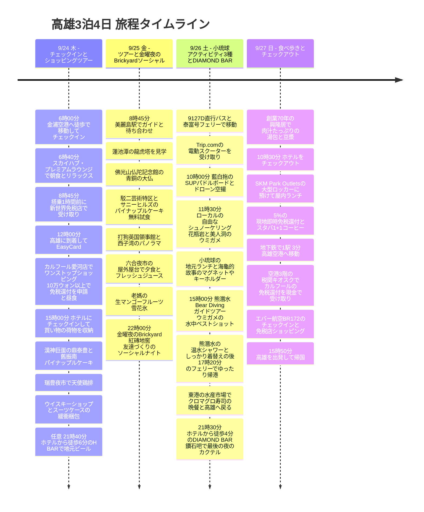

**初日の正午到着からアーリーチェックイン待ちの時間まで、鼎泰豊・漢神巨蛋のショッピング、瑞豊夜市、ダーリー歯磨き粉のワンストップ買い物でぎっしり。2日目はKlookツアーとサニーヒルズのパイナップルケーキ、六合夜市での夕食の後、金曜夜のBrickyardインターナショナルパブでソーシャルナイト(友達づくり)。3日目は小琉球を電動スクーターで巡り、藍白拖のSUPとドローン空撮、自由なシュノーケリング、15時の熊潛水でウミガメの水中フォトを撮った後、ホテルから徒歩4分のDIAMOND BARでカクテル。4日目は地元の朝食の後、SKM Parkアウトレットを経由して空港へ**と、高雄旅行の動線もショッピングもソーシャルライフも、ほぼ完璧にまとめました。

2日目(Klook日帰りツアー)と3日目(小琉球の海でのシュノーケリングとSUPアクティビティ)は朝から晩までぎっしりなので、重いスーパーでの買い物やダーリー歯磨き粉のショッピングは初日の夜にホテル(URBAN HOTEL33)のすぐ隣で済ませ、スーツケースに詰めてしまいましょう。そうすれば旅の後半を荷物の負担なく、軽く快適に楽しめます。

時刻は現地時間(韓国より1時間遅い)で、フライトは**7C6123 金浦 09:45 → 高雄 12:00 / BR172 高雄 15:50 → 仁川 19:45**の照会時刻表を基準にしました。実際の予約票と異なる場合は、まず空港への移動から調整してください。[出国時刻表](https://zbordirect.com/en/low-cost/from-korea/to-taiwan/seoul-kaohsiung)、[帰国時刻表](https://zbordirect.com/en/tools/schedule?arrival_city=SEL&departure_city=KHH)。

## 旅程の概要

### 🎯 日ごとの4大メイントピック(Daily Core Mission)

* 🏬 **Day 1 (9/24 木) : チェックインとショッピングツアー**
  - **テーマ**: フライト後のアーリーチェックイン待ちの時間を快適に使い、高雄の主要な商業エリアを制覇
  - **主な予定**: 6:00 タサンハウスから金浦空港へ徒歩で移動し7C6123のチェックイン → 6:40 スカイハブ・プレミアムラウンジへ直行して朝食&リラックス → 8:45(搭乗1時間前)新世界免税店の受取カウンターで商品を受け取る → 9:45 金浦発、12:00 高雄着&EasyCardの受け取り/チャージ → ホテルに荷物を預けてアーリーチェックイン待ちのゴールデンタイムを活用(**[選択1] カルフール愛河店でワンストップショッピング&フードコートの昼食&5%の現地即時還付** または **[選択2] 老舗の地元牛肉麺店「大牛牛肉麵」で昼食&麻古茶坊の芝芝マンゴー**) → 15:00 ホテルにチェックインして荷物を整理 → 漢神巨蛋(鼎泰豊で夕食&創業130年の舊振南パイナップルケーキ) → 瑞豊夜市で天使鶏排 → カバランショールーム/南威海洋酒行でウイスキー2本を購入してスーツケースに安全に梱包 → [任意] ホテルから徒歩6分のH BARで軽く初夜のビール。
* 🏛️ **Day 2 (9/25 金) : 韓国語ガイドの佛光山ツアー&金曜夜のBrickyardソーシャルナイト**
  - **テーマ**: 高雄No.1ランドマークの歴史・文化探訪、六合夜市のグルメ、金曜夜のインターナショナルなパブ/バーで友達づくり
  - **主な予定**: **[予約確定] Klook終日韓国語ガイドツアー**: 美麗島駅集合 → 蓮池潭(龍虎塔) → 世界最大の青銅製の坐仏がある佛光山仏陀記念館 → 駁二芸術特区&サニーヒルズ(SunnyHills)の台湾産パイナップルケーキを無料試食・購入 → 打狗英国領事館から港のパノラマビュー → 六合夜市で降りて、中央の屋外屋台で冷たいパパイヤミルクやフレッシュジュースと海鮮焼きの夕食 → 地元の隠れたかき氷の名店、老媽の生マンゴー雪花氷 → **[金曜夜のハイライト] 高雄を代表するインターナショナルパブ&クラブ[Brickyard (紅磚地窖)](https://maps.app.goo.gl/jnwZL2sB41fR88NJA)**で台湾ビールやカクテル、ビリヤード台でポケットボールを楽しみながら、外国人や地元の人と友達づくりのソーシャルナイト!
* 🐢 **Day 3 (9/26 土) : 小琉球の海のアクティビティ3種フルコース(スクーター・SUPドローン撮影・シュノーケリング)&DIAMOND BAR**
  - **テーマ**: 電動スクーターで疾走、SUPパドルボードでドローン空撮のベストショット、野生のウミガメと超接近して泳ぎ、そして宿の目の前のおしゃれなバーでソーシャルに締めくくり
  - **主な予定**: 9127Dバス&KKday泰富号往復高速フェリー(14,815ウォン) → Trip.com免許不要の電動スクーター(13,600ウォン)を受け取り → **🌟 10:00 [Trip.com予約確定] 藍白拖(藍白拖)のSUPパドルボード体験&エメラルド色の海でドローン空撮のベストショット(29,445ウォン)** → **11:30 花瓶岩・美人洞でローカルの自由なシュノーケリング** → 小琉球の地元ランチ&海龜的故事で「小琉球」刻印の立体メタリックマグネットとウミガメのキーホルダー・ぬいぐるみを購入、麻花捲(ねじり揚げ菓子)をゲット → **🌟 15:00 [Trip.com予約確定] 熊潛水(Bear Diving)ガイドツアー(ウミガメを間近で撮る水中撮影)&温水シャワーとしっかり着替え(16,000ウォン)** → 17:20 泰富号フェリーでゆったり帰港 → 東港華僑水産市場でクロマグロの寿司・海鮮丼の晩餐 → 9127Dバスで高雄に戻り、お好みで癒やしのマッサージ → **21:30 ホテルから徒歩4分の[DIAMOND BAR (鑽石吧)]**で、韓国人におすすめの親切なバーテンダーによるオーダーメイドカクテルと、情緒たっぷりのソーシャルナイト!
* 🥟 **Day 4 (9/27 日) : 食べ歩きとチェックアウト**
  - **テーマ**: 創業70年の地元の朝食グルメと、出国直前の完璧なアウトレットショッピング&超高速の空港移動
  - **主な予定**: ホテルからMRTで4分、創業70年の興隆居の名物、肉汁たっぷりの湯包(大きな小籠包)と豆漿の朝食 → 10:30 ホテルをチェックアウト → **SKM Park Outletsの大型ロッカーにスーツケースを預け、涼しい屋内でランチ・ブランドショッピング・5%の現地即時免税還付・スターバックス1+1クーポンの消化** → 空港の1駅手前(MRT 3分)から超高速で移動し、エバー航空BR172のチェックインに余裕をもって臨み、免税店でショッピングをして15:50に帰国。

---

### 🗺️ 旅程タイムライン(Mermaid)

---

| 日 | メイントピック | 主な動線 | 一日の締めくくり |
|---|---|---|---|
| 9/24 木 | **チェックインとショッピングツアー** | 6:00 金浦空港へ徒歩で移動 → ラウンジへ直行して朝食 → 8:45(搭乗1時間前)免税品を受け取り → 12:00 高雄着(e-Gate 1分・空港1階でEasyCard引き換え) → **ホテルに荷物を預けてアーリーチェックイン前にカルフール愛河店へ(MRT 3分+徒歩/バス、ショッピング、フードコートの昼食、10万ウォン以上の免税還付申請書の発行) [またはホテルから徒歩5分の大牛牛肉麵とタピオカティー]** → 15:00 チェックイン/休憩 → **漢神巨蛋(MRTで移動、スタバ1+1クーポン&鼎泰豊で待つ間に舊振南パイナップルケーキ・ヌガークラッカーを買う)** → 瑞豊夜市(徒歩5分) → **ウイスキーショップ(南威海洋酒行/カバランショールーム)** → **[任意] H BAR(徒歩6分)** | 21:00 ホテルでスーツケースの事前梱包、またはH BARで軽くビール |
| 9/25 金 | **韓国語ガイドツアー&金曜夜のソーシャル** | **[確定] Klook日帰りツアー**: 美麗島駅集合 → 蓮池潭 → 佛光山仏陀記念館(礼敬大庁のスタバ) → 駁二(誠品書店のスタバ&サニーヒルズの無料試食/ショッピング) → 英国領事館 → 愛の河 → **六合夜市で降りて夕食&屋外での交流 → 老媽冰店(生マンゴー雪花氷) → 22:00 Brickyard 紅磚地窖(金曜のインターナショナルパブ/クラブで友達づくり)** | 0:30〜1:00 ウーバー/タクシーで5分、ホテルに戻ってぐっすり |
| 9/26 土 | **小琉球アクティビティ3種&DIAMOND BAR** | **小琉球の海のアクティビティ フルコース**: 9127D直行バス → 東港泰富号フェリー(KKday) → 電動スクーター(Trip.com) → **🌟 10:00 藍白拖のSUP/カヤック&ドローン空撮(Trip.com 29,445ウォン)** → **11:30 ローカルの自由なシュノーケリング(花瓶岩・美人洞)** → 昼食&海龜的故事(ウミガメのマグネット・ぬいぐるみ・キーホルダー)でショッピング → **🌟 15:00 熊潛水(Bear Diving)ガイドツアー(ウミガメの水中ベストショット)&温水シャワーとしっかり着替え** → 17:20 フェリーで帰港 → 東港水産市場(クロマグロ・寿司) → 9127Dで高雄へ戻る → **21:30 ホテルから徒歩4分のDIAMOND BAR 鑽石吧** | 23:30 ホテルから徒歩4分のDIAMOND BARでカクテルを楽しんだ後、帰ってぐっすり |
| 9/27 日 | **食べ歩きとチェックアウト** | 創業70年の朝食(興隆居の湯包/豆漿、MRT 4分) → 10:30 チェックアウト → **SKM Parkアウトレットで昼食&スタバ1+1コーヒー&ショッピング(大型ロッカーで荷物預け)** → 空港までMRTでちょうど1駅(3分) → **[荷物を預ける前に] 空港3階の税関E-Taxキオスクでカルフールの10万ウォン以上の免税還付を現金で受け取り** → エバー航空のチェックイン&免税店ショッピング | 13:30 空港着、税関で還付を受けた後にBR172で帰国 |

---

> [!TIP]
> **台湾の現地ATM引き出し&海外カード(トラベログ・トラベルウォレット/トラベルゴー)手数料 完全攻略ガイド**
>
> 📊 **台湾旅行の決済リアルデータ(トラベルウォレット集計)**:
> - **現金引き出し55%** vs **カード決済45%**  
> - 台湾は台北の大型ショッピングモールを除けば、高雄の地元の老舗、夜市の屋台、小琉球のシュノーケリングのシャワー/コインロッカー代などで**今も現金引き出しの割合(55%)が半分を超えています**。現金(特に100 TWDの小額紙幣)を事前に十分確保しておくことが旅のカギです!
>
> ---
>
> #### 1. 台湾の人気6大銀行のATMごとの対応ブランド(Master / VISA / UnionPay)完全マッチング
> 海外決済/引き出し用カード(トラベログ、トラベルウォレット、トラベルゴー、Tossなど)は、**カードに刻まれた国際ブランドのロゴ**によって、手数料0円(無料)で引き出せるATMの銀行がまったく異なります。
>
> | 銀行名(日本語/英語/中国語) | 対応カードブランド | 主な設置場所&引き出しのコツ |
> |---|:---:|---|
> | **国泰銀行(国泰世華銀行)** Cathay United Bank / 國泰世華 🌳 | <mark>**Mastercard**</mark> · <mark>**VISA**</mark> · <mark>**UnionPay**</mark> *(3大ブランドすべて対応!)* | • **高雄MRT全駅(改札の内外)** • **宿の目の前のPXマート(全聯)店内** • ハイライフ(Hi-Life)コンビニ 👉 **Mastercard所持者は必須の拠点!** 唯一3大ブランドをすべて手数料0円で完璧に対応する「万能ATM」 |
> | **台湾銀行** Bank of Taiwan / 臺灣銀行 | <mark>**VISA**</mark> · <mark>**UnionPay**</mark> | • **高雄空港の手荷物受取所(税関通過前)** • **高雄空港1階入国ホールの右端** • 市内の台湾銀行の支店 |
> | **メガ銀行(兆豊国際商業銀行)** Mega Bank / 兆豐銀行 | <mark>**VISA**</mark> | • **高雄空港の手荷物受取所(税関通過前)** • **高雄空港1階入国ホールの左端** • 市内のメガ銀行の支店 |
> | **新光銀行** Shin Kong Bank / 新光銀行 | <mark>**VISA**</mark> | • 高雄市内の主要支店と繁華街 |
> | **中国信託銀行(CTBC)** CTBC Bank / 中國信託 | <mark>**UnionPay**</mark> *(※VISA/Masterでの引き出しは手数料がかかるので注意)* | • **台湾全土のセブン-イレブン(7-ELEVEN)店内** 👉 **UnionPay(トラベログUPI)は手数料0円!**(ただしVISA/Masterは100 NTD請求) |
> | **台新銀行** Taishin Bank / 台新銀行 | <mark>**UnionPay**</mark> *(※VISA/Masterでの引き出しは手数料がかかるので注意)* | • **台湾全土のファミリーマート(FamilyMart / 全家)店内** 👉 **UnionPay(トラベログUPI)は手数料0円!**(ただしVISA/Masterは100 NTD請求) |
>
> ---
>
> #### 2. 自分のカードに合った超かんたんATM探索戦略
> - **💳 ハナ・トラベログ(UnionPay / 銀聯 🔴🔵🟢)**:
>   - **利用できるATM**: 国泰銀行 🌳、台湾銀行、**セブン-イレブン(CTBC)**、**ファミリーマート(台新)**
>   - **戦略**: 空港(台湾銀行)はもちろん、市内の路地ごとにある**セブン-イレブンとファミリーマートのATMで24時間手数料0円**で引き出せます! アクセスのしやすさは圧倒的No.1。
> - **💳 トラベルウォレット(VISA 🔵)**:
>   - **利用できるATM**: 国泰銀行 🌳、**台湾銀行**、**メガ銀行**、新光銀行
>   - **戦略**: 空港では**台湾銀行またはメガ銀行**、市内では**MRT駅や宿の前のPXマートにある国泰銀行(Cathay)**の機械を利用。*(※コンビニのセブン-イレブン/ファミリーマートの機械は100 NTDの手数料がかかるので避ける)*
> - **💳 Mastercard(トラベログMaster / Toss / 新韓SOLトラベル 🔴🟡)**:
>   - **利用できるATM**: **国泰銀行(Cathay United Bank 🌳)**を集中的に狙いましょう!
>   - **戦略**: 空港MRT連絡通路(地下1階)や、**高雄MRT全駅の改札、PXマート店内の国泰銀行**を探せば、安全に無料で引き出せます。
>
> ---
>
> #### 3. カード会社別の引き出し限度額&交通カード/割引のコツ
> 1. **ハナ・トラベログ(Mastercard vs UnionPay)**:
>    - **引き出し手数料&限度額**: ハナカードのATM引き出し手数料は**全額免除**、1日$6,000 / 月$10,000相当とゆとりがあります。
>    - **リアルタイム自動チャージ**: 残高が足りなくても、ウォン口座から基準為替レートのまま即時に自動チャージされ、引き出しや決済ができます。
>    - **UnionPay(UPI)加盟店の特典**: **鼎泰豊(鼎泰豐)**など中華圏の主要フランチャイズでの決済時にプロモーション特典が受けられる場合があります(初日の漢神巨蛋の鼎泰豊で決済する際は、カウンターで確認がおすすめ!)。
> 2. **トラベルウォレット(Visa)**:
>    - **★ 月$500超過時の2%独自手数料に注意**: トラベルウォレットは**月500ドル(USD)相当までのみATM引き出し手数料が無料**で、**超過分には2%の独自手数料がかかります**(1回$400、1日$1,000、月$2,000が限度)。大量に引き出す場合はトラベログを優先することをおすすめします。
> 3. **高雄MRT改札でのコンタクトレス(タッチ)直接タッチ乗車(UnionPay公式対応!)**:
>    - **高雄MRT(KRTC)の大きな長所**: 台北の地下鉄と違い、**高雄の地下鉄はユニオンペイ(UnionPay)コンタクトレスの直接タッチによる乗降を公式にサポート**しています!
>    - **お手持ちのカードを100%活用**: お持ちの**ハナ・トラベログのUnionPayコンタクトレスカード**やトラベルウォレット(Visa)の実物カードを、改札上部の専用リーダーに**交通カードのようにタッチしてそのまま乗車**できます。
>    - **実物EasyCardの役割分担**: 高雄の地下鉄(MRT)はトラベログのカードでそのまま乗り、購入した実物EasyCard(87 TWD)は**Day 3の東港 ↔ 高雄 9127D直行バス(都市間バスはEasyCardが必須)**と、**宿の前のPXマート/コンビニでの少額決済**用にきれいに使い分けましょう!
>
> ---
>
> #### 4. 高雄空港の手数料無料(0円)ATM 3大ポイント&最適動線
> 高雄国際空港(KHH)はコンパクトで動線がとても短く、入国審査後はあちこちに無料ATMが整っています:
> 
> | 空港内のエリア | 設置銀行と場所 | 対応ブランドと実践的な利用のコツ |
> |---|---|---|
> | **① [最速] 手荷物受取所 (Baggage Claim / 税関通過前)** | **台湾銀行(Bank of Taiwan)&メガ銀行(Mega Bank)のATM** • e-Gateを通過した後、荷物を受け取るターンテーブルエリアの壁面 | • 台湾銀行(VISA、UPI) / メガ銀行(VISA) • 荷物が出てくるまでの5〜10分の待ち時間に、並ばずに最も早く現金を引き出せます! |
> | **② [メイン] 1階入国ホール (税関通過直後のロビー)** | **メガ銀行(左端)&台湾銀行(右端)の窓口とATM** • 自動ドアが開いて出ると、ロビーの両端にそれぞれあります | • **行列回避のコツ ⚡**: 地下鉄(MRT)に向かう通路が左方向なので、ほとんどの入国客が**左側のメガ銀行(VISA)**に集まって行列が長くなります。左側に人が多ければ迷わず**反対側の右にある台湾銀行(VISA、UPI)の窓口/ATM**へ! ほとんど並ばずに超高速で処理できます。 • **ワンストップ3分フロー**: 税関通過 → 空いているATMで100 NTD札に分けて引き出し → 右側の5番出口付近の「ユナイテッドトラベラー」でEasyCard(87 TWD)を受け取り → MRTへ移動 |
> | **③ [代替] 地下1階 MRT空港駅 (R4 Kaohsiung Airport Station)** | **国泰世華銀行(Cathay United Bank / 國泰世華 🌳)のATM** • 1階6番出口前のエスカレーターで地下鉄に降りる途中/改札のコンコース | • **Master / Visa / UPIの3大ブランドすべて100%無料対応** • Mastercard所持者に強くおすすめ! 1階ロビーのATMが混んでいたり、うっかり忘れても、地下鉄に乗る直前にすぐ引き出せます |
>
> 💡 **高雄市内と宿の前の追加拠点**:
> - **高雄MRT全駅(美麗島駅、信義国小駅など)**: 改札の内外に**国泰世華銀行(緑の木のロゴ 🌳)のATM**が完備。(Master/Visa/UPIすべて無料)
> - **宿の目の前のPXマート信義店(全聯福利中心、徒歩2分)**: 店内に**国泰世華銀行のATM**が標準で入っており、宿のすぐ近くでいつでも無料で引き出せます(※店内の商品の支払いに韓国のクレジットカードは使えず、現金/EasyCardのみ)。
>
> ---
>
> #### 5. 実践ATM引き出し完全マニュアル(100 TWD小額紙幣に分けるコツ)
> 1. **事前準備**: 出国前にカードアプリで**海外ATM引き出しのブロックが解除されているか**と**暗証番号(4桁)**を必ず確認しておきましょう。
> 2. **カードを挿入&PIN入力**: カードを入れて韓国の暗証番号4桁を入力し、緑のボタン(Enter)。(6桁を求められたら**暗証番号4桁+00**を入力)。
> 3. **口座メニューを選択**: 3番目のメニューである**`Savings Account(普通預金)`**をクリック。
> 4. **引き出し金額を入力**: 1回最大20,000 NTDまで可能(例: 1,000 NTDまたは3,000 NTDを入力してNext)。
> 5. **🌟 100 NTD券種分割画面(最も重要!)**:
>    - 引き出し直前の画面に**「引き出し金額を100台湾ドル札に分けて受け取りますか?(Exchange to 100 TWD notes?)」**という案内が出ます。
>    - **必ず`YES`を押してください!**(例: 1,000 NTDを引き出すと100 NTD札10枚で出てきます)。
>    - 夜市の屋台、ストリートフード、自動販売機、小琉球のシュノーケリングのシャワー室/コインロッカーなどでは、1,000 NTDの大きな紙幣を出すとお釣りがなくて困られることが多いため、100 NTD札の確保が必須です。
> 6. **カード回収&現金の受け取り**: 画面の案内に従って**先にカードを抜いてから**現金とレシート(任意)を受け取れば引き出し完了!
>
> #### 6. [非常用現金の両替のコツ] ウォンからの直接両替は禁止! ドル(USD)の二重両替が圧倒的に有利
> トラベログの手数料0円カードでのATM引き出しが最も経済的ですが、万一の非常用に韓国から現金を持っていくなら、次の為替の事実を必ず覚えておいてください:
> - **ウォン(KRW)現金の現地両替は絶対におすすめしません ❌**: 台湾の現地銀行でウォンを買う際のレートは非常に不利です(例: 10,800 TWDに両替するとウォンでは約55万ウォンかかりますが、韓国で事前に替えた350ドル(当時約50万ウォン)で両替すると約5万ウォン相当の差益が出ます)。
> - **米ドル(USD)紙幣を用意(二重両替をおすすめ) 🟢**: 非常用のお金は韓国で100ドル札のドル(USD)を用意していき、空港入国ホールの銀行窓口(台湾銀行/メガ銀行)で両替するほうがはるかに有利です。
> - **窓口両替の準備物**: **パスポート+外貨紙幣(USD)**だけを窓口に渡せば、1分で両替が完了します。
> - **空港銀行窓口の営業時間**: 台湾銀行/メガ銀行は毎日9:00〜21:00(月〜金の平日は5:30〜10:30の早朝営業など、フライトに合わせて運営)。*(※カードATMは24時間年中無休で利用可能)*
>
> #### 7. 高雄の現地決済&タクシー実践のコツ
> - **地元の人気店&夜市**: 100%現金払い(一部LINE Pay対応)。
> - **タクシー**: 車の外側にクレジットカードのステッカーが貼ってあっても、実際に乗るとカードは使えないと言って現金を求める運転手がほとんどです。カード決済をしたいときは**ウーバー(Uber)アプリの自動決済**を利用しましょう。(ただし旗津島の乗り場など外れのエリアではウーバーが呼びにくいので、道端の一般タクシーに現金で乗るほうがずっと早いです)。

---

## 9/24 木 · [Day 1: チェックインとショッピングツアー] 正午到着、カルフール・漢神巨蛋のショッピング&瑞豊夜市

* **出国前夜(9/23 水)**: 午前9時45分発のフライト(7C6123)に合わせて、金浦空港のすぐ前、松亭駅の**[タサンハウス](https://naver.me/xjgcCwsW)で1泊(18,000ウォン)**します。早朝の始発で移動する負担がなくぐっすり眠り、午前6時に出発します。
* **出国当日の朝(9/24 木)**: 午前**6:00にタサンハウスから金浦空港の国際線ターミナルまで余裕をもって徒歩で移動(約10〜15分)**し、6:15ごろ到着。チェジュ航空のカウンターで搭乗手続きと預け荷物の預け入れ、出国審査を終えたら、**免税エリア(エアサイド)に入った直後に新世界免税店のアプリで「受取カウンターのスマート待機(リモート順番待ち/モバイル整理券)」をすぐ申し込み**ます。そして6:30にオープンする[**スカイハブ・プレミアムラウンジ**](https://www.prioritypass.com/ko-KR/lounges/south-korea/gimpo-international/gmp5-sky-hub-lounge-premium)へ直行! 温かいビュッフェの朝食とライブ調理、マッサージチェアのリラックスゾーンでくつろぎながらアプリで順番を確認し、**搭乗1時間前(8:45ごろ)にラウンジを出て、すぐ前の新世界免税店の受取カウンターで待ち時間0秒で免税品を受け取り**、9:15に搭乗ゲートへ移動します。

### 💡 初日の正午到着後、アーリーチェックイン(15:00)前のゴールデンタイム活用法(カルフール vs 地元の牛肉麺)
高雄空港に昼の12:00に到着し、e-Gateを通過して国際線第1ターミナル1階のカウンターでEasyCardを受け取り/チャージすると、13:00〜13:10ごろになります。宿のURBAN HOTEL33の通常チェックイン時刻は**15:00**なので、客室に入るまで約1時間30分の待ち時間ができます。  
13:35にホテルのフロントでスーツケースを無料で預けた(1分で完了)後、好みに合わせて**[選択1: カルフール大型スーパーのワンストップコース(公共交通100%)]**または**[選択2: 地元グルメ&デザートの徒歩コース(交通費0円)]**から選んで、充実して過ごせます:

#### 🏆 [選択1(公共交通おすすめ・大型スーパーのワンストップ攻略型)] カルフール愛河店でのショッピング&昼食&免税還付申請(10万ウォン以上)
*ホテルのチェックイン前に大型スーパーを制覇して、大量の買い物の荷物を15:00のチェックインと同時に客室へ収納し、2〜4日目はずっと両手を軽くして動ける賢いプラン!*
1. **13:35 ホテルに荷物を預けた後、MRTの公共交通で移動**:
   - 宿の目の前の**O6信義国小駅でMRTオレンジ線に乗車 → O4市議会駅(旧・高雄市議会)で下車(わずか2駅、3分、EasyCard 20 TWD)**。
   - 2番出口から出て、中正橋(愛河)を渡る川沿いの道を徒歩約10〜12分(または市議会駅前の60番バスで2駅 / YouBikeで3分)で**[カルフール愛河店(家樂福 愛河店)](https://maps.app.goo.gl/fPioKXCNr9VqWssw7)**に到着。
2. **13:45 カルフールのフードコートで昼食&大型スーパーでショッピング**:
   - **フードコート/レストラン街での昼食**: 涼しいエアコンの下で、牛肉麺、台湾の鉄板料理、和食、点心など多彩なメニューを、待たずに快適かつ素早く食べられます。
   - **買い物を総ざらい**: DARLIE(ダーリー)歯磨き粉(まとめ買い割引パック)、Dr.Q(ドクターキュー)こんにゃくゼリー、満漢大餐の牛肉麺カップ麺、3時15分ミルクティーのティーバッグ、グミチョコボール、金門高粱酒などのお土産と夜食を、一か所で全部カートに入れましょう。
   - **🌟 [10万ウォン以上の免税還付申請&空港還付伝票の受け取り]**:
     - 台湾では、同日に同じ店舗で合計**2,000 NTD(約85,000ウォン)以上**買うと、5%の付加価値税の還付(Tax Refund)対象になります。
     - 歯磨き粉、ラーメン、お菓子、お酒などで**10万ウォン(約2,400〜2,500 NTD)以上**買い物をして会計を済ませた後、**1階のカスタマーサービスセンター(Service Desk)でパスポートとレシートを提示して免税還付を申請**してください。
     - **空港還付伝票の保管**: その場で少額の還付をすぐに受けるか、**空港税関の還付用伝票(Refund Form)**をもらってパスポートと一緒に保管しておきます。この伝票を持っていれば、**最終日(Day 4)に高雄空港3階の税関E-Taxキオスクで現金(TWD)として税金を戻してもらい、空港の免税店(ウイスキー・お土産)のショッピングにそのまま足せます!**
3. **14:45 MRTでホテルに戻り、15:00に通常チェックイン**: 市議会駅からMRTオレンジ線で信義国小駅へ戻ります(わずか3分) *(※箱単位の大量購入で荷物が重すぎる場合のみ、ホテルの前までウーバー/タクシー約8分・110 TWDを選択)*。15:00に通常チェックインした後、買い物の荷物をすぐ客室に上げ、エアコンの下で40分間快適に休憩!

#### 🍜 [選択2(徒歩で完結・地元グルメ型)] ホテルから徒歩5分、大牛牛肉麵で地元ランチ&麻古茶坊のフルーツティーでデザート
*乗り物や乗り換えなしで、宿のすぐ近くで高雄の地元の人が通う本物のローカル名店と台湾を代表するフルーツティーを楽しみながら、ゆったりチェックインを待つ、100%徒歩に優しいコース!*
1. **13:35 ホテルに荷物を預ける**: スーツケースをホテルのフロントに預けて、身軽な服装で出発(交通費0円)。
2. **13:45 地元の本物の名店で最初の食事**: ホテルから徒歩5分、高雄の地元の人お気に入りの牛肉麺の老舗[**大牛牛肉麵**](https://maps.app.goo.gl/hXfR9jY8j1K6Z9pE7)へ! すっきりして濃厚な紅焼/清燉牛肉麺と、もちもちの牛すじ、冷たいキュウリの和え物で、フライト後の空腹を満たします。
3. **14:25 台湾No.1のフルーツティーでデザート**: 食後すぐ近くの**麻古茶坊(MACU)**で、夏/秋の看板メニューである**芝芝マンゴー(生マンゴースムージー+甘じょっぱいチーズフォーム)**または**50嵐(50嵐)のウーロンミルクティー(タピオカ追加)**を片手に、涼しく糖分をチャージします。
4. **14:50 ホテルに戻ってチェックイン(15:00)**: 客室の鍵を受け取り、涼しいエアコンの下で洗顔して休憩。(歯磨き粉やラーメンなどのスーパーでの買い物は、夜の予定の後に宿の前のPXマートとPOYAで行います)

| 現地時刻 | やること | 移動・待機の配分 |
|---|---|---|
| 6:00〜6:15 | **タサンハウス出発 → 金浦空港へ徒歩で移動** | 松亭駅の宿から金浦空港の国際線ターミナルまで、朝の徒歩移動で約10〜15分 |
| 6:15〜6:40 | **7C6123の搭乗手続き&保安検査・出国審査** | チェジュ航空の預け荷物を預け、スムーズに出国審査を通過 |
| 6:40〜8:45 | **免税エリアに入ってすぐ[新世界免税店のリモート順番待ち]を申し込み → [スカイハブ・プレミアムラウンジ]へ直行して朝食&リラックス** | 保安検査/出国審査を通過して免税エリア(エアサイド)に入ったらすぐ**新世界免税店のアプリで「受取カウンターのスマート待機(リモート順番待ち/モバイル整理券)」を発行**! 6:30オープンの新しいプレミアムラウンジへ直行し、ライブ調理の朝食とマッサージチェアの休憩ゾーンでくつろぎながら、スマートフォンでリアルタイムの順番を確認 |
| 8:45〜9:15 | **[搭乗1時間前] 新世界免税店の受取カウンターでスマート受け取り(待ち時間0秒)** | ラウンジを出た後、リモート待機の順番に合わせて、すぐ前の新世界免税店の受取カウンターで待たずに事前注文した免税品をすぐ受け取り、整理して搭乗口(9:15搭乗開始)へ移動 |
| 9:15〜9:45 | **7C6123に搭乗して離陸(GMP → KHH)** | 9:45に金浦空港を出発(高雄の現地時間で12:00正午に到着予定) |
| 12:00〜13:00 | **高雄到着・e-Gate(1分)&税関通過&トラベログで引き出し&EasyCardの引き換え/チャージ** | オンライン事前申告後、入国審査場の一番奥にある赤いE-GATEカウンターで1分登録し、10秒でゲートを通過 → 出口の税関X線を通過(※肉類/加工食品は持ち込み禁止) → 入国ホール1階の**台湾銀行/メガ銀行のATMでトラベログを使って5,000 NTDを引き出し(手数料0円)** → **1階のユナイテッドトラベラーカウンター**でEasyCard(87 TWD)の実物と引き換え → コンビニまたはMRT空港駅(R4)で**400 NTDをすぐチャージ**(1,000 NTD札を出して、お釣り600 NTDは夜市用に100 NTD札で確保) |
| 13:00〜13:35 | **10番ゲートの歩道 → MRTに乗車 → 宿へ移動してスーツケースを預ける** | 10番ゲートの屋外歩道を直進1分 → R4空港駅(トラベログのコンタクトレスまたはEasyCardをタッチ) → 岡山(北)方面に乗車 → 美麗島で乗り換え → O6信義国小駅(徒歩3分)。**ホテルのフロントにまずスーツケースを預ける(1分で完了)** |
| 13:35〜14:50 | **[選択1] カルフール愛河店へMRTで移動&ショッピング・昼食・即時免税還付** *(選択2: 大牛牛肉麵の地元ランチ&麻古茶坊の芝芝マンゴー徒歩コース)* | • **選択1(公共交通)**: 宿の前でMRTオレンジ線に乗車(O6信義国小 → O4市議会駅、2駅3分、20 TWD)し、愛河の川沿いの道を徒歩10分(または60番バス/YouBike) → **[カルフール愛河店](https://maps.app.goo.gl/fPioKXCNr9VqWssw7)**のフードコートで昼食&大型スーパーの必須ショッピングアイテム(ダーリー歯磨き粉のまとめ買いパック、満漢大餐、Dr.Qゼリー、ミルクティー)をカートいっぱいに購入 → **1階カスタマーサービスセンターで5%の現地即時現金還付(2,000 NTD以上の場合)** → MRTでホテルに戻る • **選択2(徒歩で完結)**: ホテルから徒歩5分の**[大牛牛肉麵 四維本店](https://maps.app.goo.gl/ZEsUXYtWrnvQzY1S9)**で紅焼/清燉牛肉麺と牛すじの昼食の後、**麻古茶坊(MACU)**の芝芝マンゴーをテイクアウト(交通費0円) |
| 14:50〜15:45 | **ホテルチェックイン(15:00)&客室に入室・買い物の荷物を収納・シャワー・休憩** | URBAN HOTEL33にチェックイン。(選択1を行った場合は、スーパーでの買い物の荷物をすぐ客室に収納完了!) 涼しい部屋で洗顔して、40分間快適に体力を回復 |
| 15:45〜16:15 | ホテル → 漢神巨蛋へ移動 | O6信義国小 → 美麗島で乗り換え → R14巨蛋駅(地下鉄と徒歩で約20分) |
| 16:15〜18:00 | **漢神巨蛋B1でショッピング&鼎泰豊で夕食&スタバ1+1** | **1) 鼎泰豊の整理券を受け付け(待ち時間約20〜30分)** **2) 待ち時間にショッピング&コーヒー**: 1890年創業の伝統をもつ**舊振南(舊振南)のプレミアムパイナップルケーキ**を試食/購入し、**手作りヌガークラッカー**を購入。漢神巨蛋内のスターバックス(2階またはB1)で**110 TWD 1+1クーポン**を使って冷たいドリンクを受け取り • **[免税還付のコツ]**: 漢神百貨店内で同日の合計**2,000 NTD以上**の購入なら、**パスポートを持ってB1または6階のカスタマーサービスセンターで5%の現地即時現金還付**が可能! **3) 鼎泰豊での食事**: 小籠包、排骨チャーハン、和え餃子(※ユニオンペイカードで決済すると鼎泰豊10%割引のプロモーションがあるか、カウンターで確認) |
| 18:00〜18:15 | 漢神巨蛋 → 瑞豊夜市へ徒歩 | 百貨店の裏の路地を徒歩5分で移動 |
| 18:15〜19:30 | **瑞豊夜市(天使鶏排&ストリートフード)** | 高雄最大のローカル人気夜市。サクサクで厚みのある**天使鶏排(天使雞排)**、サツマイモボール、屋台フードを見て回る |
| 19:30〜20:15 | **[ウイスキー酒販店] 瑞豊から直行 → 南威海洋酒行 富民店(徒歩8分)** | **瑞豊夜市のグルメ巡りの直後、徒歩8分(南東へ650m)**の専門酒販店[**南威海洋酒行**](https://maps.app.goo.gl/4mksKCj4XeMNTj269)へ直行! 韓国の免税範囲に合わせた**ウイスキー2本(カバラン/シングルモルト)**をお得に購入。酒販店のすぐ前(徒歩5分)がMRT R13凹子底駅なので、地下鉄での帰り道まで完璧なワンウェイ(One-way)コース! |
| 20:15〜20:40 | **MRTで宿の最寄りに戻る(ワンウェイコース)** | 南威海洋酒行から徒歩5分のR13凹子底駅に乗車 → 美麗島で乗り換え → O6信義国小駅(所要約20分、引き返す必要がなく一直線で戻れる) |
| 20:40〜21:10 | **宿の前の大型スーパー(PXマート&POYA)または宿のすぐ前のスシロー(壽司郎)で夜食** | • 昼にカルフールを済ませた場合: 宿の前のコンビニ/スーパーで、冷たい台湾のフルーツドリンク(パパイヤミルク/アップルサイダー)と夜食だけを軽く購入して、ゆったり締めくくり • 昼に大牛牛肉麵を楽しんだ場合: 宿から徒歩2分の**POYA**(ダーリー歯磨き粉のまとめ買いパック)と**PXマート**(満漢大餐のラーメン、Dr.Qゼリー、ミルクティーの買い物&店内の国泰世華銀行ATMで手数料0円の無料引き出しが可能。※店内の支払いに韓国のクレジットカードは使えず、現金/EasyCardのみ)で必須の買い物を完了 • **[宿のすぐ前のお寿司・デザート夜食オプション 🍣]**: 宿(URBAN HOTEL33)のすぐ前(徒歩1分)の**[スシロー 高雄中正店(壽司郎)](https://maps.app.goo.gl/SUUBUMvHE2uVTiTN8)**! **台湾スシローの公式アプリで事前にリモート順番待ち/予約が可能**なので、待たずに涼しいエアコンの下で新鮮なお寿司と温かい緑茶/甘いデザートを楽しむのにぴったりです。 |
| 21:10〜21:40 | ホテルに戻り**預け荷物のスーツケースの緩衝梱包を完了** | **ウイスキー2本**を服/タオルで瓶の首まで厚く包んでスーツケースの中央に緩衝梱包し、歯磨き粉と一緒に鍵をかける。(2〜4日目に万全に備える) |
| 21:40〜23:00 | **[任意: 初夜の軽いローカルな一杯] ホテルから徒歩6分の[H BAR](https://maps.app.goo.gl/fT34LjREt6ENvvBe8)** | 宿(URBAN HOTEL33)から東へ徒歩わずか6分(500m)。 • **特徴**: 1人ミニマム200 NTD(約8,500ウォン)のお手頃価格、店内禁煙、心地よい音楽とともに冷たい台湾生ビールやハイボールを軽く一杯飲んで、高雄到着の初夜を祝うのにぴったり! • **徒歩で帰宅**: サンダル履きで6分、ホテルの客室にすぐ戻れる |

[ホテル → カルフール愛河店(公共交通/徒歩)](https://www.google.com/maps/dir/?api=1&origin=URBAN+HOTEL33+Kaohsiung&destination=%E5%AE%B6%E6%A8%82%E7%A6%8F%E9%87%8F%E8%B2%A9+%E6%84%9B%E6%B2%B3%E5%BA%97&travelmode=transit) · [ホテル → 大牛牛肉麵](https://www.google.com/maps/dir/?api=1&origin=URBAN+HOTEL33+Kaohsiung&destination=Da+Niu+Beef+Noodles+Kaohsiung&travelmode=walking) · [ホテル → 漢神巨蛋](https://www.google.com/maps/dir/?api=1&origin=URBAN+HOTEL33+Kaohsiung&destination=Din+Tai+Fung+Hanshin+Arena&travelmode=transit) · [漢神巨蛋 → 瑞豊](https://www.google.com/maps/dir/?api=1&origin=Din+Tai+Fung+Hanshin+Arena&destination=Ruifeng+Night+Market&travelmode=walking) · [瑞豊 → 南威海洋酒行(徒歩8分)](https://www.google.com/maps/dir/?api=1&origin=Ruifeng+Night+Market&destination=南威海洋酒行+富民店&travelmode=walking) · [ホテル → スシロー中正店(徒歩1分)](https://maps.app.goo.gl/SUUBUMvHE2uVTiTN8) · [ホテル → H BAR(徒歩6分)](https://maps.app.goo.gl/fT34LjREt6ENvvBe8) · [ホテル → DIAMOND BAR(徒歩4分)](https://maps.app.goo.gl/u19WYRNiKbpwhwfAA).

> [!TIP]
> **金浦空港国際線「スカイハブ・プレミアム」ラウンジ&新世界免税店スマート待機(リモート順番待ち)のコツ**
> - **新世界免税店 受取カウンターのスマート待機(リモート順番待ち / モバイル整理券)**:
>   - **申し込みのタイミング**: 保安検査と出国審査を終えて**免税エリア(エアサイド / 出国ゲートの内側)に入った直後**に、新世界免税店のモバイルアプリを起動!
>   - **申し込み方法**: アプリ内の`マイページ`または`受取カウンター案内`メニューで**「スマート待機(モバイル整理券の発行)」**をタッチ。
>   - **大きな長所**: 現場のキオスクの整理券発行機の前に立って待つ必要がなく、**スカイハブ・プレミアムラウンジのマッサージチェアに座って快適に朝食を楽しみながら、自分の前の待ち人数をスマートフォンでリアルタイムに確認**できます。搭乗1時間前(8:45ごろ)にラウンジを出て、呼び出しの順番に合わせて受取カウンターに行けば、**待ち時間0秒のハイパスで免税品をすぐ受け取れます**。
> - **スカイハブ・プレミアムラウンジ(Sky Hub Lounge Premium)**:
>   - **新規オープン**: 2026年9月7日に金浦空港国際線のエアサイドにオープンしたばかりの最新プレミアムラウンジ。
>   - **営業時間**: 毎日6:30〜20:10(8:35ごろの朝食の時間帯に訪れるのが最適)
>   - **入場特典**: **無制限PPカード(Priority Pass)**で追加料金なしの**100%無料入場**が可能!
>   - **差別化された設備**: ライブシェフの調理コーナー、マッサージチェアのリラックスゾーン、ビジネスラウンジの座席、新鮮なフレッシュフルーツジュース/スペシャルティコーヒー、プレミアムベーカリー。

> [!TIP]
> **高雄空港e-Gate(自動出入国審査)5分登録&一生ハイパス完全攻略(YouTubeと現場の最新レビューを反映)**
> - **申請資格**: 有効期間が6か月以上残っている大韓民国の電子パスポートを所持している方(満17歳以上、身長140cm以上)。
> - **進行3ステップの完全マニュアル**:
>   1. **[出国前に必須] オンライン入国カードの記入**:
>      - [台湾移民署のオンライン入国カード(Online Arrival Card)](https://niaspeedy.immigration.gov.tw/webacard/)にアクセスして、モバイルやPCで3分で入力(韓国語翻訳対応)。
>      - **主な入力情報**: 英文氏名、パスポート番号、生年月日、国籍(Republic of Korea)、出国便(7C6123)、帰国便(BR172)、台湾での滞在先(ホテル名: **URBAN HOTEL33**または**高雄商旅**)、訪問目的(Sightseeing)。
>      - 最後のステップでメールアドレスとセキュリティコードを入力すると、画面に**「Success」**が表示され、確認メール(PDFファイル)が送信されます。システムに即時自動連携されるため紙の印刷は不要ですが、念のためスマートフォンにPDFや画面キャプチャを保存しておくと安心です。
>   2. **[高雄到着直後] 1分の現地登録カウンターへ直行(場所のコツ!)**:
>      - 飛行機を降りたら「到着(Arrival)」の標識に従ってエスカレーターで入国審査場に下ります。
>      - 一般の外国人対面審査の列が長く伸びていても並ばず、**審査場の一番奥(隅の端)に目立つ大きな赤い文字で書かれた「E-GATE」登録カウンター(Enrollment Counter)**へまっすぐ歩いて行きます。
>      - 担当職員にパスポートを提出し、案内に従って**カメラを正面から見る(顔写真の撮影、帽子・メガネ・マスクは外す)+両手の人差し指の指紋スキャン**を行います。
>      - 職員が**パスポートの裏面に「E-GATE」登録確認のスタンプ(ステッカー)**を押してくれれば、わずか1分で登録完了!
>   3. **[当日すぐ利用] 10秒で自動ゲートを通過**:
>      - 登録が完了したらすぐ隣の**E-GATE自動ゲート**に堂々と入場します。
>      - 韓国の自動出入国審査と同じように、パスポートの写真面をリーダーにスキャン → 最初のドアが開いたら進入 → 画面のカメラを見て顔認証(または指紋スキャン) → 2番目のドアが開き、**待ち時間0秒、わずか10秒で超高速の入国審査が完了!**
> - **🌟 高雄空港での登録の大きな長所&生涯特典**:
>   - **行列ストレスゼロ**: 台北の桃園空港は人が集中して登録窓口にも行列ができますが、**高雄空港はこぢんまりと静かで登録の行列がほとんどなく、3〜5分で超高速入国が可能**です。
>   - **パスポート満了日まで一生有効**: 一度登録しておけば、**パスポートの有効期限満了日まで台湾全土(台北の桃園/松山、高雄など)のすべての空港で出入国時に自動ゲートを引き続き無料で利用**できます(次の台湾旅行や年末の台北訪問では、現地の登録所に行く必要なくオンライン入国カードだけ書けば自動ドアを10秒で通過!)。
>   - **今回の旅行の出国(Day 4)にも適用**: 高雄から韓国に帰国する際も、出国審査の列に並ぶ必要なくe-Gateの自動ドアを10秒で快適に通過できます。

> [!CAUTION]
> **高雄空港出国前の税関X線手荷物検査&畜産物の持ち込み絶対禁止の注意事項**
> - 高雄空港は入国審査を終えて預け荷物を受け取った後、**空港ターミナルのロビーに出る出口ゲートの直前でも、すべての手荷物に対する税関のX線検査(食品検疫)**を厳格に実施しています。
> - 台湾はアフリカ豚熱(ASF)の防疫のため、肉類加工品の持ち込みを厳しく禁止しています。
> - ソーセージ、ジャーキー、ハム、餃子、牛肉入りの炒めコチュジャン、**ラーメンのスープの素に入った肉の具**などを含む食品は、摘発されると**最初の20万NTD(約850万ウォン)から最大100万NTD(約4,200万ウォン)**の重い罰金がすぐに科されます。加工肉類や生の果物などは絶対にスーツケースに入れないでください。

> [!NOTE]
> **高雄空港 入国ゴールデンフロー: トラベログで5,000 NTD引き出し&MRT駅への連絡動線**
> 1. **e-Gate自動出入国ゲートの通過(約1分)**: 審査場の一番奥の赤いE-GATEカウンターで顔/指紋を1分登録し、すぐ隣のゲートを10秒で通過。
> 2. **トラベログの手数料無料で5,000 NTDを引き出し**:
>    - **ATMの場所**: 1階入国ホールのロビーにある**台湾銀行(Bank of Taiwan / 臺灣銀行)**または**メガ銀行(Mega Bank / 兆豐銀行)**のATMを利用(左側のメガ銀行が混んでいれば、右側の台湾銀行ATMが快適)。
>    - **手数料**: トラベログ(ハナ Master/UPI)の利用なら**現地手数料0円**。
>    - **引き出しのコツ**: 画面の言語を「韓国語」または「英語」に選んでから暗証番号4桁(必要なら後ろに00を追加)を入力。DCC換算の画面が出たら必ず**現地通貨(TWD)**を選択。5,000 NTDは3泊4日の夜市・地元の食堂・マッサージ・おやつなどの現金経費としてちょうどよい規模です。
> 3. **EasyCardの実物受け取り(ユナイテッドトラベラーカウンター)**:
>    - **場所**: 国際線第1ターミナル1階の中華電信(中華電信)カウンターと5番出入口の間。事前購入(87 TWD)したモバイルバウチャーを提示して実物カードを受け取ります。
> 4. **EasyCardに400 NTDをチャージ&お釣り(100 NTD札)の確保**:
>    - ロビー内のコンビニ、または連絡通路の**MRT高雄空港駅(R4)の案内所**を訪問。
>    - ATMで引き出した1,000 NTD札を渡して**「400 NTDチャージ(加值、ジャーヂー)」**を依頼。
>    - **400 NTD予算の適合度**: 3泊4日の市内MRT+26日の東港9127Dバス往復(約240 TWD)で合計約390 TWDとなり、ぴったり収まる黄金の金額! お釣りでもらう600 NTD(100 NTD札)は、初日の瑞豊夜市と天使鶏排の現金用に活用。
> 5. **空港ターミナル → MRT高雄国際空港駅(R4)乗車の動線(超かんたん徒歩)**:
>    - 1階入国ホールのロビーから**10番ゲート(Gate 10)**側の出口へ出ます。
>    - 床の案内線と屋外キャノピーの歩道に沿って直進し、徒歩1〜2分で**MRT高雄国際空港駅(R4)**の駅の入口とエスカレーターにそのままつながります。
>    - エスカレーターで地下ホームに下り、改札で**トラベログのユニオンペイ・コンタクトレスカード**または**EasyCard**をタッチして、**岡山(Gangshan / 岡山)北方面の列車**に乗ります。
>    - 高雄の中心乗換駅である美麗島駅(R10)までわずか6駅12分で到着します!

> [!TIP]
> **スターバックス110 TWD即時利用1+1クーポン ベスト活用動線ガイド**
> 今回発行した**「スターバックス110 TWD即時利用クーポン1+1」**は、台湾現地の店舗で決済時にQRコードを提示すると、110 TWDの範囲内でドリンク1+1の特典を受けたり、金額をすぐに差し引いてもらえるお得なクーポンです(110 TWDを超えるドリンクを注文した場合は、超過分の差額のみ現金/EasyCard/カードで支払い可能)。
> 動線上、最も訪れやすく情緒あふれるスターバックス5大スポットをおすすめします:
> 1. **9/24(木) 漢神巨蛋(2階 / B1店舗)**: 鼎泰豊の整理券を取って20〜30分待つ間や、舊振南パイナップルケーキの買い物の前後に、冷たい1+1ドリンクをテイクアウト! (2階店舗は大きな窓の景色が快適)
> 2. **9/25(金) 佛光山仏陀記念館(礼敬大庁 禮敬大廳 1階)**: 寺院の入口の大ホール1階に入っている珍しいスターバックス。暑い昼間のツアー中にエアコンの下で冷たい1+1で休憩できる名所。
> 3. **9/25(金) 駁二芸術特区(駁二誠品店舗)**: 赤レンガの旧港の倉庫をリノベーションした情緒満点の店舗。サニーヒルズの無料パイナップルケーキ試食の後、散策しながらの情緒あるコーヒータイムに最高。
> 4. **9/27(日) SKM Park Outlets(1階大型店舗)**: チェックアウト後に大型コインロッカーへスーツケースを入れ、涼しいモール内でショッピングした後に、ゆったり1+1コーヒー&ベーカリーを楽しむのに最も余裕のある場所。
> 5. **9/27(日) 高雄国際空港 国際線3階出発ロビー(エアサイド)**: 保安検査を通過した後、搭乗前のゲート付近で最後に残ったクーポンをすっきり消化できます。

> [!TIP]
> **台湾3大必須ショッピングアイテム(ダーリー歯磨き粉・ヌガークラッカー・パイナップルケーキ)完全購入動線まとめ**
> 1. **ダーリー歯磨き粉(DARLIE / 黑人牙膏)**:
>    - **購入先**: 初日のチェックイン前の**カルフール愛河店(家樂福 愛河店)**(大容量のまとめ買い割引パック&5%即時還付で最もおすすめ)、または初日の夜に宿の前の**POYA(寶雅 信義店)** / **PXマート(全聯福利中心)**。
>    - **おすすめの種類**: オリジナル・ダブルアクション(緑のミント味、爽快感No.1)、オールインワン重曹ホワイトニング、チャコールクリーン。
>    - **重要なコツ**: 歯磨き粉はジェル類に分類され、100mL(g)を超えると機内持ち込み不可! 初日に買ったらすぐ宿で預け入れ用スーツケースに梱包しておけば、2〜3日目はずっと身軽に動けます。
> 2. **ヌガークラッカー(牛軋餅)**:
>    - **購入先1(プレミアム)**: 1日目の漢神巨蛋B1のベーカリーポップアップ店。焼きたてサクサクのネギクラッカーと、やわらかくもちもちのミルクヌガーのハーモニー。
>    - **購入先2(コスパのお土産用)**: 宿の前のPXマートまたはカルフール。会社や友達にまとめて気軽に配るのにぴったりな個包装の箱。
> 3. **パイナップルケーキ(鳳梨酥)**:
>    - **サニーヒルズ(SunnyHills、微熱山丘) 駁二店**: 2日目(9/25)のKlookツアーの駁二芸術特区の自由時間に訪問。店に入ると温かいウーロン茶1杯と正規のパイナップルケーキ1個を無料で試食として提供してくれます! 台湾産パイナップル(土鳳梨)ならではの酸味のある果肉の繊維感が生きている台湾No.1ブランド。
>    - **舊振南(舊振南、Jiu Zhen Nan)**: 初日(9/24)の漢神巨蛋B1にあります。1890年に高雄で始まった130年の伝統をもつ最高級ペイストリーの名店。香ばしく甘い伝統のバターの風味と上品なゴールドのパッケージで、ご両親/恩師へのお土産に最高。

> [!TIP]
> **台湾ショッピング免税還付(Tax Refund)&高雄空港免税店 完全ガイド**
> 台湾は**市内の事後免税(TRS、Tax Refund Shopping)**制度と**空港免税店(Duty Free)**がとても発達しています。ショッピングの際はパスポートを常に携帯すると、税金をお得に還付してもらえます。
> 1. **市内免税還付(TRS)の還付基準**:
>    - **資格**: 外国人旅行者(入国日基準で滞在183日未満、パスポート原本が必須)。
>    - **最低購入金額**: **同じ日付、同じTRS認可店舗で税込2,000 NTD(約85,000ウォン)以上**購入した場合。
>    - **実際の受取還付額**: 台湾の付加価値税5%のうち、還付手数料(約14%)を差し引いた後の**実質約4.2〜4.3%前後が現金/カードで還付**。
>    - **注意事項**: 未開封の状態で購入日から90日以内に国外へ持ち出す必要があります(封の破損に注意)。
> 2. **現地少額即時還付(現場小額退稅 / On-site Small-amount Tax Refund)** - *最も便利な方法!*:
>    - **適用金額**: 当日同一店舗の累計購入額**2,000 NTD以上〜48,000 NTD以下**。
>    - **方法**: 決済後、購入レシートと**パスポート原本**を持って百貨店/アウトレット内のサービスカウンターを訪れれば、空港に行く必要なく**その場ですぐ現金(NTD)で還付**してもらえます。
>    - **今回の旅程でおすすめの現地還付先**:
>      - **カルフール愛河店(家樂福 愛河店)**: 初日(9/24)13:45に訪れたとき、1階カスタマーサービスセンターで、ダーリー歯磨き粉、Dr.Qゼリー、満漢大餐、ミルクティー、お菓子類など大型スーパーのショッピング合計が2,000 NTD以上なら、パスポートを提示して5%を現地ですぐ現金還付。
>      - **漢神巨蛋ショッピングモール**: 6階またはB1のカスタマーサービスセンターで、鼎泰豊で待つ間に買った舊振南パイナップルケーキ、コスメ、ファッション雑貨などの合計が2,000 NTD以上ならすぐ還付(飲食店の食事代は免税対象外)。
>      - **SKM Park Outlets Kaohsiung**: 1階中央カスタマーサービスセンターで、アウトレットのブランド店舗の合計が2,000 NTD以上の購入ならすぐ現金還付。
> 3. **空港税関の免税還付(Customs Tax Refund)**:
>    - 現地還付に対応していない一般の加盟店(POYAなど)で2,000 NTD以上購入した後、「外国人旅行者税務還付申請書(退稅明細申請表)」を発行してもらった場合。
>    - 9/27(日)の帰国日に、高雄空港3階出発ロビー(チェックインカウンター付近)の**税関E-Taxキオスク/カウンター**でパスポートと書類をスキャンして、すぐ現金またはクレジットカードで還付を受けられます。
> 4. **高雄国際空港免税店(Everrich Duty Free - 事前免税)**:
>    - 高雄市内には別途大型の市内事前免税店(Duty Free)がないため、市内のショッピングは百貨店/アウトレットの免税還付を利用します。
>    - 9/27(日)に高雄空港3階の出国審査後、搭乗ゲートエリアに**エバーリッチ(昇恆昌 / Everrich)免税店**が大きく構えており、税金が抜かれた免税価格で最後のショッピングができます。
>    - **おすすめの免税アイテム**: **金門高粱酒58度(金門高粱酒)**、**カバラン(Kavalan)シングルモルトウイスキー**(台湾ウイスキーは市内より空港免税店のほうが安く、免税特典が完璧に適用されます)、**佳徳(チアテ)パイナップルケーキ**、たばこ、ブランド品・香水。

> [!TIP]
> **台湾ウイスキー2大ショッピング名所(宿の前のカバラン公式ショールーム vs 南威海洋酒行)&お酒2本の韓国免税持ち込み完全ガイド**
> 今回の旅行でウイスキー2本を買うのに最も完璧な2か所の名所が動線上にあります。好みに応じて選んでも、両方見て回ってもOKです:
> 1. **宿のすぐ前(徒歩4分、400m) - [カバランウイスキー 苓雅中正展示販売店(KAVALAN 噶瑪蘭威士忌)](https://maps.app.goo.gl/hKy1YJECDVfEGw8JA)**:
>    - **場所**: 苓雅区中正2路(宿のURBAN HOTEL33から徒歩わずか4分、信義国小駅3番出口付近)。
>    - **特徴&長所**: **カバラン本社の公式直営ショールーム(Showroom)**。
>      - **試飲(Tasting)**: カバランのソリスト(Solist)ヴィーニョバリック、オロロソシェリー、ポートカスクなど代表的なラインナップを自分で試飲し、好みにぴったりのカスクを選べます。
>      - **正規パッケージ&グッズ**: 高級ケース、正規の紙袋、カバラン専用グラス、ミニチュアセットを取りそろえ。
>      - **圧倒的な動線**: 宿のすぐ近くなので、重い酒瓶を持って公共交通に乗る必要がなく、試飲して購入したあと4分で客室のスーツケースにすぐ入れられる最高のアクセス!
> 2. **高雄を代表する専門ボトルショップ - [南威海洋酒行 高雄富民店(南威海洋酒行)](https://maps.app.goo.gl/4mksKCj4XeMNTj269)**:
>    - **場所&完璧な連携動線**: **瑞豊夜市から南東へ徒歩わずか8分(650m)**、MRT R13凹子底駅3番出口から徒歩5分。
>    - **瑞豊夜市直結のコツ ⚡**: 漢神巨蛋の鼎泰豊で夕食 → 瑞豊夜市の屋台めぐり(天使鶏排など)の後、富民路に沿って南へ8分ほどぶらぶら歩けば、すぐ南威海洋酒行に到着します!
>    - **特徴&長所**: カバランのソリストのラインナップはもちろん、スコッチのシングルモルト、独占バレルボトリング、バーボンなど世界の希少なボトルを幅広く取りそろえていて、価格競争力がとても優れています。
>    - **超かんたんな帰り道の動線**: お酒を買った後に引き返す必要はなく、**すぐ前のR13凹子底駅(徒歩5分)からMRTに乗って宿(信義国小駅)へ直行**できる、完璧な一直線(One-way)ルートです。
> - **大韓民国関税庁の1人あたり酒類免税規定(2本免税の基準)**:
>   - **免税規格**: **1人あたり最大2本(合計容量2.0L以下、合計金額が米ドル400ドル以下)**。
>   - 2本を購入して韓国入国時に旅行者携帯品申告書に誠実に記入すれば、税金(関税・酒税・教育税)が**100%免税(0円)**で処理されます。
> - **市内で購入した酒類の機内/預け入れ梱包の必須のコツ**:
>   - 市内の店舗で購入した100mlを超える酒類は、**保安検査場を通過できず、絶対に機内持ち込みできません**。
>   - **必ず預け荷物(チェックイン用スーツケース)**に預ける必要があるため、ホテルでタオルや服で瓶の首とガラス瓶の底を厚く包んで、スーツケースのど真ん中に緩衝配置しておけば、2〜4日目の間ずっと破損の心配なく安全に韓国まで運べます。

---

## 9/25 金 · [Day 2: 韓国語ガイドの佛光山ツアー&金曜夜のソーシャルナイト] 終日バスツアー、蓮池潭、駁二サニーヒルズ、六合夜市&Brickyardで友達づくり

**9/25(金)に[Klook 高雄日帰りツアー(韓国語ガイド)](https://www.klook.com/ko/activity/22010-day-tour-kaohsiung/)を確定しました。**専用車と韓国語ガイドが同行し、高雄を代表する歴史・文化の名所を一日で快適につなぎ、夜は六合夜市のグルメとローカルかき氷に続いて、**高雄No.1のインターナショナルパブ[Brickyard (紅磚地窖)](https://maps.app.goo.gl/jnwZL2sB41fR88NJA)での金曜夜のソーシャルナイト(友達づくり)**で一日を完璧に飾ります。

* **予約商品**: [高雄日帰りツアー(韓国語ガイド) - Klook](https://www.klook.com/ko/activity/22010-day-tour-kaohsiung/)
* **集合場所**: **MRT美麗島駅(フォルモサ・ブルバード駅)**地下の「光のドーム(Dome of Light)」
* **出発時刻**: 通常8:30〜9:00の間(バウチャーに指定された時刻を基準)
* **主な訪問地**: 蓮池潭(龍虎塔) → 佛光山仏陀記念館 → 駁二芸術特区 → 打狗英国領事館 / 旗津 → 愛の河(愛河) → 六合夜市(降車して解散) → 老媽冰店(マンゴー雪花氷) → **Brickyard 紅磚地窖(金曜夜のソーシャルバー/クラブ)**
* **ショッピングポイント**: 駁二芸術特区の自由時間に**サニーヒルズ(SunnyHills)駁二店**に立ち寄り、無料のお茶/パイナップルケーキを試食した後、お土産用のパイナップルケーキをその場で購入できます。

| 現地時刻 | やること | 移動・待機の配分 |
|---|---|---|
| 7:30〜8:15 | 朝食&外出準備 | ホテル周辺で簡単な食事 |
| 8:15〜8:45 | 宿 → 美麗島駅へ移動 | MRT信義国小駅(O6) → 美麗島駅(O5/R10)1駅、徒歩を含めて約20分 |
| 8:45〜9:00 | **美麗島駅に集合&ガイドと待ち合わせ** | 地下の「光のドーム」の前に集合し、専用車に乗車 |
| 9:30〜10:45 | **蓮池潭(左営の景勝地)** | 龍の口から入って虎の口から出る龍虎塔を見学 |
| 11:30〜13:45 | **佛光山仏陀記念館** | 世界最大の青銅製の坐仏(佛光大仏)と展示を見学、寺院内で自由に昼食 |
| 14:30〜15:30 | **駁二芸術特区(サニーヒルズでショッピング&港園牛肉麵)** | 倉庫街を散策し、**サニーヒルズ駁二店**でパイナップルケーキを無料試食&購入。 • **[高雄No.1牛肉麺のお得なオプション]**: 駁二から徒歩5分(大成街)にある伝説の**[港園牛肉麵](https://maps.app.goo.gl/KyiKYxVH8jReAkmJ6)**! ニンニクだれがしみ込んだ特製**牛肉拌麵(混ぜ牛肉麺、120 TWD)**または深くて濃厚なスープ麺で、地元トップクラスのグルメを味わう |
| 15:45〜16:45 | **打狗英国領事館&西子湾(海之冰)** | 丘の上の赤レンガの領事館の建物と、西子湾の港のパノラマビュー。 • **[元祖どんぶりかき氷のお得なオプション]**: 領事館の下、鼓山フェリー乗り場の前にある**[海之冰(渡船頭海之冰)](https://maps.app.goo.gl/2eSgMuzT1XRBmJMv7)**! 2〜10倍の大きさの洗面器サイズの器にフルーツが山盛りで出てくる、高雄かき氷の聖地で冷たいフルーツかき氷タイム |
| 18:00〜20:00 | **六合夜市で降車&屋外屋台で夕食** | ツアー終了後に降車。中央の屋外テーブルで、新鮮な海鮮焼き、チャーハン、冷たいパパイヤミルク(木瓜牛奶)・フレッシュジュースでたっぷりの夕食 |
| 20:00〜20:45 | **[必須デザート] 老媽冰店** | 夜市の西端(自強一路の交差点)から徒歩1〜2分。 • **おすすめメニュー**: **総合フルーツマンゴー雪花氷(綜合水果芒果雪花冰)** • やわらかいミルクの雪花氷に、甘い生マンゴーと旬のフルーツが山盛りにのる、コスパ最強のローカルかき氷で口直し |
| 20:45〜21:45 | **ホテルに戻る&シャワー/外出着に着替え&体力チャージ** | 宿(URBAN HOTEL33)に戻る(MRT 3分または徒歩15分)。昼のツアーでかいた汗をさっぱり洗い流し、きれいな外出着に着替えて、涼しいエアコンの下で金曜夜のナイトライフに備えて軽く体力をチャージ! |
| 22:00〜1:00+ | **🌟 [金曜夜のソーシャルナイト] [Brickyard 紅磚地窖](https://maps.app.goo.gl/jnwZL2sB41fR88NJA)で友達づくり!** | • **場所**: 前金区中山二路507号 B1(MRT R9中央公園駅2番出口から徒歩4分)。 • **移動**: 宿(O6信義国小駅)からMRTで美麗島乗り換え → R9中央公園駅(所要約10分、20 TWD)またはタクシー/ウーバーで5分(約100〜120 TWD)。 • **雰囲気&ソーシャル**: 高雄No.1の地下倉庫型インターナショナルパブ&クラブ。金曜夜は22:00オープン! 台湾ビール/カクテルを一杯飲みながら**ポケットボール(ビリヤード台)**を一ゲームして、高雄に住む外国人(Expats)や英語が通じる地元の若い世代と自然に友達づくり! • **帰宅**: 深夜に戻るときはウーバー/タクシーで宿までわずか5分(約110〜130 TWD)で安全に帰れます。 |

> [!TIP]
> **六合夜市で友達づくり&高雄2大かき氷(海之冰 vs 老媽)&港園牛肉麵のコツ**
> - **駁二芸術特区のグルメ: [港園牛肉麵](https://maps.app.goo.gl/KyiKYxVH8jReAkmJ6)**
>   - **場所**: 鹽埕区大成街55号(駁二芸術特区の大勇倉庫群から徒歩5分)。
>   - **特徴**: 韓国のペク・ジョンウォン「フードストリートファイター」も絶賛! 厚くてやわらかい牛肉ともちもちの麺に、特製のみじん切りニンニクとラー油を混ぜて食べる**「牛肉拌麵(牛肉拌麵)」**が看板メニューです。
> - **高雄2大かき氷クエスト: [海之冰](https://maps.app.goo.gl/2eSgMuzT1XRBmJMv7) vs [老媽冰店](https://maps.app.goo.gl/vVkWf8eP8N9B1a8q9)**
>   - **昼の西子湾 海之冰(海之冰)**: 鼓山乗り場の前の巨大などんぶりのかき氷に、生フルーツと練乳がたっぷり! 学生時代の軽食店のような情緒のレトロかき氷の聖地。
>   - **夜の六合 老媽冰店(老媽冰店)**: やわらかく甘いミルクの雪花氷(雪花冰)に新鮮な生マンゴーがあふれる、地元住民の隠れたNo.1デザート。
> - **中央の共用テーブルで相席**: 六合夜市は通りの中央に円形/四角のテーブルと椅子が長く置かれていて、自然と知らない人と相席(併桌)する文化が発達しています。羊の串焼きや海鮮焼きを囲んで「これ、おいしいですか?」と一言かければ、地元の人やグローバルな旅行者と簡単に会話が始まります。
> - **冷たいパパイヤミルク(木瓜牛奶)&フレッシュジュース**: 六合夜市は台湾の中でもパパイヤミルクと生スイカ/マンゴージュースが最もおいしいことで有名です。甘くて冷たい搾りたてのパパイヤミルクや冬瓜茶を片手に「これ本当においしいですよ!」と声をかければ、お酒なしでも和やかに会話して友達になれます。
> - **Klookツアーの同行者と自然な夕食**: 9/25の日帰りツアーの参加者(主に20〜30代の自由旅行者)がみんなここで一緒に降ります。ツアー中に仲良くなった人たちに「夜市でおいしいジュースと海鮮焼きを食べてから帰りませんか?」と提案するのに最高のタイミングです。
> - **安全な帰り道の動線**: 六合夜市と老媽冰店は、宿(URBAN HOTEL33)のある信義国小駅(O6)から**地下鉄でちょうど1〜2駅(美麗島駅または市議会駅で接続)**なので、遅くまでゆっくり話してからゆっくり歩いて帰っても(徒歩約15分)安全です。

> [!TIP]
> **🌟 [金曜夜のナイトライフ] 高雄No.1のインターナショナルなソーシャルバー/クラブ: [Brickyard 紅磚地窖](https://maps.app.goo.gl/jnwZL2sB41fR88NJA) 完全攻略&友達づくりガイド**
> - **場所&交通**: 
>   - **住所**: 前金区中山二路507号 B1(高雄市前金區中山二路507號B1)
>   - **公共交通**: MRT赤線の**R9中央公園駅(中央公園站)2番出口から南へ直進して徒歩わずか4分(350m)**。
>   - **タクシー/ウーバー**: 宿(URBAN HOTEL33)からウーバーまたはタクシーに乗れば**わずか5分(約100〜120 TWD、約4,500ウォン)**で、夜遅くでも気軽に移動できます。
> - **営業時間**: 
>   - 主に**金曜・土曜の夜22:00〜明け方3:00/4:00**に集中して営業します(平日は休みかイベントがないので、**9/25金曜の夜は週で最高のピークタイム**!)。
> - **雰囲気&特徴**:
>   - 赤レンガ(紅磚)のインテリアと地下倉庫(Warehouse)の情緒が合わさった、高雄で最も歴史があって有名なインターナショナルパブ&クラブです。
>   - 高雄に住む外国人会社員/語学留学生(Expats)、英語がよく通じて親切な台湾の地元の20〜30代の若者、世界中のバックパッカーが一堂に集まる代表的なソーシャルハブです。
>   - ヒップホップ、ラテン、ポップ、ハウスなどの楽しい音楽とともに、カジュアルなパブの雰囲気、ビリヤード台、ダーツ、ダンスフロアがバランスよく備わっています。
> - **一人でも自然に友達ができる3大必勝のコツ 🍻**:
>   1. **ビリヤード台(Pool Table)でアイスブレイク(成功率100%)**:
>      - バーの中央にポケットボールのビリヤード台があります。地元の人や外国人がゲームをしているときに近づいて、軽く微笑みながら*「Good shot!」「Can I join the next game?」*または*「Who's up next?」*と聞いてみましょう。誰もが快くキューを渡してくれて、自然と自己紹介と会話が始まります。
>   2. **バーカウンターでビール一杯のスモールトーク**:
>      - 台湾の台湾生ビール(18日ビール)やジントニック、カクテルを一杯注文して、バーカウンター周辺のスタンディングテーブルに立っていましょう。隣の人に*「Where are you guys from?」「I just arrived in Kaohsiung today/yesterday, love the Pier-2 art center!」*のような旅の話を軽く投げかければ、次々と愉快な会話が続きます。
>   3. **自由で安全なインクルーシブ(Inclusive)な雰囲気**:
>      - 韓国の堅苦しかったり上下関係のあるクラブの雰囲気と違い、老若男女、国籍を問わず誰もが友達になるオープンで安全な雰囲気です(多様性を尊重するLGBTQ+フレンドリーなベニューでもあります)。
> - **明け方の安全な帰宅のコツ**:
>   - 夜24:00(深夜0時)前ならMRT中央公園駅を利用できます。深夜0時を過ぎてクラブを出るときは、大通り(中山二路)沿いにいつも待機している**黄色いタクシーに乗るか、ウーバー(Uber)を呼べば、宿(信義国小駅 URBAN HOTEL33)まで5〜6分(約110〜130 TWD)**で安全に早く帰れます。

---

## 9/26 土 · [Day 3: 小琉球の海のアクティビティ3種フルコース] 電動スクーター、藍白拖のSUPドローン撮影、セルフシュノーケリング、15:00の熊潛水でウミガメの水中ショット&温水シャワーで着替え、そしてDIAMOND BAR

午前中は免許不要の電動スクーターで風を切って走り、**[藍白拖ウォータースポーツクラブ](https://kr.trip.com/things-to-do/detail/90529490)でSUP(パドルボード)体験と幻想的なドローン空撮のベストショット**を残し、続いて自前の器材で**ローカルの自由なシュノーケリング(花瓶岩・美人洞)**を満喫します。おいしい地元ランチとウミガメグッズのショッピングの後、**15:00にTrip.comで予約した熊潛水(Bear Diving)**のガイドツアー(水中写真撮影)に参加した後、**ショップの温水シャワー室でさっぱり洗ってしっかり着替え、17:20の泰富号フェリーでゆったりと島を出る、完璧な3種の海のアクティビティのスマートプラン**で進めます。

* **高雄 ↔ 東港を公共交通100%で移動(9127D直行バス)**: 高いタクシーの代わりに、宿(信義国小駅)からMRTで高雄駅へ移動した後、東港フェリーターミナルのすぐ前(徒歩2分の華僑市場)まで一気に連れて行ってくれる**9127Dダイレクトバス**を利用します。空港でチャージしておいた**EasyCardで乗降タッチ(片道約120 TWD)**をするだけでよく、最も経済的で快適に移動できます。
* **[確定] 東港 ↔ 小琉球 往復高速フェリー(KKday 泰富号 泰富 / 14,815ウォン決済済み)**:
  - **予約商品**: [台湾屏東 東港 - 小琉球 往復フェリーチケット(泰富 TaiFu)](https://www.kkday.com/ko/product/100243-pingtung-donggang-xiaoliuqiu-ferry-ticket-taifu)
  - **発券場所**: 東港フェリーターミナル(屏東縣東港鎮朝隆路43號)内の**「泰富号(泰富 / TaiFu)」専用チケット窓口**で、モバイルバウチャー(QR)と**パスポート**を提示して、実物の往復乗船券と引き換え。
  - **泰富号の時刻表**: 
    - **東港 → 小琉球(白沙港)**: 7:20、**9:00**、(臨時便 9:35)、10:30、12:00、13:30、15:30、16:50
    - **小琉球(白沙港) → 東港**: 8:00、9:50、11:20、12:50、14:30、15:30、16:10、**17:20** (※週末に臨時増便がある場合は17:30〜18:00に運航)
  - **おすすめの運航便**: 東港発**9:00(または9:35)**の便に乗船(所要時間約20分)、帰りは15:00の熊潛水ツアーと温水シャワーの後、**17:20**の便にゆとりをもって乗船。
* **[確定] 小琉球 電動スクーター日帰りレンタル(Trip.com 110242025 / 13,600ウォン予約済み)**:
  - **予約商品**: [Trip.com 小琉球 電動スクーター日帰りレンタル](https://kr.trip.com/things-to-do/detail/110242025)
  - **特徴**: **国際免許証は不要**(免許がなくても誰でも簡単に乗れる電動バイク/電動車)、ヘルメット標準提供、バッテリー交換無料サポート。
  - **受け取り場所**: 小琉球の白沙港(港)で下船した後、徒歩約5分の距離にあるレンタル店でバウチャーを提示して受け取り。
* **[確定] 🌟 [1つ目のアクティビティ: 10:00] [小琉球 藍白拖ウォータースポーツクラブ(藍白拖)](https://kr.trip.com/things-to-do/detail/90529490) SUPパドルボード&ドローン空撮(29,445ウォン決済済み)**:
  - **予約商品**: [Trip.com 小琉球 SUP/カヤック体験(空撮写真プレゼント) - 藍白拖](https://kr.trip.com/things-to-do/detail/90529490)(商品90529490 / 9/26確定)
  - **場所**: 屏東縣琉球鄉杉福村復興路167-16號(白沙港からスクーターで5〜7分、杉福漁港の近く)。
  - **特徴&ハイライト**: エメラルド色の透明な海の上で楽しむ情緒あるSUPパドルボード! プロのコーチの引率のもと、初心者でも簡単に立って乗れ、**空高く飛ばしたプロのドローンで撮影した幻想的な空撮写真セットを無料でプレゼント**してもらい、過去最高のベストショットを完成させます。
* **🌟 [2つ目のアクティビティ: 11:30〜13:00] ローカルの自由なシュノーケリング(花瓶岩&美人洞)**:
  - 自前の器材(フィン・マスク)を用意して、電動スクーターで海岸道路を自由に走り、入水!
  1. **花瓶岩(花瓶岩)**: 小琉球を代表するランドマーク。穏やかで浅いサンゴ礁の海で、岩礁の海藻をついばむウミガメを最初に観察。
  2. **美人洞(美人洞ビーチ)**: 花瓶岩からスクーターで3分。**小琉球でウミガメが最も密集する特等席!** サンゴのトンネルと岩の隙間を優雅に泳ぐウミガメたちと、自由に癒やしの水泳。
* **小琉球2大必須ショッピング&地元ランチ(13:00〜14:30)**:
  - **[海龜的故事(海龜的故事)]**(民生路84号、白沙港から徒歩3分):
    - **「小琉球(Xiaoliuqiu)」刻印の立体メタリックマグネット**: ずっしりと高級感のある真鍮・シルバー・アンティークの質感の立体ウミガメマグネット&栓抜き兼用マグネットを重点的に取りそろえ!
    - **ウミガメのぬいぐるみ&キーホルダー**: エメラルド/パステルトーンのウミガメ人形、甲羅クッション、キーホルダー人形をゲット。
  - **麻花捲(麻花捲)**: サクサクで香ばしい小琉球No.1の名物ねじり揚げ菓子(オリジナル、黒糖、ごま)。
  - 地元の食堂で海鮮チャーハンや牛肉麺のしっかりしたランチ&冷たいマンゴースムージーをテイクアウト。
* **[確定] 🌟 [3つ目のアクティビティ: 15:00] 熊潛水の専門ウミガメシュノーケリング&温水シャワーでしっかり着替え(16,000ウォン決済済み)**:
  - **予約商品**: [Trip.com 小琉球 シュノーケリング体験 熊潛水(Bear Diving / 熊潛水)](https://kr.trip.com/things-to-do/detail/68271367)(商品68271367 / 9/26 15:00確定)
  - **場所**: 屏東縣琉球鄉上福村相埔路87號(白沙港からスクーターで5分)。
  - **ガイドツアーセッション(15:00〜16:15)**: 専門インストラクターが引率する大型チューブにつかまって、安全に主要なウミガメのスポットへ移動。日差しがやわらかい15時台のウミガメたちと一緒に泳ぎながら、**インストラクターが高画質の防水カメラでウミガメを間近で撮る水中写真&4K動画を無制限に撮影**(撮影した原本は全額無料で送付)。
  - **温水シャワー&しっかり着替え(16:15〜16:45)**: ショップのシャワー室で**温かいお湯でさっぱりシャワーを浴び、シャンプー/ボディソープの後、ドライヤーで髪までさらさらに乾かす**。さらさらの外出着に着替えて濡れた荷物を梱包すれば、島を出る準備は完璧に完了!
* **東港に戻った後の夕食グルメ - [東港ターミナル華僑水産市場 寿司(壽司 / 魚莊)](https://maps.app.goo.gl/HQ5VFQZHXa2ojWKk6)**:
  - **場所**: 泰富号フェリーターミナルのすぐ隣、東港華僑水産市場の中(港から徒歩2〜3分)。
  - **メニュー&特徴**: マグロの本場、東港の新鮮なマグロ(クロマグロ)・サーモンの寿司盛り合わせ、炙り寿司、たっぷりの海鮮丼。QRコードで韓国語注文が可能。
* **[任意/疲労回復オプション] シュノーケリング後の1時間マッサージ休憩 - [凱地養生館KD(凱地養生館KD)](https://maps.app.goo.gl/KRhXqxNYz3iRQMBq7)**:
  - 前金区六合二路152号(MRT市議会駅から徒歩3分)。2回のシュノーケリングとSUPで凝った脚と肩の筋肉をほぐす、60分の足裏/全身指圧の癒やし。

| 現地時刻 | やること | 移動・待機の配分 |
|---|---|---|
| 6:30〜7:15 | 軽い朝食&出発準備 | 水着をインナーに着用、自前のフィン・シュノーケル・防水パックを持参 |
| 7:15〜8:35 | **宿 → 東港港へ公共交通で移動** | MRTで高雄駅(R11)へ移動し、**9127D直行バスに乗車(EasyCardをタッチ、所要約60〜70分、華僑市場/東港港で徒歩2分の場所で下車)** |
| 8:35〜9:00 | **泰富号の乗船券の発券&乗船待機** | 東港ターミナル内の泰富号(泰富)窓口で、KKdayのバウチャー+パスポートで往復チケットに引き換え |
| 9:00〜9:25 | **東港港 → 小琉球 白沙港** | 泰富号(泰富)9:00の高速フェリーに乗船(所要約20〜25分、満席の場合は9:35に乗船) |
| 9:25〜10:00 | **[Trip.com] 電動スクーターの受け取り** | 白沙港から徒歩5分のレンタル店で電動スクーター(免許不要の電動車)を受け取った後、藍白拖へ移動 |
| 10:00〜11:30 | **🌟 [1つ目のアクティビティ] 藍白拖 SUPパドルボード&ドローン空撮** | • **[Trip.com確定(29,445ウォン)] [藍白拖](https://kr.trip.com/things-to-do/detail/90529490)**に到着、SUPレッスンとパドリングセッション。 • **ハイライト**: エメラルド色の海の上で自由にパドルボードに乗り、**空の上のプロのドローンが撮影してくれる高画質の空撮ベストショットの写真セットを無料でプレゼント**! |
| 11:30〜13:00 | **🌟 [2つ目のアクティビティ] ローカルの自由なウミガメシュノーケリング** | 自前の器材を着用して電動スクーターで海岸道路を移動: **1) 花瓶岩**の浅い海でウミガメ観察 → **2) 美人洞(ウミガメの密集度No.1の特等席)**でエメラルド色の自由遊泳セッション |
| 13:00〜14:30 | **小琉球の地元ランチ&特産品ショッピング** | 地元の食堂で海鮮チャーハン/麺の食事の後、**[海龜的故事]**を訪問(「小琉球」刻印のメタリックなウミガメマグネット、ぬいぐるみ・キーホルダーをゲット)&商店街で**麻花捲(ねじり揚げ菓子)**を購入 |
| 14:30〜14:45 | 電動スクーターでドライブ&熊潛水へ移動 | 島の海岸道路をドライブした後、上福村の**熊潛水(Bear Diving)**へ移動 |
| 14:45〜15:00 | **[Trip.com] 15:00 熊潛水の受付&着替え** | 熊潛水に到着、Trip.comのバウチャーを確認し、スーツ・ライフジャケットを着用、ブリーフィング |
| 15:00〜16:15 | **🌟 [3つ目のアクティビティ] 15:00 熊潛水のガイド付きシュノーケリング(ウミガメの水中ベストショット!)** | 専門インストラクターの引率で主要ポイントへ移動。日差しがやわらかい15時台のウミガメたちと一緒に泳ぎながら、**高画質の防水カメラでウミガメを間近で撮る水中写真&4K動画を無制限に撮影**! |
| 16:15〜16:45 | **🌟 熊潛水の温水シャワー&しっかり着替え(洗ってから出よう!)** | 熊潛水に戻ったら**温水シャワー、シャンプー、ヘアドライヤーでさっぱり髪を洗い、さらさらの服にしっかり着替え**! 濡れた荷物をきれいに梱包 |
| 16:45〜17:05 | 電動スクーターで白沙港へ移動&スクーター返却 | 電動スクーターで白沙港のレンタル店へ移動(約5分)し、スクーターを返却 |
| 17:05〜17:20 | 港へ移動&泰富号フェリーの乗船待機 | 白沙港ターミナルで泰富号の乗船待機(15:00に行うので17:20の最終便に乗る時間はとても余裕があって安全!) |
| 17:20〜17:45 | **小琉球 → 東港港フェリー** | 泰富号17:20の高速フェリーに乗船して東港に帰港(所要約20〜25分) |
| 18:00〜19:00 | **[東港到着後の夕食の晩餐] 華僑水産市場 寿司(壽司)** | **[東港ターミナル水産市場の寿司店](https://maps.app.goo.gl/HQ5VFQZHXa2ojWKk6)**へ徒歩2分で移動、東港のクロマグロ・サーモン寿司盛り合わせ&海鮮丼で夕食 |
| 19:00〜20:15 | **東港港 → 高雄の宿へ公共交通で帰る** | 華僑市場前のバス停で**9127Dバスに乗車(EasyCardをタッチ、約60分)** → 高雄駅で下車してMRTで信義国小駅へ戻る |
| 20:15〜21:30 | **[任意] シュノーケリング疲労回復の足裏マッサージまたはホテルで休憩** | **[凱地養生館KD](https://maps.app.goo.gl/KRhXqxNYz3iRQMBq7)**でシュノーケリングの筋肉痛をほぐす60分の足裏/全身指圧で休憩、またはホテルでシャワーを浴びた後にゆったり立て直し |
| 21:30〜23:30+ | **🌟 [最後の夜の前夜のローカルバー] [DIAMOND BAR 鑽石吧](https://maps.app.goo.gl/u19WYRNiKbpwhwfAA) カクテル&ソーシャル** | • **圧倒的なアクセス**: 宿(URBAN HOTEL33)から**南へ徒歩わずか4分(350m)**とすぐ近く! • **雰囲気&特徴**: 韓国人旅行者のレビューで*「オーナーとバーテンダーが本当に親切で、韓国人を温かく迎えてくれる」*、*「高雄の最後の夜を雰囲気よく締めくくるのに最高」*と絶賛されるローカルなカクテルバー。 • **メニュー&ソーシャル**: センスのよいブラックトーンのインテリア、バーテンダーのオーダーメイドシグネチャーカクテル、おいしいバースナック(トリュフフライなど)、心地よい会話。 • **帰宅のストレス0%**: 気分よく一杯飲んで夜風にあたりながら、4分でホテルの客室に歩いてすぐ帰れます! *(※クラブ/ダンスパーティーのエネルギーがあふれる場合は、中央公園のBrickyardで2次会に連携することも可能)* |
| 23:30〜24:00 | ホテルに戻る&ゆったり就寝 | 徒歩4分で客室に戻り、涼しいエアコンの下でDay 4のチェックアウトに備えてぐっすり |

> [!TIP]
> **🌟 [ドローンのベストショットの名所] 小琉球 藍白拖のSUP(パドルボード)とは何で、なぜ特別に楽しいのか?**
> - **SUP(Stand Up Paddleboard)とは?**:
>   - ハワイのサーファーが長いオールを漕いでいたことに由来する、世界的に人気のマリンスポーツです。一般のサーフボードよりはるかに大きく浮力に優れた専用ボードの上に立って(またはひざをついて座って)、1本の長いパドル(オール)を漕ぎながら水面をゆうゆうと滑っていく「水上散歩」です。
> - **小琉球のSUPが過去最高に楽しい4つの理由 🏄**:
>   1. **ボードの上から足元のウミガメを直接観察(水面上のパノラマの視界)**:
>      - カヤックは座って乗るので視界が低く、シュノーケリングは水に顔をつけないと見えませんが、SUPは1〜2m高い位置に立って水面を見下ろします! 小琉球ならではのエメラルド色の透明な海のおかげで、ボードの上でパドルを漕いでいると、**足元のサンゴ礁の間をゆうゆうと通り過ぎる巨大な野生のウミガメを目の前で見下ろす、ゾクゾクする瞬間**に出会えます。
>   2. **参入障壁ゼロ! 誰でも10分で乗れる安全さ**:
>      - 荒波に乗るサーフィンと違い、波の穏やかな湾(Bay)エリアで行うので、初心者でも10分コーチングを受ければすぐ立てるようになります。立ち上がるときに水にドボンと落ちても、ライフジャケットと足首のリーシュコード(ボードをつなぐ紐)があるので安全で、少し疲れたらひざをついたりボードの端に腰かけて足を海に浸し、遊覧するように癒やされることもできます。
>   3. **ドローン空撮との究極のシナジー(過去最高の人生グラビア)**:
>      - 広いボード+透明なミントカラーの海のグラデーション+空を見上げる人物が組み合わさり、ドローンが真上(Top-view)から撮ると、ナショナルジオグラフィックや旅行雑誌の表紙のような圧倒的な空撮写真が生まれます。
>   4. **海の真ん中で大の字に寝たときの解放感**:
>      - パドリングの後、陸から少し離れた静かな海の上にボードを浮かべて手足を伸ばして寝たとき、背中に感じるおだやかな波の揺れと、青い空、白い雲を眺める瞬間の癒やしは一生の思い出に残ります。
> - **場所&移動**: [藍白拖ウォータースポーツクラブ(藍白拖)](https://kr.trip.com/things-to-do/detail/90529490)は杉福漁港の近くにあり、白沙港から電動スクーターで5〜7分で到着します。
> - **ドローン空撮ポーズ3大公式**:
>   1. **ボードの上で大の字に寝る**: パドルボードの上に手足を伸ばして寝転がり、空を見上げるショット(ドローンのトップビューで海の色と対比されて最高!)。
>   2. **パドルを高く掲げて歓声をあげる**: ボードの上に立つかひざをついて、パドルを頭上に高く掲げ、海を制覇したようなダイナミックなアングル。
>   3. **ボードの端に腰かけて足をバシャバシャ**: 透明な海水に足を浸して、ゆったり座っている情緒あるショット。
> - **服装&動線の連携**:
>   - ラッシュガードやビーチウェアを事前に着て電動スクーターに乗ります。
>   - 10:00のSUP体験が終わったらすぐスクーターに乗って、3分の距離にある花瓶岩/美人洞へ移動して2回目の個人シュノーケリングを続ければ、着替えの手間なくワンストップで水遊びを楽しめます!
>   - スマートフォンは首かけタイプの防水パックに入れて首にかけて乗ると、現場での撮影写真の確認や連絡に便利です。

> [!TIP]
> **🌟 [最後の夜の前夜の宝石] 宿から徒歩4分の[DIAMOND BAR (鑽石吧)](https://maps.app.goo.gl/u19WYRNiKbpwhwfAA) 完全ガイド**
> - **場所&圧倒的な動線**: 
>   - **住所**: 新興区復興一路18-1号(高雄市新興區復興一路18之1號)
>   - **距離**: 宿の**URBAN HOTEL33から南へ徒歩わずか4分(350m)**! 大通り(中正二路)を渡って復興一路の路地に少し入れば、すぐ現れます。
> - **韓国人旅行者が強くおすすめする理由**:
>   - Googleレビューなどで韓国人の訪問客が口をそろえて好評する、隠れた宝石のようなバーです: *「オーナーとバーテンダーが英語がよく通じて、韓国人のお客さんに心から親切」*、*「くつろいで一人飲みしたり、バーテンダーと会話するのにいい」*、*「高雄旅行の最終日の前夜を、静かでロマンチックに締めくくるのに最も完璧な場所」*。
> - **空間の雰囲気&おすすめメニュー**:
>   - モダンでミニマルなブラックトーンのインテリアと、やわらかいアンビエント照明、洗練された音楽が流れるセンスのよいラウンジバーです。
>   - **カスタムカクテル**: メニュー表のほかに、好きなベース(ウイスキー/ジン/ラム)や味の好み(甘い/爽やか/ドライ)をバーテンダーに伝えると、その場で作ってくれるシグネチャーのオーダーメイドカクテルが絶品です。
>   - **バースナック**: トリュフフライドポテト、ミニバーガー、チキンウィングなど、おつまみのクオリティも素晴らしいです。
> - **なぜ9/26(土)の夜に行くのが最適なのか?**:
>   - 小琉球で一日中海でシュノーケリングをして、東港でマグロ寿司を食べて帰ってきた日なので、遠くへ移動するよりも**宿のすぐ近く(徒歩4分)で気軽にカクテルを一杯飲んで旅の思い出を整理し、現地のバーテンダー/お客さんと軽く話すのに最適な立地**です。
>   - お酒を飲んだ後にタクシーや地下鉄に乗る必要がなく、歩いて4分でホテルのベッドに入れるので、安全性も利便性も100点です!
> - **💡 [宿の徒歩圏の2大名店バー比較] DIAMOND BAR vs [H BAR](https://maps.app.goo.gl/fT34LjREt6ENvvBe8)**:
>   - **西へ徒歩4分 [DIAMOND BAR]**: 情緒的で洗練されたブラックトーンの雰囲気、バーテンダーのオーダーメイドのプレミアムシグネチャーカクテル&韓国人への親切さが好評。
>   - **東へ徒歩6分 [H BAR]**: 心地よいローカル音楽&冷たいビール、1人200 NTD(約8,500ウォン)のお手頃なミニマムのカジュアルな現地のバー。
>   - 好みに応じて選ぶか、Day 1には軽いH BAR、Day 3の最後の夜にはDIAMOND BARと分けて楽しめば完璧です!

---

## 9/27 日 · [Day 4: 食べ歩きとチェックアウト] 興隆居の伝統朝食、SKM Parkアウトレットでショッピング&空港まで3分で帰国

15:50発の帰国便(BR172)に搭乗する前の最終日を、最も充実してゆとりをもって仕上げる、**地元の朝食グルメ → ホテルのチェックアウト → SKM Park Outletsで複合ショッピング&快適な昼食 → 空港へ1駅(3分)移動**のルートです。

* **[朝の地元グルメ] 創業70年の朝食の名店 - [興隆居(興隆居)](https://maps.app.goo.gl/vVkWf8eP8N9B1a8q9)**:
  - **場所**: 前金区六合二路186号(MRT市議会駅1番出口から徒歩1分)。宿(信義国小駅)からMRTオレンジ線で2駅(乗り換えなし、所要約4分)。
  - **営業時間**: 4:30〜11:00(日曜の午前は地元の人と旅行者の行列ができる)。
  - **行列&注文の攻略**:
    - **左の列(湯包専用の列)**: 看板の肉汁たっぷりの大きな小籠包**「湯包(湯包、1個25 TWD)」**専用ライン。薄くてもちもちの皮の中の、キャベツとひき肉の甘く豊かな肉汁が爆発! 1人1〜2個は必須。
    - **右の列(その他のメニューの列)**: 温かく香ばしい**「甜豆漿(甜豆漿、甘い豆乳)」**、またはしょっぱい**「鹹豆漿(鹹豆漿、酢・ラー油・油条が入った豆腐のような豆乳がゆ)」**、サクサクでしっとりした台湾式の卵クレープ**「蛋餅(蛋餅)」**。
  - **楽しみ方**: 2階席で蒸したての餃子に千切りの生姜と特製のラー油醤油をのせてすぐ食べたり、テイクアウトしてホテルの客室で涼しいエアコンの下でゆったり朝食。
  - *(代替案)* もし興隆居の行列が長すぎる場合は、すぐ隣の**「果貿來來豆漿(果貿來來豆漿)」**も地元の人が挙げる同レベルの湯包・豆漿の名店で、よい代替になります。

* **ホテルの最終梱包&チェックアウト(9:30〜10:30)**:
  - 小琉球で買った**「小琉球」刻印のメタリック立体マグネット**、**ウミガメのぬいぐるみ**、**麻花捲(ねじり揚げ菓子)**、初日に買ったダーリー歯磨き粉、ヌガークラッカー、パイナップルケーキなどをスーツケースに安全に収納。
  - 100mlを超える液体類や歯磨き粉などは必ず預け荷物のスーツケースに入れ、パスポート・モバイルバッテリー・財布・バウチャーはバックパック/クロスバッグに保管。
  - 10:30にURBAN HOTEL33のフロントでチェックアウトしてからスーツケースを引いて出発。

* **MRT移動: 信義国小駅 → SKM Park Outlets(10:30〜11:00)**:
  - **移動ルート**: O6信義国小駅(オレンジ線)に乗車 → 1駅後のO5/R10美麗島駅で下車 → 赤線(Red Line)南行(小港行 / 往小港)に乗り換え → 7駅後の**R4A草衙駅(草衙站)**で下車。
  - **出口直結**: 草衙駅の**2番出口を出れば、外に出る必要なくSKM Park Outletsの地下入口にそのままつながっている**ので、暑さや天気を気にせず快適に入れます。(所要約20〜25分、EasyCardで決済)

* **[都心の複合アウトレット] [SKM Park Outlets Kaohsiung](https://www.skmpark.com.tw/) 完全制覇(11:00〜13:20)**:
  - **大型コインロッカーで荷物を預ける(11:00〜11:15)**: 2番出口の連絡通路とB1/1Fのインフォメーションデスク付近の大型コインロッカーに28インチのスーツケースを預けて(約20〜50 TWD)、両手を軽くして自由にショッピング。
  - **ゆったりショッピング&現地即時免税還付(11:15〜12:15)**: ヨーロッパ風の屋外ストリートと快適な3階建ての屋内ショッピングモール。ナイキ・アディダスのファクトリーアウトレット、ビューティー、ライフスタイルショップ、地下の食品館で、買えなかった台湾茶(ウーロン茶)や記念のお菓子を追加で買い物。
    - **[現地免税還付のコツ]**: SKM Park内で当日の購入合計が**2,000 NTD以上ならパスポートを持って1階カスタマーサービスセンターで5%の現地即時現金還付**が可能!
  - **涼しい屋内でのランチ(12:15〜13:00)**: 3階のレストラン街/フードコートで快適な最後の晩餐を楽しむ。
    - **春水堂(春水堂)**: 元祖タピオカティー、すっきりした紅焼牛肉麺、貢丸麺(混ぜ麺)で、台湾旅行のクラシックな締めくくり。
    - **フードコート&ファミリーレストラン**: 鉄板料理、和食のとんかつ、ラーメンなど、200〜300 TWD前後でさっぱり素早く食事ができます。
  - **スターバックス110 TWD 1+1クーポンの最後の消化(13:00〜13:20)**: 1階のヨーロッパ風テラス通り前のスターバックス店舗で、110 TWD 1+1割引クーポンを使ってアイスアメリカーノ/ラテをテイクアウトして涼しくティータイム。

* **空港移動(13:20〜13:35) - MRTわずか1駅(所要3分)**:
  - コインロッカーからスーツケースを回収して、R4A草衙駅のホームへ移動。
  - **空港の1つ手前の駅**: R4A草衙駅 → **R4 高雄国際空港駅(Kaohsiung International Airport)**までMRTでちょうど1駅、**乗車時間わずか3分!**
  - 空港駅の**6番出口**の専用連絡通路から出れば、エスカレーター/エレベーターで3階の国際線出発ロビーにそのまま直結。

* **高雄空港の手続き&帰国(BR172)フロー(13:35〜19:45)**:
  - **13:35〜14:15 [★荷物を預ける前に! 税関免税還付(E-Taxキオスク)&エバー航空BR172の搭乗手続き]**:
    - **★ 税関免税還付のゴールデンルール(スーツケースを預ける前に必須!)**:
      - 3階の国際線出発ロビーに着いたら、**預け荷物(スーツケース)を預ける前に、まず3階の税関E-Tax自動キオスク(Tax Refund)**へ移動します。(※税関が還付対象品の現物確認を求める場合があるため、荷物を預ける前に承認を受けるのが安全です)。
      - **キオスクでの還付手順**:
        1. 韓国語を選択して**パスポートをスキャン**。
        2. Day 1のカルフール(10万ウォン以上の購入)などで発行された**免税還付レシートのバーコードをスキャン**。
        3. 画面の承認後に出力される**還付確認証**を受け取る。
        4. すぐ隣の**還付カウンターで5%の税金を台湾ドル(TWD)の現金ですぐ受け取り!**(希望すればクレジットカードへの還付も可能)。
    - **エバー航空の荷物預け入れ**: 税関還付の承認が完了した後、エバー航空(EVA Air)BR172のカウンターへ移動して、搭乗券の発券と預け荷物の預け入れ(出発2時間15分前に到着して、待ち時間なく快適に手続き)。
  - **14:15〜14:35 [EasyCardの残高を使い切る&出国審査]**: 3階ロビーのコンビニ(ファミリーマート)で、残ったEasyCardの残高で台湾のミルクティー・お菓子をきれいに使い切る。保安検査と出国審査を通過(小さな空港なので10〜15分で超高速に通過)。
  - **14:35〜15:20 [空港免税店(Everrich)ショッピング&PPカードで無料の食事/休憩!]**:
    - **エバーリッチ免税店**: 出国ゲートエリアで、**カルフールで戻ってきた免税還付の台湾ドル(TWD)現金を足して**、**金門高粱酒58度**、**カバラン(Kavalan)シングルモルトウイスキー**(市内より安い免税価格)、佳徳パイナップルケーキをお得に購入。
    - **🌟 [無制限PPカードの特典: homee KITCHEN(ホーミーキッチン / 好饗廚房)]**:
      - **場所**: 国際線3階出国エリア(Airside)26番ゲート付近。
      - **利用のコツ**: 搭乗券と**無制限PPカード(Priority Pass)**を提示すれば、**通常の食事セットメニュー(温かい台湾式牛肉麺または丼セット+ドリンク/デザート)が無料(0円)で提供**されます! 搭乗前に涼しいエアコンの下でしっかり食事をしたり、冷たいドリンクを飲んでチャージするのに最高です。(出国エリアのスターバックスで残りの1+1クーポンを併せて使い切ることも可能)。
  - **15:20〜15:50 [搭乗&離陸]**: 15:50 BR172出発(高雄KHH → 仁川ICN、機内食あり、19:45到着)。

| 現地時刻 | やること | 移動・待機の配分 |
|---|---|---|
| 8:00〜9:15 | **伝統の朝食(興隆居 興隆居)** | MRT 2駅(市議会駅1番出口)で移動、創業70年の肉汁たっぷりの湯包(25 TWD)、豆漿(豆乳)、蛋餅の食事 |
| 9:15〜10:20 | ホテルに戻る&最終梱包 | 客室に戻り、マグネット・ぬいぐるみ・ねじり揚げ菓子・歯磨き粉などのお土産をスーツケースに安全に梱包 |
| 10:20〜10:30 | **ホテルをチェックアウト** | URBAN HOTEL33のフロントで客室の鍵を返却し、スーツケースを持って出発 |
| 10:30〜11:00 | **MRTでSKM Parkへ移動** | O6信義国小駅 → 美麗島駅で乗り換え → R4A草衙駅2番出口から直結で入場(約25分) |
| 11:00〜11:15 | **大型コインロッカーに荷物を預ける** | 2番出口の連絡通路/地下1階のロッカーにスーツケースを預ける(約20〜50 TWD) |
| 11:15〜12:15 | **SKM Parkでショッピング&現地免税還付** | 涼しい屋内ショッピングモール、アウトレットのブランドと地下の食品館でショッピング(2,000 NTD以上なら**1階カスタマーセンターで5%の現地即時現金還付**) |
| 12:15〜13:00 | **3階レストラン街で昼食** | 春水堂(タピオカティー・牛肉麺)または涼しく快適なフードコートで昼食 |
| 13:00〜13:20 | **スターバックス1+1ティータイム&荷物の回収** | 1階のスターバックス店舗で110 TWD 1+1クーポンを使ってコーヒーをテイクアウトした後、ロッカーのスーツケースを回収 |
| 13:20〜13:35 | **空港へ移動(MRTわずか1駅)** | R4A草衙駅 → **R4 高雄空港駅(所要3分)**、6番出口から国際線3階ロビーに直結 |
| 13:35〜14:35 | **★税関免税還付&エバー航空の手続き** | **[スーツケースを預ける前に] 3階E-Taxキオスクでカルフール10万ウォン以上の免税還付の現金(TWD)を受け取り** → BR172カウンターで荷物を預け入れ → コンビニでEasyCardの残高を使い切る → 超高速の保安検査・出国審査 |
| 14:35〜15:20 | **エバーリッチ免税ショッピング&PPカードで無料の食事/休憩** | 免税還付の現金を足して金門高粱酒(58度)・カバランウイスキー・佳徳パイナップルケーキを免税ショッピング、**26番ゲートのhomee KITCHENで無制限PPカードを使って牛肉麺セットを無料で食事**&ゲートで待機 |
| 15:20〜15:50 | **BR172に搭乗して離陸** | 15:50 高雄出発 → 仁川空港19:45到着(機内食あり) |
| 19:45〜20:45 | 仁川空港で入国&帰宅 | 自動出入国審査、荷物を受け取った後、空港鉄道/リムジンで帰宅 |

> [!TIP]
> **最終日の完璧な動線の4大ポイント**
> 1. **空港直前3分の心理的な安心感**: SKM Park Outletsは空港のすぐ手前の駅(R4A)なので、飛行機の時間に遅れる心配がまったくなく、天候に関係なく100%屋内のエアコンの下で昼食とショッピングを終えられます。
> 2. **コインロッカー完備**: 地下1階と地上階に28インチのスーツケースが余裕で入る大型ロッカーが多く、重い荷物を引いて歩き回る必要がありません。
> 3. **スターバックス110 TWD 1+1クーポンの最終消化**: SKM Park 1階の店舗または空港出国エリアの店舗で、残りのクーポンを使ってお得にコーヒーを楽しみましょう。
> 4. **無制限PPカードの特典(homee KITCHEN)**: 高雄空港3階出国エリアの26番ゲート付近のhomee KITCHENで、当日の搭乗券とPPカードを見せて、通常のセットメニュー(牛肉麺/丼セット)を無料で楽しみながら、ゆったり待ちましょう。

---

## 確認済みの費用内訳

| 項目 | 金額 | 備考 |
|---|---:|---|
| 7C6123 金浦 → 高雄 | 184,230ウォン | チェジュ航空 |
| BR172 高雄 → 仁川 | 348,300ウォン | エバー航空 |
| タサンハウス 1泊 | 18,000ウォン | 9/23 出国前日に金浦空港(松亭駅)で1泊 |
| URBAN HOTEL33 3泊 | 197,658ウォン | 3泊の合計(1泊あたり約65,886ウォン) |
| Klook 高雄日帰りツアー(1名) | 54,600ウォン | 9/25 終日韓国語ガイドツアー |
| KKday 東港 ↔ 小琉球 泰富号往復フェリー | 14,815ウォン | 9/26 往復乗船券(割引コード適用で確定) |
| Trip.com 小琉球 電動スクーター日帰りレンタル | 13,600ウォン | 9/26 当日予約確定(110242025、免許不要の電動車) |
| Trip.com 小琉球 熊潛水(Bear Diving)シュノーケリング | 16,000ウォン | 9/26 15:00 予約確定(68271367、ウミガメ水中撮影・温水シャワー込み) |
| Trip.com 小琉球 藍白拖 SUP/カヤック体験(ドローン空撮) | 29,445ウォン | 9/26 当日予約確定(90529490、パドルボードレッスン&ドローン空撮写真プレゼント) |
| 高雄空港で受け取るEasyCard(実物カード) | 87 TWD | 国際線1階ユナイテッドトラベラーで引き換え(約3,700ウォン相当) |
| **確認済みウォン合計** | **876,648ウォン** | 87 TWDは別(現地の食費・ショッピングは別) |
