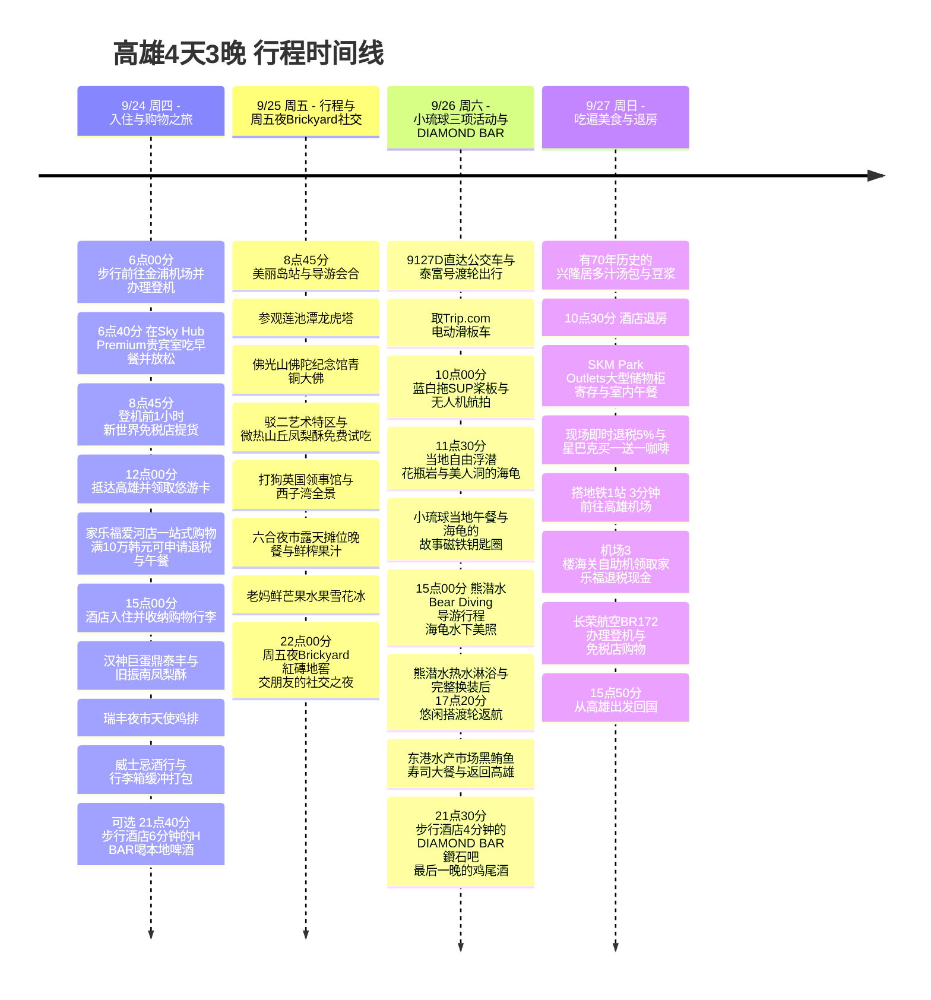

**首日正午抵达,到提前入住的等待时间都排得满满当当:鼎泰丰・汉神巨蛋购物、瑞丰夜市、黑人牙膏一站式采购。第二天先跟Klook一日游,逛微热山丘凤梨酥、在六合夜市吃晚餐,再到周五夜的Brickyard国际酒吧享受社交之夜(交朋友)。第三天骑电动滑板车游小琉球,体验蓝白拖SUP与无人机航拍、自由浮潜、15点熊潜水拍下海龟水下美照,之后到步行酒店4分钟的DIAMOND BAR喝鸡尾酒。第四天吃过当地早餐,经SKM Park奥特莱斯前往机场**,把高雄之行的动线、购物和社交生活都安排得近乎完美。

第二天(Klook一日游)和第三天(小琉球海上浮潜及SUP活动)从早到晚排得满满的,所以把沉重的超市采购和黑人牙膏购物,放在第一天晚上就在酒店(URBAN HOTEL33)旁边解决,并全部打包进行李箱,这样旅行后半段就能没有行李负担,轻松舒适地游玩。

时间均为当地时间(比韩国慢1小时),航班以查询到的时刻表**7C6123 金浦 09:45 → 高雄 12:00 / BR172 高雄 15:50 → 仁川 19:45**为准。如与实际预订单不同,请先调整前往机场的行程。[出境时刻表](https://zbordirect.com/en/low-cost/from-korea/to-taiwan/seoul-kaohsiung)、[回程时刻表](https://zbordirect.com/en/tools/schedule?arrival_city=SEL&departure_city=KHH)。

## 行程概要

### 🎯 每日四大核心主题(Daily Core Mission)

* 🏬 **Day 1 (9/24 周四) : 入住与购物之旅**
  - **主题**: 利用航班后舒适的提前入住等待时间,征服高雄核心商圈购物
  - **核心行程**: 06:00 从茶山House步行前往金浦机场并办理7C6123登机 → 06:40 直奔Sky Hub Premium贵宾室享用早餐并放松 → 08:45(登机前1小时)到新世界免税店提货处取货 → 09:45 从金浦起飞,12:00 抵达高雄并领取/充值悠游卡 → 在酒店寄存行李后,利用提前入住的黄金时间(**[选择1] 家乐福爱河店一站式购物&美食广场午餐&现场即时退税5%** 或 **[选择2] 老字号本地牛肉面店大牛牛肉面午餐&麻古茶坊芝芝芒芒**) → 15:00 酒店入住并整理行李 → 汉神巨蛋(鼎泰丰晚餐&有130年历史的旧振南凤梨酥) → 瑞丰夜市天使鸡排 → 在噶玛兰展示间/南威海洋酒行购买2瓶威士忌后安全打包进行李箱 → [可选] 步行酒店6分钟的H BAR轻松喝杯第一晚的啤酒。
* 🏛️ **Day 2 (9/25 周五) : 韩语导游佛光山之旅&周五夜Brickyard社交之夜**
  - **主题**: 探访高雄第一地标的历史与文化,品尝六合夜市美食,周五夜在国际酒吧/酒吧里交朋友
  - **核心行程**: **[已确认预订] Klook全天韩语导游行程**: 美丽岛站集合 → 莲池潭(龙虎塔) → 有世界最大青铜坐佛的佛光山佛陀纪念馆 → 驳二艺术特区&微热山丘(SunnyHills)本土凤梨酥免费试吃・购买 → 打狗英国领事馆眺望港口全景 → 在六合夜市下车后,在中央露天摊位享用冰凉的木瓜牛奶・鲜榨果汁和烤海鲜晚餐 → 当地隐藏的冰店名家老妈鲜芒果雪花冰 → **[周五夜亮点] 高雄代表性的国际酒吧&夜店[Brickyard (紅磚地窖)](https://maps.app.goo.gl/jnwZL2sB41fR88NJA)**,边喝台湾啤酒/鸡尾酒、玩台球桌上的美式台球,边结交外国人和当地人的社交之夜!
* 🐢 **Day 3 (9/26 周六) : 小琉球海上活动三项全程(滑板车・SUP无人机拍摄・浮潜)&DIAMOND BAR**
  - **主题**: 电动滑板车飞驰、SUP桨板无人机航拍美照、近距离和野生海龟共游,以及在酒店门口有情调的酒吧用社交收尾
  - **核心行程**: 9127D公交车&KKday泰富号往返高速渡轮(14,815韩元) → 取Trip.com免驾照电动滑板车(13,600韩元) → **🌟 10:00 [Trip.com预订已确认] 蓝白拖(藍白拖)SUP桨板体验&翠绿海面无人机航拍美照(29,445韩元)** → **11:30 花瓶岩・美人洞当地自由浮潜** → 小琉球当地午餐&在海龟的故事购买刻有「小琉球」的立体金属磁铁和海龟钥匙圈・玩偶,再买到麻花卷(麻花小吃) → **🌟 15:00 [Trip.com预订已确认] 熊潜水(Bear Diving)导游行程(近距离水下拍摄海龟)&热水淋浴与完整换装(16,000韩元)** → 17:20 搭泰富号渡轮悠闲返航 → 东港华侨水产市场黑鲔鱼寿司・海鲜丼大餐 → 搭9127D公交车返回高雄后,可选放松按摩 → **21:30 步行酒店4分钟的[DIAMOND BAR (鑽石吧)]**,品尝韩国人推荐的亲切调酒师的定制鸡尾酒,度过情调满满的社交之夜!
* 🥟 **Day 4 (9/27 周日) : 吃遍美食与退房**
  - **主题**: 品尝有70年历史的本地早餐,出境前完美的奥特莱斯购物&超快速前往机场
  - **核心行程**: 从酒店搭捷运4分钟去有70年历史的兴隆居,享用招牌多汁汤包(大包子)和豆浆早餐 → 10:30 酒店退房 → **SKM Park Outlets大型储物柜寄存行李&凉爽的室内午餐・品牌购物・现场即时退税5%&用完星巴克买一送一优惠券** → 在机场前1站(捷运3分钟)超快速移动,从容办理长荣航空BR172登机手续,逛免税店后15:50回国。

---

### 🗺️ 行程时间线(Mermaid)

---

| 日期 | 主要主题 | 主要动线 | 一天的收尾 |
|---|---|---|---|
| 9/24 周四 | **入住与购物之旅** | 06:00 步行前往金浦机场 → 直奔贵宾室吃早餐 → 08:45(登机前1小时)提取免税品 → 12:00 抵达高雄(e-Gate 1分钟・机场1楼换取悠游卡) → **酒店寄存行李&提前入住前去家乐福爱河店(捷运3分钟+步行/公交,购物、美食广场午餐、开具满10万韩元的退税申请单) [或步行酒店5分钟的大牛牛肉面&珍珠奶茶]** → 15:00 入住/休息 → **汉神巨蛋(搭捷运前往,星巴克买一送一优惠券&鼎泰丰等位期间购买旧振南凤梨酥・牛轧饼)** → 瑞丰夜市(步行5分钟) → **威士忌酒行(南威海洋酒行/噶玛兰展示间)** → **[可选] H BAR(步行6分钟)** | 21:00 在酒店提前打包行李箱,或在H BAR轻松喝杯啤酒 |
| 9/25 周五 | **韩语导游行程&周五夜社交** | **[已确认] Klook一日游**: 美丽岛站集合 → 莲池潭 → 佛光山佛陀纪念馆(礼敬大厅星巴克) → 驳二(诚品书店星巴克&微热山丘免费试吃/购物) → 英国领事馆 → 爱之河 → **六合夜市下车晚餐&露天交流 → 老妈冰店(鲜芒果雪花冰) → 22:00 Brickyard 紅磚地窖(周五国际酒吧/夜店交朋友)** | 00:30~01:00 乘Uber/出租车5分钟返回酒店,睡个好觉 |
| 9/26 周六 | **小琉球三项活动&DIAMOND BAR** | **小琉球海上活动全程**: 9127D直达公交车 → 东港泰富号渡轮(KKday) → 电动滑板车(Trip.com) → **🌟 10:00 蓝白拖SUP/皮划艇&无人机航拍(Trip.com 29,445韩元)** → **11:30 当地自由浮潜(花瓶岩・美人洞)** → 午餐&在海龟的故事购物(海龟磁铁・玩偶・钥匙圈) → **🌟 15:00 熊潜水(Bear Diving)导游行程(海龟水下美照)&热水淋浴与完整换装** → 17:20 搭渡轮返航 → 东港水产市场(黑鲔鱼・寿司) → 9127D返回高雄 → **21:30 步行酒店4分钟的DIAMOND BAR 鑽石吧** | 23:30 在步行酒店4分钟的DIAMOND BAR喝完鸡尾酒后回去睡个好觉 |
| 9/27 周日 | **吃遍美食与退房** | 有70年历史的早餐(兴隆居汤包/豆浆,捷运4分钟) → 10:30 退房 → **SKM Park奥特莱斯午餐&星巴克买一送一咖啡&购物(大型储物柜寄存行李)** → 前往机场捷运正好1站(3分钟) → **[托运行李前] 在机场3楼海关E-Tax自助机领取家乐福满10万韩元的退税现金** → 长荣航空办理登机&免税店购物 | 13:30 抵达机场,海关退税后搭BR172回国 |

---

> [!TIP]
> **台湾当地ATM取款&海外卡(Travelog・Travel Wallet / TravelGO)手续费完全攻略**
>
> 📊 **台湾旅行支付真实数据(Travel Wallet统计)**:
> - **现金取款55%** vs **刷卡支付45%**  
> - 台湾除台北的大型购物中心外,在高雄当地老店、夜市小摊、小琉球浮潜淋浴间/投币储物柜费用等场合,**现金取款的比例(55%)依然过半**。事先备足现金(尤其是100 TWD小面额钞票)是旅行的关键!
>
> ---
>
> #### 1. 台湾6大热门银行ATM支持的卡品牌(Master / VISA / UnionPay)完美对照
> 海外支付/取款卡(Travelog、Travel Wallet、TravelGO、Toss等)会因**卡片上印的国际品牌标志**不同,可免手续费(免费)取款的ATM银行完全不同。
>
> | 银行名称(中文/英文) | 支持的卡品牌 | 主要设置位置&取款提示 |
> |---|:---:|---|
> | **国泰世华银行** Cathay United Bank / 國泰世華 🌳 | <mark>**Mastercard**</mark> · <mark>**VISA**</mark> · <mark>**UnionPay**</mark> *(3大品牌全部支持!)* | • **高雄捷运全部车站(闸门内外)** • **酒店正对面全联(PX Mart)店内** • 莱尔富(Hi-Life)便利店 👉 **Mastercard持卡人必去据点!** 唯一以0元手续费完整支持3大品牌的「万能ATM」 |
> | **台湾银行** Bank of Taiwan / 臺灣銀行 | <mark>**VISA**</mark> · <mark>**UnionPay**</mark> | • **高雄机场行李提取处(海关通关前)** • **高雄机场1楼入境大厅右侧尽头** • 市内台湾银行分行 |
> | **兆丰银行(兆丰国际商业银行)** Mega Bank / 兆豐銀行 | <mark>**VISA**</mark> | • **高雄机场行李提取处(海关通关前)** • **高雄机场1楼入境大厅左侧尽头** • 市内兆丰银行分行 |
> | **新光银行** Shin Kong Bank / 新光銀行 | <mark>**VISA**</mark> | • 高雄市内主要分行及繁华街区 |
> | **中国信托银行(CTBC)** CTBC Bank / 中國信託 | <mark>**UnionPay**</mark> *(※VISA/Master取款会收手续费,请注意)* | • **台湾全境7-ELEVEN门店内** 👉 **银联(Travelog UPI)手续费0元!**(但VISA/Master收取100 NTD) |
> | **台新银行** Taishin Bank / 台新銀行 | <mark>**UnionPay**</mark> *(※VISA/Master取款会收手续费,请注意)* | • **台湾全境全家(FamilyMart / 全家)门店内** 👉 **银联(Travelog UPI)手续费0元!**(但VISA/Master收取100 NTD) |
>
> ---
>
> #### 2. 适合自己卡片的超简单ATM寻找策略
> - **💳 Hana Travelog(UnionPay / 银联 🔴🔵🟢)**:
>   - **可用ATM**: 国泰世华银行 🌳、台湾银行、**7-Eleven(CTBC)**、**全家(台新)**
>   - **策略**: 除机场(台湾银行)外,在市内每条街巷都有的**7-Eleven和全家ATM可24小时手续费0元**取款!便利程度压倒性第一。
> - **💳 Travel Wallet(VISA 🔵)**:
>   - **可用ATM**: 国泰世华银行 🌳、**台湾银行**、**兆丰银行**、新光银行
>   - **策略**: 在机场使用**台湾银行或兆丰银行**,在市内使用**捷运站或酒店前全联的国泰世华(Cathay)**机器。*(※便利店7-Eleven/全家的机器会收100 NTD手续费,请避开)*
> - **💳 Mastercard(Travelog Master / Toss / 新韩SOL Travel 🔴🟡)**:
>   - **可用ATM**: 重点锁定**国泰世华银行(Cathay United Bank 🌳)**!
>   - **策略**: 要找到机场捷运连接通道(地下1楼)、**高雄捷运所有车站闸门、全联店内的国泰世华**,才能安全地免费取款。
>
> ---
>
> #### 3. 各发卡机构取款额度&交通卡/优惠小贴士
> 1. **Hana Travelog(Mastercard vs UnionPay)**:
>    - **取款手续费&额度**: Hana Card ATM取款手续费**全免**,每日$6,000 / 每月$10,000左右,额度宽裕。
>    - **实时自动充值**: 即使余额不足,也会按基准汇率从韩元账户即时自动充值,可以取款/支付。
>    - **银联(UPI)商户优惠**: 在**鼎泰丰(鼎泰豐)**等华人圈主要连锁店付款时可能享有促销优惠(建议第1天在汉神巨蛋鼎泰丰结账时向柜台确认!)。
> 2. **Travel Wallet(Visa)**:
>    - **★ 注意每月超过$500会收2%自有手续费**: Travel Wallet**仅在每月500美元(USD)左右以内免ATM取款手续费**,**超出部分会收取2%的自有手续费**(单次$400、每日$1,000、每月$2,000上限)。大额取款时建议优先使用Travelog。
> 3. **高雄捷运闸门非接触式(Touch)直接刷卡乘车(官方支持银联!)**:
>    - **高雄捷运(KRTC)的突出优点**: 与台北捷运不同,**高雄捷运官方支持银联(UnionPay)非接触式直接刷卡进出站**!
>    - **100%活用您的卡**: 您持有的**Hana Travelog银联非接触式卡**或Travel Wallet(Visa)实体卡,可以**像交通卡一样刷闸门上方的专用读卡器直接乘车**。
>    - **实体悠游卡(EasyCard)的分工**: 高雄捷运(MRT)直接用Travelog卡搭乘,购买的实体悠游卡(87 TWD)则分工用于**Day 3东港 ↔ 高雄9127D直达公交车(城际公交必须用悠游卡)**以及**酒店前全联/便利店的小额支付**!
>
> ---
>
> #### 4. 高雄机场免手续费(0元)ATM三大据点&最佳动线
> 高雄国际机场(KHH)规模小巧,动线很短,入境检查后各处都设有免费ATM:
> 
> | 机场内区域 | 设置银行及位置 | 支持品牌及实用提示 |
> |---|---|---|
> | **① [最快] 行李提取处 (Baggage Claim / 海关通关前)** | **台湾银行(Bank of Taiwan)&兆丰银行(Mega Bank)ATM** • 通过e-Gate后,提取行李的传送带区域墙面 | • 台湾银行(VISA、UPI) / 兆丰银行(VISA) • 在等行李出来的5~10分钟里,不用排队就能最快取到现金! |
> | **② [主要] 1楼入境大厅 (通过海关后的大厅)** | **兆丰银行(左侧尽头)&台湾银行(右侧尽头)柜台及ATM** • 自动门打开出来后,大厅两端各有一处 | • **避开排队小窍门 ⚡**: 去搭地铁(MRT)的通道在左侧方向,大部分入境旅客都涌向**左侧的兆丰银行(VISA)**,队伍很长。左侧人多的话,别犹豫,直接去**对面右侧的台湾银行(VISA、UPI)柜台/ATM**!几乎没人排队,可超快办理。 • **一站式3分钟流程**: 通过海关 → 在清闲的ATM按100 NTD面额分次取款 → 在右侧5号出口附近的「联合旅行者」领取悠游卡(87 TWD) → 前往捷运 |
> | **③ [备选] 地下1楼 捷运机场站 (R4 Kaohsiung Airport Station)** | **国泰世华银行(Cathay United Bank / 國泰世華 🌳)ATM** • 1楼6号出口前搭自动扶梯下去搭地铁的路上/闸门候车大厅 | • **Master / Visa / UPI三大品牌100%免费支持** • 强烈推荐Mastercard持卡人!即使1楼大厅ATM排长队,或忘了取款,也可以在搭地铁前直接取 |
>
> 💡 **高雄市内及酒店前的追加据点**:
> - **高雄捷运所有车站(美丽岛站、信义国小站等)**: 闸门内外设有**国泰世华银行(绿色树木标志 🌳)ATM**。(Master/Visa/UPI全免费)
> - **酒店正对面的全联福利中心信义店(PX Mart,步行2分钟)**: 店内原本就设有**国泰世华银行ATM**,在酒店门口随时可免费取款(※店内商品结账不能使用韩国信用卡,仅限现金/悠游卡)。
>
> ---
>
> #### 5. 实战ATM取款完整手册(分成100 TWD小面额钞票的小窍门)
> 1. **事前准备**: 出发前务必在卡片App中确认**海外ATM取款是否已解除限制**以及**密码(4位)**。
> 2. **插入卡片&输入PIN**: 插卡后输入韩国的4位密码,按绿色按钮(Enter)。(如果要求输入6位,请输入**4位密码+00**)。
> 3. **选择账户菜单**: 点击第3个菜单**`Savings Account(储蓄存款)`**。
> 4. **输入取款金额**: 单次最多可取20,000 NTD(例如输入1,000 NTD或3,000 NTD后点Next)。
> 5. **🌟 100 NTD面额拆分画面(最重要!)**:
>    - 取款前的画面会出现**「是否要将取款金额换成100台币钞票?(Exchange to 100 TWD notes?)」**的提示。
>    - **一定要按`YES`!**(例如取1,000 NTD会出来10张100 NTD钞票)。
>    - 在夜市小摊、街头小吃、自动贩卖机、小琉球浮潜淋浴间/投币储物柜等地方,拿出1,000 NTD大钞往往会因为没零钱而让对方为难,所以备好100 NTD钞票是必须的。
> 6. **取回卡片&领取现金**: 按画面提示**先拔出卡片**,再拿现金和收据(可选),取款就完成了!
>
> #### 6. [应急现金兑换小贴士] 禁止直接用韩元兑换!美元(USD)二次兑换压倒性占优
> 用Travelog零手续费卡在ATM取款最划算,但如果为了以防万一想从韩国带些应急现金,请务必记住以下汇率事实:
> - **绝对不建议在当地兑换韩元(KRW)现金 ❌**: 在台湾当地银行买入韩元的汇率非常不划算(例如兑换10,800 TWD,用韩元要花约55万韩元,而用在韩国提前换好的350美元(当时约50万韩元)兑换,则会产生约5万韩元左右的差价收益)。
> - **准备美元(USD)纸钞(推荐二次兑换) 🟢**: 应急钱在韩国准备好100美元面额的美元(USD),到机场入境大厅银行柜台(台湾银行/兆丰银行)兑换要划算得多。
> - **柜台兑换所需材料**: 只要把**护照+外币纸钞(USD)**递给柜台,1分钟就能完成兑换。
> - **机场银行柜台营业时间**: 台湾银行/兆丰银行每天09:00 ~ 21:00(周一至周五工作日有05:30~10:30等对应航班的提早营业)。*(※卡片ATM取款机全年无休24小时可用)*
>
> #### 7. 高雄当地支付&出租车实战小贴士
> - **本地美食店&夜市**: 100%现金支付(部分支持LINE Pay)。
> - **出租车**: 即使车外贴着信用卡贴纸,实际上车后大多数司机会说刷不了卡而要求付现金。想刷卡支付时,请使用**Uber App自动支付**。(不过在旗津岛码头等偏远地区很难叫到Uber,直接搭路边普通出租车付现金要快得多)。

---

## 9/24 (周四) · [Day 1: 入住与购物之旅] 正午抵达,家乐福・汉神巨蛋购物&瑞丰夜市

* **出境前夜(9/23 周三)**: 为赶上上午09:45的航班(7C6123),在金浦机场正对面松亭站的**[茶山House](https://naver.me/xjgcCwsW)住1晚(18,000韩元)**。免去赶早班首班车的负担,睡个好觉,早上06:00出发。
* **出境当天早上(9/24 周四)**: 上午**06:00从茶山House悠闲地步行前往金浦机场国际线航站楼(约10~15分钟)**,06:15左右抵达。在济州航空柜台办理登机手续并托运行李,完成出境检查后,**一进入免税区(候机区)就立刻在新世界免税店App上申请「提货处智能等候(远程排队/手机取号)」**。然后直奔06:30开门的[**Sky Hub Premium贵宾室**](https://www.prioritypass.com/ko-KR/lounges/south-korea/gimpo-international/gmp5-sky-hub-lounge-premium)!享用热腾腾的自助早餐、现场烹饪和按摩椅休息区,舒舒服服地休息,同时在App上确认排号,**登机前1小时(08:45左右)离开贵宾室,到正对面的新世界免税店提货处,零等待取走免税品**,09:15前往登机口。

### 💡 首日正午抵达后,提前入住(15:00)前的黄金时间活用法(家乐福 vs 当地牛肉面)
中午12:00抵达高雄机场,通过e-Gate并在国际线1号航站楼1楼柜台领取/充值悠游卡后,大约是13:00~13:10。住宿URBAN HOTEL33的正常入住时间是**15:00**,所以会有约1小时30分钟的等待入住时间。  
13:35在酒店前台免费寄存行李箱(1分钟搞定)后,可以根据喜好,从**[选择1: 家乐福大型超市一站式路线(100%公共交通)]**或**[选择2: 当地美食&甜点步行路线(交通费0元)]**中选择,充实地度过:

#### 🏆 [选择1(推荐公共交通・大型超市一站式攻略型)] 家乐福爱河店购物&午餐&退税申请(满10万韩元)
*酒店入住前先拿下大型超市,把大量购物行李在15:00入住的同时直接收进客房,第2~4天全程轻装出行的聪明计划!*
1. **13:35 酒店寄存行李后,搭乘捷运公共交通前往**:
   - 酒店正对面的**O6信义国小站搭乘捷运橘线 → 在O4市议会站(旧高雄市议会)下车(仅2站,3分钟,悠游卡20 TWD)**。
   - 从2号出口出来,沿着跨过中正桥(爱河)的河岸路步行约10~12分钟(或搭市议会站前的60路公交车2站 / YouBike 3分钟),抵达**[家乐福爱河店(家樂福 愛河店)](https://maps.app.goo.gl/fPioKXCNr9VqWssw7)**。
2. **13:45 家乐福美食广场午餐&大型超市购物**:
   - **美食广场/餐饮区午餐**: 在凉爽的空调下,牛肉面、台式铁板烧、日料、点心等多种菜单,无需排队,舒适快速地用餐。
   - **扫货**: 黑人(DARLIE)牙膏(组合折扣装)、Dr.Q(Dr.Q)蒟蒻果冻、满汉大餐牛肉面杯面、3点15分奶茶茶包、巧克力软糖球、金门高粱酒等纪念品和宵夜,一次在一个地方全部装进购物车。
   - **🌟 [满10万韩元退税申请&领取机场退税单]**:
     - 台湾规定,当天在同一家店合计消费**2,000 NTD(约85,000韩元)以上**,即可享受5%营业税退税(Tax Refund)。
     - 买牙膏、泡面、零食、酒类等达到**10万韩元(约2,400~2,500 NTD)以上**,在收银台结完账后,**到1楼客服中心(Service Desk)出示护照和收据申请退税**。
     - **保管机场退税单**: 可以当场立即领取小额退税,或领取**机场海关退税用单据(Refund Form)**并与护照一起收好。保管好这张单据,**最后一天(Day 4)可在高雄机场3楼海关E-Tax自助机领取现金(TWD)退税,直接补贴机场免税店(威士忌・纪念品)购物!**
3. **14:45 搭捷运返回酒店&15:00正常入住**: 从市议会站搭捷运橘线返回信义国小站(仅3分钟) *(※只有在整箱大量购买导致行李过重时,才可选择搭Uber/出租车到酒店门口,约8分钟・110 TWD)*。15:00正常入住后,立刻把购物行李放进客房,在空调下舒适休息40分钟!

#### 🍜 [选择2(步行完成・本地美食型)] 步行酒店5分钟的大牛牛肉面本地午餐&麻古茶坊水果茶甜点
*不用搭车或换乘,在酒店门口享受高雄当地人真正的本地美食和台湾代表性水果茶,悠闲等待入住的100%步行友好路线!*
1. **13:35 酒店寄存行李**: 把行李箱寄放在酒店前台,轻装出发(交通费0元)。
2. **13:45 在当地真正的名店吃第一餐**: 前往步行酒店5分钟、高雄当地人最爱的牛肉面老店[**大牛牛肉面**](https://maps.app.goo.gl/hXfR9jY8j1K6Z9pE7)!用清爽浓郁的红烧/清炖牛肉面、Q弹的牛筋和清凉的凉拌黄瓜,缓解飞行后的饥饿。
3. **14:25 台湾第一的水果茶甜点**: 饭后到附近的**麻古茶坊(MACU)**,买一杯夏/秋招牌**芝芝芒芒(鲜芒果冰沙+咸甜芝士奶盖)**或**50岚(50嵐)乌龙奶茶(加珍珠)**,拿在手里清凉地补充糖分。
4. **14:50 返回酒店&办理入住(15:00)**: 拿到房卡,在凉爽的空调下洗脸休息。(牙膏和泡面等超市采购在夜间行程之后,在酒店前的全联和宝雅进行)

| 当地时间 | 要做的事 | 移动・等待安排 |
|---|---|---|
| 06:00∼06:15 | **从茶山House出发 → 步行前往金浦机场** | 从松亭站住处步行到金浦机场国际线航站楼,早晨步行约10~15分钟 |
| 06:15∼06:40 | **7C6123办理登机&安检・出境检查** | 托运济州航空行李并快速通过出境检查 |
| 06:40∼08:45 | **一进入免税区立刻申请[新世界免税店远程排队] → 直奔[Sky Hub Premium贵宾室]享用早餐&放松** | 通过安检/出境检查后,一进入免税区(候机区)就在**新世界免税店App上立刻领取「提货处智能等候(远程排队/手机取号)」**!直奔06:30开门的全新高级贵宾室,享用现场烹饪早餐、在按摩椅休息区舒舒服服地休息,同时用手机实时确认排号 |
| 08:45∼09:15 | **[登机前1小时] 新世界免税店提货处智能提货(零等待)** | 离开贵宾室后,按远程等候的排号,直接到正对面的新世界免税店提货处,无需等待即可领取预订的免税品,整理后前往登机口(09:15开始登机) |
| 09:15∼09:45 | **登上7C6123并起飞(GMP → KHH)** | 09:45从金浦机场出发(预计当地时间12:00正午抵达高雄) |
| 12:00∼13:00 | **抵达高雄・e-Gate(1分钟)&海关通关&用Travelog取款&换取/充值悠游卡** | 在线预先申报后,在入境检查区最里面的红色E-GATE柜台1分钟登记,10秒通过闸门 → 通过出口海关X光机(※禁止携带肉类/加工食品入境) → 在入境大厅1楼的**台湾银行/兆丰银行ATM用Travelog取5,000 NTD(手续费0元)** → 在**1楼联合旅行者柜台**换取悠游卡(87 TWD)实体卡 → 在便利店或捷运机场站(R4)**立即充值400 NTD**(递上1,000 NTD钞票,找回的600 NTD换成100 NTD钞票留给夜市用) |
| 13:00∼13:35 | **10号登机口步道 → 搭乘捷运 → 前往酒店并寄存行李箱** | 沿10号登机口户外步道直走1分钟 → R4机场站(刷Travelog非接触式卡或悠游卡) → 搭乘往冈山(北)方向 → 在美丽岛换乘 → O6信义国小站(步行3分钟)。**先在酒店前台寄存行李箱(1分钟搞定)** |
| 13:35∼14:50 | **[选择1] 搭捷运前往家乐福爱河店&购物・午餐・即时退税** *(选择2: 大牛牛肉面本地午餐&麻古茶坊芝芝芒芒步行路线)* | • **选择1(公共交通)**: 在酒店前搭捷运橘线(O6信义国小 → O4市议会站 2站3分钟,20 TWD)后,沿爱河河岸路步行10分钟(或60路公交车/YouBike) → **[家乐福爱河店](https://maps.app.goo.gl/fPioKXCNr9VqWssw7)**美食广场午餐&购物车装满大型超市必买商品(黑人牙膏组合装、满汉大餐、Dr.Q果冻、奶茶) → **在1楼客服中心现场即时现金退税5%(满2,000 NTD时)** → 搭捷运返回酒店 • **选择2(步行完成)**: 步行酒店5分钟的**[大牛牛肉面 四维本店](https://maps.app.goo.gl/ZEsUXYtWrnvQzY1S9)**吃红烧/清炖牛肉面和牛筋午餐后,外带**麻古茶坊(MACU)**芝芝芒芒(交通费0元) |
| 14:50∼15:45 | **酒店入住(15:00)&进入客房・收纳购物行李・淋浴・休息** | 在URBAN HOTEL33办理入住。(如果执行了选择1,超市购物行李立刻收进客房!)在凉爽的房间里洗脸,舒适地恢复体力40分钟 |
| 15:45∼16:15 | 酒店 → 前往汉神巨蛋 | O6信义国小 → 美丽岛换乘 → R14巨蛋站(地铁加步行约20分钟) |
| 16:15∼18:00 | **汉神巨蛋B1购物&鼎泰丰晚餐&星巴克买一送一** | **1) 领取鼎泰丰号码牌(等位约20~30分钟)** **2) 等位期间购物&喝咖啡**: 试吃/购买1890年传统的**旧振南(舊振南)高级凤梨酥**,购买**手工牛轧饼**。在汉神巨蛋内的星巴克(2F或B1)用**110 TWD买一送一优惠券**取一杯冰饮 • **[退税小窍门]**: 在汉神百货内当天累计消费**满2,000 NTD**,**携带护照到B1或6楼客服中心可现场即时现金退税5%**! **3) 鼎泰丰用餐**: 小笼包、排骨炒饭、红油抄手(※使用银联卡结账时,请向柜台确认是否有鼎泰丰10%折扣优惠活动) |
| 18:00∼18:15 | 汉神巨蛋 → 步行前往瑞丰夜市 | 沿百货后方小巷步行5分钟 |
| 18:15∼19:30 | **瑞丰夜市(天使鸡排&街头小吃)** | 高雄最大的本地热门夜市。逛酥脆厚实的**天使鸡排(天使雞排)**、地瓜球、街头小吃 |
| 19:30∼20:15 | **[威士忌酒行] 从瑞丰直达 → 南威海洋酒行 富民店(步行8分钟)** | **瑞丰夜市扫街美食后步行8分钟(东南方650m)**,直奔专业酒行[**南威海洋酒行**](https://maps.app.goo.gl/4mksKCj4XeMNTj269)!按韩国免税额度实惠购买**威士忌2瓶(噶玛兰/单一麦芽)**。酒行正对面(步行5分钟)就是捷运R13凹子底站,连搭地铁返回的动线都是完美的单程(One-way)路线! |
| 20:15∼20:40 | **搭捷运返回酒店所在街区(单程路线)** | 从南威海洋酒行步行5分钟到R13凹子底站搭车 → 在美丽岛换乘 → O6信义国小站(约20分钟,无需折返,一条直线返回) |
| 20:40∼21:10 | **酒店前大型超市(全联&宝雅)或酒店门口的寿司郎(壽司郎)宵夜** | • 白天已完成家乐福的话: 在酒店前的便利店/超市轻松买些清凉的台湾水果饮料(木瓜牛奶/苹果西打)和宵夜,悠闲收尾 • 白天享用了大牛牛肉面的话: 在步行酒店2分钟的**宝雅**(黑人牙膏组合装)和**全联**(满汉大餐泡面、Dr.Q果冻、奶茶采购&店内国泰世华银行ATM可0手续费免费取款。※店内结账不能使用韩国信用卡,仅限现金/悠游卡)完成必买商品采购 • **[酒店门口寿司・甜点宵夜选项 🍣]**: 酒店(URBAN HOTEL33)正对面(步行1分钟)的**[寿司郎 高雄中正店(壽司郎)](https://maps.app.goo.gl/SUUBUMvHE2uVTiTN8)**!可通过**台湾寿司郎官方App提前远程排队/预约**,无需等位,在凉爽的空调下享用新鲜寿司和温热绿茶/香甜甜点,再合适不过。 |
| 21:10∼21:40 | 返回酒店&**完成托运行李箱的缓冲打包** | 把**2瓶威士忌**用衣物/毛巾一直包到瓶颈处,厚厚地包好后放在行李箱正中间缓冲,与牙膏一起锁好。(为第2~4天做好万全准备) |
| 21:40∼23:00 | **[可选: 第一晚轻松的本地小酌] 步行酒店6分钟的[H BAR](https://maps.app.goo.gl/fT34LjREt6ENvvBe8)** | 从酒店(URBAN HOTEL33)往东步行仅6分钟(500m)。 • **特点**: 每人最低消费200 NTD(约8,500韩元)的实惠性价比,室内禁烟,伴着舒适的音乐,轻松喝杯冰镇台湾生啤或Highball,庆祝抵达高雄的第一晚再合适不过! • **步行返回**: 拖着拖鞋6分钟就能回到酒店客房 |

[酒店 → 家乐福爱河店(公共交通/步行)](https://www.google.com/maps/dir/?api=1&origin=URBAN+HOTEL33+Kaohsiung&destination=%E5%AE%B6%E6%A8%82%E7%A6%8F%E9%87%8F%E8%B2%A9+%E6%84%9B%E6%B2%B3%E5%BA%97&travelmode=transit) · [酒店 → 大牛牛肉面](https://www.google.com/maps/dir/?api=1&origin=URBAN+HOTEL33+Kaohsiung&destination=Da+Niu+Beef+Noodles+Kaohsiung&travelmode=walking) · [酒店 → 汉神巨蛋](https://www.google.com/maps/dir/?api=1&origin=URBAN+HOTEL33+Kaohsiung&destination=Din+Tai+Fung+Hanshin+Arena&travelmode=transit) · [汉神巨蛋 → 瑞丰](https://www.google.com/maps/dir/?api=1&origin=Din+Tai+Fung+Hanshin+Arena&destination=Ruifeng+Night+Market&travelmode=walking) · [瑞丰 → 南威海洋酒行(步行8分钟)](https://www.google.com/maps/dir/?api=1&origin=Ruifeng+Night+Market&destination=南威海洋酒行+富民店&travelmode=walking) · [酒店 → 寿司郎中正店(步行1分钟)](https://maps.app.goo.gl/SUUBUMvHE2uVTiTN8) · [酒店 → H BAR(步行6分钟)](https://maps.app.goo.gl/fT34LjREt6ENvvBe8) · [酒店 → DIAMOND BAR(步行4分钟)](https://maps.app.goo.gl/u19WYRNiKbpwhwfAA).

> [!TIP]
> **金浦机场国际线「Sky Hub Premium」贵宾室&新世界免税店智能等候(远程排队)小贴士**
> - **新世界免税店提货处智能等候(远程排队 / 手机取号)**:
>   - **申请时机**: 完成安检和出境检查,**刚进入免税区(候机区 / 出境区内侧)后**,立刻打开新世界免税店手机App!
>   - **申请方法**: 在App内的`我的页面`或`提货处指南`菜单,点击**「智能等候(领取手机号码牌)」**。
>   - **突出优点**: 不用站在现场取号机前等待,可以**坐在Sky Hub Premium贵宾室的按摩椅上舒舒服服享用早餐,同时在手机上实时查看前面还有多少人**。登机前1小时(08:45左右)走出贵宾室,按叫号顺序到提货处柜台,就能**零等待高速通道立刻领取免税品**。
> - **Sky Hub Premium贵宾室(Sky Hub Lounge Premium)**:
>   - **新开业**: 2026年9月7日刚在金浦机场国际线候机区开业的最新高级贵宾室。
>   - **营业时间**: 每天06:30 ~ 20:10(最适合08:35左右早餐时段前往)
>   - **入场优惠**: 持**无限次PP卡(Priority Pass)**,无需任何额外费用,**100%免费入场**!
>   - **特色设施**: 主厨现场烹饪区、按摩椅休息区、商务贵宾室座位、新鲜鲜榨果汁/精品咖啡和高级烘焙。

> [!TIP]
> **高雄机场e-Gate(自动出入境检查)5分钟登记&终身快速通关完全攻略(反映YouTube与现场最新评价)**
> - **申请资格**: 持有效期剩余6个月以上的大韩民国电子护照者(年满17岁、身高140cm以上)。
> - **三步骤完整手册**:
>   1. **[出境前必做] 填写在线入境卡**:
>      - 访问[台湾移民署在线入境卡(Online Arrival Card)](https://niaspeedy.immigration.gov.tw/webacard/),用手机或电脑3分钟输入完毕(支持韩语翻译)。
>      - **主要填写信息**: 英文姓名、护照号码、出生日期、国籍(Republic of Korea)、出境航班(7C6123)、回程航班(BR172)、台湾停留地(酒店名: **URBAN HOTEL33**或**高雄商旅**)、访问目的(Sightseeing)。
>      - 最后一步输入邮箱地址和验证码后,画面上会出现**「Success」**,并发送确认邮件(PDF文件)。会立即自动同步到系统,所以不需要打印纸质版,不过为保险起见,把PDF或截图保存在手机里会更放心。
>   2. **[抵达高雄后立刻] 直奔1分钟现场登记柜台(位置小窍门!)**:
>      - 下飞机后沿「到达(Arrival)」标志搭自动扶梯下到入境检查区。
>      - 即使普通外国人人工检查的队伍排得很长,也不要排,直接走向**检查区最里面(角落尽头)用醒目的红色大字写着「E-GATE」的登记柜台(Enrollment Counter)**。
>      - 把护照交给工作人员,按指引进行**正视摄像头(拍摄人脸,需摘掉帽子・眼镜・口罩)+双手食指指纹扫描**。
>      - 工作人员会在**护照背面盖上「E-GATE」登记确认章(贴纸)**,仅需1分钟即登记完成!
>   3. **[当天立即使用] 10秒通过自动闸门**:
>      - 登记完成后,立刻从旁边的**E-GATE自动闸门**大大方方进入。
>      - 与韩国自动出入境检查相同,把护照照片页放到读卡器上扫描 → 第一道门打开后进入 → 看着屏幕摄像头进行人脸识别(或指纹扫描) → 第二道门打开,**零等待、仅10秒完成超快速入境检查!**
> - **🌟 高雄机场登记的突出优点&终身福利**:
>   - **零排队压力**: 台北桃园机场人潮拥挤,连登记窗口都要排队,而**高雄机场小巧清静,登记几乎没有排队,3~5分钟即可超快速入境**。
>   - **到护照到期日为止终身有效**: 只要登记一次,**到护照有效期到期日为止,在台湾全境(台北桃园/松山、高雄等)所有机场出入境时都可继续免费使用自动闸门**(下次台湾旅行或年底访问台北时,不必去现场登记处,只要填写在线入境卡,就能10秒通过自动门!)。
>   - **本次旅行出境(Day 4)时也适用**: 从高雄回韩国时,也不必排出境检查队伍,可通过e-Gate自动门10秒舒适通过。

> [!CAUTION]
> **高雄机场出境前海关X光行李检查&严禁携带畜产品入境注意事项**
> - 高雄机场在入境检查结束、领取托运行李后,**走出机场航站楼大厅的出口闸门前,仍会对所有行李严格实施海关X光检查(食品检疫)**。
> - 台湾因防控非洲猪瘟(ASF),严格禁止携带肉类加工品入境。
> - 含有香肠、肉干、火腿、饺子、牛肉炒辣酱、**泡面汤料包里的肉粒**等的食品,一旦被查获,将立即处以**最低20万NTD(约850万韩元)至最高100万NTD(约4,200万韩元)**的重罚。请绝对不要把加工肉类或新鲜水果等放进行李箱。

> [!NOTE]
> **高雄机场入境黄金流程: Travelog取5,000 NTD&连接捷运站的动线**
> 1. **通过e-Gate自动出入境闸门(约1分钟)**: 在检查区最里面的红色E-GATE柜台1分钟登记人脸/指纹,然后10秒通过旁边的闸门。
> 2. **Travelog免手续费取5,000 NTD**:
>    - **ATM位置**: 使用1楼入境大厅的**台湾银行(Bank of Taiwan / 臺灣銀行)**或**兆丰银行(Mega Bank / 兆豐銀行)**ATM(左侧兆丰银行队伍长的话,右侧台湾银行ATM很舒适)。
>    - **手续费**: 使用Travelog(Hana Master/UPI)时**当地手续费0元**。
>    - **取款提示**: 屏幕语言选择「韩语」或「英语」后,输入4位密码(必要时在后面加00)。出现DCC兑换界面时,务必选择**当地货币(TWD)**。5,000 NTD作为3晚4天夜市・本地餐馆・按摩・零食等现金开销,规模刚刚好。
> 3. **领取悠游卡实体卡(联合旅行者柜台)**:
>    - **位置**: 国际线第1航站楼1楼中华电信(中華電信)柜台与5号出入口之间。出示预先购买(87 TWD)的手机凭证,领取实体卡。
> 4. **悠游卡充值400 NTD&备好零钱(100 NTD钞票)**:
>    - 前往大厅内便利店或连接通道的**捷运高雄机场站(R4)服务台**。
>    - 递上ATM取出的1,000 NTD钞票,要求**「充值400 NTD(加值,jiā zhí)」**。
>    - **400 NTD预算的合适度**: 3晚4天市内捷运+26日东港9127D公交往返(约240 TWD)合计约390 TWD,正好是完美的金额!找回的600 NTD(100 NTD钞票)用于第一天瑞丰夜市和天使鸡排的现金。
> 5. **机场航站楼 → 搭乘捷运高雄国际机场站(R4)的动线(超简单步行)**:
>    - 从1楼入境大厅走向**10号登机口(Gate 10)**一侧的出口。
>    - 沿着地面指引线和户外遮雨棚步道直走,步行1~2分钟就能直接连通**捷运高雄国际机场站(R4)**站口和自动扶梯。
>    - 搭自动扶梯下到地下月台,在闸门刷**Travelog银联非接触式卡**或**悠游卡**,搭乘**往冈山(Gangshan / 岡山)北方向的列车**。
>    - 到高雄中心换乘站美丽岛站(R10)仅6站12分钟!

> [!TIP]
> **星巴克110 TWD即时使用买一送一优惠券最佳活用动线指南**
> 这次获得的**「星巴克110 TWD即时使用优惠券买一送一」**,在台湾当地门店结账时出示二维码,可在110 TWD额度内享受饮品买一送一优惠,或即时抵扣金额(点单超过110 TWD的饮品时,仅需用现金/悠游卡/银行卡支付超出的差额)。
> 推荐动线上最适合前往、最有情调的5个星巴克据点:
> 1. **9/24(周四) 汉神巨蛋(2F / B1门店)**: 领了鼎泰丰等位号码牌等20~30分钟时,或在购买旧振南凤梨酥前后,外带清凉的买一送一饮品!(2楼门店的落地窗景观很舒适)
> 2. **9/25(周五) 佛光山佛陀纪念馆(礼敬大厅 禮敬大廳 1楼)**: 入驻寺院入口大厅1楼的特色星巴克。炎热的白天行程中,在空调下享受清凉买一送一的休息据点。
> 3. **9/25(周五) 驳二艺术特区(驳二诚品门店)**: 由红砖旧港口仓库改造而成、情调满分的门店。在微热山丘免费试吃凤梨酥后,边散步边享受有情调的咖啡时光再好不过。
> 4. **9/27(周日) SKM Park Outlets(1楼大型门店)**: 退房后把行李箱放进大型投币储物柜,在凉爽的商场内购物,之后最悠闲地享用买一送一咖啡&烘焙的最从容场所。
> 5. **9/27(周日) 高雄国际机场国际线3楼出境大厅(候机区)**: 通过安检后登机前,在登机口附近可干净利落地用掉最后剩下的优惠券。

> [!TIP]
> **台湾三大必买伴手礼(黑人牙膏・牛轧饼・凤梨酥)完整购买动线总整理**
> 1. **黑人牙膏(DARLIE / 黑人牙膏)**:
>    - **购买处**: 第一天入住前的**家乐福爱河店(家樂福 愛河店)**(大容量组合折扣装&5%即时退税,最为推荐),或第一天晚上酒店前的**宝雅(POYA 信义店)** / **全联(全聯福利中心)**。
>    - **推荐种类**: 原味双重功效(绿色薄荷味,清爽感第一)、多合一小苏打美白、炭洁净。
>    - **关键提示**: 牙膏属于凝胶类,超过100mL(g)不能带上飞机!第一天买完立刻在酒店放进托运行李箱,第2~3天的行程就能全程轻松出行。
> 2. **牛轧饼(牛軋餅)**:
>    - **购买处1(高级)**: 第1天汉神巨蛋B1烘焙快闪店。刚烤出来的酥脆葱饼干与柔软Q弹的牛奶牛轧糖的绝妙搭配。
>    - **购买处2(高性价比送礼用)**: 酒店前的全联或家乐福。适合大量轻松分送给公司/朋友的独立包装盒装。
> 3. **凤梨酥(鳳梨酥)**:
>    - **微热山丘(SunnyHills, 微熱山丘)驳二店**: 第二天(9/25)Klook行程在驳二艺术特区自由活动时前往。一走进店里就会免费提供一杯温热乌龙茶和一块正品凤梨酥试吃!保留了土凤梨(土凤梨)特有酸甜果肉纤维的台湾第一品牌。
>    - **旧振南(舊振南, Jiu Zhen Nan)**: 第一天(9/24)位于汉神巨蛋B1。1890年起源于高雄、有130年传统的顶级糕点名家。香甜的传统奶油风味和高档的金色包装,非常适合送给父母/恩师。

> [!TIP]
> **台湾购物退税(Tax Refund)&高雄机场免税店完全指南**
> 台湾的**市内事后退税(TRS, Tax Refund Shopping)**制度和**机场免税店(Duty Free)**非常发达。购物时随身携带护照,就能实惠地退税。
> 1. **市内退税(TRS)标准**:
>    - **资格**: 外国游客(以入境日为准停留不满183天,必须持护照原件)。
>    - **最低消费金额**: **同一天、同一家TRS认可门店含税消费满2,000 NTD(约85,000韩元)**时。
>    - **实际退款金额**: 台湾营业税5%中扣除退税手续费(约14%)后,**实际约4.2~4.3%左右以现金/银行卡退还**。
>    - **注意事项**: 须在未拆封状态下于购买日起90天内带出境(注意封条不要损坏)。
> 2. **现场小额即时退税(現場小額退稅 / On-site Small-amount Tax Refund)** - *最便利的方法!*:
>    - **适用金额**: 当天同一门店累计消费**2,000 NTD以上 ~ 48,000 NTD以下**。
>    - **方法**: 结账后携带购物收据和**护照原件**到百货/奥特莱斯内的服务柜台,无需去机场,**当场即可立即以现金(NTD)退税**。
>    - **本次行程推荐的现场退税处**:
>      - **家乐福爱河店(家樂福 愛河店)**: 第一天(9/24)13:45到访时,在1楼客服中心,黑人牙膏、Dr.Q果冻、满汉大餐、奶茶、零食类等大型超市购物合计满2,000 NTD时,出示护照即可现场即时现金退税5%。
>      - **汉神巨蛋购物中心**: 在6楼或B1客服中心,鼎泰丰等位期间购买的旧振南凤梨酥、化妆品、时尚杂货等合计满2,000 NTD时即时退税(餐厅用餐费不在免税范围)。
>      - **SKM Park Outlets Kaohsiung**: 在1楼中央客服中心,奥特莱斯品牌门店合计消费满2,000 NTD时即时现金退税。
> 3. **机场海关退税(Customs Tax Refund)**:
>    - 在不支持现场退税的一般加盟店(宝雅等)消费满2,000 NTD后,领取了「外国旅客退税明细申请表(退稅明細申請表)」的情况。
>    - 9/27(周日)回国当天,在高雄机场3楼出发大厅(办理登机柜台附近)的**海关E-Tax自助机/柜台**扫描护照和单据,即可立即以现金或信用卡退税。
> 4. **高雄国际机场免税店(Everrich Duty Free - 事先免税)**:
>    - 高雄市内没有另外的大型市内事先免税店(Duty Free),所以市内购物请使用百货/奥特莱斯退税。
>    - 9/27(周日)高雄机场3楼出境检查后的登机口区域,有**昇恒昌(Everrich)免税店**规模很大,可用扣除税金的免税价做最后购物。
>    - **主要推荐免税商品**: **金门高粱酒58度(金門高粱酒)**、**噶玛兰(Kavalan)单一麦芽威士忌**(台湾威士忌在机场免税店比市内便宜,且完整适用免税优惠)、**佳德(佳德)凤梨酥**、香烟、名牌及香水。

> [!TIP]
> **台湾威士忌两大购物名所(酒店前噶玛兰官方展示间 vs 南威海洋酒行)&2瓶酒韩国免税带入完全指南**
> 这次旅行购买2瓶威士忌最完美的两处名所就在动线上。可按喜好选择,也可两家都逛:
> 1. **酒店正对面(步行4分钟,400m) - [噶玛兰威士忌 苓雅中正展售店(KAVALAN 噶瑪蘭威士忌)](https://maps.app.goo.gl/hKy1YJECDVfEGw8JA)**:
>    - **位置**: 苓雅区中正二路(从住宿URBAN HOTEL33步行仅4分钟,信义国小站3号出口附近)。
>    - **特点&优点**: **噶玛兰总部官方直营展示厅(Showroom)**。
>      - **试饮(Tasting)**: 可亲自试饮噶玛兰Solist(Solist)Vinho Barrique、Oloroso雪莉、波特桶等代表系列,挑选最合口味的桶型。
>      - **正品包装&周边**: 备有高级礼盒、正品购物袋、噶玛兰专用杯、迷你酒组。
>      - **压倒性的动线**: 就在酒店门口,不需要提着沉重酒瓶搭公共交通,试饮购买后4分钟就能放进客房行李箱,便利性最佳!
> 2. **高雄代表性的专业酒行 - [南威海洋酒行 高雄富民店(南威海洋酒行)](https://maps.app.goo.gl/4mksKCj4XeMNTj269)**:
>    - **位置&完美衔接动线**: **从瑞丰夜市往东南步行仅8分钟(650m)**,捷运R13凹子底站3号出口步行5分钟。
>    - **直通瑞丰夜市的小窍门 ⚡**: 汉神巨蛋鼎泰丰晚餐 → 瑞丰夜市小吃之旅(天使鸡排等)后,沿富民路往南悠闲走8分钟就到南威海洋酒行了!
>    - **特点&优点**: 除噶玛兰Solist系列外,还备有苏格兰单一麦芽、独家桶装装瓶、波本等世界稀有酒款,价格竞争力非常出色。
>    - **超简单返回动线**: 买完酒后无需折返,**可从正对面的R13凹子底站(步行5分钟)搭捷运直达酒店(信义国小站)**,是完美的一条直线(One-way)路线。
> - **大韩民国关税厅个人酒类免税规定(2瓶免税标准)**:
>   - **免税规格**: **每人最多2瓶(合计容量2.0L以下、合计总价美元400美元以下)**。
>   - 购买2瓶并在入境韩国时如实填写旅客携带品申报单,税金(关税・酒税・教育税)会按**100%免税(0元)**处理。
> - **市内购买的酒类的机上/托运打包必备小贴士**:
>   - 在市内门店购买的超过100ml的酒类,**无法通过安检,绝对不能随身带上飞机**。
>   - **必须放进托运行李(托运行李箱)**,所以在酒店用毛巾或衣物把瓶颈和玻璃瓶底部厚厚包好,缓冲放置在行李箱正中央,第2~4天的行程就不用担心破损,可以安全地运回韩国。

---

## 9/25 (周五) · [Day 2: 韩语导游佛光山之旅&周五夜社交之夜] 全天巴士行程、莲池潭、驳二微热山丘、六合夜市&Brickyard交朋友

**9/25(周五)已确认预订[Klook高雄一日游(韩语导游)](https://www.klook.com/ko/activity/22010-day-tour-kaohsiung/)。**专车和韩语导游同行,在一天内舒适地串联高雄具代表性的历史・文化景点,晚上在六合夜市享用美食和本地冰品之后,到**高雄第一的国际酒吧[Brickyard (紅磚地窖)](https://maps.app.goo.gl/jnwZL2sB41fR88NJA)度过周五夜社交之夜(交朋友)**,为一天画上完美句号。

* **预订商品**: [高雄一日游(韩语导游) - Klook](https://www.klook.com/ko/activity/22010-day-tour-kaohsiung/)
* **集合地点**: **捷运美丽岛站(Formosa Boulevard站)**地下「光之穹顶(Dome of Light)」
* **出发时间**: 通常在08:30~09:00之间(以凭证上指定的时间为准)
* **主要游览地**: 莲池潭(龙虎塔) → 佛光山佛陀纪念馆 → 驳二艺术特区 → 打狗英国领事馆 / 旗津 → 爱之河(爱河) → 六合夜市(下车解散) → 老妈冰店(芒果雪花冰) → **Brickyard 紅磚地窖(周五夜社交酒吧/夜店)**
* **购物亮点**: 在驳二艺术特区自由活动时可前往**微热山丘(SunnyHills)驳二店**,免费品茶/试吃凤梨酥后,直接购买送礼用的凤梨酥。

| 当地时间 | 要做的事 | 移动・等待安排 |
|---|---|---|
| 07:30∼08:15 | 吃早餐&出门准备 | 酒店周边简单用餐 |
| 08:15∼08:45 | 住处 → 前往美丽岛站 | 捷运信义国小站(O6) → 美丽岛站(O5/R10)1站,含步行约20分钟 |
| 08:45∼09:00 | **美丽岛站集合&与导游会合** | 在地下「光之穹顶」前集合,乘上专车 |
| 09:30∼10:45 | **莲池潭(左营景区)** | 参观从龙口进、虎口出的龙虎塔 |
| 11:30∼13:45 | **佛光山佛陀纪念馆** | 参观世界最大的青铜坐佛(佛光大佛)及展览,在寺内自由午餐 |
| 14:30∼15:30 | **驳二艺术特区(微热山丘购物&港园牛肉面)** | 漫步仓库街,在**微热山丘驳二店**免费试吃并购买凤梨酥。 • **[高雄第一牛肉面的贴心选项]**: 步行驳二5分钟(大成街)的传奇**[港园牛肉面](https://maps.app.goo.gl/KyiKYxVH8jReAkmJ6)**!用浸透蒜香酱的特制**牛肉拌面(拌牛肉面,120 TWD)**或浓郁醇厚的汤面,品尝当地一线美食 |
| 15:45∼16:45 | **打狗英国领事馆&西子湾(海之冰)** | 山丘上的红砖领事馆建筑与西子湾港口全景。 • **[元祖大碗冰的贴心选项]**: 领事馆下方鼓山渡轮码头前的**[海之冰(渡船頭海之冰)](https://maps.app.goo.gl/2eSgMuzT1XRBmJMv7)**!在端上来如脸盆般2~10倍大的碗里堆满水果的高雄冰品圣地,享受清凉的水果冰时光 |
| 18:00∼20:00 | **六合夜市下车&露天摊位晚餐** | 行程结束后下车。在中央露天桌位享用新鲜烤海鲜、炒饭、冰凉的木瓜牛奶(木瓜牛奶)・鲜榨果汁,吃一顿丰盛的晚餐 |
| 20:00∼20:45 | **[必吃甜点] 老妈冰店** | 夜市西端(自强一路路口)步行1~2分钟。 • **推荐菜单**: **综合水果芒果雪花冰(綜合水果芒果雪花冰)** • 在绵密的牛奶雪花冰上堆满香甜鲜芒果和时令水果,是性价比无敌的本地冰品,正好解腻 |
| 20:45∼21:45 | **返回酒店&淋浴/换外出服&恢复体力** | 返回住处(URBAN HOTEL33)(捷运3分钟或步行15分钟)。把白天行程流的汗清爽冲洗掉,换上整洁的外出服,在凉爽的空调下为周五夜生活轻松恢复体力! |
| 22:00∼01:00+ | **🌟 [周五夜社交之夜] 在[Brickyard 紅磚地窖](https://maps.app.goo.gl/jnwZL2sB41fR88NJA)交朋友!** | • **位置**: 前金区中山二路507号 B1(捷运R9中央公园站2号出口步行4分钟)。 • **交通**: 从住处(O6信义国小站)搭捷运在美丽岛换乘 → R9中央公园站(约10分钟,20 TWD)或出租车/Uber 5分钟(约100~120 TWD)。 • **氛围&社交**: 高雄第一的地下仓库式国际酒吧&夜店。周五夜22:00开门!边喝一杯台湾啤酒/鸡尾酒,边玩一局**美式台球(台球桌)**,自然地与住在高雄的外国人(Expats)及会说英语的当地年轻人交朋友! • **回家**: 深夜返回时,搭Uber/出租车到住处仅需5分钟(约110~130 TWD),可安全回家。 |

> [!TIP]
> **六合夜市交朋友&高雄两大冰店(海之冰 vs 老妈)&港园牛肉面小贴士**
> - **驳二艺术特区美食: [港园牛肉面](https://maps.app.goo.gl/KyiKYxVH8jReAkmJ6)**
>   - **位置**: 盐埕区大成街55号(驳二艺术特区大勇仓库群步行5分钟)。
>   - **特点**: 韩国白种元「Food Street Fighter」大赞!厚实软嫩的牛肉和Q弹的面条,拌上特制蒜末和辣椒油的**「牛肉拌面(牛肉拌麵)」**是招牌。
> - **高雄两大冰品任务: [海之冰](https://maps.app.goo.gl/2eSgMuzT1XRBmJMv7) vs [老妈冰店](https://maps.app.goo.gl/vVkWf8eP8N9B1a8q9)**
>   - **白天西子湾的海之冰(海之冰)**: 鼓山码头前的巨大碗装冰品,堆满鲜水果和炼乳!有学生时代小吃店情怀的复古冰品圣地。
>   - **夜晚六合的老妈冰店(老媽冰店)**: 绵密香甜的牛奶雪花冰(雪花冰)上倾泻着新鲜鲜芒果,是当地居民心中隐藏的第一甜品。
> - **中央公用桌位拼桌**: 六合夜市在路中央长长摆放着圆形/方形桌椅,自然形成了与陌生人拼桌(并桌)的文化。围着羊肉串或烤海鲜,一句「这个好吃吗?」就能轻松和当地人或全球旅行者聊起来。
> - **冰凉木瓜牛奶(木瓜牛奶)&鲜榨果汁**: 六合夜市在台湾也以木瓜牛奶和鲜榨西瓜/芒果汁最好喝而闻名。手里拿着香甜冰凉现磨的木瓜牛奶或冬瓜茶,递一句「这个真的很好喝!」,不喝酒也能气氛融洽地聊天交朋友。
> - **与Klook行程同伴自然共进晚餐**: 9/25一日游的参加者(主要是20~30岁的自由行旅行者)都会在这里一起下车。向行程中变熟的人提议「在夜市吃点好喝的果汁和烤海鲜再回去吧?」,是最完美的时机。
> - **安全的回程动线**: 六合夜市及老妈冰店距离住处URBAN HOTEL33所在的信义国小站(O6)**搭地铁正好1~2站(经美丽岛站或市议会站连接)**,即使聊到很晚再慢慢走回来(步行约15分钟)也很安全。

> [!TIP]
> **🌟 [周五夜生活] 高雄第一的国际社交酒吧/夜店: [Brickyard 紅磚地窖](https://maps.app.goo.gl/jnwZL2sB41fR88NJA) 完全攻略&交朋友指南**
> - **位置&交通**: 
>   - **地址**: 前金区中山二路507号 B1(高雄市前金區中山二路507號B1)
>   - **公共交通**: 捷运红线**R9中央公园站(中央公園站)2号出口往南直走步行仅4分钟(350m)**。
>   - **出租车/Uber**: 从住处(URBAN HOTEL33)搭Uber或出租车**仅需5分钟(约100~120 TWD,约4,500韩元)**,深夜也能轻松前往。
> - **营业时间**: 
>   - 主要集中在**周五・周六晚22:00 ~ 凌晨03:00/04:00**营业(工作日休息或没有活动,所以**9/25周五夜是一周中的最高峰时段**!)。
> - **场所氛围&特点**:
>   - 红砖(紅磚)内饰与地下仓库(Warehouse)情调相结合,是高雄历史最悠久、最有名的国际酒吧&夜店。
>   - 是住在高雄的外国上班族/语言留学生(Expats)、英语流利又亲切的台湾当地二三十岁年轻人、全世界背包客齐聚一堂的代表性社交枢纽。
>   - 伴着嘻哈、拉丁、流行、浩室等动感音乐,休闲酒吧氛围、台球桌、飞镖、舞池一应俱全。
> - **一个人去也能自然交朋友的3大必胜小窍门 🍻**:
>   1. **台球桌(Pool Table)破冰(成功率100%)**:
>      - 酒吧中央有美式台球桌。当本地人或外国人在打球时走近,微笑着轻松问一句*「Good shot!」「Can I join the next game?」*或*「Who's up next?」*。大家都会愉快地递给你球杆,自然地开始自我介绍和聊天。
>   2. **吧台一杯啤酒的闲聊**:
>      - 点一杯台湾啤酒(18天生啤)或金汤力、鸡尾酒,端着站在吧台周边的站立桌旁。向旁边的人轻松抛出*「Where are you guys from?」「I just arrived in Kaohsiung today/yesterday, love the Pier-2 art center!」*之类的旅行话题,就能愉快地一路聊下去。
>   3. **自由且安全的包容(Inclusive)氛围**:
>      - 与韩国死板或等级森严的夜店氛围不同,无论男女老少、不分国籍,每个人都能成为朋友的开放安全氛围(也是尊重多元的LGBTQ+友好场所)。
> - **凌晨安全回家小贴士**:
>   - 夜里24:00(午夜)前可使用捷运中央公园站,午夜过后从夜店出来时,**搭乘大街(中山二路)旁一直待命的黄色出租车或叫Uber,5~6分钟(约110~130 TWD)**即可安全快速返回住处(信义国小站URBAN HOTEL33)。

---

## 9/26 (周六) · [Day 3: 小琉球海上活动三项全程] 电动滑板车、蓝白拖SUP无人机拍摄、自助浮潜、15:00熊潜水海龟水下照&热水淋浴换装,以及DIAMOND BAR

上午骑着免驾照电动滑板车迎风驰骋,在**[蓝白拖水上运动俱乐部](https://kr.trip.com/things-to-do/detail/90529490)体验SUP(桨板)并拍下梦幻的无人机航拍美照**,接着用自备装备尽情享受**当地自由浮潜(花瓶岩・美人洞)**。享用美味的当地午餐和海龟周边购物后,参加**15:00通过Trip.com预订的熊潜水(Bear Diving)**导游行程(水下拍摄),然后**在店里的热水淋浴间清爽冲洗并完整换装,搭乘17:20泰富号渡轮从容离岛,以这样完美的三项海上活动智能计划**来进行。

* **高雄 ↔ 东港 100%公共交通出行(9127D直达公交车)**: 不搭昂贵的出租车,从住处(信义国小站)搭捷运到高雄站后,乘坐一路直达东港渡轮码头正对面(步行2分钟的华侨市场)的**9127D直达公交车**。只需用在机场充值好的**悠游卡刷卡上下车(单程约120 TWD)**,是最经济舒适的出行方式。
* **[已确认] 东港 ↔ 小琉球往返高速渡轮(KKday 泰富号 泰富 / 已支付14,815韩元)**:
  - **预订商品**: [台湾屏东东港 - 小琉球往返渡轮船票(泰富 TaiFu)](https://www.kkday.com/ko/product/100243-pingtung-donggang-xiaoliuqiu-ferry-ticket-taifu)
  - **取票地点**: 在东港渡轮码头(屏东县东港镇朝隆路43号)内的**「泰富号(泰富 / TaiFu)」专用售票窗口**出示手机凭证(二维码)和**护照**,换取实体往返船票。
  - **泰富号时刻表**: 
    - **东港 → 小琉球(白沙港)**: 07:20、**09:00**、(加班 09:35)、10:30、12:00、13:30、15:30、16:50
    - **小琉球(白沙港) → 东港**: 08:00、09:50、11:20、12:50、14:30、15:30、16:10、**17:20** (※周末加班增班时在17:30~18:00开航)
  - **推荐班次**: 搭乘东港出发**09:00(或09:35)**的船(耗时约20分钟),返程时在15:00熊潜水行程及热水淋浴后,从容搭乘**17:20**的船。
* **[已确认] 小琉球电动滑板车当日租赁(Trip.com 110242025 / 已预订13,600韩元)**:
  - **预订商品**: [Trip.com 小琉球电动滑板车当日租赁](https://kr.trip.com/things-to-do/detail/110242025)
  - **特点**: **无需国际驾照**(无驾照任何人都能轻松骑的电动车/电动代步车),默认提供安全帽,支持免费更换电池。
  - **取车处**: 在小琉球白沙港(码头)下船后,步行约5分钟的租车店出示凭证取车。
* **[已确认] 🌟 [第1项活动: 10:00] [小琉球 蓝白拖水上运动俱乐部(藍白拖)](https://kr.trip.com/things-to-do/detail/90529490) SUP桨板&无人机航拍(已支付29,445韩元)**:
  - **预订商品**: [Trip.com 小琉球SUP/皮划艇体验(赠送航拍照片) - 蓝白拖](https://kr.trip.com/things-to-do/detail/90529490)(商品90529490 / 9/26已确认)
  - **位置**: 屏东县琉球乡杉福村复兴路167-16号(从白沙港骑车5~7分钟,杉福渔港附近)。
  - **特点&亮点**: 在翠绿通透的海面上享受有情调的SUP桨板!在专业教练带领下,新手也能轻松站起来划,还能**免费获赠用高空专业无人机拍摄的梦幻空中航拍照片组**,完成史上最棒的美照。
* **🌟 [第2项活动: 11:30~13:00] 当地自由浮潜(花瓶岩&美人洞)**:
  - 带上自备装备(脚蹼・面镜),骑电动滑板车自由驰骋海岸公路后下水!
  1. **花瓶岩(花瓶岩)**: 小琉球代表地标。在平静浅浅的珊瑚礁海里,初次观察啃食礁岩海藻的海龟。
  2. **美人洞(美人洞海滩)**: 从花瓶岩骑车3分钟。**小琉球海龟最密集的宝地!** 与在珊瑚隧道和岩石缝隙间优雅游动的海龟们自由治愈地游泳。
* **小琉球两大必买购物&当地午餐(13:00~14:30)**:
  - **[海龟的故事(海龜的故事)]**(民生路84号,白沙港步行3分钟):
    - **刻有「小琉球(Xiaoliuqiu)」的立体金属质感磁铁**: 重点备有厚实高档的黄铜・银色・古董质感的立体海龟磁铁&开瓶器两用磁铁!
    - **海龟毛绒玩偶&钥匙圈**: 带回翠绿/粉彩色调的海龟玩偶、龟壳靠垫、钥匙圈玩偶。
  - **麻花卷(麻花捲)**: 酥脆香浓的小琉球第一名产麻花小吃(原味、黑糖、芝麻)。
  - 在当地餐馆吃海鲜炒饭或牛肉面作为扎实的午餐,并外带冰凉的芒果冰沙。
* **[已确认] 🌟 [第3项活动: 15:00] 熊潜水专业海龟浮潜&热水淋浴完整换装(已支付16,000韩元)**:
  - **预订商品**: [Trip.com 小琉球浮潜体验 熊潜水(Bear Diving / 熊潛水)](https://kr.trip.com/things-to-do/detail/68271367)(商品68271367 / 9/26 15:00已确认)
  - **位置**: 屏东县琉球乡上福村相埔路87号(从白沙港骑车5分钟)。
  - **导游行程环节(15:00~16:15)**: 抓着专业教练带领的大型浮圈,安全地前往核心海龟点。在阳光柔和的15点时段与海龟一起游泳,**教练用高清防水相机无限量拍摄近距离海龟水下照片&4K视频**(拍摄原片全部免费传送)。
  - **热水淋浴&完整换装(16:15~16:45)**: 在店里的淋浴间**用温暖的热水痛快冲澡,用洗发水/沐浴露洗完后,用吹风机把头发吹得干爽**。换上干爽的外出服并打包湿行李,离岛准备就完美完成了!
* **返回东港后的晚餐美食 - [东港码头华侨水产市场 寿司(壽司 / 魚莊)](https://maps.app.goo.gl/HQ5VFQZHXa2ojWKk6)**:
  - **位置**: 位于泰富号渡轮码头旁边的东港华侨水产市场内(距码头步行2~3分钟)。
  - **菜单&特点**: 金枪鱼产地东港的新鲜鲔鱼(黑鲔)・三文鱼寿司拼盘、炙烧寿司、丰盛的海鲜丼(海鲜盖饭)。可用二维码以韩语点餐。
* **[可选/恢复疲劳选项] 浮潜后1小时按摩休息 - [凯地养生馆KD(凱地養生館KD)](https://maps.app.goo.gl/KRhXqxNYz3iRQMBq7)**:
  - 前金区六合二路152号(捷运市议会站步行3分钟)。放松经两次浮潜和SUP而酸痛的腿部和肩部肌肉,60分钟足部/全身指压疗愈。

| 当地时间 | 要做的事 | 移动・等待安排 |
|---|---|---|
| 06:30∼07:15 | 简单早餐&出发准备 | 里面穿好泳衣,携带自备脚蹼・呼吸管・防水袋 |
| 07:15∼08:35 | **住处 → 搭公共交通前往东港码头** | 搭捷运到高雄站(R11)后**乘9127D直达公交车(刷悠游卡,耗时约60~70分钟,在华侨市场/东港码头步行2分钟处下车)** |
| 08:35∼09:00 | **泰富号船票取票&候船** | 在东港码头内泰富号(泰富)窗口,用KKday凭证+护照换取往返船票 |
| 09:00∼09:25 | **东港码头 → 小琉球白沙港** | 搭乘泰富号(泰富)09:00高速渡轮(耗时约20~25分钟,满座时搭乘09:35班) |
| 09:25∼10:00 | **[Trip.com] 领取电动滑板车** | 在白沙港步行5分钟的租车处领取电动滑板车(免驾照电动车)后前往蓝白拖 |
| 10:00∼11:30 | **🌟 [第1项活动] 蓝白拖SUP桨板&无人机航拍** | • **[Trip.com已确认(29,445韩元)] 抵达[蓝白拖](https://kr.trip.com/things-to-do/detail/90529490)**,SUP教学及划桨环节。 • **亮点**: 在翠绿海面上自由划桨板,**免费获赠高空专业无人机拍摄的高清航拍美照组**! |
| 11:30∼13:00 | **🌟 [第2项活动] 当地自由海龟浮潜** | 戴好自备装备,骑电动滑板车沿海岸公路前往: **1) 花瓶岩**浅海观察海龟 → **2) 美人洞(海龟密度第一的宝地)**翠绿海水自由畅游环节 |
| 13:00∼14:30 | **小琉球当地午餐&特产购物** | 在当地餐馆吃海鲜炒饭/面后,前往**[海龟的故事]**(带回刻有「小琉球」的金属质感海龟磁铁、毛绒玩偶・钥匙圈)&在商店街购买**麻花卷(麻花小吃)** |
| 14:30∼14:45 | 骑电动滑板车兜风&前往熊潜水 | 沿岛上海岸公路兜风后前往上福村的**熊潜水(Bear Diving)** |
| 14:45∼15:00 | **[Trip.com] 15:00熊潜水报到&换装** | 抵达熊潜水,确认Trip.com凭证,穿上潜水服・救生衣,听取简报 |
| 15:00∼16:15 | **🌟 [第3项活动] 15:00熊潜水导游浮潜(海龟水下美照!)** | 在专业教练带领下前往核心点位。在阳光柔和的15点时段与海龟一起游泳,**用高清防水相机无限量拍摄近距离海龟水下照片&4K视频**! |
| 16:15∼16:45 | **🌟 熊潜水热水淋浴&完整换装(洗干净再离开!)** | 返回熊潜水后,**用热水淋浴、洗发水、吹风机清爽洗头,换上干爽衣物完整换装**!整齐打包湿行李 |
| 16:45∼17:05 | 骑电动滑板车前往白沙港&还车 | 骑电动滑板车到白沙港租车处(约5分钟)并还车 |
| 17:05∼17:20 | 前往码头&等待泰富号渡轮登船 | 在白沙港码头等待泰富号登船(因15:00进行,搭17:20末班船的时间非常充裕安全!) |
| 17:20∼17:45 | **小琉球 → 东港码头渡轮** | 搭乘泰富号17:20高速渡轮返回东港(耗时约20~25分钟) |
| 18:00∼19:00 | **[抵达东港后晚餐大餐] 华侨水产市场 寿司(壽司)** | 步行2分钟前往**[东港码头水产市场寿司店](https://maps.app.goo.gl/HQ5VFQZHXa2ojWKk6)**,享用东港黑鲔鱼・三文鱼寿司拼盘&海鲜丼晚餐 |
| 19:00∼20:15 | **东港码头 → 搭公共交通返回高雄住处** | 在华侨市场前的车站**搭乘9127D公交车(刷悠游卡,约60分钟)** → 在高雄站下车后搭捷运返回信义国小站 |
| 20:15∼21:30 | **[可选] 浮潜后恢复疲劳的足部按摩或酒店休息** | 在**[凯地养生馆KD](https://maps.app.goo.gl/KRhXqxNYz3iRQMBq7)**用60分钟足部/全身指压放松浮潜后的肌肉酸痛,或在酒店淋浴后舒适休整 |
| 21:30∼23:30+ | **🌟 [最后一晚前夜的本地酒吧] [DIAMOND BAR 鑽石吧](https://maps.app.goo.gl/u19WYRNiKbpwhwfAA) 鸡尾酒&社交** | • **压倒性的便利性**: 从住处(URBAN HOTEL33)**往南步行仅4分钟(350m)**,近在咫尺! • **氛围&特点**: 韩国游客评价中*「老板和调酒师真的很亲切,热情欢迎韩国人」*、*「为高雄最后一晚画上有氛围的句号最棒」*,备受称赞的本地鸡尾酒酒吧。 • **菜单&社交**: 有品味的黑色调内饰、调酒师的定制招牌鸡尾酒、美味的酒吧小食(松露薯条等)、舒适的聊天。 • **回家压力0%**: 心情愉快地喝一杯,吹着夜风4分钟步行就能回到酒店客房! *(※如果夜店/舞会的能量爆棚,也可以续摊到中央公园的Brickyard)* |
| 23:30∼24:00 | 返回酒店&舒适入睡 | 步行4分钟回到客房,在凉爽的空调下为Day 4退房好好睡一觉 |

> [!TIP]
> **🌟 [无人机美照名所] 小琉球蓝白拖SUP(桨板)是什么?为什么特别好玩?**
> - **什么是SUP(Stand Up Paddleboard)?**:
>   - 起源于夏威夷冲浪者划长桨,是风靡全球的海上休闲运动。站(或跪坐)在比普通冲浪板大得多、浮力极佳的专用板上,划动一支长桨,在水面上悠悠滑行的「水上散步」。
> - **小琉球的SUP格外好玩的4个理由 🏄**:
>   1. **在板上直接观看脚下的海龟(水面上的全景视野)**:
>      - 皮划艇是坐着划,视野低;浮潜要把脸埋进水里才能看到;而SUP站在高1~2m的位置俯瞰水面!多亏小琉球特有的翠绿通透海水,在板上划桨时,会遇到**脚下珊瑚礁之间悠悠游过的巨大野生海龟就在眼前俯视的刺激瞬间**。
>   2. **零门槛!任何人10分钟就能上手的安全性**:
>      - 与要乘风破浪的冲浪不同,在波浪平静的海湾(Bay)区域进行,新手只要接受10分钟指导就能很快站起来。站起来时即使扑通掉进水里,也有救生衣和脚踝防脱绳(连接板子的绳子),很安全;稍微累了还可以跪下或坐在板头,把腿泡在海里像游览一样放松。
>   3. **与无人机航拍的终极协同(史上最棒的写真)**:
>      - 宽阔的板+通透薄荷色的海水渐变+仰望天空的人物组合在一起,无人机从正上空(Top-view)拍摄,会诞生如同国家地理或旅行杂志封面般震撼的航拍照片。
>   4. **在海中央摆成大字躺下时的解放感**:
>      - 划桨后,把板子漂在离岸稍远的宁静海面上,伸展四肢躺下,感受背后轻柔的波浪起伏,望着蓝天白云的瞬间,那种疗愈感会一生难忘。
> - **位置&移动**: [蓝白拖水上运动俱乐部(藍白拖)](https://kr.trip.com/things-to-do/detail/90529490)位于杉福渔港(杉福漁港)附近,从白沙港骑电动滑板车5~7分钟即可到达。
> - **无人机航拍姿势三大公式**:
>   1. **在板上摆大字躺下**: 在桨板上伸展四肢躺着仰望天空的镜头(无人机俯拍时与海水颜色形成对比,效果最佳!)。
>   2. **高举船桨欢呼**: 站在板上或跪着把桨高举过头,仿佛征服了大海的动感角度。
>   3. **坐在板头踢水**: 把脚泡在通透的海水里悠闲坐着的有情调镜头。
> - **着装及动线衔接**:
>   - 提前穿好防晒衣或沙滩装,再骑电动滑板车。
>   - 10:00 SUP体验结束后,直接骑车3分钟到花瓶岩/美人洞,继续第二次个人浮潜,不用麻烦地换衣服,一站式享受玩水乐趣!
>   - 手机装进挂脖式防水袋挂在脖子上骑行,方便现场查看拍摄照片和联络。

> [!TIP]
> **🌟 [最后一晚前夜的宝石] 步行酒店4分钟的[DIAMOND BAR (鑽石吧)](https://maps.app.goo.gl/u19WYRNiKbpwhwfAA)完全指南**
> - **位置&压倒性的动线**: 
>   - **地址**: 新兴区复兴一路18-1号(高雄市新興區復興一路18之1號)
>   - **距离**: 从住处**URBAN HOTEL33往南步行仅4分钟(350m)**!穿过大路(中正二路),稍微拐进复兴一路小巷就到了。
> - **韩国游客强力推荐的理由**:
>   - 在谷歌评论等处,韩国访客异口同声好评的隐藏宝石酒吧: *「老板和调酒师英语很好,对韩国客人真心亲切」*、*「舒适地独酌或与调酒师聊天很棒」*、*「为高雄旅行最后一天前夜画上平静浪漫句号的最完美场所」*。
> - **空间氛围&推荐菜单**:
>   - 现代简约的黑色调内饰、柔和的氛围灯光、流淌着精致音乐的有品味的休闲酒吧。
>   - **定制鸡尾酒**: 除了菜单外,只要告诉调酒师喜欢的基酒(威士忌/金酒/朗姆酒)或口味偏好(甜/清爽/干),就会现场调制的招牌定制鸡尾酒堪称一绝。
>   - **酒吧小食**: 松露薯条、迷你汉堡、鸡翅等下酒菜品质也很出色。
> - **为什么9/26(周六)夜晚去最合适?**:
>   - 这是在小琉球整天浮潜、在东港吃完金枪鱼寿司回来的一天,所以比起远距离移动,**在住处门口(步行4分钟)轻松喝一杯鸡尾酒,整理旅行回忆,并与当地调酒师/客人轻松聊聊天,是最理想的位置**。
>   - 喝完酒后不需要搭出租车或地铁,步行4分钟就能躺到酒店床上,安全和便利都是满分!
> - **💡 [住处周边两大名店酒吧比较] DIAMOND BAR vs [H BAR](https://maps.app.goo.gl/fT34LjREt6ENvvBe8)**:
>   - **往西步行4分钟 [DIAMOND BAR]**: 有情调且精致的黑色调氛围、调酒师定制的高级招牌鸡尾酒&对韩国人亲切的好评。
>   - **往东步行6分钟 [H BAR]**: 舒适的本地音乐&冰凉啤酒、每人200 NTD(约8,500韩元)实惠最低消费的休闲本地酒吧。
>   - 可按喜好选择,或者Day 1去轻松的H BAR,Day 3最后一晚去DIAMOND BAR,分开享受就完美了!

---

## 9/27 (周日) · [Day 4: 吃遍美食与退房] 兴隆居传统早餐、SKM Park奥特莱斯购物&3分钟到机场回国

这是在搭乘15:50回程航班(BR172)之前,把最后一天安排得最充实从容的**本地早餐美食 → 酒店退房 → SKM Park Outlets综合购物&舒适午餐 → 前往机场1站(3分钟)**路线。

* **[早晨本地美食] 有70年历史的早餐名店 - [兴隆居(興隆居)](https://maps.app.goo.gl/vVkWf8eP8N9B1a8q9)**:
  - **位置**: 前金区六合二路186号(捷运市议会站1号出口步行1分钟)。从住处(信义国小站)搭捷运橘线2站(无需换乘,耗时约4分钟)。
  - **营业时间**: 04:30 ~ 11:00(周日上午会排起当地人和游客的队伍)。
  - **排队&点餐攻略**:
    - **左边队伍(汤包专用队伍)**: 招牌多汁大包子**「汤包(湯包,1个25 TWD)」**专用队列。薄而Q弹的皮里,高丽菜和肉馅的香甜浓郁肉汁爆开!每人1~2个必点。
    - **右边队伍(其他菜单队伍)**: 温热香浓的**「甜豆浆(甜豆漿,甜味豆浆)」**,或咸香的**「咸豆浆(鹹豆漿,加了醋・辣油・油条的豆腐脑风味豆浆粥)」**、酥脆又湿润的台式鸡蛋煎饼**「蛋饼(蛋餅)」**。
  - **享用方法**: 在2楼座位上,把刚蒸好的包子配上姜丝和特制辣酱油直接吃,或外带到酒店客房,在凉爽的空调下舒适享用早餐。
  - *(备选)* 如果兴隆居排队过长,紧邻的**「果贸来来豆浆(果貿來來豆漿)」**也是当地人推荐的同等水平汤包・豆浆名店,是很好的替代选择。

* **酒店最终打包&退房(09:30~10:30)**:
  - 把在小琉球买的**刻有「小琉球」的金属质感立体磁铁**、**海龟毛绒玩偶**、**麻花卷(麻花小吃)**,以及第一天买的黑人牙膏、牛轧饼、凤梨酥等,安全放进行李箱。
  - 超过100ml的液体类或牙膏等必须放进托运行李箱,护照・充电宝・钱包・凭证放在背包/斜挎包里保管。
  - 10:30在URBAN HOTEL33前台办理退房后,拖着行李箱出发。

* **捷运出行: 信义国小站 → SKM Park Outlets(10:30~11:00)**:
  - **移动路线**: 搭乘O6信义国小站(橘线) → 1站后在O5/R10美丽岛站下车 → 换乘红线(Red Line)南行(往小港 / 往小港)→ 7站后在**R4A草衙站(草衙站)**下车。
  - **出口直通**: 从草衙站**2号出口出来,无需走到室外就直接连通SKM Park Outlets地下入口**,不用担心炎热或天气,舒适进入。(耗时约20~25分钟,用悠游卡支付)

* **[市中心综合奥特莱斯] [SKM Park Outlets Kaohsiung](https://www.skmpark.com.tw/) 完全征服(11:00~13:20)**:
  - **大型投币储物柜寄存行李(11:00~11:15)**: 把28寸行李箱寄存在2号出口连接通道及B1/1F服务台附近的大型投币储物柜(约20~50 TWD),轻装自由购物。
  - **从容购物&现场即时退税(11:15~12:15)**: 欧式户外街区和舒适的3层室内购物中心。在耐克・阿迪达斯工厂奥特莱斯、美妆、生活方式店、地下食品馆,追加购买之前没买到的台湾茶(乌龙茶)或纪念零食。
    - **[现场退税小窍门]**: 在SKM Park内当天累计消费**满2,000 NTD,携带护照到1楼客服中心可现场即时现金退税5%**!
  - **凉爽室内午餐(12:15~13:00)**: 在3楼餐饮街/美食广场享受舒适的最后一餐。
    - **春水堂(春水堂)**: 元祖珍珠奶茶、清爽的红烧牛肉面、贡丸面(拌面),为台湾旅行画上经典句号。
    - **美食广场&家庭餐厅**: 铁板烧、日式炸猪排、拉面等,200~300 TWD左右就能干净快速地用餐。
  - **用完星巴克110 TWD买一送一优惠券(13:00~13:20)**: 在1楼欧式露台街前的星巴克门店,使用110 TWD买一送一折扣券外带冰美式/拿铁,清凉享受茶歇。

* **前往机场(13:20~13:35) - 捷运仅1站(耗时3分钟)**:
  - 从投币储物柜取回行李箱后,前往R4A草衙站月台。
  - **机场前一站**: R4A草衙站 → **R4 高雄国际机场站(Kaohsiung International Airport)**捷运正好1站,**乘车时间仅3分钟!**
  - 从机场站**6号出口**专用连接通道出来,通过自动扶梯/电梯直通3楼国际线出境大厅。

* **高雄机场办理手续&回国(BR172)流程(13:35~19:45)**:
  - **13:35∼14:15 [★托运行李前!海关退税(E-Tax自助机)&长荣航空BR172办理登机]**:
    - **★ 海关退税黄金法则(托运行李箱前必做!)**:
      - 到达3楼国际线出发大厅后,**在托运行李(行李箱)之前,先前往3楼海关E-Tax自助机(Tax Refund)**。(※海关可能要求现场查验退税商品,所以托运行李前先获得批准才安全)。
      - **自助机退税流程**:
        1. 选择韩语后**扫描护照**。
        2. 扫描Day 1在家乐福(满10万韩元消费)等处开具的**退税收据条形码**。
        3. 画面批准后领取打印出的**退税确认单**。
        4. 在旁边的**退税柜台当场领取5%税金的台币(TWD)现金!**(如有需要也可选择退到信用卡)。
    - **长荣航空托运行李**: 海关退税批准完成后,前往长荣航空(EVA Air)BR172柜台出票并托运行李(提前2小时15分钟抵达,无需等待,舒适办理)。
  - **14:15∼14:35 [用完悠游卡余额&出境检查]**: 在3楼大厅便利店(全家)用悠游卡剩余余额干净利落地花掉,买台湾奶茶・零食。通过安检和出境检查(小机场10~15分钟超快速通过)。
  - **14:35∼15:20 [机场免税店(Everrich)购物&PP卡免费用餐/休息!]**:
    - **昇恒昌免税店**: 在出境登机口区域,**加上从家乐福退回的退税台币(TWD)现金**,实惠购买**金门高粱酒58度**、**噶玛兰(Kavalan)单一麦芽威士忌**(比市内便宜的免税价)、佳德凤梨酥。
    - **🌟 [无限次PP卡优惠: homee KITCHEN(好飨厨房)]**:
      - **位置**: 国际线3楼出境区(Airside)26号登机口附近。
      - **使用提示**: 出示登机牌和**无限次PP卡(Priority Pass)**,即可**免费(0元)享用正式套餐菜单(热腾腾的台式牛肉面或盖饭套餐+饮品/甜点)**!登机前在凉爽的空调下吃得饱饱的,或喝杯冰饮补充能量再好不过。(也可在出境区星巴克同时用掉剩余的买一送一优惠券)。
  - **15:20∼15:50 [登机&起飞]**: 15:50 BR172出发(高雄KHH → 仁川ICN,提供机上餐,19:45抵达)。

| 当地时间 | 要做的事 | 移动・等待安排 |
|---|---|---|
| 08:00∼09:15 | **传统早餐(兴隆居 興隆居)** | 搭捷运2站(市议会站1号出口)前往,享用有70年历史的多汁汤包(25 TWD)、豆浆、蛋饼 |
| 09:15∼10:20 | 返回酒店&最终打包 | 回到客房,把磁铁・玩偶・麻花卷・牙膏等纪念品安全放进行李箱 |
| 10:20∼10:30 | **酒店退房** | 在URBAN HOTEL33前台归还房卡,带上行李箱出发 |
| 10:30∼11:00 | **搭捷运前往SKM Park** | O6信义国小站 → 美丽岛站换乘 → R4A草衙站2号出口直通进入(约25分钟) |
| 11:00∼11:15 | **大型投币储物柜寄存行李** | 把行李箱寄存在2号出口连接通道/地下1楼储物柜(约20~50 TWD) |
| 11:15∼12:15 | **SKM Park购物&现场退税** | 凉爽的室内购物中心,逛奥特莱斯品牌和地下食品馆(满2,000 NTD时可在**1楼客服中心现场即时现金退税5%**) |
| 12:15∼13:00 | **3楼餐饮街午餐** | 春水堂(珍珠奶茶・牛肉面)或凉爽舒适的美食广场午餐 |
| 13:00∼13:20 | **星巴克买一送一茶歇&取回行李** | 在1楼星巴克门店用110 TWD买一送一优惠券外带咖啡后,取回储物柜中的行李箱 |
| 13:20∼13:35 | **前往机场(捷运仅1站)** | R4A草衙站 → **R4 高雄机场站(耗时3分钟)**,从6号出口直通国际线3楼大厅 |
| 13:35∼14:35 | **★海关退税&长荣航空办理手续** | **[托运行李箱前] 在3楼E-Tax自助机领取家乐福满10万韩元的退税现金(TWD)** → 在BR172柜台托运行李 → 在便利店用完悠游卡余额 → 超快速安检・出境检查 |
| 14:35∼15:20 | **昇恒昌免税购物&PP卡免费用餐/休息** | 加上退税现金,免税购买金门高粱酒(58度)・噶玛兰威士忌・佳德凤梨酥,**在26号登机口homee KITCHEN用无限次PP卡免费享用牛肉面套餐**&在登机口候机 |
| 15:20∼15:50 | **搭乘BR172并起飞** | 15:50 从高雄出发 → 19:45 抵达仁川机场(提供机上餐) |
| 19:45∼20:45 | 仁川机场入境&回家 | 自动出入境检查,领取行李后搭机场铁路/机场大巴回家 |

> [!TIP]
> **最后一天完美动线的4大核心要点**
> 1. **机场前3分钟的心理安定感**: SKM Park Outlets是机场前一站(R4A),完全不用担心误机,而且不论天气如何,都能100%在室内空调下完成午餐和购物。
> 2. **投币储物柜齐全**: 地下1楼和地面层有很多能轻松放下28寸行李箱的大型储物柜,不需要拖着沉重行李到处走。
> 3. **星巴克110 TWD买一送一优惠券最终用完**: 在SKM Park 1楼门店或机场出境区门店,用剩余优惠券实惠地享用咖啡。
> 4. **无限次PP卡优惠(homee KITCHEN)**: 在高雄机场3楼出境区26号登机口附近的homee KITCHEN,出示当天登机牌和PP卡,免费享用正式套餐菜单(牛肉面/盖饭套餐),舒适候机。

---

## 已确认费用明细

| 项目 | 金额 | 备注 |
|---|---:|---|
| 7C6123 金浦 → 高雄 | 184,230韩元 | 济州航空 |
| BR172 高雄 → 仁川 | 348,300韩元 | 长荣航空 |
| 茶山House 1晚 | 18,000韩元 | 9/23 出境前一天在金浦机场(松亭站)住1晚 |
| URBAN HOTEL33 3晚 | 197,658韩元 | 3晚总价(每晚约65,886韩元) |
| Klook 高雄一日游(1人) | 54,600韩元 | 9/25 全天韩语导游行程 |
| KKday 东港 ↔ 小琉球 泰富号往返渡轮 | 14,815韩元 | 9/26 往返船票(使用折扣码确认) |
| Trip.com 小琉球电动滑板车当日租赁 | 13,600韩元 | 9/26 当天预订已确认(110242025,免驾照电动车) |
| Trip.com 小琉球熊潜水(Bear Diving)浮潜 | 16,000韩元 | 9/26 15:00 预订已确认(68271367,含海龟水下拍摄・热水淋浴) |
| Trip.com 小琉球蓝白拖SUP/皮划艇体验(无人机航拍) | 29,445韩元 | 9/26 当天预订已确认(90529490,桨板教学&赠送无人机航拍照片) |
| 高雄机场领取的悠游卡实体卡 | 87 TWD | 国际线1楼联合旅行者柜台换取(约合3,700韩元) |
| **已确认韩元合计** | **876,648韩元** | 87 TWD另计(当地餐饮・购物另计) |
