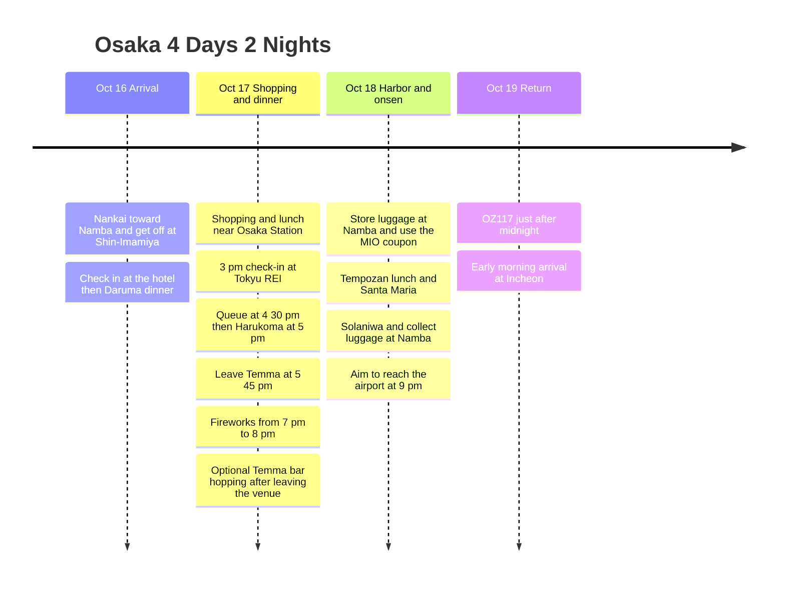

**Day one Daruma → Oct 17 Osaka Station shopping, 5 pm Harukoma → 7 pm Yodogawa Fireworks → optional Temma bar hopping** is the plan. On the 18th, use only the MIO Have Fun in Kansai Pass coupon briefly, then go via the harbor and onsen to the airport. Leave the shopping bags from the 17th in the Tokyu REI room before heading out.

All times are Japan local time. **"The festival at 7 pm" is the target for being at the venue.** Leaving Temma at 19:00 could mean missing the start. To keep both the 17:00 meal and the festival, arrive at Harukoma around 16:30 and adjust with **a 17:45 departure** as the baseline. Visiting several bars before the festival is hard on time, so bar hopping is left as an option after the festival.

## Itinerary Summary

| Date | Route | Times to keep |
|---|---|---|
| Fri, Oct 16 | Kansai → Nankai toward Namba, get off at Shin-Imamiya → CHECK inn → **Daruma** | Check in and have dinner, timed to the actual arrival |
| Sat, Oct 17 | Store luggage at Tokyu REI → **Osaka Station shopping** → check in → **Harukoma dinner** → fireworks → optional Temma bar hopping | 16:30 queue at the restaurant, 17:00 meal, 17:45 departure, 19:00-20:00 festival |
| Sun, Oct 18 | Store luggage at Namba → MIO coupon → Tempozan lunch → Santa Maria → Solaniwa → Namba → airport | 10:30 MIO, 13:30 pier, aim for the 19:45 airport train |
| Mon, Oct 19 | OZ117 Kansai → Incheon | Official summer timetable 00:15 departure, 02:15 arrival |

## Itinerary Timeline

## Fri, Oct 16 · Check In, Then Daruma for Dinner

From Kansai Airport, **take a Nankai train toward Namba and get off at Shin-Imamiya**. The hotel is **CHECK inn Osaka Shinsekai, 1-9-5 Haginochaya**. This avoids the leg of going all the way to Namba and doubling back to the hotel. [Nankai airport transport](https://www.howto-osaka.com/en/), [hotel address](https://www.hafh.com/en/properties/28089).

| Step | Time to allow | Details |
|---|---|---|
| After arriving at the airport | Aim for 60-90 minutes for immigration and baggage | Varies with the actual flight and immigration situation |
| Airport → Shin-Imamiya → hotel | Aim for 70-90 minutes including train waits and walking | Check Nankai service for the date |
| Hotel check-in | 20-40 minutes | Drop bags and head out |
| Hotel → Daruma Tsutenkaku | Allow 15-20 minutes on foot | The fixed first-night dinner spot |
| Daruma | 60-90 minutes for queue and meal | After eating, a short stroll around Tsutenkaku and back to the hotel |

Daruma Tsutenkaku is at **1-6-8 Ebisuhigashi**, officially open **11:00-22:30** on Fridays, last order **22:00**, no reservations. The goal is to **reach the hotel by around 20:00 and visit after checking in**. [Official store information](https://www.kushikatu-daruma.com/location/tsutenkaku).

**Only the outbound flight time needs further cross-checking.** The existing KE737 record shows a **22:40 arrival at Kansai** in the lookup, which does not fit Daruma's opening hours on the first night. The first-night visit specified by the traveler is included in the baseline, but if the booking really has this time, dinner on the first night becomes impossible. I did not assume an earlier flight from the cost of about KRW 140,000 alone. Once the actual arriving flight is confirmed, fill in the first-night times, and if it is a late flight, choose another day for Daruma. [Existing KE737 lookup](https://www.trip.com/flights/status-ke737/).

## Sat, Oct 17 · Osaka Station Shopping, 5 pm Harukoma, 7 pm Fireworks

| Local time | Plan | Adjustment guide |
|---|---|---|
| 08:30-09:30 | Breakfast, pack and check out of CHECK inn | Keep breakfast light if you arrived late the day before |
| 09:30-10:15 | Dobutsuen-mae → Midosuji Line to Umeda → Tokyu REI | Includes walking at stations and the hotel |
| 10:15-10:45 | Store luggage at the hotel → head toward Osaka Station | Shop without large bags |
| 10:45-12:30 | **Shopping near Osaka Station** | Visit the stores you want first in the malls around the station |
| 12:30-13:15 | Lunch near Osaka Station | Keep it light for the sushi dinner |
| 13:15-14:30 | **Remaining shopping** | Finish the day's main shopping here |
| 14:30-15:00 | Back to Tokyu REI and wait for check-in | Sort purchases |
| 15:00-16:00 | Check in, drop bags and rest in the room | Do not carry shopping bags to the meal and festival |
| 16:00-16:30 | Hotel → Harukoma Main Branch | Allow time for walking and finding the way |
| 16:30-17:00 | **Wait at Harukoma** | Seating at 17:00 is not guaranteed. If you cannot be seated by 17:10, use the alternative below |
| **17:00-17:45** | **Dinner at Harukoma** | Pre-festival meal in Temma. Aim for 45 minutes today instead of a long extra order |
| **17:45-18:45** | Temma → approach to the designated viewing area | Go by the station route below and the actual gate; it takes longer when crowded |
| 18:45-19:00 target | Move to the gate and seat | Entry closing time follows the purchased ticket, so check beforehand whether late entry is possible |
| **19:00-20:00** | **Yodogawa Fireworks** | This is not a plan to depart at 19:00 |
| 20:00-22:00 | Orderly exit and heading toward Umeda | Arrival time varies a lot due to station queues and exit controls |
| 22:00-23:00 optional | 1-2 bars near Temma Station | A target if reaching Temma is possible. If tired or the exit runs late, go straight to the hotel |
| 23:00-23:30 target | Return to Tokyu REI | Check the bars that are open and the actual route home |

[Hotel → Harukoma on foot](https://www.google.com/maps/dir/?api=1&origin=Osaka+Tokyu+REI+Hotel&destination=Harukoma+5-5-2+Tenjinbashi&travelmode=walking) · [Harukoma → Nishinakajima-Minamigata](https://www.google.com/maps/dir/?api=1&origin=Harukoma+5-5-2+Tenjinbashi&destination=Nishinakajima-Minamigata+Station&travelmode=transit) · [Bars around Temma Station](https://www.google.com/maps/search/?api=1&query=bars+near+Temma+Station+Osaka).

Harukoma is **Harukoma Honten, 5-5-2 Tenjinbashi**, and according to its public store information it is **open 11:00-21:30 and closed on Tuesdays**. Do not confuse it with a restaurant of the same name in Umeda. The sushi was placed before the festival because closing time could overlap if you go afterward. [Main branch information](https://www.hotpepper.jp/strJ000109465/). The hotel lists **check-in at 15:00 and checkout at 10:00**, with luggage storage available before check-in. [Tokyu REI FAQ](https://www.tokyuhotels.co.jp/en/osaka-r/qa/index.html).

### From Temma to the Festival · The Tight Stretch

The default Metro approach is **Tenjinbashisuji 6-chome → Tanimachi Line to Higashi-Umeda → walking transfer to Umeda → Midosuji Line to Nishinakajima-Minamigata → designated gate**. With the walking transfer between stations and the crowds, **75 minutes is a target, not a guaranteed time.** If the ticket specifies an address-side station or a different gate, follow that route first. Hankyu and JR sections are not covered by the 620-yen Metro pass.

The event is officially **Oct 17, 19:00-20:00**, and the **Umeda-side riverbank is closed to general access and viewing**. Rather than going straight to the map pin, check your ticket zone and the entry closing time. In particular, for the free zones it is hard to expect to secure a spot arriving at this time, so decide on a viewable area first. [Event overview](https://www.yodohanabi.com/gaiyou.html), [Viewing FAQ](https://www.yodohanabi.com/faq.html), [Traffic restrictions](https://www.yodohanabi.com/kisei.html).

- **Keep the 17:00 meal:** 16:30 queue → 17:00-17:45 meal → go straight to the festival. Skip the bar visit before the festival.
- **A plan with more margin:** Cut shopping by 30 minutes and move Harukoma earlier to **16:30-17:15**, then **leave for the venue at 17:15**. Use this if the gate is far or entry closes early.
- **If you still cannot get in at 17:10:** Choose between continuing to wait at Harukoma or switching to a quick meal in Temma to keep the festival start. You cannot keep the queue, the bar hopping and the 19:00 entry all as they are.
- **If you reach Temma after the festival later than 22:30:** Use just one open bar for 30-45 minutes or finish in Umeda. Do not go against the exit flow just for bar hopping.

## Sun, Oct 18 · MIO Coupon → Harbor Lunch → Cruise → Onsen → Airport

**Finish the main shopping at Osaka Station on the 17th**, and allot only 30 minutes at MIO to exchange and use the Have Fun in Kansai Pass coupon the traveler chose. Since Daruma is visited on the first day, have a relaxed lunch at Tempozan today. To cut back-and-forth trips to the Umeda hotel, move luggage to Namba in the morning.

| Local time | Plan | Travel and waiting |
|---|---|---|
| 08:00-09:15 | Breakfast, pack and check out | Leave before the hotel's 10:00 deadline |
| 09:15-10:00 | Umeda → Namba and luggage storage | A locker easy to retrieve from on the Nankai side toward the airport |
| 10:00-10:30 | Namba → Tennoji MIO | Travel to arrive at opening |
| 10:30-11:00 | **MIO coupon exchange and use** | Only what you need, without adding main shopping |
| 11:00-12:00 | Tennoji → transfer at Hommachi → Osakako → Tempozan | Allow 60 minutes for subway and walking |
| 12:00-13:00 | Lunch and rest at Tempozan | Pick a restaurant with a short wait that day |
| 13:00-13:30 | Harbor stroll and move to the pier | If it rains, rest indoors and go straight to the pier |
| 13:30-14:00 | Exchange the Santa Maria ticket and wait to board | The pier west of Kaiyukan |
| 14:00-14:45 | **Santa Maria day cruise** | Confirm actual sailings, aim to board in the 14:00 hour |
| 14:45-15:30 | Disembark → Osakako → Bentencho → Solaniwa | Includes disembarking, station walking and onsen reception |
| 15:30-17:45 | **Solaniwa Onsen and rest** | 2 hours 15 minutes including changing |
| 17:45-18:30 | Bentencho → transfer at Hommachi → Namba | Route within the Metro pass area |
| 18:30-19:15 | Dinner at Namba and collect luggage | Check the locker closing time and avoid restaurants with long waits |
| 19:15-19:45 | Nankai ticket and move to the platform | Allow time to move inside the large station |
| 19:45-21:00 | Airport train and move to the terminal | Pick the actual train on the day of departure, aim to be at the airport by 21:00 |
| 21:00-00:15 | Check-in, departure formalities and boarding | Flight just after midnight on Oct 19 |

[MIO → Tempozan](https://www.google.com/maps/dir/?api=1&origin=Tennoji+MIO&destination=Tempozan+Marketplace&travelmode=transit) · [Onsen → Namba](https://www.google.com/maps/dir/?api=1&origin=Solaniwa+Onsen&destination=Namba+Station&travelmode=transit).

The MIO shopping floors are officially open **10:30-20:30**. [MIO information](https://www.tennoji-mio.co.jp/access). The Santa Maria day cruise takes about **45 minutes**, with the pier about a 10-minute walk from Osakako Station, and **the 14:00 hour is a target, not a confirmed sailing on Oct 18**. [Operator](https://suijo-bus.osaka/cruiselist/santamaria/), [Sailing calendar](https://suijo-bus.osaka/wps/wp-content/uploads/2026/09/0901_time-santamaria.pdf). Solaniwa is at Osaka Bay Tower in Bentencho, usually **open 11:00-23:00 with last entry at 22:00**. [Onsen FAQ](https://solaniwa.com/en-us/faq/).

## Have Fun in Kansai Pass and Metro Pass Usage

| Date of use | Where to use it | Conditions |
|---|---|---|
| Oct 18, 10:30 | Tennoji MIO | Have Fun in Kansai Pass 1,500-yen coupon information. The exchange counter and eligible stores depend on the product purchased |
| Oct 18, 14:00 hour | Santa Maria | About 45-minute day cruise. Distinct from the Twilight cruise |
| Oct 18, 15:30 | Solaniwa Onsen | Check the date-tier surcharge and bathing tax separately |
| Oct 17 and 18 | Osaka Metro weekend 1-day pass | 620 yen per day, 1,240 yen if used on both days. Nankai, JR and Hankyu are separate |

The three facilities are arranged on the assumption of the **Have Fun in Kansai Pass 3-facility type**. We confirmed the sales terms of 7 days from first facility use and once per facility. The MIO coupon and Santa Maria are listed as included, but **the current official facility list could not be accessed, so we have not yet confirmed that all three facilities apply together in October.** The visiting route for all three can be used as is, but check it against the product's latest list before buying the pass. [Have Fun in Kansai Pass sales terms](https://www.kkday.com/ko/product/131268-kansai-1-week-free-pass), [JR West MIO introduction](https://www.westjr.co.jp/global/kr/ticket/cp/west_japan/pdf/e-brochures_kr.pdf), [Santa Maria inclusion notice](https://experiences.travel.rakuten.com/experiences/41020).

Under the 2026 sales terms, Solaniwa lists surcharges of 770, 990 and 1,320 yen on tier C, D and E dates respectively, plus a 150-yen bathing tax. **The date tier for Oct 18 has not yet been confirmed.** The regular Santa Maria day cruise is listed at 2,000 yen for adults from October. The costs above are not included in the payment records. [Onsen pass terms](https://www.kkday.com/ko/product/131268-kansai-1-week-free-pass), [Cruise fare](https://suijo-bus.osaka/cruiselist/santamaria/).

On the 17th the Metro pass covers the hotel transfer and festival approach, and on the 18th it covers several legs. If you switch the festival approach on the 17th to Hankyu, the Metro pass saves less. [Official coverage of the 620-yen pass](https://subway-tr.osakametro.co.jp/guide/page/enjoy-eco.php).

## Adjustable Time Ranges

| Segment | Adjustable range | Boundary to keep |
|---|---|---|
| Day-one Daruma | 60-90 minutes for queue and meal | First cross-check the actual flight arrival against the 22:00 last order |
| Oct 17 Osaka Station shopping | About 2.5-3 hours excluding lunch | Cut 30 minutes if you need more margin for getting to the festival |
| Oct 17 Harukoma | Target 16:30 queue and 17:00 meal, 30-45 minute meal | **17:45 departure**. The earlier plan is a 16:30 meal and 17:15 departure |
| Oct 17 Temma after the festival | 0-60 minutes, 1-2 bars | Skip or visit only one if exit and station crowding are severe |
| Oct 18 MIO | 20-30 minutes | Only use the coupon instead of adding main shopping |
| Oct 18 harbor lunch and stroll | 60-90 minutes | If running late, skip the stroll first, target the 13:30 pier |
| Oct 18 cruise | The 14:00 hour by default, the 15:00 hour if sailing and seats are confirmed | If it is the 15:00 sailing, start the onsen at 16:30 and do not wait past 16:00 |
| Oct 18 onsen | 75-135 minutes | Keep the **17:45 departure**. If the cruise is canceled, go straight to the onsen |
| Oct 18 dinner at Namba | 30-45 minutes | If late, take a takeout or eat at the airport and keep the **19:45 airport train target** |

If less than 75 minutes remain for Solaniwa, choose between a short bath only or skipping entry. Do not cut the airport transfer just to use up every pass. If the Namba lockers are full, first check whether a nearby storage place allows **retrieval around 19:00**.

## Mon, Oct 19 · Midnight Return and Costs

The official summer timetable for OZ117 is **00:15 Kansai → 02:15 Incheon**. That means **an airport transfer on the night of Sunday the 18th**, **2 nights of lodging on the 16th and 17th**, and **4 days** on the calendar. If the booking confirmation shows a different time, recalculate based on arriving at the airport about 3 hours before departure and 75 minutes from Namba to the terminal. [Asiana official timetable](https://flyasiana.com/C/JP/KO/customer/notice/detail?id=CM202603060002528429).

| Item | Recorded amount |
|---|---:|
| Outbound flight | **About KRW 140,000** |
| OZ117 return flight | KRW 190,000 |
| Oct 16 CHECK inn Osaka Shinsekai, 1 night | KRW 23,000 |
| Oct 17 Osaka Tokyu REI, 1 night | KRW 110,000 |
| Subtotal in KRW (including the estimated outbound fare) | **About KRW 463,000** |
| Oct 17 Metro pass planned use | **620 yen** |

The outbound airfare is an estimate reflecting the traveler's "around KRW 140,000". The Have Fun in Kansai Pass, Nankai, the Oct 18 Metro pass, meals, bars, festival seats, locker fees and onsen surcharges are separate. The items still to confirm are **the actual outbound flight and arrival time, the festival zone, entry closing time and gate, the facilities the Have Fun in Kansai Pass you buy applies to, and the airport train and transport home from Incheon in the early morning**. Itinerary last updated 2026-09-07.
