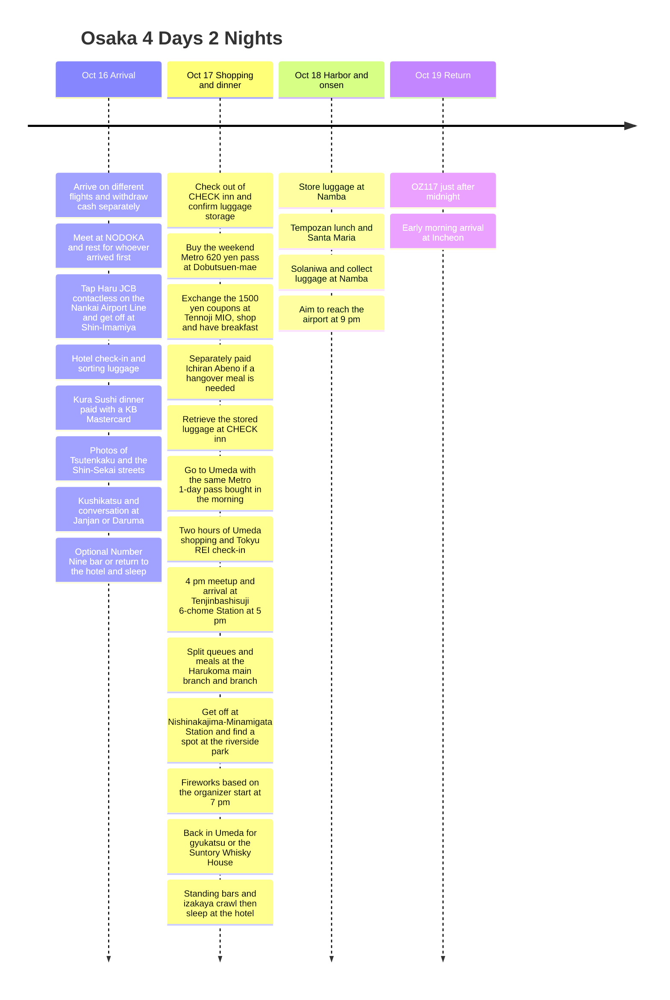

**The first day is arranged as: arrive separately and withdraw cash at an ATM → meet at NODOKA → check in and sort luggage → Kura Sushi → Tsutenkaku photos → kushikatsu at one place → optional Number Nine bar or sleep.** Since the group flies on different planes, they travel together starting from the airport meetup. The 17th is **check out of CHECK inn and store luggage → Tennoji MIO coupons, shopping and breakfast with the 620-yen pass → retrieve luggage at the lodging → Umeda with the same 1-day pass → two hours of shopping and Tokyu REI check-in → 16:00 meetup → 5 pm Tenjinbashisuji 6-chome Station and split queues at the Harukoma main branch and branch → Nishinakajima-Minamigata Station and fireworks at the riverside park → gyukatsu or the Suntory Whisky House → standing-bar and izakaya crawl → sleep at Tokyu REI**, and the 18th is the harbor and onsen, then the airport. Leave the shopping bags from the 17th in the room when you go out.

All times are Japan local time. **The festival start times given are inconsistent.** The Metro NiNE information provided by the traveler says **from 19:30 (information as of 5/27)**, while the organizer's official event overview shows **Oct 17, 19:00-20:00**. The schedule is arranged around the earlier **19:00 start**, and the organizer's announcement should be checked again before leaving. 5 pm is **a target for arriving at Tenjinbashisuji 6-chome Station**, not a guarantee that the meal starts, and if the Harukoma wait is long you could miss the start of the fireworks. [Metro NiNE](https://metronine.osaka/ko/event/yodogawa-fireworks/), [organizer's official times](https://www.yodohanabi.com/gaiyou.html).

## Trip Summary

| Date | Route | Times to keep |
|---|---|---|
| Fri, Oct 16 | **Withdraw cash separately → meet at NODOKA → Haru JCB on Nankai → Shin-Imamiya → CHECK inn → Kura Sushi → Tsutenkaku photos → kushikatsu at one place → optional Number Nine / sleep** | Pay at Kura Sushi with **KB Travelers or Livmate**. For kushikatsu, whichever of Janjan and Daruma is less crowded on the spot |
| Sat, Oct 17 | **Check out and store luggage before 11:00 → MIO and breakfast → retrieve luggage → Umeda → two hours of shopping and check-in → 16:00 meetup → 5 pm Tenjinbashisuji 6-chome → split queues at Harukoma → fireworks at the riverside park → gyukatsu or Suntory → standing bars and izakaya → sleep** | Shopping from 13:30 to 15:30 as planned. Organizer says **19:00-20:00** while NiNE says **from 19:30**, a mismatch. Gyukatsu **last order 21:30** |
| Sun, Oct 18 | Store luggage at Namba → Tempozan lunch → Santa Maria → Solaniwa → Namba → airport | 13:30 at the pier, aim for the 19:45 airport train |
| Mon, Oct 19 | OZ117 Kansai → Incheon | Official summer timetable 00:15 departure, 02:15 arrival |

## Itinerary Timeline

## Fri, Oct 16 · Meet at NODOKA, Kura Sushi, Tsutenkaku and Kushikatsu

The group **arrives at Kansai on different planes**. Each person finishes immigration, baggage and ATM withdrawals, then **meets at the KIX Airport Café Lounge NODOKA**. Whoever arrives first rests with an available card benefit and waits, and once everyone is together they head into the city. **The traveler's own withdrawal plan is five times at AEON Bank**, and the count of five was not set to include the other members' withdrawals.

After meeting up, **tap in with Haru JCB contactless on a Nankai Airport Line train toward Namba → get off at Shin-Imamiya → check in at the lodging**. The first-night lodging is **CHECK inn Osaka Shin-Sekai, 1-9-5 Haginochaya**, **one night in the KRW 30,000 range**. You get off at Shin-Imamiya rather than going on to Namba. The 10% transit benefit below is **a cashback after the fact, not an instant fare discount**. [Nankai airport transport](https://www.howto-osaka.com/en/), [lodging address](https://www.hafh.com/en/properties/28089).

| Step | Time to allow | Details |
|---|---|---|
| After arriving at the airport | Aim for 60-90 minutes for immigration and baggage | Varies with the actual flight and immigration situation |
| After immigration and customs | **Five AEON Bank ATM withdrawals, allow 15-25 minutes** | T1 1F first; if crowded, the same bank's 2F ATM. Varies with queues and processing time |
| After each person finishes withdrawing | **Move to NODOKA on Aeroplaza 2F and meet** | Whoever arrived first rests. Use the entrance and reception desk as the meeting reference, and message each other's location once inside |
| Waiting at the lounge | Until the later-arriving members finish immigration and withdrawals | Check the JCB free 2 hours and overtime charges. **Priority Pass cannot be used after arrival**, see the conditions below |
| NODOKA → Kansai Airport Station → Shin-Imamiya → hotel | Aim for 70-90 minutes including train waits and walking | **Tap the Haru JCB directly at entry and exit**, Nankai Airport Line toward Namba, get off at Shin-Imamiya |
| Hotel check-in and sorting luggage | 20-40 minutes | Unpack in the room and go out for dinner |
| Hotel → Kura Sushi Shinsekai Tsutenkaku | Allow 15-20 minutes on foot | The first-night dinner spot specified by the traveler, on the 2nd floor |
| Kura Sushi | Allow 60-90 minutes for queue and meal | **Pay in JPY with the KB Travelers or Livmate Mastercard**, entry until 23:30 |
| Around Tsutenkaku | Allow 10-20 minutes for photos and a stroll | After Kura Sushi, before kushikatsu, photos of the exterior and street |
| Kushikatsu second round | Allow 45-75 minutes for queue, meal and conversation | **Only one of Janjan / Daruma, whichever is less crowded**, chosen on the spot by the atmosphere |
| After the meal | **Number Nine bar or return to the lodging and sleep** | If you want more, the bar you went to last time; if tired, straight to the lodging. Time at the bar is undecided |

### AEON Bank ATM After Arrival · Five Travelog UPI Withdrawals

**Use only AEON Bank ATMs.** The route is **immigration, baggage and customs → AEON Bank ATM on T1 1F → five withdrawals → passageway to the airport station on 2F → meet at NODOKA on Aeroplaza 2F**. If the 1F machine is crowded or unavailable, go to **the same bank's ATM on T1 2F**.

| Priority | ATM and location | Operating information |
|---|---|---|
| 1 | **AEON Bank, T1 1F** | Listed as open 24 hours |
| 2 | **AEON Bank, T1 2F** | Listed as open 24 hours |

[Airport ATM locations and hours](https://www.kansai-airport.or.jp/service/money_insurance/atm). Check **the AEON BANK and UnionPay logos and whether overseas cards are accepted**. According to AEON Bank's official guidance, overseas-issued UPI cards are accepted 24 hours, with a **50,000-yen limit per withdrawal and a 75-yen fee per transaction (tax included)**. Use may be restricted depending on the site's operation and maintenance. [AEON Bank overseas card guide](https://www.aeonbank.co.jp/atm/card/securities-credit/oversea/).

The plan is to **withdraw five times with the traveler's Hana Travelog UnionPay debit card**. The amounts are not yet decided and will be set to match the total travel cash needed. The 15-25 minutes is an allowance in the schedule, not a guaranteed processing time.

**There are reviews of 1,000-yen withdrawals with overseas cards, but the official overseas card guidance does not state a minimum unit, so confirm it on the screen of the UPI card you hold at the machine.** Whatever the amount, the AEON Bank fee is 75 yen per withdrawal transaction. [1,000-yen withdrawal review](https://travel.korean-engineer.com/en/atm-en/atm-japan/).

| Promotion item | Confirmed conditions |
|---|---|
| Period and eligibility | 2026-06-12 to 12-31, Hana Travelog UnionPay debit card |
| Benefit | 220 yen per withdrawal at Japanese ATMs, up to 5 times per card per month |
| Participation conditions | No prior registration and no minimum withdrawal amount. Only withdrawals approved and settled normally over the UnionPay network count |
| Goal for this trip | If none of the October count has been used, up to about 1,100 yen with five withdrawals. If some has been used, only the remaining count applies |
| Payout | Usually credited the day after the withdrawal; the actual amount and date follow the card statement. The cashback does not appear on the ATM receipt |
| Notes | May end early if the budget runs out. Extra fees from the ATM operator are separate from the cashback |

This is based on [the UnionPay promotion guide specified by the traveler](https://www.unionpayintl.com/cardholderServ/serviceCenter/merchant/1175440369562?type=1). The public conditions do not state a restriction that withdrawals must be on different dates, but the actual benefit depends on normal transactions, settlement and the promotion's rules.

Prepare the physical card and PIN, and **check that the yen Hana Money balance covers the withdrawals and the fees**. Select Korean at the ATM, and for each transaction collect the cash, card and receipt, and count the completed withdrawals. **The fee for five withdrawals is 75 yen × 5 = 375 yen.** If the October benefit limit remains and all five withdrawals qualify, the aim is **about 1,100 yen of cashback − 375 yen of ATM fees = a net benefit of about 725 yen**. The cashback varies with the actual crediting exchange rate and how the promotion is applied. [Hana Card product guide](https://m.hanacard.co.kr/MKCDCM1010M.web?CD_PD_SEQ=15356).

### NODOKA · The Airport Lounge to Meet at After Withdrawing Separately

The meeting place is **KIX Airport Café Lounge NODOKA, Aeroplaza 2F general area (before security)**. It is listed as **open 24 hours, all year round**, about a 5-minute walk from the airport station. From the airport station ticket gates head right toward Aeroplaza, and after entering the building it is on the left. Use the entrance and reception desk as the meeting reference, and whoever goes in first messages the location. [Operator's location and FAQ](https://aprecio.jp/nodoka/), [airport floor location](https://platinumaps.jp/maps/kix-airport/@34.43665976,135.24240069,19-18z?floor=2F).

| Access method | Conditions and rest benefit | Waiting after arrival on the first day |
|---|---|---|
| **Haru JCB URS Platinum** | Show the **physical card plus your own boarding pass or ticket for the arriving flight in your name**, and eligible cardholders get **2 hours free**. JCB's Japan and Hawaii lounge service is limited to **6 visits in total from 2026/4/1 to 2027/3/31**, so check the remaining count | **Consider this method first for resting.** Check in through the Japan and Hawaii original lounge service |
| **Priority Pass** | A **boarding pass for a departure within 12 hours** is required. The 3-hour plan and the choice of meal, beer or shower apply when the conditions for that departing use and the PP issuer's free-use eligibility are met | **Cannot be used with an arriving flight alone.** Do not plan on PP free use for waiting for the group after arriving on Oct 16 |

The operator's FAQ distinguishes that **the 2-hour free credit card benefit can be used after arrival** and that **PP cannot be used after arrival**. Haru JCB is used through JCB's designated lounge service in Japan and Hawaii, separate from PP and from the twice-a-year LoungeKey outside Japan. [JCB Korea official terms and NODOKA eligible list](https://www.kr.jcb/ko/consumers/platinum/airport-lounge/index.html), [official PP NODOKA conditions](https://www.prioritypass.com/en-GB/lounges/japan/kansai-international/kix12-airport-cafe-lounge-nodoka).

The JCB free benefit for the cardholder **does not include a free companion**. Members of the group each show an eligible card or pay the regular fee. Soft drinks and Wi-Fi are available, and **JCB entry does not include free meals, alcohol or showers**. Check the overtime charge after 2 hours and open seats on site. If you have no boarding pass, prepare an app or email that shows the date, flight number and name, and do not throw away the physical Haru card and the boarding record for the arriving flight. [Airport card lounge guide](https://www.kansai-airport.or.jp/service/lounge/walk-in-lounge).

### After Meeting at NODOKA · The Nankai Airport Line with JCB Contactless

The route is **NODOKA → Kansai Airport Station (関西空港) → Nankai Airport Line toward Namba → Shin-Imamiya (新今宮) → check in at CHECK inn**. On Nankai's official map of eligible stations, **both Kansai Airport and Shin-Imamiya** are confirmed as stations that support touch payment. [Nankai touch-payment stations](https://www.nankai.co.jp/contents/contactless/map/index.html).

1. At Kansai Airport Station, find a **Nankai Electric Railway** gate that supports touch payment.
2. Hold the **physical Haru JCB card with the contactless function** to the dedicated reader to enter. This is not buying a separate paper ticket or topping up an ICOCA.
3. Board a train toward Namba that stops at Shin-Imamiya, such as the airport express, and **tap out at Shin-Imamiya with the same physical card**. Do not mix the card and a phone between entry and exit.
4. Each person enters and exits one at a time with their own card, then goes to the lodging after getting off and checks in. [Nankai official how-to](https://www.nankai.co.jp/contents/contactless/howto/index.html).

The JCB public transit benefit on Haru **URS Platinum** is **10% of the monthly total spent, with cashback up to 500 yen per card per month**, and **no separate promotion registration is needed**. October usage is **scheduled to be paid by the end of November**, and according to the 10/13 updated notice the end date for this month is **10/31**. **The period and limit differ from Haru's own cumulative cashback promotion that ends on 10/18.** It follows normal settlement, the remaining monthly limit and early-termination conditions, and the card's overseas usage fee is not waived. [JCB transit promotion](https://www.specialoffers.jcb/kr/premium/sub05.html), [October progress](https://www.specialoffers.jcb/kr/campaign/detail/krpremium/93243/).

### Kura Sushi After Check-In and Sorting Luggage · KB Mastercard Payment

The first-night dinner is **Kura Sushi Shinsekai Tsutenkaku (くら寿司 新世界通天閣店)**, specified by the traveler. The order is **check in at CHECK inn → unpack in the room → Kura Sushi dinner**. The address is **2F, 2-6-3 Ebisuhigashi, Naniwa-ku, Osaka**, and the official hours are **daily 11:00-24:00, with entry until 23:30, 30 minutes before closing**. The store's official information confirms that Mastercard payment is supported. [Map specified by the traveler](https://maps.app.goo.gl/F9oQqc8jdjohVbVQ9), [official store information and reservation link](https://shop.kurasushi.co.jp/detail/509).

**Payment is planned with the KB Travelers debit Mastercard or the KB Livmate Mastercard.** Both cards fall under the brand and personal credit/debit conditions of the KB Master Dining promotion, and the condition to manage is **a KB 20,000-won Shinsegae gift card, once a month, if the combined October spending at Ichiran, Sushiro and Kura Sushi is at least KRW 50,000 converted**. Do not assume this one meal is automatically KRW 50,000 or more; add up the actual settled charges and the existing October usage. **Whether the promotion entry has been completed is still unconfirmed.** Pay in the local currency **JPY** and keep the receipt. [KB official dining promotion and entry](https://card.kbcard.com/BON/DVIEW/HBBMCXCRVNEC0001?mainCC=a&eventNum=1002202).

Choose between Travelers and Livmate by checking Travelers' overseas fee waiver and remaining limit on the basic 10% discount, and Livmate's previous-month spending, basic cashback and overseas fee. This dinner payment is **not added to Haru card's cumulative spending**. After the Kura Sushi meal, continue to the photos and kushikatsu below.

### Tsutenkaku Photos → One of Two Kushikatsu Options

The order is **Kura Sushi → photos of the Tsutenkaku exterior and Shin-Sekai streets → kushikatsu**. Allow 10-20 minutes for photos, and for kushikatsu pick **only whichever of the two below is less crowded on the spot**. Real-time crowding is unconfirmed, so decide by the queue, open seats and atmosphere. This reflects the traveler's wish for **time to chat naturally with customers and staff and make friends**.

| Option | Location and opening information | Selection criteria |
|---|---|---|
| **[① Kushikatsu Janjan Shinsekai Main Branch](https://maps.app.goo.gl/hUWypz8auYQvF8tv9)** / 串かつじゃんじゃん 新世界本店 | **2-6-1 Ebisuhigashi**, map shows Friday **10:00-23:00**. Confirm last order on site | Choose it if the wait is shorter than Daruma and the atmosphere is easy for conversation |
| **[② Kushikatsu Daruma Tsutenkaku](https://maps.app.goo.gl/VaNvuhDdaNV4vUQE9)** / 串かつだるま 通天閣店 | **1-6-8 Ebisuhigashi**, officially Friday **11:00-22:30, last order 22:00**, no reservations | Choose it if the wait is short and there is a seat. Officially 38 counter seats |

Daruma has a condition of **at least one drink per person**. Janjan's hours are based on the map listing and the official site's store details could not be checked, so reconfirm on the day. [Janjan official site](https://kushikatu-janjan.com/), [Daruma official store conditions](https://www.kushikatu-daruma.com/location/tsutenkaku).

Both kushikatsu places **close earlier than Kura Sushi**. To keep Daruma as a possibility, you need time to arrive **before the 22:00 last order** after finishing Kura Sushi and the photos. Keep the overall order, check the actual flights and the airport meeting time, and then fill in the meal times. The card for kushikatsu and the bar is undecided, and these places are **not added to the KB Ichiran, Sushiro and Kura Sushi dining promotion**.

### Optional After the Meal · Number Nine Bar or Sleep

If you want more after kushikatsu, go to **[the Number Nine bar](https://maps.app.goo.gl/Gpj9KSiUzGFfPFxD9) you visited last time**, and if you have had enough or are tired, **return to CHECK inn and sleep**. The bar is a same-day choice, not a confirmed visit.

The location confirmed on the map is **1-1-9 Tennojicho Minami, Abeno-ku**, and the listed hours are **20:00 to 03:00 the next day**. It requires **an extra trip east of Tennoji** from Shin-Sekai, so decide by the route home and whether it is open that day. It is recorded exactly as the traveler specified, and no separate bar with the same name is recommended.

**The actual arriving flights and the NODOKA meeting time of each person still need to be cross-checked.** The lookup for the earlier reference record KE737 shows a **22:40 arrival at Kansai**, so if that flight is correct, **entering Kura Sushi by 23:30** after immigration, withdrawals, meeting, train travel and check-in would be difficult. Take the time when everyone arriving on different planes is ready as the starting point for travel into the city, and after confirming the actual booked flights, fill in the target dinner arrival. [Earlier KE737 lookup](https://www.trip.com/flights/status-ke737/).

## Sat, Oct 17 · MIO and Breakfast, Two Hours of Shopping and the 16:00 Meetup, Harukoma and the Fireworks

The second-night lodging is the **Osaka Tokyu REI Hotel, one night in the KRW 87,000 range**. **The CHECK inn checkout deadline of 11:00 was confirmed by the traveler.** Since the MIO exchange starts at 10:30, check out first in the morning and leave luggage, then go **Dobutsuen-mae → Tennoji MIO → breakfast and a short shopping stop → retrieve luggage at the lodging → Umeda with the same Metro 1-day pass**. Whether CHECK inn can store luggage needs to be confirmed.

**Two hours of Umeda shopping, the 16:00 meetup and arrival at Tenjinbashisuji 6-chome Station at 17:00** are the times specified by the traveler. Tokyu REI room entry is from 15:00, so the plan that secures two hours of shopping is **leave luggage at the hotel → shop 13:30-15:30 → 15:30-16:00 check in and sort luggage → 16:00 meetup**. The 16:00 meeting place is not yet decided.

| Local time | Plan | Adjustment guide |
|---|---|---|
| 09:00-09:45 | **Check out of CHECK inn and store luggage** | Handle it before the 11:00 deadline. Confirm whether the lodging can store luggage; if not, choose an alternative such as a station locker |
| 09:45-10:15 | **Buy the 620-yen weekend 1-day pass at Dobutsuen-mae Station → Tennoji** | One stop on the Midosuji Line toward Nakamozu, with time for the station and walking |
| 10:15-10:30 | Move to MIO and wait for opening | The Main Building information desk exchanges from 10:30 |
| 10:30-10:45 | **Exchange the 1,500-yen Have Fun in Kansai Pass coupons at the MIO Main Building 2F information desk** | Check the three 500-yen coupons and eligible stores |
| 10:45-11:45 (planned) | **Short shopping and breakfast or early lunch** | Aim to spend around 1,500 yen or more at MIO eligible stores. If you need a hangover meal, choose Ichiran Abeno, paid separately |
| 11:45-12:30 (planned) | **Tennoji → Dobutsuen-mae → retrieve luggage at CHECK inn** | One stop on the Midosuji Line toward Esaka and Senri-Chuo, reusing the morning's 620-yen pass |
| 12:30-13:30 (planned) | **Carry luggage from Dobutsuen-mae → Umeda → leave luggage at Tokyu REI** | **Use the existing 1-day pass.** Store before check-in, then shop |
| **13:30-15:30 (planned)** | **Two hours of Osaka Station and Umeda shopping** | End shopping to match the 16:00 meetup |
| 15:30-16:00 (planned) | Check in at Tokyu REI and put purchases in the room | Check-in starts at 15:00, allow for the actual reception wait |
| **16:00** | **Meet the group** | The specific meeting place is undecided |
| 16:00-17:00 | Move after meeting and arrive at Tenjinbashisuji 6-chome Station | Aim to reach the station at 17:00, with extra walking from the station to each restaurant |
| **From 17:00 to a target of 18:00** | **Split between the Harukoma main branch and branch and queue and have dinner separately** | Keep in touch about the wait. Seating at 17:00 is not guaranteed, target moving at 18:00 |
| **Target 18:00-19:00** | Metro → **Nishinakajima-Minamigata Station → find a spot around the designated riverside park** | Time includes transfers, crowds and walking; finding an open spot is not guaranteed |
| After reaching a place where you can watch | Spread the mat, rest and wait for the fireworks | Wait on site with no extra sightseeing |
| **Organizer 19:00-20:00** | **Watch the Yodogawa Fireworks** | Inconsistent with Metro NiNE's 19:30 information. Move based on 19:00 |
| After 20:00, travel time varies | Orderly exit and Nishinakajima-Minamigata → Umeda | Use the existing Metro 1-day pass. The return time varies with station waits and controls |
| After returning to Umeda | **Gyukatsu Motomura LUCUA or the Suntory Whisky House** | Choose one of the two. Gyukatsu last order 21:30, Suntory dining closes at 23:00 |
| After the meal or whisky | **Standing-bar and izakaya crawl** | Continue in Umeda or move to Temma. Allow one or two places depending on what is open and your condition |
| After the crawl, time undecided | **Return to Tokyu REI and sleep** | If it runs late, reduce the number of visits and check the actual transport home |

### Dobutsuen-mae 620-yen Pass → MIO Coupons and Breakfast

At the ticket machine of [Dobutsuen-mae Station](https://maps.app.goo.gl/WhbtsnC7PPHhWobr8) specified by the traveler, buy **the Enjoy Eco Card, adult 620-yen ticket for Saturdays, Sundays and holidays**. It is **Midosuji Line M22 Dobutsuen-mae → toward Nakamozu → M23 Tennoji**, one stop. On this day pass through the gates with this ticket and do not mix it with tapping in directly with JCB. It is **a 1-day pass valid on the day of use, not a 24-hour pass**, and does not include Nankai, JR or Hankyu. [Metro official 620-yen pass guide](https://subway-tr.osakametro.co.jp/ko/guide/page/enjoy-eco.php).

At **the MIO Main Building 2F information counter, exchange hours 10:30-18:00**, show the Have Fun in Kansai Pass QR code and exchange it for **three 500-yen common coupons, 1,500 yen in total**. Use them for shopping or dining at eligible stores in the Main Building and Plaza Building, and check before use that the store accepts them. **No cash or change is given for the difference**, and cash refunds and reissue are not possible. So the plan is to **shop or eat for around 1,500 yen or more** at eligible stores and return before check-in. [Pass operator's MIO coupon and exchange guide](https://travelcontentsapp.com/en/attraction/osaka/tennoji-mio/).

The MIO shopping floors are **10:30-20:30**, and the Main Building restaurant floor generally opens **at 11:00**, so check each store's hours if you want to start a meal at 10:45. Switching to a meal in the 11:00 hour after shopping still fits within the morning plan. [MIO official hours](https://www.tennoji-mio.co.jp/access).

**If you drank a lot the night before and need a hangover meal, have ramen at [Ichiran Abeno](https://maps.app.goo.gl/yHrhYGBaZAqe5T8j9).** Official hours are **10:00-23:00**, and the address is **1-3-18 Abenosuji B1F**. **It is outside MIO, so MIO coupons cannot be used and the ramen is paid separately.** In that case, use the coupons for MIO shopping and settle on Ichiran as the single breakfast place so meals are not duplicated. Card payment is possible, and if you pay with an eligible card after entering the KB Master Dining promotion, you can manage the **KRW 50,000 October combined condition** together with the previous day's Kura Sushi. If the wait is long, prioritize returning to Umeda and checking in. [Ichiran official store and payment guide](https://ichiran.com/shop/kinki/abeno/).

### Check Out Before 11:00 → MIO → Retrieve Luggage and Go to Umeda with the Same 1-Day Pass

**In the morning, check out of CHECK inn before 11:00 and leave luggage.** After MIO and breakfast, **Tennoji → Midosuji Line toward Esaka and Senri-Chuo → Dobutsuen-mae**, going back one stop to retrieve the stored luggage. Then carry the luggage back to Dobutsuen-mae Station and go **same direction on the Midosuji Line → get off at Umeda Station → Osaka Tokyu REI Hotel**. For both legs **reuse the 620-yen Metro 1-day pass bought in the morning as it is**, and do not buy additional tickets.

**The 11:00 checkout is confirmed by the traveler**, while luggage storage after checkout at the lodging is still unconfirmed. If storage is not available, choose a station locker along the route and change the pickup place. Tokyu REI has pre-check-in luggage storage guidance, so the plan is to leave luggage in Umeda, take two hours of shopping, then **check in at 15:30 and meet at 16:00**. [CHECK inn checkout guide](https://travel.yahoo.co.jp/00924272/), [Tokyu REI luggage storage and check-in FAQ](https://www.tokyuhotels.co.jp/en/osaka-r/qa/index.html).

### 16:00 Meetup → 17:00 Tenjinbashisuji 6-chome Station and the Two Harukoma Queues

After two hours of shopping, **meet the group at 16:00 and arrive at Tenjinbashisuji 6-chome Station (天神橋筋六丁目) at 17:00**. The specific 16:00 meeting place has not been decided. By subway from the Umeda area, go **Higashi-Umeda → Tanimachi Line toward Dainichi → Tenjinbashisuji 6-chome**, using the existing 620-yen pass.

| Restaurant to split between | Map specified by the traveler | Confirmed address |
|---|---|---|
| **Harukoma Branch / 春駒 支店** | [First map](https://maps.app.goo.gl/GiedWJBZUf6dnPi8A) | 5-6-8 Tenjinbashi |
| **Harukoma Main Branch / 春駒 本店** | [Second map](https://maps.app.goo.gl/bVF84NQP6X2CgbZB7) | 5-5-2 Tenjinbashi |

Walk from the station to each restaurant and **split into a main-branch team and a branch team, each queuing separately.** Message each other the expected waits and coordinate how to eat and regroup. **5 pm is arrival at the station; seating and starting the meal depend on the actual wait.**

### Nishinakajima-Minamigata Station → Find a Spot at the Riverside Park and Watch

After the meal, the default Metro approach is **Tenjinbashisuji 6-chome → Tanimachi Line toward Yaominami, Higashi-Umeda → walking transfer to Umeda → Midosuji Line toward Esaka and Senri-Chuo, Nishinakajima-Minamigata → riverside park**. **Keep using the existing 620-yen pass.** With the walk from the restaurant and station, the transfer between stations and the festival crowds, **leaving at 18:00 and arriving at 19:00 is a target, not a guaranteed time.** If the wait runs long, judge again at the end of the meal whether you can arrive before the fireworks start.

The place specified by the traveler is **[Yodogawa Riverside Park Nishinakajima Area](https://maps.app.goo.gl/sgUQkCpRfaN3PPYu7)**. The park says the walk from the station is normally about 7 minutes, but on the event day add controls and crowds. After getting off, **find a spot at a riverside area where viewing is allowed, and sit and wait with no extra sightseeing.** This pin is the park's reference point, so confirm on site the open area on the day, the actual view of the fireworks and open spots. [Park official location and access guide](https://www.yodogawa-park.jp/annai/nisinaka-juso/).

**What to bring:** a small **picnic mat or folding cushion**, a light jacket, water and a snack, a power bank and a trash bag. Leave purchases at the hotel and take only a bag for watching. Given the time spent waiting on site, take care of the restroom and drinks beforehand, and use the mat only in open areas where sitting is allowed.

**The start time is inconsistent, 19:00-20:00 from the organizer and from 19:30 from Metro NiNE**, so keep moving on a 19:00 basis. **The Umeda-side riverbank is closed to general access**, and on the Nishinakajima side follow the controls on the day. Securing a spot in the free zone is not guaranteed. The organizer recommends that sponsor-seat viewers reach the station by 17:30 and the riverbed by 18:00, so with this route starting from the 17:00 restaurant queue there is a chance of missing the start depending on the crowds. [Organizer's event overview](https://www.yodohanabi.com/gaiyou.html), [Metro NiNE provided by the traveler](https://metronine.osaka/ko/event/yodogawa-fireworks/), [viewing and crowd FAQ](https://www.yodohanabi.com/faq.html).

### After the Festival · Gyukatsu or Suntory → Standing Bars and Izakaya → Sleep

After the fireworks, return **Nishinakajima-Minamigata Station → Midosuji Line toward Nakamozu → Umeda**. Use the existing Metro 1-day pass; the actual arrival time varies with exit controls and station waits. On arriving in Umeda, choose between the two places specified by the traveler: **gyukatsu if hungry, Suntory if you want whisky and food**.

| Option | Location | Official hours and decision criteria |
|---|---|---|
| **[Gyukatsu Motomura LUCUA](https://maps.app.goo.gl/88WVgymoDCCvrof98)** | 3-1-3 Umeda, Kita-ku, Osaka, **LUCUA 10F** | The store's official **11:00-22:00, last order 21:30**. On arrival, check the queue and whether entry is possible first |
| **[Suntory Whisky House](https://maps.app.goo.gl/jDVJSrb8dTbATRVZA)** | 3-1 Ofukacho, Kita-ku, Osaka, **Grand Front Osaka North Building, Knowledge Capital 2F** | **Whisky Dining WWW.W dinner 17:30-23:00**. **Whisky Bottle Bar in the same facility 17:30-23:30, closed on Sundays and holidays**. Planned for Saturday 10/17, confirm last order and open seats |

The LUCUA facility guide also lists a 23:00 closing for gyukatsu, but plan on **the store's own official earlier 21:30 last order and 22:00 closing**. If you reach Umeda after the festival exit later than 21:30, do not assume you can enter for gyukatsu. Suntory is also split into dining and the bottle bar, so check the last order of the space you will use. [Gyukatsu store official](https://www.gyukatsu-motomura.com/store/LUCUA), [LUCUA facility guide](https://www.lucua.jp/shopguide/id791.html), [Suntory dining](https://www.suntory.co.jp/whisky/whiskyhouse/dining/), [bottle bar](https://www.suntory.co.jp/whisky/whiskyhouse/bottlebar/index.html).

After that, **do a tachinomi (standing bar) and izakaya crawl and return to Tokyu REI to sleep.** You can continue in Umeda or move on to the Temma area, and the specific venues are not yet decided. Plan for one or two places first and adjust to the atmosphere, opening hours and your condition. If it ends late, check the last subway and the walking or taxi route home. [Bar area around Temma Station](https://www.google.com/maps/search/?api=1&query=bars+near+Temma+Station+Osaka).

## Sun, Oct 18 · Harbor Lunch → Cruise → Onsen → Airport

**The MIO coupons, shopping and breakfast were moved to before check-in on the 17th.** On this day, store luggage at Namba, go straight to the harbor and have lunch at Tempozan. To cut trips back and forth to the Umeda hotel, move luggage to Namba in the morning.

| Local time | Plan | Travel and waiting |
|---|---|---|
| 08:00-09:15 | Breakfast, pack and check out | Leave before the hotel's 10:00 deadline |
| 09:15-10:00 | Umeda → Namba and luggage storage | A locker easy to retrieve from on the Nankai side toward the airport |
| 10:00-11:00 | Namba → transfer at Hommachi → Osakako → Tempozan | Allow 60 minutes for subway and walking |
| 11:00-12:00 | Stroll and rest around the harbor | Shorten this segment if you leave late |
| 12:00-13:00 | Lunch and rest at Tempozan | Pick a restaurant with a short wait that day |
| 13:00-13:30 | Harbor stroll and move to the pier | If it rains, rest indoors and go straight to the pier |
| 13:30-14:00 | Exchange the Santa Maria ticket and wait to board | The pier west of Kaiyukan |
| 14:00-14:45 | **Santa Maria day cruise** | Confirm actual sailings, aim to board in the 14:00 hour |
| 14:45-15:30 | Disembark → Osakako → Bentencho → Solaniwa | Includes disembarking, station walking and onsen reception |
| 15:30-17:45 | **Solaniwa Onsen and rest** | 2 hours 15 minutes including changing |
| 17:45-18:30 | Bentencho → transfer at Hommachi → Namba | Route within the Metro pass area |
| 18:30-19:15 | Dinner at Namba and collect luggage | Check the locker closing time and avoid restaurants with long waits |
| 19:15-19:45 | Nankai ticket and move to the platform | Allow time to move inside the large station |
| 19:45-21:00 | Airport train and move to the terminal | Pick the actual train on the day of departure, aim to be at the airport by 21:00 |
| 21:00-00:15 | Check-in, departure formalities and boarding | Flight just after midnight on Oct 19 |

[Namba → Tempozan](https://www.google.com/maps/dir/?api=1&origin=Namba+Station&destination=Tempozan+Marketplace&travelmode=transit) · [Onsen → Namba](https://www.google.com/maps/dir/?api=1&origin=Solaniwa+Onsen&destination=Namba+Station&travelmode=transit).

The Santa Maria day cruise takes about **45 minutes**, with the pier about a 10-minute walk from Osakako Station, and **the 14:00 hour is a target, not a confirmed sailing on Oct 18**. [Operator](https://suijo-bus.osaka/cruiselist/santamaria/), [Sailing calendar](https://suijo-bus.osaka/wps/wp-content/uploads/2026/09/0901_time-santamaria.pdf). Solaniwa is at Osaka Bay Tower in Bentencho, usually **open 11:00-23:00 with last entry at 22:00**. [Onsen FAQ](https://solaniwa.com/en-us/faq/).

## Five Payment Cards for Japan · October Promotions and Where to Use Them

Bring **KB My One Visa + KB Livmate Mastercard + KB Travelers debit Mastercard + Shinhan Haru JCB + Hana Travelog UPI**. Below is **the allocation for the Oct 16-19 trip as checked on 2026-10-15**. **The traveler confirmed that the Haru overseas cumulative cashback promotion and the JCB promotion entry are done.** Whether the KB promotion entries, MTR card registration and benefit activation are done has not been checked. Actual payments are in the local currency **JPY**, and the criteria are checked against the actual card approval amount after tax-free and coupons.

### Quick KB Benefit Notes · By Card Brand

These are travel notes grouped by brand, like the image the traveler provided. **An empty checkbox means that KB entry or MTR activation is unconfirmed**, not that the usage condition has been achieved. Gift card amounts are kept separate from foreign-currency money and cashback.

**KB / Visa → My One Visa**

- [ ] **Department stores (to 11/30):** Hankyu, Daimaru and Parco **combined monthly KRW 500,000 or more → KRW 100,000 Shinsegae gift card**, once a month, up to 3 times in total. [Entry](https://card.kbcard.com/BON/DVIEW/HBBMCXCRVNEC0001?mainCC=a&eventNum=1002074)
- [ ] **Fashion (to 11/30):** Uniqlo, GU, BAPE, Comme des Garçons, BEAMS, Human Made, Kapital and Stussy **combined monthly KRW 200,000 / 500,000 / 1,000,000 → KRW 20,000 / 70,000 / 200,000 Shinsegae gift card**, paid only for the tier reached, once a month, up to 3 times in total. [Entry](https://card.kbcard.com/BON/DVIEW/HBBMCXCRVNEC0001?mainCC=a&eventNum=1002073)
- [ ] **Don Quijote (to 11/30):** **monthly KRW 100,000 or more → KRW 20,000 Shinsegae gift card**, once a month, up to 3 times in total. [Entry](https://card.kbcard.com/BON/DVIEW/HBBMCXCRVNEC0001?mainCC=a&eventNum=1002072)
- [ ] **Overseas 1.1% point-back (to 10/31):** **combined KRW 200,000 or more since 10/6 → 1.1% of the won payment amount in points**, separate entry, scheduled to be paid by 2027/1/15. [Entry](https://card.kbcard.com/BON/DVIEW/HBBMCXCRVNEC0001?mainCC=a&eventNum=1002268)

**KB / Any brand → My One, Livmate, Travelers**

- [ ] **Convenience stores (to 10/31):** 7-Eleven, Lawson and FamilyMart **500 yen of foreign-currency money per transaction of 1,000 yen or more**, up to 5,000 yen or 10 uses per the guide. The limit does not increase per card. [Entry](https://card.kbcard.com/BON/DVIEW/HBBMCXCRVNEC0001?mainCC=a&eventNum=1001883)
- [ ] **Airport duty free (to 10/31):** at eligible airports including Osaka, **combined monthly 10,000 yen or more in duty-free merchant category → 1,000 yen of foreign-currency money**. General airport shops are separate. [Entry](https://card.kbcard.com/BON/DVIEW/HBBMCXCRVNEC0001?mainCC=a&eventNum=1001884)
- [ ] **Department stores (to 11/30):** Hankyu, Mitsukoshi Isetan, Takashimaya, Daimaru and Odakyu **combined monthly 30,000 yen or more → 3,000 yen of foreign-currency money**, once a month, eligible merchant category conditions. **Parco excluded.** [Entry](https://card.kbcard.com/BON/DVIEW/HBBMCXCRVNEC0001?mainCC=a&eventNum=1002215)

**Extra item in the image, gift cards by total overseas spending:** The photo lists **KRW 500,000 / 1,000,000 / 2,000,000 / 3,000,000 / 5,000,000 → KRW 10,000 / 20,000 / 40,000 / 60,000 / 100,000 Shinsegae gift card**, but with **no period, official promotion link or stacking conditions, whether it applies to this trip is unconfirmed**. Comparing it with the current official overseas promotion list also did not confirm this condition. Keep it as a candidate for reference from the image, and do not add it to the confirmed promotions above or to the expected benefits. [KB official overseas promotion guide](https://card.kbcard.com/BON/DVIEW/HBBMCXCRVNEC0001?mainCC=a&eventNum=1000177)

**KB / Mastercard → Livmate, Travelers**

- [ ] **Japan dining (to 11/30):** Ichiran, Sushiro and Kura Sushi **combined monthly KRW 50,000 or more → KRW 20,000 Shinsegae gift card**, once a month. **To be used for the Kura Sushi dinner on the first night**; Harukoma is not eligible. [Entry](https://card.kbcard.com/BON/DVIEW/HBBMCXCRVNEC0001?mainCC=a&eventNum=1002202)
- [ ] **Don Quijote (to 12/31):** **20,000 yen or more per transaction → 2,000 yen of foreign-currency money**, once a month. Entering the **Travelers-only additional promotion** adds 1,000 yen per month. [Promotion and each entry](https://card.kbcard.com/BON/DVIEW/HBBMCXCRVNEC0001?mainCC=a&eventNum=1001842)

**KB / Travelers Mastercard only, MTR → activate per store after registering**

- [ ] **Hankyu (to 12/31):** Umeda main store, Hankyu Men's Osaka and others, **30,000 yen per transaction → 2,000 yen cashback**, once between October and December, food halls and groceries excluded. [Conditions](https://card.kbcard.com/BON/DVIEW/HBBMCXCRVNEC0001?mainCC=a&eventNum=1000601)
- [ ] **Daimaru and Matsuzakaya (to 12/31):** **50,000 yen per transaction → 3,000 yen cashback**, once between October and December. [Conditions](https://card.kbcard.com/BON/DVIEW/HBBMCXCRVNEC0001?mainCC=a&eventNum=1000601)
- [ ] **Bic Camera (to 12/31):** **30,000 yen per transaction → 2,000 yen cashback**, once between October and December. [Conditions](https://card.kbcard.com/BON/DVIEW/HBBMCXCRVNEC0001?mainCC=a&eventNum=1000600)
- [ ] **Don Quijote (to 12/31):** **10,000 yen per transaction → 1,000 yen cashback**, once between October and December. Up to 4,000 yen can be considered if all of this and the KB Master and Travelers additional promotions are met. [Conditions](https://card.kbcard.com/BON/DVIEW/HBBMCXCRVNEC0001?mainCC=a&eventNum=1000599)

**Entry done:** Haru's own cumulative cashback plus the JCB promotion. Haru's own promotion **ends 10/18**, and based on the existing usage of **KRW 10,488**, **KRW 489,512** more is needed to reach the KRW 50,000 cashback. KB, JCB and Haru's cumulative are managed on different bases.

### Role of Each Card and Detailed Conditions

| Card | Payments to assign on this trip | Basic conditions |
|---|---|---|
| **KB My One Visa** | Gift cards for eligible fashion brands, department stores and Don Quijote; consider the 1.1% point-back at KRW 200,000 or more overseas | Separate entry for each promotion, conditions for existing KB Visa customers. Based on the amount table below |
| **KB Livmate Mastercard** | The Ichiran, Sushiro and Kura Sushi dining promotion, and the KB Master Don Quijote promotion | Overseas 2% cashback up to KRW 300,000 of previous-month spending and KRW 1,000,000 of monthly overseas usage, overseas usage fee separate |
| **KB Travelers debit Mastercard** | Convenience stores and Master Dining, remaining limit on the basic overseas 10%, Don Quijote and department store MTR | Basic 10% requires KRW 200,000 of previous-month spending and has a KRW 10,000 monthly discount limit. Top up foreign-currency money and enter and activate each promotion |
| **Shinhan Haru JCB** | **Overseas cumulative KRW 500,000 / 1,000,000 cashback promotion through 10/18**, compare JCB eligible stores and transit touch payment | **Cumulative promotion entry done, existing usage KRW 10,488.** Basic 3.5% earning requires KRW 300,000 of previous-month domestic spending or meeting the new-customer grace, overseas fee separate |
| **Hana Travelog UPI** | **Five AEON Bank withdrawals** | The 10% payment discount has ended and is unavailable as confirmed by the traveler, excluded from this trip's benefits. Withdrawals follow the separate promotion conditions in the earlier section |

[Livmate official product](https://card.kbcard.com/CRD/DVIEW/HCAMCXPRICAC0076?mainCC=a&cooperationcode=09215), [Travelers official product](https://card.kbcard.com/CRD/DVIEW/HCAMCXPRICAC0076?mainCC=a&cooperationcode=09562), [Haru official product](https://www.shinhancard.com/pconts/html/card/apply/credit/1233082_2207.html).

Haru's 3.5% is **basic overseas 2% (monthly 30,000-point limit) + extra Japan 1.5% (monthly 100,000-point limit)**. The card terms say transactions that receive a discount service or promotion are excluded from earning, so **do not unconditionally add the basic 3.5% on top of the JCB cashback**. Livmate's official brands are Mastercard and UPI, and Visa promotions are joined with the separately held **My One Visa**.

### Japan Dining · Livmate Master or Travelers

From **2026-09-29 to 11-30**, **a KRW 20,000 Shinsegae gift card** is offered if the **combined monthly won-converted spending at the eligible Ichiran, Sushiro and Kura Sushi is KRW 50,000 or more**. This October trip counts it as **KRW 20,000 once a month**, and both the Livmate Mastercard and the Travelers Mastercard meet the brand and personal credit/debit eligibility conditions. Using two cards is not counted as receiving the gift card twice. [KB dining official conditions and entry](https://card.kbcard.com/BON/DVIEW/HBBMCXCRVNEC0001?mainCC=a&eventNum=1002202).

Entry is mandatory, and within the same month the order of entry and usage does not matter. **Overseas approval in local JPY and identification of the merchant name** are required, and charges settled by the 15th of the month after use are added up. October is **scheduled to be paid by the end of November**. **The Kura Sushi dinner on the first night is planned to be paid with Travelers or Livmate**, and Harukoma is not an eligible restaurant.

Choose Travelers by checking the overseas payment fee waiver and the remaining basic discount limit, and Livmate by checking previous-month spending and fees. Compare Sushiro with Haru JCB's **combined 4,000 yen over the period, 20% up to 1,000 yen**, but **amounts spent with KB do not count toward Haru's KRW 500,000 cumulative**. Do not add restaurants for the promotion or spend more than the threshold unnecessarily. KB says its promotion can stack with others, but the card's basic benefits also follow each product's exclusion conditions.

### My One Visa · Shinsegae Gift Cards by Shopping Amount

All three promotions run **2026-09-17 to 11-30** and require entering each promotion. Payment is once a month and up to 3 times per promotion, and **this October trip counts one payout for each promotion**. Only overseas approvals in local JPY are recognized, and eligibility is judged by the merchant name KB settles. **October usage is scheduled to be paid by the end of November.**

| Where | October usage criterion | Benefit | Official entry and conditions |
|---|---|---|---|
| **Hankyu, Daimaru and Parco** | Combined monthly won-converted **KRW 500,000 or more** | **KRW 100,000** Shinsegae gift card | [Visa department stores](https://card.kbcard.com/BON/DVIEW/HBBMCXCRVNEC0001?mainCC=a&eventNum=1002074) |
| **Uniqlo, GU, BAPE, COMME des GARCONS, BEAMS, HUMAN MADE, KAPITAL, STUSSY** | Combined monthly won-converted **KRW 200,000 / 500,000 / 1,000,000 or more** | Shinsegae gift card for that tier, **KRW 20,000 / 70,000 / 200,000** | [Visa fashion](https://card.kbcard.com/BON/DVIEW/HBBMCXCRVNEC0001?mainCC=a&eventNum=1002073) |
| **Don Quijote** | Won-converted **KRW 100,000 or more** in that month | **KRW 20,000** Shinsegae gift card | [Visa Don Quijote](https://card.kbcard.com/BON/DVIEW/HBBMCXCRVNEC0001?mainCC=a&eventNum=1002072) |

The fashion gift cards **do not add up across tiers**. If a brand store inside a department store is approved under the department store's name it may be excluded from the fashion promotion, so **do not count the same payment toward both the department store and fashion promotions**. The won basis is determined by the charged amount after settlement, so do not assume the yen amount at a fixed exchange rate.

**Extra entry: Visa overseas spending 1.1% point-back.** From **2026-10-06 to 10-31**, if My One Visa overseas merchant spending is **a combined KRW 200,000 or more** in won, **1.1% of the total won payment is given in points**. The limit is 1,000,000 points, paid in units of 100 points with rounding at units of 10 points. **Settlement by 2027-01-08 and payment scheduled by 01-15.** Enter separately from the shopping gift card promotions, and family card usage is added to the main cardholder. Although it is called a "fee point-back", **it does not waive the overseas fee itself immediately.** [October Visa point-back official conditions and entry](https://card.kbcard.com/BON/DVIEW/HBBMCXCRVNEC0001?mainCC=a&eventNum=1002268).

### KB Common Promotions · Convenience Stores, Department Stores and Airport Duty Free

The following promotions apply to **eligible KB card usage** on My One, Livmate and Travelers. Using three cards is not counted as tripling the per-member limit. Each promotion requires entry and consent to KB Pay foreign-currency money use, and October usage is scheduled to be paid by the end of November.

| Where | Criterion | Benefit | Period and conditions |
|---|---|---|---|
| **7-Eleven, Lawson, FamilyMart** | **1,000 yen or more per transaction** | **500 yen** of foreign-currency money per transaction, up to **5,000 yen** per the guide | 9/1-10/31. [Convenience store promotion](https://card.kbcard.com/BON/DVIEW/HBBMCXCRVNEC0001?mainCC=a&eventNum=1001883) |
| **Hankyu, Mitsukoshi Isetan, Takashimaya, Daimaru, Odakyu** | **Combined monthly 30,000 yen or more** | **3,000 yen** of foreign-currency money, once a month | 10/1-11/30. MCC 5311 and 5956. [Department store promotion](https://card.kbcard.com/BON/DVIEW/HBBMCXCRVNEC0001?mainCC=a&eventNum=1002215) |
| **Duty free at eligible airports including Osaka** | **Combined monthly 10,000 yen or more** | **1,000 yen** of foreign-currency money | 9/1-10/31. MCC 5309, separate from general airport shops. [Airport duty-free promotion](https://card.kbcard.com/BON/DVIEW/HBBMCXCRVNEC0001?mainCC=a&eventNum=1001884) |

At convenience stores it is **a flat 500 yen for each transaction of 1,000 yen or more**. For example, **a 1,000-yen payment → 500 yen**, and **a single 2,000-yen payment → also 500 yen**, and it does not grow by 500 yen per 1,000 yen. The 5,000-yen maximum per the guide is **10 uses**. Apart from the monthly payment guide, **do not assume the limit renews when the month changes**. If you used it in September, first check the remaining count. Manage the per-member limit across My One, Livmate and Travelers together.

For convenience stores, **consider Travelers first**: check the overseas fee waiver and the remaining basic discount limit. KB says its common promotions can stack with others. If the merchant name is recorded as `JAPAN` and so on instead of the convenience store name, a receipt may be requested, so **keep the receipt**. You can check the payback only after finishing consent to create a KB Pay foreign-currency money account.

If you meet the **KRW 500,000 monthly condition with My One Visa** at Hankyu and Daimaru while also meeting the KB common **30,000-yen monthly condition and eligible category**, consider **a KRW 100,000 gift card + 3,000 yen of foreign-currency money** together. Both official promotions say they can stack with others, but Parco is only on the Visa list, so the common department store benefit is not automatically added.

### Don Quijote · KB Master and Travelers MTR

| Card and entry | Transaction criterion | Benefit |
|---|---|---|
| Livmate Mastercard or Travelers Mastercard + KB Master promotion entry | **20,000 yen or more per transaction**, once a month | **2,000 yen** of foreign-currency money |
| Travelers Mastercard + dedicated additional promotion entry | **20,000 yen or more per transaction**, once a month | **1,000 yen extra** of foreign-currency money |
| Travelers Mastercard + **MTR card registration and Don Quijote benefit activation** | **10,000 yen or more per transaction**, once between October and December | **1,000 yen cashback** |

If you meet all the conditions with the same Travelers card, you can consider **up to 4,000 yen**. Do not attach the Travelers-only additional promotion and MTR to Livmate. [KB Master promotion and each entry link](https://card.kbcard.com/BON/DVIEW/HBBMCXCRVNEC0001?mainCC=a&eventNum=1001842), [Don Quijote MTR](https://card.kbcard.com/BON/DVIEW/HBBMCXCRVNEC0001?mainCC=a&eventNum=1000599).

Other Travelers MTR candidates are below. **You must register the card and activate each benefit before paying**, and each benefit counts once during 10/1-12/31. Follow the conditions of physical card, JPY payment, and cancellation and refund reflection. 

| Merchant | Official transaction criterion for October-December | MTR cashback |
|---|---|---|
| **Hankyu Umeda main store, Hankyu Men's Osaka and other eligible Hankyu** | **30,000 yen or more per transaction**, food halls and groceries excluded | **2,000 yen** |
| **Daimaru Matsuzakaya** | **50,000 yen or more per transaction** | **3,000 yen** |
| **Mitsukoshi and Isetan eligible stores** | **80,000 yen or more per transaction** | **8,000 yen** |
| **Seibu and Sogo eligible stores** | **30,000 yen or more per transaction** | **3,000 yen** |
| **DFS Japan eligible stores** | **25,000 yen or more per transaction** | **1,250 yen** |
| **Bic Camera** | **30,000 yen or more per transaction** | **2,000 yen** |

[MTR department store official conditions](https://card.kbcard.com/BON/DVIEW/HBBMCXCRVNEC0001?mainCC=a&eventNum=1000601), [MTR Bic Camera](https://card.kbcard.com/BON/DVIEW/HBBMCXCRVNEC0001?mainCC=a&eventNum=1000600). Department store criteria differ by merchant, so the café summary's uniform amount was not used as is. MTR cashback cancellation slips may be deducted from each card's spending, so no confirmed total combined with the basic 10% discount is counted.

**MTR preparation order:** **register the Travelers Mastercard in your [MTR](https://mtr.mastercardservices.com/ko-KR/) account → search for Japanese merchants → activate the benefit for each merchant → pay in JPY with that physical card.** Entering a KB promotion alone does not complete MTR activation. Livmate being the same Mastercard does not make it eligible for the Travelers-only MTR. According to the official department store guide, **a cashback cancellation slip is settled within 14 days** of use, and the merchant name is shown as `MastercardTravel`. Check the actual eligible stores, activation status and whether you used it during the period in MTR.

The **Matsumotokiyoshi 2,000 yen for 20,000 yen of spending** capture in the new café post is recorded as an additional candidate. **MTR shows benefits only after card registration and login, so the period, per-transaction or combined basis, count and eligible stores of that benefit could not be verified on the current public screen.** Until you check the actual offer after registering Travelers, do not add it to the confirmed benefit table or expected refund amount. The separate 30,000-yen criterion of Daimaru Fukuoka Tenjin is also not applied to Daimaru Osaka.

### Shinhan Haru · Overseas Cumulative Cashback Through 10/18

From **2026-09-10 to 10-18**, this is a promotion based on cumulative **foreign-currency lump-sum payments** online and offline overseas on the Haru card. It runs **through 10/18 Korea time**, with no time difference from Japan. During the trip **payments on 10/16-18 fall within the period**, and payments on 10/19 are excluded.

| Cumulative usage during the promotion period | Cashback | Additional amount needed from the existing KRW 10,488 |
|---|---:|---:|
| **KRW 500,000 or more** | **KRW 50,000** | **KRW 489,512** |
| **KRW 1,000,000 or more** | **KRW 100,000** | **KRW 989,512** |

**Entry is mandatory**, and entering after use is also possible within the period. **Scheduled to be paid at the end of November**, and amounts are added up by the won charge excluding fees. Cancellations, installments, installment conversions and won payments are excluded, and third-party payments and gift cards may also be excluded. Family card amounts are added to the main cardholder. It may close early, and the official guide ensures the benefit for customers who already entered and meet the target within the period. [Shinhan Card official promotion and entry](https://www.shinhancard.com/pconts/html/benefit/event/2014217_2239.html).

**Traveler's confirmation on 2026-10-15: already entered, and usage since 9/10 is KRW 10,488.** The remaining amounts in the table were calculated assuming that this entire amount is recognized by the promotion. If it is an approval amount including fees or a cancelled amount, check again against the won charge excluding fees. Considering changes in exchange rates and settled amounts, check the actual recognized amount rather than trying to hit the threshold exactly. This promotion itself states no previous-month spending condition, which is separate from the domestic spending condition for basic earning. Because the official page says **no stacking of benefits**, do not add tier rewards or confirm a benefit combined with JCB 20% or the basic 3.5%.

The café post's separate **KRW 20,000 cashback for KRW 100,000 of overseas offline spending** is a promotion for **2026-07-06 to 09-30**, with a condition for customers who had not used it before. It does not apply to this October trip. [Ended promotion official conditions](https://www.shinhancard.com/pconts/html/benefit/event/2013715_2239.html).

### Shinhan Haru JCB · Per-Merchant Advance Entry for Round 3

**Traveler's confirmation on 2026-10-15: JCB promotion entry done.** **Round 3 runs from 2026-10-01 to 12-31.** The official conditions are **separate advance entry for each merchant, counting from usage on the day of entry**, so manage by the merchants actually registered. Except for GO, the basis is **physical card, local JPY payment**.

| Merchant | Minimum combined spending over the round 3 period | 20% cashback limit |
|---|---:|---:|
| **Don Quijote** | **15,000 yen** | **3,000 yen** |
| **Hankyu Hanshin eligible stores** | **15,000 yen** | **3,000 yen** |
| Sushiro | 4,000 yen | 1,000 yen |
| Komeda Coffee | 2,000 yen | 1,000 yen |
| Taxi app GO | 3,000 yen | 1,000 yen |

Hankyu Hanshin eligible stores include **Hankyu Umeda main store, Hankyu Men's Osaka and Hanshin Umeda main store**. Komeda **Namba CITY and JR Bentencho Station** branches are **excluded**, so do not treat them as eligible just because they are on the route. Round 3 cashback is **scheduled for the end of January 2027**. [JCB official conditions, entry link and excluded stores](https://www.specialoffers.jcb/kr/campaign/detail/2026JCBig/92971/).

### Haru JCB Premium · Don Quijote and Transit Touch Payment

Haru's overseas-capable card is the **URS Platinum**, and Shinhan Card lists it as a product eligible for the JCB Premium promotion. The two benefits below run **monthly from 2026-04-01 to 2027-03-31**, with an end date different from Haru's own cumulative promotion. **The official notice updated on 10/13 lists the end date for October for both promotions as 10/31.** [Shinhan eligible product guide](https://www.shinhancard.com/pconts/html/benefit/event/1238572_2239.html), [JCB monthly progress](https://www.specialoffers.jcb/kr/campaign/detail/krpremium/93243/).

| Benefit | October conditions | Registration and payout |
|---|---|---|
| **Don Quijote 1,000 yen cashback** | **Combined monthly 20,000 yen or more**, 1,000 yen per card per month | No separate registration per JCB details, paid by the end of the next month |
| **Transit touch payment 10%** | Pay directly with a contactless card on eligible lines, **up to 500 yen per card per month** | No separate registration per JCB details, paid by the end of the next month |

[Don Quijote detailed conditions](https://www.specialoffers.jcb/kr/premium/sub02.html), [transit detailed conditions](https://www.specialoffers.jcb/kr/premium/sub05.html). The JCB round 3 20% promotion at Don Quijote and the Premium 1,000 yen are separate conditions. **Since stacked payment of the two promotions was not explicitly confirmed, do not combine them into a confirmed 4,000-yen benefit.** Haru's own cumulative cashback and basic earning are also not automatically added.

The transit eligible list includes **all Osaka Metro stations and some Hankyu and Nankai sections**. **For the first-day Kansai Airport → Shin-Imamiya leg, the traveler chose to ride with Haru JCB contactless.** Use the same card and the same medium for actual entry and exit, and handle it as **tapping in directly, not topping up an ICOCA or buying a ticket**. In the city, compare against the existing **620-yen Metro 1-day pass**, and the payment method for the airport transfer on the return is to be considered separately. [JCB official eligible lines PDF](https://www.specialoffers.jcb/kr/uploads/260914%20JCB%20transit_list_EN_revised.pdf). It may end early depending on the monthly budget.

### Hana Travelog UPI · Assigned for Withdrawals

**Traveler's confirmation on 2026-10-15: the Hana UPI 10% payment discount has already ended and cannot be used.** Regardless of the scheduled period on the earlier promotion page, it is excluded from this trip's payment allocation, expected benefits and the pre-departure registration list.

The Hana Travelog UPI is assigned **for five AEON Bank ATM withdrawals at Kansai Airport**. The payment discount and the ATM withdrawal cashback are separate promotions, and the fee and cashback conditions of the withdrawal plan are managed in the earlier section. For general card payments, judge by the applicable benefits of Travelers, Haru, My One and Livmate.

### Order to Apply to the Current Osaka Route

| Schedule and situation | Card to pay with and judgment |
|---|---|
| 10/16 arrival at Kansai | **Five withdrawals with the AEON Bank ATM + Hana UPI**, keeping the 375-yen fee from the earlier section |
| Convenience store shopping | After entering the KB common promotion, **consider Travelers** first. Apply the 500-yen promotion when buying actually needed items at 1,000 yen or more per transaction |
| **10/16 Kura Sushi Shinsekai Tsutenkaku dinner after check-in and sorting luggage** | Planned JPY payment with the **Travelers or Livmate Mastercard** of the traveler's choice. Manage the KB dining entry and the KRW 50,000 combined October condition at eligible restaurants |
| 10/17 Osaka Station shopping · eligible fashion brands | **My One Visa**, comparing the planned purchase amount against the KRW 200,000, 500,000 and 1,000,000 tiers |
| 10/17 buying around 15,000 yen at Hankyu or Hanshin | Compare after checking **Haru JCB**'s advance entry for that department store and the excluded stores |
| Large purchase at Hankyu or Daimaru | Compare the My One Visa **KRW 500,000 + KB common 30,000-yen** combination with the Travelers MTR **per-transaction criterion** by shopping cart |
| Don Quijote purchase | Compare **My One Visa for the KRW 100,000 criterion**, **Haru JCB for the combined 15,000-yen criterion**, and **Travelers' combination of up to 4,000 yen for 20,000 yen or more at once**. Note the different minimums per promotion |
| Harukoma and general restaurants | With **KRW 489,512 more needed for the KRW 50,000 Haru cashback**, compare whether planned spending can reach the threshold. Also check Travelers' remaining basic 10% limit. For cash-only places, use the withdrawn yen |
| **10/17 MIO coupons and breakfast** | **Three 500-yen coupons, 1,500 yen in total**, with the difference in cash. Do not add the coupon amount to card promotions. Ichiran Abeno is outside MIO, so consider separate payment and KB Master Dining eligibility |
| **After meeting at NODOKA on 10/16, Kansai Airport → Shin-Imamiya** | **Haru JCB direct tap-in confirmed**, the same physical card for entry and exit. 10% transit cashback after the fact, up to 500 yen per month, check in at CHECK inn after getting off |
| Airport transfer on the return and individual city rides | Choose the payment method by comparing Haru JCB's remaining monthly transit cashback limit with the 620-yen Metro pass in the city |
| Kansai Airport duty free before returning | Check the KB promotion of **10,000 yen per month for a 1,000-yen benefit** when making a purchase that counts as duty free |

**Before departure:** **Haru's 10/18 cumulative promotion and the JCB promotion entry are recorded as done.** Manage whether Haru's existing usage of **KRW 10,488** and the additional recognized amount of **KRW 489,512** to reach the KRW 50,000 cashback are met by the 18th. Enter **KB Master Dining, the three Visa shopping promotions, the October Visa 1.1% point-back and the KB convenience store, department store and airport promotions** one by one, and finish the Travelers Don Quijote additional entry and the MTR card registration and per-merchant activation. Also check Travelers' KRW 200,000 previous-month spending, Haru's KRW 300,000 domestic spending, Livmate's KRW 300,000 spending and the remaining limit of each card. **Whether the KB entries and the MTR preparation list are done is unconfirmed.**

These were checked against the official conditions after reading the text and images of the traveler's provided [KB Visa café post](https://cafe.naver.com/f-e/cafes/30857348/articles/360122), [per-card summary café post](https://cafe.naver.com/f-e/cafes/30857348/articles/359736), [Haru 10% cashback café post](https://cafe.naver.com/f-e/cafes/30857348/articles/355632), [card company Japan promotion summary post](https://cafe.naver.com/f-e/cafes/30857348/articles/357481) and [10/14 Japan discount card summary post](https://cafe.naver.com/f-e/cafes/30857348/articles/362480). Haru's KRW 20,000 promotion in the September post has ended and was excluded, and Daimaru MTR was organized on the official October-December criterion of 50,000 yen per transaction. Benefits only for Naver Pay Money Card, Samsung Pay Travelwallet, Hana Mastercard, KB UnionPay and Shinhan UnionPay, which appeared in the café posts, were not included in the card combination held. The Travelers first Japan payment Starbucks coupon was excluded from the confirmed benefit calculation because its current official details and availability could not be confirmed. The first-night dinner was changed to Kura Sushi at the traveler's choice, and the Harukoma and festival schedule is kept. No restaurant or shopping visit is added just for benefits.

## Have Fun in Kansai Pass and Metro Pass Usage

| Date of use | Where to use it | Conditions |
|---|---|---|
| **10/17 10:30** | **Tennoji MIO** | **Main Building 2F information desk 10:30-18:00, three 500-yen coupons, 1,500 yen in total**. Shop or eat at eligible stores, no cash or change for the difference. Ichiran Abeno excluded |
| 10/18, 14:00 hour | Santa Maria | About 45-minute day cruise. Distinct from the Twilight cruise |
| 10/18 15:30 | Solaniwa Onsen | Check the date-tier surcharge and bathing tax separately |
| 10/17 and 18 | Osaka Metro weekend 1-day pass | 620 yen per day, 1,240 yen if used on both days. Nankai, JR and Hankyu are separate |

The three facilities are arranged on the assumption of the **Have Fun in Kansai Pass 3-facility type**. We confirmed the sales terms of 7 days from first facility use and once per facility, with **the first use at MIO on 10/17** and the rest on 10/18. **For MIO we confirmed the 1,500-yen coupons, the link with the Kansai pass and the exchange conditions on the pass operator's English official page.** There is a notice of a temporary suspension on 9/14-17 and resumption on 9/18, and no suspension notice for 10/17 is shown. However, check whether all three facilities apply to the same purchased product and the onsen date tier against the latest conditions of the pass you buy. [MIO official pass guide](https://travelcontentsapp.com/en/attraction/osaka/tennoji-mio/), [Have Fun in Kansai Pass sales terms](https://www.kkday.com/ko/product/131268-kansai-1-week-free-pass), [Santa Maria inclusion notice](https://experiences.travel.rakuten.com/experiences/41020).

Under the 2026 sales terms, Solaniwa lists surcharges of 770, 990 and 1,320 yen on tier C, D and E dates respectively, plus a 150-yen bathing tax. **The date tier for 10/18 has not yet been confirmed.** The regular Santa Maria day cruise is listed at 2,000 yen for adults from October. The costs above are not included in the payment records. [Onsen pass terms](https://www.kkday.com/ko/product/131268-kansai-1-week-free-pass), [Cruise fare](https://suijo-bus.osaka/cruiselist/santamaria/).

**On the 17th, buy the 620-yen pass at Dobutsuen-mae Station and use it for travel to Tennoji and Umeda and the approach to the festival.** An additional pass for the 18th is a separate purchase candidate. If you switch the festival approach on the 17th to Hankyu, that section is a separate fare. [Official coverage of the 620-yen pass](https://subway-tr.osakametro.co.jp/ko/guide/page/enjoy-eco.php).

## Adjustable Time Ranges

| Segment | Adjustable range | Boundary to keep |
|---|---|---|
| Day-one Kura Sushi | 60-90 minutes for queue and meal | Cross-check travel after the actual meetup and check-in against the **23:30 entry cutoff** |
| Day-one Tsutenkaku photos | 10-20 minutes | Keep time to move before the kushikatsu places close |
| Day-one kushikatsu | 45-75 minutes | Only whichever of Janjan and Daruma is less crowded. Daruma **22:00 last order**, Janjan **23:00 closing** on the map |
| Day-one Number Nine | Chosen on the day, length of stay undecided | Only if you want more after the meal. If tired, return to CHECK inn and sleep |
| **17th MIO shopping and breakfast** | Around 1-2 hours after the 10:30 exchange | Use the 1,500-yen coupons, cash for the difference. Ichiran is paid separately, and **reaching the hotel before the 15:00 check-in** takes priority |
| **17th Osaka Station and Umeda shopping** | **Two hours, planned for 13:30-15:30** | **Meet the group at 16:00** after check-in and sorting luggage |
| **17th Harukoma** | **Tenjinbashisuji 6-chome Station at 17:00 → queue at the main branch and branch separately** | Target leaving toward the festival at 18:00; if the wait is long, arriving before the start is hard |
| **17th wait at the riverside park** | Find a spot and rest after getting off at Nishinakajima-Minamigata Station | Bring a picnic mat and follow on-site controls. Move based on the organizer's 19:00 start |
| **17th gyukatsu / Suntory after the festival** | One of the two after returning to Umeda | Based on gyukatsu **21:30 last order**, Suntory dining **23:00 closing**, check last order |
| **17th standing-bar and izakaya crawl** | One or two places first after the meal or whisky, time home undecided | Adjust to actual opening hours and condition, then return to Tokyu REI and sleep |
| 18th harbor lunch and stroll | 60-90 minutes | If running late, skip the stroll first, target the 13:30 pier |
| 18th cruise | The 14:00 hour by default, the 15:00 hour if sailing and seats are confirmed | If it is the 15:00 sailing, start the onsen at 16:30 and do not wait past 16:00 |
| 18th onsen | 75-135 minutes | Keep the **17:45 departure**. If the cruise is canceled, go straight to the onsen |
| 18th dinner at Namba | 30-45 minutes | If late, take a takeout or eat at the airport and keep the **19:45 airport train target** |

If less than 75 minutes remain for Solaniwa, choose between a short bath only or skipping entry. Do not cut the airport transfer just to use up every pass. If the Namba lockers are full, first check whether a nearby storage place allows **retrieval around 19:00**.

## Mon, Oct 19 · Midnight Return and Costs

The official summer timetable for OZ117 is **00:15 Kansai → 02:15 Incheon**. That means **an airport transfer on the night of Sunday the 18th**, **2 nights of lodging on the 16th and 17th**, and **4 days** on the calendar. If the booking confirmation shows a different time, recalculate based on arriving at the airport about 3 hours before departure and 75 minutes from Namba to the terminal. [Asiana official timetable](https://flyasiana.com/C/JP/KO/customer/notice/detail?id=CM202603060002528429).

| Item | Recorded amount |
|---|---:|
| Outbound flight | **About KRW 140,000** |
| OZ117 return flight | KRW 190,000 |
| 10/16 CHECK inn Osaka Shin-Sekai, 1 night | **KRW 30,000 range** |
| 10/17 Osaka Tokyu REI, 1 night | **KRW 87,000 range** |
| Subtotal in KRW (based on the estimated outbound fare and the lower bound of the lodging ranges) | **From about KRW 447,000** |
| 10/17 Metro pass planned use | **620 yen** |

The lodging costs are recorded as the ranges provided by the traveler. The numbers used for the total are KRW 30,000 and KRW 87,000, an **estimate based on the lower bound of each range**, and the total will be updated once the actual amounts paid are confirmed.

The outbound airfare is an estimate reflecting the traveler's "around KRW 140,000". The Have Fun in Kansai Pass, Nankai, the 18th Metro pass, meals, bars, festival seats, locker fees and onsen surcharges are separate. The items still to confirm are **the actual outbound flight and arrival time, the ATM withdrawal amount and the used count of the October promotion, the festival zone, entry closing time and gate, the facilities the Have Fun in Kansai Pass you buy applies to, and the airport train and transport home from Incheon in the early morning**. Itinerary last updated 2026-10-15.
