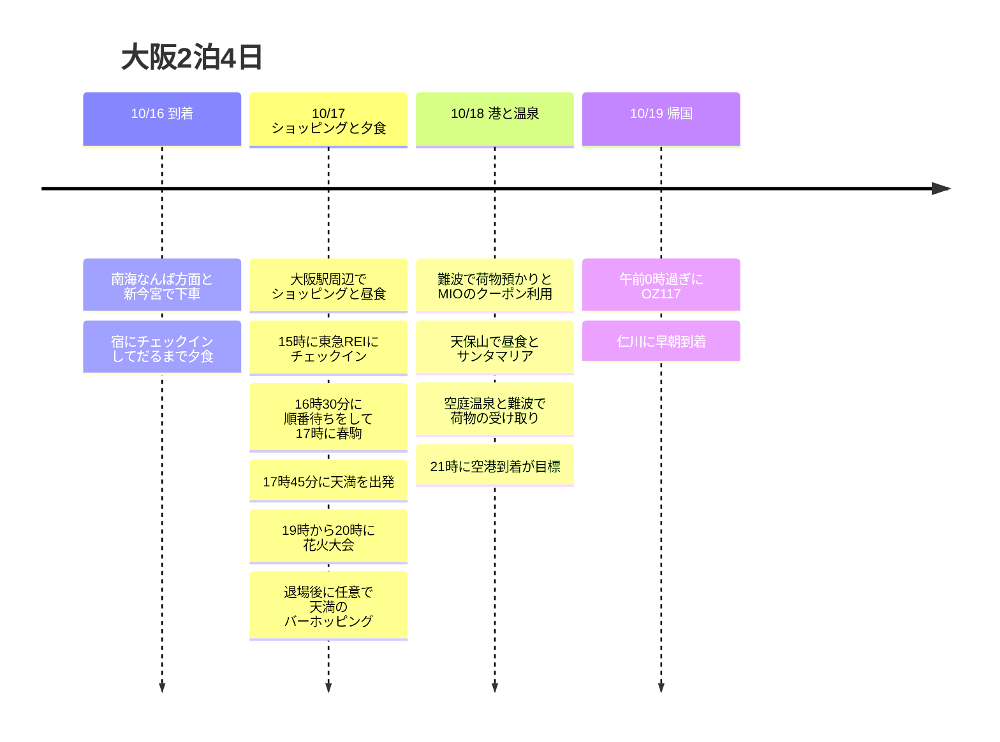

**初日にだるま → 17日は大阪駅でショッピング・17時に春駒 → 19時に淀川花火大会 → 任意の天満バーホッピング**という配置にしました。18日はMIOのHave Fun in Kansai Passのクーポンだけを短く使い、港と温泉を経由して空港へ向かいます。17日にショッピングした荷物は、東急REIの客室に置いて出かけます。

時刻は日本の現地時間です。**「19時に花火」は現地到着の目標**としました。19時に天満を出発すると、開始に間に合わない可能性があります。17時の食事と花火の両方を守るには、春駒に16:30ごろ到着し、**17:45出発**を基準に調整します。花火の前に何軒もバーを回る予定は時間的に難しいため、ホッピングは花火のあとの任意としました。

## 旅程の概要

| 日付 | 動線 | 守る時間 |
|---|---|---|
| 10/16 金 | 関西 → 南海なんば方面・新今宮で下車 → CHECK inn → **だるま** | 実際の到着時刻に合わせてチェックイン後に夕食 |
| 10/17 土 | 東急REIで荷物預かり → **大阪駅でショッピング** → チェックイン → **春駒で夕食** → 花火大会 → 任意の天満ホッピング | 16:30に店で順番待ち、17時に食事、17:45に移動、19〜20時に花火 |
| 10/18 日 | 難波で荷物預かり → MIOのクーポン → 天保山で昼食 → サンタマリア → 空庭温泉 → 難波 → 空港 | 10:30にMIO、13:30に乗り場、19:45の空港行き列車が目標 |
| 10/19 月 | OZ117 関西 → 仁川 | 公式の夏ダイヤで00:15発・02:15着 |

## 旅程タイムライン

## 10/16 (金) · チェックイン後にだるまで夕食

関西空港からは**南海なんば方面の列車に乗って新今宮で下車**します。宿は**CHECK inn Osaka Shinsekai、1-9-5 Haginochaya**が基準です。難波まで行って宿に戻る区間を減らします。[南海の空港アクセス](https://www.howto-osaka.com/en/)、[宿の住所](https://www.hafh.com/en/properties/28089)。

| 順序 | 配分する時間 | 内容 |
|---|---|---|
| 空港到着後 | 入国・手荷物で60〜90分が目標 | 実際の到着便と入国の状況により変動 |
| 空港 → 新今宮 → ホテル | 列車の待ち時間・徒歩を含め70〜90分が目標 | 日ごとの南海の運行を確認 |
| 宿のチェックイン | 20〜40分 | 荷物を置いて外出 |
| 宿 → だるま 通天閣店 | 徒歩15〜20分の余裕 | 初日の夕食で希望している固定の場所 |
| だるま | 待ち時間・食事で60〜90分 | 食後は通天閣周辺を軽く散歩して宿に戻る |

だるま 通天閣店は**1-6-8 Ebisuhigashi**にあり、金曜の公式営業時間は**11:00〜22:30**、ラストオーダーは**22:00**、予約はできません。**20時ごろまでに宿に着き、チェックインしてから訪れる**ことを目標とします。[店舗公式案内](https://www.kushikatu-daruma.com/location/tsutenkaku)。

**往路便の時刻だけは追加の照合が必要です。**既存記録のKE737の照会結果は**22:40関西着**で、初日のだるまの営業時間と合いません。ユーザーが指定した初日の訪問を基本に反映しましたが、予約票が本当にこの時刻なら、初日の食事は不可能になります。費用約14万ウォンだけで、もっと早い便だと推定することはしませんでした。実際の到着便を確認してから初日の時刻を埋め、遅い便であればだるまの代替日を決め直します。[既存のKE737照会](https://www.trip.com/flights/status-ke737/)。

## 10/17 (土) · 大阪駅でショッピング、17時に春駒、19時に花火大会

| 現地時間 | やること | 調整の基準 |
|---|---|---|
| 08:30〜09:30 | 朝食・荷造り・CHECK innをチェックアウト | 前日に遅く到着したなら朝は軽く |
| 09:30〜10:15 | 動物園前 → 御堂筋線で梅田 → 東急REI | 駅・ホテルの徒歩を含む |
| 10:15〜10:45 | ホテルで荷物預かり → 大阪駅方面へ移動 | 大きな荷物なしでショッピング |
| 10:45〜12:30 | **大阪駅周辺でショッピング** | 駅周辺のショッピングモールで希望の店を先に |
| 12:30〜13:15 | 大阪駅周辺で昼食 | 夜のお寿司のために軽く |
| 13:15〜14:30 | **残りのショッピング** | 当日の本格的なショッピングはここで完了 |
| 14:30〜15:00 | 東急REIに戻る・チェックイン待ち | 購入品の整理 |
| 15:00〜16:00 | チェックイン・荷物を置く・客室で休憩 | 食事・花火のときにショッピングバッグを持ち歩かない |
| 16:00〜16:30 | ホテル → 春駒 本店 | 徒歩と道探しの余裕 |
| 16:30〜17:00 | **春駒で順番待ち** | 17時の入店は保証されない。17:10までに着席が難しければ下の代替案 |
| **17:00〜17:45** | **春駒で夕食** | 花火の前に天満で食事。この日は長い追加注文の代わりに45分が目標 |
| **17:45〜18:45** | 天満 → 指定の観覧エリアへ接近 | 下の駅ルートと実際のゲートへ移動、混雑すればもっとかかる |
| 18:45〜19:00 目標 | ゲート・席へ移動 | 入場締切は購入したチケット基準、遅い入場が可能か事前に確認 |
| **19:00〜20:00** | **淀川花火大会** | 19時に出発する予定ではない |
| 20:00〜22:00 | 秩序ある退場・梅田方面へ移動 | 駅での待ち時間と退場規制のため、到着時刻の変動が大きい |
| 22:00〜23:00 任意 | 天満駅周辺のバーホッピング1〜2軒 | 天満に着けるときの目標。疲れていたり退場が遅かったりしたらホテルへ直行 |
| 23:00〜23:30 目標 | 東急REIに戻る | 営業中のバーと実際の帰宅ルートを確認 |

[ホテル → 春駒 徒歩](https://www.google.com/maps/dir/?api=1&origin=Osaka+Tokyu+REI+Hotel&destination=Harukoma+5-5-2+Tenjinbashi&travelmode=walking) · [春駒 → 西中島南方](https://www.google.com/maps/dir/?api=1&origin=Harukoma+5-5-2+Tenjinbashi&destination=Nishinakajima-Minamigata+Station&travelmode=transit) · [天満駅周辺のバー](https://www.google.com/maps/search/?api=1&query=bars+near+Temma+Station+Osaka)。

春駒は**春駒 本店、5-5-2 Tenjinbashi**で、公開されている店舗案内では**11:00〜21:30・火曜定休**です。同じ名前の梅田の店と混同しないようにします。花火のあとは閉店時間と重なる可能性があるので、お寿司は必ず花火の前に配置しました。[本店案内](https://www.hotpepper.jp/strJ000109465/)。ホテルは**15時チェックイン・10時チェックアウト**で、チェックイン前の荷物預かりが可能と案内されています。[東急REI FAQ](https://www.tokyuhotels.co.jp/en/osaka-r/qa/index.html)。

### 天満から花火大会まで · 慌ただしい区間

基本のメトロでのアクセスは、**天神橋筋六丁目 → 谷町線で東梅田 → 徒歩で乗り換えて梅田 → 御堂筋線で西中島南方 → 指定のゲート**です。駅間の徒歩での乗り換えや混雑もあるため、**75分は目標であり、保証された時間ではありません。**チケットが住所の最寄り駅や別のゲートを指定している場合は、そのアクセス路を先に従います。阪急・JRの区間はメトロ620円券に含まれません。

イベントは公式に**10/17 19:00〜20:00**で、**梅田側の河川敷は一般の立ち入り・観覧が禁止**です。地図の基準点にまっすぐ行く代わりに、チケットのエリアと入場締切を確認します。特に無料エリアは、この時間の到着では場所取りが期待しにくく、観覧できるエリアから決める必要があります。[イベント概要](https://www.yodohanabi.com/gaiyou.html)、[観覧FAQ](https://www.yodohanabi.com/faq.html)、[交通規制](https://www.yodohanabi.com/kisei.html)。

- **17時の食事を維持する案:**16:30に順番待ち → 17:00〜17:45に食事 → すぐに花火へ移動。花火の前のバー訪問は省略します。
- **余裕を増やす案:**ショッピングを30分減らして春駒を**16:30〜17:15**に前倒しし、**17:15に会場へ出発**します。ゲートが遠かったり入場締切が早かったりしたら、この案を使います。
- **17:10になっても入店が難しいなら:**春駒の順番待ちを続けるか、早めの天満での食事に切り替えて花火の開始を守るかを選びます。順番待ち・バーホッピング・19時の入場をすべてそのまま維持することはできません。
- **花火のあと天満に着くのが22:30を過ぎたら:**営業中のバーを1軒だけ30〜45分利用するか、梅田で締めくくります。ホッピングのために退場の動線に逆らうことはしません。

## 10/18 (日) · MIOのクーポン → 港で昼食 → クルーズ → 温泉 → 空港

**本格的なショッピングは17日の大阪駅で終え**、MIOはユーザーが選んだHave Fun in Kansai Passのクーポンの引き換えと利用だけに30分を配分します。だるまは初日に訪れるので、この日は天保山でゆっくり昼食をとります。梅田のホテルとの往復を減らすため、荷物は朝のうちに難波へ移します。

| 現地時間 | やること | 移動・待ち時間の配置 |
|---|---|---|
| 08:00〜09:15 | 朝食・荷造り・チェックアウト | ホテルの10時の締切より早く出発 |
| 09:15〜10:00 | 梅田 → 難波・荷物預かり | 空港行きの南海側で受け取りやすい預かり所 |
| 10:00〜10:30 | 難波 → 天王寺MIO | 開店に合わせて移動 |
| 10:30〜11:00 | **MIOでクーポンの引き換え・利用** | 本格的なショッピングは追加せず必要なものだけ |
| 11:00〜12:00 | 天王寺 → 本町で乗り換え → 大阪港 → 天保山 | 地下鉄・徒歩に60分の余裕 |
| 12:00〜13:00 | 天保山で昼食・休憩 | 当日待ちの少ない店を選ぶ |
| 13:00〜13:30 | 港の散策・乗り場へ移動 | 雨なら屋内で休み、すぐに乗り場へ |
| 13:30〜14:00 | サンタマリアのチケット引き換え・乗船待ち | 海遊館の西側の乗り場 |
| 14:00〜14:45 | **サンタマリア デイクルーズ** | 実際の運航を確認、14時台の乗船が目標 |
| 14:45〜15:30 | 下船 → 大阪港 → 弁天町 → 空庭温泉 | 下船・駅までの徒歩・温泉の受付を含む |
| 15:30〜17:45 | **空庭温泉・休憩** | 着替えを含め2時間15分 |
| 17:45〜18:30 | 弁天町 → 本町で乗り換え → 難波 | メトロ券の範囲のルート |
| 18:30〜19:15 | 難波で夕食・荷物の受け取り | 預かり所の閉店時間を確認、待ち時間の長い店を避ける |
| 19:15〜19:45 | 南海の乗車券・ホームへ移動 | 大きな駅の中の移動の余裕 |
| 19:45〜21:00 | 空港行き列車・ターミナルへ移動 | 出発日の実際の列車を選択、21時に空港が目標 |
| 21:00〜00:15 | 手続き・出国・搭乗 | 10/19の午前0時過ぎの便 |

[MIO → 天保山](https://www.google.com/maps/dir/?api=1&origin=Tennoji+MIO&destination=Tempozan+Marketplace&travelmode=transit) · [温泉 → 難波](https://www.google.com/maps/dir/?api=1&origin=Solaniwa+Onsen&destination=Namba+Station&travelmode=transit)。

MIOのショッピングフロアの公式営業は**10:30〜20:30**です。[MIO案内](https://www.tennoji-mio.co.jp/access)。サンタマリアはデイクルーズが約**45分**、大阪港駅から乗り場まで徒歩約10分で、**14時台は目標であって10/18の出航確定ではありません**。[運営会社](https://suijo-bus.osaka/cruiselist/santamaria/)、[運航カレンダー](https://suijo-bus.osaka/wps/wp-content/uploads/2026/09/0901_time-santamaria.pdf)。空庭温泉は弁天町のOsaka Bay Towerにあり、通常**11〜23時・最終入場22時**です。[温泉FAQ](https://solaniwa.com/en-us/faq/)。

## Have Fun in Kansai Pass・メトロ券の利用表

| 利用日 | 利用する場所 | 適用条件 |
|---|---|---|
| 10/18 10:30 | 天王寺MIO | Have Fun in Kansai Passの1,500円クーポンの案内。引き換え窓口・対象店舗は購入した商品基準 |
| 10/18 14時台 | サンタマリア | 約45分のデイクルーズ。トワイライトとは区別 |
| 10/18 15:30 | 空庭温泉 | 日付ランクの差額・入湯税は別途確認 |
| 10/17・18 | 大阪メトロ 週末1日乗車券 | 1日620円、両日利用すれば1,240円。南海・JR・阪急は別 |

**Have Fun in Kansai Pass 3施設タイプ**を基準に3か所を配置しました。最初の施設の利用日から7日間・各施設1回という販売条件を確認しています。MIOのクーポンとサンタマリアは含まれるという案内がありますが、**現在は公式の施設一覧にアクセスできず、10月に3施設が同時に適用されるかはまだ確認できていません。**3か所の訪問動線はそのまま利用できますが、パスを購入する前に、該当商品の最新の一覧で照合する必要があります。[Have Fun in Kansai Pass販売条件](https://www.kkday.com/ko/product/131268-kansai-1-week-free-pass)、[JR西日本のMIO紹介](https://www.westjr.co.jp/global/kr/ticket/cp/west_japan/pdf/e-brochures_kr.pdf)、[サンタマリア含有の案内](https://experiences.travel.rakuten.com/experiences/41020)。

空庭温泉は、2026年の販売条件でC・D・Eの日付にそれぞれ770・990・1,320円の差額と入湯税150円が案内されています。**10/18の日付ランクはまだ確認できていません。**サンタマリアの通常のデイクルーズは、10月から大人2,000円と案内されています。上の費用は決済の内訳には入れていません。[温泉パスの条件](https://www.kkday.com/ko/product/131268-kansai-1-week-free-pass)、[クルーズ料金](https://suijo-bus.osaka/cruiselist/santamaria/)。

17日はホテルの移動・花火へのアクセス、18日は複数の区間でメトロ券を使います。17日の花火へのアクセスを阪急に変えると、メトロ券の節約幅は小さくなります。[620円券の公式範囲](https://subway-tr.osakametro.co.jp/guide/page/enjoy-eco.php)。

## 時間調整の範囲

| 区間 | 調整できる範囲 | 守る境界 |
|---|---|---|
| 初日のだるま | 待ち時間・食事で60〜90分 | 実際の航空機の到着と22時のラストオーダーをまず照合 |
| 17日の大阪駅ショッピング | 昼食を除いて約2時間30分〜3時間 | 花火への移動の余裕が必要なら30分減らす |
| 17日の春駒 | 16:30に順番待ち・17時に食事が目標、食事は30〜45分 | **17:45出発**。早めの案は16:30に食事・17:15に出発 |
| 17日の花火のあとの天満 | 0〜60分、1〜2軒 | 退場・駅の混雑がひどければ省略または1軒だけ |
| 18日のMIO | 20〜30分 | 本格的なショッピングの追加はせずクーポンの利用だけ |
| 18日の港での昼食・散策 | 60〜90分 | 遅れたら散策から省略、13:30に乗り場が目標 |
| 18日のクルーズ | 14時台が基本、運航・席を確認できれば15時台 | 15時台の便なら温泉は16:30開始、16時を過ぎるまで待たない |
| 18日の温泉 | 75〜135分 | **17:45出発**を維持。欠航なら温泉へ直行 |
| 18日の難波での夕食 | 30〜45分 | 遅れたら持ち帰り・空港で食事、**19:45の空港行きが目標**は維持 |

空庭温泉が75分未満しか残らないなら、短い入浴だけにするか入場を省略するかを選びます。空港への移動を減らしてまでパスを無理にすべて使うことはしません。難波のコインロッカーが満杯なら、周辺の預かり所で**19時前後に受け取れるか**をまず確認します。

## 10/19 (月) · 深夜の帰国と費用

OZ117の公式夏ダイヤは**00:15 関西 → 02:15 仁川**です。**18日(日)の夜に空港へ移動**し、宿泊は**16・17日の2泊**、暦の上では**4日間**です。予約票の時刻が違うなら、出発の約3時間前に空港到着と、難波からターミナルまで75分を基準に計算し直します。[アシアナ公式時刻表](https://flyasiana.com/C/JP/KO/customer/notice/detail?id=CM202603060002528429)。

| 項目 | 記録された金額 |
|---|---:|
| 往路航空 | **約140,000ウォン** |
| OZ117 帰国航空 | 190,000ウォン |
| 10/16 CHECK inn 大阪新世界 1泊 | 23,000ウォン |
| 10/17 大阪東急REI 1泊 | 110,000ウォン |
| ウォン部分の合計(往路の推定額を含む) | **約463,000ウォン** |
| 10/17 メトロ券の利用予定 | **620円** |

往路の航空運賃は、ユーザーが提供した「14万ウォンくらい」を反映した推定額です。Have Fun in Kansai Pass・南海・18日のメトロ券・食費・バー・花火の座席・預かり料・温泉の追加料金は別です。残りの確認項目は、**実際の往路便・到着時刻、花火のエリア・入場締切・ゲート、購入するHave Fun in Kansai Passの適用施設、空港行きの列車・仁川の早朝の帰宅交通**です。旅程更新日 2026-09-07。
