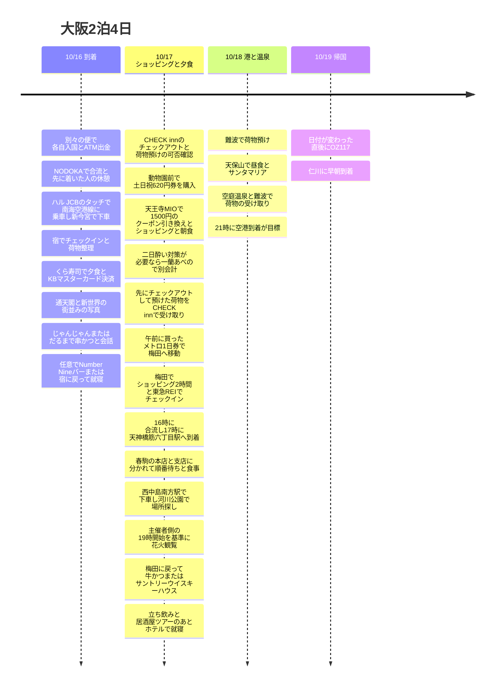

**初日は各自で入国・ATM出金 → NODOKAで合流 → 宿でチェックイン・荷物整理 → くら寿司 → 通天閣の写真 → 串かつ1軒 → 任意でNumber Nineバーまたは就寝**という配置にしました。同行者とは別々の飛行機に乗るため、空港で合流してから一緒に移動します。17日は**CHECK innをチェックアウトして荷物を預ける → 620円券で天王寺MIOのクーポン・ショッピング・朝食 → 宿で荷物を受け取る → 同じ1日券で梅田 → ショッピング2時間・東急REIでチェックイン → 16時に合流 → 17時に天神橋筋六丁目駅・春駒の本店と支店に分かれて順番待ち → 西中島南方駅・河川公園で花火観覧 → 牛かつまたはサントリーウイスキーハウス → 立ち飲み・居酒屋ツアー → 東急REIで就寝**、18日は港と温泉のあと空港へ向かいます。17日にショッピングした荷物は客室に置いて出かけます。

時刻は日本の現地時間です。**花火の開始時刻の案内が一致していません。**ユーザー提供のMetro NiNEは**19:30〜(5/27時点の情報)**、主催者側の公式の開催概要は**10/17 19:00〜20:00**と表示しています。旅程は早いほうの**19時開始を基準**に組み、出発前に主催者側のお知らせを再確認します。17時は食事開始の保証ではなく**天神橋筋六丁目駅への到着目標**で、春駒の待ち時間が長いと花火の開始に間に合わない可能性があります。[Metro NiNE](https://metronine.osaka/ko/event/yodogawa-fireworks/)、[主催者側の公式時間](https://www.yodohanabi.com/gaiyou.html)。

## 旅程の概要

| 日付 | 動線 | 守る時間 |
|---|---|---|
| 10/16 金 | **各自で出金 → NODOKAで合流 → ハル JCBで南海 → 新今宮 → CHECK inn → くら寿司 → 通天閣の写真 → 串かつ1軒 → 任意でNumber Nine / 就寝** | くら寿司は**KBトラベラーズまたはリブメイト**で決済。串かつはじゃんじゃん・だるまのうち現場で混んでいないほう |
| 10/17 土 | **11時前にチェックアウト・荷物預け → MIO・朝食 → 荷物の受け取り → 梅田 → ショッピング2時間・チェックイン → 16時合流 → 17時に天神橋筋六丁目 → 春駒で分かれて順番待ち → 河川公園で花火 → 牛かつ or サントリー → 立ち飲み・居酒屋 → 就寝** | 13:30〜15:30にショッピングする案。花火は主催者側**19〜20時**・NiNE**19:30〜**で不一致。牛かつは**21:30ラストオーダー** |
| 10/18 日 | 難波で荷物預け → 天保山で昼食 → サンタマリア → 空庭温泉 → 難波 → 空港 | 13:30に乗り場、19:45の空港行き列車が目標 |
| 10/19 月 | OZ117 関西 → 仁川 | 公式の夏ダイヤで00:15発・02:15着 |

## 旅程タイムライン

## 10/16 (金) · NODOKAで合流、くら寿司・通天閣・串かつ

同行者は**別々の飛行機で関西に到着**します。各自で入国・手荷物・ATM出金を済ませ、**KIX Airport Café Lounge NODOKAで合流**します。先に着いた人は使えるカード特典で休憩しながら待ち、全員がそろってから市内へ移動します。**本人の出金計画はイオン銀行で5回**で、同行者の出金回数まで5回と決めたわけではありません。

合流後は**ハル JCBのコンタクトレスで南海空港線の難波方面の列車に乗車 → 新今宮で下車 → 宿でチェックイン**します。初日の宿は**CHECK inn 大阪新世界(CHECK inn Osaka Shin-Sekai)、1-9-5 Haginochaya**、**1泊3万ウォン台**です。難波まで行かず、新今宮で降ります。下記の交通10%の特典は**即時の運賃割引ではなく後日のキャッシュバック**です。[南海の空港アクセス](https://www.howto-osaka.com/en/)、[宿の住所](https://www.hafh.com/en/properties/28089)。

| 順序 | 配分する時間 | 内容 |
|---|---|---|
| 空港到着後 | 入国・手荷物で60〜90分が目標 | 実際の到着便と入国の状況により変動 |
| 入国・税関を通過後 | **イオン銀行ATMで出金5回、15〜25分を配分** | T1の1階を優先、混雑していれば同じ銀行の2階のATM。待ち・処理時間により変動 |
| 各自の出金完了後 | **Aeroplaza 2階のNODOKAへ移動・合流** | 先に着いた人は休憩。入口・受付を待ち合わせの基準にし、入店したらお互いに位置を連絡 |
| ラウンジで待機 | 遅れて到着する同行者の入国・出金完了まで | JCBの2時間無料と超過料金を確認。**到着後はPP利用不可**、下記の条件を参照 |
| NODOKA → 関西空港駅 → 新今宮 → ホテル | 列車の待ち時間・徒歩を含め70〜90分が目標 | **ハル JCBを入口・出口で直接タッチ**、南海空港線の難波方面・新今宮で下車 |
| 宿のチェックイン・荷物整理 | 20〜40分 | 客室に荷物を置いて夕食に出かける |
| 宿 → くら寿司 新世界通天閣店 | 徒歩15〜20分の余裕を配分 | ユーザー指定の初日の夕食場所、2階の店舗 |
| くら寿司 | 待ち時間・食事で60〜90分を配分 | **KBトラベラーズまたはリブメイトのMastercard・JPY決済**、入店は23:30まで |
| 通天閣周辺 | 写真・散歩で10〜20分を配分 | くら寿司のあと、串かつへ行く前に外観・街並みの写真 |
| 串かつの2軒目 | 待ち時間・食事・会話で45〜75分を配分 | **じゃんじゃん / だるまのうち混んでいないほうの1軒だけ**、現場で雰囲気を見て選ぶ |
| 食後 | **Number Nineバーまたは宿に戻って就寝** | 物足りなければ前回行ったバー、疲れていればすぐ宿へ。バーに行く時間は未定 |

### 入国後のイオン銀行ATM・トラベルログUPI出金5回

**イオン銀行(AEON BANK)のATMだけを利用**します。**入国・手荷物・税関 → T1 1階のイオン銀行ATM → 出金5回 → 2階の空港駅への連絡通路 → Aeroplaza 2階のNODOKAで合流**の順に移動します。1階の機械が混んでいたり使えなかったりしたら、**同じ銀行のT1 2階のATM**へ行きます。

| 優先順位 | ATM・場所 | 運用の案内 |
|---|---|---|
| 1 | **イオン銀行、T1 1階** | 24時間運用の案内 |
| 2 | **イオン銀行、T1 2階** | 24時間運用の案内 |

[空港ATMの場所・時間](https://www.kansai-airport.or.jp/service/money_insurance/atm)。**AEON BANK・UnionPayのロゴと海外カードの取り扱い**を確認します。イオン銀行の公式案内では、海外発行のUPIカードは24時間取り扱い、**1回の出金限度額は50,000円・1件あたりの手数料は75円(税込)**です。設置場所の運用・点検により利用が制限されることがあります。[イオン銀行の海外カード案内](https://www.aeonbank.co.jp/atm/card/securities-credit/oversea/)。

ユーザーが持つ**ハナ トラベルログのUnionPayデビットカードで5回出金**する計画です。引き出し額はまだ未定で、必要な旅行現金の総額に合わせて決めます。15〜25分は旅程上に配分した余裕で、実際の処理時間を保証するものではありません。

**1,000円単位の出金は海外カードの利用レビューがありますが、公式の海外カード案内に最小単位の明記がないため、持っているUPIカードで現場の画面を見て確認**します。引き出し額がいくらでも、イオン銀行の手数料は出金1件につき75円です。[1,000円出金のレビュー](https://travel.korean-engineer.com/en/atm-en/atm-japan/)。

| キャンペーン項目 | 確認した条件 |
|---|---|
| 期間・対象 | 2026-06-12〜12-31、ハナ トラベルログのUnionPayデビットカード |
| 特典 | 日本のATM出金1回につき220円、カード1枚につき毎月最大5回 |
| 参加条件 | 事前登録・最低引き出し額の条件なし。UnionPayネットワークで正常に承認・売上確定した出金のみ認定 |
| 今回の旅行の目標 | 10月の使用済み回数がなければ5回で最大1,100円相当。使用済み分があれば残りの回数のみ適用 |
| 支給 | 通常は引き出しの翌日に付与、実際の金額・日付はカード会社の明細が基準。ATMのレシートにはキャッシュバックが表示されない |
| 注意 | 予算が尽きれば早期終了の可能性あり。ATM運営会社の追加手数料はキャッシュバックとは別 |

[ユーザー指定のUnionPayキャンペーン案内](https://www.unionpayintl.com/cardholderServ/serviceCenter/merchant/1175440369562?type=1)を基準に整理しました。公開されている条件には、異なる日に出金しなければならないという制限は記載されていませんが、実際の特典は正常な取引・売上確定およびキャンペーン規定により決まります。

実物のカードと暗証番号を準備し、**出金額と手数料をまかなえる円のハナマネー残高**を確認します。ATMで韓国語を選んで出金し、取引ごとに現金・カード・レシートを回収して完了回数を数えます。**5回の手数料は75円 × 5 = 375円**です。10月の特典の上限が残っていて5回すべてがキャンペーンで認定されれば、**キャッシュバック1,100円相当 − ATM手数料375円 = 純特典725円相当**が目標です。キャッシュバックは実際に付与される為替レート・キャンペーンの適用結果により変わります。[ハナカードの商品案内](https://m.hanacard.co.kr/MKCDCM1010M.web?CD_PD_SEQ=15356)。

### NODOKA・各自の出金後に会う空港ラウンジ

合流場所は**KIX Airport Café Lounge NODOKA、Aeroplaza 2階の一般エリア(保安検査前)**です。**24時間・年中無休**、空港駅から徒歩約5分の案内です。空港駅の改札を出て右のAeroplaza方面へ進み、建物に入ると左側にあります。入口・受付を待ち合わせの基準に決め、先に入店した人は位置を連絡します。[運営会社の場所・FAQ](https://aprecio.jp/nodoka/)、[空港のフロア別の場所](https://platinumaps.jp/maps/kix-airport/@34.43665976,135.24240069,19-18z?floor=2F)。

| 利用手段 | 条件・休憩の特典 | 初日の到着後の待機 |
|---|---|---|
| **ハル JCB URS Platinum** | **実物のカード + 本人名義の到着便の搭乗券/航空券**を提示、対象カード会員は**2時間無料**。JCBの日本・ハワイのラウンジサービスは**2026/4/1〜2027/3/31で合計6回**まで、残り回数を確認 | **この方法での休憩を優先して検討**。日本・ハワイのオリジナルラウンジサービスとして受付 |
| **Priority Pass** | **出発予定の12時間以内の搭乗券**が必要。3時間利用プランと食事・ビール・シャワーの選択特典は、該当する出発の利用条件およびPP発行会社の無料利用資格を満たす場合に適用 | **到着便だけでは利用不可**。10/16の入国後に同行者を待つのにPPの無料利用は計画しない |

運営会社のFAQは、**クレジットカードの2時間無料特典は到着後の利用が可能**、**PPは到着後の利用が不可**と区別しています。ハル JCBはJCB指定の対象ラウンジの日本・ハワイのサービスとして利用し、PPや日本国外のLoungeKey年2回とは区別します。[JCB韓国の公式利用条件・NODOKA対象リスト](https://www.kr.jcb/ko/consumers/platinum/airport-lounge/index.html)、[PP NODOKAの公式条件](https://www.prioritypass.com/en-GB/lounges/japan/kansai-international/kix12-airport-cafe-lounge-nodoka)。

JCBの本人無料特典に**同伴者の無料は含まれません**。同行者も各自で対象カードを提示するか、一般料金で利用します。ソフトドリンク・Wi-Fiは利用可能ですが、**JCBでの入場に食事・お酒・シャワーの無料が含まれるわけではありません**。2時間を超えた場合の料金と空席は現場で確認します。搭乗券がなければ日付・便名・氏名が見えるアプリ/メールを準備し、実物のハルカードと到着便の搭乗記録は捨てません。[空港のカードラウンジ案内](https://www.kansai-airport.or.jp/service/lounge/walk-in-lounge)。

### NODOKAで合流後・JCBのコンタクトレスで南海空港線

**NODOKA → 関西空港駅(関西空港) → 南海空港線の難波方面 → 新今宮 → CHECK innでチェックイン**の順に移動します。南海の公式対象駅マップで、**関西空港・新今宮はどちらもタッチ決済対応駅**であることを確認しました。[南海のタッチ決済対象駅](https://www.nankai.co.jp/contents/contactless/map/index.html)。

1. 関西空港駅で**南海電鉄**のタッチ決済対応改札を探します。
2. **コンタクトレス機能のある実物のハル JCBカード**を専用リーダーにかざして入場します。紙の乗車券の購入やICOCAのチャージ方式ではありません。
3. 難波方面の空港急行など新今宮に停車する列車に乗り、**新今宮で同じ実物のカードをタッチして出場**します。入場・出場でカードとスマートフォンを混ぜて使いません。
4. 各自が自分のカードで1人ずつ乗り降りし、降りたあと宿へ移動してチェックインします。[南海の公式利用方法](https://www.nankai.co.jp/contents/contactless/howto/index.html)。

ハル**URS Platinum**のJCB公共交通の特典は**月合計利用額の10%・カード1枚につき月最大500円のキャッシュバック**で、**別途のキャンペーン登録は不要**です。10月の利用分は**11月末までに支給予定**、10/13更新のお知らせでは今月の終了予定日は**10/31**です。**10/18に終わるハル独自の累計キャッシュバックキャンペーンとは期間・上限が異なります。**正常な売上確定・月の残り上限・早期終了の条件に従い、カードの海外利用手数料まで免除されるわけではありません。[JCBの交通キャンペーン](https://www.specialoffers.jcb/kr/premium/sub05.html)、[10月の実施状況](https://www.specialoffers.jcb/kr/campaign/detail/krpremium/93243/)。

### チェックイン・荷物整理後にくら寿司・KB Mastercard決済

初日の夕食はユーザー指定の**くら寿司 新世界通天閣店**です。**CHECK innでチェックイン → 客室で荷物を整理 → くら寿司で夕食**の順に訪れます。住所は**大阪市浪速区恵美須東2-6-3 2F**、公式の営業時間は**毎日11:00〜24:00・入店は閉店30分前の23:30まで**です。店舗の公式案内でMastercard決済に対応していることを確認しました。[ユーザー指定の地図](https://maps.app.goo.gl/F9oQqc8jdjohVbVQ9)、[公式の店舗案内・予約リンク](https://shop.kurasushi.co.jp/detail/509)。

**決済はKBトラベラーズ チェックMastercardまたはKBリブメイトMastercardの予定**です。どちらのカードもKBマスターダイニングキャンペーンの対象ブランド・個人クレジット/デビット条件に該当し、**一蘭・スシロー・くら寿司の10月合算でウォン換算5万ウォン以上なら新世界商品券2万ウォン分・月1回**の条件を管理します。今回の1食が必ず5万ウォン以上になると仮定せず、実際の売上確定の請求額と既存の10月利用分を合算します。**キャンペーンへの応募が完了しているかはまだ未確認**です。現地通貨の**JPY**で決済し、レシートを保管します。[KB公式のダイニングキャンペーン・応募](https://card.kbcard.com/BON/DVIEW/HBBMCXCRVNEC0001?mainCC=a&eventNum=1002202)。

トラベラーズは海外手数料の免除と基本10%割引の残り上限を、リブメイトは前月実績・基本キャッシュバック・海外手数料を確認して選びます。この夕食の決済は**ハルカードの累計利用額には合算しません**。くら寿司で食事したあとは、下記の写真・串かつの予定へ続きます。

### 通天閣の写真 → 串かつは2つの候補のうち1軒

**くら寿司 → 通天閣の外観・新世界の街並みの写真 → 串かつ**の順です。写真には10〜20分を配分し、串かつは下記の**2軒のうち現場で混んでいないほうの1軒だけ**を選びます。リアルタイムの混雑は未確認なので、行列・空席・雰囲気を見て決めます。**お客さんやスタッフと自然に話して友達を作る時間**を持ちたいというユーザーの希望を反映しました。

| 候補 | 場所・営業の案内 | 選ぶ基準 |
|---|---|---|
| **[① 串かつじゃんじゃん 新世界本店](https://maps.app.goo.gl/hUWypz8auYQvF8tv9)** / 串かつじゃんじゃん 新世界本店 | **恵美須東2-6-1**、地図表示は金曜**10:00〜23:00**。ラストオーダーは現場で確認 | だるまより待ち時間が短く、会話しやすい雰囲気なら選ぶ |
| **[② 串かつだるま 通天閣店](https://maps.app.goo.gl/VaNvuhDdaNV4vUQE9)** / 串かつだるま 通天閣店 | **恵美須東1-6-8**、公式の金曜**11:00〜22:30・ラストオーダー22:00**、予約不可 | 待ち時間が短く席があれば選ぶ。公式のカウンター38席の案内 |

だるまは**1人につきドリンク1杯以上の注文**が条件です。じゃんじゃんの営業時間は地図表示が基準で、公式サイトの店舗詳細を確認できなかったため、当日に再確認します。[じゃんじゃん公式サイト](https://kushikatu-janjan.com/)、[だるま公式の店舗条件](https://www.kushikatu-daruma.com/location/tsutenkaku)。

串かつの2軒は**くら寿司より早く営業が終わります**。だるまを選ぶ可能性を残すには、くら寿司・写真を終えて**22時のラストオーダー前**に入店できる余裕が必要です。全体の順序は維持し、実際の航空便・空港での合流時刻を確認してから食事の時刻を埋めます。串かつ・バーの決済カードはまだ未定で、これらの店は**KBの一蘭・スシロー・くら寿司専用ダイニングキャンペーンに合算しません**。

### 食後の任意・Number Nineバーまたは就寝

串かつまで食べても物足りなければ**前回訪れた[Number Nineバー](https://maps.app.goo.gl/Gpj9KSiUzGFfPFxD9)**へ行き、十分楽しんだか疲れていれば**CHECK innに戻って就寝**します。バーは確定の訪問ではなく、当日の選択です。

地図で確認した場所は**阿倍野区天王寺町南1-1-9**、表示されている営業時間は**20:00〜翌03:00**です。新世界から**天王寺の東へ追加で移動**する場所なので、帰りの動線・当日の営業を見て決めます。ユーザー指定の地点のまま記録し、同名の別のバーは推薦していません。

**各自の実際の到着便・NODOKAでの合流時刻は追加の照合が必要です。**既存の参考記録KE737の照会結果は**22:40関西着**なので、この便であれば入国・出金・合流・列車移動・チェックインのあと**23:30までにくら寿司へ入店**するのは難しくなります。別々の飛行機で来る同行者が全員準備できた時刻を市内移動の出発点とし、実際の予約便を確認してから夕方の到着目標を埋めます。[既存のKE737照会](https://www.trip.com/flights/status-ke737/)。

## 10/17 (土) · MIO・朝食、ショッピング2時間・16時合流、春駒・花火大会

2日目の宿は**大阪東急REIホテル、1泊8万7千ウォン台**です。**CHECK innのチェックアウト期限は11時とユーザーが確認**しました。MIOでの引き換えは10:30からなので、朝のうちにチェックアウトして荷物を預け、**動物園前 → 天王寺MIO → 朝食・短いショッピング → 宿で荷物を受け取る → 同じメトロ1日券で梅田**という配置にします。CHECK innの荷物預かりの可否は確認が必要です。

**梅田のショッピングは2時間、16時合流・17時に天神橋筋六丁目駅に到着**がユーザー指定の時間です。東急REIの客室に入れるのは15時からなので、2時間のショッピングを確保する案は**ホテルに荷物を預ける → 13:30〜15:30にショッピング → 15:30〜16:00にチェックイン・荷物整理 → 16時に合流**です。16時の集合場所はまだ未定です。

| 現地時間 | やること | 調整の基準 |
|---|---|---|
| 09:00〜09:45 | **CHECK innをチェックアウト・荷物預け** | 11時の期限前に済ませる。宿の預かり可否を確認し、不可なら駅のロッカーなどの代替案を選ぶ |
| 09:45〜10:15 | **動物園前駅で土日祝1日券620円を購入 → 天王寺** | 御堂筋線の中百舌鳥方面へ1駅、駅・徒歩を含め余裕を持つ |
| 10:15〜10:30 | MIOへ移動・開店待ち | 本館の案内所は10:30から引き換え |
| 10:30〜10:45 | **MIO本館2階の案内所でHave Fun in Kansai Passの1,500円分のクーポンを引き換え** | 500円券3枚・対象店舗を確認 |
| 10:45〜11:45の案 | **短いショッピング + 朝食を兼ねた早めの昼食** | MIOの対象店舗で1,500円前後以上の利用が目標。二日酔い対策が必要なら一蘭あべのを選び、別会計 |
| 11:45〜12:30の案 | **天王寺 → 動物園前 → CHECK innで荷物の受け取り** | 御堂筋線の江坂・千里中央方面へ1駅、午前の620円券を再利用 |
| 12:30〜13:30の案 | **荷物を持って動物園前 → 梅田 → 東急REIに荷物を預ける** | **既存の1日券を使用**。チェックイン前に預けてからショッピング |
| **13:30〜15:30の案** | **大阪駅・梅田でショッピング2時間** | 16時の合流に合わせてショッピングを終える |
| 15:30〜16:00の案 | 東急REIでチェックイン・購入品を客室に置く | チェックイン開始は15時、実際の受付の待ち時間を反映 |
| **16:00** | **同行者と合流** | 具体的な集合場所は未定 |
| 16:00〜17:00 | 合流後の移動・天神橋筋六丁目駅に到着 | 17時に駅へ到着が目標、駅から各店舗まで徒歩が追加 |
| **17:00以降〜18:00が目標** | **春駒の本店・支店に分かれてそれぞれ順番待ち・夕食** | 待ち状況を連絡。17時の着席は保証なし、18時に移動が目標 |
| **18:00〜19:00が目標** | メトロ → **西中島南方駅 → 指定の河川公園周辺で場所探し** | 乗り換え・混雑・徒歩を含めた配分、空いた場所の確保は保証なし |
| 観覧可能な場所に到着後 | レジャーシートを広げて休憩・花火を待つ | 追加の観光はせず現場で待つ |
| **主催者側19:00〜20:00** | **淀川花火大会を観覧** | Metro NiNEの19:30の案内とは不一致。19時基準で移動 |
| 20時以降・所要時間は変動 | 秩序ある退場・西中島南方 → 梅田 | 既存のメトロ1日券を使用。駅の待ち・規制により戻る時刻は変動 |
| 梅田に戻った後 | **牛かつ もと村 ルクア大阪店またはサントリーウイスキーハウス** | 2軒のうち1軒を選ぶ。牛かつは21:30ラストオーダー、サントリーのダイニングは23時閉店 |
| 食事・ウイスキーのあと | **立ち飲み・居酒屋ツアー** | 梅田で続けるか天満へ移動。営業中の店と体調を見て1〜2軒を配分 |
| ツアーの終了後・時刻未定 | **東急REIに戻って就寝** | 遅くなれば訪れる数を減らし、実際の帰りの交通を確認 |

### 動物園前の620円券 → MIOのクーポン・朝食

ユーザー指定の[動物園前駅](https://maps.app.goo.gl/WhbtsnC7PPHhWobr8)の券売機で、**エンジョイエコカードの土・日・祝日大人620円券**を買います。**御堂筋線 M22 動物園前 → 中百舌鳥方面 → M23 天王寺**の1駅です。この日はこの乗車券で改札を通り、JCBの直接タッチ乗車とは混ぜません。24時間券ではなく**使用当日の1日券**で、南海・JR・阪急は含まれません。[メトロ公式の620円券案内](https://subway-tr.osakametro.co.jp/ko/guide/page/enjoy-eco.php)。

**MIO本館2階のインフォメーションカウンター、引き換え時間10:30〜18:00**でHave Fun in Kansai PassのQRを提示し、**500円の共通券3枚・合計1,500円分**に引き換えます。本館・プラザ館の対象店舗でのショッピングや食事に使い、使う前にその店舗で使えるか確認します。**差額は現金・おつりなし**、現金での払い戻し・再発行は不可という条件です。そのため、対象店舗で**1,500円前後以上のショッピングまたは食事**をしてチェックイン前に戻る日程にします。[パス運営会社のMIOクーポン・引き換え案内](https://travelcontentsapp.com/en/attraction/osaka/tennoji-mio/)。

MIOのショッピングフロアは**10:30〜20:30**、本館のレストラン街はおおむね**11時から**なので、10:45に食事を始めるなら個別の店舗の営業時間を確認します。ショッピングのあと11時台の食事に変えても午前の配分の範囲でできます。[MIO公式の営業時間](https://www.tennoji-mio.co.jp/access)。

**前日にお酒を飲みすぎて二日酔い対策が必要なら[一蘭 あべの店](https://maps.app.goo.gl/yHrhYGBaZAqe5T8j9)**でラーメンを食べます。公式の営業は**10:00〜23:00**、住所は**阿倍野筋1-3-18 B1F**です。**MIOの外の店舗なのでMIOのクーポンは使えず、ラーメン代を別に支払います**。この場合、クーポンはMIOのショッピングに使い、朝食は一蘭の1軒に決めて食事が重ならないようにします。カード決済が可能で、KBマスターダイニングに応募して対象カードで決済すれば、前日のくら寿司と**10月合算5万ウォンの条件**をあわせて管理できます。待ち時間が長ければ、梅田に戻ってチェックインすることを優先します。[一蘭公式の店舗・決済案内](https://ichiran.com/shop/kinki/abeno/)。

### 11時前にチェックアウト → MIO → 荷物の受け取り・同じ1日券で梅田

**朝のうちにCHECK innで11時前にチェックアウトして荷物を預けます。**MIO・朝食のあと**天王寺 → 御堂筋線の江坂・千里中央方面 → 動物園前**と1駅戻って預けた荷物を受け取ります。そのあと荷物を持って再び動物園前駅へ行き、**同じ方面の御堂筋線 → 梅田駅で下車 → 大阪東急REIホテル**へ移動します。どちらの区間も**午前に買った620円のメトロ1日券をそのまま再利用**し、追加の乗車券は買いません。

**11時のチェックアウトはユーザー確認済み**で、宿のチェックアウト後の荷物預かりはまだ未確認です。預けられなければ動線上の駅のロッカーなどを決め、受け取り場所を変えます。東急REIはチェックイン前の荷物預かりの案内があるため、梅田では荷物を預けて2時間のショッピングをしたあと**15:30にチェックイン・16時に合流**する案です。[CHECK innのチェックアウト案内](https://travel.yahoo.co.jp/00924272/)、[東急REIの荷物預かり・チェックインFAQ](https://www.tokyuhotels.co.jp/en/osaka-r/qa/index.html)。

### 16時に合流 → 17時に天神橋筋六丁目駅・春駒の2つの行列

ショッピング2時間のあと**16時に同行者と集まり、17時に天神橋筋六丁目駅(天神橋筋六丁目)に到着**します。16時の具体的な集合場所はまだ決めていません。梅田エリアから地下鉄を使うなら**東梅田 → 谷町線の大日方面 → 天神橋筋六丁目**で、既存の620円券を使います。

| 分かれて待つ店舗 | ユーザー指定の地図 | 確認した住所 |
|---|---|---|
| **春駒 支店 / 春駒 支店** | [1つ目の地図](https://maps.app.goo.gl/GiedWJBZUf6dnPi8A) | 天神橋5-6-8 |
| **春駒 本店 / 春駒 本店** | [2つ目の地図](https://maps.app.goo.gl/bVF84NQP6X2CgbZB7) | 天神橋5-5-2 |

駅から各店舗へ歩き、**本店チーム・支店チームに分かれてそれぞれ列に並びます。**お互いに予想の待ち時間を連絡し、食事・再合流の方法を調整します。**17時は駅への到着で、着席・食事の開始は実際の待ち時間により決まります。**

### 西中島南方駅 → 河川公園で場所を確保して観覧

食後の基本のメトロでのアクセスは**天神橋筋六丁目 → 谷町線の八尾南方面・東梅田 → 徒歩で乗り換え梅田 → 御堂筋線の江坂・千里中央方面・西中島南方 → 河川公園**です。**既存の620円券を引き続き使用**します。店・駅への徒歩、駅間の乗り換え、花火大会の混雑まであるため、**18時出発・19時到着は目標であり、保証された時間ではありません。**待ち時間が長くなれば、食事が終わった時点で花火の開始前に到着できるか再判断します。

ユーザー指定の場所は**[淀川河川公園 西中島地区](https://maps.app.goo.gl/sgUQkCpRfaN3PPYu7)**です。駅から公園まで平常時は徒歩約7分という公園の案内がありますが、開催日は規制・混雑を加味します。降りたあと**観覧可能な河川周辺で場所を確保し、追加の観光はせず座って待ちます。**このピンは公園の基準点なので、当日の開放エリア・実際の花火の見晴らし・空いた場所を現場で確認します。[公園公式の場所・アクセス案内](https://www.yodogawa-park.jp/annai/nisinaka-juso/)。

**持っていくもの:** 小さな**レジャーシートまたは折りたたみ座布団**、軽い上着、水・簡単な軽食、モバイルバッテリー、ゴミ袋。購入品はホテルに置き、観覧用のバッグだけを持ちます。現場で待つ時間を考慮してトイレ・飲み物を事前に準備し、レジャーシートは座れる開放エリアで使います。

**開始時刻は主催者側19:00〜20:00、Metro NiNE 19:30〜で不一致**のため、19時基準の移動を維持します。**梅田側の河川敷は一般の立ち入り禁止**で、西中島側も当日の規制に従います。無料エリアでの場所の確保は保証されません。主催者側は協賛席の観覧客に、17:30までに駅・18時までに河川敷への到着を勧めているため、17時の食事の待ち時間から始まる今回の動線は、混雑によっては開始を逃す余地があります。[主催者側の開催概要](https://www.yodohanabi.com/gaiyou.html)、[ユーザー提供のMetro NiNE](https://metronine.osaka/ko/event/yodogawa-fireworks/)、[観覧・混雑FAQ](https://www.yodohanabi.com/faq.html)。

### 花火のあと・牛かつ or サントリー → 立ち飲み・居酒屋 → 就寝

花火の観覧後は**西中島南方駅 → 御堂筋線の中百舌鳥方面 → 梅田**へ戻ります。既存のメトロ1日券を使い、退場規制・駅の待ち時間により実際の到着時刻は変わります。梅田に着いたら、ユーザー指定の2か所のうち**お腹が空いていれば牛かつ、ウイスキーと料理を楽しむならサントリー**を選びます。

| 候補 | 場所 | 公式の営業時間・判断基準 |
|---|---|---|
| **[牛かつ もと村 ルクア大阪店](https://maps.app.goo.gl/88WVgymoDCCvrof98)** | 大阪市北区梅田3-1-3、**LUCUA 10F** | 店舗公式**11:00〜22:00・ラストオーダー21:30**。到着したら行列と入店できるかを最初に確認 |
| **[サントリーウイスキーハウス](https://maps.app.goo.gl/jDVJSrb8dTbATRVZA)** | 大阪市北区大深町3-1、**グランフロント大阪 北館 ナレッジキャピタル2F** | **Whisky Dining WWW.W 夕方17:30〜23:00**。同じ施設の**Whisky Bottle Bar 17:30〜23:30・日曜・祝日休み**。10/17土曜日に訪れる計画、ラストオーダー・空席を確認 |

牛かつはLUCUAの施設案内に23時閉店も表示されていますが、**店舗自体の公式案内のより早い21:30ラストオーダー・22時閉店を基準**に計画します。花火の退場後に梅田に着くのが21:30以降なら、牛かつに入店できる前提で組みません。サントリーもダイニングとボトルバーに分かれるので、利用する空間のラストオーダーを確認します。[牛かつ店舗公式](https://www.gyukatsu-motomura.com/store/LUCUA)、[LUCUA施設案内](https://www.lucua.jp/shopguide/id791.html)、[サントリーダイニング](https://www.suntory.co.jp/whisky/whiskyhouse/dining/)、[ボトルバー](https://www.suntory.co.jp/whisky/whiskyhouse/bottlebar/index.html)。

そのあとは**立ち飲み(立ってお酒を飲む店)・居酒屋ツアーをして東急REIに戻って寝ます。**梅田で続けることも天満エリアへ移ることもでき、具体的な店はまだ未定です。まず1〜2軒ほどを配分し、現場の雰囲気・営業時間・体調に合わせて調整します。遅く終わったら、地下鉄の終電と徒歩・タクシーでの帰り道を確認します。[天満駅周辺の飲み屋エリア](https://www.google.com/maps/search/?api=1&query=bars+near+Temma+Station+Osaka)。

## 10/18 (日) · 港で昼食 → クルーズ → 温泉 → 空港

**MIOのクーポン・ショッピング・朝食は17日のチェックイン前に移しました。**この日は難波に荷物を預けたあと、港へ直接移動して天保山で昼食を食べます。梅田のホテルの往復を減らすため、荷物は朝のうちに難波へ移します。

| 現地時間 | やること | 移動・待ちの配置 |
|---|---|---|
| 08:00〜09:15 | 朝食・荷物整理・チェックアウト | ホテルの10時の期限より早く出発 |
| 09:15〜10:00 | 梅田 → 難波・荷物預け | 空港行きの南海側で受け取りやすい預かり所 |
| 10:00〜11:00 | 難波 → 本町で乗り換え → 大阪港 → 天保山 | 地下鉄・徒歩に60分の余裕 |
| 11:00〜12:00 | 港周辺を散歩・休憩 | 遅く出発したらこの区間を減らす |
| 12:00〜13:00 | 天保山で昼食・休憩 | 当日の待ちが少ない店を選ぶ |
| 13:00〜13:30 | 港を散歩・乗り場へ移動 | 雨なら屋内で休んですぐ乗り場へ |
| 13:30〜14:00 | サンタマリアのチケット引き換え・乗船待ち | 海遊館の西側の乗り場 |
| 14:00〜14:45 | **サンタマリア デイクルーズ** | 実際の運航を確認、14時台の乗船が目標 |
| 14:45〜15:30 | 下船 → 大阪港 → 弁天町 → 空庭 | 下船・駅までの徒歩・温泉の受付を含む |
| 15:30〜17:45 | **空庭温泉・休憩** | 着替えを含め2時間15分 |
| 17:45〜18:30 | 弁天町 → 本町で乗り換え → 難波 | メトロ券のルート |
| 18:30〜19:15 | 難波で夕食・荷物の受け取り | 預かり所の閉まる時間を確認、待ちの長い店は避ける |
| 19:15〜19:45 | 南海の乗車券・ホームへ移動 | 大きな駅構内の移動に余裕 |
| 19:45〜21:00 | 空港行きの列車・ターミナルへ移動 | 出発日に実際の列車を選択、21時に空港到着が目標 |
| 21:00〜00:15 | 手続き・出国・搭乗 | 10/19の日付が変わった直後の便 |

[難波 → 天保山](https://www.google.com/maps/dir/?api=1&origin=Namba+Station&destination=Tempozan+Marketplace&travelmode=transit) · [温泉 → 難波](https://www.google.com/maps/dir/?api=1&origin=Solaniwa+Onsen&destination=Namba+Station&travelmode=transit)。

サンタマリアはデイクルーズで約**45分**、大阪港駅から乗り場まで徒歩約10分で、**14時台は目標であり10/18の出航確定ではありません**。[運営会社](https://suijo-bus.osaka/cruiselist/santamaria/)、[運航カレンダー](https://suijo-bus.osaka/wps/wp-content/uploads/2026/09/0901_time-santamaria.pdf)。空庭は弁天町のOsaka Bay Towerにあり、通常は**11〜23時・最終入館22時**です。[温泉FAQ](https://solaniwa.com/en-us/faq/)。

## 日本の決済カード5種・10月のキャンペーンと使い道

**KBマイワン Visa + KBリブメイト Mastercard + KBトラベラーズ チェックMastercard + 新韓ハル JCB + ハナ トラベルログUPI**を持っていきます。以下は**2026-10-15に確認した10/16〜19の旅行用の配分**です。**ハルの海外累計キャッシュバックキャンペーンとJCBキャンペーンへの応募は完了とユーザーが確認**しました。KBキャンペーンへの応募・MTRカードの登録・特典の有効化が完了しているかはまだ確認していません。実際の決済は現地通貨の**JPY**で行い、免税・クーポン適用後の実際のカード承認額で基準を確認します。

### KB特典のクイックメモ・カードブランド別

ユーザーが提供した画像のようにブランド別にまとめた旅行用のメモです。**空のチェックボックスはKB応募・MTR有効化が完了しているかが未確認**であることを意味し、利用条件を達成したという表示ではありません。商品券の金額と外貨マネー・キャッシュバックは区別します。

**KB / Visa → マイワン Visa**

- [ ] **百貨店(~11/30):** 阪急・大丸・パルコ**月合算50万ウォン以上 → 新世界商品券10万ウォン分**、月1回・全体で最大3回。[応募](https://card.kbcard.com/BON/DVIEW/HBBMCXCRVNEC0001?mainCC=a&eventNum=1002074)
- [ ] **ファッション(~11/30):** ユニクロ・GU・BAPE・コム デ ギャルソン・ビームス・ヒューマンメイド・キャピタル・ステューシー**月合算20/50/100万ウォン → 新世界商品券2/7/20万ウォン分**、該当する区間のみ支給・月1回・全体で最大3回。[応募](https://card.kbcard.com/BON/DVIEW/HBBMCXCRVNEC0001?mainCC=a&eventNum=1002073)
- [ ] **ドン・キホーテ(~11/30):** **月10万ウォン以上 → 新世界商品券2万ウォン分**、月1回・全体で最大3回。[応募](https://card.kbcard.com/BON/DVIEW/HBBMCXCRVNEC0001?mainCC=a&eventNum=1002072)
- [ ] **海外1.1%ポイントバック(~10/31):** **10/6以降の合算20万ウォン以上 → ウォン決済額の1.1%をポイントリー**、別途応募・2027/1/15までに支給予定。[応募](https://card.kbcard.com/BON/DVIEW/HBBMCXCRVNEC0001?mainCC=a&eventNum=1002268)

**KB / ブランド問わず → マイワン・リブメイト・トラベラーズ**

- [ ] **コンビニ(~10/31):** セブン-イレブン・ローソン・ファミリーマート**1件1,000円以上 → 外貨マネー500円**、案内上は最大5,000円・10回分。カードごとに上限が増えるわけではない。[応募](https://card.kbcard.com/BON/DVIEW/HBBMCXCRVNEC0001?mainCC=a&eventNum=1001883)
- [ ] **空港免税店(~10/31):** 大阪など対象空港の**免税店の業種で月合算10,000円以上 → 外貨マネー1,000円**。空港の一般店舗は別。[応募](https://card.kbcard.com/BON/DVIEW/HBBMCXCRVNEC0001?mainCC=a&eventNum=1001884)
- [ ] **百貨店(~11/30):** 阪急・三越伊勢丹・高島屋・大丸・小田急**月合算30,000円以上 → 外貨マネー3,000円**、月1回・対象業種の条件。**パルコは除く**。[応募](https://card.kbcard.com/BON/DVIEW/HBBMCXCRVNEC0001?mainCC=a&eventNum=1002215)

**画像の追加項目 — 海外総利用額別の商品券:** 写真には**50/100/200/300/500万ウォン → 新世界商品券1/2/4/6/10万ウォン分**と書かれていますが、**期間・公式のキャンペーンリンク・重複条件がなく、今回の旅行に適用されるかは未確認**です。現在の公式の海外キャンペーン一覧と照合しても、その条件を確定できませんでした。画像を参考にした候補として残し、上の確定キャンペーンや予想の特典には加えません。[KB公式の海外キャンペーン案内](https://card.kbcard.com/BON/DVIEW/HBBMCXCRVNEC0001?mainCC=a&eventNum=1000177)

**KB / Mastercard → リブメイト・トラベラーズ**

- [ ] **日本ダイニング(~11/30):** 一蘭・スシロー・くら寿司**月合算5万ウォン以上 → 新世界商品券2万ウォン分**、月1回。**初日のくら寿司の夕食で使う予定**、春駒は対象外。[応募](https://card.kbcard.com/BON/DVIEW/HBBMCXCRVNEC0001?mainCC=a&eventNum=1002202)
- [ ] **ドン・キホーテ(~12/31):** **1件20,000円以上 → 外貨マネー2,000円**、月1回。**トラベラーズ専用の追加キャンペーン**にまで応募すれば月1,000円を追加。[キャンペーン・各応募](https://card.kbcard.com/BON/DVIEW/HBBMCXCRVNEC0001?mainCC=a&eventNum=1001842)

**KB / トラベラーズ Mastercard専用 MTR → 登録後に店舗別に有効化**

- [ ] **阪急(~12/31):** 梅田本店・阪急メンズ大阪など**1件30,000円 → 2,000円キャッシュバック**、10〜12月中に1回・食品館/食料品は除く。[条件](https://card.kbcard.com/BON/DVIEW/HBBMCXCRVNEC0001?mainCC=a&eventNum=1000601)
- [ ] **大丸・松坂屋(~12/31):** **1件50,000円 → 3,000円キャッシュバック**、10〜12月中に1回。[条件](https://card.kbcard.com/BON/DVIEW/HBBMCXCRVNEC0001?mainCC=a&eventNum=1000601)
- [ ] **ビックカメラ(~12/31):** **1件30,000円 → 2,000円キャッシュバック**、10〜12月中に1回。[条件](https://card.kbcard.com/BON/DVIEW/HBBMCXCRVNEC0001?mainCC=a&eventNum=1000600)
- [ ] **ドン・キホーテ(~12/31):** **1件10,000円 → 1,000円キャッシュバック**、10〜12月中に1回。KBマスター・トラベラーズの追加キャンペーンをすべて満たせば最大4,000円を検討。[条件](https://card.kbcard.com/BON/DVIEW/HBBMCXCRVNEC0001?mainCC=a&eventNum=1000599)

**応募完了:** ハル独自の累計キャッシュバック + JCBキャンペーン。ハル独自のキャンペーンは**10/18締め切り**、既存の利用額**10,488ウォン**を基準に5万ウォンのキャッシュバックまで**489,512ウォン**の追加が必要。KB・JCB・ハルの累計はそれぞれ異なる基準で管理します。

### カードごとの役割と詳細条件

| カード | 今回の旅行で任せる決済 | 基本条件 |
|---|---|---|
| **KBマイワン Visa** | 対象ファッションブランド・百貨店・ドン・キホーテの商品券、海外20万ウォン以上なら1.1%ポイントバックを検討 | 各キャンペーンに別途応募、KB Visa既存保有顧客の条件。下記の金額表が基準 |
| **KBリブメイト Mastercard** | 一蘭・スシロー・くら寿司のダイニングキャンペーン、KBマスターのドン・キホーテキャンペーン | 海外2%キャッシュバックは前月実績30万ウォン・月の海外利用額100万ウォンまで、海外利用手数料は別 |
| **KBトラベラーズ チェックMastercard** | コンビニ・マスターダイニング、海外基本10%の残り上限、ドン・キホーテ・百貨店のMTR | 基本10%は前月実績20万ウォン・月の割引1万ウォンが上限。外貨マネーのチャージおよびキャンペーンごとの応募・有効化 |
| **新韓ハル JCB** | **10/18までの海外累計50万・100万ウォンのキャッシュバックキャンペーン**、JCB対象店舗・交通のタッチ決済の比較 | **累計キャンペーンは応募完了・既存の利用額10,488ウォン**。基本3.5%の付与は前月の国内利用30万ウォンまたは新規の猶予を満たした場合、海外手数料は別 |
| **ハナ トラベルログUPI** | **イオン銀行の出金5回** | 10%の決済割引は終了・利用不可とユーザーが確認、今回の旅行の特典から除外。出金は前の節の別キャンペーン条件が基準 |

[リブメイト公式の商品](https://card.kbcard.com/CRD/DVIEW/HCAMCXPRICAC0076?mainCC=a&cooperationcode=09215)、[トラベラーズ公式の商品](https://card.kbcard.com/CRD/DVIEW/HCAMCXPRICAC0076?mainCC=a&cooperationcode=09562)、[ハル公式の商品](https://www.shinhancard.com/pconts/html/card/apply/credit/1233082_2207.html)。

ハルの3.5%は**海外基本2%(月3万ポイント上限) + 日本追加1.5%(月10万ポイント上限)**です。カード約款は割引サービス・イベントが適用された取引を付与の対象外と案内しているため、**JCBキャッシュバックに基本3.5%を必ず足すとは考えません**。リブメイトの公式ブランドはMastercard・UPIで、Visaのキャンペーンは別に保有する**マイワン Visa**で参加します。

### 日本ダイニング・リブメイトマスターまたはトラベラーズ

**2026-09-29〜11-30**、対象の**一蘭・スシロー・くら寿司の月合算ウォン換算利用額が5万ウォン以上**なら**新世界商品券2万ウォン分**を提供します。今回の10月の旅行は**月1回2万ウォン分**で計算し、リブメイト Mastercardとトラベラーズ Mastercardのどちらもブランド・個人クレジット/デビットの対象条件に該当します。カードを2枚使っても商品券を2回受け取るとは計算しません。[KBダイニングの公式条件・応募](https://card.kbcard.com/BON/DVIEW/HBBMCXCRVNEC0001?mainCC=a&eventNum=1002202)。

応募は必須で、同じ月の中なら応募と利用の順序は問いません。**日本現地のJPYでの海外承認・加盟店名の識別**が必要で、利用月の翌月15日までに売上確定した請求額を合算します。10月分は**11月末までに支給予定**です。**初日のくら寿司の夕食をトラベラーズまたはリブメイトで決済する予定**で、春駒は対象の飲食店ではありません。

トラベラーズは海外決済手数料の免除と基本割引の残り上限を、リブメイトは前月実績・手数料を照合して選びます。スシローはハル JCBの**期間合算4,000円・20%で最大1,000円**と比較しますが、**KBで使った金額はハルの50万ウォン累計に入りません**。キャンペーンのために飲食店を追加したり、基準額以上を不必要に使ったりはしません。KBキャンペーンは他のキャンペーンと重複可能と案内していますが、カードの基本特典は各商品の除外条件にも従います。

### マイワン Visa・ショッピング金額別の新世界商品券

3つのキャンペーンはすべて**2026-09-17〜11-30**で、各キャンペーンへの応募が必要です。月1回・キャンペーン全体で最大3回の支給で、**今回の10月の旅行は各キャンペーン1回分**として計算します。日本現地のJPYでの海外承認のみ認定され、KBの売上確定の加盟店名で対象かどうかを判断します。**10月の利用分は11月末までに支給予定**です。

| 利用先 | 10月の利用基準 | 特典 | 公式の応募・条件 |
|---|---|---|---|
| **阪急・大丸・パルコ** | 月合算ウォン換算**50万ウォン以上** | 新世界商品券**10万ウォン分** | [Visa 百貨店](https://card.kbcard.com/BON/DVIEW/HBBMCXCRVNEC0001?mainCC=a&eventNum=1002074) |
| **ユニクロ・GU・BAPE・COMME des GARCONS・BEAMS・HUMAN MADE・KAPITAL・STUSSY** | 月合算ウォン換算**20万ウォン / 50万ウォン / 100万ウォン以上** | 該当する区間の新世界商品券**2万ウォン分 / 7万ウォン分 / 20万ウォン分** | [Visa ファッション](https://card.kbcard.com/BON/DVIEW/HBBMCXCRVNEC0001?mainCC=a&eventNum=1002073) |
| **ドン・キホーテ** | 該当月のウォン換算**10万ウォン以上** | 新世界商品券**2万ウォン分** | [Visa ドン・キホーテ](https://card.kbcard.com/BON/DVIEW/HBBMCXCRVNEC0001?mainCC=a&eventNum=1002072) |

ファッションの商品券は**区間ごとの金額を累積して足す方式ではありません**。百貨店の中のブランド店が百貨店名で承認されるとファッションキャンペーンから除外されることがあるため、**同じ決済を百貨店・ファッションの両方のキャンペーンで計上しません**。ウォンの基準は売上確定後の請求額で確定するため、円の金額を固定レートで断定しません。

**追加の応募: Visa海外利用額1.1%ポイントバック。****2026-10-06〜10-31**にマイワン Visaの海外加盟店の利用額がウォン換算**合算20万ウォン以上**なら、総ウォン決済額の**1.1%をポイントリー**で提供します。上限は100万ポイントリー、100ポイント単位の支給で、10ポイント単位で四捨五入します。**2027-01-08まで売上確定・01-15までに支給予定**です。ショッピング商品券キャンペーンとは別に応募し、家族カードの利用分は本人に合算します。「手数料ポイントバック」という名前ですが、**海外手数料そのものを即時に免除する方式ではありません**。[10月のVisaポイントバックの公式条件・応募](https://card.kbcard.com/BON/DVIEW/HBBMCXCRVNEC0001?mainCC=a&eventNum=1002268)。

### KB共通キャンペーン・コンビニ・百貨店・空港免税店

次のキャンペーンはマイワン・リブメイト・トラベラーズの**対象KBカードの利用分**に適用できます。カードを3枚使っても会員基準の上限が3倍になるとは計算しません。各キャンペーンへの応募とKB Payの外貨マネーの利用同意が必要で、10月の利用分は11月末までに支給予定です。

| 利用先 | 基準 | 提供する特典 | 期間・条件 |
|---|---|---|---|
| **セブン-イレブン・ローソン・ファミリーマート** | **1件1,000円以上** | 1件につき外貨マネー**500円**、案内上は最大**5,000円** | 9/1〜10/31。[コンビニキャンペーン](https://card.kbcard.com/BON/DVIEW/HBBMCXCRVNEC0001?mainCC=a&eventNum=1001883) |
| **阪急・三越伊勢丹・高島屋・大丸・小田急** | **月合算30,000円以上** | 外貨マネー**3,000円**、月1回 | 10/1〜11/30。MCC 5311・5956。[百貨店キャンペーン](https://card.kbcard.com/BON/DVIEW/HBBMCXCRVNEC0001?mainCC=a&eventNum=1002215) |
| **大阪など対象空港の免税店** | **月合算10,000円以上** | 外貨マネー**1,000円** | 9/1〜10/31。MCC 5309、空港の一般店舗とは区別。[空港免税店キャンペーン](https://card.kbcard.com/BON/DVIEW/HBBMCXCRVNEC0001?mainCC=a&eventNum=1001884) |

コンビニは**1,000円以上の取引ごとに定額500円**です。たとえば**1,000円の決済 → 500円**、**2,000円を1回で決済 → やはり500円**で、1,000円ごとに500円ずつ増えるわけではありません。案内上の最大5,000円は**10回分**です。月ごとの支給案内とは別に、**月が変わると上限が再び生じると仮定しません**。9月の利用履歴があれば、残りの回数から確認します。マイワン・リブメイト・トラベラーズの会員基準の上限をあわせて管理します。

コンビニでは**トラベラーズを優先して検討**します。海外手数料の免除と基本割引の残り上限を確認します。KB共通キャンペーンは他のキャンペーンと重複可能と案内しています。加盟店名がコンビニ名ではなく`JAPAN`などで計上されるとレシートの提出を求められることがあるため、**レシートを保管**します。KB Payの外貨マネーのアカウント作成の同意まで済ませて初めて、ペイバックを確認できます。

阪急・大丸で**マイワン Visaで月50万ウォンの条件**を満たしつつ、KB共通の**月3万円の条件・対象業種**も満たせば、**商品券10万ウォン分 + 外貨マネー3,000円**をあわせて検討します。2つの公式キャンペーンとも他のキャンペーンと重複可能と案内していますが、パルコはVisaのリストにだけあるため、共通の百貨店特典を自動で足しません。

### ドン・キホーテ・KBマスターとトラベラーズMTR

| カード・申込 | 取引基準 | 特典 |
|---|---|---|
| リブメイト Mastercardまたはトラベラーズ Mastercard + KBマスターキャンペーンに応募 | **1件20,000円以上**、月1回 | 外貨マネー**2,000円** |
| トラベラーズ Mastercard + 専用の追加キャンペーンに応募 | **1件20,000円以上**、月1回 | 外貨マネー**1,000円を追加** |
| トラベラーズ Mastercard + **MTRカード登録・ドン・キホーテ特典の有効化** | **1件10,000円以上**、10〜12月中に1回 | **1,000円キャッシュバック** |

同じトラベラーズカードですべての条件を満たせば**最大4,000円**を検討できます。リブメイトにはトラベラーズ専用の追加分とMTRをつけません。[KBマスターキャンペーン・各応募リンク](https://card.kbcard.com/BON/DVIEW/HBBMCXCRVNEC0001?mainCC=a&eventNum=1001842)、[ドン・キホーテのMTR](https://card.kbcard.com/BON/DVIEW/HBBMCXCRVNEC0001?mainCC=a&eventNum=1000599)。

ほかのトラベラーズのMTR候補は以下のとおりです。**カード登録後に各特典を決済前に有効化**する必要があり、10/1〜12/31の期間の各特典1回が基準です。実物のカード・JPY決済、取り消し・返金の反映条件に従います。

| 加盟店 | 10〜12月の公式の取引基準 | MTRキャッシュバック |
|---|---|---|
| **阪急梅田本店・阪急メンズ大阪など対象の阪急** | **1件30,000円以上**、食品館・食料品の購入は除く | **2,000円** |
| **Daimaru Matsuzakaya** | **1件50,000円以上** | **3,000円** |
| **三越・伊勢丹の対象店** | **1件80,000円以上** | **8,000円** |
| **西武・そごうの対象店** | **1件30,000円以上** | **3,000円** |
| **DFS Japanの対象店** | **1件25,000円以上** | **1,250円** |
| **ビックカメラ** | **1件30,000円以上** | **2,000円** |

[MTR百貨店の公式条件](https://card.kbcard.com/BON/DVIEW/HBBMCXCRVNEC0001?mainCC=a&eventNum=1000601)、[MTR ビックカメラ](https://card.kbcard.com/BON/DVIEW/HBBMCXCRVNEC0001?mainCC=a&eventNum=1000600)。百貨店は加盟店ごとに基準が異なるため、カフェの要約の一括金額をそのまま使いませんでした。MTRキャッシュバックの取消伝票はカードごとの実績から差し引かれることがあるため、基本10%割引と合わせた確定の総額は計上しません。

新しいカフェの投稿の**マツモトキヨシ20,000円利用で2,000円**のキャプチャは追加候補として記録します。**MTRはカード登録・ログイン後に特典が表示されるため、現在の公開画面ではその特典の期間・1件ごと/合算・回数・対象店舗を検証できませんでした。**トラベラーズの登録後に実際のオファーを確認するまでは、確定特典の表や予想の還付額に加えません。大丸福岡天神店の別の3万円基準も、大阪の大丸には適用しません。

**MTRの準備の順序:** [MTR](https://mtr.mastercardservices.com/ko-KR/)のアカウントに**トラベラーズ Mastercardを登録 → 日本の加盟店を検索 → 加盟店ごとの特典を有効化 → 該当する実物のカードでJPY決済**。KBキャンペーンへの応募だけではMTRの有効化は終わりません。リブメイトが同じMastercardだからといって、トラベラーズ専用のMTRの対象になるわけではありません。公式の百貨店案内では、利用後**14日以内にキャッシュバックの取消伝票**が売上確定し、加盟店名は`MastercardTravel`と表示されます。実際の対象店舗・有効化の状態・期間中の利用の有無はMTRで確認します。

### 新韓ハル・10/18までの海外累計キャッシュバック

**2026-09-10〜10-18**、ハルカードの海外オンライン・オフラインの**外貨一括払い**の累計を基準にしたキャンペーンです。**韓国時間の10/18まで**で、日本とは時差がありません。旅行中の**10/16〜18の決済は期間に含まれ**、10/19の決済は除外されます。

| キャンペーン期間の累計利用額 | キャッシュバック | 既存の10,488ウォン基準の追加必要額 |
|---|---:|---:|
| **50万ウォン以上** | **5万ウォン** | **489,512ウォン** |
| **100万ウォン以上** | **10万ウォン** | **989,512ウォン** |

**応募必須**で、期間内であれば利用後の応募も可能です。**11月末に支給予定**で、手数料を除いたウォンの請求額で合算します。取り消し・分割払い・分割への転換・ウォン決済は除外、第三者決済・商品券なども除外されることがあります。家族カードの金額は本人に合算されます。早期終了の可能性があり、公式案内はすでに応募した顧客の期間内の実績達成の特典を保証しています。[新韓カード公式のキャンペーン・応募](https://www.shinhancard.com/pconts/html/benefit/event/2014217_2239.html)。

**2026-10-15 ユーザー確認: すでに応募済みで、9/10以降の利用額は10,488ウォン**です。表の残り額は、この金額がすべてキャンペーンの認定額という前提で計算しました。手数料込みの承認額や取り消し分なら、手数料を除いたウォンの請求額で再度照合します。為替・売上確定金額の変動を考慮して、基準額をぴったり合わせるよりも、実際の認定額を確認します。このキャンペーン自体には前月実績の条件が記載されておらず、基本付与の国内実績の条件とは区別します。公式ページの**特典の重複不可**の文言があるため、区間ごとの報酬を足したり、JCBの20%・基本3.5%と合算した特典を確定したりしません。

カフェの投稿にある別の**海外オフライン10万ウォン利用で2万ウォンのキャッシュバック**は**2026-07-06〜09-30**のキャンペーンで、以前の未利用顧客の条件もあります。今回の10月の旅行には適用しません。[終了したキャンペーンの公式条件](https://www.shinhancard.com/pconts/html/benefit/event/2013715_2239.html)。

### 新韓ハル JCB・第3次 加盟店別の事前応募

**2026-10-15 ユーザー確認: JCBキャンペーンの応募完了。****第3次の期間は2026-10-01〜12-31**です。公式の条件は**加盟店ごとにそれぞれ事前応募・応募当日の利用分から認定**なので、実際に登録した加盟店の特典として管理します。GOを除けば**実物のカード・JPYの現地決済**が基準です。

| 加盟店 | 第3次の期間合算の最小利用額 | 20%キャッシュバックの上限 |
|---|---:|---:|
| **ドン・キホーテ** | **15,000円** | **3,000円** |
| **阪急阪神の対象店** | **15,000円** | **3,000円** |
| スシロー | 4,000円 | 1,000円 |
| コメダ珈琲店 | 2,000円 | 1,000円 |
| タクシーアプリ GO | 3,000円 | 1,000円 |

阪急阪神の対象には**阪急梅田本店・阪急メンズ大阪・阪神梅田本店**が含まれます。コメダ**なんばCITY店・JR弁天町駅店は除外店**なので、動線上に見えるからといってキャンペーンの対象とは見なしません。第3次のキャッシュバックは**2027年1月末の予定**です。[JCB公式の条件・応募リンク・除外店](https://www.specialoffers.jcb/kr/campaign/detail/2026JCBig/92971/)。

### ハル JCBプレミアム・ドン・キホーテと交通のタッチ決済

ハルの海外兼用は**URS Platinum**で、新韓カードがJCBプレミアムキャンペーンの対象商品と案内しています。以下の2つの特典は**2026-04-01〜2027-03-31の間に月ごとに実施**で、ハル独自の累計キャンペーンとは終了日が異なります。**10/13更新の公式のお知らせは、2つのキャンペーンとも10月分の終了予定日を10/31と案内**しています。[新韓の対象商品案内](https://www.shinhancard.com/pconts/html/benefit/event/1238572_2239.html)、[JCBの月ごとの実施状況](https://www.specialoffers.jcb/kr/campaign/detail/krpremium/93243/)。

| 特典 | 10月の条件 | 登録・支給 |
|---|---|---|
| **ドン・キホーテ1,000円キャッシュバック** | **月合算20,000円以上**、カード1枚につき月1,000円 | JCBの詳細基準では別途登録不要、翌月末までに支給 |
| **公共交通のタッチ決済10%** | 対象路線でコンタクトレスカードを直接決済、**カード1枚につき月最大500円** | JCBの詳細基準では別途登録不要、翌月末までに支給 |

[ドン・キホーテの詳細条件](https://www.specialoffers.jcb/kr/premium/sub02.html)、[交通の詳細条件](https://www.specialoffers.jcb/kr/premium/sub05.html)。ドン・キホーテのJCB第3次20%キャンペーンとプレミアムの1,000円は別の条件です。**両キャンペーンの重複支給を明示的に確認できなかったため、4,000円の確定特典として合算しません。**ハル独自の累計キャッシュバック・基本付与も自動では合算しません。

交通の対象リストには**大阪メトロ全駅・阪急・南海の一部区間**が含まれます。**初日の関西空港 → 新今宮は、ユーザーの選択によりハル JCBのコンタクトレスで移動**します。実際の入場・出場は同じカード・同じ媒体を使い、**ICOCAのチャージや乗車券の購入ではなく、直接タッチして乗車**する方式で処理します。市内は既存の**620円のメトロ1日券**と比較し、帰国時の空港への移動の決済方法は別途検討します。[JCB公式の対象路線PDF](https://www.specialoffers.jcb/kr/uploads/260914%20JCB%20transit_list_EN_revised.pdf)。月ごとの予算により早期終了することがあります。

### ハナ トラベルログUPI・出金用に配分

**2026-10-15 ユーザー確認: ハナUPIの10%の決済割引はすでに終了しており、利用できません。**既存のキャンペーンページの予定期間にかかわらず、今回の旅行の決済配分・予想の特典・出発前の登録リストから除外します。

ハナ トラベルログUPIは**関西空港のイオン銀行ATMでの出金5回用**に配分します。決済割引とATM出金キャッシュバックは別のキャンペーンで、出金計画の手数料・キャッシュバックの条件は前の節で管理します。一般のカード決済は、トラベラーズ・ハル・マイワン・リブメイトの適用可能な特典で判断します。

### 現在の大阪の動線に適用する順序

| 日程・状況 | 決済するカードと判断 |
|---|---|
| 10/16 関西に到着 | **イオン銀行ATM + ハナUPIで出金5回**、前の節の375円の手数料を維持 |
| コンビニでの買い物 | KB共通キャンペーンに応募後、**トラベラーズ**を優先して検討。実際に必要なものを1件1,000円以上買うときに500円のキャンペーンを適用 |
| **10/16 チェックイン・荷物整理後にくら寿司 新世界通天閣店で夕食** | ユーザーの選択により**トラベラーズまたはリブメイト Mastercard**でJPY決済の予定。KBダイニングへの応募・10月の対象飲食店の合算5万ウォンの条件を管理 |
| 10/17 大阪駅でショッピング・対象ファッションブランド | **マイワン Visa**で購入予定額を20万・50万・100万ウォンの区間と照合 |
| 10/17 阪急・阪神で15,000円前後の購入 | **ハル JCB**の該当百貨店の事前応募と除外店を確認したうえで比較 |
| 阪急・大丸で大きな購入 | マイワン Visaの**50万ウォン + KB共通3万円**の組み合わせとトラベラーズMTRの**1件ごとの基準**をカゴ単位で比較 |
| ドン・キホーテでの購入 | **ウォン10万ウォン基準はマイワン Visa**、**合算15,000円基準はハル JCB**、**1回で20,000円以上はトラベラーズの最大4,000円の組み合わせ**を比較。キャンペーンごとに異なる最小額に注意 |
| 春駒・一般の飲食店 | **ハルの5万ウォンのキャッシュバックまで追加489,512ウォン**が必要な状態で、計画した支出で基準を達成できるか比較。トラベラーズの基本10%の残り上限も照合する。現金専用なら出金した円を使用 |
| **10/17 MIOのクーポン・朝食** | **500円券3枚で合計1,500円**、差額は現金。カードキャンペーンにクーポン金額を合算しない。一蘭あべのはMIOの外なので別会計・KBマスターダイニングの対象として検討 |
| **10/16 NODOKAで合流後 関西空港 → 新今宮** | **ハル JCBの直接タッチ乗車を確定**、入場・出場は同じ実物のカード。交通10%の後日のキャッシュバック・月最大500円、降りたあとCHECK innでチェックイン |
| 帰国時の空港への移動・市内の個別乗車 | ハル JCBの交通キャッシュバックの月の残り上限と市内メトロの620円券を比較して決済方法を選択 |
| 帰国前の関西空港の免税店 | 免税店の業種として認められる購入をするとき、KBキャンペーンの**月10,000円・1,000円の特典**を照合 |

**出発前にやること:** **ハルの10/18締め切りの累計キャンペーンとJCBキャンペーンへの応募は完了**として記録しました。ハルの既存の利用額**10,488ウォン**、5万ウォンのキャッシュバックまでの追加の認定額**489,512ウォン**を18日までに満たせるか管理します。**KBマスターダイニング・Visaショッピング3種・Visa10月の1.1%ポイントバック・KBコンビニ/百貨店/空港キャンペーン**にそれぞれ応募し、トラベラーズのドン・キホーテ追加応募とMTRカード登録・加盟店ごとの有効化を完了します。トラベラーズの前月実績20万ウォン・ハルの国内実績30万ウォン・リブメイトの実績30万ウォンと、各カードの残り上限も確認します。**KB応募・MTR準備リストの完了状況は未確認です。**

ユーザー提供の[KB Visaカフェの投稿](https://cafe.naver.com/f-e/cafes/30857348/articles/360122)、[カードごとのまとめカフェの投稿](https://cafe.naver.com/f-e/cafes/30857348/articles/359736)、[ハル10%キャッシュバックのカフェの投稿](https://cafe.naver.com/f-e/cafes/30857348/articles/355632)、[カード会社のイベント日本まとめの投稿](https://cafe.naver.com/f-e/cafes/30857348/articles/357481)、[10/14日本割引カードまとめの投稿](https://cafe.naver.com/f-e/cafes/30857348/articles/362480)の本文・画像を読み、公式の条件と照合しました。9月に書かれた投稿のハルの2万ウォンキャンペーンは終了しているため除外し、大丸のMTRは10〜12月の公式の1件5万円基準で整理しました。カフェに一緒に出ていたネイバーペイマネーカード・サムスンペイ トラベルウォレット・ハナ Mastercard・KB UnionPay・新韓UnionPay専用の特典は、保有する組み合わせに入れませんでした。トラベラーズの日本初決済のスターバックスクーポンは、現在の公式の詳細・受付が可能かを確認できなかったため、確定特典の計算から除外しました。初日の夕食はユーザーの選択によりくら寿司に変更し、春駒・花火大会の日程は維持します。特典だけのために飲食店やショッピングの訪問を追加しません。

## Have Fun in Kansai Pass・メトロ券の使用表

| 利用日 | 使う場所 | 適用条件 |
|---|---|---|
| **10/17 10:30** | **天王寺MIO** | **本館2階の案内所10:30〜18時、500円券3枚・合計1,500円分**。対象店舗でショッピング・食事、差額は現金・おつりなし。一蘭あべのは除く |
| 10/18 14時台 | サンタマリア | 約45分のデイクルーズ。トワイライトとは区別 |
| 10/18 15:30 | 空庭温泉 | 日付ランクの差額・入湯税は別途確認 |
| 10/17・18 | 大阪メトロ 土日祝1日乗車券 | 1日620円、両日利用すれば1,240円。南海・JR・阪急は別 |

Have Fun in Kansai Passは**3施設型**を基準に3か所を配置しました。最初の施設の利用日から7日間・各施設1回という販売条件を確認しており、**最初の利用は10/17のMIO**、残りは10/18です。**MIOはパス運営会社の英語の公式ページで、1,500円券・関西パスとの連携・引き換え条件を確認しました。**9/14〜17の一時休止後、9/18に再開というお知らせがあり、10/17の休止のお知らせは表示されていません。ただし、3施設の同一購入商品への適用可否と温泉の日付ランクは、購入するパスの最新の条件で照合します。[MIO公式のパス案内](https://travelcontentsapp.com/en/attraction/osaka/tennoji-mio/)、[パスの販売条件](https://www.kkday.com/ko/product/131268-kansai-1-week-free-pass)、[サンタマリアの含まれる案内](https://experiences.travel.rakuten.com/experiences/41020)。

空庭は2026年の販売条件上、C・D・Eの日付にそれぞれ770・990・1,320円の差額と入湯税150円が案内されています。**10/18の日付ランクはまだ確認されていません。**サンタマリアの一般のデイクルーズは10月から大人2,000円と案内されています。上記の費用は決済内訳には入れていません。[温泉のパス条件](https://www.kkday.com/ko/product/131268-kansai-1-week-free-pass)、[クルーズ料金](https://suijo-bus.osaka/cruiselist/santamaria/)。

**17日は動物園前駅で620円券を購入して、天王寺・梅田への移動と花火大会へのアクセスに使います。**18日の追加券は別途購入の候補です。17日の花火大会へのアクセスを阪急に変えると、その区間は別運賃です。[620円券の公式の範囲](https://subway-tr.osakametro.co.jp/ko/guide/page/enjoy-eco.php)。

## 時間調整の範囲

| 区間 | 調整可能な範囲 | 守る境界 |
|---|---|---|
| 初日のくら寿司 | 待ち時間・食事で60〜90分 | 実際の合流・チェックイン後の移動と**23:30の入店締め切り**を照合 |
| 初日の通天閣の写真 | 10〜20分 | 串かつの営業終了前に移動する余裕を確保 |
| 初日の串かつ | 45〜75分 | じゃんじゃん・だるまのうち混んでいないほうの1軒だけ。だるまは**22時ラストオーダー**、じゃんじゃんは地図上**23時閉店** |
| 初日のNumber Nine | 当日の選択、滞在時間は未定 | 食後に物足りないときだけ。疲れていればCHECK innに戻って就寝 |
| **17日 MIOショッピング・朝食** | 10:30の引き換え後に1〜2時間前後 | クーポン1,500円の活用・差額は現金。一蘭は別会計、**15時のチェックイン前にホテルへ到着**を優先 |
| **17日 大阪駅・梅田でショッピング** | **2時間・13:30〜15:30の案** | チェックイン・荷物整理後に**16時に同行者と合流** |
| **17日 春駒** | **17時に天神橋筋六丁目駅 → 本店・支店でそれぞれ順番待ち** | 18時に花火会場方面へ出発が目標、実際の待ち時間が長ければ開始前の到着は難しい |
| **17日 河川公園での観覧待ち** | 西中島南方駅で降りたあと場所を探して休憩 | レジャーシートを準備・現場の規制を守る。主催者側の19時開始を基準に移動 |
| **17日 花火のあとの牛かつ / サントリー** | 梅田に戻ったあと2軒のうち1軒 | 牛かつは**21:30ラストオーダー**が基準、サントリーのダイニングは**23時閉店**・ラストオーダーを確認 |
| **17日 立ち飲み・居酒屋ツアー** | 食事・ウイスキーのあとまず1〜2軒、帰る時刻は未定 | 実際の営業・体調に合わせて調整したあと東急REIに戻って就寝 |
| 18日 港での昼食・散歩 | 60〜90分 | 遅れたら散歩から省略、13:30の乗り場が目標 |
| 18日 クルーズ | 14時台が基本、運航・席を確認できれば15時台 | 15時の便なら温泉は16:30開始、16時以降まで待たない |
| 18日 温泉 | 75〜135分 | **17:45出発**を維持。欠航なら温泉へ直行 |
| 18日 難波で夕食 | 30〜45分 | 遅ければテイクアウト・空港での食事、**19:45の空港行きが目標**を維持 |

空庭が75分未満しか残らなければ、短い入浴だけにするか入場を省略するか選びます。空港への移動を減らしてまでパスを無理にすべて使うことはしません。難波のロッカーが満席なら、周辺の預かり所の**19時前後に受け取れるか**を最初に確認します。

## 10/19 (月) · 日付が変わる時刻の帰国と費用

OZ117の公式の夏ダイヤは**00:15関西 → 02:15仁川**です。**18日日曜日の夜に空港へ移動**、宿泊は**16・17日の2泊**、カレンダー上は**4日**です。予約票の時刻が異なる場合は、出発の約3時間前に空港到着、難波からターミナルまで75分を基準に再計算します。[アシアナ公式の時刻表](https://flyasiana.com/C/JP/KO/customer/notice/detail?id=CM202603060002528429)。

| 項目 | 記録された金額 |
|---|---:|
| 往路の航空運賃 | **約140,000ウォン** |
| OZ117の帰国航空運賃 | 190,000ウォン |
| 10/16 CHECK inn 大阪新世界 1泊 | **3万ウォン台** |
| 10/17 大阪東急REI 1泊 | **8万7千ウォン台** |
| ウォン建て部分の合計(往路は推定額・宿泊は金額帯の下限が基準) | **約447,000ウォンから** |
| 10/17 メトロ券の利用予定 | **620円** |

宿泊費はユーザー提供の金額帯をそのまま記録しました。合算用の数字は、それぞれ30,000ウォン・87,000ウォンを使った**金額帯の下限が基準の推定値**で、実際の支払額が確認できたら合計を更新します。

往路の航空運賃は、ユーザー提供の「14万ウォンくらい」を反映した推定額です。Have Fun in Kansai Pass・南海・18日のメトロ券・食費・バー・花火大会の座席・預かり料・温泉の追加料金は別です。残りの確認項目は**実際の往路便・到着時刻、ATMの引き出し額・10月キャンペーンの使用済み回数、花火大会のエリア・入場締め切り・ゲート、購入するHave Fun in Kansai Passの適用施設、空港行きの列車・仁川の早朝の帰宅の交通**です。旅程の更新日は2026-10-15です。
