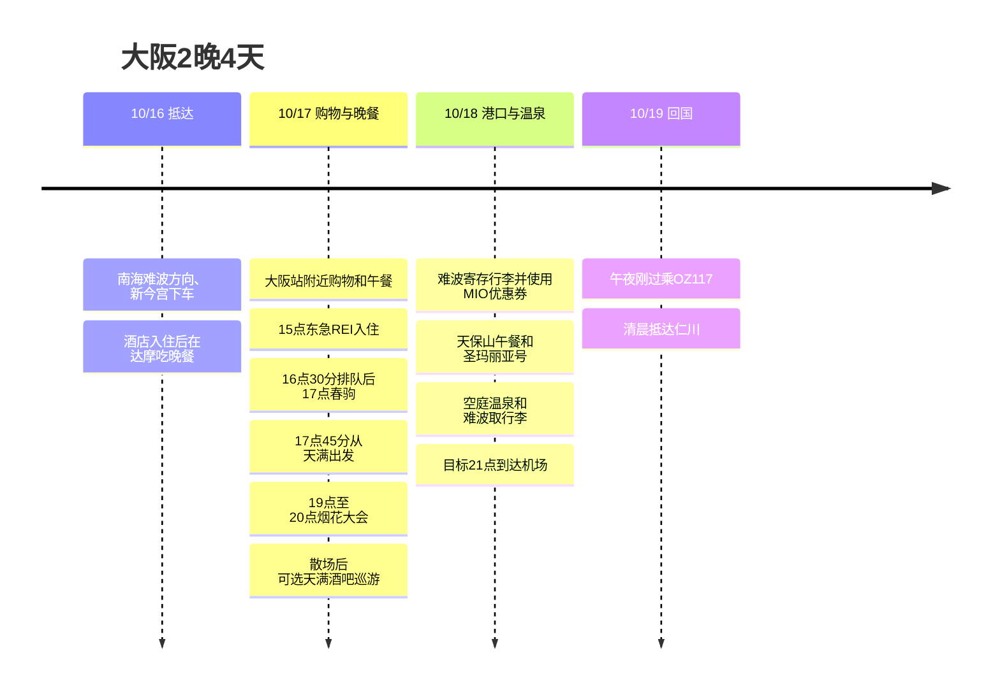

**第一天去达摩 → 17日大阪站购物、17点春驹 → 19点淀川烟花大会 → 可选天满酒吧巡游**,是这样的安排。18日只短暂使用MIO的Have Fun in Kansai Pass优惠券,然后经过港口和温泉前往机场。17日购物买的东西放在东急REI的客房里再出门。

时间均为日本当地时间。**“19点烟花”设定为到达现场的目标。**如果19点才从天满出发,可能会错过开场。想同时保证17点用餐和烟花大会,就要在16:30左右到达春驹,以**17:45出发**为基准来调整。烟花大会前要逛好几家酒吧,时间上很难,所以把巡游留作烟花大会后的可选项。

## 行程概要

| 日期 | 动线 | 保持的时间 |
|---|---|---|
| 10/16 周五 | 关西 → 南海难波方向、新今宫下车 → CHECK inn → **达摩** | 根据实际抵达时间,入住后吃晚餐 |
| 10/17 周六 | 东急REI寄存行李 → **大阪站购物** → 入住 → **春驹晚餐** → 烟花大会 → 可选天满巡游 | 16:30在店前排队,17点用餐,17:45出发,19至20点烟花 |
| 10/18 周日 | 难波寄存行李 → MIO优惠券 → 天保山午餐 → 圣玛丽亚号 → 空庭温泉 → 难波 → 机场 | 10:30 MIO,13:30码头,目标是19:45开往机场的列车 |
| 10/19 周一 | OZ117 关西 → 仁川 | 官方夏季时刻表00:15起飞、02:15抵达 |

## 行程时间线

## 10/16 (周五) · 入住后去达摩吃晚餐

从关西机场**乘坐开往南海难波方向的列车,在新今宫下车**。住宿以**CHECK inn Osaka Shinsekai,1-9-5 Haginochaya**为准。减少坐到难波再折返住宿的路段。[南海机场交通](https://www.howto-osaka.com/en/)、[住宿地址](https://www.hafh.com/en/properties/28089)。

| 顺序 | 分配时间 | 内容 |
|---|---|---|
| 机场抵达后 | 目标入境、领行李60至90分钟 | 根据实际抵达的航班和入境情况变动 |
| 机场 → 新今宫 → 酒店 | 含候车和步行目标70至90分钟 | 确认各日南海的运行情况 |
| 住宿入住 | 20至40分钟 | 放下行李外出 |
| 住宿 → 达摩通天阁店 | 步行预留15至20分钟 | 第一天晚餐固定希望去的地方 |
| 达摩 | 排队、用餐60至90分钟 | 饭后在通天阁周边短暂散步、回住宿 |

达摩通天阁店位于**Ebisuhigashi 1-6-8**,周五官方营业时间为**11:00至22:30**,最后点单**22:00**,不接受预约。目标是**20点左右前到达住宿,入住后再前往**。[门店官方说明](https://www.kushikatu-daruma.com/location/tsutenkaku)。

**只有去程航班时间需要进一步核对。**原有记录KE737的查询结果为**22:40抵达关西**,与第一天达摩的营业时间不符。基本安排中体现了用户指定的第一天前往,但如果订单上确实是这个时间,第一天的用餐就不可能了。没有仅凭约14万韩元的费用就推测是更早的航班。确认实际抵达的航班后再填入第一天的时间,如果是晚班机,就重新确定达摩的替代日期。[原有KE737查询](https://www.trip.com/flights/status-ke737/)。

## 10/17 (周六) · 大阪站购物、17点春驹、19点烟花大会

| 当地时间 | 要做的事 | 调整基准 |
|---|---|---|
| 08:30至09:30 | 早餐、整理行李、办理CHECK inn退房 | 如果前一天很晚才到,早餐从简 |
| 09:30至10:15 | 动物园前 → 御堂筋线到梅田 → 东急REI | 含车站、酒店步行 |
| 10:15至10:45 | 酒店寄存行李 → 前往大阪站方向 | 不带大件行李去购物 |
| 10:45至12:30 | **大阪站附近购物** | 先去车站周边购物中心里想去的店 |
| 12:30至13:15 | 大阪站附近午餐 | 为了晚上的寿司吃得清淡些 |
| 13:15至14:30 | **剩余的购物** | 当天的主要购物到此结束 |
| 14:30至15:00 | 返回东急REI、等待入住 | 整理购买的东西 |
| 15:00至16:00 | 入住、放行李、客房休息 | 用餐、看烟花时不要拎着购物袋 |
| 16:00至16:30 | 酒店 → 春驹本店 | 步行和找路的余裕 |
| 16:30至17:00 | **春驹排队** | 不保证17点入座。如果17:10前难以入座,采用下面的替代方案 |
| **17:00至17:45** | **春驹晚餐** | 烟花大会前在天满用餐。这天不追加点太多,目标45分钟 |
| **17:45至18:45** | 天满 → 前往指定观赏区域 | 前往下面的车站路线和实际检票口,拥挤时会花更久 |
| 18:45至19:00 目标 | 前往检票口、座位 | 入场截止以购买的门票为准,提前确认能否晚入场 |
| **19:00至20:00** | **淀川烟花大会** | 并不是19点才出发的行程 |
| 20:00至22:00 | 有序散场、前往梅田方向 | 由于车站排队和散场管制,到达时间变动很大 |
| 22:00至23:00 可选 | 天满站附近酒吧巡游1至2家 | 能到达天满时的目标。如果累了或散场晚了就直接回酒店 |
| 23:00至23:30 目标 | 返回东急REI | 确认营业中的酒吧和实际回家路线 |

[酒店 → 春驹 步行](https://www.google.com/maps/dir/?api=1&origin=Osaka+Tokyu+REI+Hotel&destination=Harukoma+5-5-2+Tenjinbashi&travelmode=walking) · [春驹 → 西中岛南方](https://www.google.com/maps/dir/?api=1&origin=Harukoma+5-5-2+Tenjinbashi&destination=Nishinakajima-Minamigata+Station&travelmode=transit) · [天满站周边酒吧](https://www.google.com/maps/search/?api=1&query=bars+near+Temma+Station+Osaka)。

春驹是**春驹 本店,Tenjinbashi 5-5-2**,根据公开的门店说明为**11:00至21:30·周二休息**。不要与同名的梅田餐厅混淆。烟花大会后可能赶上打烊,所以一定把寿司安排在烟花大会之前。[本店说明](https://www.hotpepper.jp/strJ000109465/)。酒店为**15点入住、10点退房**,并说明入住前可寄存行李。[东急REI FAQ](https://www.tokyuhotels.co.jp/en/osaka-r/qa/index.html)。

### 从天满到烟花大会 · 紧张的路段

基本的地铁路线是**天神桥筋六丁目 → 谷町线到东梅田 → 步行换乘到梅田 → 御堂筋线到西中岛南方 → 指定检票口**。由于还有车站之间步行换乘和拥挤,**75分钟是目标,而不是保证的时间。**如果门票指定了地址所在站或其他检票口,就先按那条路线走。阪急、JR路段不包含在地铁620日元券内。

活动官方时间为**10/17 19:00至20:00**,**梅田侧河岸禁止一般人员进入和观赏**。不要直接前往地图基准点,而要先确认门票对应的区域和入场截止时间。尤其是免费区域,这个时间到达很难指望占到位置,必须先确定可观赏的区域。[活动概要](https://www.yodohanabi.com/gaiyou.html)、[观赏FAQ](https://www.yodohanabi.com/faq.html)、[交通管制](https://www.yodohanabi.com/kisei.html)。

- **保持17点用餐的方案:**16:30排队 → 17:00至17:45用餐 → 直接前往烟花大会。省略烟花大会前的酒吧。
- **增加余裕的方案:**购物缩短30分钟,把春驹提前到**16:30至17:15**,**17:15出发前往会场**。如果检票口远或入场截止早,就用这个方案。
- **如果17:10还难以入座:**选择继续在春驹排队,还是改为在天满快速用餐以保证烟花开场。排队、酒吧巡游、19点入场不可能全部原样保持。
- **如果烟花大会后到天满超过22:30:**只在营业中的一家酒吧待30至45分钟,或者在梅田收尾。不为了巡游而逆着散场的人流走。

## 10/18 (周日) · MIO优惠券 → 港口午餐 → 游船 → 温泉 → 机场

**主要购物在17日的大阪站结束**,MIO只分配30分钟,用于兑换和使用用户选定的Have Fun in Kansai Pass优惠券。达摩第一天就去了,所以这天在天保山从容地吃午餐。为了减少往返梅田酒店,行李早上就转移到难波。

| 当地时间 | 要做的事 | 移动、等待安排 |
|---|---|---|
| 08:00至09:15 | 早餐、整理行李、退房 | 比酒店10点的截止时间更早出发 |
| 09:15至10:00 | 梅田 → 难波、寄存行李 | 便于在开往机场的南海一侧取回的寄存处 |
| 10:00至10:30 | 难波 → 天王寺MIO | 配合开门时间前往 |
| 10:30至11:00 | **MIO兑换、使用优惠券** | 不追加主要购物,只买需要的东西 |
| 11:00至12:00 | 天王寺 → 本町换乘 → 大阪港 → 天保山 | 地铁、步行预留60分钟 |
| 12:00至13:00 | 天保山午餐、休息 | 选择当天排队少的餐厅 |
| 13:00至13:30 | 港口散步、前往码头 | 下雨就在室内休息,然后直接去码头 |
| 13:30至14:00 | 圣玛丽亚号兑换船票、等候登船 | 海游馆西侧的码头 |
| 14:00至14:45 | **圣玛丽亚号日间游船** | 确认实际航班,目标14点左右登船 |
| 14:45至15:30 | 下船 → 大阪港 → 弁天町 → 空庭温泉 | 含下船、车站步行、温泉登记 |
| 15:30至17:45 | **空庭温泉、休息** | 含更衣共2小时15分钟 |
| 17:45至18:30 | 弁天町 → 本町换乘 → 难波 | 地铁券范围内的路线 |
| 18:30至19:15 | 难波晚餐、取回行李 | 确认寄存处的关门时间,避开排队长的餐厅 |
| 19:15至19:45 | 前往南海车票、站台 | 大车站内移动的余裕 |
| 19:45至21:00 | 开往机场的列车、前往航站楼 | 选择出发当天的实际列车,目标21点到达机场 |
| 21:00至00:15 | 办理手续、出境、登机 | 10/19午夜刚过的航班 |

[MIO → 天保山](https://www.google.com/maps/dir/?api=1&origin=Tennoji+MIO&destination=Tempozan+Marketplace&travelmode=transit) · [温泉 → 难波](https://www.google.com/maps/dir/?api=1&origin=Solaniwa+Onsen&destination=Namba+Station&travelmode=transit)。

MIO购物楼层的官方营业时间为**10:30至20:30**。[MIO说明](https://www.tennoji-mio.co.jp/access)。圣玛丽亚号日间游船约**45分钟**,从大阪港站步行到码头约10分钟,**14点左右是目标,并不是10/18的确定航班**。[运营方](https://suijo-bus.osaka/cruiselist/santamaria/)、[航班日历](https://suijo-bus.osaka/wps/wp-content/uploads/2026/09/0901_time-santamaria.pdf)。空庭温泉位于弁天町的Osaka Bay Tower,通常**11至23点·最后入场22点**。[温泉FAQ](https://solaniwa.com/en-us/faq/)。

## Have Fun in Kansai Pass·地铁券使用表

| 使用日 | 使用的地方 | 适用条件 |
|---|---|---|
| 10/18 10:30 | 天王寺MIO | Have Fun in Kansai Pass 1,500日元优惠券的说明。兑换窗口、适用店铺以所购产品为准 |
| 10/18 14点左右 | 圣玛丽亚号 | 约45分钟的日间游船。与暮光航班区分 |
| 10/18 15:30 | 空庭温泉 | 日期等级的差价、入浴税另行确认 |
| 10/17·18 | 大阪地铁 周末1日券 | 每天620日元,两天都用共1,240日元。南海、JR、阪急另计 |

以**Have Fun in Kansai Pass 3设施型**为基准安排了三个地方。已确认从首个设施使用日起7天、每个设施1次的销售条件。MIO优惠券和圣玛丽亚号有包含的说明,但**目前无法打开官方设施列表,尚未确认10月三个设施能否同时适用。**三个地方的游览动线可以照常使用,但购买通票前要对照该产品的最新列表。[Have Fun in Kansai Pass销售条件](https://www.kkday.com/ko/product/131268-kansai-1-week-free-pass)、[JR西日本的MIO介绍](https://www.westjr.co.jp/global/kr/ticket/cp/west_japan/pdf/e-brochures_kr.pdf)、[圣玛丽亚号包含说明](https://experiences.travel.rakuten.com/experiences/41020)。

空庭温泉在2026年的销售条件下,C·D·E日期分别为770·990·1,320日元的差价,另有入浴税150日元。**10/18的日期等级尚未确认。**圣玛丽亚号的普通日间游船从10月起成人为2,000日元。以上费用没有计入支付明细。[温泉通票条件](https://www.kkday.com/ko/product/131268-kansai-1-week-free-pass)、[游船费用](https://suijo-bus.osaka/cruiselist/santamaria/)。

17日用于酒店移动和前往烟花大会,18日在多个路段使用地铁券。如果17日前往烟花大会改乘阪急,地铁券节省的幅度会变小。[620日元券官方范围](https://subway-tr.osakametro.co.jp/guide/page/enjoy-eco.php)。

## 时间调整范围

| 环节 | 可调整的范围 | 保持的界限 |
|---|---|---|
| 第一天达摩 | 排队、用餐60至90分钟 | 先核对实际航班抵达时间和22点的最后点单 |
| 17日大阪站购物 | 不含午餐约2小时30分钟至3小时 | 如果需要为前往烟花大会留出余裕,就缩短30分钟 |
| 17日春驹 | 目标16:30排队、17点用餐,用餐30至45分钟 | **17:45出发**。提前方案为16:30用餐、17:15出发 |
| 17日烟花大会后的天满 | 0至60分钟,1至2家 | 如果散场、车站拥挤严重就省略或只去一家 |
| 18日MIO | 20至30分钟 | 不追加主要购物,只使用优惠券 |
| 18日港口午餐、散步 | 60至90分钟 | 晚了就先省略散步,目标13:30到码头 |
| 18日游船 | 基本为14点左右,确认航班、座位后可改15点左右 | 如果是15点左右的班次,温泉16:30开始,不要等到16点以后 |
| 18日温泉 | 75至135分钟 | 保持**17:45出发**。如果停航就直接去温泉 |
| 18日难波晚餐 | 30至45分钟 | 晚了就打包、在机场吃,保持**目标19:45开往机场** |

如果空庭温泉剩下不足75分钟,就选择只做短暂泡澡还是省略入场。不会为了把通票全部用完而压缩前往机场的时间。如果难波的寄存柜满了,先确认周边寄存处**19点前后能否取回**。

## 10/19 (周一) · 午夜回国与费用

OZ117的官方夏季时刻表是**00:15 关西 → 02:15 仁川**。**18日周日晚上前往机场**,住宿为**16、17日2晚**,按日历算是**4天**。如果订单上的时间不同,就以起飞前约3小时到达机场,以及从难波到航站楼75分钟为基准重新计算。[韩亚航空官方时刻表](https://flyasiana.com/C/JP/KO/customer/notice/detail?id=CM202603060002528429)。

| 项目 | 记录的金额 |
|---|---:|
| 去程机票 | **约140,000韩元** |
| OZ117 回程机票 | 190,000韩元 |
| 10/16 CHECK inn 大阪新世界 1晚 | 23,000韩元 |
| 10/17 大阪东急REI 1晚 | 110,000韩元 |
| 韩元部分合计(含去程估算金额) | **约463,000韩元** |
| 10/17 地铁券预计使用 | **620日元** |

去程机票是体现了用户提供的“14万韩元左右”的估算金额。Have Fun in Kansai Pass、南海、18日的地铁券、餐费、酒吧、烟花大会座位、寄存费、温泉追加费用另计。剩下需要确认的项目有**实际去程航班和抵达时间、烟花大会区域、入场截止时间、检票口,要购买的Have Fun in Kansai Pass适用设施,开往机场的列车、仁川清晨回家的交通**。行程更新日 2026-09-07。
