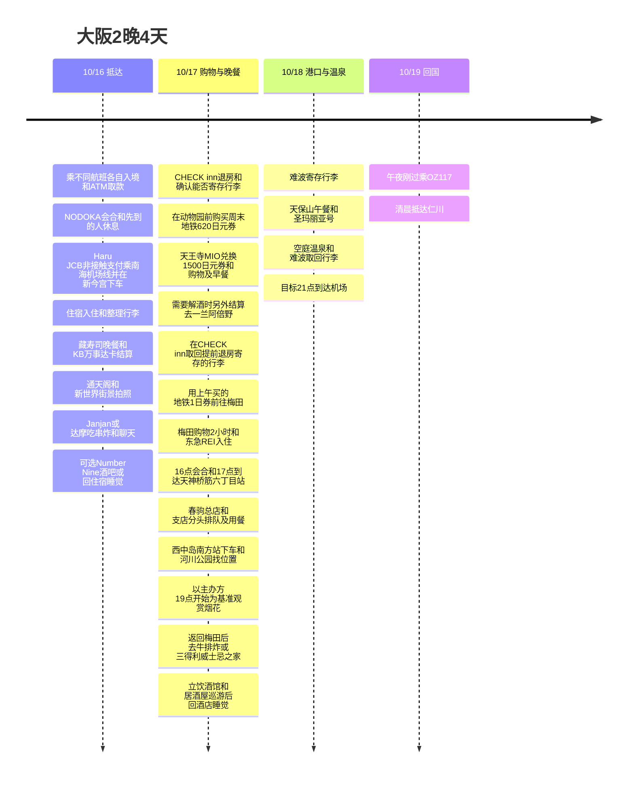

**第一天各自入境、在ATM取款 → NODOKA会合 → 住宿入住、整理行李 → 藏寿司 → 通天阁拍照 → 一家串炸 → 可选Number Nine酒吧或睡觉**,是这样的安排。同行者乘不同的航班,所以从机场会合开始一起行动。17日是**CHECK inn退房、寄存行李 → 用620日元券去天王寺MIO用优惠券、购物、吃早餐 → 回住宿取行李 → 用同一张1日券去梅田 → 购物2小时、东急REI入住 → 16点会合 → 17点到天神桥筋六丁目站、春驹总店/支店分头排队 → 西中岛南方站·河川公园观赏烟花 → 牛排炸或三得利威士忌之家 → 立饮酒馆·居酒屋巡游 → 东急REI睡觉**,18日是港口、温泉之后前往机场。17日购物买的东西放在客房里再出门。

时间均为日本当地时间。**烟花大会的开始时间说明不一致。**用户提供的Metro NiNE标注为**19:30~(5/27的信息)**,主办方官方活动概要标注为**10/17 19:00~20:00**。行程以较早的**19点开始为基准**安排,出发前再次确认主办方的公告。17点只是**到达天神桥筋六丁目站的目标**,并不保证开始用餐,之后如果春驹排队很久,可能会错过烟花开场。[Metro NiNE](https://metronine.osaka/ko/event/yodogawa-fireworks/)、[主办方官方时间](https://www.yodohanabi.com/gaiyou.html)。

## 行程概要

| 日期 | 动线 | 保持的时间 |
|---|---|---|
| 10/16 周五 | **各自取款 → NODOKA会合 → Haru JCB乘南海线 → 新今宫 → CHECK inn → 藏寿司 → 通天阁拍照 → 一家串炸 → 可选Number Nine / 睡觉** | 藏寿司用**KB Travelers或KB Liiv Mate**结算。串炸在Janjan和达摩中,于现场选不那么拥挤的一家 |
| 10/17 周六 | **11点前退房、寄存行李 → MIO·早餐 → 取回行李 → 梅田 → 购物2小时·入住 → 16点会合 → 17点天神桥筋六丁目 → 春驹分头排队 → 河川公园烟花 → 牛排炸 or 三得利 → 立饮酒馆·居酒屋 → 睡觉** | 13:30~15:30是购物的安排方案。烟花主办方**19~20点**与NiNE **19:30~**不一致。牛排炸**21:30最后点单** |
| 10/18 周日 | 难波寄存行李 → 天保山午餐 → 圣玛丽亚号 → 空庭温泉 → 难波 → 机场 | 13:30码头,目标是19:45开往机场的列车 |
| 10/19 周一 | OZ117 关西 → 仁川 | 官方夏季时刻表00:15起飞、02:15抵达 |

## 行程时间线

## 10/16 (周五) · NODOKA会合,藏寿司·通天阁·串炸

同行者**乘不同的航班抵达关西**。各自办完入境、行李、ATM取款后,**在KIX Airport Café Lounge NODOKA会合**。先到的人用可使用的信用卡优惠休息等待,人到齐后再前往市区。**本人的取款计划是永旺银行5次**,同行者的取款次数并未定为5次。

会合后**用Haru JCB非接触支付乘南海机场线开往难波方向的列车 → 在新今宫下车 → 住宿入住**。第一天的住宿是**CHECK inn 大阪新世界(CHECK inn Osaka Shin-Sekai),1-9-5 Haginochaya**,**1晚3万韩元档**。不坐到难波,在新今宫下车。下面的交通10%优惠是**事后返现,而不是即时车费折扣**。[南海机场交通](https://www.howto-osaka.com/en/)、[住宿地址](https://www.hafh.com/en/properties/28089)。

| 顺序 | 分配时间 | 内容 |
|---|---|---|
| 机场抵达后 | 目标入境、领行李60至90分钟 | 根据实际抵达的航班和入境情况变动 |
| 通过入境·海关后 | **永旺银行ATM取款5次,分配15至25分钟** | 优先T1 1层,拥挤就去同一银行2层的ATM。随排队和处理时间变动 |
| 各自取款完成后 | **前往Aeroplaza 2层的NODOKA会合** | 先到的人休息。以入口·前台为会合基准,进去之后互相联络位置 |
| 休息室等待 | 到较晚抵达的同行者完成入境、取款为止 | 确认JCB免费2小时和超时费用。**抵达后不能使用PP**,参考下面的条件 |
| NODOKA → 关西机场站 → 新今宫 → 酒店 | 含候车和步行目标70至90分钟 | **Haru JCB直接在入站、出站闸机刷卡**,乘南海机场线开往难波方向、在新今宫下车 |
| 住宿入住·整理行李 | 20至40分钟 | 在客房放下行李,出门吃晚饭 |
| 住宿 → 藏寿司 新世界通天阁店 | 步行预留15至20分钟 | 用户指定的第一天晚餐地点,2层店铺 |
| 藏寿司 | 排队、用餐分配60至90分钟 | **KB Travelers或KB Liiv Mate Mastercard·JPY结算**,入店到23:30为止 |
| 通天阁周边 | 拍照、散步分配10至20分钟 | 藏寿司之后、去吃串炸之前拍外观和街景 |
| 串炸第二轮 | 排队、用餐、聊天分配45至75分钟 | **Janjan / 达摩两家中只选不那么拥挤的一家**,在现场看氛围选择 |
| 用餐后 | **Number Nine酒吧或回住宿睡觉** | 意犹未尽就去上次去过的酒吧,累了就直接回住宿。去酒吧的时间未定 |

### 入境后永旺银行ATM · Travel Log UPI取款5次

**只使用永旺银行(AEON BANK)ATM**。按**入境·行李·海关 → T1 1层永旺银行ATM → 取款5次 → 2层机场站连接通道 → Aeroplaza 2层NODOKA会合**的顺序移动。如果1层的机器拥挤或难以使用,就去**同一银行的T1 2层ATM**。

| 优先顺序 | ATM·位置 | 运营说明 |
|---|---|---|
| 1 | **永旺银行,T1 1层** | 24小时运营的说明 |
| 2 | **永旺银行,T1 2层** | 24小时运营的说明 |

[机场ATM位置·时间](https://www.kansai-airport.or.jp/service/money_insurance/atm)。确认**AEON BANK·UnionPay标志以及是否受理海外卡**。根据永旺银行官方说明,海外发行的UPI卡24小时受理,**单次取款上限50,000日元,每笔手续费75日元(含税)**。视设置场所的运营·检修情况,使用可能受限。[永旺银行海外卡说明](https://www.aeonbank.co.jp/atm/card/securities-credit/oversea/)。

计划用用户持有的**Hana Travel Log UnionPay借记卡取款5次**。取款金额尚未确定,按所需的旅行现金总额决定。15至25分钟是行程上分配的余裕,并不保证实际处理时间。

**1,000日元单位的取款有海外卡使用者的评价,但官方海外卡说明中没有标明最小单位,所以在持有的UPI卡的现场画面上确认。**无论取多少,永旺银行的手续费都是每笔取款75日元。[1,000日元取款评价](https://travel.korean-engineer.com/en/atm-en/atm-japan/)。

| 活动项目 | 确认的条件 |
|---|---|
| 期间·对象 | 2026-06-12至12-31,Hana Travel Log UnionPay借记卡 |
| 优惠 | 日本ATM每取款1次220日元,每张卡每月最多5次 |
| 参与条件 | 无需事先登记,无最低取款金额条件。只承认通过UnionPay网络正常授权·清算完成的取款 |
| 本次旅行目标 | 如果10月没有已使用次数,5次最多相当于1,100日元。如果有已使用部分,只适用剩余次数 |
| 发放 | 通常在取款的次日入账,实际金额·日期以发卡行账单为准。ATM小票上不显示返现 |
| 注意 | 预算用完可能提前结束。ATM运营方的额外手续费与返现另计 |

以[用户指定的UnionPay活动说明](https://www.unionpayintl.com/cardholderServ/serviceCenter/merchant/1175440369562?type=1)为准整理。公开条件中没有记载必须在不同日期取款的限制,但实际优惠按正常交易·清算及活动规定决定。

准备好实体卡和密码,确认**能承担取款金额和手续费的日元Hana Money余额**。在ATM上选择韩语取款,每笔交易都取回现金、卡片、小票,数清完成次数。**5次手续费是75日元 × 5 = 375日元**。如果10月的优惠额度还有剩余、5次都被活动认可,目标是**返现相当于1,100日元 − ATM手续费375日元 = 净优惠相当于725日元**。返现随实际入账汇率·活动适用结果而变。[Hana Card产品说明](https://m.hanacard.co.kr/MKCDCM1010M.web?CD_PD_SEQ=15356)。

### NODOKA · 各自取款后会合的机场休息室

会合地点是**KIX Airport Café Lounge NODOKA,Aeroplaza 2层普通区域(安检前)**。**24小时·全年无休**,据说从机场站步行约5分钟。从机场站检票口向右,往Aeroplaza方向走,进入建筑后在左侧。以入口·前台为会合基准,先进去的人联络位置。[运营方位置·FAQ](https://aprecio.jp/nodoka/)、[机场楼层位置](https://platinumaps.jp/maps/kix-airport/@34.43665976,135.24240069,19-18z?floor=2F)。

| 使用方式 | 条件·休息优惠 | 第一天抵达后的等待 |
|---|---|---|
| **Haru JCB URS Platinum** | 出示**实体卡 + 本人姓名的抵达航班登机牌/机票**,对象卡会员**免费2小时**。JCB日本·夏威夷休息室服务有**2026/4/1~2027/3/31合计6次**的限额,需确认剩余次数 | **优先考虑用这种方式休息**。作为日本·夏威夷原创休息室服务受理 |
| **Priority Pass** | 需要**预定出发时间12小时以内的登机牌**。3小时使用方案和餐食·啤酒·淋浴的选择性优惠,在满足该出发航班使用条件以及PP发卡方免费使用资格时适用 | **只有抵达航班无法使用**。不计划把10/16入境后同行者的等待用PP免费使用 |

运营方FAQ区分为**信用卡2小时免费优惠的抵达后使用可以**、**PP抵达后使用不可以**。Haru JCB作为JCB指定对象休息室的日本·夏威夷服务使用,与PP或日本以外的LoungeKey每年2次区分开。[JCB韩国官方使用条件·NODOKA对象列表](https://www.kr.jcb/ko/consumers/platinum/airport-lounge/index.html)、[PP NODOKA官方条件](https://www.prioritypass.com/en-GB/lounges/japan/kansai-international/kix12-airport-cafe-lounge-nodoka)。

JCB本人免费优惠**不包含陪同者免费**。同行者也要各自出示对象卡,或按普通费用使用。可使用软饮、Wi-Fi,**JCB入场并不包含餐食·酒·淋浴免费**。超过2小时的费用和空座位在现场确认。没有登机牌的话,准备好能看到日期·航班号·姓名的App/邮件,不要丢掉实体Haru卡和抵达航班的登机记录。[机场信用卡休息室说明](https://www.kansai-airport.or.jp/service/lounge/walk-in-lounge)。

### NODOKA会合后 · JCB非接触支付乘南海机场线

按**NODOKA → 关西机场站(関西空港) → 南海机场线开往难波方向 → 新今宫(新今宮) → CHECK inn入住**移动。在南海官方对象车站地图上确认**关西机场·新今宫都是支持刷卡支付的车站**。[南海刷卡支付对象车站](https://www.nankai.co.jp/contents/contactless/map/index.html)。

1. 在关西机场站找到**南海电铁**支持刷卡支付的检票口。
2. 把**带非接触功能的实体Haru JCB卡**贴在专用读卡器上入站。不是购买纸质车票或给ICOCA充值的方式。
3. 乘坐开往难波方向、在新今宫停靠的机场快速等列车,**在新今宫用同一张实体卡刷卡出站**。入站·出站时不要把卡和手机混用。
4. 各自用自己的卡一个人一个人地进出站,下车后前往住宿入住。[南海官方使用方法](https://www.nankai.co.jp/contents/contactless/howto/index.html)。

Haru **URS Platinum**的JCB公共交通优惠是**月累计使用额的10%·每张卡每月最多500日元返现**,**无需另外登记活动**。10月的使用额**预定11月底前发放**,根据10/13更新的公告,本月预定结束日是**10/31**。**与10/18结束的Haru自身累计返现活动,期间·额度不同。**取决于正常清算·当月剩余额度·提前结束的条件,卡的海外使用手续费也不会因此免除。[JCB交通活动](https://www.specialoffers.jcb/kr/premium/sub05.html)、[10月进行情况](https://www.specialoffers.jcb/kr/campaign/detail/krpremium/93243/)。

### 入住·整理行李后藏寿司 · KB Mastercard结算

第一天晚餐是用户指定的**藏寿司 新世界通天阁店(くら寿司 新世界通天閣店)**。按**CHECK inn入住 → 在客房放下行李 → 藏寿司晚餐**的顺序前往。地址是**大阪市浪速区恵美須東2-6-3 2F**,官方营业时间是**每天11:00至24:00·入店到闭店前30分钟的23:30为止**。在店铺官方说明中确认了支持Mastercard结算。[用户指定的地图](https://maps.app.goo.gl/F9oQqc8jdjohVbVQ9)、[官方店铺说明·预约链接](https://shop.kurasushi.co.jp/detail/509)。

**结算预定用KB Travelers借记Mastercard或KB Liiv Mate Mastercard**。两张卡都符合KB Master Dining活动的对象品牌·个人信用/借记条件,管理**一兰·寿司郎·藏寿司10月合计折合韩元5万韩元以上则发新世界商品券2万韩元·每月1次**的条件。不假设这一餐一定在5万韩元以上,而是把实际清算的账单金额与10月已有的使用额合计。**活动是否已报名尚未确认**。用当地货币**JPY**结算并保管小票。[KB官方Dining活动·报名](https://card.kbcard.com/BON/DVIEW/HBBMCXCRVNEC0001?mainCC=a&eventNum=1002202)。

Travelers要确认海外手续费免除和基础10%折扣的剩余额度,Liiv Mate要确认上月业绩、基础返现、海外手续费,再选择。这顿晚餐的结算**不计入Haru卡累计使用额**。藏寿司用餐后接着去下面的拍照·串炸行程。

### 通天阁拍照 → 两个串炸候选中选一家

顺序是**藏寿司 → 通天阁外观·新世界街景拍照 → 串炸**。拍照分配10至20分钟,串炸只在下面**两家中于现场选不那么拥挤的一家**。实时拥挤情况尚未确认,所以看排队、空位、氛围来决定。体现了用户希望有**与客人或店员自然聊天、交朋友的时间**。

| 候选 | 位置·营业说明 | 选择标准 |
|---|---|---|
| **[① 串炸Janjan 新世界总店](https://maps.app.goo.gl/hUWypz8auYQvF8tv9)** / 串かつじゃんじゃん 新世界本店 | **恵美須東2-6-1**,地图显示周五**10:00至23:00**。最后点单在现场确认 | 比达摩排队短、氛围方便聊天就选 |
| **[② 串炸达摩 通天阁店](https://maps.app.goo.gl/VaNvuhDdaNV4vUQE9)** / 串かつだるま 通天閣店 | **恵美須東1-6-8**,官方周五**11:00至22:30·最后点单22:00**,不接受预约 | 排队短、有座位就选。官方说明吧台38席 |

达摩有**每人至少点1杯饮料**的条件。Janjan的营业时间以地图显示为准,没能确认官方网站的店铺详情,所以当天再确认。[Janjan官方网站](https://kushikatu-janjan.com/)、[达摩官方店铺条件](https://www.kushikatu-daruma.com/location/tsutenkaku)。

两家串炸店**比藏寿司更早结束营业**。想保留选择达摩的可能,就要在藏寿司·拍照结束后,有**赶在22点最后点单前**进店的余裕。保持整体顺序,确认实际航班·机场会合时间后再填入用餐时间。串炸·酒吧的结算卡尚未确定,这些店铺**不合计到KB一兰·寿司郎·藏寿司专用Dining活动中**。

### 用餐后可选 · Number Nine酒吧或睡觉

吃完串炸还意犹未尽的话,就去**上次去过的[Number Nine酒吧](https://maps.app.goo.gl/Gpj9KSiUzGFfPFxD9)**,玩够了或累了就**回CHECK inn睡觉**。酒吧不是确定要去,而是当天选择。

在地图上确认的位置是**阿倍野区天王寺町南1-1-9**,显示的营业时间是**20:00至次日03:00**。这里是从新世界**向天王寺东侧额外移动**的地方,所以看回住宿的动线·当天营业情况再决定。按用户指定的地点如实记录,没有推荐其他同名酒吧。

**各自的实际抵达航班·NODOKA会合时间还需要进一步核对。**原有参考记录KE737的查询结果是**22:40抵达关西**,如果是这个航班,办完入境·取款·会合·列车移动·入住后,要**23:30前进入藏寿司**就很难。以乘不同航班的同行者全部准备好的时间作为前往市区的出发点,确认实际预订航班后再填入晚间到达目标。[原有KE737查询](https://www.trip.com/flights/status-ke737/)。

## 10/17 (周六) · MIO·早餐,购物2小时·16点会合,春驹·烟花大会

第二天的住宿是**大阪东急REI酒店,1晚8.7万韩元档**。**CHECK inn的退房截止时间已由用户确认为11点**。MIO的兑换从10:30开始,所以早上先退房并寄存行李,安排为**动物园前 → 天王寺MIO → 早餐·短暂购物 → 在住宿取回行李 → 用同一张地铁1日券去梅田**。CHECK inn能否寄存行李需要确认。

**梅田购物2小时、16点会合·17点到达天神桥筋六丁目站**是用户指定的时间。东急REI客房15点开始入住,为了确保两小时购物,安排方案是**在酒店寄存行李 → 13:30~15:30购物 → 15:30~16:00入住·整理行李 → 16点会合**。16点的会合地点尚未确定。

| 当地时间 | 要做的事 | 调整基准 |
|---|---|---|
| 09:00至09:45 | **CHECK inn退房·寄存行李** | 在11点截止前办完。确认住宿能否寄存,不行就选车站寄存柜等替代 |
| 09:45至10:15 | **在动物园前站购买周末1日券620日元 → 天王寺** | 御堂筋线开往中百舌鸟方向一站,含车站·步行的余裕 |
| 10:15至10:30 | 前往MIO·等待开门 | 本馆服务台从10:30开始兑换 |
| 10:30至10:45 | **在MIO本馆2F服务台兑换Have Fun in Kansai Pass 1,500日元券** | 确认500日元券3张·对象店铺 |
| 10:45至11:45 安排方案 | **短暂购物 + 早餐兼早午餐** | 目标在MIO对象店铺花1,500日元左右以上。需要解酒就选一兰阿倍野·另外结算 |
| 11:45至12:30 安排方案 | **天王寺 → 动物园前 → 在CHECK inn取回行李** | 御堂筋线开往江坂·千里中央方向一站,重新使用上午的620日元券 |
| 12:30至13:30 安排方案 | **拿着行李 动物园前 → 梅田 → 在东急REI寄存行李** | **使用现有1日券**。入住前寄存后购物 |
| **13:30至15:30 安排方案** | **大阪站·梅田购物2小时** | 配合16点会合结束购物 |
| 15:30至16:00 安排方案 | 东急REI入住·把购买的东西放在客房 | 入住从15点开始,反映实际办理等待 |
| **16:00** | **与同行者会合** | 具体的会合地点未定 |
| 16:00至17:00 | 会合后移动·到达天神桥筋六丁目站 | 目标17点到站,从车站到各店铺还要追加步行 |
| **17:00之后至18:00目标** | **春驹总店·支店分头各自排队·晚餐** | 联络排队情况。不保证17点入座,目标18点移动 |
| **18:00至19:00目标** | 地铁 → **西中岛南方站 → 在指定河川公园周边找位置** | 含换乘·拥挤·步行的分配,不保证占到空位 |
| 到达可观赏的地方后 | 铺开野餐垫休息·等待烟花 | 不再增加观光,在现场等待 |
| **主办方19:00至20:00** | **观赏淀川烟花大会** | 与Metro NiNE的19:30说明不一致。以19点为基准移动 |
| 20点以后·所需时间变动 | 有序退场·西中岛南方 → 梅田 | 使用现有地铁1日券。因车站等待·管制,返回时间会变动 |
| 返回梅田后 | **牛かつもと村 LUCUA店或三得利威士忌之家** | 两家中选一家。牛排炸21:30最后点单,三得利Dining 23点闭店 |
| 用餐·威士忌后 | **立饮酒馆·居酒屋巡游** | 在梅田继续或移动到天满。看营业中的店和状态,安排1~2家 |
| 巡游结束后·时间未定 | **返回东急REI·睡觉** | 晚了就减少去的家数,确认实际回家交通 |

### 动物园前620日元券 → MIO优惠券·早餐

在用户指定的[动物园前站](https://maps.app.goo.gl/WhbtsnC7PPHhWobr8)售票机购买**Enjoy Eco Card周六·周日·节假日成人620日元券**。是**御堂筋线 M22 动物园前 → 开往中百舌鸟方向 → M23 天王寺**一站。这天用这张车票通过检票口,不与JCB直接刷卡乘车混用。是**使用当天1日券**而不是24小时券,不包含南海·JR·阪急。[地铁官方620日元券说明](https://subway-tr.osakametro.co.jp/ko/guide/page/enjoy-eco.php)。

在**MIO本馆2F服务台,兑换时间10:30至18:00**出示Have Fun in Kansai Pass的QR码,换成**500日元通用券3张·共1,500日元**。用于本馆·Plaza馆对象店铺的购物或用餐,使用前确认该店铺是否接受。**差额为现金·不找零**,且是不可兑现、不可补发的条件。因此安排为在对象店铺**购物或用餐1,500日元左右以上**,并在入住前回来。[通票运营方MIO优惠券·兑换说明](https://travelcontentsapp.com/en/attraction/osaka/tennoji-mio/)。

MIO购物楼层是**10:30至20:30**,本馆餐厅街大体从**11点开始**,所以想10:45开始用餐的话要确认各店的时间。购物后改成11点多用餐,在上午的安排内也可以。[MIO官方营业时间](https://www.tennoji-mio.co.jp/access)。

**如果前一天喝了很多酒需要解酒,就去[一兰阿倍野店](https://maps.app.goo.gl/yHrhYGBaZAqe5T8j9)**吃拉面。官方营业是**10:00至23:00**,地址是**阿倍野筋1-3-18 B1F**。**是MIO之外的店,所以不能使用MIO优惠券,拉面钱需要另外结算**。这种情况下,优惠券用于MIO购物,早餐定为一兰一处,避免重复用餐。可以刷卡,报名KB Master Dining后用对象卡结算,可以与前一天的藏寿司一起管理**10月合计5万韩元条件**。排队太长就优先返回梅田·入住。[一兰官方店铺·结算说明](https://ichiran.com/shop/kinki/abeno/)。

### 11点前退房 → MIO → 取回行李·用同一张1日券去梅田

**早上在CHECK inn于11点前退房并寄存行李。**MIO·早餐后,**天王寺 → 御堂筋线开往江坂·千里中央方向 → 动物园前**折回一站取回寄存的行李。然后拿着行李再去动物园前站,**乘同方向御堂筋线 → 在梅田站下车 → 大阪东急REI酒店**。两段都**直接重复使用上午购买的620日元地铁1日券**,不再另买车票。

**11点退房已由用户确认**,住宿退房后的行李寄存尚未确认。如果不能寄存,就按动线选择车站寄存柜等,改变取回位置。东急REI有入住前寄存行李的说明,所以在梅田寄存行李后购物2小时,安排方案是**15:30入住·16点会合**。[CHECK inn退房说明](https://travel.yahoo.co.jp/00924272/)、[东急REI行李寄存·入住FAQ](https://www.tokyuhotels.co.jp/en/osaka-r/qa/index.html)。

### 16点会合 → 17点天神桥筋六丁目站·春驹两条队

购物2小时后**16点与同行者聚齐,17点到达天神桥筋六丁目站(天神橋筋六丁目)**。16点的具体会合地点尚未定。从梅田区域乘地铁的话,是**东梅田 → 谷町线开往大日方向 → 天神桥筋六丁目**,使用现有的620日元券。

| 分头排队的店铺 | 用户指定的地图 | 确认的地址 |
|---|---|---|
| **春驹支店 / 春駒 支店** | [第一张地图](https://maps.app.goo.gl/GiedWJBZUf6dnPi8A) | 天神橋5-6-8 |
| **春驹总店 / 春駒 本店** | [第二张地图](https://maps.app.goo.gl/bVF84NQP6X2CgbZB7) | 天神橋5-5-2 |

从车站走到各店铺,**分成总店组·支店组各自排队。**互相联络预计的排队情况,协调用餐·重新会合的方式。**17点是到站,入座·开始用餐根据实际排队情况决定。**

### 西中岛南方站 → 在河川公园占位观赏

用餐后基本的地铁路线是**天神桥筋六丁目 → 谷町线开往八尾南方向·东梅田 → 步行换乘梅田 → 御堂筋线开往江坂·千里中央方向·西中岛南方 → 河川公园**。**继续使用现有的620日元券**。有餐厅·车站步行、站间换乘和活动拥挤,所以**18点出发·19点到达是目标而不是保证的时间。**排队变长的话,在用餐结束时再次判断能否在烟花开始前到达。

用户指定的地点是**[淀川河川公园 西中岛地区](https://maps.app.goo.gl/sgUQkCpRfaN3PPYu7)**。公园说明平时从车站步行约7分钟,但活动当天要加上管制·拥挤。下车后**在可观赏的河川周边占位,不增加观光,坐着等待。**这个标记是公园的基准点,所以当天的开放区域·实际烟花视野·空位要在现场确认。[公园官方位置·交通说明](https://www.yodogawa-park.jp/annai/nisinaka-juso/)。

**要带的东西:**小的**野餐垫或折叠坐垫**、轻薄外套、水·简单零食、充电宝、垃圾袋。购买的东西放在酒店,只带观赏用的包。考虑到在现场等待的时间,要提前准备好厕所·饮料,野餐垫在可以坐的开放区域使用。

**开始时间主办方为19:00至20:00,Metro NiNE为19:30~,说法不一致**,所以保持以19点为基准的移动。**梅田侧河岸禁止一般人员出入**,西中岛一侧也要遵守当天的管制。不保证占到免费区域的位置。主办方建议赞助席观众17:30前到车站、18点前到河滩,所以从17点餐厅排队开始的这条动线,可能因拥挤而错过开场。[主办方活动概要](https://www.yodohanabi.com/gaiyou.html)、[用户提供的Metro NiNE](https://metronine.osaka/ko/event/yodogawa-fireworks/)、[观赏·拥挤FAQ](https://www.yodohanabi.com/faq.html)。

### 烟花后 · 牛排炸 or 三得利 → 立饮酒馆·居酒屋 → 睡觉

观赏烟花后,**西中岛南方站 → 御堂筋线开往中百舌鸟方向 → 梅田**返回。使用现有的地铁1日券,因退场管制·车站等待,实际到达时间会有变化。到达梅田后,在用户指定的两处中,**饿了就选牛排炸,想享受威士忌和食物就选三得利**。

| 候选 | 位置 | 官方营业时间·判断标准 |
|---|---|---|
| **[牛かつもと村 LUCUA店](https://maps.app.goo.gl/88WVgymoDCCvrof98)** | 大阪市北区梅田3-1-3,**LUCUA 10F** | 店铺官方**11:00~22:00·最后点单21:30**。到达时先确认排队和能否入店 |
| **[三得利威士忌之家](https://maps.app.goo.gl/jDVJSrb8dTbATRVZA)** | 大阪市北区大深町3-1,**Grand Front Osaka北馆 Knowledge Capital 2F** | **Whisky Dining WWW.W晚间17:30~23:00**。同一设施的**Whisky Bottle Bar 17:30~23:30·周日/节假日休息**。计划10/17周六前往,确认最后点单·空位 |

牛排炸在LUCUA设施说明中也标有23点闭店,但按**店铺自身官方说明中更早的21:30最后点单·22点闭店为基准**计划。如果烟花退场后到达梅田是在21:30以后,就不以进牛排炸店为前提。三得利也分为Dining和Bottle Bar,所以要确认要使用的空间的最后点单。[牛排炸店铺官方](https://www.gyukatsu-motomura.com/store/LUCUA)、[LUCUA设施说明](https://www.lucua.jp/shopguide/id791.html)、[三得利Dining](https://www.suntory.co.jp/whisky/whiskyhouse/dining/)、[Bottle Bar](https://www.suntory.co.jp/whisky/whiskyhouse/bottlebar/index.html)。

之后**去立饮酒馆(站着喝酒的酒馆)·居酒屋巡游,再回东急REI睡觉。**可以在梅田继续,也可以转到天满区域,具体的店铺尚未定。先安排1~2家左右,根据现场氛围·营业时间·状态调整。结束得晚的话,确认地铁末班车和步行·出租车回家路线。[天满站周边酒馆区域](https://www.google.com/maps/search/?api=1&query=bars+near+Temma+Station+Osaka)。

## 10/18 周日 · 港口午餐 → 游船 → 温泉 → 机场

**MIO优惠券·购物·早餐移到了17日入住前。**这天把行李寄存在难波后直接去港口,在天保山吃午餐。为了减少往返梅田酒店,行李早上就转移到难波。

| 当地时间 | 要做的事 | 移动、等待安排 |
|---|---|---|
| 08:00至09:15 | 早餐·整理行李·退房 | 比酒店10点的截止时间更早出发 |
| 09:15至10:00 | 梅田 → 难波·寄存行李 | 便于在开往机场的南海一侧取回的寄存处 |
| 10:00至11:00 | 难波 → 本町换乘 → 大阪港 → 天保山 | 地铁·步行预留60分钟 |
| 11:00至12:00 | 港口周边散步·休息 | 出发晚了就缩短这一段 |
| 12:00至13:00 | 天保山午餐·休息 | 选择当天排队少的餐厅 |
| 13:00至13:30 | 港口散步·前往码头 | 下雨就在室内休息,然后直接去码头 |
| 13:30至14:00 | 圣玛丽亚号兑换船票·等候登船 | 海游馆西侧的码头 |
| 14:00至14:45 | **圣玛丽亚号日间游船** | 确认实际航班,目标14点左右登船 |
| 14:45至15:30 | 下船 → 大阪港 → 弁天町 → 空庭温泉 | 含下船·车站步行·温泉登记 |
| 15:30至17:45 | **空庭温泉·休息** | 含更衣共2小时15分钟 |
| 17:45至18:30 | 弁天町 → 本町换乘 → 难波 | 地铁券范围内的路线 |
| 18:30至19:15 | 难波晚餐·取回行李 | 确认寄存处的关门时间,避开排队长的餐厅 |
| 19:15至19:45 | 南海车票·前往站台 | 大车站内移动的余裕 |
| 19:45至21:00 | 开往机场的列车·前往航站楼 | 选择出发当天的实际列车,目标21点到达机场 |
| 21:00至00:15 | 办理手续·出境·登机 | 10/19午夜刚过的航班 |

[难波 → 天保山](https://www.google.com/maps/dir/?api=1&origin=Namba+Station&destination=Tempozan+Marketplace&travelmode=transit) · [温泉 → 难波](https://www.google.com/maps/dir/?api=1&origin=Solaniwa+Onsen&destination=Namba+Station&travelmode=transit)。

圣玛丽亚号日间游船约**45分钟**,从大阪港站步行到码头约10分钟,**14点左右是目标,并不是10/18的确定航班**。[运营方](https://suijo-bus.osaka/cruiselist/santamaria/)、[航班日历](https://suijo-bus.osaka/wps/wp-content/uploads/2026/09/0901_time-santamaria.pdf)。空庭温泉位于弁天町的Osaka Bay Tower,通常**11至23点·最后入场22点**。[温泉FAQ](https://solaniwa.com/en-us/faq/)。

## 日本支付卡5种 · 10月活动与使用处

带上**KB MY ONE Visa + KB Liiv Mate Mastercard + KB Travelers借记Mastercard + 新韩Haru JCB + Hana Travel Log UPI**。下面是**2026-10-15确认的10/16∼19旅行用分配**。**Haru海外累计返现活动和JCB活动已由用户确认报名完成**。KB活动报名·MTR卡登记·优惠激活是否完成尚未确认。实际结算用当地货币**JPY**,以免税·优惠券适用后的实际刷卡授权金额为准确认。

### KB优惠速记 · 按卡品牌

这是像用户提供的图片那样按品牌汇总的旅行用备忘。**空复选框表示KB报名·MTR激活是否完成未确认**,并不是已达成使用条件的标记。要区分商品券金额与外币Money·返现。

**KB / Visa → MY ONE Visa**

- [ ] **百货商店(~11/30):**阪急·大丸·PARCO **月合计50万韩元以上 → 新世界商品券10万韩元**,每月1次·总共最多3次。[报名](https://card.kbcard.com/BON/DVIEW/HBBMCXCRVNEC0001?mainCC=a&eventNum=1002074)
- [ ] **时尚(~11/30):**UNIQLO·GU·BAPE·COMME des GARCONS·BEAMS·HUMAN MADE·KAPITAL·STUSSY **月合计20/50/100万韩元 → 新世界商品券2/7/20万韩元**,只发放对应档次·每月1次·总共最多3次。[报名](https://card.kbcard.com/BON/DVIEW/HBBMCXCRVNEC0001?mainCC=a&eventNum=1002073)
- [ ] **唐吉诃德(~11/30):** **月10万韩元以上 → 新世界商品券2万韩元**,每月1次·总共最多3次。[报名](https://card.kbcard.com/BON/DVIEW/HBBMCXCRVNEC0001?mainCC=a&eventNum=1002072)
- [ ] **海外1.1%积分返还(~10/31):** **10/6以后合计20万韩元以上 → 韩元结算金额的1.1%积分(Liiv积分)**,需另外报名·预定2027/1/15前发放。[报名](https://card.kbcard.com/BON/DVIEW/HBBMCXCRVNEC0001?mainCC=a&eventNum=1002268)

**KB / 不限品牌 → MY ONE·Liiv Mate·Travelers**

- [ ] **便利店(~10/31):**7-Eleven·罗森·全家 **每笔1,000日元以上 → 外币Money 500日元**,说明上最多5,000日元·10次。不会因卡不同而增加额度。[报名](https://card.kbcard.com/BON/DVIEW/HBBMCXCRVNEC0001?mainCC=a&eventNum=1001883)
- [ ] **机场免税店(~10/31):**大阪等对象机场的**免税店行业月合计10,000日元以上 → 外币Money 1,000日元**。机场普通店铺另计。[报名](https://card.kbcard.com/BON/DVIEW/HBBMCXCRVNEC0001?mainCC=a&eventNum=1001884)
- [ ] **百货商店(~11/30):**阪急·三越伊势丹·高岛屋·大丸·小田急 **月合计30,000日元以上 → 外币Money 3,000日元**,每月1次·对象行业条件。**不含PARCO**。[报名](https://card.kbcard.com/BON/DVIEW/HBBMCXCRVNEC0001?mainCC=a&eventNum=1002215)

**图片中的追加项目 — 按海外总使用额的商品券:**照片上写的是**50/100/200/300/500万韩元 → 新世界商品券1/2/4/6/10万韩元**,但**没有期间·官方活动链接·重复条件,本次旅行是否适用未确认**。与当前官方海外活动列表对照,也没能确认该条件。作为参考图片的候选保留,不加到上面确定的活动或预期优惠中。[KB官方海外活动说明](https://card.kbcard.com/BON/DVIEW/HBBMCXCRVNEC0001?mainCC=a&eventNum=1000177)

**KB / Mastercard → Liiv Mate·Travelers**

- [ ] **日本Dining(~11/30):**一兰·寿司郎·藏寿司 **月合计5万韩元以上 → 新世界商品券2万韩元**,每月1次。**预定第一天藏寿司晚餐使用**,春驹不在对象内。[报名](https://card.kbcard.com/BON/DVIEW/HBBMCXCRVNEC0001?mainCC=a&eventNum=1002202)
- [ ] **唐吉诃德(~12/31):** **每笔20,000日元以上 → 外币Money 2,000日元**,每月1次。如果再报名**Travelers专用追加活动**,每月追加1,000日元。[活动·各报名](https://card.kbcard.com/BON/DVIEW/HBBMCXCRVNEC0001?mainCC=a&eventNum=1001842)

**KB / Travelers Mastercard专用 MTR → 登记后按店铺激活**

- [ ] **阪急(~12/31):**梅田总店·阪急Men's大阪等 **每笔30,000日元 → 返现2,000日元**,10~12月中1次·不含食品馆/食品。[条件](https://card.kbcard.com/BON/DVIEW/HBBMCXCRVNEC0001?mainCC=a&eventNum=1000601)
- [ ] **大丸·松坂屋(~12/31):** **每笔50,000日元 → 返现3,000日元**,10~12月中1次。[条件](https://card.kbcard.com/BON/DVIEW/HBBMCXCRVNEC0001?mainCC=a&eventNum=1000601)
- [ ] **BIC CAMERA(~12/31):** **每笔30,000日元 → 返现2,000日元**,10~12月中1次。[条件](https://card.kbcard.com/BON/DVIEW/HBBMCXCRVNEC0001?mainCC=a&eventNum=1000600)
- [ ] **唐吉诃德(~12/31):** **每笔10,000日元 → 返现1,000日元**,10~12月中1次。如果KB Master·Travelers的追加活动全部满足,考虑最多4,000日元。[条件](https://card.kbcard.com/BON/DVIEW/HBBMCXCRVNEC0001?mainCC=a&eventNum=1000599)

**已报名完成:**Haru自身累计返现 + JCB活动。Haru自身活动在**10/18截止**,以已有使用额**10,488韩元**为基准,到5万韩元返现还需要**489,512韩元**。KB·JCB·Haru累计按各自不同的标准管理。

### 各卡的角色与详细条件

| 卡 | 本次旅行负责的结算 | 基本条件 |
|---|---|---|
| **KB MY ONE Visa** | 对象时尚品牌·百货商店·唐吉诃德商品券,海外20万韩元以上则考虑1.1%积分返还 | 各活动另行报名,KB Visa已持有客户的条件。以下面的金额表为准 |
| **KB Liiv Mate Mastercard** | 一兰·寿司郎·藏寿司Dining活动,KB Master唐吉诃德活动 | 海外2%返现限上月业绩30万韩元·月海外使用金额100万韩元,海外使用手续费另计 |
| **KB Travelers借记Mastercard** | 便利店·Master Dining,海外基础10%剩余额度,唐吉诃德·百货商店MTR | 基础10%限上月业绩20万韩元·月折扣1万韩元。外币Money充值及各活动的报名·激活 |
| **新韩Haru JCB** | **10/18前海外累计50万·100万韩元返现活动**,比较JCB对象店铺·交通刷卡支付 | **累计活动已报名完成·已有使用额10,488韩元**。基础3.5%积分在满足上月国内使用30万韩元或新用户宽限时适用,海外手续费另计 |
| **Hana Travel Log UPI** | **永旺银行取款5次** | 10%结算折扣已结束·无法使用,由用户确认,从本次旅行优惠中排除。取款以上一节单独的活动条件为准 |

[Liiv Mate官方产品](https://card.kbcard.com/CRD/DVIEW/HCAMCXPRICAC0076?mainCC=a&cooperationcode=09215)、[Travelers官方产品](https://card.kbcard.com/CRD/DVIEW/HCAMCXPRICAC0076?mainCC=a&cooperationcode=09562)、[Haru官方产品](https://www.shinhancard.com/pconts/html/card/apply/credit/1233082_2207.html)。

Haru的3.5%是**海外基础2%(月3万积分限额) + 日本追加1.5%(月10万积分限额)**。卡条款说明享受了折扣服务·活动的交易不计入积分,所以**不能无条件地把基础3.5%加到JCB返现上**。Liiv Mate的官方品牌是Mastercard·UPI,Visa活动用另外持有的**MY ONE Visa**参加。

### 日本Dining · Liiv Mate Master或Travelers

**2026-09-29∼11-30**,对象**一兰·寿司郎·藏寿司的月合计折合韩元使用额5万韩元以上**,则提供**新世界商品券2万韩元**。本次10月旅行按**每月1次2万韩元**计算,Liiv Mate Mastercard和Travelers Mastercard都符合品牌·个人信用/借记的对象条件。不按用两张卡就领两次商品券计算。[KB Dining官方条件·报名](https://card.kbcard.com/BON/DVIEW/HBBMCXCRVNEC0001?mainCC=a&eventNum=1002202)。

报名是必须的,同一个月内报名与使用的先后顺序无关。需要**日本当地JPY海外授权·能识别商户名**,合计到使用月次月15日为止清算的账单金额。10月部分**预定11月底前发放**。**预定第一天藏寿司晚餐用Travelers或Liiv Mate结算**,春驹不是对象餐厅。

Travelers对照海外结算手续费免除和基础折扣剩余额度,Liiv Mate对照上月业绩·手续费来选择。寿司郎要与Haru JCB的**期间合计4,000日元·20%最多1,000日元**比较,但**用KB花的金额不计入Haru的50万韩元累计**。不要为了活动而增加餐厅,也不要为了达到基准额而不必要地多花钱。说明称KB活动可以与其他活动重复,但卡的基础优惠也要遵守各产品的排除条件。

### MY ONE Visa · 按购物金额的新世界商品券

三个活动都是**2026-09-17∼11-30**,各活动需要报名。每月1次·活动整体最多发放3次,**本次10月旅行按每个活动1次**计算。只承认日本当地JPY海外授权,以KB清算商户名判断是否为对象。**10月使用额预定11月底前发放**。

| 使用处 | 10月使用标准 | 优惠 | 官方报名·条件 |
|---|---|---|---|
| **阪急·大丸·PARCO** | 月合计折合韩元**50万韩元以上** | 新世界商品券**10万韩元** | [Visa百货商店](https://card.kbcard.com/BON/DVIEW/HBBMCXCRVNEC0001?mainCC=a&eventNum=1002074) |
| **UNIQLO·GU·BAPE·COMME des GARCONS·BEAMS·HUMAN MADE·KAPITAL·STUSSY** | 月合计折合韩元**20万韩元 / 50万韩元 / 100万韩元以上** | 对应档次新世界商品券**2万韩元 / 7万韩元 / 20万韩元** | [Visa时尚](https://card.kbcard.com/BON/DVIEW/HBBMCXCRVNEC0001?mainCC=a&eventNum=1002073) |
| **唐吉诃德** | 当月折合韩元**10万韩元以上** | 新世界商品券**2万韩元** | [Visa唐吉诃德](https://card.kbcard.com/BON/DVIEW/HBBMCXCRVNEC0001?mainCC=a&eventNum=1002072) |

时尚商品券**不是按各档金额累加的方式**。百货商店内的品牌店如果以百货商店的名称授权,可能被排除在时尚活动之外,所以**同一笔结算不要同时计入百货商店·时尚两个活动**。韩元标准以清算后的账单金额确定,所以不要把日元金额按固定汇率断定。

**追加报名:Visa海外使用额1.1%积分返还。** **2026-10-06∼10-31**期间MY ONE Visa的海外商户使用额折合韩元**合计20万韩元以上**,则按总韩元结算金额的**1.1%提供积分(Liiv积分)**。限额100万积分,以100积分为单位发放,10积分单位四舍五入。**2027-01-08前清算·01-15前预定发放**。与购物商品券活动分别报名,家人卡的使用额合计到本人名下。虽然名字叫“手续费积分返还”,但**并不是即时免除海外手续费本身的方式**。[10月Visa积分返还官方条件·报名](https://card.kbcard.com/BON/DVIEW/HBBMCXCRVNEC0001?mainCC=a&eventNum=1002268)。

### KB通用活动 · 便利店·百货商店·机场免税店

下面的活动适用于MY ONE·Liiv Mate·Travelers的**对象KB卡使用额**。不按用三张卡就把会员标准的限额变成三倍计算。各活动需要报名以及同意使用KB Pay外币Money,10月使用额预定11月底前发放。

| 使用处 | 标准 | 提供的优惠 | 期间·条件 |
|---|---|---|---|
| **7-Eleven·罗森·全家** | **每笔1,000日元以上** | 每笔外币Money **500日元**,说明上最多**5,000日元** | 9/1∼10/31。[便利店活动](https://card.kbcard.com/BON/DVIEW/HBBMCXCRVNEC0001?mainCC=a&eventNum=1001883) |
| **阪急·三越伊势丹·高岛屋·大丸·小田急** | **月合计30,000日元以上** | 外币Money **3,000日元**,每月1次 | 10/1∼11/30。MCC 5311·5956。[百货商店活动](https://card.kbcard.com/BON/DVIEW/HBBMCXCRVNEC0001?mainCC=a&eventNum=1002215) |
| **大阪等对象机场免税店** | **月合计10,000日元以上** | 外币Money **1,000日元** | 9/1∼10/31。MCC 5309,与机场普通店铺区分。[机场免税店活动](https://card.kbcard.com/BON/DVIEW/HBBMCXCRVNEC0001?mainCC=a&eventNum=1001884) |

便利店是**每笔1,000日元以上的交易都发固定500日元**。例如**结算1,000日元 → 500日元**,**一次结算2,000日元 → 也是500日元**,不会每1,000日元增加500日元。说明上最多5,000日元是**10次**的量。与按月发放的说明无关,**不假设换月后额度会重新出现**。如果9月有使用记录,先确认剩余次数。MY ONE·Liiv Mate·Travelers要一起管理会员标准的限额。

便利店**优先考虑Travelers**:确认海外手续费免除和基础折扣剩余额度。说明称KB通用活动可以与其他活动重复。如果商户名显示为`JAPAN`等而不是便利店名,可能会要求提交小票,所以**保管好小票**。需要同意创建KB Pay外币Money账户后才能确认返还。

在阪急·大丸用**MY ONE Visa满足月50万韩元条件**的同时,如果也满足KB通用**月3万日元条件·对象行业**,就考虑一起拿**商品券10万韩元 + 外币Money 3,000日元**。两个官方活动都说明可以与其他活动重复,但PARCO只在Visa名单中,所以不会自动叠加通用百货商店优惠。

### 唐吉诃德 · KB Master与Travelers MTR

| 卡·申请 | 交易标准 | 优惠 |
|---|---|---|
| Liiv Mate Mastercard或Travelers Mastercard + 报名KB Master活动 | **每笔20,000日元以上**,每月1次 | 外币Money **2,000日元** |
| Travelers Mastercard + 报名专用追加活动 | **每笔20,000日元以上**,每月1次 | **追加**外币Money **1,000日元** |
| Travelers Mastercard + **MTR卡登记·唐吉诃德优惠激活** | **每笔10,000日元以上**,10∼12月中1次 | **返现1,000日元** |

用同一张Travelers卡满足所有条件的话,可以考虑**最多4,000日元**。Liiv Mate不叠加Travelers专用追加部分和MTR。[KB Master活动·各报名链接](https://card.kbcard.com/BON/DVIEW/HBBMCXCRVNEC0001?mainCC=a&eventNum=1001842)、[唐吉诃德MTR](https://card.kbcard.com/BON/DVIEW/HBBMCXCRVNEC0001?mainCC=a&eventNum=1000599)。

其他Travelers MTR候选如下。**卡登记后要在结算前激活各优惠**,按10/1∼12/31期间的每个优惠1次为准。遵守实体卡·JPY结算、取消·退款反映的条件。

| 商户 | 10∼12月官方交易标准 | MTR返现 |
|---|---|---|
| **阪急梅田总店·阪急Men's大阪等对象阪急** | **每笔30,000日元以上**,不含食品馆·食品购买 | **2,000日元** |
| **Daimaru Matsuzakaya** | **每笔50,000日元以上** | **3,000日元** |
| **三越·伊势丹对象店** | **每笔80,000日元以上** | **8,000日元** |
| **西武·SOGO对象店** | **每笔30,000日元以上** | **3,000日元** |
| **DFS Japan对象店** | **每笔25,000日元以上** | **1,250日元** |
| **BIC CAMERA** | **每笔30,000日元以上** | **2,000日元** |

[MTR百货商店官方条件](https://card.kbcard.com/BON/DVIEW/HBBMCXCRVNEC0001?mainCC=a&eventNum=1000601)、[MTR BIC CAMERA](https://card.kbcard.com/BON/DVIEW/HBBMCXCRVNEC0001?mainCC=a&eventNum=1000600)。百货商店各商户的标准不同,所以没有直接使用论坛摘要中的统一金额。MTR返现的取消单据可能从各卡的业绩中扣除,所以不确定与基础10%折扣合并后的总额。

**MTR准备顺序:**在[MTR](https://mtr.mastercardservices.com/ko-KR/)账户中**登记Travelers Mastercard → 搜索日本商户 → 按商户激活优惠 → 用对应实体卡以JPY结算**。仅报名KB活动并不能完成MTR激活。Liiv Mate虽然也是Mastercard,但并不属于Travelers专用MTR的对象。根据百货商店官方说明,使用后**14天内**会清算返现取消单据,商户名显示为`MastercardTravel`。实际对象门店·激活状态·期间内是否使用,要在MTR中确认。

新论坛帖子中的**松本清使用20,000日元返2,000日元**截图作为追加候选记录。**MTR在卡登记·登录后才显示优惠,所以在目前公开的画面上没能验证该优惠的期间·每笔/合计·次数·对象门店。**在登记Travelers后确认实际优惠之前,不加到确定的优惠表或预期返还额中。大丸福冈天神店另外的3万日元标准也不适用于大阪大丸。

### 新韩Haru · 10/18前海外累计返现

**2026-09-10∼10-18**,是以Haru卡海外线上·线下**外币一次性结算**累计为标准的活动。**到韩国时间10/18为止**,与日本没有时差。旅行中**10/16∼18的结算包含在期间内**,10/19的结算被排除。

| 活动期间累计使用额 | 返现 | 以已有10,488韩元为基准的追加所需额 |
|---|---:|---:|
| **50万韩元以上** | **5万韩元** | **489,512韩元** |
| **100万韩元以上** | **10万韩元** | **989,512韩元** |

**必须报名**,在期间内使用之后报名也可以。**预定11月底发放**,以扣除手续费的韩元账单金额合计。取消·分期·分期转换·韩元结算被排除,第三方结算·商品券等也可能被排除。家人卡金额合计到本人名下。可能提前截止,官方说明保证对已报名的客户在期间内达成业绩的优惠。[新韩卡官方活动·报名](https://www.shinhancard.com/pconts/html/benefit/event/2014217_2239.html)。

**2026-10-15用户确认:已经报名,9/10以后的使用额是10,488韩元。**表中的剩余额是以这笔金额全部为活动认可额为前提计算的。如果是含手续费的授权额或取消部分,就要以扣除手续费的韩元账单金额重新对照。考虑到汇率·清算金额的变动,不要精确地凑基准额,而要确认实际认可额。该活动本身没有记载上月业绩条件,要与基础积分的国内业绩条件区分开。官方页面有**不可重复优惠**的字样,所以不累加各档奖励,也不确定与JCB 20%·基础3.5%合计的优惠。

论坛帖子中另外的**海外线下使用10万韩元返2万韩元**是**2026-07-06∼09-30**的活动,还有以前未使用客户的条件。本次10月旅行不适用。[已结束活动的官方条件](https://www.shinhancard.com/pconts/html/benefit/event/2013715_2239.html)。

### 新韩Haru JCB · 第3期按商户事先报名

**2026-10-15用户确认:JCB活动已报名完成。** **第3期期间是2026-10-01∼12-31**。官方条件是**按商户各自事先报名·从报名当天的使用额开始认可**,所以按实际登记的商户的优惠来管理。除了GO以外,都以**实体卡·JPY当地结算**为准。

| 商户 | 第3期期间合计最低使用额 | 20%返现限额 |
|---|---:|---:|
| **唐吉诃德** | **15,000日元** | **3,000日元** |
| **阪急阪神对象店** | **15,000日元** | **3,000日元** |
| 寿司郎 | 4,000日元 | 1,000日元 |
| 客美多咖啡 | 2,000日元 | 1,000日元 |
| 出租车App GO | 3,000日元 | 1,000日元 |

阪急阪神对象包括**阪急梅田总店·阪急Men's大阪·阪神梅田总店**。客美多**难波CITY店·JR弁天町站店是排除店**,所以不要因为在动线上看到就当作活动对象。第3期返现**预定2027年1月底**。[JCB官方条件·报名链接·排除店](https://www.specialoffers.jcb/kr/campaign/detail/2026JCBig/92971/)。

### Haru JCB Premium · 唐吉诃德与交通刷卡支付

Haru海外兼用卡是**URS Platinum**,新韩卡说明它是JCB Premium活动的对象产品。下面两个优惠是**2026-04-01∼2027-03-31期间按月进行**,与Haru自身累计活动的结束日不同。**10/13更新的官方公告说明两个活动10月部分的预定结束日都是10/31**。[新韩对象产品说明](https://www.shinhancard.com/pconts/html/benefit/event/1238572_2239.html)、[JCB按月进行情况](https://www.specialoffers.jcb/kr/campaign/detail/krpremium/93243/)。

| 优惠 | 10月条件 | 登记·发放 |
|---|---|---|
| **唐吉诃德返现1,000日元** | **月合计20,000日元以上**,每张卡每月1,000日元 | 按JCB详情无需另外登记,次月底前发放 |
| **公共交通刷卡支付10%** | 在对象线路用非接触卡直接结算,**每张卡每月最多500日元** | 按JCB详情无需另外登记,次月底前发放 |

[唐吉诃德详细条件](https://www.specialoffers.jcb/kr/premium/sub02.html)、[交通详细条件](https://www.specialoffers.jcb/kr/premium/sub05.html)。唐吉诃德的JCB第3期20%活动和Premium 1,000日元是各自独立的条件。**没能明确确认两个活动是否可重复发放,所以不合并成4,000日元的确定优惠。**Haru自身累计返现·基础积分也不自动合计。

交通对象列表包含**大阪地铁全线·阪急·南海部分区间**。**第一天关西机场 → 新今宫按用户选择用Haru JCB非接触支付移动**。实际入站·出站使用同一张卡·同一介质,按**不是ICOCA充值或购买车票的直接刷卡乘车**处理。市内与现有**620日元地铁1日券**比较,回国时去机场的结算方式另行考虑。[JCB官方对象线路PDF](https://www.specialoffers.jcb/kr/uploads/260914%20JCB%20transit_list_EN_revised.pdf)。根据月度预算可能提前结束。

### Hana Travel Log UPI · 分配给取款用

**2026-10-15用户确认:Hana UPI 10%结算折扣已经结束,无法使用。**无论原有活动页面的预定期间如何,都从本次旅行的结算分配·预期优惠·出发前登记清单中排除。

Hana Travel Log UPI分配给**关西机场永旺银行ATM取款5次**使用。结算折扣和ATM取款返现是各自独立的活动,取款计划的手续费·返现条件在前面的章节管理。普通刷卡结算按Travelers·Haru·MY ONE·Liiv Mate的适用优惠来判断。

### 现在适用于大阪动线的顺序

| 行程·情况 | 要结算的卡和判断 |
|---|---|
| 10/16 抵达关西 | **永旺银行ATM + Hana UPI取款5次**,保持前面章节的375日元手续费 |
| 便利店购物 | 报名KB通用活动后优先考虑**Travelers**。实际买需要的东西每笔1,000日元以上时适用500日元活动 |
| **10/16 入住·整理行李后藏寿司 新世界通天阁店晚餐** | 预定按用户选择用**Travelers或Liiv Mate Mastercard**以JPY结算。管理KB Dining报名·10月对象餐厅合计5万韩元条件 |
| 10/17 大阪站购物 · 对象时尚品牌 | 用**MY ONE Visa**把预定购买额与20万·50万·100万韩元档对照 |
| 10/17 在阪急·阪神购买15,000日元左右 | 确认**Haru JCB**对应百货商店的事先报名和排除店后比较 |
| 在阪急·大丸大额购买 | 以购物篮为单位比较MY ONE Visa **50万韩元 + KB通用3万日元**组合和Travelers MTR的**每笔标准** |
| 唐吉诃德购物 | 比较**韩元10万韩元标准用MY ONE Visa**、**合计15,000日元标准用Haru JCB**、**一次20,000日元以上用Travelers的最多4,000日元组合**。注意各活动的最低额不同 |
| 春驹·普通餐厅 | 在**到Haru 5万韩元返现还需追加489,512韩元**的状态下,比较计划支出能否达到标准。同时对照Travelers基础10%剩余额度。如果只收现金,就用取出的日元 |
| **10/17 MIO优惠券·早餐** | **500日元券3张共1,500日元**,差额用现金。不把优惠券金额合计到刷卡活动中。一兰阿倍野在MIO之外,所以另外结算·考虑KB Master Dining对象 |
| **10/16 NODOKA会合后 关西机场 → 新今宫** | **确定用Haru JCB直接刷卡乘车**,入站·出站用同一张实体卡。交通10%事后返现·月最多500日元,下车后CHECK inn入住 |
| 回国去机场·市内单独乘车 | 比较Haru JCB交通返现的当月剩余额度与市内地铁620日元券,选择结算方式 |
| 回国前关西机场免税店 | 进行被认定为免税店行业的购买时,对照KB活动**月10,000日元·1,000日元优惠** |

**出发前要做的事:** **Haru 10/18截止的累计活动和JCB活动报名已完成**,已记录。管理Haru已有使用额**10,488韩元**、到5万韩元返现还需追加认可额**489,512韩元**能否在18日前达成。分别报名**KB Master Dining·Visa购物3项·Visa 10月1.1%积分返还·KB便利店/百货商店/机场活动**,并完成Travelers唐吉诃德追加报名和MTR卡登记·按商户激活。同时确认Travelers上月业绩20万韩元·Haru国内业绩30万韩元·Liiv Mate业绩30万韩元以及各卡的剩余额度。**KB报名·MTR准备清单是否完成未确认。**

阅读了用户提供的[KB Visa论坛帖子](https://cafe.naver.com/f-e/cafes/30857348/articles/360122)、[按卡整理论坛帖子](https://cafe.naver.com/f-e/cafes/30857348/articles/359736)、[Haru 10%返现论坛帖子](https://cafe.naver.com/f-e/cafes/30857348/articles/355632)、[发卡行活动日本整理帖](https://cafe.naver.com/f-e/cafes/30857348/articles/357481)、[10/14日本折扣卡整理帖](https://cafe.naver.com/f-e/cafes/30857348/articles/362480)的正文·图片,并与官方条件对照。9月写的帖子中Haru 2万韩元活动已结束而排除,大丸MTR按10∼12月官方每笔5万日元的标准整理。论坛中一并出现的Naver Pay Money卡·Samsung Pay Travelwallet·Hana Mastercard·KB UnionPay·新韩UnionPay专用优惠没有放入持有的组合。Travelers日本首次结算星巴克优惠券没能确认当前官方详情·是否可以受理,所以从确定优惠的计算中排除。第一天晚餐按用户选择改为藏寿司,春驹·烟花大会行程保持不变。不会仅为了优惠而增加餐厅或购物的访问。

## Have Fun in Kansai Pass·地铁券使用表

| 使用日 | 使用的地方 | 适用条件 |
|---|---|---|
| **10/17 10:30** | **天王寺MIO** | **本馆2F服务台10:30∼18点,500日元券3张·共1,500日元**。在对象店铺购物·用餐,差额现金·不找零。不含一兰阿倍野 |
| 10/18 14点左右 | 圣玛丽亚号 | 约45分钟日间游船。与暮光航班区分 |
| 10/18 15:30 | 空庭温泉 | 日期等级的差价、入浴税另行确认 |
| 10/17·18 | 大阪地铁 周末1日券 | 每天620日元,两天都用共1,240日元。南海、JR、阪急另计 |

Have Fun in Kansai Pass以**3设施型**为基准安排了三个地方。已确认从首个设施使用日起7天、每个设施1次的销售条件,**首次使用是10/17的MIO**,其余在10/18。**MIO在通票运营方的英文官方页面上确认了1,500日元券·与关西通票联动·兑换条件。**有9/14∼17暂停后9/18恢复的公告,没有显示10/17暂停的公告。不过三个设施是否适用同一购买产品以及温泉的日期等级,要对照要购买的通票的最新条件。[MIO官方通票说明](https://travelcontentsapp.com/en/attraction/osaka/tennoji-mio/)、[Have Fun in Kansai Pass销售条件](https://www.kkday.com/ko/product/131268-kansai-1-week-free-pass)、[圣玛丽亚号包含说明](https://experiences.travel.rakuten.com/experiences/41020)。

空庭温泉在2026年的销售条件下,C·D·E日期分别为770·990·1,320日元的差价,另有入浴税150日元。**10/18的日期等级尚未确认。**圣玛丽亚号的普通日间游船从10月起成人为2,000日元。以上费用没有计入支付明细。[温泉通票条件](https://www.kkday.com/ko/product/131268-kansai-1-week-free-pass)、[游船费用](https://suijo-bus.osaka/cruiselist/santamaria/)。

**17日在动物园前站购买620日元券,用于前往天王寺·梅田的移动和前往烟花大会。**18日的追加票是另行购买的候选。如果17日前往烟花大会改乘阪急,该区间要另付车费。[620日元券官方范围](https://subway-tr.osakametro.co.jp/ko/guide/page/enjoy-eco.php)。

## 时间调整范围

| 环节 | 可调整的范围 | 保持的界限 |
|---|---|---|
| 第一天藏寿司 | 排队·用餐60∼90分钟 | 与实际会合·入住后的移动及**23:30入店截止**对照 |
| 第一天通天阁拍照 | 10∼20分钟 | 确保在串炸营业结束前的移动余裕 |
| 第一天串炸 | 45∼75分钟 | Janjan·达摩中只选不那么拥挤的一家。达摩**22点最后点单**,Janjan地图上**23点闭店** |
| 第一天Number Nine | 当天选择,停留时间未定 | 只在用餐后意犹未尽时。累了就回CHECK inn睡觉 |
| **17日MIO购物·早餐** | 10:30兑换后1∼2小时左右 | 活用优惠券1,500日元·差额现金。一兰另外结算,优先**15点入住前到达酒店** |
| **17日大阪站·梅田购物** | **2小时·13:30~15:30安排方案** | 入住·整理行李后**16点与同行者会合** |
| **17日春驹** | **17点天神桥筋六丁目站 → 总店·支店各自排队** | 目标18点向烟花方向出发,如果实际排队很长则难以在开始前到达 |
| **17日河川公园观赏等待** | 西中岛南方站下车后找位置·休息 | 准备野餐垫·遵守现场管制。以主办方19点开始为基准移动 |
| **17日烟花后牛排炸 / 三得利** | 返回梅田后二选一 | 以牛排炸**21:30最后点单**为基准,三得利Dining **23点闭店**·确认最后点单 |
| **17日立饮酒馆·居酒屋巡游** | 用餐·威士忌后优先1~2家,回家时间未定 | 根据实际营业·状态调整后返回东急REI·睡觉 |
| 18日港口午餐·散步 | 60∼90分钟 | 晚了就先省略散步,目标13:30到码头 |
| 18日游船 | 基本为14点左右,确认航班、座位后可改15点左右 | 如果是15点左右的班次,温泉16:30开始,不要等到16点以后 |
| 18日温泉 | 75∼135分钟 | 保持**17:45出发**。如果停航就直接去温泉 |
| 18日难波晚餐 | 30∼45分钟 | 晚了就打包、在机场吃,保持**目标19:45开往机场** |

如果空庭温泉剩下不足75分钟,就选择只做短暂泡澡还是省略入场。不会为了把通票全部用完而压缩前往机场的时间。如果难波的寄存柜满了,先确认周边寄存处**19点前后能否取回**。

## 10/19 (周一) · 午夜回国与费用

OZ117的官方夏季时刻表是**00:15 关西 → 02:15 仁川**。**18日周日晚上前往机场**,住宿为**16、17日2晚**,按日历算是**4天**。如果订单上的时间不同,就以起飞前约3小时到达机场,以及从难波到航站楼75分钟为基准重新计算。[韩亚航空官方时刻表](https://flyasiana.com/C/JP/KO/customer/notice/detail?id=CM202603060002528429)。

| 项目 | 记录的金额 |
|---|---:|
| 去程机票 | **约140,000韩元** |
| OZ117 回程机票 | 190,000韩元 |
| 10/16 CHECK inn 大阪新世界 1晚 | **3万韩元档** |
| 10/17 大阪东急REI 1晚 | **8.7万韩元档** |
| 韩元部分合计(去程估算金额·住宿金额档下限为准) | **约447,000韩元起** |
| 10/17 地铁券预计使用 | **620日元** |

住宿费如实记录了用户提供的金额档。合计用的数字分别使用30,000韩元·87,000韩元,是**以金额档下限为准的估算值**,确认实际支付金额后更新合计。

去程机票是体现了用户提供的“14万韩元左右”的估算金额。Have Fun in Kansai Pass、南海、18日的地铁券、餐费、酒吧、烟花大会座位、寄存费、温泉追加费用另计。剩下需要确认的项目有**实际去程航班·抵达时间、ATM取款额·10月活动已使用次数、烟花大会区域·入场截止时间·检票口、要购买的Have Fun in Kansai Pass适用设施、开往机场的列车·仁川清晨回家的交通**。行程更新日 2026-10-15。
