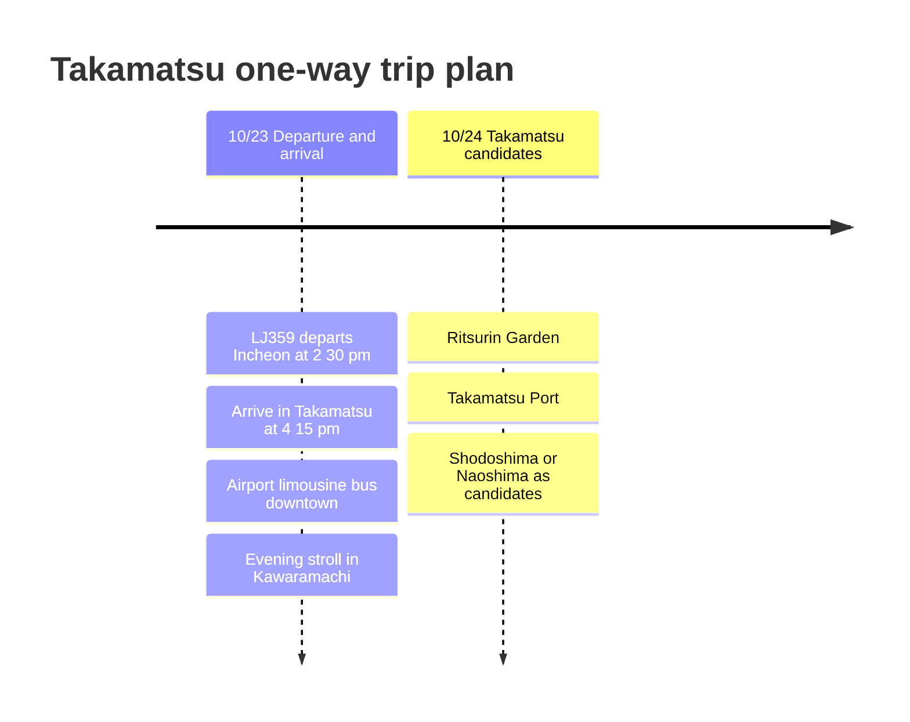

# Takamatsu One-Way Trip Plan

On October 23, fly LJ359 from Incheon to Takamatsu one way. There is no return flight yet, so this post focuses on the arrival day and downtown Takamatsu candidates that can be added afterward.

## Trip Overview

- Date: October 23, 2026
- Flight: LJ359 Incheon → Takamatsu
- Return flight: Not set
- Notes: Downtown Takamatsu, udon, Ritsurin Garden, and island trip candidates from the port

## Itinerary Summary

| Date | Area | Main plans |
|------|------|----------|
| 10/23 | Incheon, Takamatsu | Depart on LJ359, arrive at Takamatsu Airport, move downtown, dinner in Kawaramachi |
| 10/24 | Takamatsu | Ritsurin Garden, Takamatsu Port, Shodoshima or Naoshima as candidates |

## Itinerary Timeline

## 10/23 - Arriving in Takamatsu

LJ359 departs in the afternoon, so it is best to treat the first day as getting settled downtown after arrival. A natural flow is to travel from Takamatsu Airport into the city, leave your bags near Takamatsu Station or Kawaramachi, and have dinner.

Since there is no return flight yet, keep the direction of the next days open on the first day. Staying in the city keeps things light, centered on udon and Ritsurin Garden, while heading toward the port makes it easy to continue to Shodoshima or Naoshima.

## 10/24 - Candidates for the Next Day

A reasonable plan is to visit Ritsurin Garden in the morning and then go to Takamatsu Port to decide whether to take an island trip. There is a record of a previous Takamatsu trip that included Shodoshima, so it is also a good idea to leave Naoshima or Teshima open as candidates this time.

Once the return flight or accommodation is confirmed, flights, lodging, and transportation costs can be added to this post in structured form.
