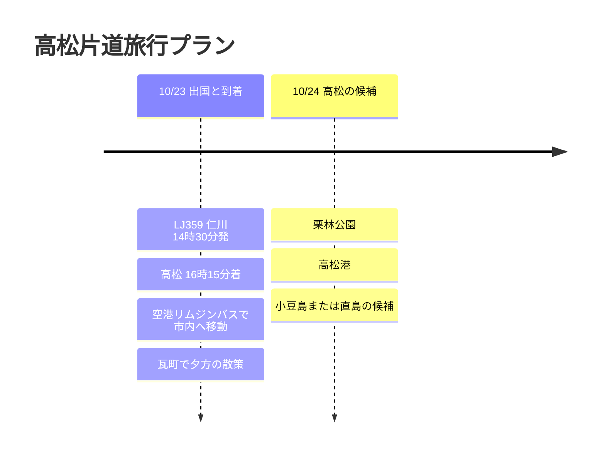

# 高松片道旅行プラン

10月23日、LJ359で仁川から高松へ入る片道の日程です。帰りの便はまだないため、今回は到着日と、続けて組み込める高松市内の候補を中心にまとめます。

## 旅行の概要

- 日付: 2026年10月23日
- 航空: LJ359 仁川 → 高松
- 復路: 未定
- メモ: 高松市内、うどん、栗林公園、港を起点にした島旅の候補

## 旅程の概要

| 日付 | 地域 | 主な予定 |
|------|------|----------|
| 10/23 | 仁川、高松 | LJ359で出国、高松空港に到着、市内へ移動、瓦町で夕食 |
| 10/24 | 高松 | 栗林公園、高松港、小豆島か直島の候補 |

## 旅程タイムライン

## 10/23 - 高松到着

LJ359は午後発のため、初日は到着後に市内に慣れる程度にしておくのがよさそうです。高松空港から市内へ移動し、高松駅や瓦町周辺に荷物を置いて夕食をとる流れが自然です。

今回は帰りの便がまだないので、初日は次の日程の方向性を開けておくのがおすすめです。市内にそのまま滞在すれば、うどんと栗林公園が中心の軽めの旅になり、港方面で組めば小豆島や直島へつなげやすくなります。

## 10/24 - 翌日の候補

翌日は午前に栗林公園を入れ、その後高松港へ移動して島へ行くかどうかを決める構成が無難です。以前の高松旅行で小豆島に行った記録があるので、今回は直島や豊島を候補に残しておくのもよいでしょう。

帰りの便や宿が確定したら、この記事に航空便、宿、交通費を追加で構造化すれば大丈夫です。
