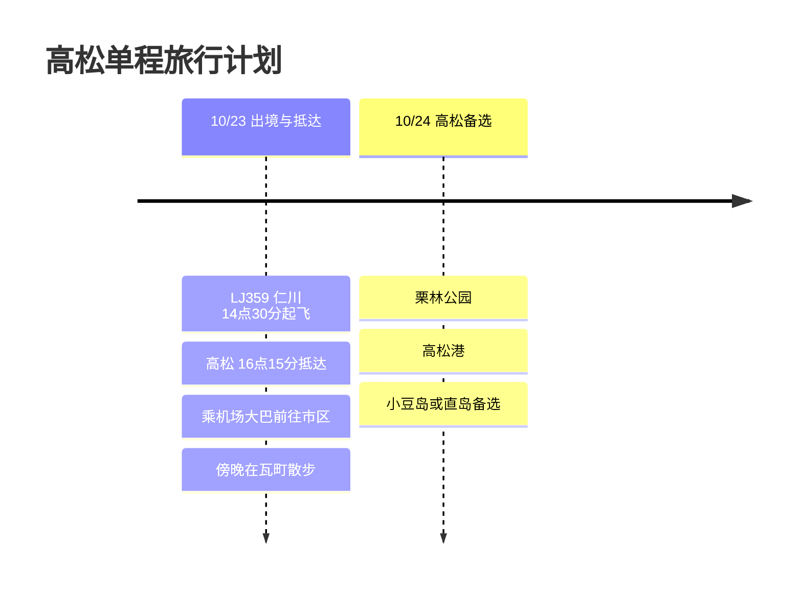

# 高松单程旅行计划

10月23日，乘坐LJ359从仁川单程飞往高松的行程。目前还没有返程航班，所以本文以抵达当天以及可以接续安排的高松市区备选行程为主。

## 旅行概览

- 日期：2026年10月23日
- 航班：LJ359 仁川 → 高松
- 返程：未定
- 备注：高松市区、乌冬面、栗林公园、以港口为起点的海岛行程备选

## 行程概要

| 日期 | 地区 | 主要行程 |
|------|------|----------|
| 10/23 | 仁川、高松 | 乘LJ359出境，抵达高松机场，前往市区，在瓦町吃晚餐 |
| 10/24 | 高松 | 栗林公园、高松港，小豆岛或直岛备选 |

## 行程时间线

## 10/23 - 抵达高松

LJ359是下午起飞，所以第一天抵达后适应一下市区就好。从高松机场进入市区后，把行李放在高松站或瓦町附近，再去吃晚餐，这样的流程比较自然。

这次行程还没有返程航班，所以第一天最好为之后的行程保留余地。如果继续留在市区，就以乌冬面和栗林公园为主，比较轻松；如果往港口方向安排，则容易接着前往小豆岛或直岛。

## 10/24 - 第二天备选

第二天上午安排栗林公园，之后前往高松港再决定是否去海岛，这样的安排比较稳妥。之前的高松旅行中有去过小豆岛的记录，所以这次也可以把直岛或丰岛列为备选。

等返程航班或住宿确定后，再在本文中补充航班、住宿和交通费用的结构化信息即可。
