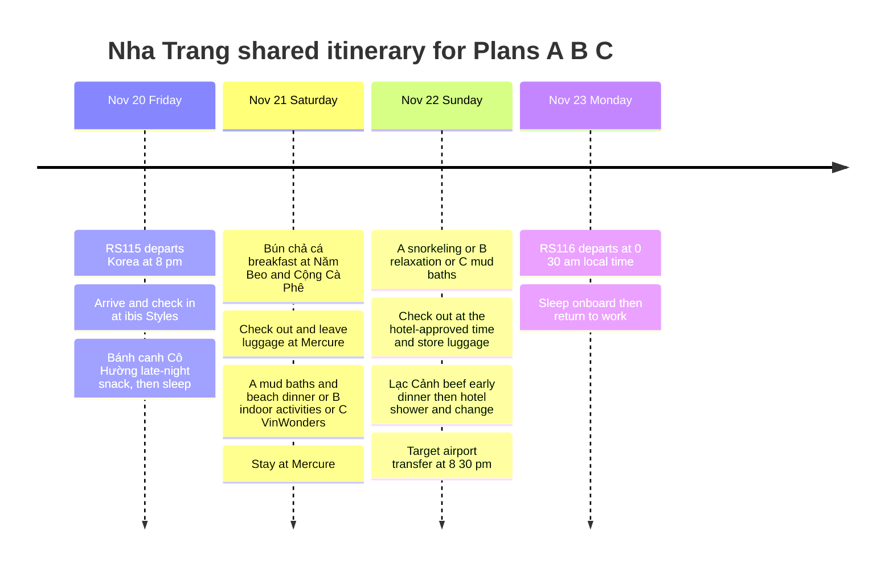

## Trip Summary

**November 20: ibis Styles → November 21: Mercure → November 22: evening shower → November 23: RS116 at 00:30 → sleep on the flight and go straight to work.** Choose one of the three plans according to sea conditions, weather and energy. **A is the default recommendation**, B suits rough seas, rain or fatigue, and C prioritizes the theme park. Whichever plan you pick, **each meal has a set restaurant**, so there is no idle time between eating and resting (see the restaurant table below).

Flights, hotels, costs and ALL Accor Platinum status were supplied by the traveler. Activities are suggestions and have not been booked. There is no separate room for the final evening: request Platinum late checkout, luggage storage and permission to shower after checkout. The hotel has not confirmed checkout time or shower access. Outbound departure uses Korean local time; sightseeing and return departure use Vietnamese local time.

| Date | Shared itinerary | Stay and conditions |
|---|---|---|
| **Friday, Nov 20** | RS115 leaves Korea at 20:00 → arrive in Nha Trang at 23:30 (expected) → ibis check-in → Bánh canh Cô Hường late-night snack → sleep | ibis Styles Nha Trang. Notify the hotel of late arrival; skip the snack if tired. |
| **Saturday, Nov 21** | Bún chả cá breakfast at Năm Beo and Cộng Cà Phê → check out of ibis → leave luggage at Mercure → choose A, B or C | Mercure Nha Trang. For C, notify the hotel of evening check-in. |
| **Sunday, Nov 22** | Follow the selected plan → check out at the approved time → store luggage → Lạc Cảnh beef early dinner → shower and change | No evening room. Confirm post-checkout shower access separately. |
| **Monday, Nov 23** | RS116 departs at 00:30 → sleep onboard → arrive in Korea and go to work | Verify arrival airport, arrival time and onward commute. |

## Itinerary Timeline

## Choosing a Plan

| Plan | Choose it when | Saturday, Nov 21 | Sunday, Nov 22 | Adjustment |
|---|---|---|---|---|
| **A — Sea and mud baths** | Seas are calm, the operator confirms suitable departure and visibility, and energy is reasonable | Mud baths → hotel rest → dinner at Louisiane | Snorkeling → late checkout → café and rest | Swap the snorkeling and mud-bath days if Saturday has better conditions. |
| **B — Indoors and relaxation** | Boat tours are canceled, seas are rough, rain persists or you are tired | Café or massage → Do Theatre performance or indoor dinner | Mud baths if conditions permit; otherwise indoor dining and rest | Outdoor mud baths are not a fallback during thunderstorms or heavy rain. |
| **C — Theme park and cable car** | Little rain or wind, the cable car is operating, and you want a full park day | VinWonders → evening Mercure check-in | Mud baths → city lunch and café | This replaces snorkeling. Switch to B if weather or transport prevents the visit. |

A rain icon alone is not enough to decide. For snorkeling, ask about **waves, wind, visibility and the operator's departure decision**. For C, check cable-car and attraction operations. November is in the rainy season; this is a conditional plan, not a forecast for November 21–22. [Vietnam Tourism climate guide](https://vietnam.travel/things-to-do/weather-and-climate-vietnam/)

## Plan A — Snorkeling, Mud Baths and a Beach Dinner

The recommended combination spreads water activities across two days and replaces Vinpearl Harbour with a city beachfront dinner.

| Day and target time | Route | Conditions or alternative |
|---|---|---|
| Sat 09:00–11:00 | Bún chả cá breakfast at Năm Beo → Cộng Cà Phê → ibis checkout → leave luggage at Mercure | After a late arrival, push breakfast to 10:00 and skip the café. |
| Sat 11:00–14:30 | Nem Nướng Đặng Văn Quyên lunch (on the route north to the mud baths) → I-Resort mud baths, allowing for travel | Allocate roughly 2–3 hours at the resort; switch to B during heavy rain or lightning. |
| Sat 14:30–18:00 | Mercure check-in → shower and nap → optional short beach walk | Adjust to the hotel's actual check-in time. |
| Sat 18:30–21:30 | Louisiane Brewhouse dinner and optional live music | Regular Friday/Saturday band schedule starts at 20:30. Confirm Nov 21; leave after dinner if tired. |
| Sun around 07:30–14:00 | Snorkeling tour → return to Mercure | Confirm operation, pickup, return time and weather cancellation terms. |
| Sun 14:00–16:15 | If the tour includes no lunch, Hai Phượng bánh xèo → room rest if permitted → checkout and luggage storage → Chè Cô Hai dessert | If approved checkout is before tour return, check out before departure. |
| Sun from 16:30 | Follow the shared departure routine below (starting with an early Lạc Cảnh dinner) | Keep the final shower and airport transfer. |

[Louisiane's official introduction](https://louisianebrewhouse.com.vn/about-us/) lists live bands on Fridays and Saturdays. Treat this as a Saturday option; do not assume the same performance on Sunday. Dinner is also an option without drinking beer.

[Angel Dive](https://www.angeldivevietnam.com/) advertises two-site snorkeling trips around 07:30–14:00. This is a candidate, not a booking. Confirm Nov 22 operation, Mercure pickup/return, guide and equipment. The plan is for snorkeling, not a scuba dive.

**If Saturday has better seas, swap the days within A.** Before departure on Nov 20, confirm Saturday availability, booking cutoff, ibis pickup, Mercure drop-off and luggage handling. Check out of ibis before the tour. Alternatively, arrange luggage storage at ibis and collect it afterward before transferring to Mercure. Do not assume a last-minute booking after arrival will be possible. Move mud baths to Sunday morning. If sleep is insufficient, keep the original A or choose B.

## Plan B — Rainy-Day Culture and Relaxation

Use indoor activities as the core, adding outdoor visits only during suitable conditions. **Confirm the specific Do Theatre performance before traveling there.**

| Day and target time | Route | Conditions or alternative |
|---|---|---|
| Sat morning | Breakfast → ibis checkout → luggage storage at Mercure | Prioritize sleep after a late arrival. |
| Sat 11:00–14:00 | Nguyên Loan bún sứa (jellyfish noodle soup) lunch → Rainforest indoor café → hotel check-in | If rain clears and time allows, add only Po Nagar Towers. |
| Sat 14:00–16:30 | Room rest or massage | Save energy for the evening performance. |
| Sat evening | Booked Life Puppets performance at Do Theatre → Hai Phượng bánh căn and bánh xèo dinner → Chè Cô Hai | Fit dinner around the confirmed show. If unavailable, replace it with the meal and a café. |
| Sun 09:00–12:30 | Mud baths if rain is light and facilities are operating | Skip during heavy rain, lightning or travel restrictions; choose indoor dining, café or massage. |
| Sun 12:30–16:15 | Nem Nướng Đặng Văn Quyên lunch → return to Mercure → approved checkout and luggage storage → city rest | Check out before leaving if approval ends before your return. |
| Sun from 16:30 | Shared departure routine below (starting with an early Lạc Cảnh dinner) | No extra evening outdoor sightseeing. |

[Do Theatre](https://www.lifepuppets.show/en/home) presents Life Puppets with puppetry and live music. **The Nov 21 performance time and seats are not confirmed.** Check the date in the [official booking calendar](https://booking.dotheatre.vn/); do not lock the plan to an assumed 18:00 show. Allow for return transport north of the city. Stay central if heavy rain makes travel difficult.

[I-Resort](https://www.i-resort.vn/dich-vu) currently lists daily hours of **08:00–17:30, ticket sales ending at 16:30**. Its outdoor facilities are not an all-weather indoor option. Keep mud baths as a priority, but omit them if bad weather persists throughout the trip. Po Nagar is an optional short visit when conditions improve. [Vietnam Tourism city guide](https://vietnam.travel/things-to-do/experience-nha-trang-like-a-local)

## Plan C — VinWonders, Cable Car and Next-Day Mud Baths

Choose this if you want rides, an aquarium, gardens and the cable-car journey. **A full theme-park day replaces snorkeling; do not combine A and C in full.**

| Day and target time | Route | Conditions or alternative |
|---|---|---|
| Sat 08:30–10:00 | Breakfast → ibis checkout → leave luggage at Mercure and notify evening check-in | Choose A or B instead if short of sleep. |
| Sat 10:00–17:00 | Cable car → VinWonders, including lunch | Confirm transport and attractions. Visit your preferred zones first. |
| Sat 17:00–20:30 | If energy allows, dinner on the island and Tata Show, then return. If you come back early, dinner at Thanh Sương seafood near the Cầu Đá pier | The current show listing is 19:30–20:10. Reconfirm Nov 21 and return transport. |
| After return | Mercure check-in and rest | Treat Harbour as a transit area rather than another visit. |
| Sun 09:00–12:30 | Mud baths → Nem Nướng Đặng Văn Quyên lunch | Switch to B's indoor options during heavy rain or lightning. |
| Sun 12:30–16:15 | Return to Mercure → late checkout and luggage storage → Chè Cô Hai or Cộng Cà Phê | Use the room only until the approved time. |
| Sun from 16:30 | Shared departure routine below (starting with an early Lạc Cảnh dinner) | No new island trip or evening performance. |

[VinWonders](https://vinwonders.com/en/vinwonders-nha-trang/) currently lists **09:00–20:00** park hours; individual zones and shows have separate schedules. Allow extra queue and travel time on Saturday. If wind suspends the cable car, switch to B rather than assuming alternative boats must run in bad weather.

The published cable-car maintenance closure is **October 26–November 10, 2026**. The trip is later, but check reopening and same-day operations. [Official notice](https://vinwonders.com/en/wonderpedia/news/notice-temporary-suspension-vinpearl-nha-trang-cable-car/)

## Restaurants — Filling Every Meal

Each meal is assigned one Nha Trang specialty: **bún chả cá (fish-cake noodle soup), nem nướng (Ninh Hòa grilled pork rolls), bánh căn (mini rice pancakes), bún sứa (jellyfish noodle soup), Lạc Cảnh beef and waterfront seafood**. Only restaurants confirmed open by at least two sources were chosen. Hours differ by source for some places, so **re-check them on a map app one week before departure**.

| Meal | Restaurant | What to eat | Location and transport | Budget per person |
|---|---|---|---|---|
| **Nov 20 late-night snack** | **Bánh canh Cô Hường** | Bánh canh chả cá (fish-cake noodles) + quail eggs | 74 Quang Trung, 3 minutes from ibis by Grab. Open 22:00–03:00 | 30,000–40,000 VND |
| **Nov 21 breakfast** | **Bún Cá Năm Beo** | Bún chả cá (fish-cake noodle soup), bánh canh chả cá | Next to Chợ Đầm market. Go in the morning for a shorter queue | 30,000–60,000 VND |
| **Nov 21 coffee** | **Cộng Cà Phê** | Coconut coffee | 2-minute walk from ibis | 45,000–75,000 VND |
| **Nov 21 lunch (Nov 22 for A and C)** | **Nem Nướng Đặng Văn Quyên** | Nem nướng set | 2-minute walk from Năm Beo, on the way to the mud baths | 60,000–120,000 VND |
| **Nov 21 lunch (B)** | **Bún Cá Nguyên Loan** | Bún sứa (jellyfish noodle soup), bún cá | 123 Ngô Gia Tự | 35,000–60,000 VND |
| **Rainy-day café (B)** | **Rainforest** | Smoothie bowl, coffee | 146 Võ Trứ, indoors | 45,000–115,000 VND |
| **Nov 21 dinner (A)** | **Louisiane Brewhouse** | House beer, seafood | 2-minute walk from Mercure, beachfront terrace | 400,000 VND or more |
| **Nov 21 dinner (B)** | **Hai Phượng bánh căn and bánh xèo** | Seafood bánh căn, bánh xèo | 200 m from ibis, air-conditioned upstairs | 80,000–100,000 VND |
| **Nov 21 dinner (C)** | **Thanh Sương seafood** | Crab, shrimp, grilled shellfish | Waterfront near the Cầu Đá pier | 300,000–600,000 VND |
| **Dessert** | **Chè Cô Hai** | Mixed chè (sweet dessert soup) | 27 Lê Quý Đôn | 12,000–35,000 VND |
| **Nov 22 early dinner** | **Lạc Cảnh beef** | Charcoal-grilled marinated beef, grilled squid | 10 minutes from Mercure by Grab, seated at 16:30 | 150,000–300,000 VND |

- **On the last day, be seated at Lạc Cảnh at 16:30 and leave at 18:00.** This avoids the evening crowd and leaves room for the 18:15 hotel shower and the 20:30 airport transfer. If you want to walk instead, switch to Hai Phượng.
- **Check the price per weight before ordering seafood.** This applies to Thanh Sương and to seafood restaurants along Trần Phú generally.
- **Nem Nướng Đặng Văn Quyên sells by the set only.** For two or more people, add another dish to one set.
- **The coordinates for Bánh canh Cô Hường and Chè Cô Hai are approximate, based on the street.** Use the map links to confirm the exact location.
- **Late-night alternative:** if Bánh canh Cô Hường is closed, try the wonton noodles at **Mì gia Hòa Hòa (2 Hai Bà Trưng, 16:00–02:00)**. For bún sứa, **Quán Mịn (170 Bạch Đằng)** is another candidate.

Restaurant information draws on the [Vietnam Coracle Nha Trang food guide](https://www.vietnamcoracle.com/nha-trang-food-guide/), the [Vietnam Tourism introduction to Lạc Cảnh](https://vietnam.travel/node/1333), the [Khánh Hòa tourism guide](https://dulichso.khanhhoa.gov.vn/en/article/lac-canh-grilled-beef-in-nha-trang-the-pinnacle-of-tiled-grill-cuisine-that-captivates-every-diner-e4d), [Foody on Năm Beo](https://www.foody.vn/khanh-hoa/bun-ca-nam-beo-cho-dam/binh-luan), [Vietnam Guide on Hai Phượng](https://vietnamguide.co.kr/place/%EB%82%98%ED%8A%B8%EB%9E%91-hai-phuong/), [Vietnam Guide on Thanh Sương](https://vietnamguide.co.kr/place/%EB%82%98%ED%8A%B8%EB%9E%91-quan-hai-san-thanh-suong/) and the [Vinpearl late-night food guide](https://vinpearl.com/vi/an-dem-nha-trang).

## Pools, Beaches and Freshwater Swimming Options

Hotel pools are part of the holiday, not just a backup. **You can skip snorkeling and still enjoy hotel swims and a short beach visit when conditions permit.** Durations below are itinerary allowances, not opening hours.

| Option | Priority and time allowance | Where to fit it | Weather and access conditions |
|---|---|---|---|
| **ibis Styles outdoor pool** | High; 45–60 minutes | Before/after Saturday breakfast, before checkout | Skip during lightning, strong wind or closure. Ask reception for current hours. |
| **Mercure indoor pools** | Easiest; 1–2 hours | If A's tour is canceled, during B's rest time or Sunday morning | Official hours: daily 06:00–18:00. Post-checkout use needs separate permission. |
| **Tran Phu city beach** | Convenient; 45–90 minutes | Instead of Sunday snorkeling or briefly after Saturday check-in | Follow designated swimming areas, flags and lifeguards. Rough seas, red flags or murky water mean hotel pool instead. |
| **Doc Let beach** | Optional; half a day or more including travel | Replace snorkeling in A; keep mud baths on the other day | Described as around 40 km north of the city. Check sea conditions and return transport; shallow water does not guarantee safety. |
| **Ba Ho waterfalls and natural pools** | Conditional; half a day including travel and walking | Replace A's snorkeling; avoid adding another distant activity | Around 25 km north. A stream and waterfalls, not a cave. Exclude swimming after rain, upstream rain, rising/dirty water or restrictions. |
| **Yang Bay waterfalls and hot springs** | Lower priority; half to a full day | Replace a major Saturday activity if nature and springs appeal | Around 40 km away. Swimming areas and current operation are unconfirmed; not a rainy-day stream-swimming fallback. |

[ibis Styles](https://all.accor.com/hotel/9578/index.en.shtml) lists an outdoor pool. [Mercure's pool page](https://www.mercurenhatrangbeach.com/leisure/pools/) lists indoor pools open 06:00–18:00. Plan to use them during the stay; ask separately about access after checkout. No extra room is planned for swimming.

See [Tran Phu's tourism introduction](https://vietnam.travel/things-to-do/experience-nha-trang-like-a-local/) and [Doc Let's tourism introduction](https://vietnam.travel/things-to-do/nha-trang-best-beaches-sustainable-vacation/). **If rough seas cancel a boat tour, do not automatically replace it with sea swimming: use the pool.** Arrange return transport for distant beaches and return to the city early in the afternoon on Sunday.

[Ba Ho's local government description](https://ninhhoa.khanhhoa.gov.vn/vi/diem-den-du-lich-36/khu-du-lich-sinh-thai-ba-ho) describes a stream and three natural pools. Current open sections, swimming permission and guides need checking. Keep it conditional in November and exclude it after rain. Clear skies do not rule out upstream rainfall or fast water. Do not assume jumping from rocks is permitted or suitable. [Vietnam Tourism's Yang Bay guide](https://vietnam.travel/things-to-do/secret-waterfalls-and-springs-around-nha-trang/) describes waterfalls and hot springs about 40 km away and recommends March–September.

### Adding Swimming to A, B or C

- **Lighter A:** Optional ibis pool on Saturday → hotel transfer, mud baths and beach dinner. On Sunday, replace snorkeling with Tran Phu or Mercure's pool. Use the indoor pool if the beach is rough.
- **Freshwater A:** Visit Ba Ho on one suitable morning only if weather, water levels and facility permission are confirmed; keep mud baths on the other day. Do not add snorkeling, Doc Let and VinWonders too. If conditions fail, use Mercure's pool.
- **B:** Add 1–2 hours at Mercure's indoor pool during permitted access. If post-checkout entry is not allowed, finish before the approved checkout time.
- **C:** If you want VinWonders' water park, reduce other zones and check operations. Keep Sunday for mud baths and rest; hotel swimming is optional if energy remains.

**Shower timing matters:** Mercure's pool closes at 18:00, so do not assume its showers are available at 18:15. Ask which facility allows an evening shower. If shower access ends before 18:00, use **16:00–17:00 early dinner → 17:00–18:00 shower/change → indoor rest and luggage collection → 20:30 airport transfer**. Confirm whether shower facilities close at the same time as the pool.

## Weekend and Weather Conditions

These regular schedules were checked on **November 1, 2026**. They do not confirm individual events or weather-dependent operations for November 21–22.

| Situation | Decision |
|---|---|
| **Saturday evening, little rain/wind** | Louisiane live music is a candidate. Regular Friday/Saturday start: 20:30; confirm Nov 21 and seating. |
| **Sunday evening** | Do not assume Louisiane's regular band program. Use the evening for early dinner, shower and airport transfer. |
| **Clear views and a rooftop preference** | Substitute Skylight on Saturday. Its FAQ lists Tuesday–Sunday operation from 17:00, closed Mondays. Keep the visit short before Sunday's tour. |
| **A more lively beachfront evening** | Replace Louisiane with Sailing Club. Check event/entry conditions; do not schedule both back to back. |
| **Light rain, calm sea** | Ask the operator about departure, waves and visibility before selecting A. Light rain alone is not approval to swim. |
| **Sunshine but strong waves/wind** | Switch snorkeling to B. Check the cable car separately; C is not automatically suitable. |
| **Persistent rain and poor views** | Prefer B. Replace rooftops and beach walks with indoor cafés/dining. |
| **Heavy rain, lightning, strong wind or travel restrictions** | Skip outdoor baths, islands and distant shows. Rest near the hotel and check airport transport/flight updates. |
| **Delayed arrival or poor sleep** | Saturday morning is for sleep, breakfast and the hotel transfer. Rest takes priority over late music or drinks. |
| **Sunday tour cancellation** | Use B's café, massage or short city options, not a full-day VinWonders trip. |

[Skylight's FAQ](https://skylightnhatrangclub.com/en/faq) lists Tuesday–Sunday operation, Monday closure and weekend booking recommendations. Monday is the return day, so consider Saturday evening. [Sailing Club](https://sailingclubnhatrang.com/) lists beachfront dining and bar facilities; check specific fire shows or DJ schedules separately.

## When to Decide

| Timing | What to confirm |
|---|---|
| **3–5 days before departure** | Check weather/marine forecasts, rank A/B/C, and review booking cutoffs, date changes and weather refund terms. |
| **Before departure on Nov 20** | Arrange any Saturday snorkeling swap in advance. Check the actual performance/park dates and cancellation conditions. |
| **At Mercure on Nov 21** | Confirm approved checkout time, luggage storage and Sunday evening shower access. If checkout is before tour return, check out before the tour. |
| **Saturday evening** | Ask the operator about Sunday's expected waves, visibility and departure; know when the final decision will arrive. |
| **Sunday morning** | Follow the final departure decision and your energy level. Preserve shower and transfer time. |

These are conditional options, not a current forecast. Do not decide from a rain percentage or a single wave-height threshold alone; follow the operator and local restrictions.

## Shared Departure Routine — Shower, Change and Fly Home

**Finish dinner before the final shower and go directly toward the airport afterward.** No further outdoor sightseeing after changing.

| Target time, Sunday Nov 22 | Shared route | Conditions |
|---|---|---|
| 16:30–18:00 | Lạc Cảnh beef early dinner (10 minutes by Grab); Hai Phượng if you prefer to walk | Stay in the city, not on an island or distant outing. |
| **18:15–20:00** | **Return to hotel, shower, dry hair, change into work clothes and collect luggage** | **Post-checkout facility and time must be confirmed. Use the earlier schedule above if access ends at 18:00.** |
| **20:30** | **Target departure from Mercure to the airport** | Confirm pickup and traffic; leave earlier if needed. |
| **21:30** | **Target arrival at Cam Ranh Airport** | Around three hours before the flight. |
| **00:30, Monday Nov 23** | **RS116 departure → sleep onboard** | Confirm Korean arrival and commute separately. |

The airport's published city transfer estimate is **45–60 minutes**. These are planning targets; actual traffic, airline check-in deadlines and flight changes take priority. [Cam Ranh transport guide](https://www.camranh.aero/en/airport-guide/transport/parking)

### Platinum Late Checkout and a Shower Before Departure

[Mercure's FAQ](https://www.mercurenhatrangbeach.com/frequently-asked-question/) lists check-in at **14:00** and checkout at **12:00**, with late departure on request. The November 21 stay does not itself provide a room through the following evening.

The traveler has **ALL Accor Platinum** status. Request late checkout instead of booking another night or a day-use room. Use the room until the approved time, then store luggage, eat and relax, and return for an approved shower/change before collecting luggage. [ALL's official benefits](https://all.accor.com/loyalty-program/cards-status-benefits-details/index.en.shtml) make late checkout subject to availability; no particular time is guaranteed here.

At check-in, ask about **approved checkout time, luggage storage, shower access around 18:15–20:00, facility location, charges, towels and a hairdryer**. A post-checkout shower is a separate hotel permission, not a guaranteed Platinum benefit. If hotel shower access is unavailable, confirm a spa with shower facilities as a fallback; no extra room is included in the default plan.

Keep work clothes, underwear, socks, basic toiletries and chargers easy to reach. Separate wet swimwear/towels in a waterproof bag and pack the main luggage after the last shower.

## Booking and Confirmation List

- Mercure's approved Platinum checkout time, luggage storage and post-checkout shower facility, hours and charges.
- For A: available snorkeling date, pickup/return hotel, luggage handling, sea conditions, visibility and cancellation terms.
- For B: actual Do Theatre performance and seats. Use central indoor options if heavy rain makes travel difficult.
- For C: cable-car reopening, same-day attractions/show operation and evening Mercure check-in.
- RS115 arrival (expected 23:30) and ibis late arrival; RS116 Korean arrival airport/time and onward commute.
- Re-check restaurant opening hours on a map app one week before departure; confirm a 16:30 table at Lạc Cảnh for Sunday. Check the price per weight before ordering seafood.

## Airfare and Hotel Costs

| Item | Dates | Traveler-provided amount | Conditions |
|---|---|---:|---|
| ibis Styles Nha Trang | Nov 20–21, 1 night | KRW 36,574 | Transfer hotels on Nov 21. |
| Mercure Nha Trang | Nov 21–22, 1 night | KRW 49,517 | Platinum late checkout and post-checkout shower requested, not confirmed; no extra room. |
| RS115 / RS116 round-trip airfare | Outbound Nov 20, return Nov 23 | KRW 192,560 | **Baggage not included.** |
| **Hotel subtotal** | **2 nights** | **KRW 86,091** | |
| **Airfare and hotel total** | | **KRW 278,651** | Additional local costs excluded. |

Count the round-trip fare once. Baggage is recorded as excluded exactly as supplied; verify the separate cabin-baggage allowance on the ticket. One-way fare breakdown, breakfast, booking source and payment method were not provided.

Food is budgeted at **about 800,000–1,200,000 VND per person** based on the restaurant table above (Plan A, including dinner at Louisiane). The total excludes snorkeling, mud baths, cable car, meals, city/airport transfers, added baggage and any separately charged shower access. Hotel dates, amounts and Platinum status come from the traveler. Late checkout, shower access and activities remain unconfirmed. No additional room cost is included in the default budget.
