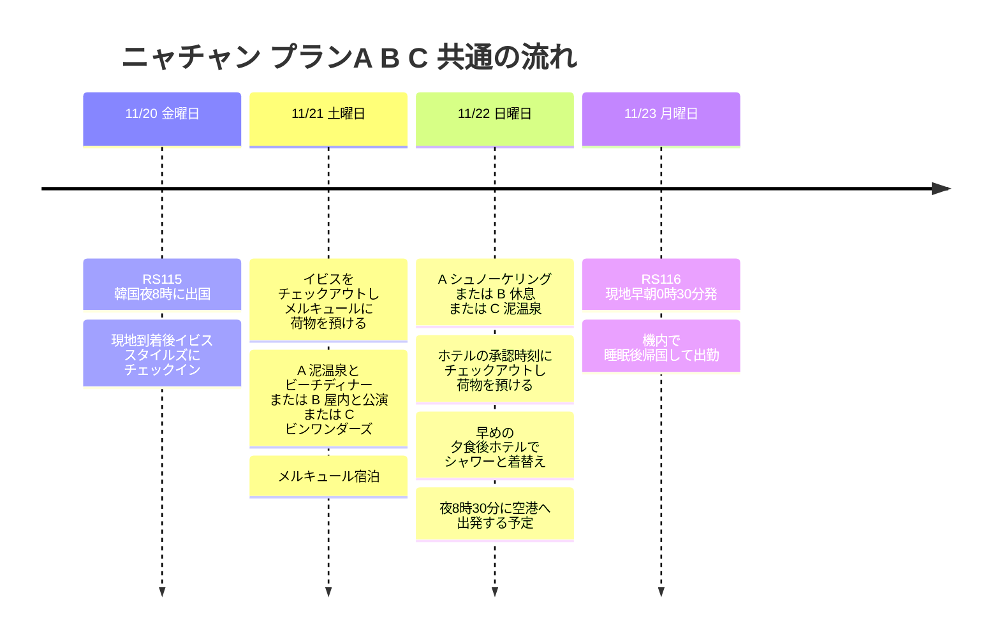

## 旅程の概要

**20日 イビス スタイルズ ニャチャン1泊 → 21日 メルキュール ニャチャン1泊 → 22日夜 ホテルでシャワー → 23日 0時30分 RS116で帰国 → 機内で睡眠後そのまま出勤**は共通です。現地では天気・海況・体力に応じて、以下の3つのプランから1つを選びます。**基本のおすすめはA**、海況が悪い、または疲れている場合はB、遊園地に1日使いたい場合はCです。

航空便・ホテル・費用・ALLアコーのプラチナ会員ランクは利用者の提供情報です。アクティビティは未予約のおすすめ案です。最終日に別の客室はなく、プラチナのレイトチェックアウトと、チェックアウト後のホテルでのシャワー利用を依頼する予定です。実際のチェックアウト時刻とシャワーの利用可否は、ホテルの確認前です。韓国出国は韓国時間、そのほかの観光と帰国便の出発はベトナム現地時間です。

| 日付 | 共通日程 | 宿泊・条件 |
|---|---|---|
| **11/20 (金)** | RS115 韓国20時00分発 → 現地到着・ホテルへ移動・就寝 | イビス スタイルズ ニャチャン。現地到着時刻とレイトチェックインの案内を確認 |
| **11/21 (土)** | イビスをチェックアウト → メルキュールに荷物を預ける → プランA・B・Cから選択 | メルキュール ニャチャン。Cは夕方チェックインなので、到着予定時刻をホテルに伝える |
| **11/22 (日)** | 選んだプランを実行 → 承認された時刻にチェックアウト・荷物預け → 早めの夕食 → ホテルでシャワー・着替え | 夜まで使える客室はなし。午後遅くは市内中心で過ごす |
| **11/23 (月)** | 現地0時30分 RS116出発 → 機内で睡眠 → 韓国到着・出勤 | 到着空港・時刻と出勤までの乗り継ぎ時間は航空券で確認 |

## 旅程タイムライン

## どのプランを選ぶか

| プラン | 選ぶ条件 | 21日 (土) | 22日 (日) | 調整ポイント |
|---|---|---|---|---|
| **A · 海と温泉** | 海が穏やかで、運営会社がシュノーケリングの実施と視界を前向きに案内していて、体力が普通以上 | 泥温泉 → ホテルで休憩 → ルイジアナでビーチディナー | シュノーケリング → レイトチェックアウト・カフェで休憩 | シュノーケリングは21日と22日のうち海況のよい日に入れ替え可能 |
| **B · 屋内と休息** | ツアー中止・波が高い・雨が降り続く、または到着の遅れで疲れている | 屋内カフェ・マッサージ → ドー劇場の公演または屋内ディナー | 泥温泉は天気が許せば、だめなら屋内で食事・休息 | 公演の回の確認が必要。温泉は屋外なので、大雨・落雷なら延期 |
| **C · 遊園地とケーブルカー** | 雨・風が弱く、ケーブルカーが通常運行、テーマパーク好きで体力も十分 | ビンワンダーズ中心の1日 → 夕方メルキュールにチェックイン | 泥温泉 → 市内でランチ・カフェ | シュノーケリングを省く選択。ケーブルカーが止まる・悪天候ならB |

雨のアイコンだけで決めません。**シュノーケリングは降水量よりも、実際の波・風・水中の視界と運営会社の出航判断**、Cはケーブルカーと行きたい施設の当日の営業状況が選ぶ基準です。11月は雨季ですが、現時点で11/21〜22の実際の天気は確定できません。[ベトナム政府観光局の気候案内](https://vietnam.travel/things-to-do/weather-and-climate-vietnam/)

## プランA · シュノーケリング + 泥温泉 + ビーチディナー

**いちばんおすすめの組み合わせ。** 海のアクティビティと温泉を1日ずつに分け、ビンパール ハーバーの代わりに市内のビーチで食事と音楽を楽しみます。

| 日付・予定時間 | ルート | 条件・代替案 |
|---|---|---|
| 21日 午前〜11:00 | ゆっくり朝食 → イビスをチェックアウト → メルキュールに荷物を預ける | 前日の到着が遅ければ午前の観光は省く |
| 21日 11:00〜14:30 | ランチ → アイ・リゾートの泥温泉、移動を含む | 温泉の利用は2〜3時間ほどを確保、大雨・落雷ならB |
| 21日 14:30〜18:00 | メルキュールにチェックイン・シャワー・昼寝 → 天気がよければビーチを軽く散歩 | チェックイン可能な時刻に合わせて調整 |
| 21日 18:30〜21:30 | ルイジアナ ブリューハウスで夕食・ビール → 希望すれば生演奏を一部 | 公式の定期案内は金・土20時30分開始。11/21の実際の公演を確認し、疲れたら食事後に戻る |
| 22日 7:30〜14:00前後 | シュノーケリングツアー → メルキュールに戻る | 催行・送迎・終了時刻・悪天候による中止条件を確認 |
| 22日 14:00〜17:00 | ランチ・許可された時間内に客室で休憩 → チェックアウト・荷物預け → カフェ | ホテルの承認時刻がツアーの帰着前なら、ツアー出発前にチェックアウト |
| 22日 17:00以降 | 下の共通の帰国準備ルート | シャワーと空港への移動時間は維持 |

[ルイジアナの公式紹介](https://louisianebrewhouse.com.vn/about-us/)にある金・土のライブバンドの定期案内を反映しました。音楽は21日(土)の選択肢で、22日(日)にも同じ公演があるとは想定しません。ビールを飲まなくても、夕食として利用できる案です。

[Angel Dive](https://www.angeldivevietnam.com/)は、2か所のポイントを巡る7時30分〜14時のシュノーケリング日程を案内しています。あくまで商品の候補で、11/22の実際の催行・メルキュールでの送迎と帰着・ガイド・器材は未確認です。今回の計画はシュノーケリングで、スキューバ体験には変更しません。

**21日のほうが海がよければ、Aの日程を入れ替えます。** 20日夜までにツアー会社へ、21日の出航・予約締切、イビスでのピックアップ・メルキュールでの降車が可能かを確認し、21日のツアー出発前にイビスのチェックアウトと荷物預けを済ませます。荷物をイビスに預けておき、戻ってから受け取ってメルキュールに移す方法も確認します。22日の午前に泥温泉へ行き、午後は休めば大丈夫です。20日に到着してから急に予約できるとは想定せず、睡眠が足りなければ元のAまたはBを維持します。

## プランB · 雨の日の屋内・公演・休息

無理にシュノーケリングをせず、天気がよくなった時間だけ屋外のアクティビティを入れる案です。**ドー劇場の公演を観るなら、その日の回が販売されているかを先に確認**してから移動します。

| 日付・予定時間 | ルート | 条件・代替案 |
|---|---|---|
| 21日 午前 | 朝食 → イビスをチェックアウト → メルキュールに荷物を預ける | 遅い到着のあと、しっかり睡眠をとる |
| 21日 11:00〜14:00 | 市内でランチ・屋内カフェ → ホテルにチェックイン | 雨が少し止んで時間に余裕があれば、ポナガール塔を1か所だけ選ぶ |
| 21日 14:00〜16:30 | 客室で休憩またはマッサージ | 夜の公演を観る体力を残す |
| 21日 夜 | 予約した回のドー劇場のライフ・パペット公演 → 夕食 | 公演時刻に合わせて食事の順番を調整。回が未販売・満席なら市内の屋内食事・カフェに変更 |
| 22日 9:00〜12:30 | 弱い雨で施設が通常営業なら泥温泉 | 大雨・落雷・移動規制なら温泉は省き、屋内でカフェ・マッサージ・食事 |
| 22日 12:30〜17:00 | メルキュールに戻る → 承認された時刻にチェックアウト・荷物預け → 市内で休憩 | チェックアウトが帰着前なら、外出前に済ませる |
| 22日 17:00以降 | 下の共通の帰国準備ルート | 夜の屋外予定は追加しない |

[ドー劇場の公式公演紹介](https://www.lifepuppets.show/en/home)は、人形劇と生演奏を組み合わせたライフ・パペットを案内しています。**11/21(土)の公演時間・座席はまだ確認できていません。**[公式の予約カレンダー](https://booking.dotheatre.vn/)で日付を選んで確定します。18時の公演に固定して日程を組みません。劇場は市内の北にあるため往復の車を考慮し、大雨で移動が難しければ市内で休みます。

泥温泉は[アイ・リゾートの公式案内](https://www.i-resort.vn/dich-vu)によると毎日**8時00分〜17時30分、チケット販売は16時30分まで**です。屋外施設なので、雨の日にいつでも使える屋内の代替案とは考えません。Bでも泥温泉を優先しますが、旅行中ずっと悪天候なら訪問を省くこともできます。ポナガール塔は、天気が回復したときに短く入れる選択観光です。[ベトナム政府観光局の市内観光案内](https://vietnam.travel/things-to-do/experience-nha-trang-like-a-local)

## プランC · ビンワンダーズ・ケーブルカー + 翌日に泥温泉

ケーブルカーだけでなく、アトラクション・水族館・庭園などのテーマパークを楽しみたいときに選びます。**シュノーケリングをあきらめてテーマパークに1日使う案**なので、AとCを合わせてすべて入れることはしません。

| 日付・予定時間 | ルート | 条件・代替案 |
|---|---|---|
| 21日 8:30〜10:00 | 朝食 → イビスをチェックアウト → メルキュールに荷物を預け、レイトチェックインを案内 | 前日の睡眠が足りなければ、CではなくAまたはB |
| 21日 10:00〜17:00 | ケーブルカー → ビンワンダーズ、ランチ込み | 通常運行・施設の営業を確認。アトラクション・水族館・庭園のうち行きたいエリアから |
| 21日 17:00〜20:30 | 体力が残っていれば夕食・タタショーのあと戻る、そうでなければ早めに帰る | 現在の公式タタショーの案内は19時30分〜20時10分、11/21の催行と帰りの交通を再確認 |
| 21日 帰着後 | メルキュールにチェックイン・休憩 | ハーバーは通りがかりに見る程度で、別の予定は追加しない |
| 22日 9:00〜12:30 | 泥温泉 → ランチ | 大雨・落雷ならBの屋内で休む動線に切り替え |
| 22日 12:30〜17:00 | メルキュールに戻る → レイトチェックアウト・荷物預け → カフェ | 客室の利用はホテルが承認した時刻まで |
| 22日 17:00以降 | 下の共通の帰国準備ルート | 最終日に島への訪問・夜の公演を新たに入れない |

[ビンワンダーズの公式案内](https://vinwonders.com/en/vinwonders-nha-trang/)による現在の営業時間は**9時00分〜20時00分**で、エリアや公演ごとの時刻は異なります。土曜日は待ち時間と移動に余裕を持ち、行きたい施設と当日の営業を確認します。運営会社が強風などでケーブルカーを止めたら、ケーブルカーの体験を前提としたCはBに切り替えます。悪天候でも代替の船が必ず運航するとは見込みません。

ケーブルカーのメンテナンス休止の告知は**2026/10/26〜11/10**です。旅行はそれ以降ですが、運行再開と当日の天気を確認します。[公式メンテナンス告知](https://vinwonders.com/en/wonderpedia/news/notice-temporary-suspension-vinpearl-nha-trang-cable-car/)

## プール・海水浴・淡水遊びの候補

ホテルのプールも旅行の主要なアクティビティとして考えます。**シュノーケリングを必ずしも予約しなくても、イビス・メルキュールのプールと、天気のよい日の短い海水浴で水遊びを楽しめます。**以下の所要時間は営業時間ではなく、日程に割り当てる計画上の値です。

| 候補 | おすすめ度・割り当て時間 | どこに入れるか | 天気・利用条件 |
|---|---|---|---|
| **イビス スタイルズの屋外プール** | 高い · 45〜60分 | 21日の朝食の前後、チェックアウト前。疲れていれば省く | 屋外なので、落雷・強風・営業中止のときは利用しない。実際の営業時間はフロントで確認 |
| **メルキュールの屋内プール** | いちばん楽 · 1〜2時間 | Aのツアーが中止のとき、Bの午後の休憩、または22日午前 | 公式案内は毎日6時00分〜18時00分。チェックアウト後の利用は別途許可を確認 |
| **チャンフー市内ビーチ** | 近い海水浴の候補 · 45〜90分 | シュノーケリングの代わりに22日午前、または21日のチェックイン後に少しだけ | 遊泳可能エリア・現地の旗・ライフガードの案内を確認。高い波・赤旗・濁った水ならホテルのプール |
| **ドックレット ビーチ** | 余裕があるとき · 移動を含め半日以上 | Aのシュノーケリングの代わりに選択、泥温泉は別の日に維持 | 市内の北約40kmと紹介される郊外のビーチ。当日の海況と交通を確認、遠浅のビーチという説明が安全を保証するわけではない |
| **バーホー滝・天然の淡水プール** | 条件付き · 移動・歩行を含め半日 | Aのシュノーケリングに代わる候補、ほかの郊外アクティビティと重ねない | 市内の北約25km。洞窟ではなく渓谷・滝。直近・当日の降雨、上流の降雨、水量の増加・濁水・立入規制があれば遊泳は除外 |
| **ヤンベイ滝・温泉** | 今回は後回し · 移動を含め半日〜1日 | 自然・温泉をもっと楽しみたければ、21日の主なアクティビティの代わりに | 市内から約40km。遊泳可能エリア・営業状況は確認前で、雨天時の渓谷遊びの代替としては使わない |

[イビスの公式案内](https://all.accor.com/hotel/9578/index.en.shtml)は屋外プールを、[メルキュールの公式プール案内](https://www.mercurenhatrangbeach.com/leisure/pools/)は屋内プールと6時00分〜18時00分の営業を案内しています。どちらのホテルも宿泊中に使う基本案で、チェックアウト後に使えるかどうかは別途確認します。プールを使うために追加の客室は予約しません。

[チャンフー ビーチの観光局紹介](https://vietnam.travel/things-to-do/experience-nha-trang-like-a-local/)と[ドックレットの観光局紹介](https://vietnam.travel/things-to-do/nha-trang-best-beaches-sustainable-vacation/)を参考にしました。**船のツアーが中止になるほど海が荒れていたら、海水浴に自動的に切り替えず、プールへ行きます。**郊外のビーチは帰りの車と戻る時刻を先に決め、22日は午後早めに市内に戻れるよう日程を短くします。

[バーホー地域の公式紹介](https://ninhhoa.khanhhoa.gov.vn/vi/diem-den-du-lich-36/khu-du-lich-sinh-thai-ba-ho)は、渓谷と3つの天然の淡水プールを案内しています。現在の開放区間・遊泳の可否・ガイドの有無は確認前です。**11月は基本のおすすめではなく条件付きの候補とし、雨が降ったあとは除外します。**晴れても上流の降雨・急流の危険を確認し、入水や岩からのジャンプができる場所だと決めつけません。[ヤンベイの観光局紹介](https://vietnam.travel/things-to-do/secret-waterfalls-and-springs-around-nha-trang/)は、滝・温泉と約40kmの距離を紹介し、おすすめの時期を3〜9月と案内しています。

### プランA・B・Cに水遊びを入れる方法

- **A 軽い水遊びバージョン:** 21日にイビスのプールを選択 → ホテルへの移動・泥温泉・ビーチディナー、22日はシュノーケリングの代わりにチャンフーで海水浴またはメルキュールのプール。市内のビーチも荒れていれば、屋内プールだけを利用します。
- **A 淡水バージョン:** 21日・22日のうち、天気・水量・施設の許可が確認できた日の午前にバーホーで半日、別の日に泥温泉。シュノーケリング・ドックレット・ビンワンダーズは追加しません。条件が合わなければメルキュールのプールに変更します。
- **B:** 雨で海のアクティビティを外しても、ホテルで利用できる時間にメルキュールの屋内プールを1〜2時間入れます。チェックアウト後の利用が許可されない場合は、承認されたチェックアウト時刻の前に済ませます。
- **C:** ビンワンダーズでウォーターパークまで楽しみたければ、21日はほかのエリアを減らし、当日の営業を確認します。22日は温泉と休息が中心で、ホテルでの水泳は体力が残っているときだけにします。

**重要な時間調整:** メルキュールのプールは公式案内で18時に閉まるため、18時30分以降のシャワーをプール施設で浴びられるとは想定しません。ホテルが夜のシャワーを許可する別の施設・時間を確認します。シャワーを使える時間が18時前だけなら、**16:00〜17:00 早めの夕食 → 17:00〜18:00 シャワー・着替え → 屋内で休憩・荷物の回収 → 20:30 空港へ出発**に変更します。プールの閉場時刻とシャワールームの利用終了時刻が同じかどうかも確認します。

## 土・日曜日と天気による選択条件

以下の営業情報は**2026-11-01に確認した定期案内**です。11/21〜22の個別の公演・イベント・天候による実際の営業を保証するものではありません。

| 状況・曜日 | 選択基準と行動 |
|---|---|
| **21日 (土) 夜 · 雨・風が弱い** | Aのルイジアナのライブバンドが候補。定期案内は金・土20時30分、その日の公演と席を確認 |
| **22日 (日) 夜** | ルイジアナの定期ライブ公演を前提にしない。早めの食事・シャワー・空港への移動に使う |
| **晴れて眺めがよい · ルーフトップを希望** | 21日夜をスカイライトに変更可能。公式FAQは火〜日営業・月曜休み、17時開店。Aでは翌日のツアーを考えて長居しない |
| **ビーチでもっとにぎやかな夜を希望** | 21日のルイジアナの代わりにセーリングクラブ。夜のイベント・入場条件は当日確認、2か所を続けて訪れる予定は省く |
| **弱い雨・海が穏やか** | 運営会社に出航・波・視界を確認してAを決定。雨が弱いというだけでシュノーケリングが可能とは判断しない |
| **晴れているが波・風が強い** | シュノーケリングを中止・変更してB。ケーブルカーも別途運行を確認、Cを自動的な代替案にしない |
| **雨が降り続く · 眺めがくもる** | B優先。ルーフトップ・ビーチの散歩は屋内のカフェ・食事に変更 |
| **大雨・落雷・強風・現地の移動制限** | 温泉・島・郊外の公演への移動は省き、宿泊先周辺の屋内で休憩。空港までの交通と航空便の案内を確認 |
| **到着の遅れ・睡眠不足** | 21日の午前は睡眠・朝食・ホテルへの移動のみ。土曜夜の公演・飲み会より休息を優先 |
| **日曜のツアー中止** | Bのカフェ・マッサージ・短い市内観光に変更。ビンワンダーズの1日訪問には変えない |

[スカイライトの公式FAQ](https://skylightnhatrangclub.com/en/faq)は、火〜日営業、月曜休み、週末の予約推奨を案内しています。今回の日程では月曜は帰国日なので、訪問は21日夜の候補にします。[セーリングクラブの公式案内](https://sailingclubnhatrang.com/)はビーチでの食事とバーの営業を案内しており、特定日のファイヤーショー・DJの時間は別途確認します。

## いつプランを決めるか

| タイミング | 確認して決めること |
|---|---|
| **出発3〜5日前** | 天気・海上の予報を参考にA・B・Cの優先順位を選択。ツアーの予約締切・日付変更・悪天候による中止の返金条件を確認 |
| **20日の出発前** | 21日のシュノーケリングに入れ替える可能性があれば、ツアー会社と事前に調整。公演・ビンワンダーズはキャンセル条件とその日の営業を確認 |
| **21日 メルキュール到着時** | レイトチェックアウトの承認時刻、22日夜のチェックアウト後のシャワー・荷物預けを確認。ツアーの帰着前にチェックアウトが必要なら、出発前のチェックアウトに変更 |
| **21日 夜** | 22日のツアー会社の波・視界・出航の案内を確認。中止ならBのルートに切り替え、翌日の最終連絡の時点を確認 |
| **22日 朝** | 運営会社の最終的な出航判断と実際のコンディションで決定。シャワー・空港への移動時間はそのまま維持 |

現在の予報ではなく、条件ごとの選択案です。出航の可否を、任意の降水確率や波高の数値ひとつで決めず、運営会社と現地の規制に従います。

## すべてのプラン共通 · 最後の夜のシャワーと帰国

**夕食後に最後のシャワー・着替えを済ませ、そのまま空港へ移動します。**シャワーのあとは屋外の観光を追加しません。

| 予定時間 | 共通ルート | 条件 |
|---|---|---|
| 17:00〜18:30 | メルキュール近くで早めの夕食 | 郊外・島では食事しない |
| **18:30〜20:00** | **ホテルに戻る・シャワー・髪を乾かす・仕事用の服に着替え・荷物の回収** | **チェックアウト後に使う施設・時間はホテルの確認が必要** |
| **20:30** | **メルキュールから空港へ出発する予定** | 送迎・交通を確認、必要ならもっと早く出発 |
| **21:30** | **カムラン空港到着が目標** | 航空便の出発約3時間前 |
| **23日 0:30** | **RS116出発 → 機内で睡眠** | 韓国到着・会社への移動時間は別途確認 |

空港の公式案内による市内からの車での移動時間は**45〜60分**です。上の表は計画上の値で、実際の交通・航空会社のチェックイン締切・変更の案内が優先されます。[カムラン空港の交通案内](https://www.camranh.aero/en/airport-guide/transport/parking)

### プラチナのレイトチェックアウトと出国前のシャワー

メルキュール ニャチャン ビーチの公式案内は**チェックイン14時00分、チェックアウト12時00分**で、遅いチェックアウトはホテルに別途問い合わせるようになっています。**11/21の宿泊だけで11/22の夜まで客室を使えるとは見込みません。**[ホテルの公式FAQ](https://www.mercurenhatrangbeach.com/frequently-asked-question/)

利用者は**ALLアコーのプラチナ会員**です。追加の1泊・デイユースの客室を予約する代わりに、メルキュールにプラチナのレイトチェックアウトを依頼し、承認された時刻まで客室を利用します。チェックアウト後は荷物を預けてカフェ・食事で時間を過ごし、空港に出発する前にホテルに戻ってシャワー・着替えをして荷物を受け取るルートです。ALLの公式案内ではレイトチェックアウトは空室状況次第なので、特定の時刻を保証された特典として記録しません。[ALLのステータス別特典](https://all.accor.com/loyalty-program/cards-status-benefits-details/index.en.shtml)

チェックインのときに、**レイトチェックアウトの可能時刻、荷物預け、チェックアウト後18時30分〜20時00分のシャワーの可否と利用施設・料金・タオル・ドライヤー**をあわせて確認します。チェックアウト後のシャワーはプラチナの保証された特典とは考えず、ホテルが別途許可するかどうかによります。ホテルのシャワーが使えなければ、シャワーのあるスパを代替として確認し、追加の客室は基本日程に入れません。

**出勤用の服・下着・靴下、簡単な洗面用具、充電器**は、取り出しやすいように分けて準備します。濡れた水着とタオルは防水の袋に分け、最後のシャワーのあとは空港で使う物だけを残して荷物を閉じます。

## 予約・確認事項

- メルキュールのプラチナのレイトチェックアウトの承認時刻、荷物預け、チェックアウト後の夜のシャワー施設・時間・料金。
- Aを選ぶなら、21日・22日のうち可能なツアー日、ピックアップのホテル・帰着・荷物預け、出航・視界・キャンセル条件。
- Bを選ぶなら、ドー劇場のその日の回・座席。大雨なら市内の食事・休息に切り替え。
- Cを選ぶなら、ケーブルカーの再開・当日の施設と公演の営業、メルキュールの夕方チェックインの案内。
- RS115の現地到着時刻とイビスのレイトチェックイン、RS116の韓国到着・出勤までの乗り継ぎ時間。

## 航空・宿泊費用

| 項目 | 利用日 | 利用者提供の金額 | 条件 |
|---|---|---:|---|
| イビス スタイルズ ニャチャン | 11/20〜11/21 · 1泊 | 36,574ウォン | ホテルの移動は11/21 |
| メルキュール ニャチャン | 11/21〜11/22 · 1泊 | 49,517ウォン | プラチナのレイトチェックアウト・チェックアウト後のシャワーを依頼予定、追加の客室なし |
| RS115 · RS116 往復航空券 | 11/20出国 · 11/23帰国 | 192,560ウォン | **受託手荷物は含まれません** |
| **宿泊小計** | **2泊** | **86,091ウォン** | |
| **航空・宿泊合計** | | **278,651ウォン** | 追加の現地費用は除く |

往復の航空券代は1件として記録し、二重に計上しません。手荷物が含まれないことは利用者提供の条件のとおり記録しており、機内持ち込み手荷物の別枠の許容量は航空券の条件で確認します。片道ごとの航空券代と朝食・予約先・支払方法は未確認です。

シュノーケリング・泥温泉・ケーブルカー・食費・空港および市内の交通・追加の手荷物・シャワー利用に別途料金が発生する場合の費用は、上の合計に含めていません。ホテルの利用日・費用・プラチナ会員ランクは利用者の提供情報です。レイトチェックアウトとチェックアウト後のシャワーはホテルの確認前で、アクティビティも確認・予約前の計画です。追加の客室費用は基本の予算に入れていません。
