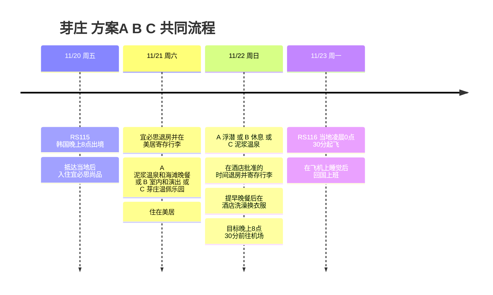

## 行程概要

**20日宜必思尚品芽庄1晚 → 21日美居芽庄1晚 → 22日晚在酒店洗澡 → 23日0点30分乘RS116回国 → 在飞机上睡觉后直接上班**是固定安排。到了当地，根据天气、海况和体力，从下面三个方案中选择一个。**默认推荐A**，海况不好或疲惫时选B，想用一整天玩游乐园则选C。

航班、酒店、费用和ALL雅高白金会员等级均由用户提供。活动为尚未预订的推荐方案。最后一天没有单独的客房，计划申请白金卡延迟退房，并申请退房后使用酒店淋浴。实际退房时间和是否允许淋浴，酒店尚未确认。从韩国出境使用韩国时间，其余观光和回程航班起飞使用越南当地时间。

| 日期 | 共同行程 | 住宿·条件 |
|---|---|---|
| **11/20 (周五)** | RS115 韩国20点00分起飞 → 抵达当地·前往酒店·睡觉 | 宜必思尚品芽庄。确认抵达当地的时间和晚入住的说明 |
| **11/21 (周六)** | 宜必思退房 → 在美居寄存行李 → 在方案A·B·C中选择 | 美居芽庄。C为傍晚入住，需告知酒店预计到达时间 |
| **11/22 (周日)** | 执行所选方案 → 在批准的时间退房·寄存行李 → 提早吃晚餐 → 在酒店洗澡·换衣服 | 没有用到晚上的客房。傍晚以前在市区中心活动 |
| **11/23 (周一)** | 当地0点30分RS116起飞 → 在飞机上睡觉 → 抵达韩国·上班 | 抵达机场·时间和上班的衔接时间，请在机票上确认 |

## 行程时间线

## 如何选择方案

| 方案 | 选择条件 | 21日 周六 | 22日 周日 | 需要调整的地方 |
|---|---|---|---|---|
| **A · 海与温泉** | 海面平静，运营方对浮潜出海和能见度给出积极答复，体力一般以上 | 泥浆温泉 → 酒店休息 → 路易斯安那海滩晚餐 | 浮潜 → 延迟退房·咖啡馆休息 | 浮潜可与21日、22日中海况更好的一天对调 |
| **B · 室内与休息** | 旅游团取消、浪大、持续下雨，或因抵达延误而疲惫 | 室内咖啡馆·按摩 → 多剧场演出或室内晚餐 | 天气允许时去泥浆温泉，否则室内用餐·休息 | 需确认演出场次。温泉在室外，暴雨·雷电时推迟 |
| **C · 游乐园与缆车** | 雨·风较小，缆车正常运行，喜欢主题乐园且体力充足 | 以芽庄温佩乐园为中心的一天 → 傍晚在美居入住 | 泥浆温泉 → 市区午餐·咖啡馆 | 放弃浮潜的选择。缆车停运·天气恶劣则选B |

不要只看下雨的图标来决定。**浮潜的依据不是降水量，而是实际的浪·风·水下能见度以及运营方的出海判断**，C则以缆车和想去的设施当天是否营业为选择标准。11月是雨季，但目前无法确定11/21～22的实际天气。[越南旅游局气候指南](https://vietnam.travel/things-to-do/weather-and-climate-vietnam/)

## 方案A · 浮潜 + 泥浆温泉 + 海滩晚餐

**最推荐的组合。**把海上活动和温泉各安排一天，不去珍珠港，而在市区海滩享用晚餐和音乐。

| 日期·计划时间 | 路线 | 条件·替代方案 |
|---|---|---|
| 21日 上午～11:00 | 悠闲早餐 → 宜必思退房 → 在美居寄存行李 | 如果前一天抵达较晚，就省去上午的观光 |
| 21日 11:00～14:30 | 午餐 → I-Resort泥浆温泉，含往返路程 | 温泉预留2～3小时左右，暴雨·雷电时改为B |
| 21日 14:30～18:00 | 美居入住·洗澡·午睡 → 天气好的话在海滩短暂散步 | 根据可入住的时间调整 |
| 21日 18:30～21:30 | 路易斯安那啤酒坊晚餐·啤酒 → 想听的话听一部分现场音乐 | 官方例行说明为周五、周六20点30分开始。确认11/21的实际演出，累了就吃完饭回去 |
| 22日 7:30～14:00前后 | 浮潜团 → 回到美居 | 确认是否开团、接送、结束时间和因天气取消的条件 |
| 22日 14:00～17:00 | 午餐·在允许的时间内在客房休息 → 退房·寄存行李 → 咖啡馆 | 如果酒店批准的时间早于旅游团返回时间，则在旅游团出发前退房 |
| 22日 17:00以后 | 下面的共同回国准备路线 | 保持洗澡和前往机场的时间 |

已参考[路易斯安那官方介绍](https://louisianebrewhouse.com.vn/about-us/)中周五、周六现场乐队的例行说明。音乐只是21日周六的选项，不假定22日周日也有同样的演出。即使不喝啤酒，也可以作为晚餐去用餐。

[Angel Dive](https://www.angeldivevietnam.com/)介绍了游览两个点位、7点30分～14点的浮潜行程。这只是产品候选，11/22的实际开团、美居接送和返回、导游、装备都尚未确认。这次计划是浮潜，不改为水肺潜水体验。

**如果21日海况更好，就对调A的日期。**在20日晚之前向旅游公司确认21日的出海·预订截止时间、宜必思接客·美居下客是否可行，并在21日旅游团出发前办完宜必思的退房和行李寄存。也要确认把行李寄存在宜必思、返回后取回再转到美居的做法。22日上午去泥浆温泉，下午休息即可。不假定20日抵达后能临时预订，如果睡眠不足，就维持原来的A或改为B。

## 方案B · 雨天室内·演出·休息

不勉强浮潜，只在天气转好的时段安排户外活动。**想看多剧场的演出，要先确认当天的场次是否在售**，再前往。

| 日期·计划时间 | 路线 | 条件·替代方案 |
|---|---|---|
| 21日 上午 | 早餐 → 宜必思退房 → 在美居寄存行李 | 晚抵达后充分睡眠 |
| 21日 11:00～14:00 | 市区午餐·室内咖啡馆 → 酒店入住 | 如果雨暂停且时间充裕，只选择婆那加占婆塔一处 |
| 21日 14:00～16:30 | 客房休息或按摩 | 为晚上的演出保留体力 |
| 21日 晚上 | 已预订场次的多剧场生命木偶演出 → 晚餐 | 根据演出时间调整用餐顺序。场次未开售·售罄则改为市区室内用餐·咖啡馆 |
| 22日 9:00～12:30 | 雨小且设施正常营业就去泥浆温泉 | 暴雨·雷电·交通管制时省去温泉，在室内咖啡馆·按摩·用餐 |
| 22日 12:30～17:00 | 回到美居 → 在批准的时间退房·寄存行李 → 在市区休息 | 如果退房时间早于返回，则在外出前办理 |
| 22日 17:00以后 | 下面的共同回国准备路线 | 不再增加晚上的户外行程 |

[多剧场官方演出介绍](https://www.lifepuppets.show/en/home)介绍了结合木偶戏与现场音乐的生命木偶（Life Puppets）。**11/21周六的演出时间·座位尚未确认。**在[官方预订日历](https://booking.dotheatre.vn/)中选好日期后再确定。不把行程锁定在固定的18点演出上。剧场位于市区北面，需考虑往返用车，如果暴雨导致出行困难，就留在市区休息。

泥浆温泉根据[I-Resort官方介绍](https://www.i-resort.vn/dich-vu)，每天**8:00～17:30，16:30停止售票**。这是户外设施，不把它当作雨天随时可去的室内替代方案。B方案中也优先安排泥浆温泉，但如果整个旅行期间都是恶劣天气，可以省去这次游览。婆那加占婆塔是天气放晴时短暂加入的可选景点。[越南旅游局市区观光指南](https://vietnam.travel/things-to-do/experience-nha-trang-like-a-local)

## 方案C · 芽庄温佩乐园·缆车 + 第二天泥浆温泉

不只想坐缆车，还想玩游乐设施、水族馆、花园等主题乐园时选择。**这是放弃浮潜、用一整天玩主题乐园的方案**，所以不要把A和C全部合并安排。

| 日期·计划时间 | 路线 | 条件·替代方案 |
|---|---|---|
| 21日 8:30～10:00 | 早餐 → 宜必思退房 → 在美居寄存行李·告知晚入住 | 如果前一天睡眠不足，就选A或B而不是C |
| 21日 10:00～17:00 | 缆车 → 芽庄温佩乐园，含午餐 | 确认正常运行·设施营业。从游乐设施·水族馆·花园中想去的区域开始 |
| 21日 17:00～20:30 | 体力有余就吃晚餐·看塔塔秀后返回，否则早点回去 | 目前官方塔塔秀说明为19点30分～20点10分，需再次确认11/21的演出和返程交通 |
| 21日 返回后 | 美居入住·休息 | 港湾区只是路过看看，不另外增加行程 |
| 22日 9:00～12:30 | 泥浆温泉 → 午餐 | 暴雨·雷电时切换为B的室内休息路线 |
| 22日 12:30～17:00 | 回到美居 → 延迟退房·寄存行李 → 咖啡馆 | 客房使用到酒店批准的时间为止 |
| 22日 17:00以后 | 下面的共同回国准备路线 | 最后一天不新增前往岛屿·晚间演出 |

[芽庄温佩乐园官方介绍](https://vinwonders.com/en/vinwonders-nha-trang/)中目前的营业时间为**9:00～20:00**，各区域和演出的时间不同。周六要为排队和路上预留富余时间，并确认想去的设施和当天的营业情况。如果运营方因强风等原因停运缆车，以体验缆车为前提的C就改为B。不把恶劣天气下有替代船只一定会运行计算在内。

缆车维护停运的公告期间为**2026/10/26～11/10**。旅行在此之后，但要确认恢复运行以及当天的天气。[官方维护公告](https://vinwonders.com/en/wonderpedia/news/notice-temporary-suspension-vinpearl-nha-trang-cable-car/)

## 泳池·海水浴·淡水戏水候选

酒店泳池也作为旅行的主要活动。**即使不一定预订浮潜，也可以通过宜必思、美居的泳池和天气好时短暂的海水浴享受戏水乐趣。**下面的所用时间不是营业时间，而是行程中分配的计划值。

| 候选 | 推荐度·分配时间 | 安排在哪里 | 天气·使用条件 |
|---|---|---|---|
| **宜必思尚品室外泳池** | 高 · 45～60分钟 | 21日早餐前后、退房前。疲惫则省略 | 室外泳池，雷电·强风·停止营业时不使用。实际营业时间请向前台确认 |
| **美居室内泳池** | 最轻松 · 1～2小时 | A的旅游团取消时、B的下午休息或22日上午 | 官方说明为每天6:00～18:00。退房后使用需另行确认是否允许 |
| **陈富市区海滩** | 较近的海水浴候选 · 45～90分钟 | 代替浮潜安排在22日上午，或21日入住后短暂前往 | 确认允许下水的区域·现场旗帜·救生员的指示。浪高·红旗·水浑浊则去酒店泳池 |
| **独列海滩** | 有余力时 · 含路程半天以上 | 代替A的浮潜，泥浆温泉安排在另一天 | 介绍为位于市区北面约40km的郊外海滩。确认当天海况和交通，浅滩海滩的说明并不保证安全 |
| **巴湖瀑布·天然水潭** | 有条件 · 含路程·步行半天 | 作为替代A浮潜的候选，不与其他郊外活动重叠 | 位于市区北面约25km。是溪谷·瀑布而非洞穴。最近·当天有降雨、上游降雨、水量增加·水浑浊·管制时不下水 |
| **杨湾瀑布·温泉** | 这次靠后 · 含路程半天～一天 | 如果更想要自然·温泉，则替代21日的主要活动 | 距市区约40km。允许下水的区域·营业情况尚未确认，雨天不作为溪谷戏水的替代方案 |

[宜必思官方介绍](https://all.accor.com/hotel/9578/index.en.shtml)说明有室外泳池，[美居官方泳池介绍](https://www.mercurenhatrangbeach.com/leisure/pools/)说明有室内泳池，营业时间为6:00～18:00。两家酒店都是住宿期间使用的基本方案，退房后能否使用要另行确认。不会为了使用泳池而另订客房。

参考了[陈富海滩旅游局介绍](https://vietnam.travel/things-to-do/experience-nha-trang-like-a-local/)和[独列旅游局介绍](https://vietnam.travel/things-to-do/nha-trang-best-beaches-sustainable-vacation/)。**如果海面粗糙到船团取消的程度，不自动改为海水浴，而是去泳池。**郊外海滩要先定好回程的车辆和返回时间，22日则缩减行程，下午早些回到市区。

[巴湖地区官方介绍](https://ninhhoa.khanhhoa.gov.vn/vi/diem-den-du-lich-36/khu-du-lich-sinh-thai-ba-ho)介绍了溪谷和三个天然水潭。目前开放的区段·是否允许游泳·有无导游尚未确认。**11月不作为默认推荐，而是作为有条件的候选，下雨之后则排除。**即使放晴，也要确认上游降雨·急流的风险，不断言那里是可以下水和跳岩的地方。[杨湾旅游局介绍](https://vietnam.travel/things-to-do/secret-waterfalls-and-springs-around-nha-trang/)介绍了瀑布·温泉和约40km的距离，并说明推荐季节为3～9月。

### 在方案A·B·C中加入游泳的方法

- **A 轻松戏水版：** 21日可选宜必思泳池 → 前往酒店·泥浆温泉·海滩晚餐，22日代替浮潜去陈富海水浴或美居泳池。如果市区海滩也浪大，就只用室内泳池。
- **A 淡水版：** 在21日、22日中，选天气·水量·设施许可已确认的一天上午去巴湖半天，另一天去泥浆温泉。不再增加浮潜·独列·芽庄温佩乐园。条件不合适就改为美居泳池。
- **B：** 即使因下雨取消了海上活动，也在酒店可使用的时间内安排1～2小时的美居室内泳池。如果退房后不允许使用，就在批准的退房时间之前结束。
- **C：** 如果想在芽庄温佩乐园连水上乐园也玩，就减少21日的其他区域并确认当天营业情况。22日以温泉和休息为主，酒店游泳只在体力有余时进行。

**重要的时间调整：**美居泳池按官方说明18点关闭，所以不假定18点30分以后能在泳池设施洗澡。要确认酒店允许晚上洗澡的其他设施·时间。如果能洗澡的时间只到18点之前，就改为**16:00～17:00 提早晚餐 → 17:00～18:00 洗澡·换衣服 → 室内休息·取回行李 → 20:30 前往机场**。还要确认泳池关闭时间和淋浴间使用截止时间是否相同。

## 周六·周日与天气对应的选择条件

下面的营业信息是**2026-11-01确认的例行说明**。不保证11/21～22个别演出·活动以及受天气影响的实际营业情况。

| 情况·星期 | 选择标准与行动 |
|---|---|
| **21日 周六晚上 · 雨·风较小** | A的路易斯安那现场乐队候选。例行说明为周五、周六20点30分，需确认当天演出和座位 |
| **22日 周日晚上** | 不以路易斯安那的例行现场演出为前提。用于提早用餐·洗澡·前往机场 |
| **天晴景色好 · 想去露台酒吧** | 21日晚可替换为天际线酒吧。官方FAQ说明周二至周日营业·周一休息，17点开门。在A中考虑第二天的旅游团，不要久留 |
| **想在海滩度过更热闹的夜晚** | 21日用帆船俱乐部代替路易斯安那。夜间活动·入场条件当天确认，省去连续去两处的行程 |
| **小雨·海面平静** | 向运营方确认出海·浪·能见度后决定A。不因为雨小就判断可以浮潜 |
| **天晴但浪·风大** | 取消·更改浮潜，选B。缆车也要另行确认运行情况，不自动选C作为替代 |
| **持续下雨·景色模糊** | 优先B。露台酒吧·海滩散步改为室内咖啡馆·用餐 |
| **暴雨·雷电·强风·当地出行限制** | 省去前往温泉·岛屿·郊外演出，在住处周边室内休息。确认机场交通和航班通知 |
| **抵达延误·睡眠不足** | 21日上午只睡觉·吃早餐·转移酒店。比起周六晚的演出·喝酒，优先休息 |
| **周日旅游团取消** | 改为B的咖啡馆·按摩·短时市区观光。不改为整天游览芽庄温佩乐园 |

[天际线酒吧官方FAQ](https://skylightnhatrangclub.com/en/faq)说明周二至周日营业、周一休息，并建议周末预订。这次行程中周一是回国日，所以把到访作为21日晚的候选。[帆船俱乐部官方介绍](https://sailingclubnhatrang.com/)说明有海滩餐饮和酒吧营业，特定日期的火秀·DJ时间需另行确认。

## 什么时候决定方案

| 时间点 | 需要确认并决定的事项 |
|---|---|
| **出发前3～5天** | 参考天气·海上预报选定A·B·C的优先顺序。确认旅游团预订截止·改期·因天气取消的退款条件 |
| **20日出发前** | 如果可能调换到21日浮潜，要提前与旅游公司协调。演出·芽庄温佩乐园要确认取消条件和当天营业情况 |
| **21日 抵达美居时** | 确认延迟退房的批准时间，22日晚退房后的洗澡·行李寄存。如果必须在旅游团返回前退房，就改为出发前退房 |
| **21日 晚上** | 确认22日旅游公司关于浪·能见度·出海的通知。取消的话切换为B路线，确认第二天最终通知的时间点 |
| **22日 早上** | 依据运营方最终的出海判断和实际状态决定。洗澡·前往机场的时间保持不变 |

这不是当前的天气预报，而是按条件划分的选择方案。不要用任意的降水概率或某个浪高数值来决定是否出海，而是遵从运营方和当地管制。

## 所有方案共同 · 最后一晚洗澡与回国

**晚餐后完成最后的洗澡·换衣服，然后直接前往机场。**洗澡后不再增加户外观光。

| 计划时间 | 共同路线 | 条件 |
|---|---|---|
| 17:00～18:30 | 在美居附近提早吃晚餐 | 不在郊外·岛上用餐 |
| **18:30～20:00** | **回酒店·洗澡·吹干头发·换上上班的衣服·取回行李** | **退房后使用的设施·时间需向酒店确认** |
| **20:30** | **目标从美居前往机场** | 确认接送·交通，必要时更早出发 |
| **21:30** | **目标抵达金兰机场** | 航班起飞前约3小时 |
| **23日 0:30** | **RS116起飞 → 在飞机上睡觉** | 抵达韩国·前往公司的时间另行确认 |

机场官方说明的从市区乘车时间为**45～60分钟**。上表为计划值，实际交通·航空公司值机截止·变更通知优先。[金兰机场交通指南](https://www.camranh.aero/en/airport-guide/transport/parking)

### 白金卡延迟退房与出境前洗澡

芽庄美居海滩酒店官方说明为**入住14:00，退房12:00**，延迟退房需另行向酒店咨询。**不要认为仅凭11/21的住宿就能用客房到11/22晚上。**[酒店官方FAQ](https://www.mercurenhatrangbeach.com/frequently-asked-question/)

用户是**ALL雅高白金会员**。不另订加住1晚·日间房，而是向美居申请白金卡延迟退房，使用客房到批准的时间。退房后寄存行李，在咖啡馆·用餐中打发时间，前往机场之前回酒店洗澡·换衣服并取回行李。根据ALL官方说明，延迟退房视可用情况而定，所以不把具体时间记录为有保证的权益。[ALL各等级权益](https://all.accor.com/loyalty-program/cards-status-benefits-details/index.en.shtml)

入住时要一并确认**延迟退房的可能时间、行李寄存、退房后18点30分～20点00分之间能否洗澡以及使用的设施·费用·毛巾·吹风机**。退房后洗澡不假定为白金卡的保证权益，取决于酒店另行是否允许。如果酒店无法洗澡，就确认可以洗澡的水疗中心作为替代，不把另订客房放入基本行程。

**上班穿的衣服·内衣·袜子、简单的洗漱用品、充电器**要单独准备，方便取出。湿泳衣和毛巾要装进防水袋分开放，最后一次洗澡后只留下在机场要用的东西，把行李合上。

## 预订·需确认事项

- 美居白金卡延迟退房的批准时间、行李寄存、退房后晚间洗澡的设施·时间·费用。
- 选A时，21日、22日中可行的旅游团日期，接送酒店·返回·行李寄存，出海·能见度·取消条件。
- 选B时，多剧场当天的场次·座位。暴雨则改为市区用餐·休息。
- 选C时，缆车恢复·当天设施和演出的营业情况，美居晚入住的通知。
- RS115抵达当地的时间和宜必思晚入住，RS116抵达韩国·上班的衔接时间。

## 机票·住宿费用

| 项目 | 使用日期 | 用户提供的金额 | 条件 |
|---|---|---:|---|
| 芽庄宜必思尚品酒店 | 11/20～11/21 · 1晚 | 36,574韩元 | 11/21转移酒店 |
| 芽庄美居酒店 | 11/21～11/22 · 1晚 | 49,517韩元 | 预计申请白金卡延迟退房·退房后洗澡，无额外客房 |
| RS115 · RS116 往返机票 | 11/20出境 · 11/23回国 | 192,560韩元 | **不含托运行李** |
| **住宿小计** | **2晚** | **86,091韩元** | |
| **机票·住宿合计** | | **278,651韩元** | 不含额外当地费用 |

往返机票按一笔记录，不重复计算。不含托运行李按用户提供的条件如实记录，随身携带行李的另行允许额度请在机票条件中确认。单程机票金额以及早餐·预订渠道·支付方式未确认。

浮潜·泥浆温泉·缆车·餐费·机场及市区交通·额外行李·使用淋浴如另行产生费用，其费用未包含在上述合计中。酒店使用日期·费用·白金卡等级均由用户提供。延迟退房和退房后洗澡尚未经酒店确认，活动也是尚未确认·预订的计划。额外客房费用不计入基本预算。
