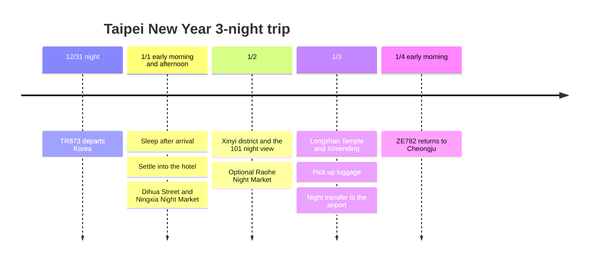

**Depart Korea on 12/31, arrive in Taipei in the early hours of 1/1, and fly to Cheongju in the early hours of 1/4.** The days usable locally are the three days of 1/1-1/3. For accommodation, we are comparing **3 nights at one hotel** against **1 night at CU + 2 nights at a cheaper place**; neither is marked as booked.

The reference date is **2026-10-03**. The visit times and travel buffers below are planning values, and flight and hotel booking terms take priority. Korea is 1 hour ahead of Taiwan.

## Itinerary Summary

| Date | Route | Stay and rest |
|---|---|---|
| Thu 12/31 | Depart at night on TR873 | Secure a room to use from 12/31 |
| Fri 1/1 | Arrive in the early hours → sleep → move to hotel or rest on a consecutive stay → Dihua Street → Ningxia Night Market | Skip first-day morning sightseeing |
| Sat 1/2 | Late morning → Xinyi and 101 → optional Raohe Night Market | Same hotel, consecutive stay |
| Sun 1/3 | Checkout and luggage storage → Longshan Temple → Ximending → pick up luggage → Airport MRT | Aim to reach the airport between 22:30 and 23:00 at night |
| Mon 1/4 | ZE782 Taipei → Cheongju | Return in the morning |

## Itinerary Timeline

## Flight Times and the New Year Mood

The [TR873 schedule by date](https://www.flight.info/TR873) lists **22:55 on 12/31 → 00:35 on 1/1**, and [another published schedule](https://zbordirect.com/en/tools/schedule?arrival_city=TPE&departure_city=SEL) lists **23:00 → 00:40**. Confirm the 5-minute difference with the ticket, but **both sources have an arrival after midnight, so watching the 101 midnight countdown in person is difficult.**

[Taipei's official New Year event page](https://www.travel.taipei/zh-tw/event-calendar/details/66403) lists **2026/12/1-2027/1/1** as the event period. Christmas-related events in the [official annual event calendar](https://www.travel.taipei/zh-cn/event-calendar/download) run **provisionally until 2027/1/31**. This trip is built around Xinyi's year-end decorations and night view, New Year greetings at temples and the night market atmosphere. Do not assume a countdown show is also held on 1/2, and check pre-departure notices for any extension of installations or lighting. Also do not assume the **Lunar New Year festival market** on Dihua Street takes place on January 1.

The [ZE782 winter published schedule](https://www.flight.info/ZE782) shows **departure at 02:35 on 1/4 → arrival in Cheongju at 06:05**. **Do not add daytime sightseeing on 1/4 or an airport transfer on the night of 1/4.**

## Accommodation · 3 Consecutive Nights vs. 1 + 2 Nights

| Option | Room booking dates | Advantages | Points to compare |
|---|---|---|---|
| **3 nights at one hotel · rest first** | 12/31-1/3, whichever of CU or Twin Star Inn fits the total price and room type | Nap on New Year's Day without moving luggage or checking in again | Compare the total and cancellation terms for the year-end first night and the remaining two |
| **1 night at CU + 2 nights at Twin Star Inn or similar · budget option** | CU 12/31-1/1, second hotel 1/1-1/3 | Use the expensive night for only 1 night and keep the rest cheap | The gap in rooms between checkout and the next check-in, and one luggage move |

**If the price difference is small, we recommend 3 consecutive nights**, because you may want a nap on the first day after an early-hours arrival. Choose split stays only after subtracting the luggage transfer fare from the savings and judging the check-in gap acceptable. Until actual room rates are received, do not assume which option is cheaper.

[CU Hotel](https://www.cuhotel.com.tw/en/taipei) is at **No. 198, Minsheng W. Rd.**, near Ningxia Night Market. [Twin Star Inn](https://www.tsitaipei.com/) is at **B3, No. 50, Sec. 1, Zhongxiao W. Rd.**, in front of Taipei Main Station. According to the official information, the single room is **underground, windowless, with a shared bathroom**, and there is a 24-hour self check-in kiosk. Check the room type of each booking and the early-hours check-in procedure.

**Book the room you will actually enter around 02:00-03:00 on 1/1 starting from 12/31**, and tell the hotel to hold it even if you arrive after midnight. Also secure a way to contact the hotel in case of an immigration delay. A booking that starts on 1/1 does not by itself create an early-hours room. Check whether you can pick up luggage in the evening after the 1/3 checkout, and if not, use lockers or a staffed storage counter at the station.

## 1/1 · Sleep, Then Dihua Street and Ningxia Night Market

| Local target time | Activity and travel buffer |
|---|---|
| 00:35-02:00 | Immigration and baggage claim. Even with e-Gate registration, allow time to wait for baggage |
| 02:00-03:15 | Travel to the hotel by taxi or a pre-booked car and check in. Late-night Airport MRT service is not assumed |
| 03:15-10:30 | Sleep. If you arrive late, cut afternoon sightseeing further |
| 10:30-12:00 | Breakfast and tidy-up. On a split stay, observe the CU booking's checkout time |
| 12:00-15:30 | On a split stay, move luggage by car, lunch and a cafe, then regular check-in at the next hotel; on a consecutive stay, nap |
| 15:30-17:00 | Dihua Street and Xiahai City God Temple. Allow 20-30 minutes from the hotel |
| 17:00-17:30 | Walk toward Ningxia, 15-25 minutes, and find a spot |
| 17:30-19:00 | Night market dinner → back to the hotel |

The old shopping street and temples described in the [official Dihua Street introduction](https://www.travel.taipei/immersive/zh-tw/a-0-1/) are grouped as a single area. On the first day, do not add an observatory or a trip to the suburbs. If the hotel move runs long, shorten Dihua Street and go only for dinner at Ningxia.

## 1/2 · Xinyi and the Taipei 101 Night View

The order is a late morning at 10:00-11:00 → MRT to Xinyi at 11:00-12:00 → lunch and shopping → **cafe rest at 14:30-15:30** → a twilight walk and night view around 101 at 16:00-17:30. Choose the observatory only if there are few clouds and the price fits the budget; a walk at ground level alone completes the day.

After a bus or car ride toward Raohe at 17:30-18:00, have **dinner at the night market at 18:00-19:30**. The two night markets are not crammed into one day. If the transfer is a hassle or you have already walked a lot, eat in Xinyi and return to the hotel. If a restaurant wait **exceeds 30 minutes**, switch to another restaurant in the same area.

## 1/3 · Longshan Temple and Ximending, Then the Airport

Leave luggage and check out around 10:00 → Longshan Temple at 11:00-12:00 → lunch and the trip to Ximending at 12:00-13:30 → cafes and shopping at 13:30-16:30 → early dinner at 17:00-18:00 → choose either a massage or indoor rest at 18:00-20:30. Find Ay-Chung at the **No. 8-1, Emei St.** branch listed in the [Wanhua District Office store information](https://whdo.gov.taipei/News_Content.aspx?n=19CABBEF3F991E9E&s=C0811D8F9FC97E2E&sms=FE5F0DE8FA424CE8).

The targets are **luggage pickup at 20:30-21:00, Airport MRT departure at 21:30-22:00 and arrival at the terminal at 22:30-23:00**. The [express train's own travel time is about 35 minutes to T1](https://www.travel.taipei/en/information/taoyuanmetro), but walking and waiting inside Main Station and getting around the terminal are separate. Check the timetable and the ticket's terminal before leaving. If the route runs late, cut the late-night snack and shopping first and do not wait for the last train.

## Revisit Lottery · First Application

Since there is a record of visiting Kaohsiung, check the revisit conditions and apply. **e-Gate registration is an automated immigration procedure and is separate from applying for the prize.** Per the [Immigration Agency notice](https://www.immigration.gov.tw/5385/7445/7889/7892/50764/cp_news), travelers without a residence permit fill in [TWAC](https://twac.immigration.gov.tw/?hl=ko-KR) before entry even after registering.

Under the [Tourism Administration's official rules](https://5000.taiwan.net.tw/campaign_rules_en.html), the revisit prize is a **NT$5,000 draw**. You must meet the eligibility, such as an entry record since 2023 up to the day before registration and a stay of 3-90 days on this trip. **For this trip, the registration period is 2026/10/3-12/25, based on the Taiwan arrival date of 1/1.** You join the draw every Wednesday, and registration and winning are each limited to once per trip. Register the February trip separately, but receiving the prize twice is not guaranteed.

If you win, **submit your return air ticket through the email link within 24 hours after entry for verification**, and **collect the prize at a 7-ELEVEN within 24 hours after verification with your passport and the exchange QR code**. Leave time to handle this before lunch on the first day. It may end when the budget runs out, and the prize is not included in the confirmed budget.

## Time Adjustment Ranges and Costs

| Situation | Itinerary to cut or change | Standard to keep |
|---|---|---|
| Delayed early-hours arrival, lack of sleep | Skip Dihua Street on 1/1 and go only for dinner at Ningxia | Secure the room and sleep |
| Rain, strong wind, low visibility | Malls and cafes instead of the 101 observatory | Move within the same Xinyi area |
| Crowded night market | Skip Raohe and have dinner in Xinyi | Do not queue for a long time for one meal |
| Decide on a single hotel | Remove the 1/1 luggage move and re-check-in, add a nap | 3 nights in total |
| Tired on the last day | Skip either Longshan Temple or shopping | Reach the airport on the night of 1/3 |

Airfare and hotel rates have not been shared yet and are not included in the spending total. For meals, set a **planning target of NT$400-650 per day**, and compare lodging, transport, massage and the observatory separately. These figures are not shop price lists or amounts paid.

The February revisit connects to the [Ximending food and Beitou relaxation itinerary](/posts/2027-02-26-taipei-healing-food/en/).
