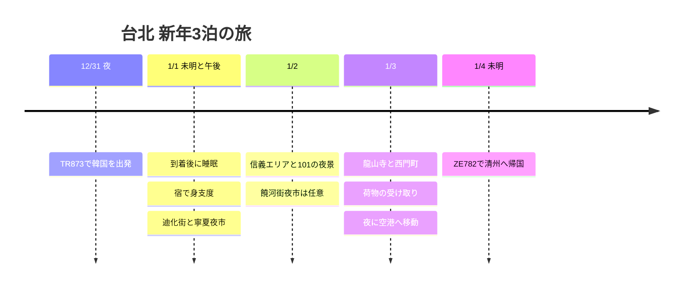

**12/31に韓国を出発し、1/1の未明に台北へ到着、1/4の未明に清州行きの飛行機に乗ります。** 現地で使えるのは1/1〜1/3の3日間です。宿泊は**1軒で3泊**と**CU 1泊＋安い宿2泊**を比較中で、予約済みとは表示していません。

照会基準日は**2026-10-03**です。以下の訪問時刻と移動の余裕は計画値で、航空券・ホテルの予約条件が優先されます。韓国は台湾より1時間進んでいます。

## 旅程の概要

| 日付 | 動線 | 宿泊・休憩 |
|---|---|---|
| 12/31 (木) | 夜にTR873で出国 | 12/31から使える客室を確保 |
| 1/1 (金) | 未明に到着 → 睡眠 → 宿へ移動または連泊で休憩 → 迪化街 → 寧夏夜市 | 初日の午前観光は省略 |
| 1/2 (土) | 遅めの朝 → 信義・101 → 饒河街夜市は任意 | 同じ宿に連泊 |
| 1/3 (日) | チェックアウト・荷物預け → 龍山寺 → 西門町 → 荷物の受け取り → 空港MRT | 夜22:30〜23:00の空港到着が目標 |
| 1/4 (月) | ZE782 台北 → 清州 | 朝に帰国 |

## 旅程タイムライン

## フライト時刻と新年の雰囲気

[TR873の日付別時刻表](https://www.flight.info/TR873)は**12/31 22:55 → 1/1 00:35**、[別の公開時刻表](https://zbordirect.com/en/tools/schedule?arrival_city=TPE&departure_city=SEL)では**23:00 → 00:40**と出ています。5分の差は航空券で確定しますが、**どちらも日付が変わった後の空港到着のため、101の年越しカウントダウンを現地で見るのは難しいです。**

[台北市公式の新年イベント案内](https://www.travel.taipei/zh-tw/event-calendar/details/66403)は、**2026/12/1〜2027/1/1**を開催期間としています。[公式の年間イベント表](https://www.travel.taipei/zh-cn/event-calendar/download)のクリスマス関連イベントは**2027/1/31まで暫定日程**です。この旅は、信義の年末の装飾と夜景、寺院での新年のお参り、夜市の雰囲気を楽しむ構成です。1/2にもカウントダウンの公演があるとは解釈せず、設置物や点灯の延長は出発前のお知らせで確認します。迪化街の**旧正月の年貨大街**も、1月1日の開催を前提にしません。

[ZE782の冬ダイヤ公開時刻表](https://www.flight.info/ZE782)は**1/4 02:35発 → 06:05清州着**です。**1/4の昼の観光や、1/4の夜の空港移動を入れてはいけません。**

## 宿 · 3連泊と1泊＋2泊の比較

| 選択 | 客室を予約する日付 | メリット | 比較する点 |
|---|---|---|---|
| **1軒で3泊 · 休息優先** | 12/31〜1/3、CUまたはTwin Star Innのうち総額・部屋タイプが合う方 | 元日に荷物の移動や再チェックインなしで昼寝ができる | 年末初日と残り2日の総額、キャンセル条件を比較 |
| **CU 1泊＋Twin Star Innなど2泊 · 節約案** | CU 12/31〜1/1、2軒目 1/1〜1/3 | 高い日は1泊だけにして、残りを安く組める | チェックアウトから次のチェックインまでの空白と、荷物の移動1回 |

**宿泊料金の差が大きくなければ、3連泊をおすすめします。** 未明に到着した後、元日に昼寝をしたくなるかもしれないからです。分けて泊まる場合は、節約額から荷物移動の交通費を引いたうえで、チェックインの空白を我慢できそうなときに選びます。実際の宿泊料金を受け取る前は、どちらが安いとは断定しません。

[CUホテル](https://www.cuhotel.com.tw/en/taipei)は**民生西路198號**で、寧夏夜市の近くにあります。[Twin Star Inn](https://www.tsitaipei.com/)は**忠孝西路一段50號 B3**で、台北駅の目の前です。公式案内のシングルルームは**地下・窓なし・共用バス**で、24時間利用できるセルフチェックイン機があります。個別に予約する客室タイプと未明の入室手順を確認します。

**1/1の午前2〜3時ごろに実際に入る部屋は、12/31から予約**し、日付が変わった後に到着しても客室を確保しておいてほしいと伝えます。入国が遅れた場合のホテルへの連絡方法も確保しておきます。1/1チェックインの予約だけでは、未明の客室は用意されません。1/3のチェックアウト後、夕方に荷物を受け取れるか確認し、無理なら駅のコインロッカーや有人の荷物預かり所を使います。

## 1/1 · 睡眠後に迪化街と寧夏夜市

| 現地の目標時間 | 日程・移動の余裕 |
|---|---|
| 00:35〜02:00 | 入国・荷物の受け取り。自動ゲートの登録があっても、手荷物を待つ時間を確保 |
| 02:00〜03:15 | タクシー・事前予約の車で宿へ移動・チェックイン。空港MRTの深夜運行は前提にしない |
| 03:15〜10:30 | 睡眠。到着が遅れたら午後の観光をさらに減らす |
| 10:30〜12:00 | 朝食・身支度。宿を分ける場合はCUの予約上のチェックアウト時刻を守る |
| 12:00〜15:30 | 宿を分ける場合は車で荷物を移動・昼食・カフェのあと次の宿で通常チェックイン、連泊なら昼寝 |
| 15:30〜17:00 | 迪化街と霞海城隍廟。宿からの移動に20〜30分の余裕 |
| 17:00〜17:30 | 寧夏方面へ徒歩15〜25分・席探し |
| 17:30〜19:00 | 夜市で夕食 → 宿に戻る |

[迪化街の公式紹介](https://www.travel.taipei/immersive/zh-tw/a-0-1/)に出てくる古い商店街と寺院を、ひとつのエリアにまとめました。初日は展望台や近郊ツアーを加えません。ホテルの移動が長引いたら、迪化街を減らして寧夏の夕食だけに行きます。

## 1/2 · 信義と台北101の夜景

10:00〜11:00 遅めの朝 → 11:00〜12:00 MRTで信義へ移動 → 昼食・ショッピング → **14:30〜15:30 カフェで休憩** → 16:00〜17:30 101周辺の夕暮れ散歩・夜景、という順番です。展望台は雲が少なく料金が予算に合うときだけ選び、地上の散歩だけでも日程は成り立ちます。

17:30〜18:00 饒河街方面へバス・車で移動し、**18:00〜19:30 夜市で夕食**。2つの夜市を1日に詰め込んではいません。乗り換えが面倒だったり、すでに歩き疲れていたら、信義で夕食を食べて宿に戻ります。飲食店の待ち時間が**30分を超えたら**、同じエリアの別の店に変えます。

## 1/3 · 龍山寺と西門町のあと空港へ

10:00前後に荷物を預けてチェックアウト → 11:00〜12:00 龍山寺 → 12:00〜13:30 昼食と西門町への移動 → 13:30〜16:30 カフェ・ショッピング → 17:00〜18:00 早めの夕食 → 18:00〜20:30 マッサージか屋内での休憩のどちらかを選びます。阿宗麺線は[萬華区役所の店舗案内](https://whdo.gov.taipei/News_Content.aspx?n=19CABBEF3F991E9E&s=C0811D8F9FC97E2E&sms=FE5F0DE8FA424CE8)にある**峨眉街8之1號**の店舗で探します。

**20:30〜21:00 荷物の受け取り、21:30〜22:00 空港MRTで出発、22:30〜23:00 ターミナル到着**を目標にします。[急行列車そのものの所要時間はT1まで約35分](https://www.travel.taipei/en/information/taoyuanmetro)ですが、台北駅構内の徒歩・待ち時間とターミナル内の移動は別です。出発前に時刻表と航空券のターミナルを確認します。動線が遅れたら、夜食とショッピングから減らし、終電まで待ちません。

## 再訪抽選 · 1回目の申込

高雄を訪れた履歴があるため、再訪の条件を確認して申し込みます。**e-Gateの登録は自動出入国の手続きで、支援金の申請とは別物**です。[移民署の案内](https://www.immigration.gov.tw/5385/7445/7889/7892/50764/cp_news)により、居留証のない旅行者は登録後も入国前に[TWAC](https://twac.immigration.gov.tw/?hl=ko-KR)を記入します。

[観光署の公式規定](https://5000.taiwan.net.tw/campaign_rules_en.html)では、再訪賞は**NT$5,000の抽選**です。2023年以降、登録前日までの入国履歴や、今回の滞在が3〜90日であることなどの資格を満たす必要があります。**この旅の登録期間は、台湾到着日の1/1を基準に2026/10/3〜12/25**です。毎週水曜日の抽選に参加でき、1回の旅行につき登録・当選は各1回です。2月の旅行は別に登録しますが、2回受け取れる保証はありません。

当選したら**入国後24時間以内にメールのリンクから帰りの航空券を提出して検証**を受け、**検証後24時間以内にパスポートと引換QRでセブン-イレブンで受け取ります**。初日の昼食前に処理する時間を確保します。予算が尽きると終了することがあり、当選金は確定した予算に含めません。

## 時間調整の範囲と費用

| 状況 | 減らす・変える日程 | 維持する基準 |
|---|---|---|
| 未明の到着が遅れた・睡眠不足 | 1/1の迪化街を省略、寧夏の夕食だけ | 客室と睡眠の確保 |
| 雨・強風・視界不良 | 101の展望台の代わりにショッピングモール・カフェ | 同じ信義エリア内で移動 |
| 夜市の混雑 | 饒河街を省略、信義で夕食 | 1食のために長く並ばない |
| 宿を1軒に決めた | 1/1の荷物移動・再チェックインを削除、昼寝を追加 | 合計3泊 |
| 最終日の疲れ | 龍山寺かショッピングのどちらか1つを省略 | 1/3夜の空港到着 |

航空運賃と宿泊料金はまだ共有されていないため、支出の合計には入れていません。食費は**1日NT$400〜650を計画の目標**とし、宿泊・交通・マッサージ・展望台は別に比較します。この数値は店の価格表や実際の支払額ではありません。

2月の再訪は、[西門町グルメと北投ヒーリングの旅程](/posts/2027-02-26-taipei-healing-food/ja/)につなげます。
