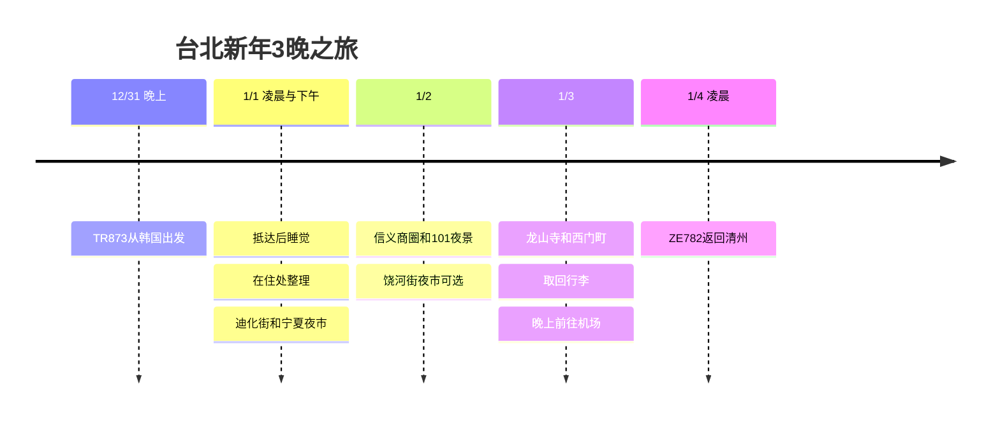

**12/31从韩国出发，1/1凌晨抵达台北，1/4凌晨乘飞机飞往清州。** 在当地能用的是1/1至1/3这三天。住宿正在比较**同一家酒店住3晚**与**CU住1晚＋便宜住处住2晚**，没有标记为已预订。

查询基准日为**2026-10-03**。下面的游览时间和交通余量都是计划值，以机票和酒店预订条件为准。韩国比台湾快1小时。

## 行程概要

| 日期 | 动线 | 住宿·休息 |
|---|---|---|
| 12/31 (周四) | 晚上乘TR873出境 | 确保从12/31起可用的客房 |
| 1/1 (周五) | 凌晨抵达 → 睡眠 → 前往住处或连住休息 → 迪化街 → 宁夏夜市 | 省略首日上午的观光 |
| 1/2 (周六) | 睡到晚一点 → 信义·101 → 饶河街夜市可选 | 连住同一家酒店 |
| 1/3 (周日) | 退房·寄存行李 → 龙山寺 → 西门町 → 取回行李 → 机场捷运 | 目标晚上22:30至23:00抵达机场 |
| 1/4 (周一) | ZE782 台北 → 清州 | 早晨回国 |

## 行程时间线

## 航班时间与新年氛围

[TR873按日期的时刻表](https://www.flight.info/TR873)显示为**12/31 22:55 → 1/1 00:35**，[另一份公开时刻表](https://zbordirect.com/en/tools/schedule?arrival_city=TPE&departure_city=SEL)显示为**23:00 → 00:40**。5分钟的差异以机票为准，但**两份资料都是午夜之后抵达机场，所以很难在现场观看101的跨年倒数。**

[台北官方新年活动介绍](https://www.travel.taipei/zh-tw/event-calendar/details/66403)将**2026/12/1至2027/1/1**列为活动期间。[官方年度活动表](https://www.travel.taipei/zh-cn/event-calendar/download)中的圣诞相关活动**暂定到2027/1/31**。这次旅行的安排是欣赏信义街头的年末装饰和夜景、寺庙新年参拜、夜市氛围。不会理解为1/2也有倒数演出，装置和点灯的延长要在出发前通过公告确认。迪化街的**春节年货大街**也不以1月1日举办为前提。

[ZE782冬季公开时刻表](https://www.flight.info/ZE782)为**1/4 02:35出发 → 06:05抵达清州**。**不能安排1/4白天的观光，也不能安排1/4晚上前往机场。**

## 住宿 · 连住3晚与1晚＋2晚比较

| 选择 | 预订客房的日期 | 优点 | 需要比较的地方 |
|---|---|---|---|
| **同一家酒店3晚 · 休息优先** | 12/31至1/3，CU或Twin Star Inn中总价、房型合适的一家 | 元旦不用搬行李、重新办理入住，可以午睡 | 比较年末首日与其余两天的总价、取消条件 |
| **CU 1晚＋Twin Star Inn等2晚 · 节省方案** | CU 12/31至1/1，第二家住处 1/1至1/3 | 贵的那天只住1晚，其余可以安排得便宜 | 退房到下次入住之间的客房空档，以及1次搬行李 |

**如果住宿差价不大，推荐连住3晚。** 因为凌晨抵达后，元旦也许会想午睡。分开住的话，要在节省的金额里扣掉搬行李的交通费之后，觉得可以忍受入住空档时再选择。在拿到实际住宿费之前，不断言哪个方案更便宜。

[CU酒店](https://www.cuhotel.com.tw/en/taipei)位于**民生西路198號**，靠近宁夏夜市。[Twin Star Inn](https://www.tsitaipei.com/)位于**忠孝西路一段50號 B3**，就在台北车站前。官方介绍的单人间是**地下·无窗·共用卫浴**，设有24小时自助入住机。需要确认各自预订的房型和凌晨入住流程。

**1/1凌晨2至3点左右实际入住的房间，要从12/31起预订**，并告知酒店即使午夜之后到达也请保留客房。同时确保入境延误时联系酒店的方式。只预订1/1入住，凌晨是不会有房间的。确认1/3退房后晚上能否取回行李，不行的话就使用车站的寄存柜或有人值守的寄存处。

## 1/1 · 睡醒后去迪化街和宁夏夜市

| 当地目标时间 | 行程·交通余量 |
|---|---|
| 00:35至02:00 | 入境·领取行李。即使已登记自动通关，也要留出等行李的时间 |
| 02:00至03:15 | 乘出租车或提前预约的车前往住处·办理入住。不以机场捷运深夜运营为前提 |
| 03:15至10:30 | 睡眠。如果抵达更晚，就进一步减少下午的观光 |
| 10:30至12:00 | 早餐·整理。分开住的话要遵守CU预订上的退房时间 |
| 12:00至15:30 | 分开住的话，乘车搬行李·午餐·咖啡馆后在下一家住处正常入住，连住的话就午睡 |
| 15:30至17:00 | 迪化街和霞海城隍庙。从住处过去预留20至30分钟 |
| 17:00至17:30 | 向宁夏方向步行15至25分钟·找座位 |
| 17:30至19:00 | 夜市晚餐 → 回住处 |

把[迪化街官方介绍](https://www.travel.taipei/immersive/zh-tw/a-0-1/)中提到的老店街和寺庙合并成一个区域。首日不加入观景台和近郊旅行团。如果前往酒店的路程拖长，就缩减迪化街，只去宁夏吃晚餐。

## 1/2 · 信义与台北101夜景

10:00至11:00 睡到晚一点 → 11:00至12:00 乘捷运前往信义 → 午餐·购物 → **14:30至15:30 咖啡馆休息** → 16:00至17:30 101周边黄昏漫步·夜景，顺序就是这样。观景台只在云少、价格符合预算时选择，只在地面散步，行程也是完整的。

17:30至18:00 乘公交或车前往饶河街方向，**18:00至19:30 夜市晚餐**。没有把两个夜市塞进同一天。如果换乘麻烦，或者已经走了很多路，就在信义吃晚餐后回住处。餐厅排队**超过30分钟**的话，就换同一区域的其他餐厅。

## 1/3 · 龙山寺和西门町之后去机场

10:00前后寄存行李并退房 → 11:00至12:00 龙山寺 → 12:00至13:30 午餐并前往西门町 → 13:30至16:30 咖啡馆·购物 → 17:00至18:00 早点吃晚餐 → 18:00至20:30 在按摩或室内休息中选一项。阿宗面线按[万华区公所的门店介绍](https://whdo.gov.taipei/News_Content.aspx?n=19CABBEF3F991E9E&s=C0811D8F9FC97E2E&sms=FE5F0DE8FA424CE8)中的**峨眉街8之1號**门店去找。

目标是**20:30至21:00取回行李，21:30至22:00乘机场捷运出发，22:30至23:00抵达航站楼**。[快线列车本身到T1约35分钟](https://www.travel.taipei/en/information/taoyuanmetro)，但台北车站内的步行·等待和航站楼内的移动要另算。出发前确认时刻表和机票上的航站楼。动线延误时，先减少宵夜和购物，不要等到末班车。

## 重游抽奖 · 第一次申请

因为有过访问高雄的记录，所以确认重游条件后申请。**e-Gate登记是自动通关手续，与奖励金申请无关。** 按照[移民署的介绍](https://www.immigration.gov.tw/5385/7445/7889/7892/50764/cp_news)，没有居留证的旅客即使登记后，入境前也要填写[TWAC](https://twac.immigration.gov.tw/?hl=ko-KR)。

按照[观光署官方规定](https://5000.taiwan.net.tw/campaign_rules_en.html)，重游奖是**NT$5,000的抽奖**。需要满足2023年以后到登记前一天为止的入境记录、本次停留3至90天等资格。**这次旅行的登记期间，以抵达台湾的1/1为准，是2026/10/3至12/25。** 参加每周三的抽奖，每次旅行登记、中奖各1次。2月的旅行要另外登记，但不保证能领取两次。

中奖后要**入境后24小时内通过邮件链接提交回程机票接受验证**，并**在验证后24小时内凭护照和兑换QR码在7-ELEVEN领取**。要留出首日午餐前处理的时间。预算用完时可能结束，中奖金额不计入确定的预算。

## 时间调整范围与费用

| 情况 | 缩减或更改的行程 | 保持的标准 |
|---|---|---|
| 凌晨抵达延误·睡眠不足 | 省略1/1的迪化街，只吃宁夏晚餐 | 保证客房和睡眠 |
| 下雨·大风·能见度低 | 用商场·咖啡馆代替101观景台 | 在同一个信义区域内移动 |
| 夜市拥挤 | 省略饶河街，在信义吃晚餐 | 不为一顿饭排长队 |
| 决定只住一家 | 删除1/1的搬行李·重新入住，增加午睡 | 总共3晚 |
| 最后一天疲劳 | 省略龙山寺或购物中的一项 | 1/3晚上抵达机场 |

机票和住宿费还没有共享，所以没有计入支出合计。餐费以**每天NT$400至650为计划目标**，住宿·交通·按摩·观景台另行比较。这个数字不是店里的价目表或实际支付金额。

2月的重游会衔接到[西门町美食与北投疗愈行程](/posts/2027-02-26-taipei-healing-food/zh/)。
