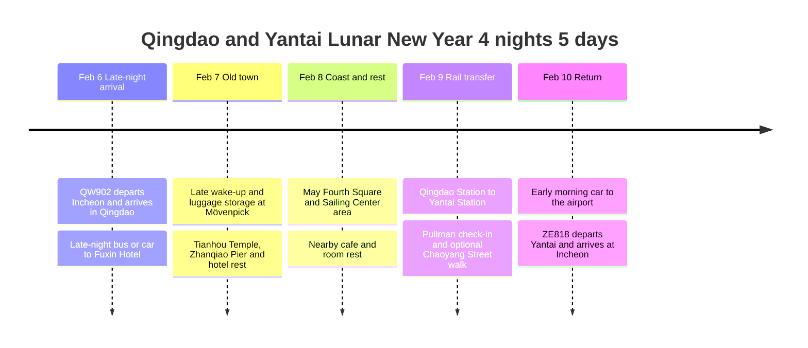

**On the first day, take a single late-night bus from the airport to Fuxin Hotel and sleep there; for the next 2 nights, the top candidate is the downtown Accor-affiliated Mövenpick May Fourth Square. On the last day, take the train to Yantai and stay one night at Pullman.** 2/7 covers Tianhou Temple and the old town, and 2/8 combines May Fourth Square, a coastal walk and hotel rest.

In 2027, **February 6 is Lunar New Year's Day**, so 2/7 to 2/9 in China are the 2nd to 4th days of the new year. The night of arrival is the night of the new year's first day, and New Year's Eve has already passed. [Hong Kong Observatory 2027 Gregorian-Lunar calendar table](https://www.hko.gov.hk/en/gts/time/calendar/pdf/files/2027e.pdf).

**Route, hotel and rail booking rules reviewed on 2026-10-03.** The flights are ticketed, Pullman is a stay planned by the traveler, and Fuxin Hotel and the downtown Mövenpick are recommended candidates. Whether hotels are booked and their rates are not confirmed. Times other than the flights below are target schedules that include travel buffers, and **2027 Lunar New Year events, special transport and train tickets are not confirmed.**

## Qingdao Hotel Recommendations

**Fuxin Hotel (府新大厦) is the best fit for the first night.** The late-night bus from the airport to 府新大厦 goes to the terminus in one ride, so no transfer is needed. The bus may stop at intermediate stops. The next day, move luggage to the downtown Mövenpick with a single taxi or ride-hail, planning a 15 to 20 minute buffer including getting in and out and waiting. Check the actual travel time in a map app that day. [2026 late-night bus operation check](https://www.ctnews.com.cn/paper/att/202603/26/d1bd8240-ffde-4b50-a564-e55cf9f6c41f.pdf), [Fuxin Hotel address](https://m.ctrip.com/html5/hotel/hoteldetail/455485.html).

The top candidate for the next 2 nights is **Mövenpick by Accor Qingdao May Fourth Square · 青岛香港中路万象城雅高瑞享酒店**. Search for it by **福州南路22号, hotel code C7G9**, and distinguish it from the west-coast Sunmei branch C0M1. The hotel was reselected based on using Accor Platinum benefits. The official facility guide lists a restaurant and fitness center, and a pool and Executive Lounge are not confirmed. Despite the May Fourth Square name, it is not right in front of the square's station; per Ctrip, it is **about 990 m and a 15-minute walk to 浮山所 station**. Plan on a car for trips with luggage. [Official downtown Mövenpick guide](https://all.accor.com/hotel/C7G9/index.en.shtml), [Hotel and station location guide](https://m.ctrip.com/html5/hotel/hoteldetail/6838355.html).

### Booking Basis for Applying Accor Platinum Benefits

Based on the official ALL terms and the exclusion list, this Mövenpick was judged to be a candidate participating hotel. However, **no individual confirmation was received from the hotel about applying or operating the 2027 free breakfast at this branch.** The hotel phone is **+86 532 8389 1188**. Before booking, give the stay dates and member tier to confirm the benefit. [Official ALL terms](https://all.accor.com/a/en/loyalty-program/legal/terms-and-conditions.html), [List of excluded hotels](https://all.accor.com/a/en/loyalty-program/hotels-exception.html).

| Item | Basis applied to this itinerary |
|---|---|
| Booking channel | Choose a rate that earns points and stay credit through the ALL app, official website or direct hotel booking. Do not assume tier benefits on ordinary OTA rates |
| Free breakfast | Applies to Platinum and above at participating hotels in Asia-Pacific. After confirming C7G9 participates, apply it to breakfast on 2/8 and 2/9. Breakfast on the 2/7 check-in morning is separate |
| Room upgrade, early check-in, late checkout | Provided depending on room availability. On the morning of 2/7, plan to store luggage and go sightseeing |
| Lounge, happy hour | Not confirmed in the hotel's official facilities or the ALL lounge list, so not counted as an expected benefit |

Benefits depend on a valid member tier and eligible stay conditions at check-in. After confirming breakfast, compare the total of the room-only rate and the rate with breakfast. Room rates and availability for 2027/2/7 to 2/9 are not yet confirmed. [Platinum benefits guide](https://all.accor.com/loyalty-program/cards-status-benefits-details/index.en.shtml), [Lounge list](https://all.accor.com/loyalty-program/user/hotels-lounge/index.en.shtml).

## Accommodation Plan

| Stay dates to book | Hotel | Nights | Why chosen |
|---|---|---|---|
| **Check in 2/6, check out 2/7** | **Fuxin Hotel · 青岛府新大厦** | 1 night | Candidate for the first day, resting right at the terminus of the late-night bus toward 府新大厦 |
| **Check in 2/7, check out 2/9** | **Mövenpick by Accor Qingdao May Fourth Square · 青岛香港中路万象城雅高瑞享酒店** | 2 nights | Top downtown Accor candidate. Book after confirming Platinum benefit details |
| **Check in 2/9, check out 2/10** | **Pullman Yantai Center · 烟台中泽华羿铂尔曼酒店** | 1 night | After a walk in downtown Yantai, head to the airport the next morning |

Make an advance request to the first hotel: **"Booking the 2/6 night, actual arrival in the early hours of 2/7 around 02:00 to 03:00, please hold the room."** If you book from 2/7, it may be treated as a check-in that afternoon. The current booking page for Fuxin Hotel lists a 24-hour front desk and luggage storage, but confirm at booking that late-night arrival is accepted and that luggage can be stored after checkout. The address is **市南区闽江路5甲号**. [Fuxin Hotel facilities and policy](https://hotels.ctrip.com/hotels/455485.html).

The downtown Mövenpick is at **市南区福州南路22号**, and Pullman is at **芝罘区胜利路139号**. The downtown Mövenpick's official check-in is **from 14:00**, and checkout is by 12:00. On the morning of 2/7, first ask for luggage storage and check in after sightseeing. [Official downtown Mövenpick guide](https://all.accor.com/hotel/C7G9/index.en.shtml), [Official Pullman guide](https://all.accor.com/hotel/C037/index.en.shtml).

## Itinerary Summary

| Date | Route and key activities | Hotel |
|---|---|---|
| 2/6 Sat · New Year's Day | Aim to arrive at Incheon T1 at 20:20 → depart 23:20 → arrive in Qingdao 23:50, late-night bus after immigration | Fuxin Hotel, 1 night, actual check-in in the early hours of 2/7 |
| 2/7 Sun · 2nd day | Late morning → store luggage at downtown Mövenpick → Lunar New Year folk visit at Tianhou Temple → Zhanqiao Pier and old town → check in | Downtown Mövenpick, night 1 |
| 2/8 Mon · 3rd day | Late breakfast → May Fourth Square and Olympic Sailing Center area → indoor shopping and hotel rest | Downtown Mövenpick, night 2 |
| 2/9 Tue · 4th day | Breakfast → Qingdao Station → Yantai Station → Pullman → Chaoyang Street walk and early dinner | Pullman, 1 night |
| 2/10 Wed · 5th day | Leave hotel 05:30 → aim to reach airport T2 at 06:30 to 06:45 → depart 09:00 → arrive Incheon 11:25 | Return home |

## Itinerary Timeline

## Costs Confirmed So Far

| Item | Amount | Status |
|---|---|---|
| QW902 outbound + ZE818 return | **KRW 218,750** | Paid |
| 4 hotel nights | TBD | Hotel rates and bookings not confirmed |
| Local transport, meals, experiences | TBD | Public fares below are reference values and not added to actual spending |

**The confirmed payment so far is KRW 218,750**, and the overall trip budget will be set by adding accommodation and local costs.

## Ticketed Flights

All departure and arrival times are in **each airport's local time**, and the details below are based on the booking sheet.

**Total airfare paid: KRW 218,750.** Recorded as the combined amount for the QW902 outbound and ZE818 return flights.

| Leg | Date | Flight | Departure | Arrival | Seat, aircraft, in-flight meal |
|---|---|---|---|---|---|
| Outbound | 2027-02-06 | Qingdao Airlines **QW902** | **23:20** Incheon International Airport **ICN T1** | **23:50** Qingdao Jiaodong International Airport **TAO** | Economy · Airbus A320 · no in-flight meal |
| Return | 2027-02-10 | Eastar Jet **ZE818** | **09:00** Yantai Penglai International Airport **YNT T2** | **11:25** Incheon International Airport **ICN T1** | Economy · Boeing 737-800 · no in-flight meal |

## 2/6 Sat · Late-Night Arrival and the Airport Bus

| Local time | What to do |
|---|---|
| **Aim for 20:20 · Korea time** | Arrive at Incheon Airport T1, check in and drop baggage |
| 20:20 to 22:20 · Korea time | After airline processing and security, have dinner and go to the gate. The flight has no in-flight meal, so eat before departure |
| **23:20 · Korea time** | QW902 departs Incheon |
| 23:50 | Arrive at Qingdao Jiaodong Airport |
| **2/7 00:00 to 01:15** | Immigration, baggage claim and the move to the GTC, adjusted for processing delays |
| Around 00:45 to 01:30 | Aim to confirm and board the **late-night bus toward 府新大厦** at the **GTC ground-floor coach terminal (汽车客运站)** |
| Around 02:00 to 03:30 | Aim to arrive at Fuxin Hotel, check in and sleep. Estimated range allowing generously 90 to 120 minutes for waiting and road travel |

**According to a March 26, 2026 interview with an airport transport company official, the late-night bus from the airport to 府新大厦 runs from 23:00 until flight operations end.** The boarding times in the table above are targets that account for immigration, not fixed departure times. A guide citing 2025 airport materials lists **30 yuan, boarding on GTC ground floor**. Check the 2027 last bus, boarding area and fare before departure. [2026 airport official interview](https://www.ctnews.com.cn/paper/att/202603/26/d1bd8240-ffde-4b50-a564-e55cf9f6c41f.pdf), [2025 boarding and fare guide](https://www.sohu.com/a/921505340_121117467).

**Do not plan on the airport rail as a connection tonight.** In the 2026 holiday subway notice I checked, the direct airport to Qingdao North train was basically 22:25 and 22:45 with extra runs at 23:15 and 23:45. After landing at 23:50 and clearing immigration, you would be later than that. This is a past holiday example, and the 2027 timetable needs separate confirmation. [2026 subway holiday notice](https://epaper.qingdaonews.com/qdzb/resfile/2026-04-28/A05/qdzb-20260428-A05.pdf).

Before departure, check the last bus available after QW902's international arrival and the drop-off point through the airport bus's official WeChat **青岛机场巴士出行** or **+86 18853217000**. Service timed to the end of flight operations does not mean it waits until every international passenger finishes processing. [Airport bus inquiry and contact guide](https://epaper.guanhai.com.cn/conpaper/qdwb/resfile/2024-09-03/A05/qdwb-20240903-A05.pdf).

If you miss the bus, take an official airport taxi or ride-hail to **the same Fuxin Hotel**. Save the address so you don't need to change the first-night hotel, and tell the hotel about the arrival delay.

## 2/7 Sun · Leave Luggage at the Downtown Hotel and Head to Tianhou Temple

| Target time | Activity | Transport and notes |
|---|---|---|
| 10:30 to 11:30 | Wake up late, light meal, check out, go by car to the downtown Mövenpick and ask for luggage storage | Plan a 15 to 20 minute travel buffer. Request early check-in depending on room availability. If luggage storage is also difficult, leave it at Fuxin Hotel and collect it in the afternoon |
| 11:30 to 12:15 | Move to Tianhou Temple | Taxi or ride-hail, with a buffer for holiday waits |
| **12:15 to 13:15** | **Lunar New Year folk visit at Tianhou Temple** | After confirming 2027 operation, one exhibition or temple fair activity |
| 13:15 to 14:15 | Warm lunch in the old town | Open restaurants such as dumplings or noodles; do not assume a specific restaurant is open for the holiday |
| 14:15 to 15:00 | Sea walk around Zhanqiao Pier (栈桥) | If the wind is strong, switch to an indoor cafe on Zhongshan Road |
| 15:00 to 16:00 | Return to downtown Mövenpick and check in | If you left luggage at Fuxin Hotel, collect it first |
| 16:00 to 18:00 | Rest in the room | Recover from the previous night's late-night travel |
| 18:00 to 19:30 | Dinner at the hotel or nearby | Then rest lightly and sleep |

### One Meaningful Lunar New Year Activity: Tianhou Temple's New Year Folk Temple Fair

**The recommended extra activity is the new year folk experience at Tianhou Temple (天后宫).** It was a place where people prayed for the safety of those traveling the sea, so it fits this coastal-city trip that enters through Qingdao and exits through Yantai. Tianhou Temple doubles as a folk museum, and its address is **太平路19号**. [Tianhou Temple and folk museum guide](https://maps.apple.com/place?_provider=57879&place-id=H2710I3F8320675FDC2).

In 2026, a new-year folk culture temple fair opened on the first day of the first lunar month, with programs such as a craft market, lantern riddles and new-year rubbings. **Whether an event is held on 2/7 in 2027 and what the program is are unconfirmed**, so do not reserve the same program as a fixed plan. [2026 temple fair on-site report](https://www.dailyqd.com/guanhai/436668_1.html).

- **If the event is held:** Pick one of the on-site rubbings, crafts or lantern riddles and join for about 30 minutes, then pick up a new-year souvenir and write down a travel wish.
- **If there is no event but the temple is open:** Use about an hour to see the folk exhibition and learn about Qingdao's sea culture and new-year customs.
- **If it is closed:** Switch to a walk along Zhanqiao Pier and Zhongshan Road and a warm dumpling lunch, and leave one thing you want to achieve this year in your travel notes.

The arrival day is the night of the first day, so a New Year's Eve bell ringing cannot be added, and on the return day 2/10, the fifth day, a morning event is hard to fit because of the 09:00 flight. So **the 2/7 daytime experience** is the center of the Lunar New Year plan.

## 2/8 Mon · A Relaxed Day at May Fourth Square and Downtown

| Target time | Activity |
|---|---|
| 09:00 to 10:00 | Breakfast at downtown Mövenpick. Confirm the free benefit and that day's hours at booking |
| 10:00 to 11:00 | Get ready and go by car to May Fourth Square |
| 11:00 to 12:00 | Walk along May Fourth Square and Fushan Bay (浮山湾) coast |
| 12:00 to 13:30 | Move to the Olympic Sailing Center area, lunch |
| 13:30 to 15:00 | Rest indoors at a cafe near the Sailing Center, short shopping nearby |
| 15:00 to 18:00 | Return to the hotel and rest in the room or use open indoor facilities |
| 18:00 to 19:30 | Dinner at the hotel or downtown |
| Around 20:00 | Check next day's train ticket, station name and car departure time |

After moving east from May Fourth Square to the Sailing Center, rest nearby and return to the hotel. The round trip back to MixC Mall is left out of the base plan. On days when shopping appeals more or the wind is strong, choose **one stop at MixC Mall instead of the Sailing Center**. If it is very cold or windy, shorten the walk and switch to a cafe or room rest. Hotel pool and lounge use are not in the plan. Night light shows and Lunar New Year performance times are not fixed until they are announced separately. [Downtown Mövenpick facilities guide](https://all.accor.com/hotel/C7G9/index.en.shtml).

## 2/9 Tue · From Qingdao Station to Yantai

**The recommended search leg is `青岛 → 烟台`.** The preferred setup is to go by car from downtown Mövenpick to **Qingdao Station (青岛站)**, depart there, and get off at the downtown **Yantai Station (烟台站)** near Pullman. Per Ctrip route guidance, hotel to Qingdao Station is about 32 minutes by car, and during Lunar New Year plan 50 minutes including waiting. `青岛`, `青岛北` and `青岛西` are different stations. [Hotel to Qingdao Station location guide](https://jp.trip.com/hotels/qingdao-hotel-detail-6838355/mvenpick-by-accor-qingdao-may-fourth-square/).

### Reference Trains Currently Listed

Below is **a comparison timetable based on 2026 search data**. It does not mean operation, availability or remaining seats for February 9, 2027 are confirmed.

| Priority | Leg | Current reference train | Departure → Arrival | Reference duration · 2nd class |
|---|---|---|---|---|
| 1 | **青岛 → 烟台** | **C6574** | **13:20 → 14:54** | 1 h 34 min · about 80 to 81 yuan |
| 2 · Earlier arrival | **青岛 → 烟台** | **C6568** | **10:29 → 12:03** | 1 h 34 min · about 80 yuan |
| Alternative | 青岛北 → 烟台 | C6579 | 12:05 → 13:29 | 1 h 24 min · about 74 yuan, travel time to the north station calculated separately |

Sources: [Ctrip latest Qingdao to Yantai search](https://trains.ctrip.com/TrainBooking/qingdao-yantai/gaotie), [C6574 timetable](https://www.crecc.com/huoche/c6574.html), [Ctrip C6568 stops and times](https://trains.ctrip.com/TrainSchedule/C6568), [Ctrip Qingdao North area train search](https://trains.ctrip.com/trainbooking/qingdaobei-yantainan/gaotie/). A September 2026 Ctrip search also confirmed C6574 at 13:20 → 14:54 with a 2nd-class fare of 80 yuan. The search pages also mix in nearby stations, so **check the departure and arrival stations separately** on the ticketing screen. C6574 is currently listed as a direct train whose number changes to C6571 mid-route, not a transfer.

12306's current booking window is **15 days including the travel date**. If this rule holds, **tickets for 2/9 go on sale from 2027/1/26**. Sale start times differ by station, so check **青岛** under `起售时间`. [12306 booking window guide](https://mobile.12306.cn/mormhweb/zxdt/202205/t20220531_37508.html), [12306 current booking window lookup](https://hzfw.12306.cn/zgzfw/resources/h5/ysqcx-h5.html), [Sale start time lookup by station](https://kyfw.12306.cn/index/view/infos/sale_time.html).

### If You Get a 13:00-Hour Train Similar to C6574

| Target time | Activity |
|---|---|
| 08:30 to 10:00 | Breakfast at downtown Mövenpick, pack |
| 11:15 to 11:40 | Check out, prepare a light lunch |
| 11:40 to 12:30 | Taxi or ride-hail from downtown Mövenpick to Qingdao Station |
| 12:30 to 13:10 | Check passport, security, go to the platform. Aim to reach the station about 50 minutes before departure |
| 13:00 hour to around 15:00 | Direct train to Yantai, adjust the actual times after ticketing |
| 15:10 to 15:40 | Get off at Yantai Station → go by car to Pullman and check in |
| 15:40 to 16:15 | Rest in the room |
| 16:15 to 17:30 | Walk and cafe on Chaoyang Street (朝阳街), and if there is time, to the entrance of Yantai Mountain |
| 17:30 to 18:30 | Early dinner |
| 19:00 to 20:00 | Return to the hotel, reconfirm next day's airport car, pack |

Per its official guide, Pullman is **about 10 minutes by car from Yantai Station** and about 50 minutes from the airport. Allow 20 to 30 minutes including waiting for a taxi after getting off at the station. Chaoyang Street is included as a historic-street walk on the coastal side, and outdoor performances or light shows are not assumed. [Pullman transport guide](https://all.accor.com/hotel/C037/index.en.shtml), [Yantai city introduction to Chaoyang Street](https://www.yantai.gov.cn/art/2024/4/2/art_55792_3178885.html).

**If there is no direct train or it is sold out,** compare `青岛北 → 烟台` first. If you switch to the north station, also change the car destination to **青岛北站** and set aside 60 to 75 minutes for hotel to station travel plus separate waiting time in the station. For trains arriving at `烟台南`, recalculate with a 40 to 60 minute buffer to Pullman. If you choose the 10:29 train, leave the hotel around 08:45 and move up the schedule so lunch is in Yantai. Fix the final times with the ticketed train and that day's map route.

## 2/10 Wed · Early Trip to Yantai Airport T2

| Target time | Activity |
|---|---|
| 04:45 to 05:15 | Wake up, get ready to check out, prepare a light breakfast the day before if needed |
| **05:30** | Pre-booked car leaves Pullman |
| **06:30 to 06:45** | Aim to arrive at Yantai Penglai Airport **T2** |
| 06:45 to 08:15 | Airline counter, baggage, emigration, security, proceeding according to actual counter operation |
| After 08:15 | Check airline announcements at the gate |
| **09:00 → 11:25** | ZE818 Yantai → Incheon T1 |

The official guide says the airport is about 50 minutes by car, and this plan leaves at 05:30 with a **60 to 75 minute travel buffer**. If there is a snow or ice forecast or traffic delay, consult the hotel and move up to 05:00 to 05:15. **Request the car for a 05:30 departure at check-in on 2/9 and confirm the dispatch in the evening.** The time is a recommended booking suggestion and does not mean the car has been booked on your behalf.

The Yantai Airport official site says bus timetables are updated by flight and directs people to check the **烟台交运机场巴士** WeChat. With only the official materials available now, it is hard to confirm an early bus connection on 2/10, so the base plan for the return day is a direct hotel-to-airport car. A route using the airport rail is also not included in this morning schedule. [Yantai Airport official bus guide](https://www.ytairport.com.cn/index/Page/index.html?cate=9).

## Airport, Rail and City Transport Summary

| Leg | Transport to use | Planning basis |
|---|---|---|
| Qingdao Airport → first hotel | Late-night airport bus toward 府新大厦 | GTC ground floor; 30 yuan is a past published fare. Recheck late-night stops, the last bus and that day's fare |
| Fuxin Hotel → downtown Mövenpick | One taxi or ride-hail | Specify 福州南路22号 · C7G9, plan a 15 to 20 minute buffer including getting in and out |
| Downtown Mövenpick ↔ Tianhou Temple and old town | Taxi or ride-hail | 30 to 45 minute buffer one way; adjust the route in a map app when congested |
| Downtown Mövenpick → Qingdao Station | Taxi or ride-hail | Leave 11:40, aim to arrive 12:30. Reach the station 45 to 60 minutes before the confirmed train |
| Qingdao Station → Yantai Station | Direct C train preferred | Prefer a 13:00-hour departure; confirm booking on 2027/1/26 |
| Yantai Station → Pullman | Taxi or ride-hail | 20 to 30 minutes including waiting |
| Pullman → Yantai Airport T2 | Pre-booked car | Leave 05:30, aim to arrive 06:30 to 06:45 |

To use the subway from downtown Mövenpick, compare the route of **about a 15-minute walk to 浮山所 station → Line 2 to 五四广场 station → transfer to Line 3 toward 青岛站**. For Tianhou Temple, get off at 人民会堂 station and walk; Qingdao Station is the terminus. Considering the walk to the station and the transfer, a car is the default for trips with luggage. Check the route and exits in the **青岛地铁** app on the day of travel. [Nearest station to the hotel](https://m.ctrip.com/html5/hotel/hoteldetail/6838355.html), [May Fourth Square station Line 2 and 3 guide](https://www.shangri-la.com/qingdao/shangrila/about/map-directions/).

## Range for Adjusting Time

**What can be adjusted is the amount of sightseeing; the hotel nights and ticketed flights stay.** The times below are planning buffers for on-site judgment.

| Situation | Schedule to adjust | Buffer to keep |
|---|---|---|
| Arrival at the hotel in the early hours of 2/7 is later than 03:30 | Don't rush to start morning sightseeing. After hotel checkout and luggage storage, start from lunch, and choose only one of Tianhou Temple and Zhanqiao Pier with better operation and weather | Rest at least 2 hours after the room is ready. Check Fuxin Hotel's checkout time separately |
| Waiting to enter Tianhou Temple on 2/7 is 30 minutes or more | See only one of the folk experience or exhibition, and skip Zhanqiao Pier | Aim to return to the hotel around 16:00 |
| Sea wind and cold are severe on 2/8 | Simplify to 20 to 30 minutes of photos at May Fourth Square → lunch and cafe at MixC Mall. Skip the Sailing Center | Keep 2 to 3 hours of afternoon hotel rest |
| Direct train is sold out on 2/9 | Compare the same day's morning direct train or trains from Qingdao North first. If the station changes, also move up the hotel departure | Reach the station 45 to 60 minutes before the confirmed train. Chaoyang Street sightseeing can be reduced |
| Arrival at Pullman is after 17:00 on 2/9 | Skip Chaoyang Street, dinner near the hotel and room rest | Prioritize confirming next day's car and packing around 20:00 |
| Snow, ice or car delay expected on 2/10 | Move hotel departure up to 05:00 to 05:15 | Keep aiming to reach the airport at 06:30 to 06:45 |

For Lunar New Year meals, the default is **warm dumplings or noodles along the day's route, or the hotel restaurant**. Rather than seeking out famous restaurants and traveling back and forth to another district, eat in the old town on the day you see Tianhou Temple and Zhanqiao Pier, and around May Fourth Square and the Sailing Center on the day you see the coast. If the wait at a restaurant exceeds 30 minutes, switch to a nearby open one, and check holiday closures and surcharges before ordering.

## Order of Booking and Event Checks

1. **First hotel:** Check Fuxin Hotel's 2/6 to 2/7 room, early-morning check-in and late-night bus terminus operation together.
2. **Accor hotels:** Confirm with the hotel that Platinum breakfast applies for downtown Mövenpick C7G9 on 2/7 to 2/9, and compare ALL-eligible rates, cancellation terms and totals together with Pullman on 2/9 to 2/10. Record accommodation costs after receiving the actual booking amounts.
3. **Lunar New Year experience:** Once the 2027 Tianhou Temple operation and temple fair notice is out, confirm the 2/7 daytime experience and the entry and booking conditions.
4. **1/26:** On 12306, check that sales have opened and seats for the 2/9 `青岛 → 烟台` direct train. Register passport information in advance.
5. **Just before departure:** Check the late-night bus after QW902 arrival, Lunar New Year business hours and weather, and adjust the first-day travel and outdoor walks.
6. **2/9:** Confirm the next day's airport car at Pullman.

The map shows the locations of the main places and the visiting order, and does not show actual bus or train routes or every route back to the hotel. Airport coordinates refer to OurAirports' [Qingdao Jiaodong](https://ourairports.com/airports/ZSQD/) and [Yantai Penglai](https://ourairports.com/airports/ZSYT/), stations to [Qingdao Station](https://mapcarta.com/16209672) and [Yantai Station](https://mapcarta.com/W326649325), and the square to [May Fourth Square location data](https://commons.wikimedia.org/wiki/Category:May_Fourth_Square). Stations and the square are approximate locations, so specify the entrance in a map app for the actual drop-off.
