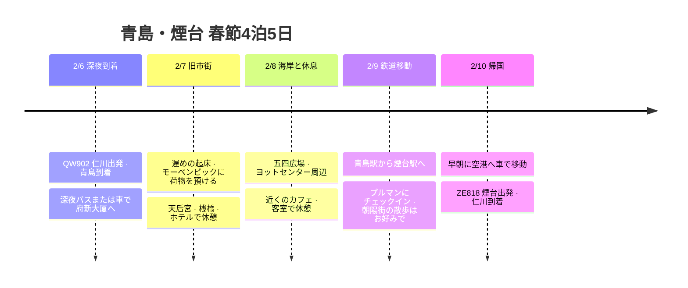

**初日は空港から深夜バス1本で府新大厦まで移動して眠り、次の2泊はアコー系列の市街地のモーベンピック五四広場店を優先候補にします。最終日は鉄道で煙台に移り、プルマンで1泊。**2/7は天后宮と旧市街、2/8は五四広場・海岸の散歩とホテルでの休憩をまとめます。

2027年は**2月6日が旧暦の元日**なので、現地で過ごす2/7〜2/9は旧正月の2日目〜4日目です。到着する夜は元日の夜で、除夜はすでに過ぎています。[香港天文台 2027年 太陽暦・太陰暦対照表](https://www.hko.gov.hk/en/gts/time/calendar/pdf/files/2027e.pdf)。

**ルート・ホテル・鉄道の予約規定の確認：2026-10-03。**航空便は発券済み、プルマンは利用者指定の宿泊計画、府新大厦と市街地のモーベンピックはおすすめ候補です。ホテルの予約が完了しているかどうかと料金は未確認です。以下の航空便以外の時刻は移動の余裕を含めた目標日程で、**2027年の春節の行事・特別な交通・列車の切符が確定しているわけではありません。**

## 青島のホテルのおすすめ

**最初の宿は府新大厦（Fuxin Hotel · 府新大厦）がいちばん合います。**空港 → 府新大厦の深夜バスに1回乗って終点まで行くので、途中で車を乗り換える必要がありません。バスは途中の停留所に停まることがあります。翌日は市街地のモーベンピックまでタクシー・配車1回で荷物を移動し、乗り降りと待ち時間を含めて15〜20分の計画上の余裕を見ます。当日の所要時間は地図アプリで確認します。[2026年の深夜バス運行の確認](https://www.ctnews.com.cn/paper/att/202603/26/d1bd8240-ffde-4b50-a564-e55cf9f6c41f.pdf)、[府新大厦の住所](https://m.ctrip.com/html5/hotel/hoteldetail/455485.html)。

次の2泊の優先候補は**Mövenpick by Accor Qingdao May Fourth Square · 青岛香港中路万象城雅高瑞享酒店**です。**福州南路22号、ホテルコードC7G9**で検索し、西海岸のSunmei店C0M1と区別します。アコーのプラチナの活用を基準に宿を選び直しました。公式の施設案内にはレストラン・フィットネスがあり、プールとエグゼクティブラウンジは確認できません。五四広場という名前ですが、広場駅のすぐ前ではなく、Ctripの案内では**浮山所駅まで徒歩約990m・15分**です。荷物がある移動は車を基本にします。[市街地のモーベンピックの公式案内](https://all.accor.com/hotel/C7G9/index.en.shtml)、[ホテル・駅の位置案内](https://m.ctrip.com/html5/hotel/hoteldetail/6838355.html)。

### アコーのプラチナ特典を適用する予約の基準

ALLの公式規約と除外リストに基づき、このモーベンピックを参加ホテルの候補と判断しました。ただし、**この店舗の2027年の無料朝食の適用・運営方法についてホテルから個別の確答は得ていません。**ホテルの電話は**+86 532 8389 1188**です。予約前に宿泊日・会員ランクを伝えて特典を確認します。[ALL公式規約](https://all.accor.com/a/en/loyalty-program/legal/terms-and-conditions.html)、[参加除外ホテルリスト](https://all.accor.com/a/en/loyalty-program/hotels-exception.html)。

| 項目 | 今回の日程での適用基準 |
|---|---|
| 予約経路 | ALLアプリ・公式サイト・ホテル直接予約で、ポイント・宿泊実績の付与が可能な料金を選択。一般的なOTA料金でのランク特典は前提にしない |
| 無料朝食 | アジア・太平洋の特典参加ホテルで、プラチナ以上に適用。C7G9での適用を確認したうえで2/8・2/9の朝食に反映。チェックインする2/7の朝食は別 |
| 客室アップグレード・アーリーチェックイン・レイトチェックアウト | 客室の状況に応じて提供。2/7午前は荷物を預けて観光する動線で計画 |
| ラウンジ・ハッピーアワー | 該当ホテルの公式施設およびALLラウンジのリストで確認できないため、予定する特典に含めない |

特典は、チェックイン時点で有効な会員ランクと対象の宿泊条件によります。朝食の適用を確認したあと、客室のみの料金と朝食付きの料金の総額を比較します。2027/2/7〜9の客室料金と予約の可否はまだ未確認です。[プラチナ特典の案内](https://all.accor.com/loyalty-program/cards-status-benefits-details/index.en.shtml)、[ラウンジリスト](https://all.accor.com/loyalty-program/user/hotels-lounge/index.en.shtml)。

## 宿泊の構成

| 予約する宿泊日 | 宿 | 泊数 | 選ぶ理由 |
|---|---|---|---|
| **2/6チェックイン〜2/7チェックアウト** | **府新大厦 · Fuxin Hotel · 青岛府新大厦** | 1泊 | 府新大厦方面の深夜バスの終点ですぐ休める初日の候補 |
| **2/7チェックイン〜2/9チェックアウト** | **Mövenpick by Accor Qingdao May Fourth Square · 青岛香港中路万象城雅高瑞享酒店** | 2泊 | アコーの市街地の宿の優先候補。プラチナの詳細な特典を確認してから予約 |
| **2/9チェックイン〜2/10チェックアウト** | **Pullman Yantai Center · 烟台中泽华羿铂尔曼酒店** | 1泊 | 煙台の市街地を散歩したあと、翌朝に空港へ移動 |

最初の宿には**「2/6の宿泊を予約、実際の到着は2/7未明の2〜3時台、客室を確保しておいてほしい」**と事前に依頼します。2/7から予約すると、その日の午後チェックインとして扱われることがあります。府新大厦は現在の予約ページに24時間フロントと荷物預かりが案内されていますが、深夜到着の受け入れとチェックアウト後の荷物預かりは予約時に確認します。住所は**市南区闽江路5甲号**です。[府新大厦の宿・ポリシー](https://hotels.ctrip.com/hotels/455485.html)。

市街地のモーベンピックは**市南区福州南路22号**、プルマンは**芝罘区胜利路139号**を基準にしました。市街地のモーベンピックの公式チェックインは**14:00から**、チェックアウトは12:00までです。2/7午前はまず荷物預かりを依頼し、観光のあとにチェックインします。[市街地のモーベンピックの公式案内](https://all.accor.com/hotel/C7G9/index.en.shtml)、[プルマンの公式案内](https://all.accor.com/hotel/C037/index.en.shtml)。

## 旅程の概要

| 日付 | ルートと主な日程 | 宿 |
|---|---|---|
| 2/6 (土) · 旧暦元日 | 20:20仁川T1到着が目標 → 23:20出発 → 青島23:50到着、入国後に深夜バス | 府新大厦1泊、実際のチェックインは2/7未明 |
| 2/7 (日) · 2日目 | 遅めの朝 → 市街地のモーベンピックに荷物を預ける → 天后宮で春節の民俗訪問 → 桟橋・旧市街 → チェックイン | 市街地のモーベンピック1泊目 |
| 2/8 (月) · 3日目 | 遅めの朝食 → 五四広場・オリンピックヨットセンター周辺 → 屋内のショッピング・ホテルで休憩 | 市街地のモーベンピック2泊目 |
| 2/9 (火) · 4日目 | 朝食 → 青島駅 → 煙台駅 → プルマン → 朝陽街の散歩・早めの夕食 | プルマン1泊 |
| 2/10 (水) · 5日目 | 05:30ホテル出発 → 06:30〜06:45空港T2が目標 → 09:00出発 → 仁川11:25 | 帰国 |

## 旅程タイムライン

## 現時点で確定している費用

| 項目 | 金額 | 状況 |
|---|---|---|
| QW902出国便 + ZE818帰国便 | **218,750ウォン** | 支払い済み |
| 宿泊4泊 | 未定 | ホテル料金・予約は未確認 |
| 現地の交通・食事・体験 | 未定 | 下記の公開運賃は参考値で、実際の支出には合算しない |

**現時点で確認できた支払額は218,750ウォン**で、旅行全体の予算は宿泊と現地費用を加えて決めます。

## 発券した航空便

すべての出発・到着時刻は**各空港の現地時間**で、以下の内容は予約表に基づきます。

**航空券の総支払額：218,750ウォン。**QW902出国便とZE818帰国便を合わせた金額として記録しました。

| 区間 | 日付 | 航空便 | 出発 | 到着 | 座席・機材・機内食 |
|---|---|---|---|---|---|
| 出国 | 2027-02-06 | 青島航空 **QW902** | **23:20** 仁川国際空港 **ICN T1** | **23:50** 青島膠東国際空港 **TAO** | エコノミー · エアバスA320 · 機内食なし |
| 帰国 | 2027-02-10 | イースター航空 **ZE818** | **09:00** 煙台蓬莱国際空港 **YNT T2** | **11:25** 仁川国際空港 **ICN T1** | エコノミー · ボーイング737-800 · 機内食なし |

## 2/6 (土) · 深夜到着と空港バス

| 現地時刻 | やること |
|---|---|
| **20:20目標 · 韓国時間** | 仁川空港T1到着、チェックイン・手荷物手続き |
| 20:20〜22:20 · 韓国時間 | 航空会社の手続きと保安検査のあと、夕食・搭乗口へ移動。機内食なしの便なので出発前に食事 |
| **23:20 · 韓国時間** | QW902 仁川出発 |
| 23:50 | 青島膠東空港到着 |
| **2/7 00:00〜01:15** | 入国審査・手荷物受取・GTCへ移動、手続きの遅れに応じて調整 |
| 00:45〜01:30前後 | **GTC 1階の長距離バスターミナル（汽车客运站）**で**府新大厦方面の深夜バス**の発車を確認・乗車が目標 |
| 02:00〜03:30前後 | 府新大厦に到着・チェックイン・就寝が目標。待ち時間と道路移動の90〜120分を余裕をもって見込んだ予想範囲 |

**2026年3月26日の空港運輸会社の関係者へのインタビューによると、空港 → 府新大厦の深夜バスは23:00から航空便の運航終了まで運行します。**上の表の乗車時刻は入国手続きを考慮した目標で、固定の発車時刻ではありません。2025年の空港資料を引用した案内には**30元・GTC 1階で乗車**とあります。2027年の最終便・乗り場・運賃は出発前に確認します。[2026年の空港関係者へのインタビュー](https://www.ctnews.com.cn/paper/att/202603/26/d1bd8240-ffde-4b50-a564-e55cf9f6c41f.pdf)、[2025年の乗車・運賃案内](https://www.sohu.com/a/921505340_121117467)。

**空港鉄道はこの夜の接続便としては考えません。**確認した2026年の連休の地下鉄案内でも、空港→青島北駅の直通列車は基本の22:25・22:45に延長便の23:15・23:45を加えた形でした。23:50に着陸して入国を終えると、これより遅くなります。これは過去の連休の運行例で、2027年の運行表は別途確認が必要です。[2026年の地下鉄連休案内](https://epaper.qingdaonews.com/qdzb/resfile/2026-04-28/A05/qdzb-20260428-A05.pdf)。

空港バスの公式WeChat**青岛机场巴士出行**または**+86 18853217000**で、出発前にQW902の国際線到着後に利用できる最終バスと降車地点を確認します。航空便の運航終了に合わせた運行が、すべての国際線の乗客の手続き完了まで待つという意味ではありません。[空港バスの照会・連絡案内](https://epaper.guanhai.com.cn/conpaper/qdwb/resfile/2024-09-03/A05/qdwb-20240903-A05.pdf)。

バスに乗り遅れたら、空港公式のタクシー・配車で**同じ府新大厦**まで移動します。初日の宿を変えなくて済むよう住所を保存し、宿に到着の遅れを伝えます。

## 2/7 (日) · 市街地のホテルに荷物を預けて天后宮へ

| 目標時刻 | 日程 | 移動・メモ |
|---|---|---|
| 10:30〜11:30 | 遅めに起床・軽い食事・チェックアウト、市街地のモーベンピックへ車で移動して荷物預かりを依頼 | 移動に15〜20分の計画上の余裕。アーリーチェックインは客室の状況に応じて依頼。荷物預かりも難しければ府新大厦に預けて午後に回収 |
| 11:30〜12:15 | 天后宮へ移動 | タクシー・配車、祝日の待ち時間を含めた余裕 |
| **12:15〜13:15** | **天后宮で春節の民俗訪問** | 2027年の営業を確認したうえで、展示または廟会の体験をひとつ |
| 13:15〜14:15 | 旧市街で温かいランチ | 餃子・麺など営業している店、指定した店の旧正月の営業を前提にしない |
| 14:15〜15:00 | 桟橋（栈桥）周辺の海辺の散歩 | 風が強ければ中山路側の屋内カフェに変更 |
| 15:00〜16:00 | 市街地のモーベンピックに戻る・チェックイン | 府新大厦に荷物を預けた場合は、回収してから移動 |
| 16:00〜18:00 | 客室で休憩 | 前日の深夜移動の疲れをとる |
| 18:00〜19:30 | ホテルまたは近くで夕食 | そのあとは軽く休んで就寝 |

### 春節に意味のあるひとつ：天后宮の新年民俗廟会

**おすすめの追加日程は天后宮（天后宫）の新年の民俗体験です。**海を行き交う人々の安全を祈ってきた場所なので、青島に入って煙台から出るという今回の海岸都市の旅にもよく合います。天后宮は民俗博物館を兼ねていて、住所は**太平路19号**です。[天后宮・民俗博物館の案内](https://maps.apple.com/place?_provider=57879&place-id=H2710I3F8320675FDC2)。

2026年は旧暦の元日に新年民俗文化廟会が開幕し、工芸市場・灯謎（なぞなぞ）・新年の拓本などのプログラムが開かれました。**2027年2/7の行事の開催とプログラムは未確認**なので、同じプログラムを確定した日程として予約しておくことはしません。[2026年の廟会の現地報道](https://www.dailyqd.com/guanhai/436668_1.html)。

- **行事が開かれたら：**現場で行われている拓本・工芸・灯謎のうちひとつを選んで30分ほど参加し、新年の記念品をひとつ選んで、旅の願いごとを記録する。
- **行事はなく、天后宮が開いていたら：**民俗展示を見て、青島の海の文化と新年の風習を知る1時間にあてる。
- **休館なら：**桟橋・中山路の散歩と温かい餃子のランチに変えて、旅行ノートに今年かなえたいことをひとつ残す。

到着日は元日の夜なので除夜の鐘を組み込むことはできず、帰国日の2/10は旧正月の5日目でも、09:00の航空便のため朝の行事を入れるのは難しいです。そのため、**2/7昼の体験**を春節の日程の中心に置きます。

## 2/8 (月) · 五四広場と市街地でゆったり

| 目標時刻 | 日程 |
|---|---|
| 09:00〜10:00 | 市街地のモーベンピックで朝食。無料特典の適用と当日の営業時間を予約時に確認 |
| 10:00〜11:00 | 外出の準備・五四広場へ車で移動 |
| 11:00〜12:00 | 五四広場と浮山湾の海岸を散歩 |
| 12:00〜13:30 | オリンピックヨットセンター周辺へ移動・ランチ |
| 13:30〜15:00 | ヨットセンター近くのカフェで屋内で休憩、ショッピングは周辺で短く |
| 15:00〜18:00 | ホテルに戻る・客室で休憩、または営業している屋内施設を利用 |
| 18:00〜19:30 | ホテルまたは市街地で夕食 |
| 20:00前後 | 翌日の列車の切符・駅名・車の出発時刻を確認 |

五四広場から東のヨットセンターに移動したあと、近くで休んでホテルに戻ります。MIXCモール（万象城）を再び往復する移動は基本案から外しました。ショッピングのほうがよい日や風が強い日には、**ヨットセンターの代わりにMIXCモール1か所**を選びます。寒さや風がひどければ、散歩を減らしてカフェ・客室での休憩に変えます。ホテルのプール・ラウンジの利用は日程に入れません。夜のライトアップショーと春節の公演の時間は、別途発表があるまで固定しません。[市街地のモーベンピックの施設案内](https://all.accor.com/hotel/C7G9/index.en.shtml)。

## 2/9 (火) · 青島駅から煙台へ

**おすすめの検索区間は`青岛 → 烟台`です。**市街地のモーベンピックから車で**青島駅（青岛站）**に行って出発し、プルマンに近い市内の**煙台駅（烟台站）**で降りる構成を優先します。ホテル → 青島駅はCtripのルート案内で車約32分で、春節は待ち時間を含めて50分を見込みます。`青岛`、`青岛北`、`青岛西`はそれぞれ別の駅です。[ホテル → 青島駅の位置案内](https://jp.trip.com/hotels/qingdao-hotel-detail-6838355/mvenpick-by-accor-qingdao-may-fourth-square/)。

### 現在照会できる参考列車

以下は**2026年の照会資料に基づく比較用の時刻表**です。2027年2月9日の運行確定・予約可能・残席を意味するものではありません。

| 優先順位 | 区間 | 現在の参考便 | 出発 → 到着 | 参考所要時間・2等席 |
|---|---|---|---|---|
| 1 | **青岛 → 烟台** | **C6574** | **13:20 → 14:54** | 1時間34分 · 約80〜81元 |
| 2 · 早く到着 | **青岛 → 烟台** | **C6568** | **10:29 → 12:03** | 1時間34分 · 約80元 |
| 代替 | 青岛北 → 烟台 | C6579 | 12:05 → 13:29 | 1時間24分 · 約74元、北駅までの移動時間は別途計算 |

出典：[Ctrip 青島 → 煙台の最新照会](https://trains.ctrip.com/TrainBooking/qingdao-yantai/gaotie)、[C6574の時刻表](https://www.crecc.com/huoche/c6574.html)、[Ctrip C6568の停車駅・時刻](https://trains.ctrip.com/TrainSchedule/C6568)、[Ctrip 青島北駅圏の列車照会](https://trains.ctrip.com/trainbooking/qingdaobei-yantainan/gaotie/)。2026年9月のCtrip照会でも、C6574の13:20 → 14:54、2等席80元が確認できました。照会ページが近くの駅も混ぜて表示するため、発券画面で**出発駅・到着駅をそれぞれ確認**します。現在、C6574は途中の区間でC6571に番号が変わる直通便として案内されていて、乗り換え便ではありません。

12306の現在の予約期間は**乗車日を含めて15日**です。この規定が維持されれば、**2/9乗車分は2027/1/26から**販売の対象に入ります。駅ごとに販売開始時刻が異なるので、`起售时间`で**青岛**を確認します。[12306予約期間の案内](https://mobile.12306.cn/mormhweb/zxdt/202205/t20220531_37508.html)、[12306現在の予約可能期間の照会](https://hzfw.12306.cn/zgzfw/resources/h5/ysqcx-h5.html)、[駅別の発売開始時刻の照会](https://kyfw.12306.cn/index/view/infos/sale_time.html)。

### C6574に似た13時台の列車をとれた場合

| 目標時刻 | 日程 |
|---|---|
| 08:30〜10:00 | 市街地のモーベンピックで朝食・荷物の整理 |
| 11:15〜11:40 | チェックアウト・軽いランチの準備 |
| 11:40〜12:30 | 市街地のモーベンピックからタクシー・配車で青島駅へ移動 |
| 12:30〜13:10 | パスポート確認・保安検査・ホームへ移動。列車の出発約50分前に駅へ到着が目標 |
| 13時台〜15時前後 | 煙台行きの直通列車、実際の時刻は発券後に調整 |
| 15:10〜15:40 | 煙台駅で降車 → 車でプルマンへ移動・チェックイン |
| 15:40〜16:15 | 客室で休憩 |
| 16:15〜17:30 | 朝陽街（朝阳街）で散歩・カフェ、余裕があれば煙台山の入口まで |
| 17:30〜18:30 | 早めの夕食 |
| 19:00〜20:00 | ホテルに戻り、翌日の空港行きの車を再確認・荷物の整理 |

プルマンは公式案内で**煙台駅から車で約10分**、空港から約50分の距離です。駅で降りてからタクシー待ちまで含めて、20〜30分を見込みました。朝陽街は海岸側の駅前通りの散歩として入れていて、屋外の公演・ライトアップショーの開催は前提にしません。[プルマンの交通案内](https://all.accor.com/hotel/C037/index.en.shtml)、[煙台市の朝陽街の紹介](https://www.yantai.gov.cn/art/2024/4/2/art_55792_3178885.html)。

**直通列車がないか満席なら、**`青岛北 → 烟台`を先に比較します。北駅に変えたら、車の行き先も**青島北駅**に変えて、ホテル→駅の移動に60〜75分と駅構内の待ち時間を別に確保します。`烟台南`到着の便は、プルマンまで40〜60分の計画上の余裕で計算し直します。10:29の列車を選ぶと、ホテルを08:45前後に出発し、ランチを煙台でとる日程に前倒しします。最終的な時刻は、発券した列車と当日の地図のルートで確定します。

## 2/10 (水) · 煙台空港T2へ早めに移動

| 目標時刻 | 日程 |
|---|---|
| 04:45〜05:15 | 起床・チェックアウトの準備、必要なら前日に簡単な朝食を用意 |
| **05:30** | プルマンから事前に予約した車が出発 |
| **06:30〜06:45** | 煙台蓬莱空港**T2到着が目標** |
| 06:45〜08:15 | 航空会社のカウンター・手荷物・出国審査・保安検査、実際のカウンターの営業に合わせて進行 |
| 08:15以降 | 搭乗口で航空会社の案内を確認 |
| **09:00 → 11:25** | ZE818 煙台 → 仁川T1 |

空港までは公式案内で車約50分で、この日程は**60〜75分の移動の余裕**を見て05:30に出発します。雪・凍結の予報や交通の遅れがあれば、ホテルと相談して05:00〜05:15に前倒しします。車は**2/9のチェックイン時に05:30出発で依頼し、夜に手配を確認**します。時刻は予約の推奨案で、車の予約を代わりに完了した状態ではありません。

煙台空港の公式サイトは、バスの時刻表が航空便に合わせて更新されるとして、**烟台交运机场巴士**のWeChatで照会するよう案内しています。いま確認できる公式資料だけでは、2/10の早朝のバスの接続便を確定しにくいため、帰国日の基本案はホテル→空港の直行車です。空港鉄道を利用するルートも、この朝の日程には入れていません。[煙台空港の公式バス案内](https://www.ytairport.com.cn/index/Page/index.html?cate=9)。

## 空港・鉄道・市内の交通まとめ

| 区間 | 使う交通 | 計画の基準 |
|---|---|---|
| 青島空港 → 最初の宿 | 府新大厦方面の深夜空港バス | GTC 1階、30元は過去の公開運賃。深夜の停車・最終便・当日の料金を再確認 |
| 府新大厦 → 市街地のモーベンピック | タクシー・配車1回 | 福州南路22号 · C7G9を指定、乗り降り込みで15〜20分の計画上の余裕 |
| 市街地のモーベンピック ↔ 天后宮・旧市街 | タクシー・配車 | 片道30〜45分の計画上の余裕、混雑時は地図アプリでルートを調整 |
| 市街地のモーベンピック → 青島駅 | タクシー・配車 | 11:40出発、12:30到着が目標。確定した列車の出発45〜60分前に駅へ到着 |
| 青島駅 → 煙台駅 | 直通のC列車を優先 | 13時台の出発を優先、2027/1/26に予約を確認 |
| 煙台駅 → プルマン | タクシー・配車 | 待ち時間を含めて20〜30分 |
| プルマン → 煙台空港T2 | 事前予約の車 | 05:30出発、06:30〜06:45到着が目標 |

市街地のモーベンピックから地下鉄を使うなら、**浮山所駅まで徒歩約15分 → 2号線で五四広場駅へ移動 → 3号線の青島駅方面に乗り換え**るルートを比較します。天后宮は人民会堂駅で降りて徒歩、青島駅は終点で降ります。駅まで歩く距離と乗り換えを考えて、荷物がある移動は車を基本にしました。路線と出口は乗車日に**青岛地铁**アプリで確認します。[ホテルから近い駅](https://m.ctrip.com/html5/hotel/hoteldetail/6838355.html)、[五四広場駅 2・3号線の案内](https://www.shangri-la.com/qingdao/shangrila/about/map-directions/)。

## 時間調整の範囲

**調整してよいのは観光の量で、ホテルの泊数と発券した航空便は維持します。**以下の時刻は現場での判断の基準として見込んだ計画上の余裕です。

| 状況 | 調整する日程 | 残しておく余裕 |
|---|---|---|
| 2/7未明の宿への到着が03:30より遅くなる | 午前の観光を始めようと急がない。ホテルのチェックアウト・荷物預けのあと、ランチから始めて、天后宮と桟橋のうち営業・天気がよいほうだけ選ぶ | 客室の準備後に2時間以上休憩。府新大厦のチェックアウト時刻は別途確認 |
| 2/7天后宮の入場待ちが30分以上 | 民俗体験または展示のどちらかだけ見て、桟橋は省く | 16時前後にホテルに戻るのが目標 |
| 2/8 海風・寒さがひどい | 五四広場の写真20〜30分 → MIXCモールでランチ・カフェに簡略化。ヨットセンターは省く | 午後のホテルでの休憩2〜3時間を維持 |
| 2/9 直通列車が満席 | 同じ日の午前の直通便または青島北駅発の便から比較。駅が変わればホテルの出発も前倒し | 確定した列車の出発45〜60分前に駅へ到着。朝陽街の観光は減らしてもよい |
| 2/9 プルマンへの到着が17時以降 | 朝陽街は省き、ホテル近くで夕食・客室で休憩 | 翌日の車の確認と20時前後の荷物の整理を優先 |
| 2/10 雪・凍結・車の遅れが予想される | ホテルの出発を05:00〜05:15に前倒し | 06:30〜06:45の空港到着の目標を維持 |

春節の食事は、**その日のルートの中で温かい餃子・麺、またはホテルのレストラン**を基本にします。有名店を探して別のエリアへ往復するより、天后宮・桟橋を見る日は旧市街で、海岸を見る日は五四広場・ヨットセンター周辺で食べます。店の待ち時間が30分を超えたら近くの営業している店に変え、祝日の休業と追加料金は注文前に確認します。

## 予約・行事の確認の順序

1. **最初の宿：**府新大厦の2/6〜2/7の客室と未明のチェックイン、深夜バスの終点までの運行をあわせて確認する。
2. **アコーのホテル：**市街地のモーベンピックC7G9の2/7〜2/9のプラチナの朝食の適用をホテルに確認し、プルマンの2/9〜2/10とあわせて、ALL対象の料金・キャンセル条件・総額を比較する。宿泊費は実際の予約金額を受け取ってから記録する。
3. **春節の体験：**2027年の天后宮の営業・廟会の告知が出たら、2/7昼の体験と入場・予約条件を確定する。
4. **1/26：**12306で2/9の`青岛 → 烟台`直通便の販売開始と座席を確認する。パスポート情報はあらかじめ登録しておく。
5. **出発直前：**QW902の到着後の深夜バス、春節の営業、天気を確認して、初日の移動と屋外の散歩を調整する。
6. **2/9：**プルマンで翌日の空港行きの車を確認する。

地図は主な場所の位置と訪問の順序を示すもので、実際のバス・列車の路線やホテルへの戻りのルートをすべて表しているわけではありません。空港の座標はOurAirportsの[青島膠東](https://ourairports.com/airports/ZSQD/)・[煙台蓬莱](https://ourairports.com/airports/ZSYT/)、駅は[青島駅](https://mapcarta.com/16209672)・[煙台駅](https://mapcarta.com/W326649325)、広場は[五四広場の位置資料](https://commons.wikimedia.org/wiki/Category:May_Fourth_Square)を参考にしました。駅と広場はおおよその位置で、実際の乗り降りは地図アプリで入口を指定します。
