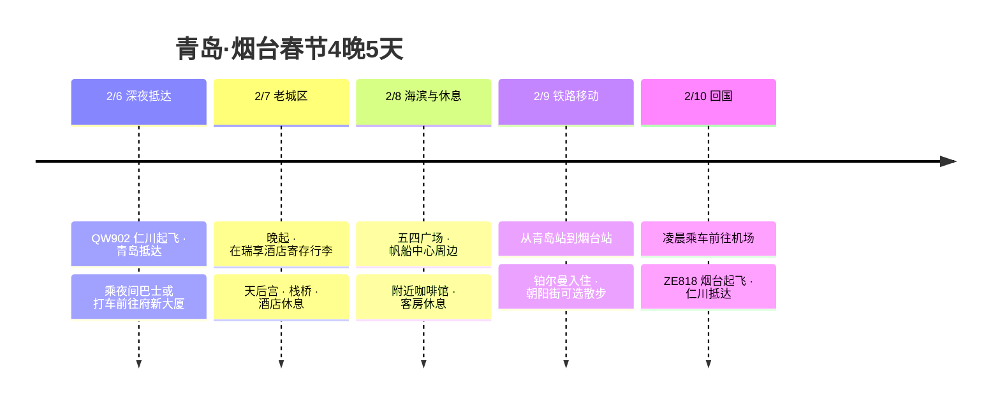

**第一天从机场乘一趟夜间巴士到府新大厦睡觉，接下来的2晚优先考虑雅高旗下的市区瑞享酒店五四广场店。最后一天乘铁路前往烟台，在铂尔曼住1晚。**2/7安排天后宫和老城区，2/8把五四广场、海滨漫步和酒店休息串在一起。

2027年**2月6日是农历正月初一**，所以在当地度过的2/7～2/9分别是初二～初四。抵达的夜晚是春节初一的夜晚，除夕已经过去。[香港天文台2027年公历·农历对照表](https://www.hko.gov.hk/en/gts/time/calendar/pdf/files/2027e.pdf)。

**路线·酒店·铁路订票规定核查：2026-10-03。**机票已出票，铂尔曼是用户指定的住宿计划，府新大厦和市区瑞享酒店是推荐候选。酒店是否已预订和价格未确认。下面航班以外的时间是包含移动余量的目标行程，**2027年春节活动、特别交通和火车票并未确定。**

## 青岛酒店推荐

**第一晚的住处最适合府新大厦（Fuxin Hotel · 府新大厦）。**从机场到府新大厦的夜间巴士坐一趟就到终点，中途不用换车。巴士可能在中途站停靠。第二天用一次出租车·网约车把行李转移到市区瑞享酒店，含上下车和等待，预留15～20分钟的计划余量。当天所需时间用地图App确认。[2026年夜间巴士运营确认](https://www.ctnews.com.cn/paper/att/202603/26/d1bd8240-ffde-4b50-a564-e55cf9f6c41f.pdf)、[府新大厦地址](https://m.ctrip.com/html5/hotel/hoteldetail/455485.html)。

接下来2晚的优先候选是**Mövenpick by Accor Qingdao May Fourth Square · 青岛香港中路万象城雅高瑞享酒店**。以**福州南路22号、酒店代码C7G9**查询，并与西海岸的Sunmei店C0M1区分。以使用雅高白金卡为基准重新选择了住处。官方设施介绍中有餐厅和健身房，未确认有泳池和行政酒廊。虽然叫五四广场，但并不在广场地铁站正前方，根据携程介绍，**到浮山所站步行约990米·15分钟**。带行李的移动默认乘车。[市区瑞享酒店官方介绍](https://all.accor.com/hotel/C7G9/index.en.shtml)、[酒店·车站位置介绍](https://m.ctrip.com/html5/hotel/hoteldetail/6838355.html)。

### 适用雅高白金卡权益的预订标准

依据ALL官方条款和排除名单，判断这家瑞享酒店为参与酒店候选。但是**尚未收到该店2027年免费早餐适用·运营方式的酒店个别确认。**酒店电话是**+86 532 8389 1188**。预订前告知住宿日期·会员等级以确认权益。[ALL官方条款](https://all.accor.com/a/en/loyalty-program/legal/terms-and-conditions.html)、[不参与酒店名单](https://all.accor.com/a/en/loyalty-program/hotels-exception.html)。

| 项目 | 本次行程的适用标准 |
|---|---|
| 预订渠道 | 在ALL App·官方网站·酒店直接预订中选择可累积积分·住宿记录的价格。不以普通OTA价格享受会员等级权益为前提 |
| 免费早餐 | 适用于亚太地区权益参与酒店的白金及以上会员。确认C7G9适用后，反映到2/8·2/9的早餐。入住当天2/7的早餐另算 |
| 客房升级·提前入住·延迟退房 | 视客房情况提供。2/7上午按寄存行李后观光的动线计划 |
| 酒廊·欢乐时光 | 在该酒店官方设施及ALL酒廊名单中未能确认，不计入预期权益 |

权益以入住时有效的会员等级和符合条件的住宿为准。确认早餐适用之后，比较纯客房价格和含早价格的总额。2027/2/7～9的客房价格和能否预订尚未确认。[白金卡权益介绍](https://all.accor.com/loyalty-program/cards-status-benefits-details/index.en.shtml)、[酒廊名单](https://all.accor.com/loyalty-program/user/hotels-lounge/index.en.shtml)。

## 住宿安排

| 要预订的住宿日期 | 住处 | 晚数 | 选择理由 |
|---|---|---|---|
| **2/6入住～2/7退房** | **府新大厦 · Fuxin Hotel · 青岛府新大厦** | 1晚 | 在开往府新大厦方向的夜间巴士终点就能直接休息的第一天候选 |
| **2/7入住～2/9退房** | **Mövenpick by Accor Qingdao May Fourth Square · 青岛香港中路万象城雅高瑞享酒店** | 2晚 | 雅高市区住宿的优先候选。确认白金卡具体权益后预订 |
| **2/9入住～2/10退房** | **Pullman Yantai Center · 烟台中泽华羿铂尔曼酒店** | 1晚 | 在烟台市区漫步后，第二天早上前往机场 |

要事先向第一个住处提出**“预订2/6住宿，实际到达是2/7凌晨2～3点，请保留客房”**。如果从2/7开始预订，可能会按当天下午入住处理。府新大厦目前预订页面上写有24小时前台和行李寄存，但夜间到达的接待和退房后寄存行李，要在预订时确认。地址是**市南区闽江路5甲号**。[府新大厦住宿·政策](https://hotels.ctrip.com/hotels/455485.html)。

市区瑞享酒店以**市南区福州南路22号**、铂尔曼以**芝罘区胜利路139号**为准。市区瑞享酒店的官方入住时间是**14:00起**，退房到12:00为止。2/7上午先申请寄存行李，观光后再办理入住。[市区瑞享酒店官方介绍](https://all.accor.com/hotel/C7G9/index.en.shtml)、[铂尔曼官方介绍](https://all.accor.com/hotel/C037/index.en.shtml)。

## 行程概要

| 日期 | 动线与核心行程 | 住宿 |
|---|---|---|
| 2/6 (周六) · 初一 | 目标20:20抵达仁川T1 → 23:20起飞 → 青岛23:50抵达，入境后乘夜间巴士 | 府新大厦1晚，实际入住在2/7凌晨 |
| 2/7 (周日) · 初二 | 晚起 → 在市区瑞享酒店寄存行李 → 天后宫春节民俗参观 → 栈桥·老城区 → 入住 | 市区瑞享酒店第1晚 |
| 2/8 (周一) · 初三 | 晚些吃早餐 → 五四广场·奥林匹克帆船中心周边 → 室内购物·酒店休息 | 市区瑞享酒店第2晚 |
| 2/9 (周二) · 初四 | 早餐 → 青岛站 → 烟台站 → 铂尔曼 → 朝阳街漫步·提早晚餐 | 铂尔曼1晚 |
| 2/10 (周三) · 初五 | 05:30酒店出发 → 目标06:30～06:45抵达机场T2 → 09:00起飞 → 仁川11:25 | 回国 |

## 行程时间线

## 目前已确定的费用

| 项目 | 金额 | 状态 |
|---|---|---|
| QW902去程 + ZE818回程 | **218,750韩元** | 已付款 |
| 住宿4晚 | 待定 | 酒店价格·预订未确认 |
| 当地交通·餐饮·体验 | 待定 | 下面的公开票价仅供参考，不计入实际支出 |

**目前确认的付款额为218,750韩元**，整个旅行的预算要加上住宿和当地费用后再确定。

## 已出票的航班

所有起降时间均为**各机场的当地时间**，以下内容依据预订单。

**机票总付款额：218,750韩元。**记录为QW902去程和ZE818回程合计的金额。

| 区间 | 日期 | 航班 | 起飞 | 抵达 | 座位·机型·机上餐食 |
|---|---|---|---|---|---|
| 去程 | 2027-02-06 | 青岛航空 **QW902** | **23:20** 仁川国际机场 **ICN T1** | **23:50** 青岛胶东国际机场 **TAO** | 经济舱 · 空客A320 · 不含机上餐食 |
| 回程 | 2027-02-10 | 易斯达航空 **ZE818** | **09:00** 烟台蓬莱国际机场 **YNT T2** | **11:25** 仁川国际机场 **ICN T1** | 经济舱 · 波音737-800 · 不含机上餐食 |

## 2/6 (周六) · 深夜抵达与机场巴士

| 当地时间 | 要做的事 |
|---|---|
| **目标20:20 · 韩国时间** | 抵达仁川机场T1，办理值机·行李手续 |
| 20:20～22:20 · 韩国时间 | 航空公司手续和安检之后吃晚饭·前往登机口。因为是不含机上餐食的航班，要在起飞前用餐 |
| **23:20 · 韩国时间** | QW902仁川起飞 |
| 23:50 | 抵达青岛胶东机场 |
| **2/7 00:00～01:15** | 入境检查·领取行李·前往GTC，根据手续延误情况调整 |
| 00:45～01:30前后 | 目标在**GTC一层汽车客运站**确认·乘坐**开往府新大厦方向的夜间巴士** |
| 02:00～03:30前后 | 目标抵达府新大厦·办理入住·就寝。是宽裕估计了等候和道路行驶90～120分钟的预计范围 |

**据2026年3月26日机场运输公司相关人士的采访，机场 → 府新大厦的夜间巴士从23:00运营到航班运行结束。**上表的乘车时间是考虑入境手续的目标，并非固定的发车时间。引用2025年机场资料的介绍中写有**30元·GTC一层乘车**。2027年的末班·乘车点·票价请在出发前确认。[2026年机场相关人士采访](https://www.ctnews.com.cn/paper/att/202603/26/d1bd8240-ffde-4b50-a564-e55cf9f6c41f.pdf)、[2025年乘车·票价介绍](https://www.sohu.com/a/921505340_121117467)。

**机场轨道交通不作为当晚的接驳方案。**确认的2026年假期地铁介绍中，机场→青岛北站的直达列车也是基本的22:25·22:45再加上延长班次23:15·23:45。23:50落地后办完入境，会比这更晚。这是过去假期的运行案例，2027年的运行时刻表需另行确认。[2026年地铁假期介绍](https://epaper.qingdaonews.com/qdzb/resfile/2026-04-28/A05/qdzb-20260428-A05.pdf)。

出发前通过机场巴士官方微信**青岛机场巴士出行**或**+86 18853217000**，确认QW902国际航班抵达后能乘坐的末班车和下车地点。按航班运行结束时间运营，并不意味着会等到所有国际航班乘客办完手续。[机场巴士查询·联系方式](https://epaper.guanhai.com.cn/conpaper/qdwb/resfile/2024-09-03/A05/qdwb-20240903-A05.pdf)。

如果错过巴士，就乘机场官方出租车·网约车前往**同一个府新大厦**。保存好地址，这样第一天不用更换住处，并告知住处会晚到。

## 2/7 (周日) · 在市区酒店寄存行李，前往天后宫

| 目标时间 | 行程 | 移动·备注 |
|---|---|---|
| 10:30～11:30 | 晚起·简单吃点东西·退房，乘车前往市区瑞享酒店申请寄存行李 | 移动预留15～20分钟的计划余量。提前入住视客房情况申请。如果寄存行李也有困难，就寄存在府新大厦，下午取回 |
| 11:30～12:15 | 前往天后宫 | 出租车·网约车，含节日排队的余量 |
| **12:15～13:15** | **天后宫春节民俗参观** | 确认2027年开放情况后，选一个展览或庙会体验 |
| 13:15～14:15 | 在老城区吃一顿热乎的午餐 | 饺子·面条等营业的餐馆，不以指定餐馆春节营业为前提 |
| 14:15～15:00 | 栈桥周边海边漫步 | 风大就改去中山路一带的室内咖啡馆 |
| 15:00～16:00 | 回到市区瑞享酒店·办理入住 | 如果把行李寄存在府新大厦，取回后再移动 |
| 16:00～18:00 | 在客房休息 | 缓解前一天深夜移动的疲劳 |
| 18:00～19:30 | 在酒店或附近吃晚餐 | 之后轻松休息就寝 |

### 对春节有意义的一件事：天后宫新春民俗庙会

**推荐追加的行程是天后宫的新年民俗体验。**这里是祈求往来海上的人平安的地方，也与这次从青岛进、从烟台出的海滨城市之旅很契合。天后宫兼作民俗博物馆，地址是**太平路19号**。[天后宫·民俗博物馆介绍](https://maps.apple.com/place?_provider=57879&place-id=H2710I3F8320675FDC2)。

2026年在正月初一开幕了新春民俗文化庙会，举办了手工艺集市·猜灯谜·新年拓印等活动。**2027年2/7的活动是否举办以及节目内容未确认**，所以不把同样的节目当作确定的行程提前预订。[2026年庙会现场报道](https://www.dailyqd.com/guanhai/436668_1.html)。

- **如果举办活动：**从现场开展的拓印·手工艺·猜灯谜中选一个，参与30分钟左右，选一件新年纪念品，并记录旅行心愿。
- **没有活动但天后宫开放：**参观民俗展览，用1小时了解青岛的海洋文化和新年习俗。
- **如果闭馆：**改为栈桥·中山路漫步和热乎的饺子午餐，在旅行笔记中留下一件今年想完成的事。

抵达日是初一的夜晚，无法安排除夕敲钟，回国日2/10虽然是初五，但因为09:00的航班，也很难安排早晨的活动。因此把**2/7白天的体验**放在春节行程的中心。

## 2/8 (周一) · 在五四广场和市区悠闲度过

| 目标时间 | 行程 |
|---|---|
| 09:00～10:00 | 市区瑞享酒店早餐。预订时确认免费权益的适用和当天的营业时间 |
| 10:00～11:00 | 出门准备·乘车前往五四广场 |
| 11:00～12:00 | 在五四广场和浮山湾海滨漫步 |
| 12:00～13:30 | 前往奥林匹克帆船中心周边·午餐 |
| 13:30～15:00 | 在帆船中心附近的咖啡馆室内休息，购物在周边短时间进行 |
| 15:00～18:00 | 回酒店·客房休息，或使用营业中的室内设施 |
| 18:00～19:30 | 在酒店或市区吃晚餐 |
| 20:00前后 | 确认第二天的火车票·车站名称·用车出发时间 |

从五四广场前往东边的帆船中心后，在附近休息再回酒店。基本方案中去掉了再次往返万象城的移动。如果更想购物或风很大的日子，就**选万象城一处来代替帆船中心**。寒冷或风很大时，减少散步，改为咖啡馆·客房休息。行程中不安排酒店泳池·酒廊的使用。夜间灯光秀和春节演出的时间，在另行公布之前不固定。[市区瑞享酒店设施介绍](https://all.accor.com/hotel/C7G9/index.en.shtml)。

## 2/9 (周二) · 从青岛站到烟台

**推荐的查询区间是`青岛 → 烟台`。**优先选择从市区瑞享酒店乘车前往**青岛站（青岛站）**出发，在离铂尔曼较近的市内**烟台站（烟台站）**下车的方案。酒店 → 青岛站按携程路线介绍乘车约32分钟，春节期间含等待预留50分钟。`青岛`、`青岛北`、`青岛西`是各不相同的车站。[酒店 → 青岛站位置介绍](https://jp.trip.com/hotels/qingdao-hotel-detail-6838355/mvenpick-by-accor-qingdao-may-fourth-square/)。

### 目前可查询到的参考列车

以下是**根据2026年查询资料制作的对比用时刻表**。并不意味着2027年2月9日确定运行·可订票·有余票。

| 优先级 | 区间 | 当前参考车次 | 出发 → 到达 | 参考用时·二等座 |
|---|---|---|---|---|
| 1 | **青岛 → 烟台** | **C6574** | **13:20 → 14:54** | 1小时34分 · 约80～81元 |
| 2 · 较早到达 | **青岛 → 烟台** | **C6568** | **10:29 → 12:03** | 1小时34分 · 约80元 |
| 备选 | 青岛北 → 烟台 | C6579 | 12:05 → 13:29 | 1小时24分 · 约74元，另算前往北站的移动时间 |

出处：[携程 青岛 → 烟台最新查询](https://trains.ctrip.com/TrainBooking/qingdao-yantai/gaotie)、[C6574时刻表](https://www.crecc.com/huoche/c6574.html)、[携程 C6568停靠站·时间](https://trains.ctrip.com/TrainSchedule/C6568)、[携程 青岛北站周边列车查询](https://trains.ctrip.com/trainbooking/qingdaobei-yantainan/gaotie/)。在2026年9月的携程查询中，也确认了C6574的13:20 → 14:54、二等座80元。由于查询页面也会混合显示附近的车站，要在购票界面**分别确认出发站·到达站**。目前C6574被介绍为在中间区段车次变为C6571的直达车，并非换乘车次。

12306目前的订票期限是**含乘车日共15天**。如果这一规定保持不变，**2/9乘车的票从2027/1/26起**进入发售范围。各车站开售时间不同，所以在`起售时间`中确认**青岛**。[12306订票期限说明](https://mobile.12306.cn/mormhweb/zxdt/202205/t20220531_37508.html)、[12306当前可订票期限查询](https://hzfw.12306.cn/zgzfw/resources/h5/ysqcx-h5.html)、[各车站开售时间查询](https://kyfw.12306.cn/index/view/infos/sale_time.html)。

### 订到与C6574相近的13点档列车时

| 目标时间 | 行程 |
|---|---|
| 08:30～10:00 | 市区瑞享酒店早餐·整理行李 |
| 11:15～11:40 | 退房·准备简单午餐 |
| 11:40～12:30 | 从市区瑞享酒店乘出租车·网约车前往青岛站 |
| 12:30～13:10 | 核对护照·安检·前往站台。目标在列车发车约50分钟前抵达车站 |
| 13点档～15点前后 | 开往烟台的直达列车，实际时间在购票后调整 |
| 15:10～15:40 | 烟台站下车 → 乘车前往铂尔曼·办理入住 |
| 15:40～16:15 | 客房休息 |
| 16:15～17:30 | 在朝阳街（朝阳街）漫步·喝咖啡，有余力的话去烟台山入口 |
| 17:30～18:30 | 提早晚餐 |
| 19:00～20:00 | 回酒店，再次确认第二天的机场用车·整理行李 |

铂尔曼按官方说明**距烟台站乘车约10分钟**，距机场约50分钟。含下车后等出租车的时间，预留了20～30分钟。朝阳街作为海滨一侧车站大街的散步安排，不以举办户外演出·灯光秀为前提。[铂尔曼交通介绍](https://all.accor.com/hotel/C037/index.en.shtml)、[烟台市朝阳街介绍](https://www.yantai.gov.cn/art/2024/4/2/art_55792_3178885.html)。

**如果没有直达列车或已售罄，**先比较`青岛北 → 烟台`。换成北站时，用车目的地也要改为**青岛北站**，酒店→车站的移动另外预留60～75分钟和站内等待时间。到达`烟台南`的车次，按到铂尔曼40～60分钟的计划余量重新计算。如果选10:29的列车，就在08:45前后从酒店出发，行程提前为在烟台吃午餐。最终时间根据购买的列车和当天的地图路线确定。

## 2/10 (周三) · 一早前往烟台机场T2

| 目标时间 | 行程 |
|---|---|
| 04:45～05:15 | 起床·准备退房，必要时前一天准备简单的早餐 |
| **05:30** | 从铂尔曼乘事先预约的车出发 |
| **06:30～06:45** | 目标**抵达**烟台蓬莱机场**T2** |
| 06:45～08:15 | 航空公司柜台·行李·出境检查·安检，根据柜台实际营业情况进行 |
| 08:15以后 | 在登机口确认航空公司的通知 |
| **09:00 → 11:25** | ZE818 烟台 → 仁川T1 |

到机场按官方说明乘车约50分钟，这个行程预留了**60～75分钟的移动余量**，05:30出发。如果有降雪·结冰预报或交通延误，与酒店商量后提前到05:00～05:15。用车要**在2/9入住时申请05:30出发，晚上确认派车**。时间是预约推荐方案，并不是已经代为完成了用车预订。

烟台机场官网说明巴士时刻表会根据航班更新，请在**烟台交运机场巴士**微信中查询。仅凭目前能确认的官方资料，很难确定2/10一早的巴士接驳班次，所以回国日的基本方案是酒店→机场直达用车。乘坐机场轨道交通的动线也没有放入这天早上的行程。[烟台机场官方巴士介绍](https://www.ytairport.com.cn/index/Page/index.html?cate=9)。

## 机场·铁路·市内交通整理

| 区间 | 使用的交通 | 计划标准 |
|---|---|---|
| 青岛机场 → 第一个住处 | 开往府新大厦方向的夜间机场巴士 | GTC一层，30元是过去公开的票价。夜间停靠·末班·当天票价需再确认 |
| 府新大厦 → 市区瑞享酒店 | 出租车·网约车一次 | 指定福州南路22号 · C7G9，含上下车预留15～20分钟的计划余量 |
| 市区瑞享酒店 ↔ 天后宫·老城区 | 出租车·网约车 | 单程预留30～45分钟的计划余量，拥堵时用地图App调整路线 |
| 市区瑞享酒店 → 青岛站 | 出租车·网约车 | 11:40出发，目标12:30抵达。在确定的列车发车前45～60分钟抵达车站 |
| 青岛站 → 烟台站 | 优先直达C字头列车 | 优先13点档出发，2027/1/26确认订票 |
| 烟台站 → 铂尔曼 | 出租车·网约车 | 含等待20～30分钟 |
| 铂尔曼 → 烟台机场T2 | 事先预约的车 | 05:30出发，目标06:30～06:45抵达 |

如果想从市区瑞享酒店乘地铁，要比较**步行到浮山所站约15分钟 → 乘2号线前往五四广场站 → 换乘3号线开往青岛站方向**的路线。天后宫在人民会堂站下车后步行，青岛站在终点站下车。考虑到走到车站的距离和换乘，带行李的移动默认乘车。线路和出口请在乘车当天用**青岛地铁**App确认。[离酒店近的车站](https://m.ctrip.com/html5/hotel/hoteldetail/6838355.html)、[五四广场站2·3号线介绍](https://www.shangri-la.com/qingdao/shangrila/about/map-directions/)。

## 时间调整范围

**可以调整的是观光量，酒店晚数和已出票的航班保持不变。**下面的时间是作为现场判断标准而预留的计划余量。

| 情况 | 调整的行程 | 保留的余量 |
|---|---|---|
| 2/7凌晨到达住处晚于03:30 | 不为了开始上午观光而赶时间。酒店退房·寄存行李后，从午餐开始，在天后宫和栈桥中只选开放情况·天气更好的一处 | 客房准备好后休息2小时以上。府新大厦的退房时间另行确认 |
| 2/7天后宫入场排队30分钟以上 | 民俗体验或展览只看其中一个，省去栈桥 | 目标16点前后回酒店 |
| 2/8 海风·寒冷严重 | 五四广场拍照20～30分钟 → 简化为万象城午餐·咖啡馆。省去帆船中心 | 保持下午酒店休息2～3小时 |
| 2/9 直达列车售罄 | 从同一天上午的直达车次或青岛北站出发的车次开始比较。如果车站变了，酒店出发时间也要提前 | 在确定的列车发车前45～60分钟抵达车站。朝阳街的观光可以减少 |
| 2/9 抵达铂尔曼在17点以后 | 省去朝阳街，在酒店附近吃晚餐·客房休息 | 优先第二天的用车确认和20点前后的整理行李 |
| 2/10 预计有降雪·结冰·用车延误 | 把酒店出发时间提前到05:00～05:15 | 保持目标06:30～06:45抵达机场 |

春节的餐食以**当天动线内热乎的饺子·面条或酒店餐厅**为基本方案。与其为了找名店而往返其他区域，不如在看天后宫·栈桥的日子在老城区吃，在看海滨的日子在五四广场·帆船中心周边吃。餐馆排队超过30分钟就换成附近营业的店，节日休息和额外费用在点餐前确认。

## 预订·活动确认顺序

1. **第一个住处：**一并确认府新大厦2/6～2/7的客房和凌晨入住，以及夜间巴士终点站的运行。
2. **雅高酒店：**向酒店确认市区瑞享酒店C7G9 2/7～2/9白金卡早餐的适用，并与铂尔曼2/9～2/10一起比较ALL合格价格·取消条件·总额。住宿费在收到实际预订金额后再记录。
3. **春节体验：**2027年天后宫开放·庙会公告发布后，确定2/7白天的体验以及入场·预约条件。
4. **1/26：**在12306确认2/9 `青岛 → 烟台` 直达车次是否开售及座位。提前登记护照信息。
5. **出发前夕：**确认QW902抵达后的夜间巴士、春节营业情况和天气，调整第一天的移动和户外散步。
6. **2/9：**在铂尔曼确认第二天的机场用车。

地图展示的是主要地点的位置和访问顺序，并未表示实际的巴士·列车线路或返回酒店的全部动线。机场坐标参考了OurAirports的[青岛胶东](https://ourairports.com/airports/ZSQD/)·[烟台蓬莱](https://ourairports.com/airports/ZSYT/)，车站参考[青岛站](https://mapcarta.com/16209672)·[烟台站](https://mapcarta.com/W326649325)，广场参考[五四广场位置资料](https://commons.wikimedia.org/wiki/Category:May_Fourth_Square)。车站和广场是大致位置，实际上下车时要在地图App中指定入口。
