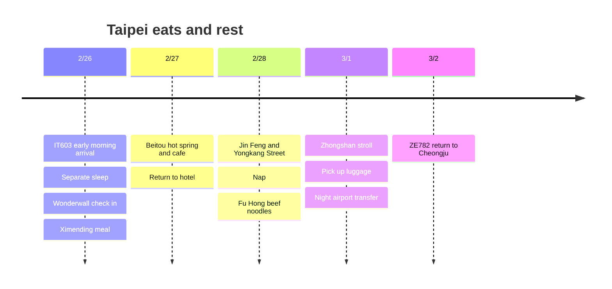

**The three nights at Wonderwall Ximending, 2/26 to 3/1, are the traveler's chosen itinerary.** A separate room is needed right after arriving in the early morning of 2/26. For the first morning, an extra sleeping room is recommended, and during the day you only visit nearby eateries. Rather than spending more time on 101 and Dihua Street as in the New Year trip, focus on **one day in Beitou and meals and rest near the hotel**.

**Checked as of 2026-10-03.** Restaurant and hot spring visits are recommendations and not booked, and the times are planning values with some buffer. All local times are Taiwan time.

## Itinerary Summary

| Date | Route | Rest |
|---|---|---|
| Thu 2/25 night | Head to Incheon Airport | Prepare for the departure after midnight on 2/26 |
| Fri 2/26 | IT603 arrival → separate sleeping room → lunch → Wonderwall check-in → Ximending | First-morning sleep + nap after check-in |
| Sat 2/27 | Xinbeitou park, cafe and hot spring → Ximending | One far outing area per day |
| Sun 2/28 | Jin Feng → Yongkang Street → hotel rest → Fu Hong | Keep 2+ hours free in the afternoon |
| Mon 3/1 | Check out and store luggage → Zhongshan and Chifeng Street → pick up luggage → airport | An evening break with either a cafe or a massage |
| Tue 3/2 | ZE782 return to Cheongju | Arrive in the morning |

## Itinerary Timeline

## Flights and Hotel Dates

The [IT603 public timetable](https://www.flight.info/IT603) is **2/26 00:30 Incheon departure → 02:15 Taipei arrival**. Go to the airport on the **night of 2/25**. [ZE782](https://www.flight.info/ZE782) is planned as **3/2 02:35 departure → 06:05 Cheongju arrival**; change notices on the actual ticket take priority.

| Item | Dates | Status |
|---|---|---|
| Wonderwall Ximending | **Check-in 2/26 to check-out 3/1, 3 nights** | Traveler-specified, amount not shared |
| First-morning sleep candidate | **Twin Star Inn 2/25 to 2/26, 1 extra night** | Recommended, not booked. Actual check-in is in the early morning of 2/26 |
| Last day | Night airport transfer after 3/1 checkout | No extra room; luggage storage and indoor rest |

If you choose the extra room above, **Wonderwall's 3 nights plus 1 night for early-morning sleep make 4 paid room nights in total**. The 3 nights on the trip card show the number of Wonderwall nights currently specified. If a quote to extend Wonderwall to a 2/25 room is similar, using the same hotel reduces luggage moving. Do not arrive counting only on a free early check-in under the 2/26 booking.

[Twin Star Inn's official information](https://www.tsitaipei.com/) lists a **24-hour self check-in kiosk** and basement single rooms with shared bathrooms. The condition is to book after confirming **arrival around 04:00 on 2/26, that the room is held, the check-in code and the checkout time**. Wonderwall's address looks up as **西寧南路36號9樓之2**; match the entrance and room type against the booking confirmation. [Wonderwall location guide](https://newway-explore.com/b/wonderwall%E7%BE%8E%E5%A5%BD%E5%A2%83%E7%95%8C---%E5%8F%B0%E5%8C%97%E8%A5%BF%E9%96%80%E9%A4%A8)

If you want to rest inside the airport, [CHO Stay](https://chostay.com/en/) is a candidate as an accommodation used after immigration, on the **5th floor of the T2 south side**, but its official regular check-in is after 16:00 and checkout is before 10:00. Until you confirm whether it accepts early-morning arrivals, do not treat it as a firm place to sleep. The option with no extra lodging cost is to rest in the airport's general area until public transport starts and then leave luggage at Wonderwall, but because a bed cannot be secured, it is not recommended as the default plan for a healing trip.

## 2/26 · Sleep First, Eat Only in Ximending

| Local target time | Plan |
|---|---|
| 02:15 to 03:30 | Immigration and baggage claim |
| 03:30 to 04:45 | Taxi or booked car to the extra sleeping room, check in |
| 04:45 to 11:00 | Sleep, observing the checkout time set by the hotel |
| 11:00 to 12:00 | Pack, move to Wonderwall and request luggage storage. Use a car if walking is a burden |
| 12:00 to 13:00 | Braised pork rice, egg and soup combo at Tian Tian Li, or a nearby restaurant |
| 13:00 to 15:00 | Rest at a cafe and check in at the check-in time on the Wonderwall booking |
| After check-in to 17:30 | Shower and nap. If check-in is late, shorten the evening walk |
| 18:00 to 19:30 | Ximending stroll, a light dinner, then return |

Do not cut the 6 hours of sleep for sightseeing. On the first day, also leave time before lunch to handle lottery verification and collection. If you enter in the early morning of 2/26, do not miss the **24-hour deadline** that runs until the same time the next day.

## 2/27 · A Half-Day Hot Spring in Beitou

The aim is 09:30 to 10:30 breakfast → 10:30 to 11:30 MRT trip **Ximen → Taipei Main Station → Beitou → Xinbeitou** → 11:30 to 13:00 park and lunch → 13:00 to 14:30 hot spring → 14:30 to 15:30 a cup of tea → back at the hotel around 16:30. About 1 hour each way, including transfers and walking, is allowed as planning buffer.

[The Taipei tourism office introduces Beitou as a hot spring and walking area](https://www.travel.taipei/zh-tw/attraction/popular-area). For the hot spring, choose **either a private bath for 60 to 90 minutes or a public bath**, and match it to the actual facility, fees and available booking times. Do not try to fit in the museum as well, and if it rains, extend the indoor cafe time instead of the park. **Do not add Tamsui or Yangmingshan on the same day.**

## 2/28 · From Chiang Kai-shek Memorial Hall Station to Yongkang Street

The order is 10:00 leave the hotel → 11:00 to 12:00 Jin Feng Braised Pork Rice → 12:00 to 13:00 a short walk around Chiang Kai-shek Memorial Hall → 13:00 to 15:00 cafes and desserts in Dongmen and Yongkang Street → **15:30 to 17:30 rest at the hotel** → 18:00 to 19:00 Fu Hong beef noodles. Connect by MRT, one stop from Chiang Kai-shek Memorial Hall to Dongmen, and have dinner near the hotel.

2/28 is a visit day that coincides with a Taiwanese memorial day. If event or business notices for that year are announced, adjust the visit times. A paid event or special festival has not been confirmed.

## Budget Meal Candidates

| Shop and area | What to order | How to fit it in |
|---|---|---|
| **Tian Tian Li Food House · Ximending** | Braised pork rice + egg + soup | 2/26 lunch. Address per the district office listing is 漢中街32巷1號; scheduled to avoid Monday |
| **Ay-Chung Flour-Rice Noodle · Ximending** | A small bowl of flour rice noodles | Only as a snack when hungry near the hotel |
| **Jin Feng Braised Pork Rice · Chiang Kai-shek Memorial Hall Station** | Small braised pork rice + soup and side dishes | 2/28 lunch. If the wait exceeds 20 to 30 minutes, switch to a nearby restaurant |
| **Fu Hong Beef Noodles · north of Ximending** | A bowl of beef noodles | 2/28 dinner. Do not add a late-night snack |

Address sources: [Tian Tian Li district office introduction](https://whdo.gov.taipei/News_Content.aspx?n=19CABBEF3F991E9E&s=EDF1F022618A79FC&sms=FE5F0DE8FA424CE8), [Ay-Chung Wanhua district office introduction](https://whdo.gov.taipei/News_Content.aspx?n=19CABBEF3F991E9E&s=C0811D8F9FC97E2E&sms=FE5F0DE8FA424CE8), [Jin Feng shop information](https://tabelog.com/taiwan/A5403/A540307/54002578/), [Fu Hong shop information](https://www.tripadvisor.com.tw/Restaurant_Review-g13806951-d8807417-Reviews-Fuhong_Beef_Noodles-Wanhua_Taipei.html). Menu prices and 2027 opening hours are not confirmed, and the **food budget of NT$400 to 650 per day is only a planning target**. Hot springs, massages and transport are separate.

## 3/1 · Zhongshan Stroll and Departure Prep

Check out in the morning and store luggage → 11:30 to 14:00 lunch and cafe at Zhongshan Station and Chifeng Street → 14:00 to 16:00 shopping → return to Ximending, early dinner → 18:00 to 20:30 rest at a cafe or with a massage. Do not assume room or shower use after checkout is included.

**20:30 to 21:00 pick up luggage → 21:30 to 22:00 depart on the airport MRT from A1 → 22:30 to 23:00 arrive at the airport.** This plan adds in-station walking and waiting time to the [roughly 35-minute express T1 ride](https://www.travel.taipei/en/information/taoyuanmetro). Whether in-town check-in is supported is unconfirmed, so using the airport counter is the default. Leave a buffer until the 02:35 departure on 3/2 and do not add a day tour on the last day.

## Revisit Lottery · Second Application

Under the per-trip registration principle in the [official rules](https://5000.taiwan.net.tw/campaign_rules_en.html), **register separately for the 2/26 arrival between 2026/11/28 and 2027/2/19**. Do not reuse the New Year trip's application. The e-Gate registered in Kaohsiung and the lottery are separate, and **you can collect twice only if both trips win**. Also check for budget exhaustion and rule changes.

If you win, follow the procedure of verification within 24 hours of entry and collection within 24 hours after verification. For detailed conditions and the TWAC link, also see the [revisit notes in the New Year trip](/posts/2026-12-31-taipei-new-year/en/#revisit-lottery--first-application). Plan the food and lodging budget so it works even without the benefit.

## Flexibility Range

- **If a first-morning bed cannot be secured:** Limit all 2/26 sightseeing to Ximending and prioritize sleep after regular check-in. If you add an early-morning room booking, update the number of nights and the total as well.
- **If Beitou booking is expensive or sold out:** Drop the hot spring and visit only the park and a cafe, or swap in a massage or rest in Ximending.
- **Rain, fatigue or restaurant queues:** Cut one walk that day. Do not wait at two famous shops in a row.
- **If luggage storage is not available on the last day:** Check the operating hours of station lockers and staffed storage, and set the luggage pickup route first. Keep the airport departure time.

Wonderwall's price, the extra first-morning room, airfare, and hot spring and massage costs are either not shared or not booked yet, so they are not included in the cost total.
