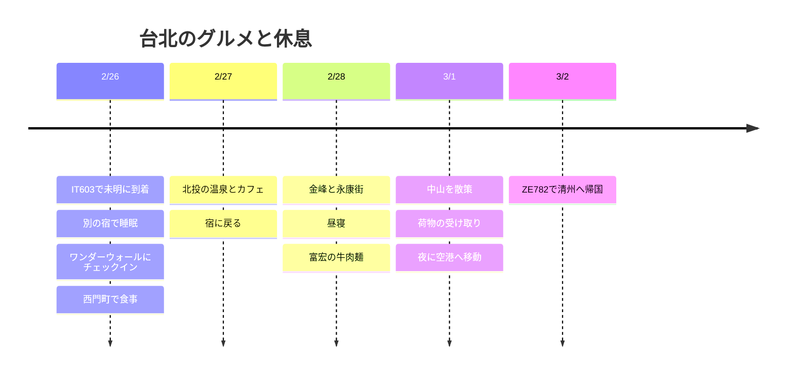

**ワンダーウォール西門町の2/26〜3/1の3泊は、利用者指定の日程です。** 2/26の未明に到着した直後に使う部屋は、別に必要です。最初の未明は追加の睡眠用の宿をおすすめし、昼間は近くのグルメだけをめぐります。新年の旅で見た101や迪化街にもう一度時間を使うより、**北投の1日と、宿の近くでの食事・休息**に集中します。

**2026-10-03照会基準。** 飲食店・温泉の訪問はおすすめで未予約、時刻は余裕を含めた計画値です。現地の日程はすべて台湾時間です。

## 旅程の概要

| 日付 | 動線 | 休憩 |
|---|---|---|
| 2/25 (木) 夜 | 仁川空港へ移動 | 2/26の深夜0時過ぎの出発に備える |
| 2/26 (金) | IT603で到着 → 別の睡眠用の宿 → 昼食 → ワンダーウォールにチェックイン → 西門町 | 最初の未明の睡眠＋チェックイン後の昼寝 |
| 2/27 (土) | 新北投の公園・カフェ・温泉 → 西門町 | 遠出は1日1エリア |
| 2/28 (日) | 金峰 → 永康街 → 宿で休憩 → 富宏 | 午後に2時間以上の空きをつくる |
| 3/1 (月) | チェックアウト・荷物預け → 中山・赤峰街 → 荷物の受け取り → 空港 | カフェかマッサージのどちらかで夕方に休憩 |
| 3/2 (火) | ZE782で清州へ帰国 | 朝に到着 |

## 旅程タイムライン

## 航空便と宿泊日

[IT603の公開時刻表](https://www.flight.info/IT603)は**2/26 00:30仁川発 → 02:15台北着**です。空港には**2/25の夜**に向かいます。[ZE782](https://www.flight.info/ZE782)は**3/2 02:35発 → 06:05清州着**で計画し、実際の航空券の変更案内を優先します。

| 区分 | 日付 | 状態 |
|---|---|---|
| ワンダーウォール西門町 | **2/26チェックイン〜3/1チェックアウト、3泊** | 利用者指定、金額は未共有 |
| 最初の未明の睡眠の候補 | **Twin Star Inn 2/25〜2/26、追加1泊** | おすすめ・未予約。実際の入室は2/26の未明 |
| 最終日 | 3/1のチェックアウト後、夜に空港へ移動 | 客室の追加なしで、荷物預けと屋内での休憩 |

上の追加客室を選ぶと、**ワンダーウォール3泊＋未明の睡眠用1泊で、有料の客室は合計4泊**になります。旅行カードの3泊は、現在指定されているワンダーウォールの宿泊数を表示しています。ワンダーウォールで2/25の客室まで延長する見積もりが同程度なら、同じホテルを使うほうが荷物の移動が減ります。2/26の予約の無料アーリーチェックインだけを期待して到着することはしません。

[Twin Star Innの公式案内](https://www.tsitaipei.com/)には、**24時間セルフチェックイン機**、地下のシングルルーム・共用バスが案内されています。**2/26の4時ごろの到着・客室のキープ・入室コード・チェックアウト時間**を確認してから予約するのが条件です。ワンダーウォールの住所は**西寧南路36號9樓之2**で照会され、入口・客室タイプは予約書と照らし合わせます。[ワンダーウォールの場所案内](https://newway-explore.com/b/wonderwall%E7%BE%8E%E5%A5%BD%E5%A2%83%E7%95%8C---%E5%8F%B0%E5%8C%97%E8%A5%BF%E9%96%80%E9%A4%A8)

空港の中で休みたいなら、[CHO Stay](https://chostay.com/en/)は**T2南側5階、入国後に利用する宿**の候補ですが、公式の通常チェックインは16:00以降、チェックアウトは10:00以前です。未明の受け入れ可否を確認する前は、確定した睡眠場所としては押さえません。追加の宿泊費をかけない案は、空港の一般エリアで公共交通の運行開始まで休み、ワンダーウォールに荷物を預ける方法ですが、ベッドでの睡眠を確保できないため、ヒーリング目的の基本案としてはおすすめしません。

## 2/26 · まず睡眠、食事は西門町だけ

| 現地の目標時間 | 日程 |
|---|---|
| 02:15〜03:30 | 入国・手荷物の受け取り |
| 03:30〜04:45 | タクシー・予約した車で追加の睡眠用の宿へ移動・入室 |
| 04:45〜11:00 | 睡眠、宿が定めたチェックアウト時刻を守る |
| 11:00〜12:00 | 荷物の整理・ワンダーウォールへ移動・預かりを依頼。徒歩が負担なら車を利用 |
| 12:00〜13:00 | 天天利で魯肉飯・卵・スープの組み合わせ、または周辺の食堂 |
| 13:00〜15:00 | カフェで休み、ワンダーウォールの予約書にあるチェックイン時刻に合わせて入室 |
| チェックイン後〜17:30 | シャワー・昼寝。チェックインが遅れたら夕方の散策を減らす |
| 18:00〜19:30 | 西門町を散策・軽い夕食のあと帰る |

観光のために6時間の睡眠は削りません。初日の昼食前に、当選の検証と受け取りを処理する時間も設けます。2/26の未明の入国なら、翌日の同じ時刻までという**24時間の期限**を逃さないようにします。

## 2/27 · 北投で半日温泉

09:30〜10:30 朝食 → 10:30〜11:30 **西門→台北駅→北投→新北投**をMRTで移動 → 11:30〜13:00 公園・昼食 → 13:00〜14:30 温泉 → 14:30〜15:30 お茶を1杯 → 16:30ごろに宿へ戻る、を目標にします。乗り換え・徒歩を合わせて片道約1時間を計画上の余裕としました。

[台北市観光局は北投を温泉・散策エリアとして紹介](https://www.travel.taipei/zh-tw/attraction/popular-area)しています。温泉は**個室風呂60〜90分または大浴場のどちらか1つ**だけを選び、実際の施設・料金・予約できる時間を確認して合わせます。博物館まで詰め込まず、雨なら公園の代わりに屋内のカフェの時間を増やします。**淡水・陽明山を同じ日に付け足しません。**

## 2/28 · 中正紀念堂駅から永康街へ

10:00 宿を出発 → 11:00〜12:00 金峰魯肉飯 → 12:00〜13:00 中正紀念堂周辺を短く散策 → 13:00〜15:00 東門・永康街のカフェとデザート → **15:30〜17:30 宿で休憩** → 18:00〜19:00 富宏牛肉麺、という順番です。MRTの中正紀念堂→東門の1駅でつなぎ、夕食は宿の近くで済ませます。

2/28は台湾の記念日と重なる訪問日です。その年の行事・営業のお知らせが出たら訪問時間を調整します。有料イベントや特別なお祭りの開催は確定していません。

## コスパのよい食事の候補

| 店・エリア | 注文の方向 | 日程への入れ方 |
|---|---|---|
| **天天利美食坊 · 西門町** | 魯肉飯＋卵＋スープ | 2/26の昼食。区役所の案内にある住所は漢中街32巷1號、月曜日は避けて配置 |
| **阿宗麺線 · 西門町** | 小さな麺線1杯 | 宿の周辺でおなかがすいたときの軽食としてのみ選ぶ |
| **金峰魯肉飯 · 中正紀念堂駅** | 小さな魯肉飯＋スープ・おかず | 2/28の昼食。待ち時間が20〜30分を超えたら周辺の店に変更 |
| **富宏牛肉麺 · 西門町の北側** | 牛肉麺1杯 | 2/28の夕食。遅い夜食まで追加しない |

住所の根拠: [天天利の区役所紹介](https://whdo.gov.taipei/News_Content.aspx?n=19CABBEF3F991E9E&s=EDF1F022618A79FC&sms=FE5F0DE8FA424CE8)、[阿宗麺線の萬華区役所紹介](https://whdo.gov.taipei/News_Content.aspx?n=19CABBEF3F991E9E&s=C0811D8F9FC97E2E&sms=FE5F0DE8FA424CE8)、[金峰の店舗情報](https://tabelog.com/taiwan/A5403/A540307/54002578/)、[富宏の店舗情報](https://www.tripadvisor.com.tw/Restaurant_Review-g13806951-d8807417-Reviews-Fuhong_Beef_Noodles-Wanhua_Taipei.html)。メニューの価格と2027年の営業時間は未確定で、**食費1日NT$400〜650は計画の目標**としてのみ見込みます。温泉・マッサージ・交通は別です。

## 3/1 · 中山の散策と帰国の準備

午前にチェックアウト・荷物預け → 11:30〜14:00 中山駅・赤峰街で昼食とカフェ → 14:00〜16:00 ショッピング → 西門町に戻って早めの夕食 → 18:00〜20:30 カフェかマッサージで休憩します。チェックアウト後の客室・シャワーの利用は含まれているとは仮定しません。

**20:30〜21:00 荷物の受け取り → 21:30〜22:00 空港MRT A1で出発 → 22:30〜23:00 空港到着**。[急行でT1まで約35分](https://www.travel.taipei/en/information/taoyuanmetro)に、駅構内の徒歩・待ち時間を加えた計画です。市内でのチェックイン代行の可否は確認できていないため、空港のカウンターの利用を基本とします。3/2 02:35の出発まで余裕を持たせ、最終日に近郊ツアーは追加しません。

## 再訪抽選 · 2回目の申込

[公式規定](https://5000.taiwan.net.tw/campaign_rules_en.html)の旅行ごとの登録の原則に従い、**2/26到着分は2026/11/28〜2027/2/19に別途登録**します。新年の旅行の申込は流用しません。高雄で登録したe-Gateと抽選は別物で、**2つの旅行ともに当選してはじめて2回受け取れます。** 予算の終了・規定の変更も確認します。

当選したら、入国後24時間以内に検証、検証後24時間以内に受け取る手続きに従います。詳しい条件とTWACのリンクは、[新年の旅行の再訪案内](/posts/2026-12-31-taipei-new-year/ja/#再訪抽選--1回目の申込)もあわせて参照してください。特典がなくても可能な食費・宿泊の予算で計画します。

## 時間調整の範囲

- **最初の未明にベッドを確保できない場合:** 2/26の観光をすべて西門町に限定し、通常のチェックイン後の睡眠を優先します。未明の客室の予約を追加したら、宿泊数・総額も一緒に更新します。
- **北投の予約が高い・満席の場合:** 温泉を外して公園・カフェだけ行くか、西門町のマッサージ・休息に差し替えます。
- **雨・疲れ・飲食店の待ち時間:** その日の散策を1か所減らします。有名店を2軒続けて待ちません。
- **最終日に荷物を預けられない場合:** 駅のコインロッカー・有人の荷物預かり所の営業時間を確認し、荷物を受け取る動線を先に決めます。空港への移動時刻は維持します。

ワンダーウォールの料金、最初の未明の追加客室、航空運賃、温泉・マッサージの費用は、まだ未共有または未予約のため、費用の合計には入れていません。
