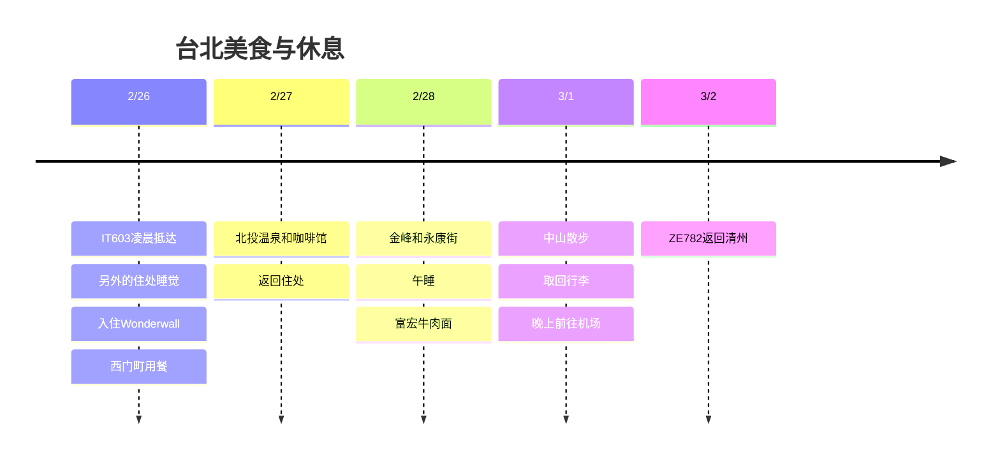

**Wonderwall西门町2/26至3/1的3晚是用户指定的行程。** 2/26凌晨抵达后马上要用的房间需要另外安排。第一个凌晨推荐额外的睡眠住处，白天只去附近的美食店。与其在新年旅行中去过的101和迪化街再花时间，不如专注于**北投一天和住处附近的用餐·休息**。

**2026-10-03查询基准。** 餐厅·温泉的游览只是推荐，尚未预订，时间是包含余量的计划值。所有当地行程均为台湾时间。

## 行程概要

| 日期 | 动线 | 休息 |
|---|---|---|
| 2/25 (周四) 晚 | 前往仁川机场 | 准备2/26午夜之后的出发 |
| 2/26 (周五) | 乘IT603抵达 → 另外的睡眠住处 → 午餐 → 入住Wonderwall → 西门町 | 第一个凌晨的睡眠＋入住后午睡 |
| 2/27 (周六) | 新北投公园·咖啡馆·温泉 → 西门町 | 远途外出每天只去一个区域 |
| 2/28 (周日) | 金峰 → 永康街 → 住处休息 → 富宏 | 下午空出2小时以上 |
| 3/1 (周一) | 退房·寄存行李 → 中山·赤峰街 → 取回行李 → 机场 | 在咖啡馆或按摩中选一项，傍晚休息 |
| 3/2 (周二) | ZE782返回清州 | 早晨抵达 |

## 行程时间线

## 航班与住宿日期

[IT603公开时刻表](https://www.flight.info/IT603)为**2/26 00:30仁川出发 → 02:15抵达台北**。要在**2/25晚上**前往机场。[ZE782](https://www.flight.info/ZE782)按**3/2 02:35出发 → 06:05抵达清州**计划，以实际机票的变更通知为准。

| 类别 | 日期 | 状态 |
|---|---|---|
| Wonderwall西门町 | **2/26入住至3/1退房，3晚** | 用户指定，金额未共享 |
| 第一个凌晨的睡眠候选 | **Twin Star Inn 2/25至2/26，额外1晚** | 推荐·未预订。实际入住为2/26凌晨 |
| 最后一天 | 3/1退房后晚上前往机场 | 不增加客房，寄存行李·室内休息 |

如果选择上面额外的客房，就是**Wonderwall 3晚＋凌晨睡眠用1晚，付费客房共4晚**。旅行卡片上的3晚，显示的是目前指定的Wonderwall住宿晚数。如果Wonderwall延长到2/25客房的报价差不多，用同一家酒店可以减少搬行李。不会只指望2/26预订的免费提前入住就直接抵达。

[Twin Star Inn官方介绍](https://www.tsitaipei.com/)中写有**24小时自助入住机**、地下单人间·共用卫浴。条件是确认**2/26凌晨4点左右抵达·保留客房·入住密码·退房时间**之后再预订。Wonderwall的地址查询为**西寧南路36號9樓之2**，入口·房型要和预订单核对。[Wonderwall位置介绍](https://newway-explore.com/b/wonderwall%E7%BE%8E%E5%A5%BD%E5%A2%83%E7%95%8C---%E5%8F%B0%E5%8C%97%E8%A5%BF%E9%96%80%E9%A4%A8)

如果想在机场里休息，[CHO Stay](https://chostay.com/en/)是**T2南侧5层、入境后使用的住宿**候选，但官方的正式入住是16:00以后，退房是10:00以前。在确认能否接待凌晨之前，不把它当作确定的睡眠地点。不额外花住宿费的方案是在机场普通区域休息到公共交通开始运行，再把行李寄放在Wonderwall，但无法保证在床上睡觉，所以不作为疗愈目的的基本方案推荐。

## 2/26 · 先睡觉，只在西门町用餐

| 当地目标时间 | 行程 |
|---|---|
| 02:15至03:30 | 入境·领取行李 |
| 03:30至04:45 | 乘出租车·预约的车前往额外的睡眠住处·入住 |
| 04:45至11:00 | 睡眠，遵守住处规定的退房时间 |
| 11:00至12:00 | 整理行李·前往Wonderwall·请求寄存。步行有负担就乘车 |
| 12:00至13:00 | 在天天利吃卤肉饭·鸡蛋·汤的组合，或周边餐厅 |
| 13:00至15:00 | 在咖啡馆休息，按Wonderwall预订单上的入住时间入住 |
| 入住后至17:30 | 洗澡·午睡。如果入住延迟，就减少傍晚的散步 |
| 18:00至19:30 | 逛西门町·简单晚餐后返回 |

不为了观光而缩短6小时的睡眠。首日午餐前，也要留出处理中奖验证和领取的时间。如果是2/26凌晨入境，不要错过到次日同一时刻为止的**24小时期限**。

## 2/27 · 北投半日温泉

目标是09:30至10:30 早餐 → 10:30至11:30 乘捷运**西门→台北车站→北投→新北投** → 11:30至13:00 公园·午餐 → 13:00至14:30 温泉 → 14:30至15:30 喝一杯茶 → 16:30前后回到住处。把换乘·步行都算上，单程约1小时作为计划余量。

[台北市观光局把北投介绍为温泉·散步地区](https://www.travel.taipei/zh-tw/attraction/popular-area)。温泉只在**私人汤屋60至90分钟或公共浴池中选一项**，确认实际的设施·费用·可预约时间后再安排。不把博物馆也塞进去，下雨的话就用室内咖啡馆的时间代替公园。**不在同一天加上淡水·阳明山。**

## 2/28 · 从中正纪念堂站到永康街

顺序是10:00 从住处出发 → 11:00至12:00 金峰卤肉饭 → 12:00至13:00 在中正纪念堂周边短暂散步 → 13:00至15:00 东门·永康街的咖啡馆和甜点 → **15:30至17:30 在住处休息** → 18:00至19:00 富宏牛肉面。用捷运中正纪念堂→东门一站衔接，晚餐在住处附近解决。

2/28是与台湾纪念日重合的游览日。如果出了当年的活动·营业公告，就调整游览时间。没有确定会举办收费活动或特别庆典。

## 高性价比用餐候选

| 店铺·地区 | 点餐方向 | 加入行程的方法 |
|---|---|---|
| **天天利美食坊 · 西门町** | 卤肉饭＋鸡蛋＋汤 | 2/26午餐。区公所介绍的地址为漢中街32巷1號，避开周一安排 |
| **阿宗面线 · 西门町** | 一小碗面线 | 只在住处周边饿的时候作为小吃选择 |
| **金峰魯肉飯 · 中正纪念堂站** | 小份卤肉饭＋汤·小菜 | 2/28午餐。排队超过20至30分钟就换成周边餐厅 |
| **富宏牛肉面 · 西门町北侧** | 一碗牛肉面 | 2/28晚餐。不再加上晚了的宵夜 |

地址依据: [天天利区公所介绍](https://whdo.gov.taipei/News_Content.aspx?n=19CABBEF3F991E9E&s=EDF1F022618A79FC&sms=FE5F0DE8FA424CE8)、[阿宗面线万华区公所介绍](https://whdo.gov.taipei/News_Content.aspx?n=19CABBEF3F991E9E&s=C0811D8F9FC97E2E&sms=FE5F0DE8FA424CE8)、[金峰店铺信息](https://tabelog.com/taiwan/A5403/A540307/54002578/)、[富宏店铺信息](https://www.tripadvisor.com.tw/Restaurant_Review-g13806951-d8807417-Reviews-Fuhong_Beef_Noodles-Wanhua_Taipei.html)。菜单价格和2027年营业时间未确定，**每天NT$400至650的餐费只作为计划目标**。温泉·按摩·交通另算。

## 3/1 · 中山散步与回国准备

上午退房·寄存行李 → 11:30至14:00 中山站·赤峰街午餐和咖啡馆 → 14:00至16:00 购物 → 返回西门町·早点吃晚餐 → 18:00至20:30 在咖啡馆或按摩中休息。不假设退房之后可以使用客房·淋浴。

**20:30至21:00 取回行李 → 21:30至22:00 乘机场捷运A1出发 → 22:30至23:00 抵达机场**。这是在[快线到T1约35分钟](https://www.travel.taipei/en/information/taoyuanmetro)的基础上，加上站内步行·等待时间的计划。市内是否支持代办值机尚未确认，所以以使用机场柜台为基本方案。到3/2 02:35起飞前留足余量，最后一天不增加近郊旅行团。

## 重游抽奖 · 第二次申请

按照[官方规定](https://5000.taiwan.net.tw/campaign_rules_en.html)中每次旅行单独登记的原则，**2/26抵达的这次要在2026/11/28至2027/2/19另外登记**。不沿用新年旅行的申请。在高雄登记的e-Gate与抽奖无关，**两次旅行都中奖才能领取两次。** 同时确认预算用完·规定变更的情况。

中奖后按入境后24小时内验证、验证后24小时内领取的流程办理。详细条件和TWAC链接请一并参考[新年旅行的重游介绍](/posts/2026-12-31-taipei-new-year/zh/#重游抽奖--第一次申请)。即使没有这项福利，也按照可行的餐费·住宿预算来计划。

## 时间调整范围

- **如果第一个凌晨订不到床位:** 把2/26的观光全部限定在西门町，优先在正式入住之后睡觉。如果增加了凌晨客房的预订，住宿晚数·总额也要一起更新。
- **如果北投预约太贵或订满:** 去掉温泉，只去公园·咖啡馆，或者换成西门町的按摩·休息。
- **下雨·疲劳·餐厅排队:** 当天减少一处散步。不连续排队等两家名店。
- **最后一天无法寄存行李:** 确认车站寄存柜·有人值守寄存处的营业时间，先确定取回行李的动线。前往机场的时间保持不变。

Wonderwall的价格、第一个凌晨的额外客房、机票以及温泉·按摩费用，因为仍未共享或未预订，所以没有计入费用合计。
