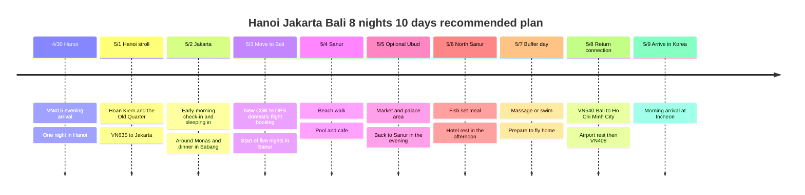

## Trip Summary

**This is a recommended 8-night, 10-day plan: depart on 4/30, 2027, board the return flight from Bali on 5/8 and arrive in Korea on 5/9.** The route confirmed by the traveler is **Incheon → Hanoi → Jakarta → Bali → Ho Chi Minh City → Incheon**. The date and flight number of the domestic flight between Jakarta and Bali, all lodging and all amounts are still undecided.

Hanoi is a one-night stopover, Jakarta is two nights of room booking including an early-morning arrival, and Bali is five nights at a single Sanur hotel. Hotel candidates are centered on Accor but do not mean confirmed bookings. The transit times and visit times below are planning values with some slack, to be adjusted to actual traffic and tickets.

| Date | Route | Sleep and slack |
|---|---|---|
| **Fri 4/30** | VN415 Incheon → Hanoi → hotel | One night in Hanoi, rest right after arrival |
| **Sat 5/1** | Hoan Kiem and the Old Quarter → collect luggage → Hanoi airport → VN635 | Booking the Jakarta room from this day is recommended |
| **Sun 5/2** | Early-morning check-in in Jakarta → sleep in → around Monas → dinner in Sabang | 2–3 hours of pool time and a nap in the afternoon |
| **Mon 5/3** | Jakarta → domestic flight to Bali → check in at Sanur | A new domestic flight booking is needed, dinner near the hotel |
| **Tue 5/4** | Southern Sanur beach → cafe and gelato → swim | A day of resting at the hotel |
| **Wed 5/5** | Optional Ubud palace area, market and cafe → back to Sanur | Only this one day has a long outing |
| **Thu 5/6** | Northern Sanur walk and a fish set meal → hotel rest | If you postponed Ubud, swap with this day |
| **Fri 5/7** | Late breakfast → massage or swim → pack | A buffer day; adding a new long-distance tour is optional |
| **Sat 5/8** | Check out of Sanur → DPS → VN640 → SGN → VN408 | Transit rest at Ho Chi Minh City airport and a night on the plane |
| **Sun 5/9** | Arrive at Incheon | Leave the time after the morning free |

## Itinerary Timeline

## Flights and Date Changes

**Times are based on the public timetable checked on 2026-10-03, and the ticketing record takes priority.** The structured flight records contain the traveler-specified dates, flight numbers and legs, and the lookup times are kept as reference notes. Hanoi, Jakarta and Ho Chi Minh City are UTC+7, Bali is UTC+8 and Korea is UTC+9, so read each leg in local time.

| Boarding date and flight | Public timetable reference | How it is reflected in the plan |
|---|---|---|
| 4/30 **VN415** | ICN 18:05 → HAN 20:35 | Skip night sightseeing on the first day in Hanoi |
| 5/1 **VN635** | HAN 20:00 → **CGK 5/2 00:40** | Book the Jakarta stay from 5/1 and tell the hotel about the early-morning arrival |
| **5/3 CGK → DPS recommended** | Flight number and time undecided, separate booking needed | Compare departures around midday. About 2 hours of flight, and the local clock adds 1 hour |
| 5/8 **VN640** | DPS 16:00 → SGN 18:40 | The departure airport in Bali is DPS, not Jakarta |
| 5/8 **VN408** | SGN 23:45 → **ICN 5/9 06:40** | The end date is 5/9, the day of arrival in Korea |

Lookup sources: [VN415](https://www.flight.info/VN415), [VN635](https://www.flight.info/VN635), [VN640](https://www.flight.info/VN640), [VN408](https://www.flight.info/VN408). They refer to the 2027 summer timetable period and may change later.

**Securing the CGK → DPS connecting flight comes first.** Do not assume this leg is included in the existing international tickets. Compare the 5/3 daytime flights and the total price including baggage, then match the hotel dates. Also check whether the departure airport in Jakarta is **CGK or HLP**. This recommended plan assumes departure from CGK.

## Lodging Layout · All Unbooked Candidates

| City and recommended dates | Candidate | Why chosen and what to check when booking |
|---|---|---|
| Hanoi **4/30–5/1, 1 night** | [Mercure Hanoi la Gare](https://all.accor.com/hotel/7049/index.en.shtml) | 94 Ly Thuong Kiet. For a short city stay. Confirm late arrival and next-day luggage storage |
| Jakarta **5/1–5/3, 2 nights** | [Mercure Jakarta Sabang](https://all.accor.com/hotel/9414/index.en.shtml) | Near the Sabang food street and Monas, with a pool. Tell them about the **early-morning arrival on 5/2** and confirm the 5/1 booking will not be treated as a no-show |
| Bali **5/3–5/8, 5 nights** | [Mercure Resort Sanur](https://all.accor.com/hotel/5474/index.en.shtml) | A relaxation-type candidate with beach access and 2 pools. Current official check-in 15:00, check-out 11:00 |

**The recommended number of nights is 1 + 2 + 5 = 8**, excluding the night on the plane home. If you book Jakarta only from a 5/2 check-in, immediate check-in on the early-morning arrival is not guaranteed. Secure the room for the night of 5/1 in advance, or get a confirmed paid early check-in arrangement separately.

Accor Platinum should be confirmed by **your tier, booking conditions and each hotel's scope of benefits at the time of the 2027 stay**. Early check-in, late checkout, upgrades and lounge access were not built into the plan as confirmed benefits. Without hotel rates, they are not currently reflected in any cost total.

## 4/30–5/1 · Hanoi Stopover

On 4/30, from the reference arrival time of 20:35, after immigration, baggage claim and airport transfer, the **target is to reach the hotel at 22:00–23:00**. It can be later if there are delays, so no restaurant reservation is made.

For 5/1, a suitable pace is **09:00 check out and store luggage → 09:30–12:00 Hoan Kiem Lake → Old Quarter walk**, one meal of pho or bun cha for lunch, and a rest at a cafe in the afternoon. The walking route combining the lake and the Old Quarter follows the [Vietnam Tourism guide](https://vietnam.travel/things-to-do/explore-old-quarter-your-way). Do not widen it to museums, West Lake or outlying tours.

**15:00–15:30 return to the hotel and collect luggage → 15:30–16:00 leave for the airport → target arrival at the airport at 17:00.** Since the international flight is at 20:00 per the public timetable, do not delay leaving for the airport even if lunch in the city runs long. Given holiday demand and road congestion on 4/30 and 5/1, leave earlier if the car's estimated arrival is late.

## 5/2 · Recovering Sleep in Jakarta

If VN635 arrives at 00:40, allow for **arriving at the hotel around 02:00–03:00 as planning slack** after immigration, baggage and the car ride. This is not a fixed check-in time or a guaranteed airport transfer. Leave the morning free and sleep in.

Move around centered on the hotel: **11:30 brunch → 13:00–14:00 walk around Monas → 14:00–17:00 hotel pool and nap → 18:00–20:00 dinner on Jalan Sabang.** Choose the Monas observation deck depending on the queue and whether entry is possible. If the observation deck queue is long or it is hot, just look around and head back. Adding Kota Tua and the southern shopping malls on this day would increase time spent in the car, so they are left out of the base plan.

On Sabang, share two or three dishes, such as **satay + nasi goreng**, and martabak if you still have room. The [Indonesia tourism board](https://www.indonesia.travel/in/en/travel-ideas/gastronomy/explore-jakarta-s-street-food) presents the Sabang street as an evening food area. If a particular shop has a long line, switch to a nearby shop on the same street.

## 5/3 · Domestic Flight, Then Settle into One Place in Sanur

**Searching for flights departing CGK between 12:00 and 14:00 is recommended.** This time is not a booked flight. Once confirmed, work backward for hotel departure by adding 1–2 hours of city transit to arriving at the airport 2 hours before departure. Including the time difference between Jakarta and Bali, Sanur check-in may be late in the afternoon.

For the car ride from Bali airport to Sanur, **allow 45–90 minutes as planning slack**, which can grow with traffic. On arrival day, go no further than check-in, a short beach walk and a nearby dinner. A hotel move that goes up to Ubud first and then back to Sanur is not in the base plan.

## 5/4–5/7 · Resting in Sanur and a One-Day Ubud Trip

| Date | Morning | Afternoon and evening | Adjustable range |
|---|---|---|---|
| **Tue 5/4** | 08:00–09:30 southern beach walk and breakfast | 12:00–15:00 indoor rest → swim → optional Massimo gelato | Do not walk all the way to the north end of the beach and back on the first day |
| **Wed 5/5** | 08:30 leave by car → around the Ubud palace and market | Lunch and cafe → **leave for Sanur at 15:00–15:30** | Plan 1.5–2.5 hours each way. Do not add rice terraces or waterfalls |
| **Thu 5/6** | 10:30 car north to Sanur → lunch at Mak Beng → beach | Back at the hotel around 14:00, swim and nap | If heavy rain is forecast for Ubud, swap with 5/5 |
| **Fri 5/7** | Late breakfast and free stroll | Massage or swim → pack and early dinner | If your body is tired, rest at the hotel all day |

[Sanur](https://www.indonesia.travel/id/en/destination/bali-nusa-tenggara/bali) is a beach where you can see the sunrise. **Do not plan around a sunset over the sea**, and if your wake-up time allows, choose a walk before sunrise. The coastal walk and the hotel swim are separated so the rest plan holds even if the sea is not in good condition.

Walk the [Ubud Market](https://www.indonesia.travel/id/id/destination/bali-nusa-tenggara/bali/ubud-traditional-market) together with the area around the palace, and if market shopping runs long, shorten the cafe time. If the Ubud trip feels like a burden, canceling the whole day trip does not affect later lodging or flight connections. Full-day boat tours such as Nusa Penida are not added to this plan.

### Meal Candidates That Don't Require Going Far

- **Warung Mak Beng:** Jalan Hang Tuah No.45, north Sanur. A lunch candidate with fried fish, fish soup and rice. Included based on the [Indonesia tourism board introduction](https://www.indonesia.travel/gb/en/travel-ideas/gastronomy/warung-mak-beng). It is not a nearby restaurant you can walk to directly from the southern hotel, so pair it with 5/6, when you go to the northern beach, and take a car.
- **Massimo:** Jalan Danau Tamblingan No.228. Checked against the [official menu and address page](https://www.massimobali.com/our-menus/). A meal is optional; include it only as a gelato snack on the afternoon of 5/4. It is an Italian restaurant, so think of it separately from value-for-money local meals.

Recheck opening hours and prices before visiting in 2027. Recommended restaurants and hotels have not been registered as visited records or completed payment items.

## 5/8–5/9 · Leaving Bali and Transit at Ho Chi Minh City Airport

Plan **08:00–09:30 breakfast and a last walk → 10:30 pack → 11:00 check out → 11:00–11:30 leave for the airport.** The goal is to **arrive at the DPS international terminal by 13:00**, with VN640 departing at 16:00 per the public timetable. If the day's car estimate is longer than 90 minutes, leave earlier. Even if late checkout is possible, do not use it to delay the airport departure time.

In Ho Chi Minh City, per the public timetable, it is **arrive 18:40 → depart 23:45, a layover of 5 hours 5 minutes.** After subtracting check-in and the wait before boarding, **eating and resting at the airport** suits better than a round trip into the city. Choose a lounge only when you have a card or ticket condition that allows access, and do not assume free entry.

Check **whether baggage is checked through to Incheon from Bali and whether the VN408 boarding pass is issued.** Since it is not shared whether the two flights are on the same booking or a connected ticket, do not assume the transit works without entering Vietnam. If separate tickets mean collecting baggage and checking in again, confirm Vietnam entry requirements and the check-in route with the airline, and skip going out into the city. If your arrival is delayed, check the next flight's information first.

## Adjustment Range and Order of Next Confirmations

| Situation | What to adjust | What to keep |
|---|---|---|
| Delayed arrival in Hanoi or lack of sleep | Shrink the 5/1 morning walk to 1 hour after lunch | Target arrival at the airport at 17:00 |
| Tired in Jakarta | Skip Monas, only the hotel pool and dinner on Sabang | The 5/3 domestic flight day |
| Domestic flight price or time is poor | Moving on 5/4 instead of 5/3 is also possible, swapping to 3 nights in Jakarta and 4 in Bali | 5/8 must depart from DPS |
| Ubud traffic or weather is a burden | Swap 5/5 and 5/6 or skip Ubud entirely | The consecutive Sanur nights and the rest day before flying home |
| Congestion on the day of leaving Bali | Skip the last beach walk, leave early for the airport | VN640 check-in and boarding |

The next order is **confirm actual international flight times and connected-ticket conditions → secure the CGK–DPS domestic flight → a Jakarta hotel that allows early-morning check-in → the Bali and Hanoi hotels.** When amounts for hotels, the domestic flight, transport and meals are received, add them to the expense table.
