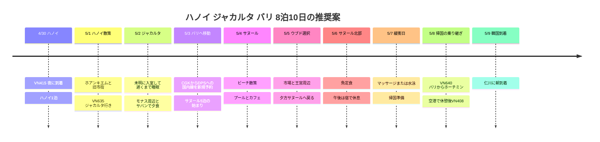

## 旅程の概要

**2027年4/30に出国し、5/8にバリで帰国便に搭乗、韓国到着は5/9となる8泊10日の推奨案**です。ユーザー確認済みのルートは**仁川 → ハノイ → ジャカルタ → バリ → ホーチミン → 仁川**です。ジャカルタとバリの間の国内線の日付・便名、すべての宿と金額はまだ未定です。

ハノイは経由地で1泊、ジャカルタは未明到着を含めて客室2泊、バリはサヌールの1つの宿で5泊と配置しました。ホテルの候補はAccor中心に選びましたが、予約確定を意味するものではありません。以下の移動時間と訪問時刻は余裕を持たせた計画値で、実際の交通・航空券に合わせて調整します。

| 日付 | 動線 | 睡眠・余裕 |
|---|---|---|
| **4/30 金** | VN415 仁川 → ハノイ → 宿 | ハノイ1泊、到着後すぐ休息 |
| **5/1 土** | ホアンキエム・旧市街 → 荷物回収 → ハノイ空港 → VN635 | ジャカルタの客室はこの日からの予約を推奨 |
| **5/2 日** | ジャカルタ未明に入室 → 遅くまで睡眠 → モナス周辺 → サバンで夕食 | 午後のプール・昼寝2〜3時間 |
| **5/3 月** | ジャカルタ → バリ国内線 → サヌールにチェックイン | 国内線は新規予約が必要、夕食は宿の近く |
| **5/4 火** | サヌール南部のビーチ → カフェ・ジェラート → 水泳 | 宿で休む日 |
| **5/5 水** | 選択 ウブド王宮周辺・市場・カフェ → サヌール | 遠出はこの日だけ |
| **5/6 木** | サヌール北部の散歩・魚定食 → 宿で休息 | ウブドを延期したらこの日と入れ替え |
| **5/7 金** | 遅い朝食 → マッサージまたは水泳 → 荷造り | 緩衝日、新しい遠出のツアーを足すのは任意 |
| **5/8 土** | サヌールをチェックアウト → DPS → VN640 → SGN → VN408 | ホーチミン空港で乗り継ぎ休憩・機内泊 |
| **5/9 日** | 仁川到着 | 午前以降の予定は空けておく |

## 旅程タイムライン

## 航空便と日付またぎ

**時刻は2026-10-03に確認した公開ダイヤが基準で、発券内容を優先します**。構造化した航空記録にはユーザー指定の日付・便名・区間を入れ、照会時刻は参考メモとして残しました。ハノイ・ジャカルタ・ホーチミンはUTC+7、バリはUTC+8、韓国はUTC+9なので、各区間は現地時間で読んでください。

| 搭乗日・便名 | 公開ダイヤの参考 | 旅程に反映した点 |
|---|---|---|
| 4/30 **VN415** | ICN 18:05 → HAN 20:35 | ハノイ初日の夜の観光は省略 |
| 5/1 **VN635** | HAN 20:00 → **CGK 5/2 00:40** | 5/1のジャカルタ宿泊を押さえ、実際は未明に到着することをホテルに伝える |
| **5/3 CGK → DPS 推奨** | 便名・時刻は未定、別途予約が必要 | 正午前後の出発候補を比較。飛行時間は約2時間で、現地の時計は1時間進む |
| 5/8 **VN640** | DPS 16:00 → SGN 18:40 | バリの出発空港はDPSで、ジャカルタではない |
| 5/8 **VN408** | SGN 23:45 → **ICN 5/9 06:40** | 終了日は韓国到着日の5/9 |

照会の根拠: [VN415](https://www.flight.info/VN415)、[VN635](https://www.flight.info/VN635)、[VN640](https://www.flight.info/VN640)、[VN408](https://www.flight.info/VN408)。2027年夏ダイヤの区間を参考にしており、今後変更される可能性があります。

**CGK → DPSの接続便の確保が先です。** この区間は既存の国際線に含まれているとは仮定しません。5/3昼の航空便と手荷物込みの総額を比較し、ホテルの日付を合わせます。ジャカルタの出発空港が**CGKかHLPか**も確認します。この推奨案はCGK出発が前提です。

## 宿の配置 · すべて未予約の候補

| 都市・推奨日付 | 候補 | 選んだ理由・予約時の確認事項 |
|---|---|---|
| ハノイ **4/30〜5/1 1泊** | [Mercure Hanoi la Gare](https://all.accor.com/hotel/7049/index.en.shtml) | 94 Ly Thuong Kiet。短い市内滞在向け。遅い到着・翌日の荷物預かりを確認 |
| ジャカルタ **5/1〜5/3 2泊** | [Mercure Jakarta Sabang](https://all.accor.com/hotel/9414/index.en.shtml) | サバンのグルメ通りとモナスの近く、プールあり。**5/2未明の到着**を伝え、5/1の予約がノーショー扱いにならないか確認 |
| バリ **5/3〜5/8 5泊** | [Mercure Resort Sanur](https://all.accor.com/hotel/5474/index.en.shtml) | ビーチへのアクセスとプール2か所が使える休息型の候補。現在の公式チェックインは15:00、チェックアウトは11:00 |

**推奨の宿泊数は1 + 2 + 5 = 8泊**で、帰国の機内泊は除きます。ジャカルタを5/2チェックインだけで予約すると、未明の到着直後の入室は保証されません。5/1夜の客室を先に確保するか、確約された有料のアーリーチェックイン条件を別途もらう必要があります。

Accorプラチナは、**2027年の宿泊時点のステータス・予約条件・ホテルごとの提供範囲**で確認します。アーリーチェックイン、レイトチェックアウト、アップグレードやラウンジ利用を確定した特典として旅程に入れていません。ホテルごとの料金がないため、現時点では費用の合計に反映していません。

## 4/30〜5/1 · ハノイ ストップオーバー

4/30は20:35到着の参考時刻から、入国・荷物受け取りと空港からの移動を経て、**22:00〜23:00に宿へ到着を目標**とします。遅延すればさらに遅くなることもあるので、レストランの予約は入れません。

5/1は**09:00 チェックアウト・荷物預け → 09:30〜12:00 ホアンキエム湖 → 旧市街を散策**、昼にフォーかブンチャーを1食、午後はカフェで休むくらいが適当です。湖と旧市街をまとめる徒歩の動線は[ベトナム政府観光局の案内](https://vietnam.travel/things-to-do/explore-old-quarter-your-way)を参考にしました。博物館・西湖・郊外ツアーまでは広げません。

**15:00〜15:30 宿に戻って荷物を回収 → 15:30〜16:00 空港へ出発 → 17:00 空港到着が目標**です。公開ダイヤ上は20:00の国際線なので、市内の昼食を長くとっても空港への出発は遅らせません。4/30・5/1の連休の需要と道路渋滞に備え、車の到着予想が遅れるときはさらに早く出発します。

## 5/2 · ジャカルタで睡眠を回復

VN635が00:40に到着すると、入国・荷物・車での移動のあと**02:00〜03:00ごろにホテル到着を計画上の余裕として見込みます**。固定のチェックイン時刻や空港からの移動の保証ではありません。午前の予定は空けて遅くまで寝ます。

**11:30 ブランチ → 13:00〜14:00 モナス周辺を散策 → 14:00〜17:00 宿でプール・昼寝 → 18:00〜20:00 ジャラン・サバンで夕食**と、宿を中心に動きます。モナスの展望台は待ち時間・入場の可否を見て選びます。展望台の待ち時間が長かったり暑かったりするときは周辺を見るだけで戻ります。この日にコタ・トゥアや南部のショッピングモールまで加えると車内で過ごす時間が増えるので、基本案からは外しました。

サバンでは**サテ + ナシゴレン**、おなかに余裕があればマルタバを選ぶように、2〜3品を分け合って食べます。[インドネシア観光省](https://www.indonesia.travel/in/en/travel-ideas/gastronomy/explore-jakarta-s-street-food)がサバンの通りを夕食向けのグルメエリアとして案内しています。特定の店に長い行列ができたら、同じ通りの近い店に変えます。

## 5/3 · 国内線で移動してサヌールの1か所に落ち着く

**CGK 12:00〜14:00発の航空便を検索することを推奨**します。この時間は予約済みの便ではありません。確定したら、出発2時間前の空港到着に市内の移動1〜2時間を足して、ホテルの出発時刻を逆算します。ジャカルタとバリの時差を含めると、サヌールのチェックインは午後遅くになることがあります。

バリ空港からサヌールまでの車の移動は**45〜90分を計画上の余裕として見込み**、交通状況によってはさらに延びることもあります。到着日はチェックイン・ビーチの短い散歩・近くでの夕食までにとどめます。先にウブドへ上がってから再びサヌールへ移る宿の移動は、基本案には入れていません。

## 5/4〜5/7 · サヌールでの休息と日帰りのウブド

| 日付 | 午前 | 午後・夕方 | 調整できる範囲 |
|---|---|---|---|
| **5/4 火** | 08:00〜09:30 南のビーチを散歩・朝食 | 12:00〜15:00 室内で休息 → 水泳 → Massimoのジェラートは任意 | 初日から北のビーチの端まで往復しない |
| **5/5 水** | 08:30 車で出発 → ウブド王宮周辺・市場 | 昼食・カフェ → **15:00〜15:30 サヌール行きに出発** | 往復の移動は各1.5〜2.5時間を見込む。棚田・滝は追加しない |
| **5/6 木** | 10:30 車でサヌール北部へ移動 → Mak Bengで昼食 → ビーチ | 14:00前後に宿へ戻る・水泳・昼寝 | ウブドの雨予報が強ければ5/5と入れ替え |
| **5/7 金** | 遅い朝食・自由散策 | マッサージまたは水泳 → 荷造り・早めの夕食 | 疲れていれば1日中宿で休む |

[サヌール](https://www.indonesia.travel/id/en/destination/bali-nusa-tenggara/bali)は日の出を見られるビーチです。**夕日が海の向こうに沈む予定は組まず**、起床時間が合えば日の出前の散歩を選びます。海岸の散歩とホテルでの水泳を分けて、海の状態がよくなくても休息の予定が保てるようにしました。

[ウブド市場](https://www.indonesia.travel/id/id/destination/bali-nusa-tenggara/bali/ubud-traditional-market)は王宮周辺とまとめて歩き、市場での買い物が長引いたらカフェの時間を減らします。ウブドへの移動が負担なら、当日のコース全体をキャンセルしても、その後の宿泊・フライトの接続には影響しません。ヌサ・ペニダなど船に乗る終日ツアーは、この案には加えていません。

### 遠くへ行かない食事の候補

- **Warung Mak Beng:** サヌール北部のJalan Hang Tuah No.45。魚のフライ・魚のスープ・ご飯の構成で昼食をとる候補です。[インドネシア観光省の紹介](https://www.indonesia.travel/gb/en/travel-ideas/gastronomy/warung-mak-beng)を根拠にしました。南のホテルからすぐ歩いて行ける近い店ではないので、北のビーチへ行く5/6にまとめて車を利用します。
- **Massimo:** Jalan Danau Tamblingan No.228。[公式のメニュー・住所案内](https://www.massimobali.com/our-menus/)を確認しました。食事は任意で、5/4午後のジェラートのおやつ程度に入れます。イタリアンなので、ローカルのコスパのよい食事とは別に考えます。

営業時間と価格は2027年の訪問前にあらためて確認します。おすすめのレストラン・ホテルは、訪問記録や決済済みの項目としては登録していません。

## 5/8〜5/9 · バリ出発とホーチミン空港での乗り継ぎ

**08:00〜09:30 朝食・最後の散歩 → 10:30 荷造り → 11:00 チェックアウト → 11:00〜11:30 空港へ出発**とします。目標は**DPS国際線ターミナルに13:00までに到着**で、公開ダイヤ上のVN640は16:00出発です。当日の車の予想が90分より長ければ、出発を早めます。レイトチェックアウトが可能でも、空港への出発時間を遅らせる目的には使いません。

ホーチミンは公開ダイヤ上**18:40到着 → 23:45出発、乗り継ぎ間隔5時間5分**です。手続きと搭乗前の待ち時間を除くと、市内への往復より**空港での食事・休息**が合っています。ラウンジは利用可能なカードや航空券の条件があるときだけ選び、無料で使えるとは仮定しません。

バリで**仁川までの手荷物の接続とVN408の搭乗券の発行**を確認します。2便が同一予約か、接続発券かは共有されていないので、ベトナムに入国せずに乗り継げると断定しません。別発券で荷物の受け取り・再手続きが必要な場合は、ベトナムの入国条件と手続きの動線を航空会社に確認し、市内への外出は省略します。到着が遅れたときは、次の便の案内を先に確認します。

## 時間調整の範囲と次に確定する順序

| 状況 | 調整する内容 | 維持する内容 |
|---|---|---|
| ハノイ到着の遅延・睡眠不足 | 5/1午前の散歩を昼以降の1時間に縮小 | 空港17:00到着の目標 |
| ジャカルタで疲れた | モナスは省略、ホテルのプール・サバンの夕食のみ | 5/3の国内線の移動日 |
| 国内線の価格・時間がよくない | 5/3の代わりに5/4の移動も可、ジャカルタ3泊・バリ4泊に変更 | 5/8は必ずDPSから出発 |
| ウブドの交通・天候が負担 | 5/5と5/6を入れ替えるか、ウブド全体を省略 | サヌールの連泊と帰国前日の休息 |
| バリの帰国日の渋滞 | 最後のビーチ散歩は省略、空港へ早めに出発 | VN640の手続き・搭乗 |

次の順序は**国際線の実際の時刻・接続発券の条件を確認 → CGK〜DPSの国内線を確保 → 未明に入室できるジャカルタの宿 → バリ・ハノイの宿**です。ホテル・国内線・移動・食費は、金額が分かったら費用表に追加します。
