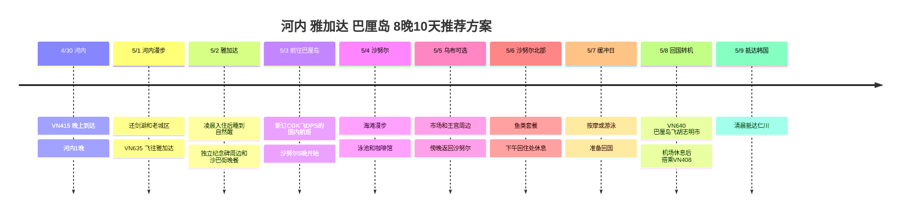

## 行程概要

**2027年4/30出发，5/8在巴厘岛搭乘回程航班，5/9抵达韩国的8晚10天推荐方案**。用户确认的路线是**仁川 → 河内 → 雅加达 → 巴厘岛 → 胡志明市 → 仁川**。雅加达与巴厘岛之间国内航班的日期和航班号、所有住宿和金额都尚未确定。

河内作为中转地住1晚，雅加达含凌晨到达共订2晚客房，巴厘岛在沙努尔的同一家酒店住5晚。酒店候选以Accor为主挑选，但并不代表预订确定。下面的交通耗时和到访时间是留有余量的计划值，会根据实际交通和机票调整。

| 日期 | 路线 | 睡眠·余量 |
|---|---|---|
| **4/30 周五** | VN415 仁川 → 河内 → 住处 | 河内1晚，到达后立刻休息 |
| **5/1 周六** | 还剑湖·老城区 → 取行李 → 河内机场 → VN635 | 建议雅加达客房从这天起预订 |
| **5/2 周日** | 雅加达凌晨入住 → 睡到自然醒 → 独立纪念碑周边 → 沙巴街晚餐 | 下午游泳·午睡2～3小时 |
| **5/3 周一** | 雅加达 → 巴厘岛国内航班 → 沙努尔入住 | 国内航班需新订，晚餐在住处附近 |
| **5/4 周二** | 沙努尔南部海滩 → 咖啡馆·意式冰淇淋 → 游泳 | 在住处休息的日子 |
| **5/5 周三** | 可选 乌布王宫周边·市场·咖啡馆 → 沙努尔 | 远途外出只安排这一天 |
| **5/6 周四** | 沙努尔北部漫步·鱼类套餐 → 回住处休息 | 如果推迟了乌布，就与这天对调 |
| **5/7 周五** | 晚起早餐 → 按摩或游泳 → 整理行李 | 缓冲日，是否新增远途旅游团可选 |
| **5/8 周六** | 沙努尔退房 → DPS → VN640 → SGN → VN408 | 胡志明市机场转机休息·机上过夜 |
| **5/9 周日** | 抵达仁川 | 上午之后的行程留空 |

## 行程时间线

## 航班与跨日

**时间以2026-10-03确认的公开时刻表为准，实际出票信息优先**。结构化航班记录中填入了用户指定的日期、航班号和航段，查询时间作为参考备注保留。河内、雅加达和胡志明市是UTC+7，巴厘岛是UTC+8，韩国是UTC+9，因此各航段请按当地时间阅读。

| 乘机日·航班号 | 公开时刻表参考 | 行程中的体现 |
|---|---|---|
| 4/30 **VN415** | ICN 18:05 → HAN 20:35 | 省略河内第一天的夜游 |
| 5/1 **VN635** | HAN 20:00 → **CGK 5/2 00:40** | 订好5/1的雅加达住宿，并告知酒店实际凌晨到达 |
| **5/3 CGK → DPS 推荐** | 航班号·时间待定，需另行预订 | 比较正午前后出发的候选。飞行约2小时，当地时钟会多1小时 |
| 5/8 **VN640** | DPS 16:00 → SGN 18:40 | 巴厘岛的出发机场是DPS，而不是雅加达 |
| 5/8 **VN408** | SGN 23:45 → **ICN 5/9 06:40** | 结束日是抵达韩国的5/9 |

查询依据：[VN415](https://www.flight.info/VN415)、[VN635](https://www.flight.info/VN635)、[VN640](https://www.flight.info/VN640)、[VN408](https://www.flight.info/VN408)。参考的是2027年夏季时刻表的航段，今后可能变更。

**先确保CGK → DPS的衔接航班。** 不假定这一段已包含在现有国际航班中。比较5/3白天的航班和含行李的总价，并配合酒店日期。还要确认雅加达的出发机场是**CGK还是HLP**。这个推荐方案以CGK出发为准。

## 住宿安排 · 全部是未预订的候选

| 城市·推荐日期 | 候选 | 选择理由·预订时确认事项 |
|---|---|---|
| 河内 **4/30～5/1 1晚** | [Mercure Hanoi la Gare](https://all.accor.com/hotel/7049/index.en.shtml) | 94 Ly Thuong Kiet。适合短暂的市区停留。确认晚到和次日寄存行李 |
| 雅加达 **5/1～5/3 2晚** | [Mercure Jakarta Sabang](https://all.accor.com/hotel/9414/index.en.shtml) | 靠近沙巴街美食街和独立纪念碑，有泳池。告知**5/2凌晨到达**，确认5/1的预订不会被按未到店处理 |
| 巴厘岛 **5/3～5/8 5晚** | [Mercure Resort Sanur](https://all.accor.com/hotel/5474/index.en.shtml) | 可使用海滩通道和2个泳池的休闲型候选。目前官方入住时间15:00，退房时间11:00 |

**推荐住宿晚数是1 + 2 + 5 = 8晚**，不含回国途中的机上过夜。如果雅加达只预订5/2入住，则无法保证凌晨到达后立即入住。需要提前订下5/1晚的客房，或另外取得确定的付费提前入住条件。

Accor白金会员以**2027年入住时的等级、预订条件和各酒店的提供范围**为准确认。提前入住、延迟退房、升级或使用行政酒廊，都没有作为确定的权益写入行程。由于没有各酒店的价格，目前没有计入费用合计。

## 4/30～5/1 · 河内中转停留

4/30按参考到达时间20:35，经过入境、取行李和机场出行后，以**22:00～23:00到达住处为目标**。延误的话可能更晚，所以不预订餐厅。

5/1适合安排为**09:00 退房·寄存行李 → 09:30～12:00 还剑湖 → 老城区漫步**，中午吃一顿河粉或烤肉米线，下午在咖啡馆休息。把湖和老城区串联起来的步行路线参考了[越南旅游局的介绍](https://vietnam.travel/things-to-do/explore-old-quarter-your-way)。不扩展到博物馆、西湖和郊外旅游团。

目标是**15:00～15:30 回住处取行李 → 15:30～16:00 前往机场 → 17:00 到达机场**。按公开时刻表是20:00的国际航班，所以即使市区午餐吃得久，前往机场的时间也不推迟。考虑到4/30、5/1假期的需求和道路拥堵，如果预计车辆到达较晚，就更早出发。

## 5/2 · 在雅加达恢复睡眠

VN635如果00:40到达，经过入境、行李和乘车，**02:00～03:00左右到达酒店是计划中预留的余量**。这并不是固定的入住时间或机场接送的保证。上午不安排行程，睡到自然醒。

**11:30 早午餐 → 13:00～14:00 独立纪念碑周边散步 → 14:00～17:00 在住处游泳·午睡 → 18:00～20:00 沙巴街晚餐**，以住处为中心活动。独立纪念碑观景台视排队和能否入场再选择。如果观景台排队太久或太热，就只看看周边然后回去。这天如果再加上科塔图阿和南部购物中心，在车上的时间会变多，所以基本方案中去掉了。

在沙巴街，点**沙爹 + 印尼炒饭**，如果还有胃口就选马达巴，两三道菜分着吃。[印度尼西亚旅游局](https://www.indonesia.travel/in/en/travel-ideas/gastronomy/explore-jakarta-s-street-food)把沙巴街介绍为晚餐的美食区。如果某家店排起长队，就换同一条街上附近的店。

## 5/3 · 乘国内航班转移，在沙努尔一处安顿下来

**推荐搜索CGK 12:00～14:00出发的航班**。这个时间并不是已预订的航班。确定后，以出发前2小时到达机场，再加上市内出行1～2小时，倒推酒店的出发时间。算上雅加达与巴厘岛的时差，到沙努尔入住可能已是下午较晚。

从巴厘岛机场到沙努尔的车程**计划预留45～90分钟**，视交通情况还可能延长。到达当天只进行入住、海滩短暂散步和附近晚餐。先上乌布再换回沙努尔的住宿移动，没有放进基本方案。

## 5/4～5/7 · 沙努尔休息与一日游乌布

| 日期 | 上午 | 下午·晚上 | 可调整的范围 |
|---|---|---|---|
| **5/4 周二** | 08:00～09:30 南部海滩散步·早餐 | 12:00～15:00 室内休息 → 游泳 → 可选Massimo意式冰淇淋 | 第一天就不要往返走到北边海滩尽头 |
| **5/5 周三** | 08:30 乘车出发 → 乌布王宫周边·市场 | 午餐·咖啡馆 → **15:00～15:30 出发回沙努尔** | 往返车程各按1.5～2.5小时计划。不加梯田和瀑布 |
| **5/6 周四** | 10:30 乘车前往沙努尔北部 → Mak Beng午餐 → 海滩 | 14:00前后回住处·游泳·午睡 | 如果乌布降雨预报严重，就与5/5对调 |
| **5/7 周五** | 晚起早餐·自由散步 | 按摩或游泳 → 整理行李·早点吃晚饭 | 如果身体疲劳，就整天在住处休息 |

[沙努尔](https://www.indonesia.travel/id/en/destination/bali-nusa-tenggara/bali)是可以看日出的海滩。**不安排看夕阳落入海面的行程**，如果起床时间合适，就选择日出前的散步。把海岸散步和酒店游泳分开，这样即使海况不好，休息的安排也能保持。

[乌布市场](https://www.indonesia.travel/id/id/destination/bali-nusa-tenggara/bali/ubud-traditional-market)和王宫周边一起步行游览，如果市场购物拖得久，就缩短咖啡馆的时间。如果前往乌布觉得负担重，取消当天的全部路线，也不会影响之后的住宿和航班衔接。像佩尼达岛这种要乘船的全天旅游团，没有加入这个方案。

### 不用跑远的用餐候选

- **Warung Mak Beng:** 位于沙努尔北部Jalan Hang Tuah No.45。是午餐吃炸鱼、鱼汤和米饭套餐的候选。依据是[印度尼西亚旅游局的介绍](https://www.indonesia.travel/gb/en/travel-ideas/gastronomy/warung-mak-beng)。它并不是从南边酒店可以直接走到的近处餐厅，所以安排在去北边海滩的5/6，并乘车前往。
- **Massimo:** 位于Jalan Danau Tamblingan No.228。确认了[官方菜单和地址介绍](https://www.massimobali.com/our-menus/)。用餐可选，只作为5/4下午的意式冰淇淋小点心。因为是意大利餐厅，要与当地高性价比的饭菜分开考虑。

营业时间和价格在2027年到访前重新确认。推荐的餐厅和酒店没有登记为到访记录或已付款项目。

## 5/8～5/9 · 巴厘岛出发与胡志明市机场转机

安排为**08:00～09:30 早餐·最后一次散步 → 10:30 整理行李 → 11:00 退房 → 11:00～11:30 前往机场**。目标是**13:00前到达DPS国际航班航站楼**，按公开时刻表VN640 16:00起飞。如果当天预计车程超过90分钟，就提前出发。即使可以延迟退房，也不用来推迟前往机场的时间。

胡志明市按公开时刻表**18:40到达 → 23:45出发，转机间隔5小时5分**。扣除手续和登机前的等待，比起往返市区，更适合在**机场用餐·休息**。只有在持有可用的信用卡或机票条件时才选择贵宾室，不假定可以免费使用。

在巴厘岛确认**行李是否直挂到仁川以及VN408登机牌的发放**。两个航班是否同一订单、是否联程出票尚未共享，所以不断定可以不入境越南直接转机。如果是分开出票，需要取行李、重新办理手续，就向航空公司确认越南入境条件和办理流程，并省略市区外出。如果到达延误，先确认下一班航班的通知。

## 时间调整范围与接下来的确定顺序

| 情况 | 调整的内容 | 保持的内容 |
|---|---|---|
| 河内到达延误·睡眠不足 | 把5/1上午的散步缩减为午后1小时 | 17:00到达机场的目标 |
| 在雅加达感到疲劳 | 省略独立纪念碑，只保留酒店游泳和沙巴街晚餐 | 5/3的国内航班转移日 |
| 国内航班的价格·时间不理想 | 也可以改为5/4而不是5/3转移，换成雅加达3晚·巴厘岛4晚 | 5/8必须从DPS出发 |
| 乌布的交通·天气是负担 | 5/5与5/6对调，或省略整个乌布 | 沙努尔连住以及回国前一天的休息 |
| 巴厘岛回国当天拥堵 | 省略最后的海滩散步，提早前往机场 | VN640的办理手续·登机 |

接下来的顺序是**确认国际航班的实际时间和联程出票条件 → 确保CGK～DPS国内航班 → 可凌晨入住的雅加达住宿 → 巴厘岛·河内住宿**。酒店、国内航班、交通和餐费，拿到金额后再加入费用表。
