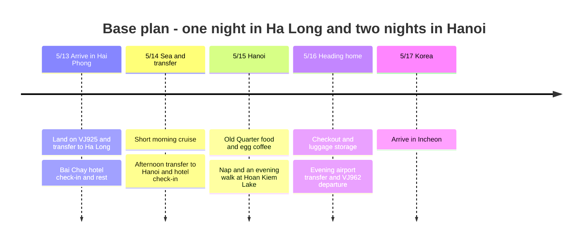

## Itinerary Summary

The base plan is **one night in Ha Long Bay → two nights in Hanoi**. Since the accommodation is still undecided, the Ha Long night is proposed as a **hotel stay in the Bai Chay area**. An overnight cruise, where you sleep at sea, can be compared against the alternative below. Flights and travel dates are specified by the traveler; hotels, cruises and restaurants are unbooked suggestions.

| Date | Travel and activities | Stay and confirmation status |
|---|---|---|
| **Thu 5/13** | Arrive in Hai Phong on VJ925 → transfer to Bai Chay, Ha Long → check in and nap → seaside walk and dinner | Candidate Ha Long hotel, 1 night |
| **Fri 5/14** | Morning 4-hour cruise → pick up luggage → afternoon transfer to Hanoi → hotel rest and Hoan Kiem night view | Candidate Hanoi hotel, night 1 |
| **Sat 5/15** | Pho and St. Joseph's Cathedral → lake and egg coffee → bun cha → nap → Old Quarter dinner | Candidate Hanoi hotel, night 2 |
| **Sun 5/16** | Late breakfast → checkout and luggage storage → relaxed meal and cafe → airport → VJ962 | Night departure, sleeping on the plane |
| **Mon 5/17** | Arrive in Incheon | Next-day arrival per the published schedule |

## Itinerary Timeline

All times are local time in the city concerned. The summer 2027 published schedules checked on 2026-10-03 are [VJ925 Incheon 07:15 → Hai Phong 09:55](https://www.flight.info/VJ925) and [VJ962 Hanoi 23:15 → Incheon 05:30 the next day](https://www.flight.info/VJ962). Plan on **5/16 being the departure day from Vietnam and 5/17 the arrival in Korea**. Actual tickets and airline change notices take priority, and the 3-night count does not include the overnight flight home.

## Accommodation Split and Cruise Choice

| Plan | 5/13 | 5/14 | 5/15 | Selection criteria |
|---|---|---|---|---|
| **Base plan · 1 night Ha Long + 2 nights Hanoi** | Ha Long hotel | Hanoi hotel | Hanoi hotel | Absorbs a first-day flight delay and allows two consecutive nights of rest in Hanoi. The 5/14 morning cruise is booked separately |
| **Sleep-at-sea alternative** | Ha Long hotel | 1-night cruise | Hanoi hotel | For sunset and morning on board. Hanoi shrinks to 1 night and you arrive on the afternoon of 5/15 |

Connecting to an overnight cruise on the arrival day is not part of the base plan. [Indochine Premium lists check-in at 11:30-11:45](https://www.indochinasails.com/en/tour/ha-long-indochine-premium-1-night.html) and [Orchid lists 11:00-11:30](https://www.orchidcruises.com/schedule/itinerary-2-days-1-night/). With a 09:55 landing, plus immigration, baggage and the road transfer, there is not enough margin. Do not treat it as a workable connection without explicit confirmation from the operator that late boarding is accepted.

Grouping the hotels around **Bai Chay in Ha Long and around Hoan Kiem or east of Hanoi Station in Hanoi** keeps transfers simple. [Novotel Ha Long Bay](https://all.accor.com/hotel/6185/index.en.shtml) at 160 Ha Long Road is the Bai Chay hotel candidate, and [Mercure Hanoi La Gare](https://all.accor.com/hotel/7049/index.en.shtml) at 94 Ly Thuong Kiet is the candidate for the two nights in Hanoi. Neither is booked, and neither is assumed to be the cheapest. Compare the all-in total with breakfast and the cancellation terms for the same dates against Old Quarter hotels. For Platinum member benefits too, check each hotel's facilities and same-day availability, and do not count early check-in or late checkout as confirmed in the itinerary.

## Thu 5/13 · From Hai Phong to Ha Long, a Rest Day

| Planned time | Activity | Flexibility |
|---|---|---|
| 09:55-11:30 | Land at Hai Phong, immigration, baggage claim | A planning buffer based on the published arrival time. If delayed, push back what follows in order |
| 11:30-13:30 | Airport → Bai Chay hotel in Ha Long | A planned allowance of 90-120 minutes by car. Varies with actual traffic and vehicle meeting |
| 13:30-15:00 | Luggage storage, lunch, wait for the room | Check-in follows the booking terms |
| 15:00-17:00 | Check in, shower, nap | The main rest block of the first day |
| 17:00-19:30 | Short seaside walk in Bai Chay, seafood or an easy dinner | If it rains, substitute a hotel meal or a cafe |

Adding a meal or sightseeing in Hai Phong city first means hauling luggage and more stops. This time, go straight from the airport to Ha Long and keep first-day sightseeing near the hotel. For the airport pickup, set the destination to the **actual hotel address in Bai Chay** and confirm tolls, waiting fees and whether the vehicle is private. Fix the price and travel time after receiving a quote.

## Fri 5/14 · Sea in the Morning, Hanoi in the Afternoon

The plan assumes a **4-hour cruise departing around 8 am and returning around noon**. The [Vivu Halong tour](https://vivuhalong.com/en/tour/halong-bay-day-tour-4-hour-cruise/) lists hotel pickup in Bai Chay at 07:00-07:30, departure from Ha Long International Port, a route past Thien Cung Cave and Ba Hang, lunch on board and a return at 11:50-12:10. This is the current sales itinerary, so **confirm 2027-05-14 operation, inclusions and hotel pickup before booking**. Do not confuse the port with other tours departing from Tuan Chau Harbor.

| Planned time | Activity | Connection conditions |
|---|---|---|
| 06:15-07:00 | Light breakfast, checkout, luggage storage | If breakfast starts later, prepare simple food the day before. Arrange luggage storage with the hotel |
| 07:00-12:30 | Pickup, 4-hour cruise, return to the hotel | Kayaking is optional; rest on board if tired. Leave luggage at the hotel |
| 12:30-13:30 | Retrieve luggage, restroom, time to board the vehicle | Avoid a tight bus connection right after docking |
| 13:30-17:00 | Ha Long → Hanoi hotel | Plan a 3-3.5 hour buffer including stops and entering the city; confirm the actual dispatch |
| 17:00-18:30 | Hotel check-in and rest | Skip the walk if you arrive late |
| 18:30-20:30 | Nearby dinner and a short walk at Hoan Kiem Lake | After a full day of travel, visit only one area |

Choosing a vehicle that departs from the hotel avoids the problem of carrying luggage aboard the boat. For a shared limousine, confirm hotel pickup, the drop-off address in Hanoi and the luggage allowance, and compare the cost of a private car if there is no departure in that time slot. **If the morning tour does not operate and you switch to a 6-8 hour daytime cruise, push the arrival in Hanoi to the evening and drop the night-view plan.**

## Sat 5/15 · Hanoi Old Quarter Food and a Nap

Make one loop from the hotel: **Pho 10 Ly Quoc Su → St. Joseph's Cathedral → west and north of the lake → Cafe Giang → Bun Cha Dac Kim → hotel**. The Old Quarter and Hoan Kiem are an area that is easy to combine on foot. [Vietnam Tourism's Old Quarter guide](https://vietnam.travel/things-to-do/explore-old-quarter-your-way)

| Planned time | Activity | Light adjustments |
|---|---|---|
| 08:30-09:30 | Breakfast at Pho 10 Ly Quoc Su | If you eat plenty at the hotel breakfast, move the pho to the next day |
| 09:30-10:45 | Exterior of St. Joseph's Cathedral → walk around the lake | Focus on shade and cafes; shorten the walking sections if hot |
| 10:45-11:45 | Egg coffee at Cafe Giang | Based on the 39 Nguyen Huu Huan branch |
| 12:00-13:00 | Lunch at Bun Cha Dac Kim | If the wait is long, switch to a nearby bun cha restaurant |
| 13:30-16:30 | Hotel nap and rest | Keep this block even if you compress the morning route |
| 17:30-20:30 | Old Quarter dinner and lake night view | Soak up the Ta Hien Street atmosphere for just 30-60 minutes more if you have energy left |

[Pho 10 Ly Quoc Su](https://guide.michelin.com/ph/en/ha-noi/ha-noi_2974158/restaurant/pho-10-ly-quoc-su) is a pho shop at **10 Ly Quoc Su**, and [Bun Cha Dac Kim](https://guide.michelin.com/us/en/ha-noi/ha-noi_2974158/restaurant/bun-cha-%C4%91ac-kim) is a bun cha shop at **1 Hang Manh**. The **39 Nguyen Huu Huan** branch was chosen to match [Cafe Giang's official information](https://cafegiang.vn/pages/about-us). Recheck restaurant prices and opening hours before visiting, and confirm the address so you are not directed to a similarly named shop.

## Sun 5/16 · Check Out and Leave Without Rushing

Rather than adding an outlying tour from the morning, finish with meals, cafes and souvenir shopping around Hoan Kiem. **Hotel checkout and luggage storage follow the booking terms**; since you will need somewhere to rest afterward, keep a cafe or a separate day-use room as an option for 14:00-17:00. Use late checkout or a post-checkout shower only if the hotel has confirmed it is possible.

| Planned time | Activity |
|---|---|
| 09:00-12:00 | Breakfast, checkout, luggage storage, one missed pho or cafe stop |
| 12:00-17:00 | Lunch, indoor rest, light shopping, a day-use room if needed |
| 17:00-18:30 | Early dinner → retrieve and sort luggage at the hotel |
| **18:45-19:00** | Target departure from the hotel to the airport |
| **20:00-20:15** | Target arrival at Noi Bai international terminal |
| 23:15 | VJ962 departure (reference time) → arrive in Incheon at 05:30 on 5/17 (reference time) |

The city-to-airport leg has a **60-90 minute planning buffer**, including traffic and pickup waiting. If the flight time changes on the departure day, work backward from **arriving at the airport 3 hours before departure**. Do not put the last activity before the airport on the outskirts.

## Time Adjustment Ranges

| Situation | Keep | Cut or change |
|---|---|---|
| Delayed arrival on day 1 | Transfer to Ha Long, a meal, sleep | Drop the beach walk; do not try a same-day cruise connection |
| Cruise canceled or rough seas | Hotel rest and the trip to Hanoi | Check cancellation terms, then move to Hanoi early or sit in an indoor cafe |
| Morning cruise sold out | 1 night Ha Long, 2 nights Hanoi | Choose a longer daytime cruise with an evening arrival in Hanoi, or skip the cruise |
| Prioritize an overnight cruise | Board on 5/14, disembark on 5/15 | Change to 1 night in Hanoi; do only part of the 5/15 food walk on 5/16 |
| Tired of walking or hot | Lunch and the afternoon hotel rest | Skip one morning restaurant or cafe, take Grab for some legs |
| Return flight changes | Airport arrival buffer | Cut the 5/16 cafe and shopping time first |

## Booking and Cost Status

No payment amounts for flights, hotels or cruises have been shared so far, so **no cost total has been made**. The hotels are also not recorded as confirmed bookings yet.

Making the next decisions will firm up the itinerary. First decide whether to keep **1 night in a Ha Long hotel + 2 nights in Hanoi** or change to **1 night in a Ha Long hotel + 1 night on an overnight cruise + 1 night in Hanoi**. If you choose the base plan, confirm the 5/14 morning cruise operation, luggage storage and the vehicle connection to Hanoi after 13:30 together. Then compare hotel totals, breakfast, cancellation terms, and the inclusions for airport pickup and the cruise. Apart from booking deadlines, the schedule above gives target times for arranging the itinerary.
