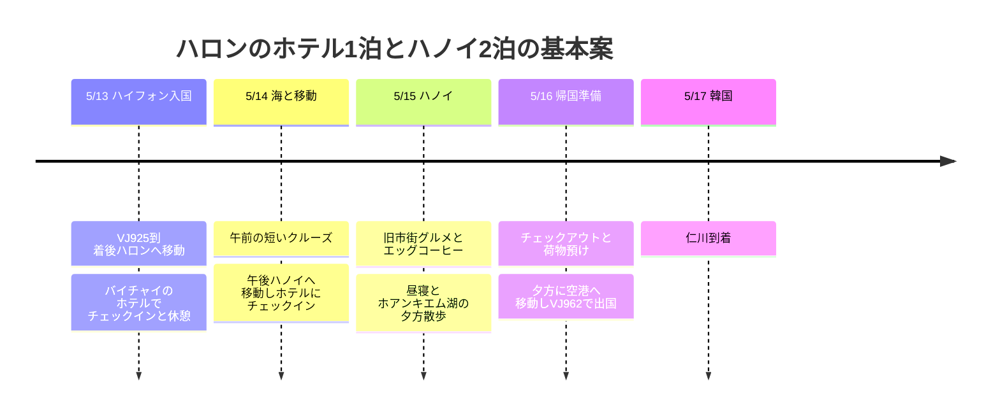

## 旅程の概要

**ハロン湾1泊 → ハノイ2泊を基本案**とします。まだ宿を検討中のため、ここでのハロン1泊は**バイチャイ地区のホテル泊**として提案します。海上で眠る宿泊クルーズは、下の代替案と比較して決めればよいでしょう。航空便と搭乗日はユーザー指定で、宿・クルーズ・レストランは未予約の提案です。

| 日付 | 移動と予定 | 宿泊・確定状況 |
|---|---|---|
| **5/13 (木)** | VJ925でハイフォン到着 → ハロン・バイチャイへ移動 → チェックイン・昼寝 → 海辺の散歩・夕食 | ハロンのホテル1泊候補 |
| **5/14 (金)** | 午前に4時間クルーズ → 荷物回収 → 午後ハノイへ移動 → ホテルで休憩・ホアンキエムの夜景 | ハノイ1泊目候補 |
| **5/15 (土)** | フォー・聖ヨセフ大聖堂 → 湖・エッグコーヒー → ブンチャー → 昼寝 → 旧市街で夕食 | ハノイ2泊目候補 |
| **5/16 (日)** | 遅めの朝食 → チェックアウト・荷物預け → ゆったり食事・カフェ → 空港 → VJ962 | 夜に出国・機内泊 |
| **5/17 (月)** | 仁川到着 | 公開時刻表では翌日到着 |

## 旅程タイムライン

すべての時刻は各都市の現地時間です。2026-10-03に確認した2027年夏ダイヤの公開時刻表は、[VJ925 仁川07:15 → ハイフォン09:55](https://www.flight.info/VJ925)、[VJ962 ハノイ23:15 → 仁川翌日05:30](https://www.flight.info/VJ962)です。**5/16はベトナム出発日、韓国到着は5/17**として計画します。実際の航空券・航空会社の変更案内を優先し、宿泊数の3泊には帰国時の機内泊を含めていません。

## 宿泊の配分とクルーズの選択

| 案 | 5/13 | 5/14 | 5/15 | 選択基準 |
|---|---|---|---|---|
| **基本案 · ハロン1泊 + ハノイ2泊** | ハロンのホテル | ハノイのホテル | ハノイのホテル | 初日のフライト遅延を吸収でき、ハノイで2日連続で休みやすい。5/14午前のクルーズは別途 |
| **海上宿泊優先の代替案** | ハロンのホテル | 1泊クルーズ | ハノイのホテル | 船上の夕日・朝を見たいとき。ハノイの宿泊は1泊に減り、5/15午後到着 |

到着当日の宿泊クルーズへの接続は基本案に入れません。[Indochine Premiumは11:30〜11:45受付](https://www.indochinasails.com/en/tour/ha-long-indochine-premium-1-night.html)、[Orchidは11:00〜11:30受付](https://www.orchidcruises.com/schedule/itinerary-2-days-1-night/)と案内しています。09:55着陸後の入国・手荷物・陸路移動まで考えると余裕がありません。遅れての乗船を受け入れるという運航会社の明確な確認がない限り、接続可能な旅程とはみなしません。

ホテルは**ハロンはバイチャイ、ハノイはホアンキエム周辺またはハノイ駅の東側**にまとめると移動がシンプルになります。[ノボテル ハロンベイ](https://all.accor.com/hotel/6185/index.en.shtml)は160 Ha Long Roadのバイチャイの宿泊候補、[メルキュール ハノイ ラ・ガール](https://all.accor.com/hotel/7049/index.en.shtml)は94 Ly Thuong Kietのハノイ2泊の候補とします。どちらのホテルも未予約で、最安値とは断定しません。同じ日付の朝食込み総額・キャンセル条件を旧市街のホテルと比較します。プラチナ会員の特典もホテルごとの提供設備と当日の可否を確認し、早めのチェックイン・レイトチェックアウトを確定した予定として計算しません。

## 5/13 (木) · ハイフォンからハロンへ、初日は休息

| 計画時間 | 予定 | 調整の範囲 |
|---|---|---|
| 09:55〜11:30 | ハイフォン到着・入国・手荷物受け取り | 公開到着時刻を基準にした計画上の余裕。遅れたら以降の予定を順に後ろへずらす |
| 11:30〜13:30 | 空港 → ハロン・バイチャイの宿 | 車で90〜120分を確保する計画値。実際の交通・車の集合状況により変動 |
| 13:30〜15:00 | 荷物預け・昼食・客室準備の待機 | チェックインは予約条件による |
| 15:00〜17:00 | チェックイン・シャワー・昼寝 | 初日の主な休息時間帯 |
| 17:00〜19:30 | バイチャイの海辺を短く散歩・シーフードまたは気軽な夕食 | 雨なら宿の食事・カフェで代替 |

ハイフォン市内での食事や観光を先に挟むと、荷物を積んだまま停車が増えます。今回は空港からハロンへ直行し、初日の観光は宿の周辺に限定します。空港送迎は目的地を**バイチャイの実際の宿の住所**に指定し、通行料・待機料・車の貸切かどうかを確認します。金額と移動時間は見積もりを受け取ってから確定します。

## 5/14 (金) · 午前は海、午後はハノイ

**8時台出港 → 12時頃帰港の4時間クルーズ**を基準にします。[Vivu Halongの商品](https://vivuhalong.com/en/tour/halong-bay-day-tour-4-hour-cruise/)は、バイチャイのホテルで07:00〜07:30にピックアップ、Ha Long International Port出港、ティエンクン洞窟・バーハン方面、船上ランチの後11:50〜12:10に帰港と案内しています。これは現在販売中の日程であり、**2027-05-14の運航・含まれる項目・宿のピックアップは予約前に確認**します。トゥアンチャウ港から出発する他の商品と港を混同しないようにします。

| 計画時間 | 予定 | 接続条件 |
|---|---|---|
| 06:15〜07:00 | 簡単な朝食・チェックアウト・荷物預け | 朝食開始前なら前日に軽食を用意。ホテルと荷物預けについて合意 |
| 07:00〜12:30 | ピックアップ・4時間クルーズ・宿へ戻る | カヤックは任意、疲れたら船上で休憩。荷物はホテルに預ける |
| 12:30〜13:30 | 荷物回収・トイレ・車に乗る余裕 | 帰港直後の慌ただしいバス接続を避ける |
| 13:30〜17:00 | ハロン → ハノイのホテル | 停車・市内進入を含め3〜3.5時間の計画上の余裕、実際の手配を確認 |
| 17:00〜18:30 | ホテルでチェックイン・休憩 | 到着が遅ければ散歩は省略 |
| 18:30〜20:30 | 近くで夕食・ホアンキエム湖を短く散歩 | 一日中移動した後は一つのエリアだけ訪問 |

ホテルに戻ってから出発する車を選べば、荷物を船に積む問題を減らせます。乗り合いリムジンは、宿のピックアップ・ハノイでの降車住所・荷物の許容量を確認し、その時間帯に配車がなければ貸切車の費用と比較します。**午前の商品が運航されず6〜8時間の日中クルーズに変える場合は、ハノイ到着を夕方に遅らせ、夜景の予定を削ります**。

## 5/15 (土) · ハノイ旧市街のグルメと昼寝

宿 → **フォー10 リークオックスー → 聖ヨセフ大聖堂 → 湖の西側・北側 → カフェ・ジャン → ブンチャー・ダックキム → 宿**の順にひと回りします。旧市街とホアンキエムは徒歩でまとめやすいエリアです。[ベトナム観光局の旧市街ガイド](https://vietnam.travel/things-to-do/explore-old-quarter-your-way)

| 計画時間 | 予定 | 気軽に調整 |
|---|---|---|
| 08:30〜09:30 | フォー10 リークオックスーで朝食 | 宿の朝食をしっかり食べるなら、フォーは翌日に移動 |
| 09:30〜10:45 | 聖ヨセフ大聖堂の外観 → 湖周辺を散策 | 日陰・カフェ中心、暑ければ徒歩区間を短縮 |
| 10:45〜11:45 | カフェ・ジャンでエッグコーヒー | 39 Nguyen Huu Huan店を基準 |
| 12:00〜13:00 | ブンチャー・ダックキムで昼食 | 待ち時間が長ければ近くのブンチャーの店に変更 |
| 13:30〜16:30 | ホテルで昼寝・休憩 | 午前の動線を圧縮してもこの時間帯は維持 |
| 17:30〜20:30 | 旧市街で夕食・湖の夜景 | ターヒエン通りの雰囲気を眺めるのは、体力が残っていれば30〜60分だけ追加 |

[フォー10 リークオックスー](https://guide.michelin.com/ph/en/ha-noi/ha-noi_2974158/restaurant/pho-10-ly-quoc-su)は**10 Ly Quoc Su**のフォーの店、[ブンチャー・ダックキム](https://guide.michelin.com/us/en/ha-noi/ha-noi_2974158/restaurant/bun-cha-%C4%91ac-kim)は**1 Hang Manh**のブンチャーの店です。[カフェ・ジャン公式案内](https://cafegiang.vn/pages/about-us)に合わせて**39 Nguyen Huu Huan**店を選びました。レストランの価格と営業は訪問前に再確認し、名前の似た別の店に案内されないよう住所も一緒に確認します。

## 5/16 (日) · チェックアウト後にゆったり出国

朝から郊外ツアーを入れるより、ホアンキエム周辺で食事・カフェ・お土産ショッピングを済ませます。**宿のチェックアウトと荷物預けは予約条件どおり**、その後は休む場所が必要なので、14:00〜17:00にカフェまたは別のデイユース客室を選べるようにしておきます。レイトチェックアウト・チェックアウト後のシャワーは、可能だというホテルの回答を得たときだけ使います。

| 計画時間 | 予定 |
|---|---|
| 09:00〜12:00 | 朝食・チェックアウト・荷物預け、食べ逃したフォーやカフェを1軒 |
| 12:00〜17:00 | 昼食・屋内で休憩・軽いショッピング、必要ならデイユース |
| 17:00〜18:30 | 早めの夕食 → 宿で荷物を回収・整理 |
| **18:45〜19:00** | 宿から空港へ出発する目標 |
| **20:00〜20:15** | ノイバイ国際線ターミナル到着の目標 |
| 23:15 | VJ962出発の参考時刻 → 5/17仁川05:30到着の参考 |

市内 → 空港は、交通と送迎の待ち時間を含めて**60〜90分の計画上の余裕**を取りました。出国当日に航空便の時刻が変わったら、**出発3時間前に空港到着**を基準に逆算します。空港出発前の最後の予定を郊外に置かないようにします。

## 時間調整の範囲

| 状況 | 維持するもの | 減らす・変えるもの |
|---|---|---|
| 初日の到着遅延 | ハロンの宿への移動・食事・睡眠 | 海辺の散歩を削除、クルーズへの当日接続は試みない |
| 船の運航中止・海況の悪化 | 宿での休憩とハノイ移動 | クルーズのキャンセル条件を確認後、ハノイへ早めに移動、または屋内カフェ |
| 午前のクルーズが満席 | ハロン1泊・ハノイ2泊 | 長めの日中クルーズとハノイへの夕方到着を選ぶか、クルーズを省略 |
| 宿泊クルーズを優先 | 5/14クルーズ乗船・5/15下船 | ハノイ1泊に変更、5/15のグルメ徒歩コースは5/16に一部だけ |
| 歩くのが疲れる・暑い | 昼食・午後のホテル休憩 | 午前のレストラン・カフェのうち1軒を省略、区間をGrabで移動 |
| 帰国便の変更 | 空港到着の余裕 | 5/16のカフェ・ショッピングの時間を先に短縮 |

## 予約と費用の状況

現時点で共有された航空券・ホテル・クルーズの支払い金額がないため、**費用の合計は作成していません**。ホテルもまだ確定予約として記録しません。

次の決定をすると旅程が具体化します。まず**ハロンのホテル1泊 + ハノイ2泊**を維持するか、**ハロンのホテル1泊 + 宿泊クルーズ1泊 + ハノイ1泊**に変えるかを決めます。基本案を選ぶ場合は、5/14午前のクルーズの運航と荷物預け、13:30以降のハノイ行きの車の接続を合わせて確認します。そのうえでホテルの総額・朝食・キャンセル条件、空港送迎とクルーズの含まれる項目を比較します。上の時刻表は、予約締切時刻を除けば、旅程を配置するための目標時間です。
