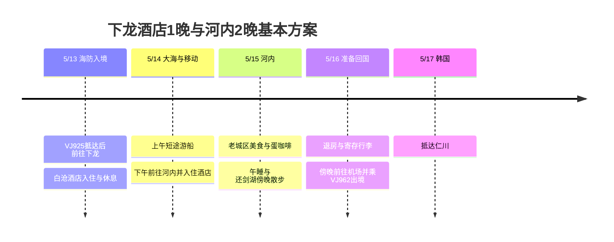

## 行程概要

以**下龙湾1晚 → 河内2晚作为基本方案**。由于还在考虑住宿，这里的下龙1晚建议**住在白沧一带的酒店**。至于在海上过夜的过夜游轮，可以对照下面的替代方案来决定。航班和乘机日期由用户指定，住宿、游船、餐厅均为未预订的建议。

| 日期 | 交通与行程 | 住宿·确定状态 |
|---|---|---|
| **5/13 周四** | VJ925抵达海防 → 前往下龙白沧 → 入住·午睡 → 海边散步·晚餐 | 下龙酒店1晚候选 |
| **5/14 周五** | 上午4小时游船 → 取回行李 → 下午前往河内 → 酒店休息·还剑湖夜景 | 河内第1晚候选 |
| **5/15 周六** | 河粉·圣若瑟主教座堂 → 湖边·蛋咖啡 → 烤肉米线 → 午睡 → 老城区晚餐 | 河内第2晚候选 |
| **5/16 周日** | 晚些吃早餐 → 退房·寄存行李 → 悠闲用餐·咖啡馆 → 机场 → VJ962 | 夜间出境·机上过夜 |
| **5/17 周一** | 抵达仁川 | 按公开时刻表为次日抵达 |

## 行程时间线

所有时间均为当地城市时间。2026-10-03确认的2027年夏季公开时刻表为[VJ925 仁川07:15 → 海防09:55](https://www.flight.info/VJ925)、[VJ962 河内23:15 → 仁川次日05:30](https://www.flight.info/VJ962)。按**5/16为越南出发日、5/17抵达韩国**来规划。以实际机票和航空公司的变更通知为准，3晚的住宿晚数不包含回国时的机上过夜。

## 住宿分配与游轮选择

| 方案 | 5/13 | 5/14 | 5/15 | 选择标准 |
|---|---|---|---|---|
| **基本方案 · 下龙1晚 + 河内2晚** | 下龙酒店 | 河内酒店 | 河内酒店 | 可以消化第一天的航班延误，在河内连续两天好好休息。5/14上午游船另算 |
| **优先海上过夜的替代方案** | 下龙酒店 | 1晚游轮 | 河内酒店 | 想在船上看日落和清晨时。河内住宿减为1晚，5/15下午抵达 |

基本方案不安排抵达当天衔接过夜游轮。[Indochine Premium为11:30～11:45办理登船](https://www.indochinasails.com/en/tour/ha-long-indochine-premium-1-night.html)，[Orchid为11:00～11:30办理登船](https://www.orchidcruises.com/schedule/itinerary-2-days-1-night/)。考虑到09:55落地后还要办理入境、取行李和陆路转移，时间不够宽裕。在运营方没有明确确认可接受晚到登船之前，不视为可衔接的行程。

酒店若**下龙选白沧、河内选还剑湖周边或河内火车站东侧**，交通会比较简单。[下龙湾诺富特酒店](https://all.accor.com/hotel/6185/index.en.shtml)为160 Ha Long Road的白沧住宿候选，[河内美居拉加尔酒店](https://all.accor.com/hotel/7049/index.en.shtml)为94 Ly Thuong Kiet的河内2晚候选。两家酒店都尚未预订，也不断言是最低价。将同一日期含早餐的总价和取消条件与老城区酒店进行比较。铂金会员权益也要确认各酒店提供的设施和当天是否可用，不把提前入住、延迟退房计入确定的行程。

## 5/13 (周四) · 从海防到下龙，第一天以休息为主

| 计划时间 | 行程 | 调整范围 |
|---|---|---|
| 09:55～11:30 | 抵达海防·入境·领取行李 | 以公开到达时间为基准的计划余量。若延误，后续行程依次顺延 |
| 11:30～13:30 | 机场 → 下龙白沧住宿 | 预留90～120分钟车程的计划值。根据实际交通和集合用车情况变动 |
| 13:30～15:00 | 寄存行李·午餐·等待客房准备好 | 入住取决于预订条件 |
| 15:00～17:00 | 入住·淋浴·午睡 | 第一天的核心休息时段 |
| 17:00～19:30 | 白沧海边短暂散步·海鲜或轻松的晚餐 | 下雨则改为在住宿用餐或去咖啡馆 |

如果先安排海防市区的用餐或观光，带着行李会增加停靠。这次从机场直接前往下龙，第一天的观光仅限住宿周边。机场接送要把目的地指定为**白沧实际住宿的地址**，并确认过路费、等候费以及是否包车。金额和行驶时间在拿到报价后确定。

## 5/14 (周五) · 上午看海，下午去河内

以**8点多出港 → 12点左右返港的4小时游船**为基准。[Vivu Halong的产品](https://vivuhalong.com/en/tour/halong-bay-day-tour-4-hour-cruise/)提供07:00～07:30在白沧酒店接客、从Ha Long International Port出港、天宫洞和巴杭片区、船上午餐后11:50～12:10返港。这是目前在售的行程，**2027-05-14的运营情况、包含项目和住宿接送需在预订前确认**。不要与从土周港出发的其他产品混淆港口。

| 计划时间 | 行程 | 衔接条件 |
|---|---|---|
| 06:15～07:00 | 简单早餐·退房·寄存行李 | 若早餐尚未开始，前一天准备简单的食物。与酒店商定行李寄存 |
| 07:00～12:30 | 接送·4小时游船·返回住宿 | 皮划艇可选，累了就在船上休息。行李寄存在酒店 |
| 12:30～13:30 | 取行李·上洗手间·上车的余裕 | 避免返港后紧迫的巴士衔接 |
| 13:30～17:00 | 下龙 → 河内酒店 | 含停靠和进入市区，计划余量3～3.5小时，需确认实际发车安排 |
| 17:00～18:30 | 酒店入住·休息 | 若到得晚就省去散步 |
| 18:30～20:30 | 附近晚餐·还剑湖短暂散步 | 一整天移动后只游览一个区域 |

选择从酒店返回后出发的车辆，可以减少把行李装上船的问题。拼车商务车需确认酒店接客、河内下车地址和行李限额，若该时段没有班次，就与包车费用比较。**如果上午的产品不运营，改为6～8小时的白天游轮，则把抵达河内的时间推迟到傍晚，并删除夜景行程**。

## 5/15 (周六) · 河内老城区美食与午睡

按照住宿 → **Pho 10 Ly Quoc Su → 圣若瑟主教座堂 → 湖西侧、北侧 → 江咖啡 → Bun Cha Dac Kim → 住宿**的顺序转一圈。老城区和还剑湖是适合步行串联的区域。[越南旅游局老城区指南](https://vietnam.travel/things-to-do/explore-old-quarter-your-way)

| 计划时间 | 行程 | 轻松调整 |
|---|---|---|
| 08:30～09:30 | Pho 10 Ly Quoc Su早餐 | 若酒店早餐吃得充足，河粉改到次日 |
| 09:30～10:45 | 圣若瑟主教座堂外观 → 湖边散步 | 以阴凉处和咖啡馆为主，太热就缩短步行路段 |
| 10:45～11:45 | 江咖啡蛋咖啡 | 以39 Nguyen Huu Huan分店为准 |
| 12:00～13:00 | Bun Cha Dac Kim午餐 | 若排队太久，改为附近的烤肉米线店 |
| 13:30～16:30 | 酒店午睡·休息 | 即使压缩上午路线也保留这个时段 |
| 17:30～20:30 | 老城区晚餐·湖边夜景 | 逛逛打铁街（Ta Hien）的氛围，体力有余再增加30～60分钟 |

[Pho 10 Ly Quoc Su](https://guide.michelin.com/ph/en/ha-noi/ha-noi_2974158/restaurant/pho-10-ly-quoc-su)是**10 Ly Quoc Su**的河粉店，[Bun Cha Dac Kim](https://guide.michelin.com/us/en/ha-noi/ha-noi_2974158/restaurant/bun-cha-%C4%91ac-kim)是**1 Hang Manh**的烤肉米线店。依据[江咖啡官方介绍](https://cafegiang.vn/pages/about-us)选择了**39 Nguyen Huu Huan**分店。餐厅价格和营业情况需在前往前再次确认，并一同核对地址，避免被带到名字相似的其他店。

## 5/16 (周日) · 退房后从容出境

与其一早就安排郊外游览，不如在还剑湖周边完成用餐、咖啡馆和购买纪念品。**酒店退房和行李寄存按预订条件办理**，之后需要休息的地方，所以14:00～17:00可选择咖啡馆或另订日用房。延迟退房、退房后淋浴，仅在得到酒店答复确认可行时才使用。

| 计划时间 | 行程 |
|---|---|
| 09:00～12:00 | 早餐·退房·寄存行李，补上错过的河粉或一家咖啡馆 |
| 12:00～17:00 | 午餐·室内休息·轻松购物，必要时订日用房 |
| 17:00～18:30 | 早点吃晚餐 → 回酒店取行李·整理 |
| **18:45～19:00** | 目标从酒店出发前往机场 |
| **20:00～20:15** | 目标抵达内排国际航站楼 |
| 23:15 | VJ962起飞参考时间 → 5/17仁川05:30抵达参考 |

市区 → 机场包含交通和接送等待在内，预留了**60～90分钟的计划余量**。若出境当天航班时间有变，以**起飞前3小时到达机场**为基准倒推。机场出发前的最后一项行程不要安排在郊外。

## 时间调整范围

| 情况 | 保留的内容 | 减少或更改的内容 |
|---|---|---|
| 第一天抵达延误 | 前往下龙住宿·用餐·睡眠 | 取消海边散步，不尝试当天衔接游轮 |
| 船只停航·海况恶化 | 住宿休息与前往河内 | 确认游船取消条件后提前前往河内，或去室内咖啡馆 |
| 上午游船售罄 | 下龙1晚·河内2晚 | 选择较长的白天游轮和傍晚抵达河内，或省略游船 |
| 优先过夜游轮 | 5/14登上游轮·5/15下船 | 改为河内1晚，5/15的美食步行路线只在5/16完成一部分 |
| 走路累或天气热 | 午餐·下午酒店休息 | 省略上午餐厅·咖啡馆中的1家，路段改乘Grab |
| 回程航班变更 | 到达机场的余裕 | 先缩短5/16的咖啡馆·购物时间 |

## 预订与费用状态

目前没有共享的机票、酒店、游轮的付款金额，所以**没有汇总费用**。酒店也尚未记录为确定预订。

做出下面的决定后，行程就会具体化。首先决定是保留**下龙酒店1晚 + 河内2晚**，还是改为**下龙酒店1晚 + 过夜游轮1晚 + 河内1晚**。若选择基本方案，要一并确认5/14上午游船的运营、行李寄存，以及13:30之后前往河内的车辆衔接。然后比较酒店总价、早餐、取消条件，以及机场接送和游轮的包含项目。除预订截止时间外，上面的时间表是为安排行程而设定的目标时间。
