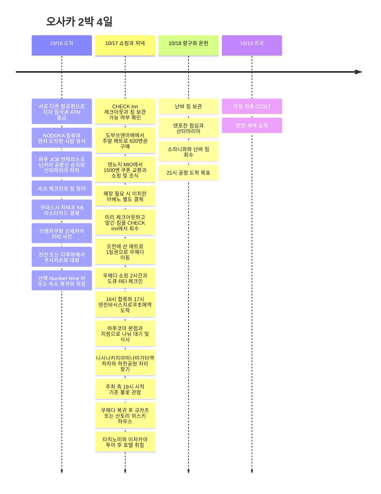

**첫날 각자 입국·ATM 출금 → NODOKA 합류 → 숙소 체크인·짐 정리 → 쿠라스시 → 쓰텐카쿠 사진 → 쿠시카츠 한 곳 → 선택 넘버 나인 바 또는 취침**으로 배치했다. 일행은 서로 다른 비행기를 타므로 공항 합류부터 함께 이동한다. 17일은 **CHECK inn 체크아웃·짐 보관 → 620엔권으로 덴노지 MIO 쿠폰·쇼핑·조식 → 숙소 짐 회수 → 같은 1일권으로 우메다 → 쇼핑 2시간·도큐 REI 체크인 → 16시 합류 → 17시 덴진바시스지로쿠초메역·하루코마 본점/지점 분산 대기 → 니시나카지마미나미가타역·하천공원 불꽃 관람 → 규카츠 또는 산토리 위스키 하우스 → 타치노미·이자카야 투어 → 도큐 REI 취침**, 18일은 항구·온천 후 공항이다. 17일 쇼핑한 짐은 객실에 놓고 나간다.

시각은 일본 현지 기준이다. **축제 시작 안내가 서로 다르다.** 사용자 제공 Metro NiNE는 **19:30~(5/27 기준 정보)**, 주최 측 공식 행사 개요는 **10/17 19:00~20:00**로 표시한다. 일정은 더 이른 **19시 시작 기준**으로 배치하고 출발 전 주최 측 공지를 다시 확인한다. 17시는 식사 시작 보장이 아닌 **덴진바시스지로쿠초메역 도착 목표**이며, 이후 하루코마 대기가 길면 불꽃 시작을 놓칠 수 있다. [Metro NiNE](https://metronine.osaka/ko/event/yodogawa-fireworks/), [주최 측 공식 시간](https://www.yodohanabi.com/gaiyou.html).

## 일정 요약

| 날짜 | 동선 | 유지할 시간 |
|---|---|---|
| 10/16 금 | **각자 출금 → NODOKA 합류 → 하루 JCB 난카이 → 신이마미야 → CHECK inn → 쿠라스시 → 쓰텐카쿠 사진 → 쿠시카츠 한 곳 → 선택 Number Nine / 취침** | 쿠라스시는 **KB 트래블러스 또는 리브메이트** 결제. 쿠시카츠는 잔잔·다루마 중 현장에서 덜 붐비는 곳 |
| 10/17 토 | **11시 전 체크아웃·짐 보관 → MIO·조식 → 짐 회수 → 우메다 → 쇼핑 2시간·체크인 → 16시 합류 → 17시 덴진바시스지로쿠초메 → 하루코마 분산 대기 → 하천공원 불꽃 → 규카츠 or 산토리 → 타치노미·이자카야 → 취침** | 13:30~15:30 쇼핑 배정안. 축제 주최 측 **19~20시**·NiNE **19:30~** 불일치. 규카츠 **21:30 주문 마감** |
| 10/18 일 | 난바 짐 보관 → 덴포잔 점심 → 산타마리아 → 소라니와 → 난바 → 공항 | 13:30 선착장, 19:45 공항행 열차 목표 |
| 10/19 월 | OZ117 간사이 → 인천 | 공식 하계 시간표 00:15 출발·02:15 도착 |

## 일정 타임라인

## 10/16 금 · NODOKA 합류, 쿠라스시·쓰텐카쿠·쿠시카츠

일행은 **서로 다른 비행기로 간사이에 도착**한다. 각자 입국·수하물·ATM 출금을 마치고 **KIX Airport Café Lounge NODOKA에서 합류**한다. 먼저 도착한 사람은 이용 가능한 카드 혜택으로 쉬며 기다리고, 모두 모인 뒤 시내로 이동한다. **본인 출금 계획은 이온은행 5회**이며 일행의 출금 횟수까지 5회로 정한 것은 아니다.

합류 후 **하루 JCB 컨택리스로 난카이 공항선 난바 방면 열차에 승차 → 신이마미야에서 하차 → 숙소 체크인**한다. 첫날 숙소는 **CHECK inn 大阪新世界 (CHECK inn Osaka Shin-Sekai), 1-9-5 Haginochaya**, **1박 3만원대**다. 난바까지 가지 않고 신이마미야에서 내린다. 아래 교통 10% 혜택은 **즉시 운임 할인이 아닌 사후 캐시백**이다. [난카이 공항 교통](https://www.howto-osaka.com/en/), [숙소 주소](https://www.hafh.com/en/properties/28089).

| 순서 | 배정할 시간 | 내용 |
|---|---|---|
| 공항 도착 후 | 입국·수하물 60∼90분 목표 | 실제 도착편과 입국 상황에 따라 변동 |
| 입국·세관 통과 후 | **이온은행 ATM 출금 5회, 15∼25분 배정** | T1 1층 우선, 혼잡하면 같은 은행 2층 ATM. 대기·처리 시간에 따라 변동 |
| 각자 출금 완료 후 | **Aeroplaza 2층 NODOKA로 이동·합류** | 먼저 도착한 사람은 휴식. 입구·접수대를 만남 기준으로 하고, 입장했으면 서로 위치 연락 |
| 라운지 대기 | 늦게 도착하는 일행의 입국·출금 완료까지 | JCB 무료 2시간과 초과요금 확인. **도착 후 PP 이용 불가**, 아래 조건 참고 |
| NODOKA → 간사이공항역 → 신이마미야 → 호텔 | 열차 대기·도보 포함 70∼90분 목표 | **하루 JCB를 입·출구에 직접 터치**, 난카이 공항선 난바 방면·신이마미야 하차 |
| 숙소 체크인·짐 정리 | 20∼40분 | 객실에 짐 풀고 저녁 식사하러 외출 |
| 숙소 → 쿠라스시 신세카이 츠텐카쿠점 | 도보 15∼20분 여유 배정 | 사용자 지정 첫날 저녁 장소, 2층 매장 |
| 쿠라스시 | 대기·식사 60∼90분 배정 | **KB 트래블러스 또는 리브메이트 Mastercard·JPY 결제**, 입장 23:30까지 |
| 쓰텐카쿠 주변 | 사진·산책 10∼20분 배정 | 쿠라스시 다음, 쿠시카츠 가기 전 외관·거리 사진 |
| 쿠시카츠 2차 | 대기·식사·대화 45∼75분 배정 | **잔잔 / 다루마 두 곳 중 덜 붐비는 한 곳만**, 현장에서 분위기 보고 선택 |
| 식사 후 | **Number Nine 바 또는 숙소 복귀·취침** | 아쉬우면 지난번 갔던 바, 피곤하면 바로 숙소. 바 방문 시간은 미정 |

### 입국 후 이온은행 ATM · 트래블로그 UPI 출금 5회

**이온은행(AEON BANK) ATM만 이용**한다. **입국·수하물·세관 → T1 1층 이온은행 ATM → 출금 5회 → 2층 공항역 연결 통로 → Aeroplaza 2층 NODOKA 합류** 순서로 이동한다. 1층 기기가 혼잡하거나 이용이 어려우면 **같은 은행의 T1 2층 ATM**으로 간다.

| 우선순위 | ATM·위치 | 운영 안내 |
|---|---|---|
| 1 | **이온은행, T1 1층** | 24시간 운영 안내 |
| 2 | **이온은행, T1 2층** | 24시간 운영 안내 |

[공항 ATM 위치·시간](https://www.kansai-airport.or.jp/service/money_insurance/atm). **AEON BANK·UnionPay 로고와 해외 카드 취급 여부**를 확인한다. 이온은행 공식 안내상 해외 발행 UPI 카드는 24시간 취급, **1회 출금 한도 50,000엔·건당 수수료 75엔(세금 포함)**이다. 설치 장소 운영·점검에 따라 이용이 제한될 수 있다. [이온은행 해외 카드 안내](https://www.aeonbank.co.jp/atm/card/securities-credit/oversea/).

사용자 보유 **하나 트래블로그 UnionPay 체크카드로 5회 출금**할 계획이다. 인출액은 아직 미정이며 필요한 여행 현금 총액에 맞춰 정한다. 15∼25분은 일정상 배정한 여유로, 실제 처리 시간 보장은 아니다.

**1,000엔 단위 출금은 해외 카드 이용 후기가 있으나, 공식 해외 카드 안내에 최소 단위가 명시되어 있지 않아 보유 UPI 카드의 현장 화면에서 확인**한다. 인출액이 얼마든 이온은행 수수료는 출금 거래 1건당 75엔이다. [1,000엔 출금 후기](https://travel.korean-engineer.com/en/atm-en/atm-japan/).

| 행사 항목 | 확인한 조건 |
|---|---|
| 기간·대상 | 2026-06-12∼12-31, 하나 트래블로그 UnionPay 체크카드 |
| 혜택 | 일본 ATM 출금 1회당 220엔, 카드당 매월 최대 5회 |
| 참여 조건 | 사전 등록·최소 인출액 조건 없음. UnionPay 망으로 정상 승인·매입 완료된 출금만 인정 |
| 이번 여행 목표 | 10월 기사용 횟수가 없다면 5회로 최대 1,100엔 상당. 기사용분이 있으면 남은 횟수만 적용 |
| 지급 | 통상 인출 다음 날 적립, 실제 금액·일자는 카드사 명세서 기준. ATM 영수증에는 캐시백 미표시 |
| 유의 | 예산 소진 시 조기 종료 가능. ATM 운영사 추가 수수료는 캐시백과 별도 |

[사용자 지정 UnionPay 행사 안내](https://www.unionpayintl.com/cardholderServ/serviceCenter/merchant/1175440369562?type=1) 기준으로 정리했다. 공개 조건에는 서로 다른 날짜에 출금해야 한다는 제한이 기재되어 있지 않지만, 실제 혜택은 정상 거래·매입 및 행사 규정에 따라 결정된다.

실물 카드와 비밀번호를 준비하고 **출금액과 수수료를 감당할 엔화 하나머니 잔액**을 확인한다. ATM에서 한국어를 선택해 출금하고, 매 거래의 현금·카드·영수증을 회수해 완료 횟수를 센다. **5회 수수료는 75엔 × 5 = 375엔**이다. 10월 혜택 한도가 남아 있고 5회 모두 행사 인정 시 **캐시백 1,100엔 상당 − ATM 수수료 375엔 = 순혜택 725엔 상당**을 목표로 한다. 캐시백은 실제 적립 환율·행사 적용 결과에 따라 달라진다. [하나카드 상품 안내](https://m.hanacard.co.kr/MKCDCM1010M.web?CD_PD_SEQ=15356).

### NODOKA · 각자 출금 후 만나는 공항 라운지

합류 장소는 **KIX Airport Café Lounge NODOKA, Aeroplaza 2층 일반구역(보안검색 전)**이다. **24시간·연중무휴**, 공항역에서 도보 약 5분 안내다. 공항역 개찰구에서 오른쪽 Aeroplaza 방향으로 가서 건물에 들어가면 왼쪽에 있다. 입구·접수대를 만남 기준으로 정하고, 먼저 입장한 사람은 위치를 연락한다. [운영사 위치·FAQ](https://aprecio.jp/nodoka/), [공항 층별 위치](https://platinumaps.jp/maps/kix-airport/@34.43665976,135.24240069,19-18z?floor=2F).

| 이용 수단 | 조건·휴식 혜택 | 첫날 도착 후 대기 |
|---|---|---|
| **하루 JCB URS Platinum** | **실물 카드 + 본인 명의 도착편 탑승권/항공권** 제시, 대상 카드 회원 **2시간 무료**. JCB 일본·하와이 라운지 서비스는 **2026/4/1~2027/3/31 합계 6회** 한도, 잔여 횟수 확인 | **이 방식으로 휴식 우선 검토**. 일본·하와이 오리지널 라운지 서비스로 접수 |
| **Priority Pass** | **출발 예정 12시간 이내의 탑승권** 필요. 3시간 이용 플랜과 식사·맥주·샤워 선택 혜택은 해당 출발 이용 조건 및 PP 발급사 무료 이용 자격 충족 시 적용 | **도착편만으로는 이용 불가**. 10/16 입국 후 일행 대기를 PP 무료 이용으로 계획하지 않음 |

운영사 FAQ는 **신용카드 2시간 무료 혜택의 도착 후 이용은 가능**, **PP 도착 후 이용은 불가**라고 구분한다. 하루 JCB는 JCB 지정 대상 라운지의 일본·하와이 서비스로 이용하며, PP나 일본 외 LoungeKey 연 2회와 구분한다. [JCB 한국 공식 이용 조건·NODOKA 대상 목록](https://www.kr.jcb/ko/consumers/platinum/airport-lounge/index.html), [PP NODOKA 공식 조건](https://www.prioritypass.com/en-GB/lounges/japan/kansai-international/kix12-airport-cafe-lounge-nodoka).

JCB 본인 무료 혜택에 **동반자 무료는 포함되지 않는다**. 일행도 각자 대상 카드를 제시하거나 일반 요금으로 이용한다. 소프트드링크·Wi-Fi 이용 가능, **JCB 입장에 식사·술·샤워 무료가 포함되는 것은 아니다**. 2시간 초과요금과 빈 좌석은 현장 확인한다. 탑승권이 없으면 날짜·편명·이름이 보이는 앱/메일을 준비하고, 실물 하루카드와 도착편 탑승 기록을 버리지 않는다. [공항 카드 라운지 안내](https://www.kansai-airport.or.jp/service/lounge/walk-in-lounge).

### NODOKA 합류 후 · JCB 컨택리스로 난카이 공항선

**NODOKA → 간사이공항역(関西空港) → 난카이 공항선 난바 방면 → 신이마미야(新今宮) → CHECK inn 체크인**으로 이동한다. 난카이 공식 대상역 지도에서 **간사이공항·신이마미야 모두 터치결제 대응역**으로 확인했다. [난카이 터치결제 대상역](https://www.nankai.co.jp/contents/contactless/map/index.html).

1. 간사이공항역에서 **난카이 전철** 터치결제 대응 개찰구를 찾는다.
2. **컨택리스 기능이 있는 실물 하루 JCB 카드**를 전용 리더에 대고 입장한다. 별도 종이 승차권 구매나 ICOCA 충전 방식이 아니다.
3. 난바 방면 공항급행 등 신이마미야 정차 열차를 타고 **신이마미야에서 같은 실물 카드로 터치 출장**한다. 입장·출장에 카드와 휴대전화를 섞지 않는다.
4. 각자 자기 카드로 1명씩 승하차하고, 하차 후 숙소로 이동해 체크인한다. [난카이 공식 이용 방법](https://www.nankai.co.jp/contents/contactless/howto/index.html).

하루 **URS Platinum**의 JCB 대중교통 혜택은 **월 합산 이용액의 10%·카드당 월 최대 500엔 캐시백**이며 **별도 행사 등록 불필요**다. 10월 이용분은 **11월 말까지 지급 예정**, 10/13 갱신 공지상 이번 달 종료 예정일은 **10/31**이다. **10/18에 끝나는 하루 자체 누적 캐시백 행사와 기간·한도가 다르다.** 정상 매입·월 잔여 한도·조기 종료 조건을 따르며, 카드의 해외 이용 수수료까지 면제되는 것은 아니다. [JCB 교통 행사](https://www.specialoffers.jcb/kr/premium/sub05.html), [10월 진행 현황](https://www.specialoffers.jcb/kr/campaign/detail/krpremium/93243/).

### 체크인·짐 정리 후 쿠라스시 · KB Mastercard 결제

첫날 저녁은 사용자 지정 **쿠라스시 신세카이 츠텐카쿠점(くら寿司 新世界通天閣店)**이다. **CHECK inn 체크인 → 객실에 짐 풀기 → 쿠라스시 저녁** 순서로 방문한다. 주소는 **大阪市浪速区恵美須東2-6-3 2F**, 공식 영업시간은 **매일 11:00∼24:00·입장은 폐점 30분 전인 23:30까지**다. 매장 공식 안내에서 Mastercard 결제 지원을 확인했다. [사용자 지정 지도](https://maps.app.goo.gl/F9oQqc8jdjohVbVQ9), [공식 매장 안내·예약 링크](https://shop.kurasushi.co.jp/detail/509).

**결제는 KB 트래블러스 체크 Mastercard 또는 KB 리브메이트 Mastercard 예정**이다. 두 카드 모두 KB 마스터 다이닝 행사 대상 브랜드·개인 신용/체크 조건에 해당하며, **이치란·스시로·쿠라스시 10월 합산 원화환산 5만원 이상이면 신세계상품권 2만원·월 1회** 조건을 관리한다. 이번 한 끼가 무조건 5만원 이상이라고 가정하지 않고 실제 매입 청구금액과 기존 10월 이용분을 합산한다. **행사 응모 완료 여부는 아직 미확인**이다. 현지 통화 **JPY**로 결제하고 영수증을 보관한다. [KB 공식 다이닝 행사·응모](https://card.kbcard.com/BON/DVIEW/HBBMCXCRVNEC0001?mainCC=a&eventNum=1002202).

트래블러스는 해외 수수료 면제와 기본 10% 할인 잔여 한도를, 리브메이트는 전월 실적·기본 캐시백·해외 수수료를 확인해 고른다. 이 저녁 결제는 **하루카드 누적 사용액에 합산하지 않는다**. 쿠라스시 식사 후에는 아래 사진·쿠시카츠 일정으로 이어간다.

### 쓰텐카쿠 사진 → 쿠시카츠 두 후보 중 한 곳

**쿠라스시 → 쓰텐카쿠 외관·신세카이 거리 사진 → 쿠시카츠** 순서다. 사진에는 10∼20분을 배정하고, 쿠시카츠는 아래 **둘 중 현장에서 덜 붐비는 한 곳만** 고른다. 실시간 혼잡은 미확인이므로 대기 줄·빈자리·분위기를 보고 정한다. **손님이나 직원과 자연스럽게 이야기하며 친구를 만드는 시간**을 갖고 싶다는 사용자 희망을 반영했다.

| 후보 | 위치·영업 안내 | 선택 기준 |
|---|---|---|
| **[① 쿠시카츠 잔잔 신세카이 본점](https://maps.app.goo.gl/hUWypz8auYQvF8tv9)** / 串かつじゃんじゃん 新世界本店 | **恵美須東2-6-1**, 지도 표시 금요일 **10:00∼23:00**. 주문 마감은 현장 확인 | 다루마보다 대기가 짧고 대화하기 편한 분위기면 선택 |
| **[② 쿠시카츠 다루마 츠텐카쿠점](https://maps.app.goo.gl/VaNvuhDdaNV4vUQE9)** / 串かつだるま 通天閣店 | **恵美須東1-6-8**, 공식 금요일 **11:00∼22:30·주문 마감 22:00**, 예약 불가 | 대기가 짧고 자리가 있으면 선택. 공식 카운터 38석 안내 |

다루마는 **1인 음료 1잔 이상 주문** 조건이 있다. 잔잔 영업시간은 지도 표시 기준이고 공식 사이트 매장 상세를 확인하지 못했으므로 당일 재확인한다. [잔잔 공식 사이트](https://kushikatu-janjan.com/), [다루마 공식 매장 조건](https://www.kushikatu-daruma.com/location/tsutenkaku).

쿠시카츠 두 곳은 **쿠라스시보다 일찍 영업이 끝난다**. 다루마를 선택할 가능성을 남기려면 쿠라스시·사진을 마치고 **22시 주문 마감 전**에 들어갈 여유가 있어야 한다. 전체 순서는 유지하고 실제 항공편·공항 합류시각을 확인한 뒤 식사 시각을 채운다. 쿠시카츠·바 결제 카드는 아직 미정이며, 이 매장들을 **KB 이치란·스시로·쿠라스시 전용 다이닝 행사에 합산하지 않는다**.

### 식사 후 선택 · Number Nine 바 또는 취침

쿠시카츠까지 먹고도 아쉬우면 **지난번 방문했던 [Number Nine 바](https://maps.app.goo.gl/Gpj9KSiUzGFfPFxD9)**에 가고, 충분히 즐겼거나 피곤하면 **CHECK inn으로 돌아가 취침**한다. 바는 확정 방문이 아닌 당일 선택이다.

지도에서 확인한 위치는 **阿倍野区天王寺町南1-1-9**, 표시 영업시간은 **20:00∼익일 03:00**다. 신세카이에서 **덴노지 동쪽으로 추가 이동**하는 곳이라 귀가 동선·당일 영업을 보고 정한다. 사용자 지정 지점 그대로 기록했으며 별도의 동명 바를 추천하지 않았다.

**각자의 실제 도착편·NODOKA 합류시각은 추가 대조가 필요하다.** 기존 참고 기록 KE737의 조회는 **22:40 간사이 도착**이므로 이 편이 맞다면 입국·출금·합류·열차 이동·체크인 후 **23:30까지 쿠라스시 입장**은 어렵다. 서로 다른 비행기로 오는 일행이 모두 준비된 시각을 시내 이동의 출발점으로 잡으며, 실제 예약편 확인 후 저녁 도착 목표를 채운다. [기존 KE737 조회](https://www.trip.com/flights/status-ke737/).

## 10/17 토 · MIO·조식, 쇼핑 2시간·16시 합류, 하루코마·불꽃축제

둘째 날 숙소는 **오사카 도큐 REI 호텔, 1박 8만 7천원대**다. **CHECK inn 체크아웃 마감은 11시로 사용자 확인**했다. MIO 교환은 10:30부터이므로 아침에 먼저 체크아웃하고 짐을 맡긴 뒤 **도부쓰엔마에 → 덴노지 MIO → 조식·짧은 쇼핑 → 숙소에서 짐 회수 → 같은 메트로 1일권으로 우메다**로 배치한다. CHECK inn 짐 보관 가능 여부는 확인이 필요하다.

**우메다 쇼핑은 2시간, 16시 합류·17시 덴진바시스지로쿠초메역 도착**이 사용자 지정 시간이다. 도큐 REI 객실 입실은 15시부터라, 두 시간 쇼핑을 확보하는 배정안은 **호텔에 짐 맡기기 → 13:30~15:30 쇼핑 → 15:30~16:00 체크인·짐 정리 → 16시 합류**다. 16시 모임 장소는 아직 미정이다.

| 현지 시간 | 할 일 | 조절 기준 |
|---|---|---|
| 09:00∼09:45 | **CHECK inn 체크아웃·짐 보관** | 11시 마감 전에 처리. 숙소 보관 가능 여부 확인, 불가하면 역 보관함 등 대안 선택 |
| 09:45∼10:15 | **도부쓰엔마에역에서 주말 1일권 620엔 구매 → 덴노지** | 미도스지선 나카모즈 방면 한 정거장, 역·도보 포함 여유 |
| 10:15∼10:30 | MIO 이동·개점 대기 | 본관 안내소는 10:30부터 교환 |
| 10:30∼10:45 | **MIO 본관 2F 안내소에서 조이패스 1,500엔 쿠폰 교환** | 500엔권 3장·대상 점포 확인 |
| 10:45∼11:45 배정안 | **짧은 쇼핑 + 조식 겸 이른 점심** | MIO 대상 점포에서 1,500엔 안팎 이상 사용 목표. 해장 필요 시 이치란 아베노 선택·별도 결제 |
| 11:45∼12:30 배정안 | **덴노지 → 도부쓰엔마에 → CHECK inn 짐 회수** | 미도스지선 에사카·센리추오 방면 한 정거장, 오전의 620엔권 재사용 |
| 12:30∼13:30 배정안 | **짐을 들고 도부쓰엔마에 → 우메다 → 도큐 REI에 짐 맡기기** | **기존 1일권 사용**. 체크인 전 보관 후 쇼핑 |
| **13:30∼15:30 배정안** | **오사카역·우메다 쇼핑 2시간** | 16시 합류에 맞춰 쇼핑 종료 |
| 15:30∼16:00 배정안 | 도큐 REI 체크인·구매품 객실에 두기 | 체크인 시작은 15시, 실제 접수 대기 반영 |
| **16:00** | **일행 합류** | 구체적인 모임 장소는 미정 |
| 16:00∼17:00 | 합류 후 이동·덴진바시스지로쿠초메역 도착 | 17시 역 도착 목표, 역에서 각 매장까지 도보 추가 |
| **17:00 이후∼18:00 목표** | **하루코마 본점·지점에 나눠 각각 대기·저녁** | 대기 상황 연락. 17시 착석 보장 아님, 18시 이동 목표 |
| **18:00∼19:00 목표** | 메트로 → **니시나카지마미나미가타역 → 지정 하천공원 주변 자리 찾기** | 환승·혼잡·도보 포함 배정, 빈 자리 확보 보장 아님 |
| 관람 가능한 곳 도착 후 | 돗자리 펴고 휴식·불꽃 대기 | 추가 관광 없이 현장에서 기다리기 |
| **주최 측 19:00∼20:00** | **요도가와 불꽃축제 관람** | Metro NiNE의 19:30 안내와 불일치. 19시 기준으로 이동 |
| 20시 이후·소요 시간 변동 | 질서 퇴장·니시나카지마미나미가타 → 우메다 | 기존 메트로 1일권 사용. 역 대기·통제로 복귀 시각 변동 |
| 우메다 복귀 후 | **규카츠 모토무라 루쿠아점 또는 산토리 위스키 하우스** | 두 곳 중 한 곳 선택. 규카츠 21:30 주문 마감, 산토리 다이닝 23시 폐점 |
| 식사·위스키 후 | **타치노미·이자카야 투어** | 우메다에서 이어가거나 덴마로 이동. 영업 중인 곳과 컨디션을 보고 1~2곳 배정 |
| 투어 마무리 후·시각 미정 | **도큐 REI 복귀·취침** | 늦어지면 방문 수를 줄이고 실제 귀가 교통 확인 |

### 도부쓰엔마에 620엔권 → MIO 쿠폰·조식

사용자 지정 [도부쓰엔마에역](https://maps.app.goo.gl/WhbtsnC7PPHhWobr8) 발매기에서 **엔조이 에코 카드 토·일·공휴일 성인 620엔권**을 산다. **미도스지선 M22 도부쓰엔마에 → 나카모즈 방면 → M23 덴노지** 한 정거장이다. 이날은 이 승차권으로 개찰구를 통과하고, JCB 직접 터치 승차와 섞지 않는다. 24시간권이 아닌 **사용 당일 1일권**이며 난카이·JR·한큐는 포함되지 않는다. [메트로 공식 620엔권 안내](https://subway-tr.osakametro.co.jp/ko/guide/page/enjoy-eco.php).

**MIO 본관 2F 인포메이션 카운터, 교환 시간 10:30∼18:00**에서 조이패스 QR을 제시해 **500엔 공통권 3장·총 1,500엔**으로 바꾼다. 본관·플라자관의 대상 점포에서 쇼핑이나 식사에 쓰며, 사용 전에 해당 점포가 받는지 확인한다. **차액은 현금·거스름돈 없음**, 현금 환급·재발급 불가 조건이다. 따라서 대상 점포에서 **1,500엔 안팎 이상 쇼핑 또는 식사**를 하고 체크인 전에 돌아오는 일정으로 잡는다. [패스 운영사 MIO 쿠폰·교환 안내](https://travelcontentsapp.com/en/attraction/osaka/tennoji-mio/).

MIO 쇼핑층은 **10:30∼20:30**, 본관 식당가는 대체로 **11시부터**여서 10:45에 식사를 시작하려면 개별 매장 시간을 확인한다. 쇼핑 후 11시대 식사로 바꿔도 오전 배정 안에서 가능하다. [MIO 공식 영업시간](https://www.tennoji-mio.co.jp/access).

**전날 술을 많이 마셔 해장이 필요하면 [이치란 아베노점](https://maps.app.goo.gl/yHrhYGBaZAqe5T8j9)**에서 라멘을 먹는다. 공식 운영은 **10:00∼23:00**, 주소는 **阿倍野筋1-3-18 B1F**다. **MIO 외부 매장이므로 MIO 쿠폰은 쓸 수 없고 라멘값을 따로 결제**한다. 이 경우 쿠폰은 MIO 쇼핑에 쓰고 조식은 이치란 한 곳으로 정해 식사를 중복하지 않는다. 카드 결제가 가능하며, KB 마스터 다이닝 응모 후 대상 카드로 결제하면 전날 쿠라스시와 **10월 합산 5만원 조건**을 함께 관리할 수 있다. 대기가 길면 우메다 복귀·체크인을 우선한다. [이치란 공식 매장·결제 안내](https://ichiran.com/shop/kinki/abeno/).

### 11시 전 체크아웃 → MIO → 짐 회수·같은 1일권으로 우메다

**아침에 CHECK inn에서 11시 전에 체크아웃하고 짐을 맡긴다.** MIO·조식 후 **덴노지 → 미도스지선 에사카·센리추오 방면 → 도부쓰엔마에**로 한 정거장 되돌아와 맡긴 짐을 회수한다. 그 뒤 짐을 들고 다시 도부쓰엔마에역으로 가서 **같은 방면 미도스지선 → 우메다역 하차 → 오사카 도큐 REI 호텔**로 이동한다. 두 구간 모두 **오전에 구매한 620엔 메트로 1일권을 그대로 재사용**하고 추가 승차권은 사지 않는다.

**11시 체크아웃은 사용자 확인 완료**, 숙소의 체크아웃 후 짐 보관은 아직 미확인이다. 보관이 안 되면 동선상 역 보관함 등을 정하고 회수 위치를 바꾼다. 도큐 REI는 체크인 전 짐 보관 안내가 있어, 우메다에서는 짐을 맡겨 두고 쇼핑 2시간을 가진 뒤 **15:30 체크인·16시 합류**하는 배정안이다. [CHECK inn 체크아웃 안내](https://travel.yahoo.co.jp/00924272/), [도큐 REI 짐 보관·체크인 FAQ](https://www.tokyuhotels.co.jp/en/osaka-r/qa/index.html).

### 16시 합류 → 17시 덴진바시스지로쿠초메역·하루코마 두 줄

쇼핑 2시간 후 **16시에 일행과 모이고, 17시에 덴진바시스지로쿠초메역(天神橋筋六丁目)에 도착**한다. 구체적인 16시 모임 장소는 아직 정하지 않았다. 우메다 권역에서 지하철을 이용하면 **히가시우메다 → 다니마치선 다이니치 방면 → 덴진바시스지로쿠초메**로 가며, 기존 620엔권을 사용한다.

| 나눠 대기할 매장 | 사용자 지정 지도 | 확인한 주소 |
|---|---|---|
| **하루코마 지점 / 春駒 支店** | [첫 번째 지도](https://maps.app.goo.gl/GiedWJBZUf6dnPi8A) | 天神橋5-6-8 |
| **하루코마 본점 / 春駒 本店** | [두 번째 지도](https://maps.app.goo.gl/bVF84NQP6X2CgbZB7) | 天神橋5-5-2 |

역에서 각 매장으로 걸어가 **본점팀·지점팀으로 나눠 각각 줄을 선다.** 서로 예상 대기를 연락하며 식사·재합류 방식을 조율한다. **17시는 역 도착, 착석·식사 시작은 실제 대기에 따라 결정**한다.

### 니시나카지마미나미가타역 → 하천공원 자리 잡고 관람

식사 후 기본 메트로 접근은 **덴진바시스지로쿠초메 → 다니마치선 야오미나미 방면·히가시우메다 → 도보 환승 우메다 → 미도스지선 에사카·센리추오 방면·니시나카지마미나미가타 → 하천공원**이다. **기존 620엔권을 계속 사용**한다. 식당·역 도보, 역간 환승과 축제 혼잡까지 있어 **18시 출발·19시 도착은 목표이며 보장 시간이 아니다.** 대기가 길어지면 식사 종료 시점에 불꽃 시작 전 도착이 가능한지 다시 판단한다.

사용자 지정 장소는 **[요도가와 하천공원 니시나카지마 지구](https://maps.app.goo.gl/sgUQkCpRfaN3PPYu7)**다. 역에서 공원까지 평상시 도보 약 7분이라는 공원 안내가 있지만, 행사일에는 통제·혼잡을 더한다. 하차 후 **관람 가능한 하천 주변에서 자리를 잡고, 추가 관광 없이 앉아서 기다린다.** 이 핀은 공원 기준점이므로 당일 개방 구역·실제 불꽃 시야·빈 자리를 현장에서 확인한다. [공원 공식 위치·접근 안내](https://www.yodogawa-park.jp/annai/nisinaka-juso/).

**가져갈 것:** 작은 **돗자리 또는 접이식 방석**, 가벼운 겉옷, 물·간단한 간식, 보조배터리, 쓰레기봉투. 구매품은 호텔에 두고 관람용 가방만 챙긴다. 현장에서 기다릴 시간을 고려해 화장실·음료를 미리 준비하고, 돗자리는 앉을 수 있는 개방 구역에서 사용한다.

**시작 시각은 주최 측 19:00∼20:00, Metro NiNE 19:30~로 불일치**하므로 19시 기준 이동을 유지한다. **우메다 측 강변은 일반 출입 금지**, 니시나카지마 쪽도 당일 통제를 따른다. 무료 구역 자리 확보는 보장되지 않는다. 주최 측은 협찬석 관람객에게 17:30까지 역·18시까지 하천부지 도착을 권하므로, 17시 식당 대기부터 시작하는 이번 동선은 혼잡에 따라 시작을 놓칠 여지가 있다. [주최 측 행사 개요](https://www.yodohanabi.com/gaiyou.html), [사용자 제공 Metro NiNE](https://metronine.osaka/ko/event/yodogawa-fireworks/), [관람·혼잡 FAQ](https://www.yodohanabi.com/faq.html).

### 축제 후 · 규카츠 or 산토리 → 타치노미·이자카야 → 취침

불꽃 관람 후 **니시나카지마미나미가타역 → 미도스지선 나카모즈 방면 → 우메다**로 돌아온다. 기존 메트로 1일권을 사용하며, 퇴장 통제·역 대기로 실제 도착 시각은 달라진다. 우메다에 도착하면 사용자 지정 두 장소 중 **배고프면 규카츠, 위스키와 음식을 즐기려면 산토리**를 선택한다.

| 후보 | 위치 | 공식 영업시간·판단 기준 |
|---|---|---|
| **[규카츠 모토무라 루쿠아점](https://maps.app.goo.gl/88WVgymoDCCvrof98)** | 大阪市北区梅田3-1-3, **LUCUA 10F** | 매장 공식 **11:00~22:00·주문 마감 21:30**. 도착 시 줄과 입장 가능 여부부터 확인 |
| **[산토리 위스키 하우스](https://maps.app.goo.gl/jDVJSrb8dTbATRVZA)** | 大阪市北区大深町3-1, **그랜드프런트 오사카 북관 나리지 캐피털 2F** | **Whisky Dining WWW.W 저녁 17:30~23:00**. 같은 시설 **Whisky Bottle Bar 17:30~23:30·일/공휴일 휴무**. 10/17 토요일 방문 계획, 주문 마감·빈자리 확인 |

규카츠는 LUCUA 시설 안내에 23시 폐점도 표시되어 있지만 **매장 자체 공식 안내의 더 이른 21:30 주문 마감·22시 폐점 기준**으로 계획한다. 축제 퇴장 후 우메다 도착이 21:30 이후라면 규카츠 입장을 전제로 잡지 않는다. 산토리도 다이닝·보틀바가 나뉘므로 이용할 공간의 주문 마감을 확인한다. [규카츠 매장 공식](https://www.gyukatsu-motomura.com/store/LUCUA), [LUCUA 시설 안내](https://www.lucua.jp/shopguide/id791.html), [산토리 다이닝](https://www.suntory.co.jp/whisky/whiskyhouse/dining/), [보틀바](https://www.suntory.co.jp/whisky/whiskyhouse/bottlebar/index.html).

이후에는 **타치노미(서서 마시는 술집)·이자카야 투어를 하고 도큐 REI로 돌아가 잔다.** 우메다에서 이어가거나 덴마 권역으로 넘어갈 수 있으며, 구체적인 매장은 아직 미정이다. 우선 1~2곳 정도로 배정하고 현장 분위기·영업시간·컨디션에 맞춰 조절한다. 늦게 끝나면 지하철 막차와 도보·택시 귀가 경로를 확인한다. [덴마역 주변 술집 권역](https://www.google.com/maps/search/?api=1&query=bars+near+Temma+Station+Osaka).

## 10/18 일 · 항구 점심 → 크루즈 → 온천 → 공항

**MIO 쿠폰·쇼핑·조식은 17일 체크인 전으로 옮겼다.** 이날은 난바에 짐을 보관한 뒤 항구로 바로 이동하고 덴포잔에서 점심을 먹는다. 우메다 호텔 왕복을 줄이기 위해 짐은 아침에 난바로 옮긴다.

| 현지 시간 | 할 일 | 이동·대기 배치 |
|---|---|---|
| 08:00∼09:15 | 아침·짐 정리·체크아웃 | 호텔의 10시 마감보다 일찍 출발 |
| 09:15∼10:00 | 우메다 → 난바·짐 보관 | 공항행 난카이 쪽에서 회수하기 쉬운 보관소 |
| 10:00∼11:00 | 난바 → 혼마치 환승 → 오사카코 → 덴포잔 | 지하철·도보에 60분 여유 |
| 11:00∼12:00 | 항구 주변 산책·휴식 | 늦게 출발하면 이 구간을 줄임 |
| 12:00∼13:00 | 덴포잔에서 점심·휴식 | 당일 대기 적은 식당 선택 |
| 13:00∼13:30 | 항구 산책·선착장 이동 | 비가 오면 실내에서 쉬고 바로 선착장 |
| 13:30∼14:00 | 산타마리아 표 교환·승선 대기 | 가이유칸 서쪽 선착장 |
| 14:00∼14:45 | **산타마리아 데이크루즈** | 실제 운항 확인, 14시대 승선 목표 |
| 14:45∼15:30 | 하선 → 오사카코 → 벤텐초 → 소라니와 | 하선·역 도보·온천 접수 포함 |
| 15:30∼17:45 | **소라니와 온천·휴식** | 착탈의 포함 2시간 15분 |
| 17:45∼18:30 | 벤텐초 → 혼마치 환승 → 난바 | 메트로권 경로 |
| 18:30∼19:15 | 난바 저녁·짐 회수 | 보관소 마감 확인, 대기 긴 식당 피하기 |
| 19:15∼19:45 | 난카이 승차권·승강장 이동 | 큰 역 내 이동 여유 |
| 19:45∼21:00 | 공항행 열차·터미널 이동 | 출발일 실제 열차 선택, 21시 공항 목표 |
| 21:00∼00:15 | 수속·출국·탑승 | 10/19 자정 직후 편 |

[난바 → 덴포잔](https://www.google.com/maps/dir/?api=1&origin=Namba+Station&destination=Tempozan+Marketplace&travelmode=transit) · [온천 → 난바](https://www.google.com/maps/dir/?api=1&origin=Solaniwa+Onsen&destination=Namba+Station&travelmode=transit).

산타마리아는 데이크루즈 약 **45분**, 오사카코역에서 선착장까지 도보 약 10분이며 **14시대는 목표이지 10/18 출항 확정은 아니다**. [운영사](https://suijo-bus.osaka/cruiselist/santamaria/), [운항 캘린더](https://suijo-bus.osaka/wps/wp-content/uploads/2026/09/0901_time-santamaria.pdf). 소라니와는 벤텐초 Osaka Bay Tower, 통상 **11∼23시·마지막 입장 22시**다. [온천 FAQ](https://solaniwa.com/en-us/faq/).

## 일본 결제 카드 5종 · 10월 행사와 사용처

**KB 마이원 Visa + KB 리브메이트 Mastercard + KB 트래블러스 체크 Mastercard + 신한 하루 JCB + 하나 트래블로그 UPI**를 가져간다. 아래는 **2026-10-15 확인한 10/16∼19 여행용 배분**이다. **하루 해외 누적 캐시백 행사와 JCB 행사 응모는 완료로 사용자 확인**했다. KB 행사 응모·MTR 카드 등록·혜택 활성화 완료 여부는 아직 확인하지 않았다. 실제 결제는 현지 통화 **JPY**로 하고, 면세·쿠폰 적용 후 실제 카드 승인금액으로 기준을 확인한다.

### KB 혜택 빠른 메모 · 카드 브랜드별

사용자가 제공한 이미지처럼 브랜드별로 모은 여행용 메모다. **빈 체크박스는 KB 응모·MTR 활성화 완료 여부 미확인**을 뜻하며, 이용 조건을 달성했다는 표시가 아니다. 상품권 금액과 외화머니·캐시백을 구분한다.

**KB / Visa → 마이원 Visa**

- [ ] **백화점 (~11/30):** 한큐·다이마루·파르코 **월 합산 50만원 이상 → 신세계상품권 10만원**, 월 1회·전체 최대 3회. [응모](https://card.kbcard.com/BON/DVIEW/HBBMCXCRVNEC0001?mainCC=a&eventNum=1002074)
- [ ] **패션 (~11/30):** 유니클로·GU·BAPE·꼼데가르송·빔즈·휴먼메이드·캐피탈·스투시 **월 합산 20/50/100만원 → 신세계상품권 2/7/20만원**, 해당 구간만 지급·월 1회·전체 최대 3회. [응모](https://card.kbcard.com/BON/DVIEW/HBBMCXCRVNEC0001?mainCC=a&eventNum=1002073)
- [ ] **돈키호테 (~11/30):** **월 10만원 이상 → 신세계상품권 2만원**, 월 1회·전체 최대 3회. [응모](https://card.kbcard.com/BON/DVIEW/HBBMCXCRVNEC0001?mainCC=a&eventNum=1002072)
- [ ] **해외 1.1% 포인트백 (~10/31):** **10/6 이후 합산 20만원 이상 → 원화 결제금액의 1.1% 포인트리**, 별도 응모·2027/1/15까지 지급 예정. [응모](https://card.kbcard.com/BON/DVIEW/HBBMCXCRVNEC0001?mainCC=a&eventNum=1002268)

**KB / 브랜드 무관 → 마이원·리브메이트·트래블러스**

- [ ] **편의점 (~10/31):** 세븐일레븐·로손·패밀리마트 **건당 1,000엔 이상 → 외화머니 500엔**, 안내상 최대 5,000엔·10회분. 카드별로 한도가 늘어나지 않음. [응모](https://card.kbcard.com/BON/DVIEW/HBBMCXCRVNEC0001?mainCC=a&eventNum=1001883)
- [ ] **공항 면세점 (~10/31):** 오사카 등 대상 공항의 **면세점 업종 월 합산 10,000엔 이상 → 외화머니 1,000엔**. 공항 일반 매장은 별도. [응모](https://card.kbcard.com/BON/DVIEW/HBBMCXCRVNEC0001?mainCC=a&eventNum=1001884)
- [ ] **백화점 (~11/30):** 한큐·미츠코시 이세탄·타카시마야·다이마루·오다큐 **월 합산 30,000엔 이상 → 외화머니 3,000엔**, 월 1회·대상 업종 조건. **파르코 제외**. [응모](https://card.kbcard.com/BON/DVIEW/HBBMCXCRVNEC0001?mainCC=a&eventNum=1002215)

**이미지의 추가 항목 — 총 해외 이용액별 상품권:** 사진에는 **50/100/200/300/500만원 → 신세계상품권 1/2/4/6/10만원**으로 적혀 있지만, **기간·공식 행사 링크·중복 조건이 없어 이번 여행 적용 여부는 미확인**이다. 현재 공식 해외 행사 목록과 대조해도 해당 조건을 확정하지 못했다. 이미지를 참고한 후보로 남기고, 위 확정 행사나 예상 혜택에는 더하지 않는다. [KB 공식 해외 행사 안내](https://card.kbcard.com/BON/DVIEW/HBBMCXCRVNEC0001?mainCC=a&eventNum=1000177)

**KB / Mastercard → 리브메이트·트래블러스**

- [ ] **일본 다이닝 (~11/30):** 이치란·스시로·쿠라스시 **월 합산 5만원 이상 → 신세계상품권 2만원**, 월 1회. **첫날 쿠라스시 저녁에 사용 예정**, 하루코마는 대상 아님. [응모](https://card.kbcard.com/BON/DVIEW/HBBMCXCRVNEC0001?mainCC=a&eventNum=1002202)
- [ ] **돈키호테 (~12/31):** **건당 20,000엔 이상 → 외화머니 2,000엔**, 월 1회. **트래블러스 전용 추가 행사**까지 응모하면 월 1,000엔 추가. [행사·각 응모](https://card.kbcard.com/BON/DVIEW/HBBMCXCRVNEC0001?mainCC=a&eventNum=1001842)

**KB / 트래블러스 Mastercard 전용 MTR → 등록 후 매장별 활성화**

- [ ] **한큐 (~12/31):** 우메다 본점·한큐맨즈 오사카 등 **건당 30,000엔 → 2,000엔 캐시백**, 10~12월 중 1회·식품관/식료품 제외. [조건](https://card.kbcard.com/BON/DVIEW/HBBMCXCRVNEC0001?mainCC=a&eventNum=1000601)
- [ ] **다이마루·마츠자카야 (~12/31):** **건당 50,000엔 → 3,000엔 캐시백**, 10~12월 중 1회. [조건](https://card.kbcard.com/BON/DVIEW/HBBMCXCRVNEC0001?mainCC=a&eventNum=1000601)
- [ ] **빅카메라 (~12/31):** **건당 30,000엔 → 2,000엔 캐시백**, 10~12월 중 1회. [조건](https://card.kbcard.com/BON/DVIEW/HBBMCXCRVNEC0001?mainCC=a&eventNum=1000600)
- [ ] **돈키호테 (~12/31):** **건당 10,000엔 → 1,000엔 캐시백**, 10~12월 중 1회. KB 마스터·트래블러스 추가 행사와 모두 충족하면 최대 4,000엔 검토. [조건](https://card.kbcard.com/BON/DVIEW/HBBMCXCRVNEC0001?mainCC=a&eventNum=1000599)

**응모 완료:** 하루 자체 누적 캐시백 + JCB 행사. 하루 자체 행사는 **10/18 마감**, 기존 사용액 **10,488원** 기준 5만원 캐시백까지 **489,512원** 추가 필요. KB·JCB·하루 누적은 서로 다른 기준으로 관리한다.

### 카드별 역할과 상세 조건

| 카드 | 이번 여행에서 맡길 결제 | 기본 조건 |
|---|---|---|
| **KB 마이원 Visa** | 대상 패션 브랜드·백화점·돈키호테 상품권, 해외 20만원 이상이면 1.1% 포인트백 검토 | 각 행사 별도 응모, KB Visa 기보유 고객 조건. 아래 금액표 기준 |
| **KB 리브메이트 Mastercard** | 이치란·스시로·쿠라스시 다이닝 행사, KB 마스터 돈키호테 행사 | 해외 2% 캐시백은 전월 실적 30만원·월 해외 이용금액 100만원까지, 해외 이용 수수료 별도 |
| **KB 트래블러스 체크 Mastercard** | 편의점·마스터 다이닝, 해외 기본 10% 잔여 한도, 돈키호테·백화점 MTR | 기본 10%는 전월 실적 20만원·월 할인 1만원 한도. 외화머니 충전 및 행사별 응모·활성화 |
| **신한 하루 JCB** | **10/18까지 해외 누적 50만·100만원 캐시백 행사**, JCB 대상 매장·교통 터치결제 비교 | **누적 행사 응모 완료·기존 사용액 10,488원**. 기본 3.5% 적립은 전월 국내 이용 30만원 또는 신규 유예 충족 시, 해외 수수료 별도 |
| **하나 트래블로그 UPI** | **이온은행 출금 5회** | 10% 결제 할인은 종료·이용 불가로 사용자 확인, 이번 여행 혜택에서 제외. 출금은 앞 절의 별도 행사 조건 기준 |

[리브메이트 공식 상품](https://card.kbcard.com/CRD/DVIEW/HCAMCXPRICAC0076?mainCC=a&cooperationcode=09215), [트래블러스 공식 상품](https://card.kbcard.com/CRD/DVIEW/HCAMCXPRICAC0076?mainCC=a&cooperationcode=09562), [하루 공식 상품](https://www.shinhancard.com/pconts/html/card/apply/credit/1233082_2207.html).

하루의 3.5%는 **해외 기본 2%(월 3만 포인트 한도) + 일본 추가 1.5%(월 10만 포인트 한도)**다. 카드 약관은 할인서비스·이벤트를 적용받은 거래를 적립 제외로 안내하므로 **JCB 캐시백에 기본 3.5%를 무조건 더하지 않는다**. 리브메이트는 공식 브랜드가 Mastercard·UPI이며, Visa 행사는 별도로 보유한 **마이원 Visa**로 참여한다.

### 일본 다이닝 · 리브메이트 마스터 또는 트래블러스

**2026-09-29∼11-30**, 대상 **이치란·스시로·쿠라스시의 월 합산 원화환산 이용액 5만원 이상**이면 **신세계상품권 2만원**을 제공한다. 이번 10월 여행은 **월 1회 2만원**으로 계산하며, 리브메이트 Mastercard와 트래블러스 Mastercard 모두 브랜드·개인 신용/체크 대상 조건에 해당한다. 카드 두 장을 쓴다고 상품권을 두 번 받는 것으로 계산하지 않는다. [KB 다이닝 공식 조건·응모](https://card.kbcard.com/BON/DVIEW/HBBMCXCRVNEC0001?mainCC=a&eventNum=1002202).

응모는 필수이며 같은 달 안에서는 응모와 이용 순서가 무관하다. **일본 현지 JPY 해외 승인·가맹점명 식별**이 필요하고, 이용월 다음 달 15일까지 매입된 청구금액을 합산한다. 10월분은 **11월 말까지 지급 예정**이다. **첫날 쿠라스시 저녁을 트래블러스 또는 리브메이트로 결제 예정**이며, 하루코마는 대상 식당이 아니다.

트래블러스는 해외 결제 수수료 면제와 기본 할인 잔여 한도를, 리브메이트는 전월 실적·수수료를 대조해 고른다. 스시로는 하루 JCB의 **기간 합산 4,000엔·20% 최대 1,000엔**과 비교하되, **KB로 쓴 금액은 하루의 50만원 누적에 들어가지 않는다**. 행사 때문에 식당을 추가하거나 기준액 이상을 불필요하게 쓰지 않는다. KB 행사는 다른 행사와 중복 가능하다고 안내하지만 카드 기본 혜택은 각 상품의 제외 조건도 따른다.

### 마이원 Visa · 쇼핑 금액별 신세계상품권

세 행사 모두 **2026-09-17∼11-30**, 각 행사 응모가 필요하다. 월 1회·행사 전체 최대 3회 지급이며 **이번 10월 여행은 각 행사 1회분**으로 계산한다. 일본 현지 JPY 해외 승인만 인정되고, KB 매입 가맹점명으로 대상 여부를 판단한다. **10월 이용분은 11월 말까지 지급 예정**이다.

| 사용처 | 10월 이용 기준 | 혜택 | 공식 응모·조건 |
|---|---|---|---|
| **한큐·다이마루·파르코** | 월 합산 원화환산 **50만원 이상** | 신세계상품권 **10만원** | [Visa 백화점](https://card.kbcard.com/BON/DVIEW/HBBMCXCRVNEC0001?mainCC=a&eventNum=1002074) |
| **유니클로·GU·BAPE·COMME des GARCONS·BEAMS·HUMAN MADE·KAPITAL·STUSSY** | 월 합산 원화환산 **20만원 / 50만원 / 100만원 이상** | 해당 구간 신세계상품권 **2만원 / 7만원 / 20만원** | [Visa 패션](https://card.kbcard.com/BON/DVIEW/HBBMCXCRVNEC0001?mainCC=a&eventNum=1002073) |
| **돈키호테** | 해당 월 원화환산 **10만원 이상** | 신세계상품권 **2만원** | [Visa 돈키호테](https://card.kbcard.com/BON/DVIEW/HBBMCXCRVNEC0001?mainCC=a&eventNum=1002072) |

패션 상품권은 **구간별 금액을 누적해서 더하는 방식이 아니다**. 백화점 안 브랜드 매장이 백화점 이름으로 승인되면 패션 행사에서 제외될 수 있으므로, **같은 결제를 백화점·패션 두 행사에 모두 잡지 않는다**. 원화 기준은 매입 후 청구금액으로 확정되므로 엔화 금액을 고정 환율로 단정하지 않는다.

**추가 응모: Visa 해외 이용액 1.1% 포인트백.** **2026-10-06∼10-31** 마이원 Visa의 해외가맹점 이용액이 원화환산 **합산 20만원 이상**이면 총 원화 결제금액의 **1.1%를 포인트리**로 제공한다. 한도는 100만 포인트리, 100포인트 단위 지급이며 10포인트 단위에서 반올림한다. **2027-01-08까지 매입·01-15까지 지급 예정**이다. 쇼핑 상품권 행사와 별도로 응모하고, 가족카드 이용분은 본인에 합산한다. ‘수수료 포인트백’이라는 이름이지만 **해외 수수료 자체를 즉시 면제하는 방식은 아니다**. [10월 Visa 포인트백 공식 조건·응모](https://card.kbcard.com/BON/DVIEW/HBBMCXCRVNEC0001?mainCC=a&eventNum=1002268).

### KB 공통 행사 · 편의점·백화점·공항 면세점

다음 행사는 마이원·리브메이트·트래블러스의 **대상 KB 카드 이용분**에 적용 가능하다. 카드 세 장을 쓴다고 회원 기준 한도가 세 배가 되는 것으로 계산하지 않는다. 각 행사 응모와 KB Pay 외화머니 이용 동의가 필요하며, 10월 이용분은 11월 말까지 지급 예정이다.

| 사용처 | 기준 | 제공 혜택 | 기간·조건 |
|---|---|---|---|
| **세븐일레븐·로손·패밀리마트** | **건당 1,000엔 이상** | 건당 외화머니 **500엔**, 안내상 최대 **5,000엔** | 9/1∼10/31. [편의점 행사](https://card.kbcard.com/BON/DVIEW/HBBMCXCRVNEC0001?mainCC=a&eventNum=1001883) |
| **한큐·미츠코시 이세탄·타카시마야·다이마루·오다큐** | **월 합산 30,000엔 이상** | 외화머니 **3,000엔**, 월 1회 | 10/1∼11/30. MCC 5311·5956. [백화점 행사](https://card.kbcard.com/BON/DVIEW/HBBMCXCRVNEC0001?mainCC=a&eventNum=1002215) |
| **오사카 등 대상 공항 면세점** | **월 합산 10,000엔 이상** | 외화머니 **1,000엔** | 9/1∼10/31. MCC 5309, 공항 일반 매장과 구분. [공항 면세점 행사](https://card.kbcard.com/BON/DVIEW/HBBMCXCRVNEC0001?mainCC=a&eventNum=1001884) |

편의점은 **1,000엔 이상 거래마다 정액 500엔**이다. 예를 들어 **1,000엔 결제 → 500엔**, **2,000엔 한 번 결제 → 역시 500엔**이며, 1,000엔당 500엔씩 늘어나지 않는다. 안내상 최대 5,000엔은 **10회분**이다. 월별 지급 안내와 별개로 **월이 바뀌면 한도가 다시 생긴다고 가정하지 않는다**. 9월 이용 이력이 있으면 잔여 횟수부터 확인한다. 마이원·리브메이트·트래블러스의 회원 기준 한도를 함께 관리한다.

편의점에는 **트래블러스 우선 검토**: 해외 수수료 면제와 기본 할인 잔여 한도를 확인한다. KB 공통 행사는 다른 행사와 중복 가능하다고 안내한다. 가맹점명이 편의점명 대신 `JAPAN` 등으로 잡히면 영수증 제출을 요구할 수 있어 **영수증을 보관**한다. KB Pay 외화머니 계정 생성 동의까지 마쳐야 페이백을 확인할 수 있다.

한큐·다이마루에서 **마이원 Visa로 월 50만원 조건**을 채우면서 KB 공통 **월 3만엔 조건·대상 업종**도 충족하면 **상품권 10만원 + 외화머니 3,000엔**을 함께 검토한다. 두 공식 행사 모두 다른 행사와 중복 가능하다고 안내하지만, 파르코는 Visa 목록에만 있어 공통 백화점 혜택을 자동으로 더하지 않는다.

### 돈키호테 · KB 마스터와 트래블러스 MTR

| 카드·신청 | 거래 기준 | 혜택 |
|---|---|---|
| 리브메이트 Mastercard 또는 트래블러스 Mastercard + KB 마스터 행사 응모 | **건당 20,000엔 이상**, 월 1회 | 외화머니 **2,000엔** |
| 트래블러스 Mastercard + 전용 추가 행사 응모 | **건당 20,000엔 이상**, 월 1회 | 외화머니 **1,000엔 추가** |
| 트래블러스 Mastercard + **MTR 카드 등록·돈키호테 혜택 활성화** | **건당 10,000엔 이상**, 10∼12월 중 1회 | **1,000엔 캐시백** |

같은 트래블러스 카드로 모든 조건을 충족하면 **최대 4,000엔**을 검토할 수 있다. 리브메이트에는 트래블러스 전용 추가분과 MTR을 붙이지 않는다. [KB 마스터 행사·각 응모 링크](https://card.kbcard.com/BON/DVIEW/HBBMCXCRVNEC0001?mainCC=a&eventNum=1001842), [돈키호테 MTR](https://card.kbcard.com/BON/DVIEW/HBBMCXCRVNEC0001?mainCC=a&eventNum=1000599).

다른 트래블러스 MTR 후보는 아래와 같다. **카드 등록 후 각 혜택을 결제 전에 활성화**해야 하며 10/1∼12/31 기간의 각 혜택 1회 기준이다. 실물 카드·JPY 결제, 취소·환불 반영 조건을 따른다.

| 가맹점 | 10∼12월 공식 거래 기준 | MTR 캐시백 |
|---|---|---|
| **한큐 우메다 본점·한큐맨즈 오사카 등 대상 한큐** | **건당 30,000엔 이상**, 식품관·식료품 구매 제외 | **2,000엔** |
| **Daimaru Matsuzakaya** | **건당 50,000엔 이상** | **3,000엔** |
| **미츠코시·이세탄 대상점** | **건당 80,000엔 이상** | **8,000엔** |
| **세이부·소고 대상점** | **건당 30,000엔 이상** | **3,000엔** |
| **DFS Japan 대상점** | **건당 25,000엔 이상** | **1,250엔** |
| **빅카메라** | **건당 30,000엔 이상** | **2,000엔** |

[MTR 백화점 공식 조건](https://card.kbcard.com/BON/DVIEW/HBBMCXCRVNEC0001?mainCC=a&eventNum=1000601), [MTR 빅카메라](https://card.kbcard.com/BON/DVIEW/HBBMCXCRVNEC0001?mainCC=a&eventNum=1000600). 백화점은 가맹점별 기준이 다르므로 카페 요약의 일괄 금액을 그대로 쓰지 않았다. MTR 캐시백 취소전표는 카드별 실적에서 차감될 수 있어, 기본 10% 할인과 합친 확정 총액은 잡지 않는다.

**MTR 준비 순서:** [MTR](https://mtr.mastercardservices.com/ko-KR/) 계정에 **트래블러스 Mastercard 등록 → 일본 가맹점 검색 → 가맹점별 혜택 활성화 → 해당 실물 카드로 JPY 결제**. KB 행사 응모만으로 MTR 활성화가 끝나지는 않는다. 리브메이트가 같은 Mastercard라고 트래블러스 전용 MTR 대상이 되는 것은 아니다. 공식 백화점 안내상 이용 후 **14일 안에 캐시백 취소전표**가 매입되며 가맹점명은 `MastercardTravel`로 표시된다. 실제 대상 지점·활성화 상태·기간 중 사용 여부는 MTR에서 확인한다.

새 카페 글의 **마츠모토키요시 20,000엔 이용 시 2,000엔** 캡처는 추가 후보로 기록한다. **MTR은 카드 등록·로그인 후 혜택을 보여주므로 현재 공개 화면에서 해당 혜택의 기간·건당/합산·횟수·대상 지점을 검증하지 못했다.** 트래블러스 등록 후 실제 오퍼를 확인하기 전에는 확정 혜택 표나 예상 환급액에 더하지 않는다. 다이마루 후쿠오카 덴진점의 별도 3만엔 기준도 오사카 다이마루에 적용하지 않는다.

### 신한 하루 · 10/18까지 해외 누적 캐시백

**2026-09-10∼10-18**, 하루카드의 해외 온라인·오프라인 **외화 일시불 결제** 누적 기준 행사다. **한국시간 10/18까지**이며 일본과 시차가 없다. 여행 중 **10/16∼18 결제는 기간에 포함**, 10/19 결제는 제외된다.

| 행사기간 누적 이용액 | 캐시백 | 기존 10,488원 기준 추가 필요액 |
|---|---:|---:|
| **50만원 이상** | **5만원** | **489,512원** |
| **100만원 이상** | **10만원** | **989,512원** |

**응모 필수**, 기간 내에는 이용 후 응모도 가능하다. **11월 말 지급 예정**이며 수수료를 제외한 원화 청구금액으로 합산한다. 취소·할부·할부전환·원화 결제는 제외, 제3자 결제·상품권 등도 제외될 수 있다. 가족카드 금액은 본인에 합산된다. 조기 마감 가능하며 공식 안내는 이미 응모한 고객의 기간 내 실적 달성 혜택을 보장한다. [신한카드 공식 행사·응모](https://www.shinhancard.com/pconts/html/benefit/event/2014217_2239.html).

**2026-10-15 사용자 확인: 이미 응모했고, 9/10 이후 사용액은 10,488원**이다. 표의 잔여액은 이 금액 전부가 행사 인정액이라는 전제로 계산했다. 수수료 포함 승인액이나 취소분이면 수수료 제외 원화 청구금액으로 다시 대조한다. 환율·매입금액 변동을 고려해 기준액을 정확히 맞추기보다 실제 인정액을 확인한다. 이 행사 자체에는 전월 실적 조건이 기재되어 있지 않으며, 기본 적립의 국내 실적 조건과 구분한다. 공식 페이지의 **중복혜택 불가** 문구가 있어 구간 보상을 더하거나 JCB 20%·기본 3.5%와 합산한 혜택을 확정하지 않는다.

카페 글의 별도 **해외 오프라인 10만원 이용 시 2만원 캐시백**은 **2026-07-06∼09-30** 행사이며, 이전 미이용 고객 조건도 있다. 이번 10월 여행에는 적용하지 않는다. [종료된 행사 공식 조건](https://www.shinhancard.com/pconts/html/benefit/event/2013715_2239.html).

### 신한 하루 JCB · 3차 가맹점별 사전 응모

**2026-10-15 사용자 확인: JCB 행사 응모 완료.** **3차 기간은 2026-10-01∼12-31**이다. 공식 조건은 **가맹점별 각각 사전 응모·응모 당일 이용분부터 인정**이므로 실제 등록한 가맹점의 혜택으로 관리한다. GO를 제외하면 **실물 카드·JPY 현지 결제** 기준이다.

| 가맹점 | 3차 기간 합산 최소 이용액 | 20% 캐시백 한도 |
|---|---:|---:|
| **돈키호테** | **15,000엔** | **3,000엔** |
| **한큐한신 대상점** | **15,000엔** | **3,000엔** |
| 스시로 | 4,000엔 | 1,000엔 |
| 코메다커피 | 2,000엔 | 1,000엔 |
| 택시 앱 GO | 3,000엔 | 1,000엔 |

한큐한신 대상에는 **한큐 우메다 본점·한큐맨즈 오사카·한신 우메다 본점**이 포함된다. 코메다 **난바CITY점·JR 벤텐초역점은 제외점**이므로 동선상 보인다고 행사 대상으로 잡지 않는다. 3차 캐시백은 **2027년 1월 말 예정**이다. [JCB 공식 조건·응모 링크·제외점](https://www.specialoffers.jcb/kr/campaign/detail/2026JCBig/92971/).

### 하루 JCB 프리미엄 · 돈키호테와 교통 터치결제

하루 해외겸용은 **URS Platinum**이며 신한카드가 JCB 프리미엄 행사 대상 상품으로 안내한다. 아래 두 혜택은 **2026-04-01∼2027-03-31 중 월별 진행**으로, 하루 자체 누적 행사와 종료일이 다르다. **10/13 갱신된 공식 공지는 두 행사 모두 10월분 종료 예정일을 10/31로 안내**한다. [신한 대상 상품 안내](https://www.shinhancard.com/pconts/html/benefit/event/1238572_2239.html), [JCB 월별 진행 현황](https://www.specialoffers.jcb/kr/campaign/detail/krpremium/93243/).

| 혜택 | 10월 조건 | 등록·지급 |
|---|---|---|
| **돈키호테 1,000엔 캐시백** | **월 합산 20,000엔 이상**, 카드당 월 1,000엔 | JCB 상세 기준 별도 등록 불필요, 익월 말까지 지급 |
| **대중교통 터치결제 10%** | 대상 노선에서 컨택리스 카드로 직접 결제, **카드당 월 최대 500엔** | JCB 상세 기준 별도 등록 불필요, 익월 말까지 지급 |

[돈키호테 상세 조건](https://www.specialoffers.jcb/kr/premium/sub02.html), [교통 상세 조건](https://www.specialoffers.jcb/kr/premium/sub05.html). 돈키호테의 JCB 3차 20% 행사와 프리미엄 1,000엔은 별도 조건이다. **두 행사의 중복 지급을 명시적으로 확인하지 못했으므로 4,000엔 확정 혜택으로 합치지 않는다.** 하루 자체 누적 캐시백·기본 적립도 자동 합산하지 않는다.

교통 대상 목록에는 **Osaka Metro 전 역·한큐·난카이 일부 구간**이 포함된다. **첫날 간사이공항 → 신이마미야는 사용자 선택에 따라 하루 JCB 컨택리스로 이동**한다. 실제 입·출장은 같은 카드·같은 매체를 사용하고, **ICOCA 충전이나 승차권 구매가 아닌 직접 터치 승차**로 처리한다. 시내는 기존 **620엔 메트로 일권**과 비교하며 귀국 공항 이동의 결제 방식은 별도 검토한다. [JCB 공식 대상 노선 PDF](https://www.specialoffers.jcb/kr/uploads/260914%20JCB%20transit_list_EN_revised.pdf). 월별 예산에 따라 조기 종료될 수 있다.

### 하나 트래블로그 UPI · 출금용으로 배정

**2026-10-15 사용자 확인: 하나 UPI 10% 결제 할인은 이미 종료되어 이용할 수 없다.** 기존 행사 페이지의 예정 기간과 관계없이 이번 여행의 결제 배분·예상 혜택·출발 전 등록 목록에서 제외한다.

하나 트래블로그 UPI는 **간사이공항 이온은행 ATM 출금 5회용**으로 배정한다. 결제 할인과 ATM 출금 캐시백은 별도 행사이며, 출금 계획의 수수료·캐시백 조건은 앞 절에서 관리한다. 일반 카드 결제는 트래블러스·하루·마이원·리브메이트의 적용 가능한 혜택으로 판단한다.

### 현재 오사카 동선에 적용할 순서

| 일정·상황 | 결제할 카드와 판단 |
|---|---|
| 10/16 간사이 도착 | **이온은행 ATM + 하나 UPI로 출금 5회**, 앞 절의 375엔 수수료 유지 |
| 편의점 장보기 | KB 공통 행사 응모 후 **트래블러스** 우선 검토. 실제 필요한 물건을 건당 1,000엔 이상 살 때 500엔 행사 적용 |
| **10/16 체크인·짐 정리 후 쿠라스시 신세카이 츠텐카쿠점 저녁** | 사용자 선택 **트래블러스 또는 리브메이트 Mastercard**로 JPY 결제 예정. KB 다이닝 응모·10월 대상 식당 합산 5만원 조건 관리 |
| 10/17 오사카역 쇼핑 · 대상 패션 브랜드 | **마이원 Visa**로 구매 예정액을 20만·50만·100만원 구간과 대조 |
| 10/17 한큐·한신에서 15,000엔 안팎 구매 | **하루 JCB**의 해당 백화점 사전 응모와 제외점 확인 후 비교 |
| 한큐·다이마루에서 큰 구매 | 마이원 Visa **50만원 + KB 공통 3만엔** 조합과 트래블러스 MTR의 **건당 기준**을 장바구니 단위로 비교 |
| 돈키호테 구매 | **원화 10만원 기준은 마이원 Visa**, **합산 15,000엔 기준은 하루 JCB**, **한 번에 20,000엔 이상은 트래블러스의 최대 4,000엔 조합**을 비교. 행사마다 다른 최소액에 유의 |
| 하루코마·일반 식당 | **하루 5만원 캐시백까지 추가 489,512원**이 필요한 상태에서 계획 지출로 기준 달성이 가능한지 비교. 트래블러스 기본 10% 잔여 한도도 대조한다. 현금 전용이면 출금한 엔화 사용 |
| **10/17 MIO 쿠폰·조식** | **500엔권 3장으로 총 1,500엔**, 차액은 현금. 카드 행사에 쿠폰 금액을 합산하지 않음. 이치란 아베노는 MIO 밖이라 별도 결제·KB 마스터 다이닝 대상 검토 |
| **10/16 NODOKA 합류 후 간사이공항 → 신이마미야** | **하루 JCB 직접 터치 승차 확정**, 입·출장 같은 실물 카드. 교통 10% 사후 캐시백·월 최대 500엔, 하차 후 CHECK inn 체크인 |
| 귀국 공항 이동·시내 개별 승차 | 하루 JCB 교통 캐시백 월 잔여 한도와 시내 메트로 620엔권을 비교해 결제 방식 선택 |
| 귀국 전 간사이공항 면세점 | 면세점 업종으로 인정되는 구매를 할 때 KB 행사 **월 10,000엔·1,000엔 혜택** 대조 |

**출발 전 할 일:** **하루 10/18 마감 누적 행사와 JCB 행사 응모는 완료**로 기록했다. 하루 기존 사용액 **10,488원**, 5만원 캐시백까지 추가 인정액 **489,512원**을 18일까지 충족하는지 관리한다. **KB 마스터 다이닝·Visa 쇼핑 3종·Visa 10월 1.1% 포인트백·KB 편의점/백화점/공항 행사**를 각각 응모하고, 트래블러스 돈키호테 추가 응모와 MTR 카드 등록·가맹점별 활성화를 완료한다. 트래블러스 전월 실적 20만원·하루 국내 실적 30만원·리브메이트 실적 30만원과 각 카드 잔여 한도도 확인한다. **KB 응모·MTR 준비 목록의 완료 여부는 미확인이다.**

사용자 제공 [KB Visa 카페 글](https://cafe.naver.com/f-e/cafes/30857348/articles/360122), [카드별 정리 카페 글](https://cafe.naver.com/f-e/cafes/30857348/articles/359736), [하루 10% 캐시백 카페 글](https://cafe.naver.com/f-e/cafes/30857348/articles/355632), [카드사 이벤트 일본 정리 글](https://cafe.naver.com/f-e/cafes/30857348/articles/357481), [10/14 일본 할인 카드 정리 글](https://cafe.naver.com/f-e/cafes/30857348/articles/362480)의 본문·이미지를 읽고 공식 조건과 대조했다. 9월 작성 글의 하루 2만원 행사는 종료되어 제외하고, 다이마루 MTR은 10∼12월 공식 건당 5만엔 기준으로 정리했다. 카페에 함께 나온 네이버페이머니카드·삼성페이 트래블월렛·하나 Mastercard·KB UnionPay·신한 UnionPay 전용 혜택은 보유 조합에 넣지 않았다. 트래블러스 일본 첫 결제 스타벅스 쿠폰은 현재 공식 상세·접수 가능 여부를 확인하지 못해 확정 혜택 계산에서 제외했다. 첫날 저녁은 사용자 선택에 따라 쿠라스시로 변경했으며, 하루코마·축제 일정은 유지한다. 혜택만을 위해 식당이나 쇼핑 방문을 추가하지 않는다.

## 조이패스·메트로권 사용표

| 이용일 | 사용할 곳 | 적용 조건 |
|---|---|---|
| **10/17 10:30** | **덴노지 MIO** | **본관 2F 안내소 10:30∼18시, 500엔권 3장·총 1,500엔**. 대상 점포에서 쇼핑·식사, 차액 현금·거스름돈 없음. 이치란 아베노 제외 |
| 10/18 14시대 | 산타마리아 | 약 45분 데이크루즈. 트와일라이트와 구분 |
| 10/18 15:30 | 소라니와 온천 | 날짜 등급 차액·입욕세 별도 확인 |
| 10/17·18 | 오사카 메트로 주말 1일권 | 하루 620엔, 양일 이용하면 1,240엔. 난카이·JR·한큐 별도 |

조이패스는 **Have Fun in Kansai Pass 3시설형**을 기준으로 세 곳을 배치했다. 첫 시설 이용일부터 7일·각 시설 1회라는 판매 조건을 확인했으며 **첫 이용은 10/17 MIO**, 나머지는 10/18이다. **MIO는 패스 운영사 영문 공식 페이지에서 1,500엔권·간사이 패스 연계·교환 조건을 확인했다.** 9/14∼17 일시 중단 후 9/18 재개 공지가 있으며 10/17 중단 공지는 표시되지 않는다. 다만 세 시설의 동일 구매 상품 적용 여부와 온천 날짜 등급은 구매할 패스의 최신 조건으로 대조한다. [MIO 공식 패스 안내](https://travelcontentsapp.com/en/attraction/osaka/tennoji-mio/), [조이패스 판매 조건](https://www.kkday.com/ko/product/131268-kansai-1-week-free-pass), [산타마리아 포함 안내](https://experiences.travel.rakuten.com/experiences/41020).

소라니와는 2026년 판매 조건상 C·D·E 날짜에 각각 770·990·1,320엔 차액과 입욕세 150엔이 안내된다. **10/18의 날짜 등급은 아직 확인되지 않았다.** 산타마리아 일반 데이크루즈는 10월부터 성인 2,000엔으로 안내되어 있다. 위 비용은 결제 내역에 넣지 않았다. [온천 패스 조건](https://www.kkday.com/ko/product/131268-kansai-1-week-free-pass), [크루즈 요금](https://suijo-bus.osaka/cruiselist/santamaria/).

**17일은 도부쓰엔마에역에서 620엔권을 구매해 덴노지·우메다 이동과 축제 접근에 쓴다.** 18일 추가권은 별도 구매 후보다. 17일 축제 접근을 한큐로 바꾸면 해당 구간은 별도 운임이다. [620엔권 공식 범위](https://subway-tr.osakametro.co.jp/ko/guide/page/enjoy-eco.php).

## 시간 조절 범위

| 구간 | 조절 가능한 범위 | 유지할 경계 |
|---|---|---|
| 첫날 쿠라스시 | 대기·식사 60∼90분 | 실제 합류·체크인 후 이동과 **23:30 입장 마감** 대조 |
| 첫날 쓰텐카쿠 사진 | 10∼20분 | 쿠시카츠 영업 마감 전 이동 여유 확보 |
| 첫날 쿠시카츠 | 45∼75분 | 잔잔·다루마 중 덜 붐비는 한 곳만. 다루마 **22시 주문 마감**, 잔잔 지도상 **23시 폐점** |
| 첫날 Number Nine | 당일 선택, 체류 시간 미정 | 식사 후 아쉬울 때만. 피곤하면 CHECK inn 복귀·취침 |
| **17일 MIO 쇼핑·조식** | 10:30 교환 후 1∼2시간 안팎 | 쿠폰 1,500엔 활용·차액 현금. 이치란은 별도 결제, **15시 체크인 전 호텔 도착** 우선 |
| **17일 오사카역·우메다 쇼핑** | **2시간·13:30~15:30 배정안** | 체크인·짐 정리 후 **16시 일행 합류** |
| **17일 하루코마** | **17시 덴진바시스지로쿠초메역 → 본점·지점 각각 대기** | 18시 축제 방향 출발 목표, 실제 대기가 길면 시작 전 도착 어려움 |
| **17일 하천공원 관람 대기** | 니시나카지마미나미가타역 하차 후 자리 찾고 휴식 | 돗자리 준비·현장 통제 준수. 주최 측 19시 시작 기준 이동 |
| **17일 축제 후 규카츠 / 산토리** | 우메다 복귀 후 둘 중 한 곳 | 규카츠 **21:30 주문 마감** 기준, 산토리 다이닝 **23시 폐점**·주문 마감 확인 |
| **17일 타치노미·이자카야 투어** | 식사·위스키 후 우선 1~2곳, 귀가 시각 미정 | 실제 영업·컨디션에 맞춰 조절 후 도큐 REI 복귀·취침 |
| 18일 항구 점심·산책 | 60∼90분 | 늦으면 산책부터 생략, 13:30 선착장 목표 |
| 18일 크루즈 | 14시대 기본, 운항·자리 확인 시 15시대 | 15시편이면 온천 16:30 시작, 16시 이후까지 기다리지 않기 |
| 18일 온천 | 75∼135분 | **17:45 출발** 유지. 결항이면 온천으로 바로 이동 |
| 18일 난바 저녁 | 30∼45분 | 늦으면 포장·공항 식사, **19:45 공항행 목표** 유지 |

소라니와가 75분 미만으로 남으면 짧은 목욕만 할지 입장을 생략할지 선택한다. 공항 이동을 줄여 패스를 억지로 모두 쓰지는 않는다. 난바 보관함이 만석이면 주변 보관소의 **19시 전후 회수 가능 여부**부터 확인한다.

## 10/19 월 · 자정 귀국과 비용

OZ117 공식 하계 시간표는 **00:15 간사이 → 02:15 인천**이다. **18일 일요일 밤 공항 이동**, 숙소는 **16·17일 2박**, 달력상 **4일**이다. 예약표 시각이 다르면 출발 약 3시간 전 공항 도착과 난바에서 터미널까지 75분을 기준으로 다시 계산한다. [아시아나 공식 시간표](https://flyasiana.com/C/JP/KO/customer/notice/detail?id=CM202603060002528429).

| 항목 | 기록된 금액 |
|---|---:|
| 출국 항공 | **약 140,000원** |
| OZ117 귀국 항공 | 190,000원 |
| 10/16 CHECK inn 大阪新世界 1박 | **3만원대** |
| 10/17 오사카 도큐 REI 1박 | **8만 7천원대** |
| 원화 부분 합계 (출국 추정액·숙박 금액대 하한 기준) | **약 447,000원부터** |
| 10/17 메트로권 이용 예정 | **620엔** |

숙박비는 사용자 제공 금액대를 그대로 기록했다. 합산용 숫자는 각각 30,000원·87,000원을 사용한 **금액대 하한 기준의 추정치**이며, 실제 결제액이 확인되면 합계를 갱신한다.

출국 항공료는 사용자 제공 ‘14만 원 정도’를 반영한 추정액이다. 조이패스·난카이·18일 메트로권·식비·바·축제 좌석·보관료·온천 추가금은 별도다. 남은 확인 항목은 **실제 출국편·도착시각, ATM 인출액·10월 행사 기사용 횟수, 축제 구역·입장 마감·게이트, 구매할 조이패스 적용 시설, 공항행 열차·인천 새벽 귀가 교통**이다. 일정 갱신일 2026-10-15.
