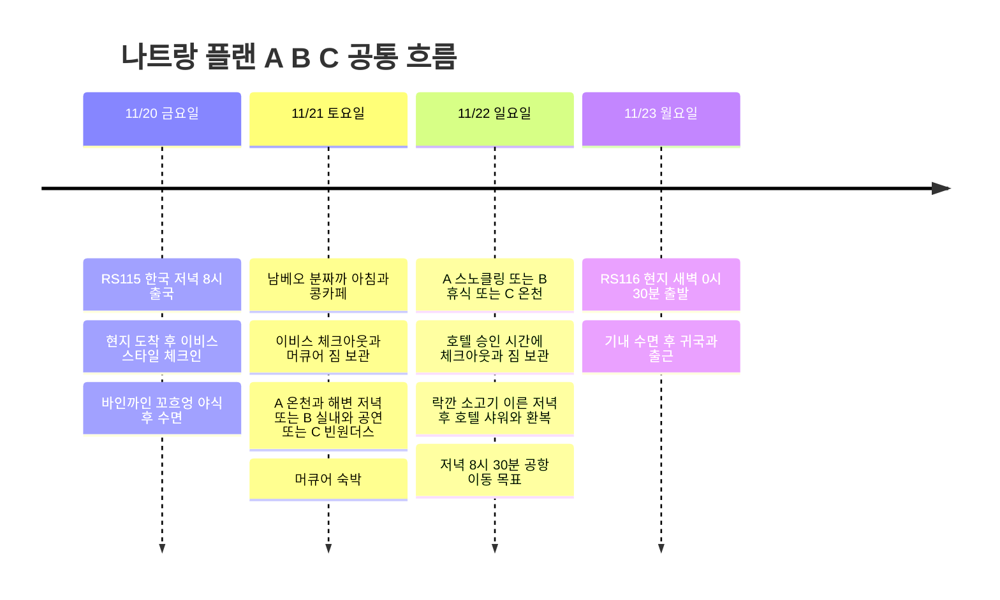

## 일정 요약

**20일 이비스 스타일 나트랑 1박 → 21일 머큐어 나트랑 1박 → 22일 저녁 호텔 샤워 → 23일 00:30 RS116 귀국 → 기내 수면 후 바로 출근**은 공통이다. 현지에서는 날씨·바다 상태·체력에 따라 아래 세 플랜 중 하나를 고른다. **기본 추천은 A**, 바다 상태가 나쁘거나 피곤하면 B, 놀이공원에 하루를 쓰고 싶으면 C다. 어느 플랜이든 **끼니마다 갈 식당을 정해 두어** 빈 시간 없이 먹고 쉬도록 짰다(아래 맛집 표).

항공편·호텔·비용·ALL 아코르 플래티넘 등급은 사용자 제공 정보다. 활동은 미예약 추천안이다. 마지막 날 별도 객실은 없고, 플래티넘 레이트 체크아웃과 퇴실 후 호텔 샤워를 요청할 계획이다. 실제 퇴실 시간·샤워 허용 여부는 호텔 확인 전이다. 한국 출국은 한국 시간, 나머지 관광·귀국편 출발은 베트남 현지 시간이다.

| 날짜 | 공통 일정 | 숙박·조건 |
|---|---|---|
| **11/20 금** | RS115 한국 20:00 출국 → 현지 23:30 도착 예정 → 이비스 체크인 → 바인까인 꼬흐엉 야식 → 수면 | 이비스 스타일 나트랑. 늦은 체크인 안내, 피곤하면 야식 생략 |
| **11/21 토** | 남베오 분짜까 아침·콩카페 → 이비스 체크아웃 → 머큐어 짐 보관 → 플랜 A·B·C 중 선택 | 머큐어 나트랑. C는 저녁 체크인, 호텔에 도착 예정 시각 전달 |
| **11/22 일** | 선택 플랜 진행 → 승인 시간에 체크아웃·짐 보관 → 락깐 소고기 이른 저녁 → 호텔 샤워·환복 | 저녁까지 쓰는 객실 없음. 늦은 오후는 시내 중심 |
| **11/23 월** | 현지 00:30 RS116 출발 → 기내 수면 → 한국 도착·출근 | 도착 공항·시각과 출근 연결 시간은 항공권 확인 |

## 일정 타임라인

## 어떤 플랜을 고를까

| 플랜 | 선택 조건 | 21일 토요일 | 22일 일요일 | 조절할 점 |
|---|---|---|---|---|
| **A · 바다와 온천** | 바다가 잔잔하고 운영사가 스노클링 진행·시야를 긍정적으로 안내, 체력 보통 이상 | 머드온천 → 호텔 휴식 → 루이지애나 해변 저녁 | 스노클링 → 레이트 체크아웃·카페 휴식 | 스노클링은 21·22일 중 바다가 나은 날로 교환 가능 |
| **B · 실내와 휴식** | 투어 취소·파도 큼·지속적인 비, 또는 도착 지연으로 피곤함 | 실내 카페·마사지 → 도 극장 공연 또는 실내 저녁 | 머드온천은 날씨가 허용할 때, 아니면 실내 식사·휴식 | 공연 회차 확인 필요. 온천은 야외여서 폭우·낙뢰 시 연기 |
| **C · 놀이공원과 케이블카** | 비·바람이 약하고 케이블카 정상 운행, 테마파크 선호·체력 충분 | 빈원더스 중심 하루 → 저녁 머큐어 체크인 | 머드온천 → 시내 점심·카페 | 스노클링을 생략하는 선택. 케이블카 중단·악천후면 B |

비 오는 아이콘만 보고 정하지 않는다. **스노클링은 강수보다 실제 파도·바람·수중 시야와 운영사의 출항 판단**, C는 케이블카와 원하는 시설의 당일 운영이 선택 기준이다. 11월은 우기이지만 현재 시점에 11/21~22의 실제 날씨를 확정할 수는 없다. [베트남 관광청 기후 안내](https://vietnam.travel/things-to-do/weather-and-climate-vietnam/)

## 플랜 A · 스노클링 + 머드온천 + 해변 저녁

**가장 추천하는 조합.** 바다 활동과 온천을 하루씩 나누고, 빈펄 하버 대신 시내 해변에서 식사와 음악을 즐긴다.

| 날짜·계획 시간 | 동선 | 조건·대체 |
|---|---|---|
| 21일 09:00~11:00 | 남베오 분짜까 아침 → 콩카페 → 이비스 체크아웃 → 머큐어 짐 보관 | 전날 도착이 늦으면 아침을 10시로 미루고 카페 생략 |
| 21일 11:00~14:30 | 넴느엉 당반꾸엔 점심(머드온천 가는 북쪽 길목) → 아이리조트 머드온천, 이동 포함 | 온천 이용은 2~3시간 정도 배정, 폭우·낙뢰 시 B |
| 21일 14:30~18:00 | 머큐어 체크인·샤워·낮잠 → 날씨 좋으면 해변 짧은 산책 | 체크인 가능 시각에 맞춰 조절 |
| 21일 18:30~21:30 | 루이지애나 브루하우스 저녁·맥주 → 원하면 라이브 음악 일부 | 공식 정기 안내는 금·토 20:30 시작. 11/21 실제 공연 확인, 피곤하면 식사 후 복귀 |
| 22일 07:30~14:00 전후 | 스노클링 투어 → 머큐어 복귀 | 운영·픽업·종료 시각·기상 취소 조건 확인 |
| 22일 14:00~16:15 | 투어에 점심이 없으면 하이프엉 반쎄오 → 허용 시간 내 객실 휴식 → 체크아웃·짐 보관 → 쩨 꼬하이 디저트 | 호텔 승인 시간이 투어 복귀 전이면 투어 출발 전에 체크아웃 |
| 22일 16:30 이후 | 아래 공통 귀국 준비 동선(락깐 이른 저녁부터) | 샤워·공항 이동 시간 유지 |

[루이지애나 공식 소개](https://louisianebrewhouse.com.vn/about-us/)의 금·토 라이브밴드 정기 안내를 반영했다. 음악은 21일 토요일의 선택지이며, 22일 일요일에도 같은 공연이 있다고 가정하지 않는다. 맥주를 마시지 않아도 저녁 식사로 이용하는 안이다.

[Angel Dive](https://www.angeldivevietnam.com/)는 두 포인트를 방문하는 07:30~14:00 스노클링 일정을 안내한다. 상품 후보일 뿐이며 11/22 실제 운영·머큐어 픽업과 복귀·가이드·장비는 확인 전이다. 이번 계획은 스노클링이며 스쿠버 체험으로 바꾸지 않는다.

**21일 바다가 더 좋으면 A의 날짜를 교환**한다. 20일 저녁까지 투어사와 21일 출항·예약 마감, 이비스 픽업·머큐어 하차 가능 여부를 확인하고, 21일 투어 출발 전에 이비스 체크아웃·짐 보관을 마친다. 짐은 이비스에 맡기고 복귀 후 회수해 머큐어로 옮기는 방법도 확인한다. 22일 오전에 머드온천을 가고 오후는 쉬면 된다. 20일 도착 후 즉석 예약이 가능하다고 가정하지 않으며, 수면이 부족하면 원래 A 또는 B를 유지한다.

## 플랜 B · 비 오는 날 실내·공연·휴식

스노클링을 무리해서 진행하지 않고, 날씨가 좋아지는 시간에만 야외 활동을 넣는 안이다. **도 극장 공연을 보려면 해당 날짜 회차가 판매되는지 먼저 확인**하고 이동한다.

| 날짜·계획 시간 | 동선 | 조건·대체 |
|---|---|---|
| 21일 오전 | 조식 → 이비스 체크아웃 → 머큐어 짐 보관 | 늦은 도착 후 충분히 수면 |
| 21일 11:00~14:00 | 응우옌로안 분사 점심 → 레인포레스트 실내 카페 → 호텔 체크인 | 잠깐 비가 멎고 시간 여유가 있으면 포나가르 사원 한 곳만 선택 |
| 21일 14:00~16:30 | 객실 휴식 또는 마사지 | 저녁 공연을 볼 체력을 남김 |
| 21일 저녁 | 예매한 회차의 도 극장 라이프 퍼펫 공연 → 하이프엉 반깐·반쎄오 저녁 → 쩨 꼬하이 | 공연 시각에 맞춰 식사 순서 조절. 회차 미판매·매진이면 식사와 카페로 대체 |
| 22일 09:00~12:30 | 가벼운 비이고 시설 정상 운영이면 머드온천 | 폭우·낙뢰·이동 통제 시 온천 생략, 실내 카페·마사지·식사 |
| 22일 12:30~16:15 | 넴느엉 당반꾸엔 점심 → 머큐어 복귀 → 승인 시간에 체크아웃·짐 보관 → 시내 휴식 | 체크아웃이 복귀 전이면 외출 전에 처리 |
| 22일 16:30 이후 | 아래 공통 귀국 준비 동선(락깐 이른 저녁부터) | 저녁 야외 일정 추가하지 않음 |

[도 극장 공식 공연 소개](https://www.lifepuppets.show/en/home)는 인형극과 라이브 음악을 결합한 라이프 퍼펫을 안내한다. **11/21 토요일 공연 시간·좌석은 아직 확인되지 않았다.** [공식 예매 달력](https://booking.dotheatre.vn/)에서 날짜를 선택한 뒤 확정한다. 고정된 18시 공연으로 일정에 잠그지 않는다. 극장은 시내 북쪽이라 왕복 차량을 고려하고, 폭우로 이동이 어려우면 시내에서 쉰다.

머드온천은 [아이리조트 공식 안내](https://www.i-resort.vn/dich-vu)상 매일 **08:00~17:30, 매표 종료 16:30**이다. 야외 시설이므로 비 오는 날 항상 가능한 실내 대안으로 보지 않는다. B에서도 머드온천을 우선하되, 여행 내내 악천후면 방문을 생략할 수 있다. 포나가르 사원은 날이 갰을 때 짧게 넣는 선택 관광이다. [베트남 관광청 시내 관광 안내](https://vietnam.travel/things-to-do/experience-nha-trang-like-a-local)

## 플랜 C · 빈원더스·케이블카 + 다음 날 머드온천

케이블카뿐 아니라 놀이기구·수족관·정원 등 테마파크를 즐기고 싶을 때 선택한다. **스노클링을 포기하고 테마파크에 하루를 쓰는 안**이므로 A와 C를 합쳐 모두 넣지 않는다.

| 날짜·계획 시간 | 동선 | 조건·대체 |
|---|---|---|
| 21일 08:30~10:00 | 조식 → 이비스 체크아웃 → 머큐어 짐 보관·늦은 체크인 안내 | 전날 수면이 부족하면 C 대신 A 또는 B |
| 21일 10:00~17:00 | 케이블카 → 빈원더스, 점심 포함 | 정상 운행·시설 운영 확인. 놀이기구·수족관·정원 중 원하는 구역부터 |
| 21일 17:00~20:30 | 체력이 남으면 섬에서 저녁·타타쇼 후 복귀. 일찍 나오면 꺼우다 선착장 근처 탄쓰엉 해산물 저녁 | 현재 공식 타타쇼 안내 19:30~20:10, 11/21 운영·복귀 교통 재확인 |
| 21일 귀환 후 | 머큐어 체크인·휴식 | 하버는 지나가며 보는 정도, 별도 일정 추가 없음 |
| 22일 09:00~12:30 | 머드온천 → 넴느엉 당반꾸엔 점심 | 폭우·낙뢰 시 B의 실내 휴식 동선으로 전환 |
| 22일 12:30~16:15 | 머큐어 복귀 → 레이트 체크아웃·짐 보관 → 쩨 꼬하이 또는 콩카페 | 객실 사용은 호텔 승인 시간까지 |
| 22일 16:30 이후 | 아래 공통 귀국 준비 동선(락깐 이른 저녁부터) | 마지막 날 섬 방문·저녁 공연을 새로 넣지 않음 |

[빈원더스 공식 안내](https://vinwonders.com/en/vinwonders-nha-trang/)의 현재 공원 운영 시간은 **09:00~20:00**이며 구역·공연별 시각은 다르다. 토요일에는 대기와 이동 여유를 두고, 원하는 시설과 당일 운영을 확인한다. 운영사가 강풍 등으로 케이블카를 중단하면 케이블카 경험을 전제로 한 C는 B로 바꾼다. 악천후에 대체 선박이 반드시 운항한다고 계산하지 않는다.

케이블카 정비 중단 공지는 **2026/10/26~11/10**이다. 여행은 그 이후지만 운행 재개와 당일 날씨를 확인한다. [공식 정비 공지](https://vinwonders.com/en/wonderpedia/news/notice-temporary-suspension-vinpearl-nha-trang-cable-car/)

## 맛집 · 끼니별로 꽉 채우기

나트랑에서 꼭 먹을 **분짜까(어묵 국수)·넴느엉(닌호아식 돼지고기 꼬치 쌈)·반깐·분사(해파리 국수)·락깐 소고기·바닷가 해산물**을 끼니마다 하나씩 배정했다. 식당은 출처 두 곳 이상에서 영업이 확인된 곳만 골랐다. 영업시간은 출처마다 다른 곳이 있어 **출발 1주 전 지도 앱에서 다시 확인**한다.

| 끼니 | 식당 | 무엇을 먹을까 | 위치·이동 | 1인 예산 |
|---|---|---|---|---|
| **20일 밤 야식** | **바인까인 꼬흐엉** | 바인까인 짜까 + 메추리알 | 74 Quang Trung, 이비스에서 그랩 3분. 밤 22시~새벽 3시 | 3만~4만 동 |
| **21일 아침** | **분까 남베오** | 분짜까, 바인까인 짜까 | 쩌담 시장 옆. 오전에 가야 줄이 짧음 | 3만~6만 동 |
| **21일 커피** | **콩카페** | 코코넛 커피 | 이비스에서 걸어서 2분 | 4.5만~7.5만 동 |
| **21일 점심 (A·C는 22일)** | **넴느엉 당반꾸엔** | 넴느엉 세트 | 남베오에서 걸어서 2분, 머드온천 가는 길목 | 6만~12만 동 |
| **21일 점심 (B)** | **분사 응우옌로안** | 분사, 분까 | 123 Ngô Gia Tự | 3.5만~6만 동 |
| **비 오는 날 카페 (B)** | **레인포레스트** | 스무디볼, 커피 | 146 Võ Trứ, 실내 | 4.5만~11.5만 동 |
| **21일 저녁 (A)** | **루이지애나 브루하우스** | 하우스 맥주, 해산물 | 머큐어에서 걸어서 2분, 해변 테라스 | 40만 동 이상 |
| **21일 저녁 (B)** | **하이프엉 반깐·반쎄오** | 해산물 반깐, 반쎄오 | 이비스에서 200m, 2층 에어컨 | 8만~10만 동 |
| **21일 저녁 (C)** | **탄쓰엉 해산물** | 게·새우·조개구이 | 꺼우다 선착장 근처 바닷가 | 30만~60만 동 |
| **디저트** | **쩨 꼬하이** | 모둠 쩨 | 27 Lê Quý Đôn | 1.2만~3.5만 동 |
| **22일 이른 저녁** | **락깐 소고기** | 숯불 양념 소고기, 오징어구이 | 머큐어에서 그랩 10분, 16:30 입장 | 15만~30만 동 |

- **마지막 날은 락깐 16:30 입장 → 18:00 출발**이다. 저녁 혼잡을 피하는 시간이고, 18:15 호텔 샤워·20:30 공항 이동까지 여유가 있다. 걸어서 가고 싶으면 하이프엉으로 바꾼다.
- **해산물은 주문 전에 무게당 가격을 확인**한다. 탄쓰엉뿐 아니라 쩐푸 거리 해산물 식당 전반에 적용한다.
- **넴느엉 당반꾸엔은 세트 단위로만** 판다. 둘 이상이면 한 세트에 다른 메뉴를 더한다.
- **바인까인 꼬흐엉과 쩨 꼬하이 좌표는 거리 기준 대략 위치**다. 지도 링크로 정확한 위치를 확인한다.
- **늦은 밤 대안:** 바인까인 꼬흐엉이 닫았으면 **미 지아 호아호아(Mì gia Hòa Hòa, 2 Hai Bà Trưng, 16:00~02:00)**의 완탕면. 분사는 **꽌 민(Quán Mịn, 170 Bạch Đằng)**도 후보다.

식당 정보는 [Vietnam Coracle 나트랑 음식 가이드](https://www.vietnamcoracle.com/nha-trang-food-guide/), [베트남 관광청 락깐 소개](https://vietnam.travel/node/1333), [칸호아성 관광 안내](https://dulichso.khanhhoa.gov.vn/en/article/lac-canh-grilled-beef-in-nha-trang-the-pinnacle-of-tiled-grill-cuisine-that-captivates-every-diner-e4d), [Foody 남베오](https://www.foody.vn/khanh-hoa/bun-ca-nam-beo-cho-dam/binh-luan), [베트남가이드 하이프엉](https://vietnamguide.co.kr/place/%EB%82%98%ED%8A%B8%EB%9E%91-hai-phuong/), [베트남가이드 탄쓰엉](https://vietnamguide.co.kr/place/%EB%82%98%ED%8A%B8%EB%9E%91-quan-hai-san-thanh-suong/), [Vinpearl 야식 안내](https://vinpearl.com/vi/an-dem-nha-trang)를 참고했다.

## 수영장·해수욕·민물 물놀이 후보

호텔 수영장도 여행의 주요 활동으로 둔다. **스노클링을 꼭 예약하지 않아도 이비스·머큐어 수영장과 날씨 좋은 날 짧은 해수욕으로 물놀이를 즐길 수 있다.** 아래 소요 시간은 운영 시간이 아니라 일정에 배정하는 계획값이다.

| 후보 | 추천도·배정 시간 | 어디에 넣을까 | 날씨·이용 조건 |
|---|---|---|---|
| **이비스 스타일 야외 수영장** | 높음 · 45~60분 | 21일 조식 전후, 체크아웃 전. 피곤하면 생략 | 야외라 낙뢰·강풍·운영 중단 시 이용하지 않음. 실제 운영 시간은 프런트 확인 |
| **머큐어 실내 수영장** | 가장 편함 · 1~2시간 | A의 투어 취소 시, B의 오후 휴식 또는 22일 오전 | 공식 안내는 매일 06:00~18:00. 체크아웃 후 이용은 별도 허용 확인 |
| **쩐푸 시내 해변** | 가까운 해수욕 후보 · 45~90분 | 스노클링 대신 22일 오전, 또는 21일 체크인 후 잠깐 | 입수 허용 구역·현장 깃발·구조요원 안내 확인. 높은 파도·적색 깃발·탁한 물이면 호텔 수영장 |
| **독렛 해변** | 여유가 있을 때 · 이동 포함 반나절 이상 | A의 스노클링 대신 선택, 머드온천은 다른 날 유지 | 시내 북쪽 약 40km로 소개되는 외곽 해변. 당일 바다 상태와 교통 확인, 얕은 해변이라는 설명이 안전을 보장하지 않음 |
| **바호 폭포·자연 웅덩이** | 조건부 · 이동·걷기 포함 반나절 | A의 스노클링을 대체하는 후보, 다른 외곽 활동과 겹치지 않음 | 시내 북쪽 약 25km. 동굴이 아닌 계곡·폭포. 최근·당일 강우, 상류 강우, 유량 증가·탁수·통제 시 수영 제외 |
| **양베이 폭포·온천** | 이번에는 후순위 · 이동 포함 반나절~하루 | 자연·온천을 더 원하면 21일 주요 활동을 대체 | 시내에서 약 40km. 입수 허용 구역·운영 확인 전이며 우천 시 계곡 물놀이 대안으로 쓰지 않음 |

[이비스 공식 안내](https://all.accor.com/hotel/9578/index.en.shtml)는 야외 수영장을, [머큐어 공식 수영장 안내](https://www.mercurenhatrangbeach.com/leisure/pools/)는 실내 수영장과 06:00~18:00 운영을 안내한다. 두 호텔 모두 숙박 중 이용하는 기본안이며, 퇴실 후 접근 권한은 별도 확인한다. 수영장 이용 때문에 추가 객실을 예약하지 않는다.

[쩐푸 해변 관광청 소개](https://vietnam.travel/things-to-do/experience-nha-trang-like-a-local/)와 [독렛 관광청 소개](https://vietnam.travel/things-to-do/nha-trang-best-beaches-sustainable-vacation/)를 참고했다. **배 투어가 취소될 만큼 바다가 거칠면 해수욕으로 자동 전환하지 않고 수영장으로 간다.** 외곽 해변은 돌아올 차량과 복귀 시각을 먼저 정하고, 22일에는 오후 일찍 시내로 돌아오도록 일정을 줄인다.

[바호 지역 공식 소개](https://ninhhoa.khanhhoa.gov.vn/vi/diem-den-du-lich-36/khu-du-lich-sinh-thai-ba-ho)는 계곡과 세 자연 웅덩이를 안내한다. 현재 개방 구간·수영 허용·가이드 여부는 확인 전이다. **11월에는 기본 추천보다 조건부 후보로 두고, 비가 온 뒤에는 제외한다.** 맑아졌어도 상류 강우·급류 위험을 확인하며, 입수와 바위 점프가 가능한 장소라고 단정하지 않는다. [양베이 관광청 소개](https://vietnam.travel/things-to-do/secret-waterfalls-and-springs-around-nha-trang/)는 폭포·온천과 약 40km 거리를 소개하고 추천 시기를 3~9월로 안내한다.

### 플랜 A·B·C에 수영을 넣는 방법

- **A 가벼운 물놀이 버전:** 21일 이비스 수영장 선택 → 호텔 이동·머드온천·해변 저녁, 22일 스노클링 대신 쩐푸 해수욕 또는 머큐어 수영장. 시내 해변도 거칠면 실내 수영장만 이용한다.
- **A 민물 버전:** 21·22일 중 날씨·유량·시설 허용이 확인된 날 오전 바호 반나절, 다른 날 머드온천. 스노클링·독렛·빈원더스를 추가하지 않는다. 조건이 맞지 않으면 머큐어 수영장으로 바꾼다.
- **B:** 비 때문에 바다 활동을 빼도, 호텔에서 이용 가능한 시간에 머큐어 실내 수영장 1~2시간을 넣는다. 체크아웃 후 이용이 허용되지 않으면 승인된 퇴실 시각 전에 마친다.
- **C:** 빈원더스에서 워터파크까지 즐기고 싶으면 21일 다른 구역을 줄이고 당일 운영을 확인한다. 22일은 온천과 휴식 중심이며, 호텔 수영은 체력이 남을 때만 한다.

**중요한 시간 조정:** 머큐어 수영장은 공식 안내상 18시에 닫으므로, 18:15 이후 샤워를 수영장 시설에서 할 수 있다고 가정하지 않는다. 호텔이 저녁 샤워를 허용하는 별도 시설·시각을 확인한다. 샤워 가능 시간이 18시 전뿐이면 **16:00~17:00 이른 저녁 → 17:00~18:00 샤워·환복 → 실내 휴식·짐 회수 → 20:30 공항 이동**으로 바꾼다. 수영장 마감 시각과 샤워실 이용 마감이 같은지도 확인한다.

## 토·일요일과 날씨에 따른 선택 조건

아래 운영 정보는 **2026-11-01 확인한 정기 안내**다. 11/21~22 개별 공연·행사·기상에 따른 실제 운영을 보장하지 않는다.

| 상황·요일 | 선택 기준과 행동 |
|---|---|
| **21일 토요일 저녁 · 비·바람이 약함** | A의 루이지애나 라이브밴드 후보. 정기 안내는 금·토 20:30, 해당 날짜 공연과 자리 확인 |
| **22일 일요일 저녁** | 루이지애나 정기 라이브 공연을 전제하지 않음. 이른 식사·샤워·공항 이동에 사용 |
| **맑고 전망이 좋음 · 루프톱을 원함** | 21일 저녁을 스카이라이트로 교체 가능. 공식 FAQ는 화~일 운영·월 휴무, 17시 개장. A에서 다음 날 투어를 고려해 오래 머물지 않음 |
| **해변에서 더 활기찬 저녁을 원함** | 21일 루이지애나 대신 세일링클럽. 야간 행사·입장 조건은 당일 확인, 두 곳을 연달아 방문하는 일정은 생략 |
| **약한 비·바다 잔잔함** | 운영사에 출항·파도·시야 확인 후 A 결정. 비가 약하다는 이유만으로 스노클링 가능하다고 판단하지 않음 |
| **맑지만 파도·바람이 큼** | 스노클링을 취소·변경하고 B. 케이블카도 별도 운행 확인, C를 자동 대안으로 선택하지 않음 |
| **지속적인 비·전망 흐림** | B 우선. 루프톱·해변 산책은 실내 카페·식사로 교체 |
| **폭우·낙뢰·강풍·현지 이동 제한** | 온천·섬·외곽 공연 이동 생략, 숙소 주변 실내 휴식. 공항 교통과 항공편 안내 확인 |
| **도착 지연·수면 부족** | 21일 오전은 수면·조식·호텔 이동만. 토요일 밤 공연·술자리보다 휴식 우선 |
| **일요일 투어 취소** | B의 카페·마사지·짧은 시내 관광으로 교체. 빈원더스 종일 방문으로 바꾸지 않음 |

[스카이라이트 공식 FAQ](https://skylightnhatrangclub.com/en/faq)는 화~일 운영, 월요일 휴무와 주말 예약 권장을 안내한다. 이번 일정에서 월요일은 귀국일이므로 방문은 21일 저녁 후보로 둔다. [세일링클럽 공식 안내](https://sailingclubnhatrang.com/)는 해변 식사·바 운영을 안내하며, 특정일 불쇼·DJ 시간은 별도 확인한다.

## 언제 플랜을 결정할까

| 시점 | 확인하고 정할 것 |
|---|---|
| **출발 3~5일 전** | 일기·해상 예보를 참고해 A·B·C 우선순위 선택. 투어 예약 마감·날짜 변경·기상 취소 환불 조건 확인 |
| **20일 출발 전** | 21일 스노클링으로 교환할 가능성이 있으면 투어사와 미리 조율. 공연·빈원더스는 취소 조건과 해당 날짜 운영 확인 |
| **21일 머큐어 도착 시** | 레이트 체크아웃 승인 시각, 22일 저녁 퇴실 후 샤워·짐 보관 확인. 투어 복귀 전에 퇴실해야 하면 출발 전 체크아웃으로 변경 |
| **21일 저녁** | 22일 투어사의 파도·시야·출항 안내 확인. 취소 시 B 동선으로 전환, 다음 날 최종 통보 시점 확인 |
| **22일 아침** | 운영사의 최종 출항 판단과 실제 컨디션으로 결정. 샤워·공항 이동 시간은 그대로 유지 |

현재 예보가 아닌 조건별 선택안이다. 출항 여부를 임의의 강수 확률이나 파고 수치 하나로 결정하지 않고 운영사·현지 통제를 따른다.

## 모든 플랜 공통 · 마지막 저녁 샤워와 귀국

**저녁 식사 후 마지막 샤워·환복을 마치고 곧바로 공항으로 이동한다.** 샤워 후에는 야외 관광을 더 넣지 않는다.

| 계획 시간 | 공통 동선 | 조건 |
|---|---|---|
| 16:30~18:00 | 락깐 소고기 이른 저녁(그랩 10분), 걸어서 가려면 하이프엉 | 외곽·섬에서 식사하지 않음 |
| **18:15~20:00** | **호텔 복귀·샤워·머리 말리기·출근복 환복·짐 회수** | **체크아웃 후 이용할 시설·시간은 호텔 확인 필요** |
| **20:30** | **머큐어에서 공항으로 출발 목표** | 픽업·교통 확인, 필요하면 더 일찍 출발 |
| **21:30** | **깜란공항 도착 목표** | 항공편 출발 약 3시간 전 |
| **23일 00:30** | **RS116 출발 → 기내 수면** | 한국 도착·회사 이동 시간은 별도 확인 |

공항 공식 안내의 시내 차량 이동 시간은 **45~60분**이다. 위 표는 계획값이며 실제 교통·항공사 수속 마감·변경 안내가 우선이다. [깜란공항 교통 안내](https://www.camranh.aero/en/airport-guide/transport/parking)

### 플래티넘 레이트 체크아웃과 출국 전 샤워

머큐어 나트랑 비치 공식 안내는 **체크인 14:00, 체크아웃 12:00**이며, 늦은 체크아웃은 호텔에 별도 문의하도록 되어 있다. **11/21 숙박만으로 11/22 저녁까지 객실을 쓸 수 있다고 계산하지 않는다.** [호텔 공식 FAQ](https://www.mercurenhatrangbeach.com/frequently-asked-question/)

사용자는 **ALL 아코르 플래티넘**이다. 추가 1박·데이유스 객실 예약 대신, 머큐어에 플래티넘 레이트 체크아웃을 요청하고 승인된 시간까지 객실을 이용한다. 퇴실 후에는 짐을 맡기고 카페·식사로 시간을 보낸 뒤, 공항 출발 전에 호텔로 돌아와 샤워·환복하고 짐을 찾는 동선이다. ALL 공식 안내상 레이트 체크아웃은 이용 가능 여부에 따르므로 특정 시각을 보장된 혜택으로 기록하지 않는다. [ALL 등급별 혜택](https://all.accor.com/loyalty-program/cards-status-benefits-details/index.en.shtml)

체크인할 때 **레이트 체크아웃 가능 시각, 짐 보관, 체크아웃 후 18:15~20:00 사이 샤워 가능 여부와 이용 시설·요금·수건·드라이어**를 함께 확인한다. 체크아웃 후 샤워는 플래티넘의 보장 혜택으로 가정하지 않고 호텔의 별도 허용 여부에 따른다. 호텔 샤워가 불가능하면 샤워 가능한 스파를 대안으로 확인하며, 추가 객실은 기본 일정에 넣지 않는다.

**출근용 옷·속옷·양말, 간단한 세면도구, 충전기**는 따로 꺼내기 쉽게 챙긴다. 젖은 수영복과 수건은 방수 주머니에 분리하고, 마지막 샤워 뒤에는 공항에서 쓸 물건만 남겨 짐을 닫는다.

## 예약·확인할 사항

- 머큐어 플래티넘 레이트 체크아웃 승인 시각, 짐 보관, 체크아웃 후 저녁 샤워 시설·시간·요금.
- A를 선택하면 21·22일 중 가능한 투어 날짜, 픽업 호텔·복귀·짐 보관, 출항·시야·취소 조건.
- B를 선택하면 도 극장 해당 날짜 회차·좌석. 폭우면 시내 식사·휴식으로 전환.
- C를 선택하면 케이블카 재개·당일 시설과 공연 운영, 머큐어 저녁 체크인 안내.
- RS115 현지 도착(23:30 예정)과 이비스 늦은 체크인, RS116 한국 도착·출근 연결 시간.
- 식당 영업시간은 출발 1주 전 지도 앱으로 재확인, 락깐은 일요일 16:30 자리 확인. 해산물은 무게당 가격 먼저 확인.

## 항공·숙박 비용

| 항목 | 이용 날짜 | 사용자 제공 금액 | 조건 |
|---|---|---:|---|
| 이비스 스타일 나트랑 | 11/20~11/21 · 1박 | 36,574원 | 호텔 이동은 11/21 |
| 머큐어 나트랑 | 11/21~11/22 · 1박 | 49,517원 | 플래티넘 레이트 체크아웃·퇴실 후 샤워 요청 예정, 추가 객실 없음 |
| RS115 · RS116 왕복 항공권 | 11/20 출국 · 11/23 귀국 | 192,560원 | **수하물 미포함** |
| **숙박 소계** | **2박** | **86,091원** | |
| **항공·숙박 합계** | | **278,651원** | 추가 현지 비용 제외 |

왕복 항공료는 한 건으로 기록해 중복 집계하지 않는다. 수하물 미포함은 사용자 제공 조건 그대로 기록하며, 기내 휴대 수하물의 별도 허용량은 항공권 조건을 확인한다. 편도별 항공료와 조식·예약처·결제수단은 미확인이다.

식비는 위 맛집 표 기준 **1인 약 80만~120만 동**(플랜 A, 루이지애나 저녁 포함)으로 잡았다. 스노클링·머드온천·케이블카·식비·공항 및 시내 교통·추가 수하물·샤워 이용에 별도 요금이 발생할 경우의 비용은 위 합계에 포함하지 않았다. 호텔 이용 날짜·비용·플래티넘 등급은 사용자 제공 정보다. 레이트 체크아웃과 퇴실 후 샤워는 호텔 확인 전이며, 활동도 확인·예약 전인 계획이다. 추가 객실 비용은 기본 예산에 넣지 않는다.
